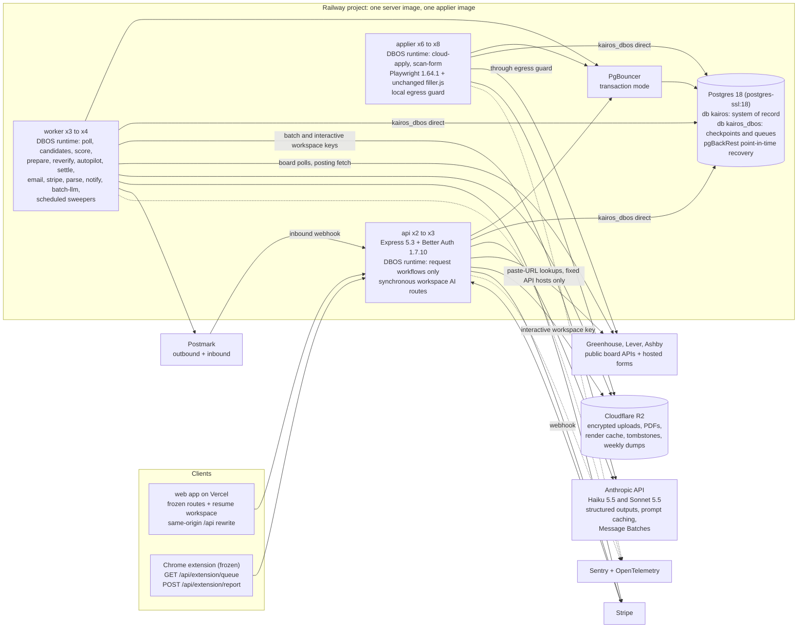

# Kairos backend architecture: ADR-001 and the target design

Revision 2, 2026-10-23. Status: Proposed, awaiting owner approval. This revision replaces the 2026-10-16 draft of this file, which selected the evolved monolith under an earlier judge scoreboard and assumed OpenRouter. It applies the final scoreboard (postgres-durable first, weighted 7.35) and the owner decisions of 2026-10-23 (Anthropic API only, Starter at 1,000 applications, freehire items F1 to F11, and the binding resume workspace contract).

Scope: the backend (`server/`), additive types in `shared/`, Railway and vendor configuration, and the backend routes and payloads that the new resume builder and tailor screens in `web/` consume. `extension/` is frozen and is not modified; `extension/dist/filler.js` stays the cloud applier's filler byte for byte. Every route, request shape, response shape, status code and error code that `web/lib/api.ts`, `web/hooks/*.ts` and `extension/src/lib/api.ts` use today stays backward compatible; new capabilities appear only as new routes or optional response fields.

Inputs read in full: the four option documents in `_options/`; the research files `as-built.md`, `requirements.md`, `openrouter.md`, `stack-options.md`, `integrations.md`, `cost-model.md`, `anthropic-models.md` and `huntr-tsenta-teardown.md` (including section 5, freehire); `docs/superpowers/specs/2026-10-23-resume-workspace/README.md` (sections 3, 6, 7 and 8 are binding); the zod schemas at the end of `shared/src/schemas.ts`; `shared/src/plans.ts`; the frozen client files; `extension/src/background.ts`; the current route list in `server/src/routes/`, `server/src/lib/errors.ts`, `server/src/middleware/rate-limit.ts`, `server/src/db/schema/profile.ts` and the migration `server/drizzle/0001_resume_workspace.sql` (which already adds `resumes`, `resume_revisions` and `jobs.source`). Ids such as FR-17, AC-7, NFR-4, INV-5 and OQ-9 come from `requirements.md`; D-xx, S-xx and P-xx from `as-built.md`; C-1 to C-10 from `cost-model.md`; F1 to F11 from section 5 of the teardown.

Skills applied: `engineering:architecture` (ADR structure, option tables, trade-off analysis), `architecture-decision-records` (MADR sections, honest consequences, reversibility, supersede rules), `senior-architect` (scaling and decision checklists), plus `dbos-typescript` as API reference for the chosen engine. All four loaded; the `senior-architect` helper scripts were not run because this step writes a specification, not code.

Evidence tags: **[V]** verified in a research file from vendor documentation; **[est]** an estimate derived in this document or the cost model, to be replaced by beta measurements; **[verify]** a behavior the design depends on that a named spike must prove before the phase that needs it.

How to read this document:

- **Part A** is the decision record (ADR-001): context, options, decision, consequences, how every judge must-fix for the winner is resolved, which ideas are grafted from the other options, and how each owner decision of 2026-10-23 lands.
- **Part B** is the target architecture that the downstream specifications implement: diagrams, stack, processes, the durable execution engine, the application lifecycle and state machine, Autopilot, matching, the resume workspace backend, the agent runtime, the data model outline, cross-cutting concerns, cost and capacity, migration, risks and the invariant map.
- **Part C** fixes the inventories (data domains, workers, agents) that drive the rest of the plan.

---

## Part A. ADR-001: Backend architecture for the paid beta and 10,000 users

### A.1 Record

| Field | Value |
|---|---|
| Status | Proposed. It becomes Accepted when the owner approves the spec README |
| Date | 2026-10-23 (revision 2; revision 1 dated 2026-10-16 is superseded in full) |
| Deciders | Owner (Gray Matter Labs); chief architect step of the spec workflow |
| Supersedes | The skeleton's implicit architecture in `docs/02-trd.md` ("Backend", "Data flow"); revision 1 of this file |
| Related | `cost-model.md` (volumes and token counts, still binding); `anthropic-models.md` (model per agent and prices, binding); the resume workspace README sections 3, 6, 7 and 8 (binding contract); downstream specs `02-*` onward implement Part B and must not contradict Part C |
| Reversibility | High for the durable engine (every engine call sits behind `server/src/durable/`, so a pg-boss swap is a one-folder change); medium for the data model (additive migrations only); none for the frozen HTTP contracts |

### A.2 Context

1. **The skeleton is evidence, not a constraint.** Seven flows are verified end to end: polling, fit gate, tailoring, review, approve, extension and cloud submit, single charge. One TypeScript codebase runs three Railway entry points (api, worker, applier) on Postgres with Drizzle 0.45 and BullMQ 6 on Redis.
2. **The skeleton has high-severity defects.** No semantic truth lock (D-01), truth lock over unconfirmed facts (D-03), fact edits that silently confirm (D-05), approval before tailoring (D-07), a racy credit check (D-08), no claim lease and duplicate employer submits (D-09), failed applications never resent (D-10), applications stuck in `submitting` (D-12), approve-then-enqueue not atomic (D-13), Stripe events recorded before they are handled (D-14), and an O(new jobs x users) scoring loop (S-01).
3. **Locked decisions of 2026-10-15** (still in force unless superseded): full re-architecture with an explicit migration path; size for about 10,000 users at public beta with pre-ranking, per-user caps, cost alarms and horizontally scalable workers; pipeline agents with versioned prompts, strict schemas, a model choice and an eval set, orchestrated deterministically, with an independent verifier and no open-ended loops; the Huntr x Tsenta combination (decision 5).
4. **Owner decisions of 2026-10-23 that change the design:**
   - A. **Anthropic API only** (`@anthropic-ai/sdk`, Claude models). OpenRouter routing, provider fallbacks and model slugs are gone. Haiku 5.5 is the default model, Sonnet 5.5 is used for verifier escalations and interactive builder AI, Opus 5.5 and Fable 5.1 never run in production. Fallback is retry, then one tier up, never another provider. Two consequences shape this design: there is **no embedding model** on the Anthropic API, and the verifier can **no longer come from a different model family** than the drafter.
   - B. **Starter is 1,000 applications per 30 days** (weekly 234, quarterly 3,000). Starter quarterly at full use, $45 / 3,000 = **$0.015 per application**, is now the lowest revenue per application any plan earns.
   - C. **freehire items F1 to F11 are adopted**: deterministic match score, ghost-job signal, fact provenance, revisioned resume edits, an append-only application event ledger with reminders, saved-search digests, paste-a-URL ATS detection, ATS adapter porting (phase 2), bounded interview rehearsal, Typst ATS-safe templates, and a per-feature daily AI allowance that refuses rather than degrades.
   - D. **The web resume workspace is built now against a fixed contract**: seven routes with exact request, response and error shapes; the base resume is a `resumes` row validated by `resumeSchema` with F4 revisions; tailored edits live in the application draft; one ATS-safe template that the server PDF renderer reproduces; typed notes become unconfirmed user-asserted facts; imported jobs reuse `jobs` and `matches` with source `manual_url`; the F1 score fills `band` and `categories`.
   - **Autopilot** (hands-off sending) is an opt-in user mode under strict guards; approval before send stays the default.
5. **Cost.** The TRD target is about $0.01 of model and compute per submitted application (NFR-4). Anthropic list prices plus a Sonnet-backed builder raise the modeled cost from the cost model's $0.0035 to about **$0.0076** (section B.12). It still meets $0.01 and stays at 51% of the lowest revenue per application.
6. **Frozen clients.** `web/lib/api.ts` turns any non-2xx response into an `ApiError` that shows the server `message` and exposes `code`; `extension/src/lib/api.ts` turns any non-2xx into `api_<status>` and never retries a report. The extension only sends when the user presses send in its side panel (`queue:send` in `extension/src/background.ts`), so hands-off sending is possible only through the cloud applier.
7. **One operator.** A solo developer builds and runs the backend. Moving parts, pages at 3 a.m. and debugging time are real costs.
8. **Privacy.** Resumes, work authorization and replies are sensitive under the India DPDP Act 2023 and GDPR. Job descriptions, form questions and emails are untrusted input.

### A.3 Decision drivers

Hard constraints (an option that fails one is out):

- Every invariant in the task survives with a named enforcing mechanism (section B.16).
- The frozen HTTP contracts hold; the resume workspace contract is implemented exactly.
- All-in cost per submitted application stays under $0.01 at 10,000 users with the cost model's volumes and Anthropic prices.
- No new third party holds personal content without a data processing agreement.

Weighted drivers, as used by the judges:

| Driver | Weight | What it measures |
|---|---|---|
| Scale and cost | 0.3 | Cost per submission, headroom at 10,000 users, path to 50,000 |
| Reliability | 0.3 | Invariants under crashes, retries, duplicates and ambiguous submits; liveness |
| Security and privacy | 0.2 | Isolation, least privilege, data sent to providers, erasure, prompt-injection surface |
| Operability and migration | 0.2 | Solo on-call load, moving parts, migration length and safety |

### A.4 Options considered

Per-lens scores are the judges' scores out of 10.

| Option | Scale and cost | Reliability | Security and privacy | Operability and migration | Weighted |
|---|---|---|---|---|---|
| **postgres-durable** (DBOS Transact in Postgres) | 7.5 | 8.0 | 6.5 | 7.0 | **7.35** |
| evolved-monolith (BullMQ behind a transactional outbox) | 7.0 | 7.0 | 6.0 | 8.0 | 7.00 |
| workflow-engine (Temporal Cloud) | 6.0 | 7.7 | 7.5 | 4.0 | 6.41 |
| event-services (bounded contexts on a Postgres event log) | 5.5 | 5.5 | 8.0 | 3.0 | 5.50 |

#### Option 1: postgres-durable

| Dimension | Assessment |
|---|---|
| Complexity | Medium. DBOS Transact is a library inside the existing processes; approval is row state; Redis removed |
| Cost | $0.0046 stated on OpenRouter models; lowest compute line ($512 a month) because there is no Redis, no outbox relay and no engine fee |
| Scalability | Postgres is the single hot component (checkpoints plus application writes); partitioned queues give per-user and per-ATS-host fairness natively |
| Team familiarity | Low: DBOS is new to the team and has moved quickly between major versions |

Pros: one store and one failure domain (no dual write, no outbox), approval as a plain row state, engine-native fairness and rate limits, exactly-once database effects through datasource transactions, a browser replay guard that is independent of the engine.
Cons as drafted: DBOS recovery on Railway unproven; checkpoints persisting unverified drafts; no database roles; a deferred O(ledger) trigger on the charge path that can roll back the charge for an application the employer already received; a 120-second unbound extension claim; ambiguous cloud outcomes lumped into `failed`; no Autopilot or decision 5 design. Every one of these is resolved in A.8.

#### Option 2: evolved-monolith

| Dimension | Assessment |
|---|---|
| Complexity | Low to medium; keeps BullMQ and adds an outbox, reconcilers and a matching pipeline |
| Cost | $0.0048 stated; Redis with `noeviction` is a hard stop on the way to 50,000 users |
| Scalability | Redis carries queue load off Postgres; fairness by job shape |
| Team familiarity | Highest |

Pros: continuity, the safest migration, the best spend-shaping levers (demand budget, back-pressure, degradation order). Cons: two stateful stores, about 600 lines of relay and reconcilers the team owns, weak isolation as drafted, a state-changing GET resend link, rejected genuine reports from non-lease sessions.

#### Option 3: workflow-engine (Temporal Cloud)

| Dimension | Assessment |
|---|---|
| Complexity | High: fourteen workflow types, determinism and patching discipline, outbox to Temporal, payload codec |
| Cost | $0.0058 at list price; the engine alone is $0.0018 per submission and grows linearly to about $5,000 a month at 50,000 users |
| Scalability | Lowest Postgres load |
| Team familiarity | Low |

Pros: the best-designed submit protocol (attempt phases, `submit_seen`, decision table, `needs_check`, acknowledged resend, late confirmation), the applier database role, the reconciler table, ids-only encrypted payloads. Cons: dual write returns, a new sub-processor, a 30-day parked workflow per application, about $1,000 a month at list.

#### Option 4: event-services

| Dimension | Assessment |
|---|---|
| Complexity | Highest: six contexts plus core, a hand-built bus, service JWTs, up to eight deployables |
| Cost | $0.0041 restated at the growth case |
| Scalability | Push-direction prefilter; bus re-platform near 57,000 users |
| Team familiarity | Low; about 20 engineer-weeks |

Pros: the strongest isolation (role per context, scoped keys, erasure tracking), atomic credit reservation, approval-time facts hash, kill switches. Cons: an asynchronous cross-context charge that can be dead-lettered, a bus reader any long transaction can stall, the longest path to a paid beta.

### A.5 Trade-off analysis

The judges' gaps fall into two kinds: gaps of **shape** (stores, engine, vendor, deployables) that no graft can remove, and gaps of **missing controls** that any option can adopt.

| Gap | Kind | Options affected | Closable by graft? |
|---|---|---|---|
| No database roles; applier holds broad credentials; checkpoint contents; deletion reach | Missing control | postgres-durable, evolved-monolith | Yes (B.10.4, B.5.6, B.11.5) |
| Thin handling of ambiguous submits; no late confirmation; unbound extension claim | Missing control | postgres-durable, evolved-monolith | Yes (B.6.6 to B.6.9) |
| Model roster and enrichment overspend | Missing control | postgres-durable, evolved-monolith | Yes, and moot under decision A (B.9, B.12) |
| Two stateful stores and an owned relay | Shape | evolved-monolith | No |
| DBOS recovery and checkpoint volume on the one primary | Shape | postgres-durable | Partly: retired by a hard spike gate, an orphan sweeper, ids-only steps, coarse steps and a measured write budget; the engine stays a one-folder swap |
| Per-action vendor fee, determinism discipline, a new sub-processor | Shape | workflow-engine | No |
| Hand-built bus, cross-context charge, eight deployables, 20 weeks | Shape | event-services | No |

Once the missing controls are grafted, the remaining differences are shape differences. postgres-durable's shape is the smallest: one store, no relay, no Redis, no engine fee, approval as row state. Three facts from the 2026-10-23 decisions strengthen it further:

1. **Autopilot needs one actor-aware approval transaction** that evaluates every guard under the per-user lock and enqueues the send in the same durable unit. In postgres-durable that is one datasource transaction followed by a checkpointed enqueue; in the evolved monolith it needs the outbox; in Temporal it needs signals plus the outbox.
2. **Decision A removes embeddings.** Without an embedding model, postgres-durable's pgvector store, its PITR-on-custom-image risk and its split vector service disappear; the database becomes Railway's standard Postgres 18 with managed point-in-time recovery [V].
3. **The resume workspace is mostly synchronous request work** (CRUD, deterministic scoring, one model call plus verification, PDF rendering). It needs no engine at all, so engine choice affects only the pipeline flows, where DBOS's checkpointed steps and partitioned queues fit best.

The close second, the evolved monolith (7.00), was considered for an override and not chosen: its one decisive advantage, team familiarity, is bought with a second stateful store and owned relay code, and its spend-shaping levers are portable (they are grafted in B.7). The DBOS risks are real, so the decision carries a **hard gate**: spike S-D1 must pass in week 1, and every engine call stays behind `server/src/durable/`, so that pg-boss 12.38.0 with a typed state machine is a one-folder fallback.

### A.6 Decision

**We adopt option postgres-durable, hardened with every must-fix in A.8 and the grafts in A.9.** No override: the top weighted option wins.

In the context of a pre-launch, solo-operated, fit-first job application agent with frozen clients, a Claude-only model policy, opt-in Autopilot and a $0.01 cost ceiling, facing high-severity money and duplicate-send defects and an O(jobs x users) scoring loop, we decided for one TypeScript codebase with three process types (api, worker, applier) that run DBOS Transact durable workflows and queues checkpointed into Postgres, Postgres 18 as the only stateful store, a pre-ranked matching pipeline driven by deterministic scores before any model call, and an Anthropic agent runtime with a deterministic claims check and an independent verifier role, and against an outbox in front of BullMQ, a hosted workflow engine and bounded-context services, to achieve one failure domain, exactly-once money effects in database transactions, native per-user and per-host fairness and the shortest safe path to a paid beta, accepting that DBOS is young (gated by spike S-D1 with a pg-boss fallback), that checkpoints share the primary until a measured trigger moves them, and that the verifier shares the drafter's model family (mitigated in B.9.6).

The decision fixes these points for every downstream specification:

1. **Postgres 18 on Railway (`postgres-ssl:18`) with pgBackRest point-in-time recovery is the only stateful store.** Database `kairos` holds every business fact; database `kairos_dbos` on the same server holds DBOS checkpoints and queues. No Redis, no vector store.
2. **DBOS Transact 5.3.0 is the durable execution engine**: one DBOS application named `kairos` with three process types that dequeue only their own queues (`listenQueues`), datasource transactions for every money and status effect, deterministic workflow ids as idempotency keys, ids-only step inputs and outputs.
3. **Approval is row state.** No workflow waits for a human. Short request workflows on the api write state and enqueue follow-up work; long human gaps live in `applications.status`.
4. **One `approveCore(tx, actor, request)` function** serves the user's approve route, the resend route and Autopilot, under one per-user lock with one global lock order.
5. **Matching pre-ranks deterministically before any model call**: SQL superset prefilter on deterministic hint columns, the unchanged `passesHardFilters`, the ghost gate, the F1 deterministic match score with a floor, per-plan caps, a demand budget, then Claude Haiku 5.5 fit scoring of `GatePassed` pairs only.
6. **Twelve pipeline agents on the Anthropic API** behind one gateway module: Haiku 5.5 by default, Sonnet 5.5 for verifier escalation, the interactive resume writer and interview rehearsal; strict structured outputs, prompt caching, the Batch API for latency-free work, per-call ceilings, daily envelopes, per-user spend caps and per-feature allowances.
7. **The truth lock has three layers** for every resume line, answer, cover-letter paragraph and builder suggestion: deterministic id ownership and confirmation, deterministic `checkClaims` containment, and the independent `claim-verifier` role with Sonnet escalation.
8. **The resume workspace contract is implemented exactly**, with F1, F3, F4, F7, F10 and F11 behind it and a Typst renderer that reproduces the section 8 template.

### A.7 Consequences

What becomes easier:

- Money and duplicate-send correctness live in Postgres constraints, triggers and row locks that tests prove on a real database; the engine affects liveness, never correctness.
- A crash between "write the row" and "enqueue the follow-up" cannot lose work: both are steps of one checkpointed workflow.
- One store to back up, restore, erase and secure; no queue memory to size; no relay to own.
- Per-user and per-ATS-host fairness, rate limits and priorities are queue settings, not hand-written code.
- Cost is measured per call in `llm_calls` and bounded at six layers (B.11.2).

What becomes harder:

- DBOS is new to the team; its recovery on Railway, its versioning rule and its retention API must be learned and proven (spike S-D1, runbooks).
- Checkpoint writes share the primary; a write budget per workflow type is monitored and a measured trigger moves the system database out.
- The verifier is the same model family as the drafter; independence comes from role separation, deterministic checks, a stronger escalation model and a shadow audit rather than a different vendor.
- Without embeddings, pre-ranking is lexical and requirement-based; its recall must be proven against the scorer (spike S-F1).

What we will revisit, and when:

| Revisit | Trigger (measured) | Action |
|---|---|---|
| Durable engine | S-D1 fails, or more than 2 orphaned-workflow incidents in a month that the sweeper did not heal within 15 minutes | Swap `server/src/durable/` to pg-boss 12.38.0 with the typed state machine already defined by `draft_state` and attempt phases |
| Second Postgres for checkpoints and telemetry | Primary CPU above 60% for 7 days, or DBOS checkpoint writes above 400 per second sustained, or 25,000 registered users, whichever comes first | Move `kairos_dbos`, `llm_calls`, `llm_cost_daily` and `metrics_minute` to an "ops" Postgres instance |
| Read replica | `/api/matches` or `/api/applications` read p95 above 300 ms with primary CPU above 70% for a week | Railway read replica for GET routes |
| Embeddings for pre-rank and fact retrieval | F1 pre-rank recall below 0.85 against scorer labels (S-F1) for two consecutive weekly evals | In-process local embeddings (transformers.js, no new provider) or Voyage AI after owner approval as a new sub-processor |
| Split worker into services | One queue family needs more than 4 replicas or a different image | Second Railway service from the same image with a narrower `WORKER_QUEUES` list |
| Learned ranker (Python) | At least 50,000 labeled (match, user action) pairs and a measured precision gap | Python ranking service behind a 150 ms timeout with fall-through to F1 |
| Applier autoscaling | Peak concurrent contexts vary more than 3x week over week | Queue-depth-driven replica changes through the Railway API |
| DBOS Conductor | `listWorkflows` triage takes more than 2 hours a week | Buy Conductor ($99 a month) only after its metadata-only mode is verified |

### A.8 How every judge must-fix for the winner is resolved

| Id | Lens | Must-fix | Resolution | Where |
|---|---|---|---|---|
| SC-1 | Scale and cost | Model roster overspends (scorer on `gpt-6-luna`; Sonnet-5 escalation at $0.0109 per call, 39% of spend with the verifier) | Decision A replaces the roster: scorer on Haiku 5.5 ($0.00021 per call); escalation on Sonnet 5.5 with `max_tokens` 400, `effort: "low"`, **uncertain claims only**, capped at 15% of the day's drafts (alert at 10%); the deterministic `checkClaims` containment check runs before the verifier and drops number, entity, skill and URL inventions for free | B.9.2, B.9.6, B.12.1 |
| SC-2 | Scale and cost | Enrichment is eager (11,000 calls a day) | Lazy: `jd-analyst` runs only for a job that survived the SQL prefilter, `passesHardFilters` and the ghost gate for at least one user, once per job version, by claim-or-wait; the same card serves F1, the scorer, the workspace and every user | B.7.6 |
| SC-3 | Scale and cost | DBOS write amplification on the shared primary; no write budget; no plan to move tables | Coarse steps (one step per 25 polled companies, one step per scoring chunk, one generate-and-verify step per draft) cut checkpoint writes to about 37 per submitted application, 8.7 per second on average at growth; a per-workflow-type write budget is published and monitored; the measured trigger in A.7 moves `kairos_dbos` and telemetry tables to a second Postgres before 25,000 users | B.5.7, A.7 |
| SC-4 | Scale and cost | No PgBouncer because of LISTEN/NOTIFY; 146 of 200 connections growing with replicas | Application pools (including the DBOS datasource) go through PgBouncer in transaction mode; only DBOS system-database pools and their listener connect directly; 108 server connections at growth against `max_connections = 200` | B.4.2 |
| SC-5 | Scale and cost | `credit_ledger_nonnegative` is an O(ledger) deferred trigger on the charge path | Removed. `credit_balances(balance, in_flight)` is maintained by O(1) triggers (ledger insert adjusts `balance`; application status change adjusts `in_flight`), locked `FOR UPDATE` by approve, charge and grant; no `CHECK (balance >= 0)`, so a real submission is always recorded; nightly reconciliation against `SUM(delta)` and a recount of in-flight rows | B.6.4, B.10.3 |
| SC-6 | Scale and cost | Headroom at peak is thin (score 1.2x, prepare 1.4x, applier 1.0x) | `score` concurrency 24 (2x peak), `prepare` 32 (1.9x), applier 6 replicas x 4 contexts at base and 8 x 4 at growth (1.5x); concurrencies tied to the Anthropic rate-limit request in B.12.4; Autopilot sends smoothed by `delaySeconds` and a per-user hourly cap | B.4, B.6.3, B.12.4 |
| SC-7 | Scale and cost | Decision 5 has no cost lines | `jd-analyst` folded into the shared enrich-once job card; F1 match score deterministic (no model); `resume-writer` metered by a per-feature daily allowance; renders cached by content hash; paste-URL intake counts against `dailyScoringCap` and its own allowance; Autopilot smoothed by `autopilotDailySendCap` from `plans.ts`; every line priced in B.12 | B.7, B.8, B.12 |
| RL-1 | Reliability | Extension claim is 120 seconds and not session-bound | 10-minute **session-bound visibility lease** inside the frozen `GET /api/extension/queue`; a genuine `submitted` report is always recorded and charged once, from any session, even after the lease expired; explicit claim and release routes ship for a future extension release | B.6.6 |
| RL-2 | Reliability | Ambiguous cloud outcomes lumped into `failed` | Attempt phases with a `submit_seen` marker written by a Playwright route handler outside the filler; a settlement decision table; `needs_check` attempt state with failure code `unconfirmed`; resend only with explicit acknowledgement; late confirmation `failed` to `submitted` charges once | B.6.7, B.6.8 |
| RL-3 | Reliability | The deferred non-negative trigger can roll back a real report | Trigger removed (SC-5); negatives are prevented upstream by the approval lock and detected downstream by an hourly invariant check | B.6.9 |
| RL-4 | Reliability | DBOS recovery unproven; no wrapper; sweepers missing | Spike S-D1 (50 forced crashes across all three process types, a rolling deploy with pending workflows, executor identity, version rule, retention) is a **hard gate** before any traffic moves; all engine calls behind `server/src/durable/`; `dbos-orphan-recovery` resumes workflows of dead executors; state reconcilers re-derive missing work from business rows | B.5.5, B.5.8 |
| RL-5 | Reliability | No Autopilot design | One `approveCore(tx, actor)` used by the user route, resend and Autopilot; every Autopilot guard evaluated under the same per-user lock; failure-spike pause driven by `submission_attempts` per user and globally | B.6.3, B.6.4 |
| SP-1 | Security | Checkpoints persist unverified drafts in system databases the deletion path does not reach | Step inputs and outputs carry ids, counts and hashes only; drafting, verification and storage of verified content happen inside one step, so unverified text never reaches a checkpoint; errors carry codes only; a CI test seeds PII and scans every `kairos_dbos` table after the pipelines run; `kairos_dbos` retention is 2 to 14 days | B.5.6 |
| SP-2 | Security | No database roles; the applier holds credentials that reach the ledger, sessions and every user's facts | Five application roles; the applier can read one view and execute five `SECURITY DEFINER` functions and nothing else; `UPDATE` and `DELETE` on the ledger revoked from every runtime role; separate system-database credentials per process type | B.10.4 |
| SP-3 | Security | One credential leak exposes everything; no column encryption | Per-process roles with statement timeouts; AES-256-GCM application-layer encryption for resume source text, uploaded files, inbound email bodies and sensitive profile answers under a key held only by api and worker; sensitive answer values blanked from terminal applications after 7 days | B.11.5 |
| SP-4 | Security | Erasure within PITR | Privacy notice states the backup window (about 28 days with Railway's 4 full backups); every deletion writes an R2 tombstone that the restore runbook replays | B.11.5 |
| SP-5 | Security | Decision 5 surfaces (paste-URL SSRF, untrusted file parsing, export links, Autopilot injection) | Paste-URL never fetches the user's URL: strict parsers map it to a board token and posting id, then only fixed ATS API hosts are called; uploads parsed in a resource-capped worker thread with page, size, entry-count and time limits; no public share links (authenticated download, 5-minute presigned URLs for the extension only); Autopilot requires verifier pass with a verifier that never sees the job description, the sensitive-question re-check at approval, and a deterministic injection canary on the job | B.8.6, B.11.5, B.6.3 |
| SP-6 | Security | 2% prompt-body sample in R2 holds fact text | No prompt or completion bodies are stored anywhere; samples are rebuilt from Postgres using ids stored on the `llm_calls` row | B.9.8 |
| OM-1 | Operability | DBOS spike must pass; the wrapper must be real | Same as RL-4; `server/src/durable/` exposes `startRequestWorkflow`, `enqueue`, `runTx`, `runStep`, `sleep`, `listStuck`; a lint rule forbids importing `@dbos-inc/*` anywhere else | B.2, B.5 |
| OM-2 | Operability | Version pinning toil | One rule: `applicationVersion` is a constant changed only on an incompatible workflow change; ordinary changes use `DBOS.patch()`; a CI check compares a hash of workflow sources with the recorded version; on a bump, a sweeper forks non-terminal old-version workflows onto the new version from step 1 (all workflows are state-conditional) | B.5.5 |
| OM-3 | Operability | Connection budget tight without a pooler | PgBouncer for application pools (SC-4); budget test under load in phase P1 and P8 | B.4.2 |
| OM-4 | Operability | Builder, tailor, JD analysis and Autopilot not designed; must be row-state flows | All of them are row-state flows or synchronous routes; no long-lived workflow anywhere | B.6, B.8 |

The judges also listed one gap that applied to all four options (decision 5 and Autopilot). It is closed by SC-7, RL-5 and SP-5 above.

### A.9 Grafts from the other options

Adopted:

| Idea | From | Used in |
|---|---|---|
| Attempt phases (`claimed`, `navigating`, `filling`, `submit_seen`, `reported`) with a route handler writing `submit_seen` before `route.continue()`; settlement decision table; `needs_check`; acknowledged resend; late confirmation | workflow-engine | B.6.7, B.6.8 |
| Settlement reads the attempt row, never the step result; the applier role writes only attempts through functions | workflow-engine | B.6.7, B.10.4 |
| Database guard on legal status transitions; ledger sign `CHECK`; one-free-grant unique index; balance row with no `CHECK (balance >= 0)` | workflow-engine | B.10.3 |
| Deterministic `checkClaims` before the verifier | workflow-engine | B.9.6 |
| `GatePassed` branded type plus a gateway spy test | workflow-engine | B.7.5 |
| Lazy enrichment after the gate; cohort cadences | workflow-engine, event-services | B.7.3, B.7.6 |
| The reconciler check list; ids-only payloads with a seeded-PII scan; `ops_audit` and a read-only support role | workflow-engine | B.5.8, B.5.6, B.10.4 |
| A published coordination-layer unit metric per submitted application | workflow-engine | B.5.7 |
| Demand budget, pause on unacted matches, plan-priority scoring, back-pressure under backlog, spend degradation order | evolved-monolith | B.7.4, B.11.3 |
| Hard-filter reasons computed on demand, never stored per pair | evolved-monolith | B.7.1 |
| Process-kill chaos test as the acceptance bar for the engine | evolved-monolith (adapted from FLUSHALL) | B.14 (P2 exit) |
| Session-bound visibility lease; `skipped[]` optional field on approve; submit never retried; per-ATS extension-only switch above a 30% challenge rate | evolved-monolith | B.6.4, B.6.6, B.6.8 |
| Phase 0 recorded contract suite; per-feature flags; alert table; add-later trigger table | evolved-monolith | B.14, B.11.4, A.7 |
| "Sent / never sent" table per agent; failure screenshots only when no personal field is visible; sign-up abuse controls | evolved-monolith | B.9.5, B.11.5 |
| Approval-time `facts_snapshot_hash` check | event-services | B.6.4 |
| Verifier never sees the job description; shadow week before enforcement; weekly shadow audit of 2% of supported claims by the escalation model | event-services | B.9.6 |
| Kill switches and a documented shedding order | event-services | B.11.3 |
| Erasure tracked per store with a page after 24 hours | event-services | B.11.5 |
| A counter of in-flight credits kept atomically next to the balance (adapted: maintained by a status trigger instead of six code paths) | event-services | B.6.4 |
| Separate keys per process class (here: Anthropic workspaces) | event-services | B.9.1 |
| Measured split triggers instead of up-front splits | event-services | A.7 |
| Partitioned queues for per-user and per-host fairness; approval as row state; browser replay guard written outside the checkpoint; Stripe event row in the same transaction as its effects; offer pause only on a rule-tagged offer with a 48-hour undo | postgres-durable (kept) | B.5.3, B.6, B.6.11 |

Considered and not adopted:

| Idea | From | Why not |
|---|---|---|
| Transactional outbox and relay | evolved-monolith, workflow-engine | DBOS checkpoints make "write then enqueue" one durable unit; an outbox would duplicate the engine |
| One parked workflow per application for up to 30 days | workflow-engine | A row is the natural durable form of "waiting for a human"; parked workflows cost storage, pin versions and count against concurrency |
| `approval_id` minted at approval and required by the claim | workflow-engine | `attempt_no` plays the same role: every approval increments it, and the claim requires `status = 'approved'` and `attempt_no = n`, the number that approval wrote, so a stale or forged enqueue cannot send |
| Event bus, eight deployables, cross-context RPC | event-services | Shape gaps (A.5) |
| Per-user wrapped data keys stored in Postgres | event-services | Keys in the same database are in the same backups; a key outside Postgres plus backup expiry and tombstone replay is honest |
| pgvector embeddings for pre-rank and retrieval | all four | No embedding model on the Anthropic API (decision A); F1 and full-text search replace them; trigger in A.7 |
| Cross-family verifier | all four | Impossible under a Claude-only policy; replaced by the mitigations in B.9.6 |
| Redis for rate limits or caches | evolved-monolith, workflow-engine | Postgres counters handle 25 to 150 requests per second |
| Letting `POST /api/applications/approve` accept `failed` ids as a resend | workflow-engine | Changes a frozen route's semantics; resend uses a new route and a signed link |
| Python service at launch | event-services | No measured need (trigger in A.7) |

### A.10 How each owner decision of 2026-10-23 lands

| Decision | Where it lands | Notes |
|---|---|---|
| A. Anthropic API only, model per agent | B.9 (gateway, roster, caching, Batch, escalation), B.12 (costs) | Haiku 5.5 for 9 agents; Sonnet 5.5 for `claim-verifier-escalation`, `resume-writer` and `interview-coach`; Opus 5.5 only for offline eval grading; Fable 5.1 never. Fallback: SDK retries, then one tier up for interactive and verification agents, deferral for batch agents. No embeddings (A.9) |
| B. Starter 1,000 per 30 days | B.7.4 (caps sized from `applicationsPerCycle`), B.12.3 (floor $0.015) | `dailyScoringCap` and `dailyModelSpendCapUsd` are derived from each plan's allowance so full use is possible |
| C. F1 deterministic match score | B.7.7, B.8.4 | Pre-rank before the Haiku scorer and the workspace Job match; no model |
| C. F2 ghost-job signal | B.7.8 | Gate skips `likely`; Autopilot skips `possible` and `likely`; evidence shown |
| C. F3 fact provenance | B.8.2, B.10.2 | `facts.asserted_by` and `facts.employment_id`; new `employments` table |
| C. F4 revisioned edits | B.8.2 | `resume_revisions` with reasons, snapshot before AI runs, restore route |
| C. F5 application event ledger and reminders | B.6.12 | `application_events` (append-only), `reminders`, reply-driven stage |
| C. F6 saved-search digests | B.7.10 | `saved_searches`; hourly digest scheduler; email only |
| C. F7 paste-URL ATS detection | B.8.6 | Strict parsers, fixed API hosts, review queue for unknown boards |
| C. F8 ATS adapter porting | B.14 phase 2 | After public beta; public JSON or HTML boards only; no Workday submit |
| C. F9 bounded interview rehearsal | B.8.9 | Bound to a submitted application, 8 questions per session, metered per plan |
| C. F10 Typst ATS-safe templates | B.8.7 | One template now (`kairos-single-v1`), `atsSafe` flag, template field for later |
| C. F11 per-feature daily allowance | B.8.10 | Refused, never degraded; one status code (429 `rate_limited`) because the binding web contract names it |
| D. Resume workspace contract | B.8 | Seven routes implemented exactly, plus `GET /api/resume/pdf` from README section 7.3 |
| Autopilot | B.6.3, B.6.4 | Opt-in; Pro and Max send hands-off through the cloud applier; Starter pre-approves into the extension queue; Free has none |

---

## Part B. Target architecture

### B.1 System overview



| Component | Process | Responsibility | State it owns | Scales by |
|---|---|---|---|---|
| HTTP API | `api` (`server/src/api.ts`) | Every frozen route with unchanged shapes; the resume workspace routes; new additive routes; Better Auth; Stripe and Postmark webhooks; short request workflows that write state and enqueue follow-up work; the synchronous verifier on `PATCH /api/applications/:id`; signed-link confirmation pages | None | Replicas (stateless) |
| Worker | `worker` (`server/src/worker.ts`) | Every non-browser queue and every scheduled workflow: polling, candidate generation, scoring, the prepare pipeline, re-verification, Autopilot approval, settlement, Stripe and inbound email processing, resume parsing, notifications and digests, Batch API jobs, sweepers, reconcilers, monitors | None | Replicas; DBOS `workerConcurrency` per queue; `WORKER_QUEUES` lets a later service take a subset |
| Cloud applier | `applier` (`server/src/applier.ts`) | `cloud-apply` and `scan-form` queues: the attempt protocol around the unchanged `filler.js`, challenge detection, form scans, the local egress guard | None | Replicas of one browser with 4 contexts each |
| Agent runtime | Library `server/src/agents/` and `server/src/llm/` | Agent registry, versioned prompts, strict schemas, the only Anthropic client, budgets, allowances, cost rows | None | With the calling process |
| Durable engine | Library `server/src/durable/` over DBOS Transact 5.3.0 | Workflow and queue registration, the only importer of `@dbos-inc/*`, executor heartbeats, orphan recovery, version rule | Checkpoints in `kairos_dbos` | With the calling process |
| Postgres | Railway `postgres-ssl:18` | Database `kairos` (business state, ledger, `llm_calls`) and database `kairos_dbos` (DBOS system tables) | All state | Vertical to 8 vCPU and 32 GB; measured triggers in A.7 |
| PgBouncer | Railway service | Transaction pooling for application pools | None | One replica |
| R2 | Cloudflare | Encrypted resume uploads, tailored PDFs, the render cache, failure snapshots, deletion tombstones, weekly encrypted logical dumps | Files | n/a |

### B.2 Code layout and module boundaries

One package, `server/`, organized as a modular monolith.

```
server/src/
  api.ts  worker.ts  applier.ts  migrate.ts   entry points (names unchanged)
  app.ts                                       Express app (middleware order unchanged)
  routes/                                      frozen routes, workspace routes, new routes: parse, authorize, call one module function
  modules/
    identity/       Better Auth config, sign-up hook, abuse limits, deletion hook
    profile/        resume profiles, uploads, facts (provenance), employments, preferences, saved answers, encryption of raw sources
    resume/         resumes, revisions, default document builder, truth lock for documents, PDF rendering (Typst), render cache
    catalog/        companies, ATS adapters (kept), polling, upsert, hints, injection canary, ghost evidence, URL intake, form questions
    matching/       passesHardFilters (kept, pure), gate, eligibility, F1 match score, candidate generation, pacing, digests
    applications/   state machine, prepare pipeline, approveCore, Autopilot, leases, resend, withdraw, events and reminders
    submission/     recordOutcome, extension report, cloud attempts, settlement, sweepers
    billing/        ledger, balances, Stripe, rollover, offer pause, reconciliation
    inbox/          inbound email, forwarding verification, classification, linking, reply-driven stage
    coaching/       interview rehearsal sessions
    reports/        outcome report, priority polling
  agents/           registry.ts, <agentId>/{spec.ts, schema.ts, prompts/v<N>.md}
  llm/              gateway.ts, prices.ts, budget.ts, allowance.ts, fence.ts, claims.ts (checkClaims), batch.ts, drift.ts
  durable/          dbos.ts (config, launch), queues.ts, workflows/<name>.ts, version.ts, recovery.ts (the engine seam)
  applier/          browser-pool.ts, egress-guard.ts, attempt.ts, challenge.ts, apply-endpoints.ts, scan.ts
  lib/              env, errors, logger, db (pg + Drizzle), telemetry, flags, crypto, signed-links, rate-limit
server/templates/kairos-single-v1/            template.typ, meta.json, fonts/ (Inter, OFL)
server/evals/<agentId>/cases.jsonl
server/test/contract/                          recorded frozen-client and workspace calls, replayed on every build
```

Boundary rules, enforced by an import-path lint rule in CI:

1. A module talks to another module only through that module's `index.ts` exports.
2. A workflow in `durable/workflows/` holds sequencing only: it validates its ids-only input, calls module functions as steps or datasource transactions, and enqueues follow-up workflows. Business rules live in modules.
3. Only `durable/` imports `@dbos-inc/*`. This is the engine seam: replacing DBOS with pg-boss touches this folder only.
4. Only `llm/gateway.ts` imports `@anthropic-ai/sdk`.
5. Only `modules/billing/ledger.ts` inserts into `credit_ledger`; the database also revokes `UPDATE` and `DELETE` on it from every runtime role (B.10.4).
6. Only `modules/submission/record-outcome.ts` changes an application to `submitted`, or to `failed` from a report.
7. Only `modules/applications/approve-core.ts` changes an application from `draft` or `failed` to `approved`.
8. Heavy step implementations (Playwright, Typst, file parsers) are imported lazily inside the step, so every process can register every workflow for recovery without loading browser or parser code.

### B.3 Stack per layer

Versions are those read from the npm registry on 2026-10-15 in `stack-options.md`, from `server/package.json`, or from vendor documentation, unless marked [verify]. Every npm dependency is pinned to an exact version in `package.json` (no caret ranges) and the lockfile is committed. Container images are pinned by digest at build time.

| Layer | Choice | Version | Why, and what it replaces |
|---|---|---|---|
| Runtime | Node.js LTS | 22.18.x (`node:22.18-slim`) | One runtime for every process. Move to Node 24 LTS in Q1 2027, before Node 22 end of life on 2027-04-30 |
| Language and build | TypeScript, ESM, esbuild bundle per entry point (`server/build.mjs`, kept) | TypeScript 5.9.3, esbuild 0.28.2 | Kept |
| HTTP framework | Express | 5.3.0 | Kept. Peak load is about 150 requests per second; the frozen clients depend on its status codes, bodies and parsing |
| Security headers | helmet | 8.3.0 | Kept |
| Validation | zod | 4.6.7 | Kept. `z.toJSONSchema` also produces the JSON schemas sent as Anthropic structured outputs, so one schema per agent serves both |
| Auth | Better Auth, every `@better-auth/*` package pinned as a set | 1.7.10 | The clients call its routes, cookies, bearer plugin and one-time token directly. `session.cookieCache` and database-backed rate-limit storage enabled (option names verified in spike S-B1) |
| Durable execution | DBOS Transact for TypeScript (`@dbos-inc/dbos-sdk`) | 5.3.0 | Checkpointed workflows and steps, partitioned queues with per-partition concurrency and rate limits, priorities, deduplication, delayed enqueue, durable sleep, scheduled workflows, all in Postgres, MIT, no service to run [V]. Replaces BullMQ 6 and Redis |
| Transactions in workflows | `@dbos-inc/drizzle-datasource` over `pg` | 5.3.0 | `runTransaction` commits application writes and the step's completion record together, so money and status effects are exactly-once [V] |
| Fallback engine (not installed) | pg-boss | 12.38.0 | Documented one-folder swap if spike S-D1 fails (B.5.9) |
| ORM | drizzle-orm, drizzle-kit | 0.45.4, 0.31.11 | Kept. Raw SQL through `drizzle-kit generate --custom` for partitions, triggers, roles and functions |
| Postgres driver | pg (node-postgres) | 8.23.1 | Replaces postgres.js 3.4.9: the DBOS datasource requires `pg`, so the application uses one driver and one pooling model |
| Database | PostgreSQL on Railway's `postgres-ssl:18` image with pgBackRest point-in-time recovery; extensions `pg_trgm` (contrib) | Postgres 18 | Railway-managed PITR: weekly full and daily differential backups, about 4 weeks of range, restore to a new service [V]. No pgvector, so no custom image. `pg_trgm` availability on this image is confirmed in spike S-P1 |
| Connection pooler | PgBouncer, transaction mode | 1.24.x, pinned by image digest [verify exact tag] | Application pools only; DBOS system-database pools and listeners connect directly |
| Rate limiting | rate-limiter-flexible, `RateLimiterPostgres` on an unlogged table | 11.2.2 | Replaces per-process `express-rate-limit` (S-09); shared across replicas, no Redis |
| LLM access | `@anthropic-ai/sdk` | Exact version pinned from the npm registry at phase P1 start, at least two weeks old, recorded in the lockfile [verify] | The only provider (decision A). Structured outputs through `output_config.format`, prompt caching with `cache_control`, Message Batches for latency-free work. No agent framework |
| PDF rendering | Typst CLI, invoked as a child process with JSON input | 0.13.1 [verify: newest 0.x that passes the template golden tests at phase P3] | F10. One ATS-safe template that reproduces the web print template exactly; real text layer; about 100 to 300 ms per page |
| PDF and DOCX text extraction | unpdf, mammoth | 1.9.0, 1.13.0 | Pure JavaScript, no native dependencies; used for uploads (including LinkedIn profile PDFs) and the PDF text round trip |
| Object storage | Cloudflare R2 via `@aws-sdk/client-s3`, `@aws-sdk/s3-request-presigner` | 3.1152.0 | No egress fee, presigned URLs, prefix deletes per user |
| Browser | playwright-core with `mcr.microsoft.com/playwright:v1.64.1-noble` | 1.64.1 | One browser per replica, 4 contexts, recycled every 25 contexts |
| Cryptography | `node:crypto` (AES-256-GCM, HMAC-SHA256) | Node standard library | Raw-source encryption, signed links, user hashes |
| Email | postmark | 5.1.0 | Kept |
| Payments | stripe | 23.0.0 | Kept |
| Logging | pino, pino-http | 10.4.0, 11.0.0 | Kept; redaction extended to URLs, bodies and model payloads |
| Errors and traces | `@sentry/node`, `@opentelemetry/sdk-node`, `@opentelemetry/auto-instrumentations-node` | 11.8.0, 0.223.0, 0.81.0 | Metadata-only traces; Sentry owns the OpenTelemetry provider; DBOS workflow and step spans through its OpenTelemetry hooks |
| Tests | vitest, supertest, testcontainers with `@testcontainers/postgresql` | 5.0.5, 7.3.1, 12.2.1 | Invariants are tested on a real Postgres 18 with DBOS running |

Removed by the end of the migration: `bullmq`, `ioredis`, `express-rate-limit`, `postgres` (postgres.js), the Redis service. Deliberately not added, each with a trigger in A.7: Kubernetes, a service mesh, Kafka or NATS, a vector store, embeddings, an agent framework, Langfuse, a feature-flag vendor, DBOS Conductor, Python.

### B.4 Processes and how each scales

"Base" is the cost model's 2,000-company case; "growth" is 10,000 companies. Both have 10,000 registered users and 2,850 users eligible for scoring on a typical day.

#### B.4.1 Process table

| Process | Start command | DBOS queues it dequeues (`listenQueues`) | Replicas base / growth | Size (limit) | Scale signal and action | Secrets it holds |
|---|---|---|---|---|---|---|
| api | `node dist/api.js` | None (request workflows run on the replica that starts them) | 2 / 3 | 0.5 vCPU, 0.75 GB | p95 latency above 300 ms or CPU above 70%: add a replica | Better Auth secret, Stripe keys, Postmark token, `ANTHROPIC_KEY_INTERACTIVE`, role `kairos_api`, `kairos_dbos` credential `dbos_api`, R2 token (uploads read-write, renders read-write), `DATA_KEKS`, `LINK_SIGNING_KEY` |
| worker | `node dist/worker.js` | `poll`, `candidates`, `score`, `prepare`, `reverify`, `autopilot`, `settle`, `email`, `stripe`, `parse`, `notify`, `batch-llm` | 3 / 4 | 1 vCPU, 1.5 GB | `prepare` p95 wait above 2 minutes, `score` waiting above 5,000, or oldest due poll more than 5 minutes late: add a replica | `ANTHROPIC_KEY_BATCH`, `ANTHROPIC_KEY_INTERACTIVE`, Stripe keys, Postmark token, role `kairos_worker`, `dbos_worker`, R2 token, `DATA_KEKS`, `LINK_SIGNING_KEY` |
| applier | `node dist/applier.js` | `cloud-apply`, `scan-form` | 6 / 8 | 2 vCPU, 4 GB | `cloud-apply` waiting above 30 for 10 minutes, or p95 approve-to-start above 10 minutes: add a replica | Role `kairos_applier` only, `dbos_applier`, R2 token scoped to read `resumes/` and write `applier-failures/`; no model key, no Stripe key, no data key |
| postgres | `postgres-ssl:18` | n/a | 1 | base 4 vCPU, 8 GB, 100 GB; growth 4 vCPU, 16 GB, 150 GB | CPU above 70% for a week or connections above 80%: resize, then the A.7 triggers | n/a |
| pgbouncer | Railway service | n/a | 1 | 0.25 vCPU, 0.25 GB | `cl_waiting` above 0 for one minute: alert | n/a |

Scheduled workflows are registered (`DBOS.registerScheduled`) only in the worker entry point, so only worker replicas start them; DBOS runs each scheduled interval exactly once across replicas [V]. Every process registers every workflow function so that any process can resume any workflow during recovery (rule 8 in B.2 keeps heavy code out of processes that do not run it).

#### B.4.2 Connection budget at growth

| Client | Pools | Connections |
|---|---|---|
| api application pool, through PgBouncer | 3 replicas x 10 | 30 client |
| worker application pool including the DBOS datasource, through PgBouncer | 4 x 12 | 48 client |
| applier application pool, through PgBouncer | 8 x 2 | 16 client |
| PgBouncer server pools | `kairos_api` 15, `kairos_worker` 25, `kairos_applier` 4 | **44 server** |
| api to `kairos_dbos`, direct | 3 x (pool 3 + 1 listener) | 12 |
| worker to `kairos_dbos`, direct | 4 x (pool 5 + 1 listener) | 24 |
| applier to `kairos_dbos`, direct | 8 x (pool 2 + 1 listener) | 24 |
| Migrations, admin, read-only | | 4 |
| **Postgres server connections in use** | | **108 of `max_connections = 200`** (1.85x headroom) |

`max_connections = 200` is set on the Railway Postgres service (start parameter; confirmed in S-P1). DBOS system-database pool sizes come from env (`DBOS_SYS_POOL_SIZE`). The budget is load-tested in phases P1 and P8; an alert fires at 80%.

### B.5 Durable execution with DBOS Transact

#### B.5.1 Rules

| Rule | Meaning |
|---|---|
| D1 Postgres decides | Business state lives in `kairos` tables. A workflow is a hint: its first step is a conditional read or claim, and zero rows means the work is done or no longer wanted, so the workflow ends as a no-op |
| D2 Write and follow-up are one durable unit | A route that changes state and needs follow-up work runs as a short request workflow: step 1 is a datasource transaction, then the workflow body enqueues the follow-up with a deterministic workflow id. A crash between the two resumes at the enqueue |
| D3 Deterministic ids | Every workflow id is derived from the entity and its attempt or revision (B.5.4), so a duplicate start returns the existing workflow and a duplicate enqueue is ignored |
| D4 Ids-only data | Workflow inputs, step outputs and thrown errors carry ids, enums, counts and hashes only (B.5.6) |
| D5 Approval is row state | No workflow waits for a human. Waits longer than 10 minutes are rows plus scheduled sweepers |
| D6 The irreversible step runs at most once | The browser step runs with `retriesAllowed: false` and a replay guard written outside the checkpoint (B.6.7); ambiguity is settled from the attempt row, never by retrying |
| D7 Short workflows | Request workflows finish in under 5 seconds; pipeline workflows in under 10 minutes (`timeoutMS` set on every start); the cloud apply in under 8 minutes |
| D8 Coarse steps | A step is the unit of retry and of checkpoint cost; loops over many external calls run inside one step and are made idempotent by the database (B.5.7) |
| D9 Drain on deploy | `SIGTERM` stops dequeuing, waits up to 30 seconds for steps in flight (the applier up to 170 seconds); Railway drain time is 60 seconds for api and worker, 180 seconds for the applier |

#### B.5.2 One DBOS application, three process types

All three processes run one DBOS application named `kairos` against one system database, `kairos_dbos`, on the same Postgres server as `kairos`. Each process dequeues only its own queues through `listenQueues` [V], so the applier never pulls scoring work and the worker never needs Chromium. Enqueueing across process types is an ordinary `DBOS.startWorkflow(fn, { queueName })` from the workflow body; no `DBOSClient` hop is needed.

```ts
// server/src/durable/dbos.ts (specification-level code)
import { DBOS } from "@dbos-inc/dbos-sdk";
import { WORKFLOW_SET_VERSION } from "./version";
import { queuesFor, type ProcessRole } from "./queues";

export async function launchDurable(role: ProcessRole): Promise<void> {
  DBOS.setConfig({
    name: "kairos",
    systemDatabaseUrl: env.DBOS_SYSTEM_DATABASE_URL,        // direct, not through PgBouncer
    applicationVersion: WORKFLOW_SET_VERSION,                // constant, see B.5.5
    executorID: `${env.RAILWAY_SERVICE_NAME}:${env.RAILWAY_REPLICA_ID}`, // unique per replica [verify env names in S-D1]
    listenQueues: queuesFor(role),                           // api: [], worker: worker queues, applier: applier queues
  });
  registerAllWorkflows();                                    // every process registers every workflow (B.2 rule 8)
  if (role === "worker") registerSchedules();                // schedules only on the worker
  await DBOS.launch();
  startExecutorHeartbeat(role);                              // B.5.5
}
```

#### B.5.3 Queue catalog

| Queue | Dequeued by | Options | Enqueued by | Priority |
|---|---|---|---|---|
| `poll` | worker | `partitionQueue: true` (key = ATS API host), `partitionConcurrency: 4`, `workerConcurrency: 4` | `pollTick` schedule | priority companies 10, others 50 |
| `candidates` | worker | `concurrency: 4`, `workerConcurrency: 2` | `candidateTick` schedule; preference save; first resume parsed | Max 10, Pro 20, Starter 30, Free 40 |
| `score` | worker | `partitionQueue: true` (key = user id), `partitionConcurrency: 1`, `concurrency: 24`, `rateLimit: { limitPerPeriod: 1200, periodSec: 60 }`, `priorityEnabled: true` | `candidatePage` | Max 10, Pro 20, Starter 30, Free 40; backfill +5 |
| `prepare` | worker | `partitionQueue: true` (user id), `partitionConcurrency: 2`, `concurrency: 32`, `workerConcurrency: 8`, `priorityEnabled: true` | `queueMatch` request workflow; retry route; Autopilot | user-initiated 10, Autopilot 50 |
| `reverify` | worker | `concurrency: 8` | `PATCH` with verifier unavailable; approval with changed facts; cut-over | 20 |
| `autopilot` | worker | `partitionQueue: true` (user id), `partitionConcurrency: 1`, `concurrency: 8` | `scoreUser` (match at or above the Autopilot bar); `prepareApplication` (draft ready) | none |
| `cloud-apply` | applier | `partitionQueue: true` (key = ATS apply host), `partitionConcurrency: 8`, `workerConcurrency: 4`, `rateLimit: { limitPerPeriod: 240, periodSec: 60 }`, `priorityEnabled: true` | `approveApplications`, `resendApplication`, `autopilotApprove` | user-approved Max 10, Pro 20; Autopilot 40 (with `delaySeconds`, B.6.3) |
| `scan-form` | applier | `workerConcurrency: 1`, `concurrency: 4` | `prepareApplication` for Lever and Ashby jobs without `form_questions` | none |
| `settle` | worker | `concurrency: 8` | `applyCloud` final step; `leaseSweeper` | none |
| `email` | worker | `concurrency: 8` | `ingestInboundEmail` request workflow | none |
| `stripe` | worker | `partitionQueue: true` (key = Stripe customer id), `partitionConcurrency: 1`, `concurrency: 4` | `ingestStripeEvent` request workflow; `billingReconcile` | none |
| `parse` | worker | `workerConcurrency: 1`, `concurrency: 4` | resume paste and upload routes (request workflow) | none |
| `notify` | worker | `concurrency: 4` | sends: Autopilot hourly email, digests, reminders, resend offers, receipts | none |
| `batch-llm` | worker | `concurrency: 2` | backfill scoring, nightly re-scores, catalog re-analysis | none |

#### B.5.4 Workflow catalog

| Workflow | Type | Started by | Workflow id (idempotency key) | Steps (each ids-only) | Timeout |
|---|---|---|---|---|---|
| `queueMatch` | request (api) | `POST /api/matches/:id/queue` | `queue:<matchId>` | tx: company cap, insert draft `ON CONFLICT (user_id, job_id) DO NOTHING`, match `queued`, event `drafted`; then enqueue `prepareApplication` | 5 s |
| `prepareApplication` | queue `prepare` | `queueMatch`, retry route, Autopilot | `prepare:<applicationId>:<revision>` | tx `loadAndPlan`; step `ensureFormQuestions` (child `scanForm` on the applier when needed); step `generateAndVerify`; step `renderPdf`; tx `markReady`; enqueue `autopilotApprove` when Autopilot applies | 10 min |
| `reverifyDraft` | queue `reverify` | `PATCH` fallback, approval facts change, cut-over | `reverify:<applicationId>:<rowVersion>` | step `reverifyAndStore`; tx `markReady` or record drops | 5 min |
| `approveApplications` | request (api) | `POST /api/applications/approve` | `approve:<sha256(userId, sorted ids, channel, minuteBucket)>` | tx `approveCore(actor = user)`; enqueue `applyCloud` per cloud id | 5 s |
| `resendApplication` | request (api) | `POST /api/applications/:id/resend`, signed link POST | `resend:<applicationId>:<attemptNo + 1>` | tx `approveCore(actor = user, mode = resend)`; enqueue `applyCloud` when cloud | 5 s |
| `autopilotApprove` | queue `autopilot` | `scoreUser`, `prepareApplication` | `autopilot:<applicationId>:<revision>` or `autopilot-queue:<matchId>` | tx `queueMatch` body when starting from a match; or tx `approveCore(actor = autopilot)`; enqueue `applyCloud` with a delay | 2 min |
| `applyCloud` | queue `cloud-apply` | approve, resend, Autopilot | `apply:<applicationId>:<attemptNo>` | step `claim` (SQL function); step `precheck`; step `runBrowser` (`retriesAllowed: false`); step `recordResult` (SQL function); enqueue `settleAttempt` | 8 min |
| `scanForm` | queue `scan-form` | `prepareApplication` | `scan:<jobId>:<parserVersion>` | step `scanAndStore` (browser, SQL function) | 3 min |
| `settleAttempt` | queue `settle` | `applyCloud`, `leaseSweeper` | `settle:<attemptId>` | tx `recordOutcome` by the decision table; step notify (receipt, Autopilot notification row) | 2 min |
| `pollTick` | scheduled, every 60 s | worker | DBOS schedule id | tx claim due companies (`next_poll_at`); enqueue one `pollBatch` per 25 companies of one ATS host | 1 min |
| `pollBatch` | queue `poll` | `pollTick` | `poll:<host>:<firstCompanyId>:<epochMinute>` | step `pollCompanies` (conditional GETs, upserts, hints, canary, closes; idempotent by the database) | 5 min |
| `candidateTick` | scheduled, every 5 min | worker | schedule id | tx select due users by cohort; enqueue `candidatePage` per 100 users | 1 min |
| `candidatePage` | queue `candidates` | `candidateTick`, preference save | `cand:<tickEpoch>:<cohort>:<page>` or `backfill:<userId>:<prefsVersion>` | step `prefilterAndGate`; step `ensureJobCards` (lazy `jd-analyst`); step `prerankAndPace` (F1, caps, demand budget); enqueue `scoreUser` per user | 5 min |
| `scoreUser` | queue `score` | `candidatePage` | `score:<userId>:<runId>` | step `scoreChunk` per 5 pairs (calls and writes in one transaction each); enqueue `autopilotApprove` for Autopilot-eligible new matches | 5 min |
| `batchScore`, `batchAnalyze` | queue `batch-llm` | backfill, nightly re-score, catalog re-analysis | `batch:<agent>:<batchKey>` | step submit to Message Batches; durable `DBOS.sleep` and step poll (at most 26 hours); step apply results | 27 h |
| `ingestInboundEmail` | request (api) | Postmark webhook | `mail:<MessageID>` | tx store row (body encrypted); enqueue `classifyEmail` | 5 s |
| `classifyEmail` | queue `email` | `ingestInboundEmail`, reconciler | `classify:<inboundEmailId>` | step rules, then `reply-classifier` for the remainder; tx link, stage, events, offer-pause candidate | 2 min |
| `ingestStripeEvent` | request (api) | Stripe webhook | `stripe-in:<eventId>` | tx insert `stripe_events` (`received`); enqueue `processStripeEvent` | 5 s |
| `processStripeEvent` | queue `stripe` | `ingestStripeEvent`, reconciler | `stripe:<eventId>` | step refetch from Stripe; tx effects plus `status = 'processed'` | 10 min |
| `parseResume` | queue `parse` | resume paste and upload routes | `parse:<resumeProfileId>:<sourceHash8>` | step `parseAndStore` (decrypt, extract in a capped worker thread, redact, `resume-parser`, insert unconfirmed facts and employments) | 3 min |
| `notify` | queue `notify` | many | `notify:<kind>:<entityId>` | step send with `email_sends` written first | 2 min |
| Sweepers and monitors | scheduled | worker | schedule ids | B.5.8 and B.11.4 | 2 to 10 min |

Synchronous routes that need no workflow (each is idempotent by the database and returns its result directly): the resume workspace routes (B.8), `PATCH /api/applications/:id`, `POST /api/extension/report` (one transaction through `recordOutcome`), `GET /api/extension/queue` (lease), withdraw, Autopilot settings, saved searches, rehearsal turns.

#### B.5.5 Executor identity, recovery and versioning

**Executor identity.** Each replica uses `executorID = <service>:<replicaId>`, which changes on every redeploy [V: Railway replica ids change]. DBOS recovers a process's own pending workflows at launch; workflows owned by replicas that no longer exist are recovered by the worker's `dbos-orphan-recovery` schedule:

1. Every process upserts `dbos_executors(executor_id, service, last_seen_at)` every 15 seconds.
2. Every 60 seconds the sweeper lists `PENDING` workflows (`DBOS.listWorkflows({ status: "PENDING" })`) whose executor has not been seen for 90 seconds.
3. For each, it calls `DBOS.cancelWorkflow(id)` then `DBOS.resumeWorkflow(id)` on itself; resume restarts the workflow from its last completed step [V]. Workflows on the `cloud-apply` queue are re-enqueued to the applier instead (the browser step's replay guard makes this safe).
4. If spike S-D1 shows that DBOS 5.3 exposes a supported recovery call for other executors' workflows, that call replaces step 3; the behavior is the same.

State reconcilers (B.5.8) are the second line: they re-derive missing work from business rows, so even a lost checkpoint costs minutes, never an application.

**Versioning rule (drain-or-compat).** `applicationVersion` is the constant `WORKFLOW_SET_VERSION` in `server/src/durable/version.ts`, not the git SHA, so ordinary deploys keep recovering each other's workflows.

| Change | What the developer does | What CI checks |
|---|---|---|
| Step bodies, prompts, models, thresholds (no change to which steps a workflow runs or their order) | Nothing | `version.ts` records a hash of `durable/workflows/**`; the check recomputes it and fails only if the step sequence changed |
| A step added, removed or reordered in a workflow | Wrap the new path in `DBOS.patch("<yyyymmdd>-<slug>")`, keep the old path; deprecate after 14 days, remove after 28 [V] | Hash updated together with the patch marker |
| An incompatible rewrite | Bump `WORKFLOW_SET_VERSION` | On deploy, the `dbos-version-migrate` schedule forks every non-terminal workflow of the old version onto the new one from its first step (`DBOS.forkWorkflow(id, 0, { applicationVersion })`) and cancels the original; every workflow is state-conditional (rule D1), so re-running from step 1 is safe |

**Retention.** The `dbos-retention` schedule (daily) removes terminal workflows older than 2 days on `poll`, `candidates`, `score`, `notify`, `batch-llm` and schedules, and older than 14 days on every other queue and request workflow, using the SDK's garbage-collection function if spike S-D1 confirms it in 5.3; otherwise it deletes terminal rows from the DBOS `workflow_status` table in batches of 5,000 (step outputs cascade) [verify table and column names in S-D1].

#### B.5.6 Step data rule (privacy)

Checkpoints are durable copies of step inputs and outputs. DBOS stores them in `kairos_dbos`, which the account-deletion cascade does not reach. Therefore:

- Workflow inputs are ids, enums and small integers, validated by a zod schema per workflow; a CI test fails if any input or output schema contains a free-text string not constrained to a uuid, an enum, a date, a hash or 64 characters.
- Any step that touches personal free text (resume text, facts, drafts, answers, email bodies) reads it from `kairos`, does its work in memory and writes results back to `kairos` inside the same step. Its output is a count, a status enum or a hash. In the prepare pipeline, drafting, `checkClaims`, verification, escalation, the single repair and the storage of verified items are one step (`generateAndVerify`), so unverified text never reaches a checkpoint and a draft that cannot be verified stores nothing (INV-2).
- Steps throw `KairosStepError(code)` with a short code; messages and stack traces of third-party errors are logged to Sentry with redaction, never rethrown into DBOS.
- A CI test (`durable/pii-scan.test.ts`) seeds a user with marker strings in name, email, resume text, facts, answers and an inbound email, runs every pipeline on Testcontainers, then scans every text and JSON column of `kairos_dbos` for the markers. One hit fails the build.
- With ids-only data, `kairos_dbos` holds pseudonymous identifiers that resolve to nothing once the account is deleted, and retention removes them within 14 days.

#### B.5.7 Checkpoint write budget

DBOS writes about three status rows per workflow (enqueue, start, finish), one row per step, one row per child enqueue, and one `transaction_completion` row in `kairos` per datasource transaction [est, measured in S-D1].

| Workflow type | Runs per day at growth | Writes per run | Writes per day |
|---|---|---|---|
| `pollBatch` (25 companies per run, 552,000 polls) | 22,080 | 4 | 88,000 |
| `pollTick`, `candidateTick` and other schedules | about 4,000 | 4 to 20 | 36,000 |
| `candidatePage` (about 187,600 user-runs in pages of 100) | 1,880 | 7 plus one enqueue per user | 13,000 |
| `scoreUser` (133,500 calls, about 7 per run) | 19,000 | 5 | 95,000 |
| `prepareApplication` (27,700 drafts) | 27,700 | 10 | 277,000 |
| `approveApplications`, `resendApplication` | 4,900 | 5 | 25,000 |
| `autopilotApprove` | 6,700 | 5 | 34,000 |
| `applyCloud` | 8,580 | 7 | 60,000 |
| `settleAttempt` | 8,580 | 5 | 43,000 |
| `scanForm` | 2,000 | 5 | 10,000 |
| Email, Stripe, parse, notify | about 14,000 | 5 | 70,000 |
| **Total** | | | **about 751,000 a day: 8.7 per second on average, about 35 per second at peak** |
| **Per submitted application (20,200 a day)** | | | **about 37 writes** |

The coordination-layer unit metric is `checkpoint writes per submitted application`, computed hourly by the `metrics` schedule; target 40, alert above 60 for a day. The system database's hot size stays under 3 GB with the retention windows above. Postgres write capacity on 4 vCPU is well above this load; the A.7 trigger moves `kairos_dbos` to a second instance before checkpoints matter.

#### B.5.8 Reconcilers and invariant checks

Every check runs as a worker schedule and is idempotent; repairs go through the same workflows and deterministic ids as normal work.

| Check | Schedule | Query (summary) | Repair or alert |
|---|---|---|---|
| Draft with no live prepare workflow | 5 min | `draft_state = 'pending' AND updated_at < now() - 10 min` and no non-terminal `prepare:<id>:<revision>` | Enqueue `prepareApplication` |
| Cloud approval with no live apply workflow | 5 min | `status = 'approved' AND channel = 'cloud' AND approved_at < now() - 5 min` and no non-terminal `apply:<id>:<n>` and no open attempt | Enqueue `applyCloud` (honoring a remaining Autopilot delay) |
| Attempt reported but not settled | 5 min | `phase = 'reported' AND settled_at IS NULL AND finished_at < now() - 2 min` | Enqueue `settleAttempt` |
| Stuck attempt | 1 min (`leaseSweeper`) | Open attempt with `heartbeat_at < now() - 90 s` or `started_at < now() - 8 min`; expired explicit extension claims | Settle by stored phase (B.6.8) |
| Unclassified inbound email | 5 min | `classified_at IS NULL AND received_at < now() - 10 min` | Enqueue `classifyEmail` |
| Stripe event received but not processed | 5 min | `stripe_events.status = 'received' AND received_at < now() - 10 min` | Enqueue `processStripeEvent`; page after 30 minutes |
| Orphaned workflows | 1 min | B.5.5 | Resume or re-enqueue |
| Ledger drift | Nightly | `credit_balances.balance <> SUM(credit_ledger.delta)` or `in_flight <> count(approved, submitting)` | Page and set `approvals_frozen` |
| Negative balance | Hourly | `credit_balances.balance < 0` | Page (approvals already skip that user) |
| Dual submission | Hourly | More than one attempt with `state IN ('submitted','needs_check')` for one application | Page and set `approvals_frozen` |
| Duplicate report or lease conflict | On write | Counters on the attempt row | Email |
| Citation integrity | Nightly | Stored drafts or base resumes citing a fact id that is missing, not owned or not confirmed | Page; unapproved drafts move to `draft_state = 'stale'` |
| Invoice paid without grant | Hourly | `invoice.paid` stored more than 1 hour ago with no `plan_grant` row | Page |
| Sign-up without profile | 5 min | `user` rows older than 5 minutes with no `profiles` or `credit_balances` row | Create them through the idempotent sign-up body |

#### B.5.9 The escape hatch: pg-boss with a typed state machine

If spike S-D1 fails (recovery, executor identity, version rule, retention or connection behavior), `server/src/durable/` is reimplemented on pg-boss 12.38.0 [V: Node 22.12 or later, Postgres 13 or later, transactional job creation with a Drizzle adapter]. The business design does not change: every pipeline already persists its progress in business columns (`draft_state`, attempt phases, `stripe_events.status`, `classified_at`), the request workflows become one transaction that creates the pg-boss job inside the same transaction, and the step memoization that DBOS provides is replaced by the state-conditional checks of rule D1. Expected effort: about 1.5 engineer-weeks, mostly tests.

### B.6 Application lifecycle

#### B.6.1 End-to-end sequence

```mermaid
sequenceDiagram
  autonumber
  participant ATS as ATS boards
  participant W as worker (DBOS)
  participant PG as Postgres (kairos + kairos_dbos)
  participant AN as Anthropic API
  participant U as Web app
  participant API as api (DBOS request workflows)
  participant AP as applier (DBOS)
  participant EXT as Extension
  participant ER as Employer form

  W->>ATS: pollBatch: GET board with If-None-Match
  W->>PG: upsert jobs, content hash, hints, injection canary
  W->>PG: candidatePage: SQL superset, passesHardFilters, ghost gate
  W->>AN: jd-analyst once per surviving job (lazy, shared card)
  W->>PG: F1 pre-rank, caps, demand budget: GatePassed pairs
  W->>AN: scoreUser: fit-scorer per pair (Haiku 5.5, cached profile block)
  W->>PG: matches new (at or above the bar) or below_bar
  alt user prepares the draft
    U->>API: POST /api/matches/:id/queue
    API->>PG: queueMatch tx: draft (draft_state pending), match queued, event
  else Autopilot (opt-in, score at or above the Autopilot bar)
    W->>PG: autopilotApprove: queueMatch body as actor autopilot
  end
  API-->>W: enqueue prepare:APP:REV (checkpointed)
  W->>AN: generateAndVerify: resume-tailor, answer-drafter, cover-letter-writer
  W->>W: checkClaims (deterministic containment)
  W->>AN: claim-verifier (Haiku 5.5), escalation for uncertain claims (Sonnet 5.5)
  W->>PG: tx: verified lines, answers, letter, verification, facts hash
  W->>W: renderPdf (Typst, cached by content hash), draft_state ready
  alt human approval (default)
    U->>API: PATCH /api/applications/:id (checkClaims + synchronous verifier)
    U->>API: POST /api/applications/approve
    API->>PG: approveApplications tx: approveCore(actor user) under the balance lock
  else Autopilot
    W->>PG: autopilotApprove tx: approveCore(actor autopilot), every guard
  end
  alt channel cloud (Pro, Max)
    API-->>AP: enqueue apply:APP:N (delayed for Autopilot)
    AP->>PG: claim_cloud_attempt (approved to submitting, attempt open)
    AP->>ER: navigate, attach PDF, inject filler.js, submit once (submit_seen marker)
    AP->>PG: record_attempt_result, enqueue settle:ATTEMPT
    W->>PG: settleAttempt: recordOutcome (charge 1 credit or none), events, notification
  else channel extension
    EXT->>API: GET /api/extension/queue (10-minute session-bound lease)
    EXT->>ER: user presses send in the side panel; filler submits
    EXT->>API: POST /api/extension/report
    API->>PG: recordOutcome (charge 1 credit or none), events
  end
```

#### B.6.2 State machine

`applications.status` keeps its seven values because `shared/src/types.ts` and both frozen clients read them. Preparation progress lives in a new column, `draft_state`, exposed only as an optional response field. Who approved is recorded in `approved_by` (`user` or `autopilot`).

```mermaid
stateDiagram-v2
  [*] --> draft: queueMatch (draft_state pending, prepare enqueued)
  draft --> draft: prepare sets ready, failed or needs_facts; PATCH re-verifies; changed facts set stale
  draft --> approved: approveCore (user or autopilot actor, balance lock, every check)
  draft --> withdrawn: withdraw
  approved --> withdrawn: withdraw (no live lease, no open attempt)
  approved --> approved: extension visibility lease taken, renewed or expired
  approved --> submitting: cloud claim (attempt opens) or explicit extension claim
  approved --> submitted: extension report submitted, charge 1
  approved --> failed: extension report failed, no charge
  approved --> draft: 14 days unsent on the extension, or Autopilot switched off before the claim
  submitting --> submitted: report submitted, charge 1
  submitting --> failed: failed, challenge, closed, applier error, unconfirmed, lease expired; no charge
  failed --> approved: resend (approveCore, mode resend)
  failed --> submitted: late confirmation after unconfirmed, timeout or no_report; charge 1
  failed --> withdrawn: withdraw
  submitted --> submitted: duplicate report, no second charge
  submitted --> [*]
  withdrawn --> [*]
```

`refunded` stays in the enum for an admin `refund_failed_submit` correction; no automated path sets it. A `BEFORE UPDATE OF status` trigger rejects any pair not drawn above (B.10.3).

`draft_state` values:

| Value | Meaning | Set by | Approvable |
|---|---|---|---|
| `pending` | Preparation queued or running | `queueMatch`, retry route | No (`not_ready`) |
| `ready` | Content verified, PDF rendered, `verification.state = 'passed'` | `prepareApplication`, `reverifyDraft` | Yes |
| `failed` | Preparation failed after its retries; `draft_issue` holds a short code | `prepareApplication` | No; `POST /api/applications/:id/prepare` re-runs it |
| `needs_facts` | Fewer than 3 confirmed facts, or fewer than 3 resume lines survived verification | `prepareApplication` | No |
| `stale` | An edit is stored awaiting verification, cited facts changed, or the draft predates the verifier | `PATCH`, approval, cut-over | No (`verification_pending` or `facts_changed`) until `reverifyDraft` returns it to `ready` |
| `expired` | Not approved within 30 days; content cleared | `draft-expiry` | No |

Transition table (every transition is a conditional `UPDATE ... WHERE status = <expected>`; zero rows means another actor won, and the caller returns 409 `conflict` on the API or ends as a no-op inside a workflow):

| From | To | Actor | Guard (one transaction, lock order of B.6.4) |
|---|---|---|---|
| (none) | `draft` | `queueMatch` (user or Autopilot) | Owned match (a `below_bar` match only when `source = 'manual_url'`, which sets `gate_override = true`); company cap counting `draft`, `approved`, `submitting`, `submitted` in 30 days; at most 50 drafts in `pending` per user; `INSERT ... ON CONFLICT (user_id, job_id) DO NOTHING` |
| `draft` | `approved` | `approveCore` | B.6.4 |
| `draft` | `withdrawn` | Withdraw route | Owned |
| `approved` | `withdrawn` | Withdraw route | No live lease and no open attempt |
| `approved` | `submitting` | `claim_cloud_attempt` or `POST /api/extension/claim` | `status = 'approved'` and `attempt_no` matches; one open attempt per application |
| `approved` or `submitting` | `submitted` | `recordOutcome` | Report `submitted`; ledger insert guarded by the partial unique index |
| `approved` or `submitting` | `failed` | `recordOutcome`, `leaseSweeper` | Report `failed`, or settlement by phase |
| `approved` | `draft` | `return-to-draft` schedule; Autopilot off switch | Extension channel approved 14 days ago with no attempt; or `approved_by = 'autopilot'` with no attempt when Autopilot is switched off |
| `failed` | `approved` | `resendApplication` | Resendable `failure_code`; acknowledgement for `unconfirmed`, `timeout`, `no_report` |
| `failed` | `submitted` | `recordOutcome` (late confirmation) | `failure_code IN ('unconfirmed','timeout','no_report')` and outcome `submitted` |
| `failed` | `withdrawn` | Withdraw route | Owned |

#### B.6.3 Autopilot

Autopilot is an opt-in per-user mode that submits without per-application review. It reuses every gate of the human path and adds its own; it never weakens a check.

**Availability by plan** (additive field `autopilotDailySendCap` in `shared/src/plans.ts`):

| Plan | `autopilotDailySendCap` | Channel | What "hands-off" means |
|---|---|---|---|
| Free | 0 | n/a | Not available |
| Starter | 35 | `extension` | Autopilot pre-approves into the extension queue; the frozen extension still needs the user to press send in its side panel |
| Pro | 45 | `cloud` | Fully hands-off through the cloud applier |
| Max | 110 | `cloud` | Fully hands-off through the cloud applier |

The caps are about 1.1 times each plan's daily share of `applicationsPerCycle` (1,000, 1,200 and 3,000 per 30 days), so a full plan can be used without bursts.

**Settings** (`autopilot_settings`, B.10.5) and routes:

| Route | Request | Response | Rules |
|---|---|---|---|
| `GET /api/autopilot` | | `{ enabled, threshold, dailySendCap, channel, pausedAt, pausedReason, sentToday }` | |
| `PUT /api/autopilot` | `{ enabled: boolean, threshold?: number (80..95), dailySendCap?: number }` | same as GET | 403 `forbidden` when the plan cap is 0; `threshold` at least `max(80, preferences.fitThreshold)`, default 85; `dailySendCap` at most the plan cap; turning it off returns not-yet-claimed Autopilot approvals to `draft` in the same transaction (credits released) |

**Flow.**

1. `scoreUser` writes a `new` match with score at or above the user's Autopilot threshold, `matches.source = 'pipeline'`, and the user has Autopilot enabled: it enqueues `autopilotApprove` with id `autopilot-queue:<matchId>`, which runs the `queueMatch` body as actor `autopilot` (draft created, match `queued`, counts as a match action for the demand budget) and enqueues `prepareApplication` at priority 50.
2. `prepareApplication` ends with `draft_state = 'ready'` and, for a draft created by Autopilot, enqueues `autopilotApprove:<applicationId>:<revision>`.
3. `autopilotApprove` runs `approveCore(tx, { kind: "autopilot", userId }, { applicationIds: [id], channel })` (B.6.4). Every guard below must pass, or the draft stays in the review queue with `draft_issue = 'autopilot_skipped:<reason>'` for the user to approve by hand.
4. For the cloud channel, the workflow enqueues `applyCloud` with `delaySeconds` chosen so that the user's Autopilot sends are spread across the day: at most `ceil(dailySendCap / 8)` sends per user per hour, plus up to 10 minutes of jitter, and lower queue priority (40) than human approvals.
5. Every auto-sent application gets the normal receipt, an `application_events` row (`auto_approved`, then `sent`), an in-app notification row, and appears in an email sent at most hourly that lists each application sent since the previous email.

**Guards evaluated inside `approveCore` for the Autopilot actor, in order** (the first failure is the skip reason):

| # | Guard | Skip reason |
|---|---|---|
| 1 | `autopilot_settings.enabled` and `paused_at IS NULL`; `ops_flags.autopilot_frozen` unset; plan cap above 0 | `autopilot_off` |
| 2 | Every human-path check of B.6.4 (ready, verification passed, facts unchanged, required answers, cover letter rule, company cap, paused billing, cloud availability, posting open) | the human-path reason |
| 3 | Match score at or above the Autopilot threshold; `matches.source = 'pipeline'`; `applications.gate_override = false` | `below_autopilot_threshold`, `manual_import`, `gate_override` |
| 4 | Verification covered every resume line, answer and paragraph with `supported` (no item kept on `uncertain`; no pending escalation) | `verification_pending` |
| 5 | Every answer to a question classified sensitive has `source = 'profile'` (the fixed table), and no required sensitive question is blank | `sensitive_answer_source` or `required_answers_missing` |
| 6 | Ghost verdict of the job is `none` (F2; `possible` and `likely` never auto-send) | `ghost_risk` |
| 7 | `jobs.injection_suspect = false` (deterministic canary, B.11.5) | `injection_suspect` |
| 8 | The posting was seen open in the last 6 hours (`jobs.last_seen_at`) | `stale_posting` |
| 9 | Autopilot approvals today below `min(settings.dailySendCap, plan.autopilotDailySendCap)`; hourly spread limit | `autopilot_daily_cap` |
| 10 | Credits available: `balance - in_flight >= 1` | `no_credits` |

**Failure-spike pause** (`submission-health` schedule, every 15 minutes):

- Per user: in the last 24 hours, at least 3 failed Autopilot attempts and failures at least 40% of that user's Autopilot attempts: set `autopilot_settings.paused_at`, `paused_reason = 'failure_spike'`, return not-yet-claimed Autopilot approvals to `draft`, and notify the user with the failure reasons.
- Global: Autopilot attempts in the last hour at least 20 and failures above 25%: set `ops_flags.autopilot_frozen`, page the owner. Human approvals continue.
- A paused user turns Autopilot back on with `PUT /api/autopilot`; the counter window restarts.

**Off switch.** `PUT /api/autopilot { enabled: false }` takes effect in the same transaction: `approveCore` checks `enabled` under the balance lock, and every `approved_by = 'autopilot'` application not yet `submitting` returns to `draft`. An `applyCloud` workflow that later starts finds the row not `approved` and ends as a no-op.

#### B.6.4 `approveCore`: one approval function for users, resend and Autopilot

```ts
// server/src/modules/applications/approve-core.ts
export type ApproveActor =
  | { kind: "user"; userId: string }
  | { kind: "autopilot"; userId: string };

export interface ApproveRequest {
  applicationIds: string[];                    // 1..50 for users, exactly 1 for Autopilot and resend
  channel: "extension" | "cloud";
  mode?: "approve" | "resend";                 // resend accepts failed rows with a resendable code
  acknowledgeUnconfirmed?: boolean;            // resend of unconfirmed, timeout or no_report
}

export type SkipReason =
  | "not_ready" | "verification_pending" | "facts_changed" | "required_answers_missing"
  | "cover_letter_required" | "company_cap" | "paused" | "cloud_unavailable_for_ats"
  | "free_grant_used" | "posting_closed"
  | "autopilot_off" | "below_autopilot_threshold" | "manual_import" | "gate_override"
  | "sensitive_answer_source" | "ghost_risk" | "injection_suspect" | "stale_posting"
  | "autopilot_daily_cap" | "no_credits";

export interface ApproveResult {
  approved: { id: string; attemptNo: number; atsHost: string; channel: "extension" | "cloud" }[];
  skipped: { id: string; reason: SkipReason }[];
}

/** Throws HttpError 402 payment_required (user actor) when available credits < approvable rows; 403 for cloud on a plan without the applier. */
export declare function approveCore(tx: Tx, actor: ApproveActor, req: ApproveRequest): Promise<ApproveResult>;
```

**Global lock order** (every transaction that touches credits or application status follows it, which removes the lock-order inversion the judges found between charge and resend): (1) `credit_balances` row of the user `FOR UPDATE`; (2) `applications` rows `FOR UPDATE`, ordered by `id`; (3) `submission_attempts` rows. `recordOutcome` therefore reads the application's `user_id` without a lock, locks the balance row, then locks the application row.

```sql
-- inside approveCore, one datasource transaction
SELECT ensure_credit_balance($user);                                                         -- SECURITY DEFINER, creates the row if missing
SELECT balance, in_flight FROM credit_balances WHERE user_id = $user FOR UPDATE;            -- 1. serialization point (fixes D-08)

SELECT a.id, a.status, a.draft_state, a.verification, a.facts_snapshot_hash, a.questions, a.answers,
       a.cover_letter, a.attempt_no, a.failure_code, a.gate_override, a.match_id,
       j.id AS job_id, j.company_id, j.closed_at, j.last_seen_at, j.injection_suspect, c.ats, c.apply_host
  FROM applications a JOIN jobs j ON j.id = a.job_id JOIN companies c ON c.id = j.company_id
 WHERE a.user_id = $user AND a.id = ANY($ids)
   AND a.status = CASE WHEN $mode = 'resend' THEN 'failed' ELSE 'draft' END
 ORDER BY a.id
 FOR UPDATE OF a;                                                                             -- 2. rows, ordered
```

Then, in TypeScript inside the same transaction, each candidate is checked in this order and skipped with the first failing reason (non-candidate ids are skipped silently, exactly as today):

| Check | Skip reason |
|---|---|
| `draft_state = 'ready'` (resend: the stored content is still `ready`) | `not_ready` |
| `verification.state = 'passed'` | `verification_pending` |
| Hash of the cited facts' `(id, text, confirmed_at)` equals `facts_snapshot_hash` | `facts_changed` (and `reverifyDraft` is enqueued) |
| `missingRequired(questions, answers)` is empty (FR-26) | `required_answers_missing` |
| A required cover letter is present (FR-29) | `cover_letter_required` |
| Company cap: `approved`, `submitting`, `submitted` in 30 days plus earlier rows of this batch below `maxApplicationsPerCompanyPer30Days` (fixes D-18) | `company_cap` |
| `profiles.applications_paused_at IS NULL` and `ops_flags.approvals_frozen` unset | `paused` |
| `jobs.closed_at IS NULL` | `posting_closed` |
| Cloud only: `ops_flags.extension_only:<ats>` unset | `cloud_unavailable_for_ats` |
| Free plan only: no other account with the same normalized email hash has a submitted Free application (D-25) | `free_grant_used` |
| Autopilot actor only: the guards of B.6.3 | B.6.3 |

Credit rule: `available = balance - in_flight`. For the user actor, if `available < approvable.length`, the transaction rolls back and the route returns 402 `payment_required` with no status change (AC-7, INV-18, unchanged behavior). For the Autopilot actor, a shortfall is the skip reason `no_credits`. The cloud plan check (403 "The cloud applier is on Pro and Max", AC-8) runs first, as today.

```sql
UPDATE applications
   SET status = 'approved', channel = $channel, approved_at = now(), approved_by = $actorKind,
       attempt_no = attempt_no + 1,                         -- every approval opens a new attempt number
       row_version = row_version + 1
 WHERE id = ANY($approvable) AND status = ANY($fromStatuses)
RETURNING id, attempt_no;
-- the AFTER UPDATE trigger adds 1 to credit_balances.in_flight per row (B.10.3)
INSERT INTO application_events (application_id, user_id, kind, actor) SELECT id, $user, 'approved', $actorKind FROM ...;
```

After the transaction commits as a checkpointed step, the workflow body enqueues `applyCloud` with id `apply:<applicationId>:<attemptNo>` for each cloud row. The route response stays `{ approved: string[] }` and gains the optional field `skipped: { id, reason }[]`.

FR-26 and FR-29 describe 422 `required_answers_missing` and 422 `cover_letter_required` on this route. Both codes would be new on a frozen route, so the information travels in `skipped`; the open questions list asks whether to enable the 422 codes when the review screen is next changed.

#### B.6.5 The prepare pipeline

`prepareApplication` (queue `prepare`, id `prepare:<applicationId>:<revision>`):

| Step | Kind | What it does | Output (ids only) |
|---|---|---|---|
| `loadAndPlan` | datasource transaction | Require `status = 'draft'` and `draft_state IN ('pending','failed','stale')`; load the job card, the user's **confirmed** facts only (fixes D-03), the base resume document for the user's resume profile (B.8.2), saved answers, plan; classify every form question deterministically: `profile`, `sensitive` (Greenhouse `compliance` and `demographic_questions` blocks plus the sensitive label patterns of FR-25), `saved_answer`, `free_text`; compute `facts_snapshot_hash` | `{ questionPlanHash, factCount, hasBaseResume }` |
| `ensureFormQuestions` | step, or child workflow `scanForm` on the applier | Greenhouse: `?questions=true` API; Lever and Ashby: browser scan once per job (`form_questions`), else `questions_unknown` | `{ source }` |
| `generateAndVerify` | one step | In memory: `resume-tailor` produces suggestions against the base resume document (or fact-only lines for users without one); `answer-drafter` answers `free_text` questions in one call; `cover-letter-writer` when the plan has `coverLetters` and the form has a letter field. Then the deterministic truth lock (ids exist, owned, confirmed), `checkClaims`, `claim-verifier` on every item, `claim-verifier-escalation` for `uncertain` items within the cap, one repair call per drafting agent with the dropped claims as "do not claim", and the same three layers on the repaired items. Finally, in one transaction: write `resume_lines`, `resume_line_entries`, `resume_base_revision_id`, `answers` (profile answers `source: "profile"`, saved answers `"saved_answer"`, model answers `"generated"`), `cover_letter`, `verification`, `verification_results`. If fewer than 3 resume lines survive: `draft_state = 'needs_facts'` and nothing else stored | `{ stored: boolean, contentHash, droppedCount }` |
| `renderPdf` | step | Render the tailored document with Typst (B.8.7), round-trip the text layer, upload to R2 under a content-hash key (reuse when it exists) | `{ pdfKey }` |
| `markReady` | datasource transaction | `draft_state = 'ready'`, `resume_pdf_key`, `facts_snapshot_hash`, `prepared_at`; event `verified` | `{ ready: true }` |
| Autopilot hand-off | workflow body | Enqueue `autopilotApprove:<applicationId>:<revision>` when the draft was created by Autopilot | |

Store-nothing rule: verified items are written only at the end of `generateAndVerify`, after every layer; a draft that cannot be verified keeps empty content and a `draft_issue` (INV-2, INV-7). A crash inside `generateAndVerify` re-runs the step; model calls repeat (about $0.002), but no unverified text was ever stored or checkpointed.

Latency: about 12 seconds p50 and 45 seconds p95 from "Prepare draft" to `ready` [est]; the frozen web app already polls the application.

#### B.6.6 Extension channel

The frozen extension calls only `GET /api/extension/queue` and `POST /api/extension/report`; the user presses send per item in its side panel, and it sends one report per item with no retry. The backend adds a **10-minute session-bound visibility lease** inside the existing queue route:

```sql
WITH picked AS (
  SELECT id FROM applications
   WHERE user_id = $user AND status = 'approved' AND channel = 'extension'
     AND (lease_session_id IS NULL OR lease_expires_at < now() OR lease_session_id = $session)
   ORDER BY approved_at
   LIMIT 20
   FOR UPDATE SKIP LOCKED
)
UPDATE applications a
   SET lease_session_id = $session, lease_expires_at = now() + interval '10 minutes'
  FROM picked
 WHERE a.id = picked.id
RETURNING a.id, a.answers, a.resume_lines, a.cover_letter, a.resume_pdf_key, a.job_id;
```

`$session` is the Better Auth session id behind the bearer token. Each item gains `resumePdfUrl` (already optional in the shared `FillPayload` type): a presigned R2 URL valid for 10 minutes. The status stays `approved`, so viewing the queue never strands an application.

Report acceptance rules (all inside `recordOutcome`, B.6.9):

| Report | Application status | Lease | Result |
|---|---|---|---|
| `submitted` | `approved` or `submitting` | Any (holder, none, another session) | Accepted: `submitted`, one credit charged. If another session held a live lease, the attempt records `lease_conflict = true` and an alert fires. A real submission is always recorded |
| `submitted` | `submitted` | Any | 200 with the stored status, no second charge, `duplicate_reports + 1`, alert |
| `submitted` | `failed` with `failure_code` in `unconfirmed`, `timeout`, `no_report` | Any | Late confirmation: `submitted`, one credit charged |
| `submitted` | `failed` with another code, or `withdrawn` | Any | 409 `conflict` as today; evidence stored on an attempt row; alert |
| `failed` | `approved` or `submitting` | Holder or none | Accepted: `failed`, no charge |
| `failed` | `approved` | Another session holds a live lease | 409 `conflict`, no change (the holder may be submitting) |
| `failed` | `submitted` | Any | 200 with the stored status, no change |

Residual risk, stated plainly: two tabs of the same extension share one session token, so the backend cannot tell them apart. The extension's single background queue, the idempotent charge and the duplicate-report alert cover that case. Explicit claim routes close it in a future extension release: `POST /api/extension/claim {applicationId}` (conditional `approved` to `submitting` with a 10-minute lease, 200 `{claimed: true}` or 409 `already_claimed`, FR-34) and `POST /api/extension/release {applicationId}`. Expired explicit claims are failed by `leaseSweeper` with code `no_report` and the message "No report from the extension within 10 minutes. Check for the employer's confirmation email before you resend.", with no charge.

#### B.6.7 Cloud channel: the attempt protocol

`extension/dist/filler.js` fills and clicks in one `page.evaluate`, so the applier cannot mark "about to click" from inside it. The protocol observes from outside the filler. `applyCloud` (queue `cloud-apply`, id `apply:<applicationId>:<attemptNo>`):

1. **`claim`** (step): `SELECT claim_cloud_attempt($applicationId, $attemptNo, $executor)`. The function moves `approved` to `submitting` only when `attempt_no = $attemptNo` and the channel is cloud, and opens a `submission_attempts` row with `phase = 'claimed'`. If an open attempt for this `(application, attemptNo)` already exists, it returns that attempt id (idempotent on replay). A null result means withdrawn, switched off or already handled: the workflow ends.
2. **`precheck`** (step): read `applier_payload_v`; re-check with `effectivePlan` and `shared/src/plans.ts` that the plan still has `cloudApplier`, that the ATS is not extension-only, and re-fetch the posting through the ATS API (404 means closed). On failure, `record_attempt_result` with `plan_lapsed`, `cloud_unavailable_for_ats` or `posting_closed`.
3. **`runBrowser`** (step, `retriesAllowed: false`): first it calls `mark_browser_launched($attemptId)`, an ordinary committed write deliberately outside the checkpoint. If it returns no row, the browser was already launched for this attempt (a replay after a crash): the step does **not** open a browser and returns `{ replayed: true }`, which settles by the stored phase. Otherwise:
   - opens a fresh context through the egress guard (B.11.5) with images, fonts and media blocked; heartbeats `mark_attempt_phase` every 10 seconds;
   - phase `navigating`: `page.goto(applyUrl, { timeout: 45_000 })`; top-level navigation must stay on the five ATS hosts;
   - phase `filling`: challenge detection (reCAPTCHA, hCaptcha, interstitial markers) before and after the fill; attach the tailored PDF with `setInputFiles` when a resume input exists; inject `filler.js` with `page.addScriptTag`; call `window.__kairosFill({ ..., submit: true })` under an outer 120-second timeout;
   - phase `submit_seen`: a Playwright `route` handler, outside the filler, sees the ATS apply `POST` (host and path patterns per ATS in `applier/apply-endpoints.ts`) and writes the marker **before** it calls `route.continue()`; if the marker write fails, the request is aborted and the attempt fails as `applier_error`, which is safe;
   - classify the result: confirmation text, filler-reported failure, challenge, closed posting, required fields left empty.
   Until spike S-AP2 proves the interception on all three ATS apply endpoints, settlement treats a crash in phase `filling` exactly like `submit_seen`.
4. **`recordResult`** (step): `SELECT record_attempt_result($attemptId, $state, $failureCode, $evidence)`, which writes the result and `phase = 'reported'`. Evidence holds the confirmation text (capped at 2 KB), filled field names and the apply response status, never field values.
5. The workflow body enqueues `settleAttempt` with id `settle:<attemptId>` on the worker. The applier never writes the ledger.

#### B.6.8 Settlement decision table

`settleAttempt` applies this table by reading the attempt row, never a step result:

| Attempt row when settled | Application result | Charge | Resend |
|---|---|---|---|
| `state = submitted` (confirmation seen) | `submitted` | 1 credit | n/a |
| `state = failed`, `failure_code = challenge` | `failed` | None | Allowed through the extension (INV-8) |
| `state = failed`, `failure_code = posting_closed` | `failed`, reason "This posting has closed", `jobs.closed_at` set, match `expired` (FR-42, INV-23) | None | Not allowed |
| `state = failed`, `failure_code = required_missing` (the filler refused to submit, AC-11) | `failed` | None | Allowed after the user fixes the answers |
| `state = failed`, `failure_code` in `plan_lapsed`, `cloud_unavailable_for_ats` | `failed` | None | Allowed through the extension |
| Open, stale heartbeat or run cap exceeded, last phase `claimed` or `navigating`; or a replayed browser step before `filling` | `failed`, code `applier_error` | None | Allowed |
| Open, stale or timed out, last phase `filling` (until S-AP2 passes) or `submit_seen`; or a replayed browser step at those phases | `failed`, code `unconfirmed`; attempt `needs_check` | None | Only with acknowledgement; the email says to check the inbox first; a later `submitted` report is a late confirmation |
| `state = failed`, `failure_code = timeout` (outer timeout after `submit_seen`) | `failed`, code `timeout`; attempt `needs_check` | None | As above |

A missed charge costs the product at most about $0.03 of revenue; a duplicate application costs the user an employer relationship, so ambiguity always resolves toward "do not resend automatically".

Per-ATS challenge routing: when the challenge rate for one ATS exceeds 30% over 24 hours with at least 20 attempts, `submission-health` sets `ops_flags.extension_only:<ats>`; new cloud approvals for that ATS are skipped with `cloud_unavailable_for_ats` and the owner is emailed.

#### B.6.9 `recordOutcome`: one charge path for both channels

```ts
// server/src/modules/submission/record-outcome.ts
export type FailureCode =
  | "challenge" | "posting_closed" | "required_missing" | "applier_error" | "unconfirmed"
  | "timeout" | "no_report" | "plan_lapsed" | "cloud_unavailable_for_ats" | "extension_reported";

export interface OutcomeInput {
  applicationId: string;
  source: "extension" | "cloud";
  userId?: string;            // extension path: must own the row, else 404 not_found
  sessionId?: string;         // extension path: Better Auth session id, for the lease rules
  attemptId?: string;         // cloud path
  outcome: "submitted" | "failed";
  failureCode?: FailureCode;
  failureReason?: string;     // plain words, shown in the web app
  receipt?: { filledFields: { fieldKey: string; label: string; value: string }[]; confirmationText?: string; channel: "extension" | "cloud" };
  clientSubmittedAt?: string; // kept in the receipt only; submitted_at is server time (D-27)
}

export type OutcomeResult =
  | { status: "submitted"; charged: boolean; duplicate: boolean; lateConfirm: boolean }
  | { status: "failed" }
  | { status: "conflict" };   // the route maps this to 409 conflict

export declare function recordOutcome(tx: Tx, input: OutcomeInput): Promise<OutcomeResult>;
```

Inside one transaction, following the global lock order: read `user_id`; `SELECT ... FROM credit_balances WHERE user_id = $u FOR UPDATE`; `SELECT ... FROM applications WHERE id = $1 FOR UPDATE`; apply the acceptance rules of B.6.6 (extension) or B.6.8 (cloud). For `submitted`: `INSERT INTO credit_ledger (user_id, delta, reason, application_id) VALUES ($u, -1, 'submission', $a) ON CONFLICT (application_id, reason) WHERE application_id IS NOT NULL DO NOTHING`; set `status = 'submitted'`, `submitted_at = now()`, the receipt; clear the lease; close the attempt; append `application_events (sent)`. For `failed`: set `status = 'failed'`, `failure_code`, `failure_reason`; clear the lease; close the attempt; no ledger row. An extension report that finds no open attempt inserts a closed attempt row (`channel = 'extension'`), so evidence, lease conflicts and duplicates always have a home.

| Property | Mechanism |
|---|---|
| Two reports for one application serialize | Balance row lock, then the application row lock |
| The second report is a no-op | Status check returns the stored state |
| A bug cannot double charge | Partial unique index on `(application_id, reason)` |
| Approve and charge never race on the balance | Both lock the `credit_balances` row first |
| `failed` is never charged | The `failed` branch writes no ledger row |
| A submission the employer received is always recorded | No `CHECK (balance >= 0)`; negatives are prevented upstream by the approval lock and detected by the hourly invariant |
| Client clocks cannot rewrite history | `submitted_at` is server time |

#### B.6.10 Resend, signed links, withdraw, return to draft and expiry

- **Resend** (`POST /api/applications/:id/resend`, new, FR-35): body `{ channel?: "extension" | "cloud", acknowledgeUnconfirmed?: boolean }`, default `extension`. Runs `resendApplication`, which calls `approveCore(actor user, mode resend)`: 402 `payment_required` without credit, 403 for cloud on Free or Starter. Resendable codes: `challenge`, `applier_error`, `required_missing`, `plan_lapsed`, `cloud_unavailable_for_ats`, `extension_reported`, and `unconfirmed`, `timeout`, `no_report` only with `acknowledgeUnconfirmed: true`. Response `{ applicationId, status }`.
- **Signed resend link.** The review screen has no resend button yet, so the backend emails a signed link after every resendable failure. `GET /api/applications/:id/resend-link?t=<token>` renders a small server-side HTML page (strict CSP: `default-src 'none'; form-action 'self'; style-src 'unsafe-inline'`) that explains the failure and shows one button; a GET changes nothing, so link scanners are harmless. The button POSTs the token to the same path, which consumes it (`UPDATE action_tokens SET used_at = now() WHERE token_hash = $h AND used_at IS NULL AND expires_at > now() RETURNING ...`) and starts `resendApplication` to the extension channel. Unconfirmed failures show the acknowledgement checkbox. Token: `base64url(payload) + "." + base64url(HMAC-SHA256(LINK_SIGNING_KEY, payload))`, payload `{purpose: "resend", applicationId, attemptNo, userHash, exp}`, valid 7 days; only its SHA-256 is stored.
- **Withdraw** (`POST /api/applications/:id/withdraw`, response unchanged): `UPDATE ... SET status = 'withdrawn' WHERE id = $1 AND user_id = $u AND (status IN ('draft','failed') OR (status = 'approved' AND (lease_expires_at IS NULL OR lease_expires_at < now())))`. Zero rows returns 404 `not_found` as today. A queued cloud workflow later finds the row not `approved` and does nothing (fixes D-11). This resolves OQ-9 in favor of the FLOW rule (draft or approved, before it is sent).
- **Return to draft.** An extension-channel approval with no attempt after 14 days returns to `draft`, releasing the in-flight credit; the user is emailed once.
- **Draft expiry.** A draft not approved within 30 days of its last update becomes `draft_state = 'expired'`; its lines, answers, letter and PDF are deleted (B.10.6).

#### B.6.11 Billing

- **Stripe webhook (store then process, fixes D-14).** The route verifies the signature on the raw body and starts `ingestStripeEvent` (id `stripe-in:<eventId>`), whose transaction inserts `stripe_events (id, type, status = 'received', payload, event_created) ON CONFLICT DO NOTHING`, then enqueues `processStripeEvent` (id `stripe:<eventId>`, queue `stripe` partitioned by customer). The route returns 200 `{received: true}` once the workflow is durably started; a redelivered event returns `{received: true, duplicate: true}` as today. Workflow inputs carry the event id only; the payload stays in `kairos`.
- **Processing.** One datasource transaction runs the effects and sets `status = 'processed'`; a failure rolls back both, and the step retries (up to 40 attempts over 72 hours, as Stripe retries for 3 days). Subscription events refetch the current subscription from the Stripe API; an event whose `created` is not newer than `subscriptions.stripe_event_created` is ignored (D-15).
- **Effective plan (D-17).** One function `effectivePlan(subscription)`: `active` and `trialing` keep the plan; `past_due` keeps it for a 7-day grace from `current_period_end`, then behaves as Free (owner to confirm).
- **Invoice grant (FR-46, D-16).** Only on `invoice.paid`, only when `amount_paid > 0` or the invoice carries an allowlisted beta coupon, only for the line whose price `lookup_key` maps to a plan, with `creditsPerInvoice(plan, interval)` from `shared/src/plans.ts` (Starter weekly 234, monthly 1,000, quarterly 3,000). Under the `credit_balances` lock: insert the `plan_grant` row `ON CONFLICT (stripe_invoice_id, reason) DO NOTHING`; if inserted, apply the rollover.
- **Rollover (FR-47, D-23).** `expiry = max(0, (balanceAfterGrant - in_flight) - 2 x grant)`, written as an `expiry` row with the same invoice id (allowed by the widened unique index on `(stripe_invoice_id, reason)`). The `in_flight` term keeps expiry from removing credits reserved by approved applications; owner to confirm.
- **Reconciliation.** `billing-reconcile` (daily) lists paid invoices of the last 7 days and applies any missing grant through the same function, and syncs any subscription that differs from Stripe.
- **Offer pause (FR-48, D-26).** A pause candidate is created only when the deterministic offer rule matches ("offer you an interview" and "extend an offer to interview" never match; tests kept), the email is linked by sender domain to a `submitted` application, and the subscription is active. The user is emailed a signed undo link (GET confirmation page, POST performs). After 48 hours without undo, `offer-pause-apply` calls Stripe `pause_collection: { behavior: "void" }` with idempotency key `pause:<userId>:<inboundEmailId>`, sets `profiles.applications_paused_at`, and approvals and Autopilot skip with reason `paused`. The model never triggers a pause.
- **Account deletion (FR-6, D-24).** The Better Auth `beforeDelete` hook cancels the Stripe subscription (idempotency key `cancel:<userId>`), writes a `deletion_tasks` row and an R2 tombstone, then lets the cascade run; a `BEFORE DELETE` trigger on `"user"` copies the ledger rows to `credit_ledger_archive` under a user hash. The `erasure` schedule deletes R2 prefixes and marks each store done (B.11.5).

#### B.6.12 Replies, the application event ledger and reminders (F5)

- **Inbound route.** New path `POST /api/webhooks/postmark/inbound/:pathSecret` with HTTP Basic credentials, both compared in constant time (closes OQ-14 and P-03); the old `?token=` route stays one week while Postmark is reconfigured, then is removed (it is configured in Postmark, not in a client). Malformed payloads return 400 (P-05); unknown recipients return 200 and store nothing; bad credentials return 403 so Postmark stops retrying. A 50 MB JSON limit applies to this route only; `Attachments[].Content` is dropped before storage; the body is capped at 16 KB and encrypted. `ingestInboundEmail` (id `mail:<MessageID>`) stores the row and enqueues classification.
- **Classification.** Deterministic rules first: Gmail forwarding confirmation (sender and subject allowlist, 9-digit code and link stored in `forwarding_verifications` for 3 days and emailed to the user; sample captured in spike S-G1), then the kept regex classifier with its tested offer guard, then `reply-classifier` (Haiku 5.5) only for mail the rules cannot tag (about 25%). The model may propose `offer` only as a candidate for the deterministic rule; it never pauses billing.
- **Linking.** Sender domain against `companies.domains` and the ATS domains first; then subject and body tokens, using the company name only with word boundaries and only when the name has at least 6 characters or the sender domain also matches (fixes the "Box", "Ramp", "Scale" problem of D-26).
- **Event ledger (F5).** `application_events` is append-only (`UPDATE` and `DELETE` revoked): one row per `drafted`, `verified`, `edited`, `approved`, `auto_approved`, `sent`, `failed`, `resent`, `withdrawn`, `reply_confirmation`, `reply_rejection`, `reply_interview`, `reply_assessment`, `reply_offer`, `gone_quiet`, `reminder_sent`, written in the same transaction as the change it records. `GET /api/applications/:id/events` (new) returns the timeline.
- **Reply-driven stage.** A new column `applications.stage` (`applied`, `in_review`, `assessment`, `interviewing`, `offer`, `rejected`) moves forward on linked reply kinds (`confirmation` to `in_review`, `assessment`, `interview`, `offer`, `rejection`) and never backward except to `rejected`. It is an optional response field; `status` is unchanged.
- **Reminders.** The `reminders` schedule (hourly) creates `no_reply` nudges for submitted applications with no linked reply after 14 days (event `gone_quiet`) and `saved_job_ageing` nudges for `new` matches the user starred more than 7 days ago; nudges go out in the daily digest email (B.7.10), never as separate emails.
- **Receipt counters.** Application responses gain the optional `receiptSummary: { filled, total, skipped, generated }` computed from the receipt and the questions snapshot (Tsenta's "6 of 6 fields, 0 skipped").

#### B.6.13 HTTP surface: frozen routes and what is added

Every existing route keeps its method, path, request shape, response shape, status codes and error codes. The recorded contract suite (phase P0) replays every call made by `web/lib/api.ts`, `web/hooks/*.ts` (including the new `use-resume.ts`, `use-jobs.ts`, `use-drafts.ts`) and `extension/src/lib/api.ts` on every build.

| Route | Internal change | Additive surface |
|---|---|---|
| `GET /health` | Checks Postgres and DBOS launch state; 503 only when Postgres fails | `checks.durable` |
| `GET /api/me`, `GET /api/credits` | Balance from `credit_balances` (S-07); in-flight from the same row | None |
| `PATCH /api/profile/facts/:id` | `confirmed` changes only when present in the raw body; an owner edit of `text` confirms that text and sets `confirmed_at`, `asserted_by = 'user'` (fixes D-05) | None |
| `POST /api/profile/resumes` | Source text encrypted; `parseResume` workflow | None |
| `PUT /api/profile/preferences` | Bumps `prefs_version`; enqueues backfill | None |
| `GET /api/matches` | Unchanged query; `below_bar` never returned | Optional `ghost` per match |
| `POST /api/matches/:id/queue` | `queueMatch` workflow; company cap and 50-pending limit; accepts a `below_bar` match only when `source = 'manual_url'` | When a limit applies: 200 `{applicationId: null, reason}` with `company_cap` or `too_many_pending` (the web hook already accepts a null id) |
| `GET /api/applications`, `GET /api/applications/:id` | `job.raw` trimmed to 1 KB | Optional `draftState`, `draftIssue`, `verification {state, supported, dropped[]}`, `approvedBy`, `stage`, `receiptSummary` |
| `PATCH /api/applications/:id` | Confirmed facts only (D-03); lines, answers and paragraphs (D-04); `checkClaims` then the synchronous verifier on changed items (8-second timeout; verified-claim cache hits skip the call); verifier unavailable: stored with `draft_state = 'stale'` and re-verified | 422 `truth_lock` keeps `details = rejected[]`, each element gains optional `reason`; request gains optional `resumeLineEntries: Record<lineId, entryId>` (B.8.7) |
| `POST /api/applications/approve` | `approveApplications` workflow over `approveCore` | Optional `skipped[]` |
| `POST /api/applications/:id/withdraw` | Lease and attempt aware | None |
| `GET /api/extension/queue` | Visibility lease | `resumePdfUrl` (already in the shared type) |
| `POST /api/extension/report` | `recordOutcome` with lease rules | None |
| `POST /api/webhooks/stripe` | Store then process | None |
| `POST /api/webhooks/inbound-email` | Kept one week, then replaced by the path-secret route | None |
| Rate limiter (every route) | `rate-limiter-flexible` on Postgres; 429 responses now carry the error envelope `{error: {code: "rate_limited", message, details}}` | `details.reason` (`ip_limit`, `user_limit`, `daily_allowance`) |

Resume workspace routes (binding contract, B.8): `GET /api/resume`, `PUT /api/resume`, `POST /api/resume/suggestions`, `POST /api/jobs/import`, `GET /api/jobs/:jobId/fit`, `POST /api/jobs/:jobId/tailor`, `POST /api/applications/:id/drafts`, plus `GET /api/resume/pdf` (README 7.3).

New additive routes: `POST /api/profile/resumes/upload` (FR-8, PDF, DOCX and LinkedIn profile PDF), `GET /api/resume/revisions`, `POST /api/resume/revisions/:revisionId/restore`, `GET /api/applications/:id/pdf`, `GET /api/applications/:id/events`, `POST /api/applications/:id/prepare`, `POST /api/applications/:id/resend`, `GET` and `POST /api/applications/:id/resend-link`, `GET /api/applications/:id/verification`, `POST /api/jobs/:jobId/ghost-report`, `GET` and `PUT /api/autopilot`, `GET`, `POST`, `PATCH` and `DELETE /api/saved-searches[/:id]`, `POST /api/applications/:id/rehearsals`, `POST /api/rehearsals/:sessionId/turns`, `GET /api/rehearsals/:sessionId`, `POST /api/extension/claim`, `POST /api/extension/release`, `GET /api/extension/applications/:id/resume.pdf` (FR-30), `GET /api/forwarding/status`, `GET` and `POST /api/billing/offer-pause/undo`, `GET /api/usage/today`, `GET /api/reports/latest` (FR-52), `GET /api/notifications`, `POST /api/webhooks/postmark/inbound/:pathSecret`, admin routes under `/api/admin/*` (session user id in `ADMIN_USER_IDS`; flags, board requests, stuck workflows).

### B.7 Matching at 10,000 users

#### B.7.1 Funnel and numbers

Volumes come from `cost-model.md` sections 3 to 5 (row D, the recommended policy). Base is 2,000 companies, growth is 10,000; both have 10,000 registered users and 2,850 users eligible for scoring on a typical day (Free 900, Starter 975, Pro 720, Max 255). The embedding floor of the cost model is replaced by the deterministic F1 floor with the same 60% keep rate target, calibrated in spike S-F1.

```mermaid
flowchart LR
  P["New or changed postings<br/>3,000 / 12,000 a day"] --> U["Upsert + deterministic hints<br/>seniority_hint, sponsorship_hint,<br/>injection canary, search_tsv"]
  U --> T["Cohort tick<br/>Max 5 min, Pro 15, Starter and Free 60"]
  T --> EL["Eligible users<br/>2,850 of 10,000"]
  EL --> S["SQL superset prefilter<br/>deterministic columns only<br/>8.55 M / 34.2 M pair checks"]
  S --> H["passesHardFilters (unchanged)<br/>seniority, sponsorship, company cap, rest<br/>256,500 / 1,026,000 passes"]
  H --> G["Ghost gate (F2)<br/>drop likely ghosts"]
  G --> C["Lazy job card<br/>jd-analyst once per job version<br/>2,362 / 9,450 calls"]
  C --> F["F1 deterministic pre-score<br/>floor keeps about 60%"]
  F --> K["Token bucket + daily cap + spend cap<br/>+ demand budget = GatePassed pairs"]
  K --> SC["fit-scorer (Haiku 5.5)<br/>per-user batches<br/>115,100 / 132,000 calls"]
  SC --> M["matches: new at or above the bar (35%)<br/>below_bar otherwise"]
```



| Stage | Rule | Where it runs | Base per day | Growth per day |
|---|---|---|---|---|
| Upsert | `ON CONFLICT (company_id, external_id) DO UPDATE ... WHERE content_hash IS DISTINCT FROM EXCLUDED.content_hash OR closed_at IS NOT NULL` (fixes D-19), chunks of 500 rows (S-05); hints, canary and `visible_at` set in the same statement | `pollBatch` | 3,000 new jobs | 12,000 |
| Eligibility | Preferences saved, session seen in the last 7 days, available credits above 0, not paused, under the scoring cap and pipeline spend cap (C-2) | SQL, per tick | 2,850 users | 2,850 |
| SQL superset prefilter | Deterministic columns only (B.7.2); `ghost_verdict <> 'likely'` | SQL, pages of 100 users | 8.55 M pair checks | 34.2 M |
| Exact hard filters | Unchanged `passesHardFilters`: seniority, sponsorship, per-company cap, then locations, excludes, salary floor, remote, roles. Reason strings unchanged (pinned by `landing-fit-sample.test.ts`) | TypeScript | 256,500 passes | 1,026,000 |
| Lazy enrichment | Job card only for jobs that passed for at least one user, once per job version (C-4) | `candidatePage` step `ensureJobCards` | 2,362 calls | 9,450 |
| F1 floor | Deterministic match score (B.7.7) at or above the calibrated floor (initially 35) | TypeScript | about 153,900 | about 615,600 |
| Pacing and caps | Token bucket per user (B.7.3), `dailyScoringCap`, `dailyModelSpendCapUsd`, demand budget, ordered by F1 | TypeScript | 115,100 pairs | 132,000 |
| Scoring | `fit-scorer`, per-user batches | `scoreUser` | 115,100 calls | 132,000 |
| Matches at or above the bar | 35% of scored pairs | | 38,400 | 44,000 |

Hard-filter rejections are never stored per pair (C-1: about 8.3 million rows a day at base); only per-user daily counters by reason are kept in `user_daily_usage.filtered`. The reason a job was filtered for a user is computed on demand by `passesHardFilters`.

#### B.7.2 Deterministic hints and the superset property

The fit gate never depends on model output.

- `jobs.seniority_hint` (`intern`, `entry`, `mid`, `senior`, `staff_plus`, `manager`, `unknown`) is computed at upsert by `seniorityOf(title)`, extracted from `services/fit.ts` without changing its behavior.
- `jobs.sponsorship_hint` (`no_sponsorship`, `sponsors`, or null) is computed at upsert by the deterministic phrase list over `description_text` (OQ-13 asks the owner to sign off the list).
- The SQL prefilter uses only these hints and other deterministic columns: `title` trigrams against the user's role terms, `location` and `remote`, adapter-parsed `salary_max_usd` against the salary floor, excluded companies and excluded keywords, `ghost_verdict`. Each predicate is the same rule as the matching `passesHardFilters` check, or looser.
- The job card written by `jd-analyst` feeds F1, the scorer prompt and the workspace. It never feeds the gate; deterministic fields (adapter-parsed salary, the sponsorship phrase list) win over card fields on conflict, and a card can never turn a phrase-list `no_sponsorship` into a pass.
- A property test generates 10,000 seeded `(job, preferences, context)` fixtures with the repository's own seeded generator, runs the SQL prefilter on Testcontainers Postgres, and asserts that `passesHardFilters(x).pass` implies the prefilter keeps `x`. One counterexample fails CI.

#### B.7.3 Cadence, window and pacing

```sql
CREATE TABLE user_match_state (
  user_id        text PRIMARY KEY REFERENCES "user"(id) ON DELETE CASCADE,
  cursor_at      timestamptz NOT NULL DEFAULT now(),     -- upper bound of the last processed visibility window
  next_match_at  timestamptz NOT NULL DEFAULT now(),
  prefs_version  integer     NOT NULL DEFAULT 0,         -- bumped by PUT /api/profile/preferences
  facts_version  integer     NOT NULL DEFAULT 0,         -- bumped when confirmed facts change
  bucket_tokens  real        NOT NULL DEFAULT 5,         -- scoring token bucket
  bucket_at      timestamptz NOT NULL DEFAULT now(),
  last_scored_at timestamptz
);
CREATE INDEX user_match_state_due_idx ON user_match_state (next_match_at);
```

- **Cadence.** `candidateTick` runs every 5 minutes and selects eligible users with `next_match_at <= now()`, ordered by plan (Max, Pro, Starter, Free) then `next_match_at`, at most 5,000 users, in pages of 100. After a run, `next_match_at = now() + plan.matchCadenceMinutes` (Max 5, Pro 15, Starter 60, Free 60). A priority company polled every 5 minutes reaches a Max user's feed within about 10 minutes plus scoring time. Candidate generation is SQL and F1 arithmetic, so the faster cadence adds no model cost; caps are daily.
- **Window.** A run considers jobs with `visible_at > cursor_at - interval '2 minutes' AND visible_at <= $upper AND closed_at IS NULL`, where `visible_at` is set on insert, reopen or content change and `$upper = now() - interval '15 seconds'` at query start, and excludes pairs already in `matches`. On success `cursor_at = $upper`. The 2-minute overlap absorbs commit-order skew; the `matches` check keeps scored pairs from being paid twice.
- **Pacing (token bucket).** Each user's bucket refills at `1.25 x dailyScoringCap` tokens a day, holds at most 5 tokens of burst, and never allows more than `dailyScoringCap - scored_today`. A run takes `K = min(bucket tokens, capRemaining, floor(spendRemaining / 0.00021), demandRemaining)` pairs, ordered by F1; the rest of that window's survivors are dropped (they may return through the nightly re-rank if still open).
- **Minimum batch.** A run enqueues scoring only when it has at least 3 pairs or 60 minutes have passed since the user's last scoring call, so per-user batches keep the profile prefix cached.
- **Failure.** If a `scoreUser` workflow ends in error, its final step moves `cursor_at` back to the window start, so the next run re-derives the pairs (fixes D-21); pairs already scored are skipped by the `matches` check.

#### B.7.4 Caps, spend caps, demand budget and the plan fields

Additive fields in `shared/src/plans.ts`, the only source of plan limits (INV-10). Values are derived from each plan's `applicationsPerCycle` after decision B so that a plan can be used in full: `dailyScoringCap = ceil(1.1 x (applicationsPerCycle / 30) / (0.35 fit yield x 0.9 submit success))`, rounded.

```ts
export interface AiDailyAllowance {
  /** Units per UTC day for POST /api/resume/suggestions; scope "resume" costs 4 units, every other scope 1. */
  resumeSuggestions: number;
  /** POST /api/jobs/:jobId/tailor runs that reach the model (cache hits are free). */
  jobTailor: number;
  /** POST /api/applications/:id/drafts calls. */
  applicationDrafts: number;
  /** POST /api/jobs/import calls; each also uses one scoring call from dailyScoringCap. */
  jobImports: number;
  /** Interview rehearsal turns (F9). */
  rehearsalTurns: number;
}

export interface Plan {
  // ...existing fields unchanged...
  /** Maximum fit-scoring model calls per user per UTC day, including backfill, re-scores and imports. */
  dailyScoringCap: number;          // free 20, starter 120, pro 140, max 350
  /** Ceiling on pipeline model spend (scoring, drafting, verification) per user per UTC day, USD. */
  dailyModelSpendCapUsd: number;    // free 0.05, starter 0.20, pro 0.25, max 0.50
  /** Minutes between candidate-generation runs for this plan. */
  matchCadenceMinutes: number;      // free 60, starter 60, pro 15, max 5
  /** Autopilot approvals per user per UTC day; 0 means Autopilot is not available. */
  autopilotDailySendCap: number;    // free 0, starter 35, pro 45, max 110
  /** Per-feature daily AI allowance (F11); a spent allowance is refused, never degraded. */
  aiDailyAllowance: AiDailyAllowance;
}
```

| Plan | `aiDailyAllowance` (suggestions, tailor, drafts, imports, rehearsal turns) |
|---|---|
| Free | 8, 3, 10, 3, 0 |
| Starter | 15, 10, 40, 10, 5 |
| Pro | 30, 20, 60, 20, 15 |
| Max | 50, 40, 120, 40, 30 |

- **Spend cap.** When a user reaches `dailyModelSpendCapUsd`, scoring stops until 00:00 UTC. User-initiated drafting continues up to 1.5 times the cap; above that, preparation stays `pending` with `draft_issue = 'daily_limit'` and resumes after 00:00 UTC through a delayed enqueue. Autopilot stops at 1.0 times the cap. Verification is never skipped to save money.
- **Demand budget** (grafted from the evolved monolith): `budget = clamp(10 + 2.5 x average daily match actions over the last 3 days, 10, dailyScoringCap)`, where an action is queue, skip or an Autopilot draft. Scoring pauses for a user while their unacted `new` matches exceed `2 x budget`. Typical users therefore score far below the cap; the raised caps let heavy users and Autopilot users reach their plan allowance. The cost model's volumes stay the expected case (B.12).

#### B.7.5 The `GatePassed` type

```ts
// server/src/modules/matching/gate.ts
declare const gatePassedBrand: unique symbol;
export type GatePassed = {
  readonly userId: string;
  readonly jobId: string;
  readonly prerankScore: number;        // F1, facts only
  readonly [gatePassedBrand]: true;
};

export function gate(job: JobForGate, prefs: Preferences, ctx: GateContext):
  { ok: true } | { ok: false; reason: HardFilterReason | "Likely ghost posting" } {
  const result = passesHardFilters(job, prefs, ctx);   // unchanged function, unchanged reason strings
  if (!result.pass) return { ok: false, reason: result.reason };
  if (job.ghostVerdict === "likely") return { ok: false, reason: "Likely ghost posting" };   // new, separate reason
  return { ok: true };
}

/** The only constructor of GatePassed: requires a passed gate and an F1 score at or above the floor. */
export declare function admit(job: JobForGate, ctx: GateContext, f1: number, floor: number): GatePassed | null;
```

The `fit-scorer` input type requires `pair: GatePassed`, and `admit()` is the only place one is created (a lint rule forbids `as GatePassed` elsewhere). A gateway spy test runs fixtures that fail each hard filter and the ghost gate and asserts zero `fit-scorer` calls (INV-1). The only model call before the per-user gate is `jd-analyst`, which runs per job on public text and only for jobs that passed the gate for at least one user (C-4). User-initiated imports and "Tailor anyway" (B.8.6) are the documented exception: the user picked the job by hand, the call is metered by the user's allowance, and Autopilot never acts on such a job.

#### B.7.6 Lazy job cards without duplicate calls

`ensureJobCards(jobIds)` (inside `candidatePage`, and called synchronously by the workspace routes) uses claim-or-wait per job:

1. If `jobs.card` exists at the current `card_version` and `card_content_hash = content_hash`, use it.
2. Otherwise claim: `UPDATE jobs SET card_claimed_until = now() + interval '60 seconds' WHERE id = $1 AND (card IS NULL OR card_version < $v OR card_content_hash IS DISTINCT FROM content_hash) AND (card_claimed_until IS NULL OR card_claimed_until < now()) RETURNING id`.
3. The winner calls `jd-analyst` (Haiku 5.5) with the fenced description cut to 2,500 tokens, writes `card`, `card_version`, `card_content_hash`, clears the claim.
4. Losers re-read every 500 ms for up to 15 seconds; if still missing, the step throws a retryable error and DBOS retries it after 10 seconds.

The same card serves every user, F1, the scorer, the workspace Job match and the tailor; JD analysis is therefore folded into the shared enrich-once card, as the scale judge asked. Catalog-wide re-analysis after a `jd-analyst` prompt version change runs through the Message Batches API (public text only, B.9.11), 50% cheaper.

#### B.7.7 F1: the deterministic match score

F1 (freehire `internal/candidate/cvmatch`, ported to TypeScript with MIT attribution) uses no model. It powers the workspace Job match (README section 2.4) and the pre-rank before the Haiku scorer.

```ts
// server/src/modules/matching/f1.ts
export interface JobCard {                       // written by jd-analyst, once per job version
  cardVersion: number;
  seniority: Seniority | "unknown";
  yearsMin: number | null;
  sponsorship: { signal: "offers" | "unable" | "silent"; quote: string | null };
  salary: { minUsd: number | null; maxUsd: number | null };
  remote: "remote" | "hybrid" | "onsite" | "unknown";
  requirements: { id: string; text: string; required: boolean; kind: "qualification" | "responsibility"; terms: string[] }[]; // 3..25
  keywords: { term: string; count: number; group: "hard_skill" | "tool" | "domain" | "certification" | "soft_skill" }[];   // 0..40
  mustHaves: string[];                           // 3..8, short
  disqualifiers: string[];                       // shown to the user, never decided by the model
  summary: string;                               // at most 120 tokens, scorer prompt only
}

export interface F1Input {
  card: JobCard;
  jobTitle: string;
  seniorityHint: Seniority | "unknown";          // deterministic, wins over card.seniority
  facts: { id: string; kind: FactKind; text: string; confirmed: boolean; terms: string[]; months: number | null }[];
  resumeText: string | null;                     // rendered text of the base or tailored resume; null in pre-rank
  prefs: Pick<Preferences, "roles" | "seniority">;
}

export interface F1Result {                      // maps 1:1 onto jobFitSchema
  score: number;                                 // 0..100
  band: "poor" | "fair" | "great";               // < 50, 50..74, >= 75
  basis: string;
  categories: { name: "Requirements coverage" | "Keyword match" | "Job title" | "Seniority"; points: number; max: number; reason: string | null }[];
  requirements: { id: string; text: string; required: boolean; status: "covered" | "unconfirmed" | "missing"; factIds: string[] }[];
  keywords: { term: string; status: "in_resume" | "has_fact" | "no_fact"; factIds: string[] }[];
}

export declare function computeF1(input: F1Input): F1Result;
```

| Category | Max | Rule | Unavailable when |
|---|---|---|---|
| Requirements coverage | 40 | Each requirement is `covered` when a confirmed fact contains all its normalized `terms` (alias-aware vocabulary shared with `checkClaims`), or, for a requirement without terms, when token Jaccard between requirement and fact is at least 0.5; a `yearsMin` requirement is covered when confirmed role facts with dates sum to at least that many years. `unconfirmed` when only unconfirmed facts match (shown with "Confirm"); `missing` otherwise. Weight 2 for required, 1 for preferred. Points = 40 x covered weight / verifiable weight | No verifiable requirement (a requirement with no terms and fewer than 3 content tokens, such as "great attitude", is unverifiable and leaves the denominator) |
| Keyword match | 30 | Keyword weight `min(count, 3)`; `in_resume` (the term appears in `resumeText`) scores 1, `has_fact` 0.5, `no_fact` 0. In pre-rank, where `resumeText` is null, `has_fact` scores 1. `soft_skill` keywords are unverifiable | No verifiable keyword |
| Job title | 20 | Best token-set similarity between the normalized job title (seniority words removed, role-family aliases applied) and the user's target roles or confirmed role-fact titles | No target role and no role fact |
| Seniority | 10 | Job seniority (deterministic hint first, card second) in the user's preferred levels: 10; adjacent level: 5; otherwise 0 | Job seniority `unknown` |

Score = `round(100 x sum(points) / sum(max of available categories))`. An unverifiable input leaves the denominator, never the numerator, and each unavailable category is reported with its reason. `basis` states what was counted, for example "12 requirements and 18 keywords checked against your confirmed facts; Seniority unavailable: the posting does not state a level". The score is never called a chance of an interview. Property tests: adding a confirmed covering fact never lowers the score; unverifiable inputs never raise it; the result is identical for identical inputs.

#### B.7.8 Ghost-job signal (F2)

| Criterion | Kind | Detection | Stored as |
|---|---|---|---|
| Repost pattern | Structural | The same `(company, normalized title, location)` posted at least 3 times in 120 days with closes in between | `job_ghost_evidence` row, `kind = 'repost_pattern'` |
| Long open | Structural | Open more than 60 days | `long_open` |
| Unlisted | Structural | Not listed on the employer's own board (Ashby `isListed: false`, or an imported posting id absent from the board listing) | `unlisted` |
| Silent applications | Outcome | At least 5 Kairos submissions to the posting older than 30 days with no linked reply of any kind (daily `ghost-signals` schedule; counts only, no user data) | `silent_applications` |
| User reports | Outcome | `POST /api/jobs/:jobId/ghost-report` from at least 2 distinct users (one report per user per job; the abuse and privacy gate) | `ghost_reports` rows, evidence `user_reports` |

`ghostVerdict(evidence)` is a pure function computed on read: `likely` when at least one outcome criterion and at least one structural criterion hold, or both outcome criteria hold; `possible` when any single criterion holds; `none` otherwise. Structural evidence alone never reaches `likely`. `jobs.ghost_verdict` caches the verdict for SQL filtering and is refreshed by the daily schedule and on every report. The gate skips `likely`; Autopilot skips `possible` and `likely`; match and fit responses gain the optional field `ghost: { verdict, evidence: { kind, detail }[] }` so the UI shows reasons, not just a flag.

#### B.7.9 Scoring, writes, backfill and re-scores

- **`scoreUser`** holds at most 20 `GatePassed` pairs for one user. It renders the user's profile block once (role, seniority and location preferences plus the top 25 confirmed facts by kind priority and recency, about 900 tokens; never contact details, work authorization or the salary floor) and calls `fit-scorer` sequentially in chunks of 5 pairs. Each chunk is one step: it skips pairs already in `matches`, calls the model, and writes the results and usage counters in one transaction (`INSERT INTO matches ... ON CONFLICT (user_id, job_id) DO NOTHING`; `user_daily_usage.scored` and `.pipeline_usd` incremented in the same transaction), so a replayed chunk never pays twice. Scores at or above the user's `fitThreshold` (default 75) get status `new`; others `below_bar`, which no frozen route returns and which is deleted after 30 days. New matches at or above the Autopilot threshold enqueue `autopilotApprove` (B.6.3).
- **Onboarding and preference-change backfill** (fixes D-20). When preferences are saved or the first resume is parsed, `candidatePage` runs in backfill mode: open jobs filtered by the SQL prefilter and ranked by full-text relevance (`ts_rank(jobs.search_tsv, query of target roles and top confirmed skills)`), top `4 x remaining daily cap`, then `passesHardFilters`, the ghost gate, cards and F1, up to the remaining daily cap. The first 15 pairs score synchronously on the `score` queue so the feed is never empty after onboarding; the remainder goes to the Message Batches API through `batchScore` if the Anthropic zero-data-retention terms allow batch for personal data (open question 11), otherwise to the `score` queue at backfill priority. Backfill draws from the daily cap and never adds to it.
- **Nightly re-score.** For users whose confirmed facts changed that day, up to 20 open `new` matches are re-scored overnight through the same batch-or-queue rule, counted against the next day's cap.
- **Imports** (B.8.6) score one pair synchronously and count against `dailyScoringCap`.

#### B.7.10 Saved searches and digests (F6)

`saved_searches (id, user_id, name, filters, frequency, last_digest_at)` filters the user's own matches; it adds no scoring. `filters` is `{ minScore?: number, roles?: string[], companies?: string[], remoteOnly?: boolean }`. Onboarding creates one default search, "My matches", at `daily`. Routes: `GET`, `POST`, `PATCH`, `DELETE /api/saved-searches[/:id]` (at most 10 per user). The `digests` schedule (hourly) sends, for each search whose frequency is due at 08:00 in the user's time zone (`profiles.timezone`), the top 10 new matches since `last_digest_at` plus the reminder nudges of B.6.12, through the `notify` queue with `email_sends (kind = 'digest', entity_id = <searchId>:<date>)`. No digest is sent when there is nothing new. Telegram stays out of scope.

#### B.7.11 Matching capacity

| Item | Base | Growth |
|---|---|---|
| `candidatePage` runs a day (Max 288, Pro 96, Starter and Free 24 runs per user, pages of 100) | about 1,900, 2 to 4 seconds each | about 1,900, 3 to 6 seconds each |
| `jd-analyst` calls a day (lazy, plus imports) | 3,112 | 10,200 |
| Scoring calls per second, average and peak | 1.35 and 6.8 | 1.55 and 7.7 |
| Scoring calls in flight at peak (1.5 s per call) | 10 | 12 |
| `score` concurrency | 24 | 24 (2x peak) |
| `matches` rows written a day | about 116,600 | about 133,500 |
| Postgres load from matching | under 0.5 vCPU average | under 1 vCPU average |

### B.8 The resume workspace backend (decision D)

#### B.8.1 Routes

The seven contract routes are implemented exactly as `docs/superpowers/specs/2026-10-23-resume-workspace/README.md` section 6 and the zod schemas at the end of `shared/src/schemas.ts` define them; all paths are under `/api` with the existing error envelope `{ error: { code, message, details } }`. They run synchronously on the api; none needs a workflow.

| Method and path | Request | Response | Errors | Model calls | Allowance (F11) |
|---|---|---|---|---|---|
| `GET /api/resume` | none | `{ resume: Resume }`, a default document built from confirmed facts when none exists | none | none | none |
| `PUT /api/resume` | `ResumeInput` (`resumeInputSchema`) | `{ resume: Resume }` | 422 `truth_lock` with `details.lineIds` | none | none |
| `POST /api/resume/suggestions` | `SuggestionRequest` | `{ suggestions: ResumeSuggestion[], factCreated: Fact \| null }` | 429 `rate_limited` | `resume-writer` (Sonnet 5.5), `claim-verifier` | `resumeSuggestions` (scope `resume` costs 4 units) |
| `POST /api/jobs/import` | `{ url }` (`importJobSchema`) | `{ jobId, matchId: string \| null, fit: { passed, reasons: string[] } }` | 422 `unsupported_board`, 404 `posting_not_found` | `jd-analyst` when the job is new, `fit-scorer` when the gate passes | `jobImports` plus one call from `dailyScoringCap` |
| `GET /api/jobs/:jobId/fit` | none | `{ fit: JobFit }` plus optional `matchId`, `ghost` | 404 `not_found` | `jd-analyst` only when the card is missing | none |
| `POST /api/jobs/:jobId/tailor` | none | `{ resume: Resume, suggestions: ResumeSuggestion[], fit: JobFit }`; nothing saved | 404 `not_found` | `resume-tailor` (Haiku 5.5), `claim-verifier`, escalation | `jobTailor` (cache hits free) |
| `POST /api/applications/:id/drafts` | `DraftRequest` | `{ text, factIds: string[] }` | 422 `profile_only` | `answer-drafter` or `cover-letter-writer`, `claim-verifier` | `applicationDrafts` |
| `GET /api/resume/pdf` (README 7.3) | optional `?template=` | `application/pdf` | 404 `not_found` | none | none |

Error codes `unsupported_board`, `posting_not_found`, `profile_only` and `rate_limited` are added as `HttpError` factories in `server/src/lib/errors.ts`. A spent allowance answers 429 `rate_limited` with `details = { reason: "daily_allowance", feature, limit, used, resetsAt }` on every metered route: the binding contract names 429 `rate_limited` for suggestions, and every route can already return 429 `rate_limited` from the global limiter, so no route gains a status code its clients do not already handle (B.8.10).

#### B.8.2 Storage: resumes, revisions, employments and fact provenance

The skeleton's migration `0001_resume_workspace.sql` already creates `resumes` (JSONB `document` typed as `ResumeInput`, one row per user through `resumes_user_uq`), `resume_revisions` and `jobs.source` (`board` or `manual_url`). This design extends them additively:

| Table | Change | Purpose |
|---|---|---|
| `resumes` | Add `template text NOT NULL DEFAULT 'kairos-single-v1'`, `version integer NOT NULL DEFAULT 1`; when multiple slots ship, add `UNIQUE (user_id, resume_profile_id)` and drop `resumes_user_uq` in the following contract release | One base resume per resume profile slot (plans allow 1, 1, 3, 10). `GET /api/resume` serves the default profile's resume; an optional `?profileId=` is additive |
| `resume_revisions` | Add `reason text NOT NULL DEFAULT 'save' CHECK (reason IN ('save','pre_ai','pre_autopilot','restore','import'))`, `name text`, `created_by text NOT NULL DEFAULT 'user' CHECK (created_by IN ('user','system'))` | F4: every change revisioned and undoable; named versions; a snapshot before any AI run |
| `employments` (new, F3) | `id`, `user_id`, `resume_profile_id`, `title`, `company`, `location`, `start_month` (`YYYY-MM`), `end_month`, `is_current`, `asserted_by`, `confirmed`, `confirmed_at`, `created_at` | Builder sections are employments with their facts; entry headings come from here |
| `facts` | Add `asserted_by text NOT NULL DEFAULT 'import' CHECK (asserted_by IN ('user','import','model'))`, `employment_id uuid REFERENCES employments(id) ON DELETE SET NULL`, `confirmed_at`, `updated_at`, `source_span_hash` | F3 provenance: `user` typed by the user, `import` extracted from the user's own resume or LinkedIn PDF, `model` proposed by an agent. **Citable only when `confirmed = true`**; a `model` fact can become confirmed only through a user action |

Truth rule for citations everywhere: a fact id is citable when the fact exists, belongs to the user and has `confirmed = true`. `asserted_by` records where it came from; it never makes an unconfirmed fact citable. "Say it in your own words" text (`note`) becomes a fact with `asserted_by = 'user'`, `confirmed = false`, as decision D requires.

**Revision policy.** `PUT /api/resume` inserts a revision of the previous document when the latest revision is older than 10 minutes or has a different reason (autosaves within 10 minutes coalesce). `POST /api/resume/suggestions` and `POST /api/jobs/:jobId/tailor` insert a `pre_ai` snapshot under the same 10-minute rule. Restoring (`POST /api/resume/revisions/:revisionId/restore`) snapshots the current document first (`reason = 'restore'`). The 100 newest revisions per resume are kept, plus every named one. Autopilot never mutates the base resume (tailored content lives in the application), so `pre_autopilot` is used only if a future Autopilot feature edits the base resume.

**Default document.** When no row exists, `GET /api/resume` builds and stores (idempotently, `INSERT ... ON CONFLICT DO NOTHING`) a document: contact from the profile; sections Summary (empty), Skills (one entry whose lines are confirmed `skill` facts), Experience (one entry per employment with its confirmed `role`, `metric` and `project` facts as lines), Projects, Education, Certifications; every line is a fact's text with `factIds = [fact.id]`. Only confirmed facts are used.

#### B.8.3 `GET` and `PUT /api/resume`: the document truth lock

`PUT /api/resume` validates `resumeInputSchema`, then in one transaction:

1. **Deterministic truth lock.** Every line's `factIds` is non-empty (schema) and every id is a fact owned by the user with `confirmed = true`; every `headingFactId`, when set, is an owned confirmed fact.
2. **`checkClaims` on changed lines** (diff against the stored document): numbers, years, currency amounts, capitalized entities, skill-vocabulary terms, URLs, emails and phone numbers in the line must appear in the cited facts (B.9.6). A user-written line that only rephrases its facts passes; a line that adds "led 40 engineers" without a fact containing 40 fails.
3. Any failure returns 422 `truth_lock` with `details.lineIds` (the failing line ids) and optional `details.reasons` (`unknown_fact`, `unconfirmed_fact`, `number_not_in_facts`, `entity_not_in_facts`, `skill_not_in_facts`, `contact_data_in_line`), and stores nothing.
4. On success: revision snapshot (B.8.2), update `document` and `updated_at`, write contact back to the profile (`phone`, `location` into `city`, links into `linkedin_url`, `github_url`, `portfolio_url` by host; the resume's name and email are stored in the document only, since the account email changes only through auth).

The semantic verifier is not run on base-resume saves: the base resume never leaves Kairos except as the user's own PDF download. It runs wherever content can reach an employer: the prepare pipeline, `PATCH /api/applications/:id` and Autopilot. Lines that came from accepted suggestions were already verified before they were shown (B.8.5).

#### B.8.4 `GET /api/jobs/:jobId/fit`

Returns `{ fit: JobFit }` from `computeF1` (B.7.7) with the stored base resume's rendered text as `resumeText` (keywords `in_resume`), the user's facts (confirmed and unconfirmed, so requirements can show `unconfirmed`), and the job card (created synchronously through `ensureJobCards` when missing; public text, shared, budgeted by the `jd-analyst` envelope). `band` and `categories` are always filled. 404 `not_found` when the job does not exist or the user has no match, import or application for it (jobs are public, but this keeps the route from becoming an enumeration API). Optional top-level `matchId` (the user's match for the job, so "Create draft" works after "Tailor anyway") and `ghost`.

#### B.8.5 Suggestions and tailoring

**`POST /api/resume/suggestions`:**

1. Consume the `resumeSuggestions` allowance (1 unit, 4 for scope `resume`) with an atomic `UPDATE ai_usage SET used = used + $units WHERE user_id = $u AND day = $d AND feature = $f AND used + $units <= $limit RETURNING used`; refuse with 429 `rate_limited` when it returns no row.
2. If `note` is present: insert a fact (`asserted_by = 'user'`, `confirmed = false`, `kind` from the target line's first cited fact or the section kind, `employment_id` from the target entry) and return it as `factCreated`.
3. `pre_ai` revision snapshot under the 10-minute rule.
4. Build the input for the scope: the target lines (`line`, `entry`, `section`, `summary`, `skills`, or the whole document for `resume`), the confirmed facts linked to the scope (the entry's employment facts; for summary, skills and resume the top 60 confirmed facts by requirement coverage when `jobId` is given, else by kind priority and recency), the job card's requirements when `jobId` is given, the `refine` option, and `factCreated` marked as "unconfirmed, cite only if needed".
5. Call `resume-writer` (Sonnet 5.5, `effort: "low"` for `line` and `entry` scopes). Output: up to 3 suggestions for `line`, up to 8 for `entry` and `section`, up to 20 for `resume`, each `{ action, sectionId, entryId, lineId, before, after, why, factIds, needsFact }`.
6. Deterministic post-checks: ids exist in the document; `factIds` are owned and confirmed, or equal to `factCreated.id`; refine compliance (`shorter` means `after` is shorter than `before`, `longer` longer, `use_numbers` means a number from a cited metric fact appears; a non-compliant suggestion is dropped); `use_numbers` with no metric fact linked yields one `needsFact { kind: "metric", question }` instead of text.
7. `checkClaims` and then `claim-verifier` on every suggestion with text; `unsupported`, `contradicted` and `uncertain` suggestions are dropped before they reach the user (README 7.1; no escalation on this interactive path, so latency stays bounded and the result fails closed). `remove` suggestions cite nothing and need no verification.
8. Return. Suggestion ids are fresh ULIDs; nothing else is stored except `llm_calls` rows, usage counters and a verified-claim hash cache entry per surviving suggestion (B.9.8), so accepting a suggestion later costs no second verifier call.

Latency target: p50 6 seconds, p95 14 seconds for `line` and `entry` scopes; p95 30 seconds for `resume`. The web shows skeleton cards meanwhile.

**`POST /api/jobs/:jobId/tailor`:**

1. Load the base resume (default document when none), the job card (`ensureJobCards`), the user's facts; compute `fit` with F1.
2. Cache: `tailor_cache (user_id, job_id, input_hash)` where `input_hash = sha256(document, card_version, confirmed facts hash, prompt version)`; a hit within 24 hours returns the stored verified suggestions without a model call or allowance use.
3. Otherwise consume `jobTailor`, snapshot `pre_ai`, call `resume-tailor` (Haiku 5.5) in suggestion mode against the document: `rewrite` lines toward covered requirements, `add` lines from confirmed facts not yet printed that cover requirements, `remove` lines unrelated to the job. For required requirements that are `missing` in F1, the server adds deterministic `needsFact` suggestions ("Do you have experience with Kubernetes? If it is true, add it as a fact."), never model text: a JD keyword the user lacks becomes a question, never a line.
4. Three-layer verification as in step 7 above, with escalation for `uncertain` items within the daily cap; store the verified suggestions in `tailor_cache` (7-day retention); return `{ resume, suggestions, fit }`. Nothing else is saved; "Create draft" goes through the existing `POST /api/matches/:matchId/queue` and `PATCH /api/applications/:id`, where the truth lock and verifier run again (cache hits are free).

#### B.8.6 Paste a job URL (F7)

`POST /api/jobs/import` never fetches the URL the user pasted. It parses it with strict patterns and calls only fixed ATS API hosts, so server-side request forgery is impossible by construction.

| Board | Accepted URL forms | API call |
|---|---|---|
| Greenhouse | `https://boards.greenhouse.io/{token}/jobs/{id}`, `https://job-boards.greenhouse.io/{token}/jobs/{id}`, `https://boards.greenhouse.io/embed/job_app?for={token}&token={id}` | `GET https://boards-api.greenhouse.io/v1/boards/{token}/jobs/{id}?questions=true` |
| Lever | `https://jobs.lever.co/{site}/{uuid}` (optional `/apply`), `https://jobs.eu.lever.co/{site}/{uuid}` | `GET https://api.lever.co/v0/postings/{site}/{uuid}?mode=json` (EU host for EU URLs) |
| Ashby | `https://jobs.ashbyhq.com/{board}/{uuid}` (optional `/application`) | `GET https://api.ashbyhq.com/posting-api/job-board/{board}?includeCompensation=true`, then select `{uuid}` |

Tokens must match `^[A-Za-z0-9_.-]{1,100}$` and ids their ATS format. Flow:

1. Parse. No match: 422 `unsupported_board` with message "That is not a Greenhouse, Lever or Ashby posting link." and a `board_requests` row (normalized host and path without the query string) for the owner's review queue (`GET /api/admin/board-requests`).
2. Consume `jobImports` (429 when spent) and one unit of `dailyScoringCap`.
3. Fetch through the kept adapters with a 10-second timeout and a 2 MB response cap. 404, or a posting absent from the board, or closed: 404 `posting_not_found`.
4. Upsert the company (`discovered_by = 'import'`, `active = false` until the owner adds it to polling) and the job (`source = 'manual_url'` for a new row; an existing polled job keeps `board`), with hints and the injection canary. Ensure the job card.
5. Run `gate()`. If it fails: upsert a match with `source = 'manual_url'`, `status = 'below_bar'`, and answer `{ jobId, matchId: null, fit: { passed: false, reasons: [gate reason] } }` (the web shows "Tailor anyway").
6. If it passes: score with `fit-scorer`; upsert the match with `source = 'manual_url'` and status `new` when the score is at or above the user's bar, else `below_bar`. Answer `{ jobId, matchId, fit: { passed, reasons } }` where `matchId` is set and `passed` is true only for `new`, and `reasons` are the scorer's reasons.
7. A `below_bar` match with `source = 'manual_url'` can be queued (`POST /api/matches/:id/queue`), which sets `applications.gate_override = true`; Autopilot never acts on `manual_url` matches or gate overrides. The match id is available to the web through the optional `matchId` on `GET /api/jobs/:jobId/fit`.

#### B.8.7 PDF rendering with Typst (F10)

- **Template registry.** `server/templates/<templateId>/template.typ` plus `meta.json { id, name, version, atsSafe, headshot }`. One template now: `kairos-single-v1`, `atsSafe: true`, `headshot: false`, reproducing README section 8 exactly: single column, Inter 10.5 pt body on 1.3 leading (Compact 10 pt on 1.25), 12 pt section headings with a hairline, entry heading line with dates right-aligned as plain text, real bullets as list items, no columns, tables, icons or images, 0.6 inch margins, US Letter. Inter is bundled under the SIL Open Font License. freehire's Typst templates (MIT) are a reference; any reused code carries its MIT notice. More templates and DOCX export arrive later behind `resumes.template` and a `format` query parameter.
- **Renderer.** `renderResume(doc: ResumeInput, opts: { template, density }) -> { pdf: Buffer, text: string, pages: number }` runs `typst compile` as a child process with the document as JSON input, a 10-second timeout and a 256 MB memory limit, in the api (base resume downloads) and the worker (application PDFs).
- **Round trip.** `unpdf` extracts the text layer; every printed line must appear in order. A failure is a render error, never a silent PDF.
- **Cache.** Rendered files are stored in R2 under `renders/{userId}/{sha256(template, density, document)}.pdf` and reused; edits that do not change printed content cost nothing.
- **Parity with the web print.** The web's v1 PDF is the browser print of the same template. Spike S-T1 renders 20 fixture resumes both ways and requires identical text layers, identical page counts and line breaks within one line per page; golden files in CI keep them aligned.
- **Application PDFs.** Tailored edits live in the application draft (`resume_lines`, each labelled with its section title, as `toDraftLines` in the web sends them). The renderer rebuilds the tailored document from the base revision the draft started from (`applications.resume_base_revision_id`): lines are placed by line id; a line id not in the base document goes to the entry named by `resume_line_entries[lineId]` when the client or the prepare pipeline sent it (optional `resumeLineEntries` on `PATCH`, an additive optional field in `updateApplicationSchema`), otherwise to the entry of the nearest preceding known line in the same section (the anchor rule; `visibleLines` emits lines in document order). The applier and the extension upload this PDF; `GET /api/applications/:id/pdf` lets the user download it.

#### B.8.8 `POST /api/applications/:id/drafts`

1. The application must be owned and in `draft` (else 404 `not_found` or 409 `conflict`).
2. `kind = "answer"`: the `fieldKey` must exist in the application's questions snapshot. When the question is classified `sensitive` (EEO, disability, veteran, gender, race, sexual orientation, salary, visa or sponsorship) or `profile` (name, email, phone, links), answer 422 `profile_only` with the message "Filled from your profile, never written by AI". Otherwise `answer-drafter` drafts one answer from the relevant confirmed facts and the saved answers.
3. `kind = "cover_letter"`: the plan must have `coverLetters` (403 `forbidden` "Cover letters are on Starter and up" otherwise); `cover-letter-writer` drafts at most 4 paragraphs and 250 words.
4. `checkClaims`, `claim-verifier` and escalation within the cap; a draft with any unsupported part is repaired once, then returned with only supported paragraphs, or refused with 422 `truth_lock` when nothing survives. Response `{ text, factIds }` (the union of cited facts). Nothing is stored; acceptance goes through `PATCH /api/applications/:id`, where the verified-claim cache makes re-verification free.

#### B.8.9 Interview rehearsal (F9)

A bounded feature, not a chat agent.

| Route | Request | Response | Rules |
|---|---|---|---|
| `POST /api/applications/:id/rehearsals` | none | `{ sessionId, question: { id, text, requirementIds } }` | The application must be owned and `submitted` (the server verifies the binding); at most 2 sessions per application; consumes one `rehearsalTurns` unit |
| `POST /api/rehearsals/:sessionId/turns` | `{ answer: string (1..2000) }` | `{ feedback: { strengths: string[], gaps: string[], suggestion: string, factIds: string[] }, nextQuestion: { id, text, requirementIds } \| null }` | One unit per turn; at most 8 questions per session; the session ends after 8 or on request |
| `GET /api/rehearsals/:sessionId` | none | the transcript | Owner only |

Questions come from the gap between the job card's requirements and the user's confirmed facts (F1 `missing` and `unconfirmed` requirements first, then must-haves). `interview-coach` (Sonnet 5.5) receives the requirements (public), the relevant confirmed facts, the gap list and the transcript so far, with the user's answers fenced as untrusted text. It has no tools and cannot loop: one call per turn. Its feedback may suggest how to describe real experience and cites fact ids; it never writes anything that is sent to an employer. Tables `rehearsal_sessions` and `rehearsal_turns`; transcripts are deleted after 30 days.

#### B.8.10 Per-feature daily AI allowance (F11)

```sql
CREATE TABLE ai_usage (
  user_id text    NOT NULL REFERENCES "user"(id) ON DELETE CASCADE,
  day     date    NOT NULL,
  feature text    NOT NULL CHECK (feature IN ('resumeSuggestions','jobTailor','applicationDrafts','jobImports','rehearsalTurns')),
  used    integer NOT NULL DEFAULT 0,
  PRIMARY KEY (user_id, day, feature)
);
```

```ts
// server/src/llm/allowance.ts
export type AiFeature = keyof AiDailyAllowance;
/** Atomically consumes `units`; throws HttpError(429, "rate_limited", ..., { reason: "daily_allowance", feature, limit, used, resetsAt }) when spent. */
export declare function consumeAllowance(tx: Tx, userId: string, plan: Plan, feature: AiFeature, units?: number): Promise<void>;
```

Rules: limits come only from `plans.ts`; the day is UTC; a spent allowance is refused, never served by a cheaper model; a request that fails before any model call (validation, 404, a cache hit) refunds its units in the same transaction; `GET /api/usage/today` returns `{ scored, scoringCap, pipelineUsd, spendCapUsd, allowances: { feature, used, limit }[] }`. The 429 status rather than freehire's 402 follows the binding web contract (decision D) and keeps 402 meaning "no credits" for the frozen clients; open question 7 asks whether to revisit it later.

### B.9 Agent runtime on the Anthropic API

#### B.9.1 Placement and keys

The agent runtime is a library (`server/src/agents/` plus `server/src/llm/`), not a service. Workers and routes orchestrate agents in fixed code paths: no agent decides what runs next, no agent has tools, and the only repetition is one bounded repair call per drafting agent.

| Process | Agents it calls | Anthropic workspace and key |
|---|---|---|
| api | `resume-writer`, `resume-tailor` (tailor route), `answer-drafter` and `cover-letter-writer` (drafts route), `claim-verifier` and `claim-verifier-escalation` (workspace routes and the synchronous `PATCH` check), `jd-analyst` and `fit-scorer` (import and fit routes), `interview-coach` | `kairos-prod-interactive` |
| worker | `fit-scorer`, `jd-analyst`, `resume-parser`, `reply-classifier`, `outcome-analyst` | `kairos-prod-batch` |
| worker | `resume-tailor`, `answer-drafter`, `cover-letter-writer`, `claim-verifier`, `claim-verifier-escalation` (the prepare pipeline is user-facing) | `kairos-prod-interactive` |
| applier | None | None |

Two more workspaces exist outside production traffic: `kairos-staging` and `kairos-evals` (CI evals; the only place Opus 5.5 runs, as an offline grader). Each workspace has its own API key and a monthly spend limit set in the Anthropic Console at about 2.4 times expected spend (batch $2,500, interactive $7,500 a month at growth); daily envelopes are enforced by the gateway because console limits are monthly [verify in S-A1]. The applier holds no model key.

#### B.9.2 Roster

Model choice follows decision A: the cheapest model that passes the agent's eval set; escalation one tier up only on a failed or low-confidence result, never by default; never another provider. Model ids are exact (`claude-haiku-5-5`, `claude-sonnet-5-5`); if Anthropic publishes dated snapshot ids, the dated id is pinned.

| Agent | Model | On failure | `max_tokens` | Input (untrusted parts fenced) | Output schema (strict) | Eval set |
|---|---|---|---|---|---|---|
| `resume-parser` | Haiku 5.5 | SDK retries, then Sonnet 5.5 on a second schema failure | 4,000 | Static prefix; *resume text with the contact block redacted* (from paste, PDF, DOCX or LinkedIn profile PDF) | `{ employments[0..30]: { ref, title, company, location, startMonth, endMonth, isCurrent }, facts[1..200]: { kind, text (3..400), employmentRef, start, end } }` (character offsets, not echoed spans) | 60 resumes and 15 LinkedIn PDFs with gold facts |
| `jd-analyst` | Haiku 5.5 (Message Batches for catalog re-analysis) | SDK retries, then Sonnet 5.5 within 2% of the day's calls, else defer | 1,200 | Static prefix; *title and description cut to 2,500 tokens* | `JobCard` (B.7.7) | 200 labeled postings, 20 injection cases |
| `fit-scorer` | Haiku 5.5 (Message Batches for backfill and nightly re-scores when allowed) | SDK retries, then defer to the next run (no tier-up at this volume) | 200 | Static prefix; per-user profile block (cached); *job card summary, must-haves and requirements* | `{ score: 0..100, reasons[1..4] (20 words each), mustHaveHits[] }` | 500 labeled pairs, 30 injection cases |
| `resume-tailor` | Haiku 5.5 | SDK retries, then Sonnet 5.5 within 2% of the day's calls | 1,800 | Static prefix; confirmed facts `{id, kind, text}` relevant to the job (at most 60, cached per user); the base resume document's lines with ids; *job card*; do-not-claim hints on repair | Suggestion mode: `{ suggestions[0..20]: { action, sectionId, entryId, lineId, after, why (300 chars), factIds[] } }`; legacy mode (no base resume): `{ summaryLine: { text, factIds[1..] }, lines[6..16]: { id, section, text (400 chars), factIds[1..] } }` | 200 cases, 40 adversarial |
| `resume-writer` | Sonnet 5.5 (`effort: "low"` for line and entry scopes) | SDK retries only (no tier above Sonnet in production) | 800 (line, entry), 2,600 (section, resume) | Static prefix with the refine rules; scope facts; current lines; optional job requirements; *the user's note when present* | `{ suggestions[0..20]: { action, sectionId, entryId, lineId, before, after, why, factIds[], needsFact: { kind, question } or null } }` | 150 builder cases; invented-detail rate 0; refine compliance |
| `answer-drafter` | Haiku 5.5 | SDK retries, then Sonnet 5.5 within 2% | 900 | Static prefix; top facts per question; saved answers; *non-sensitive question labels and options* | `{ answers[]: { fieldKey, value (1,500 chars), factIds[1..] } or { fieldKey, abstain: "sensitive" or "no_supporting_facts" or "not_answerable" } }` | 150 forms, 30 injection cases, protected-question leakage 0 |
| `cover-letter-writer` | Haiku 5.5 | SDK retries, then Sonnet 5.5 within 2% | 1,000 | Static prefix; facts; *job card* | `{ paragraphs[1..4]: { text (700 chars), factIds[1..] } }`, at most 250 words | 100 letters, 30 injection cases |
| `claim-verifier` | Haiku 5.5, its own prompt and role | SDK retries, then Sonnet 5.5 (verification is never skipped) | 800 (draft), 300 (edit) | Static prefix; claims in randomized order; only the facts each claim cites; never the job description, the drafter prompt or the drafter's reasons | `{ verdicts[]: { claimId, verdict: supported or unsupported or contradicted or uncertain, factId } }` | 400 claims with planted violations, including 200 produced by the production drafters (self-preference set) |
| `claim-verifier-escalation` | Sonnet 5.5, `effort: "low"` | None: fail closed (the claim is dropped) | 400 | Same, uncertain claims only | Same | The 60 hardest verifier cases |
| `reply-classifier` | Haiku 5.5 | SDK retries, then defer (rules already tagged 75%) | 160 | Static prefix; *subject and redacted body cut to 550 tokens* | `{ kind: confirmation or rejection or interview or assessment or offer or other, confidence: 0..1 }` | 400 emails including 40 "offer you an interview" cases |
| `outcome-analyst` | Haiku 5.5 | SDK retries, then skip this week's suggestions | 600 | Static prefix; the deterministic weekly report as numbered metrics (counts, rates, role labels) | `{ suggestions[1..3]: { text (240 chars), metricIds[1..] } }` | 50 synthetic reports |
| `interview-coach` | Sonnet 5.5 | SDK retries only | 500 | Static prefix; job requirements; relevant confirmed facts; gap list; *the transcript with the user's answers* | `{ feedback: { strengths[], gaps[], suggestion, factIds[] }, nextQuestion: { id, text, requirementIds[] } or null }` | 60 sessions; no invented user facts; question grounding 100% |

Agents deliberately not built: an embedder (no Anthropic embedding model; F1 and full-text search replace it), a keyword-gap agent (the question is a deterministic template from F1 `missing` requirements), a question classifier (sensitive classification must stay deterministic, INV-9), an answer-memory proposer (FR-28 proposals are copied deterministically from verified answers), a reply drafter (not adopted), and any general chat agent (freehire's tool-using chat is explicitly skipped).

#### B.9.3 Agent definition

```ts
// server/src/agents/types.ts
import type { z } from "zod";

export type AgentId =
  | "resume-parser" | "jd-analyst" | "fit-scorer" | "resume-tailor" | "resume-writer" | "answer-drafter"
  | "cover-letter-writer" | "claim-verifier" | "claim-verifier-escalation" | "reply-classifier"
  | "outcome-analyst" | "interview-coach";

export type ClaudeModel = "claude-haiku-5-5" | "claude-sonnet-5-5";   // production; Opus 5.5 only in kairos-evals

export interface AgentSpec<I, O> {
  id: AgentId;
  promptVersion: number;                       // prompts/v<promptVersion>.md; sha256 recorded on every llm_calls row
  model: ClaudeModel;
  tierUp: { model: "claude-sonnet-5-5"; maxShareOfDailyCalls: number } | null;   // "one tier up", never another provider
  effort?: "low" | "medium";                   // output_config.effort where the model supports it
  input: z.ZodType<I>;
  output: z.ZodType<O>;                        // also compiled to the JSON schema sent as output_config.format
  maxTokens: number;
  timeoutMs: number;
  expectedCostUsd: number;
  maxCostPerCallUsd: number;                   // the gateway refuses a call whose estimate exceeds this
  dailyEnvelopeUsd: number;                    // alert at 80%; batch agents pause at 100%
  workspace: "batch" | "interactive";
  batchEligible: "public_only" | "if_zdr_allows" | "never";
  render(input: I): { system: string; userBlock?: string; untrusted: { label: string; text: string }[] };
  postValidate?(out: O, input: I): Violation[]; // deterministic checks after zod (ids in the input set, enums, bounds)
  evalSet: string;                             // server/evals/<id>/cases.jsonl
}

export interface AgentCallContext {
  userId?: string;            // hashed (HMAC) before it leaves the process
  applicationId?: string;
  jobId?: string;
  inputRefs: Record<string, string[]>;   // ids used to build the prompt (fact ids, question keys, email id), for samples
  plan?: PlanId;
}

export interface AgentResult<O> {
  data: O;
  model: ClaudeModel;
  usage: { inputTokens: number; cacheReadTokens: number; cacheWriteTokens: number; outputTokens: number; costUsd: number };
  attempts: number;
  tieredUp: boolean;
  llmCallId: string;
}

export declare function runAgent<I, O>(spec: AgentSpec<I, O>, input: I, ctx: AgentCallContext): Promise<AgentResult<O>>;
```

`server/src/llm/prices.ts` holds the price table from `anthropic-models.md` (USD per million tokens: Haiku 5.5 input 0.10, output 0.50, cache read 0.01, 5-minute cache write 0.125; Sonnet 5.5 input 2.00, output 10.00, cache read 0.10, cache write 2.50; Message Batches at 50%), and `costUsd` is computed from the response's usage fields. A nightly job compares the sum of `llm_calls.cost_usd` with Anthropic's usage and cost report for the organization [verify the Admin API endpoints in S-A1]; drift above 2% raises an email alert.

#### B.9.4 Request policy and gateway rules

Every call (`llm/gateway.ts`, the only importer of `@anthropic-ai/sdk`):

```ts
const res = await client.messages.create(
  {
    model: spec.model,
    max_tokens: spec.maxTokens,
    system: [{ type: "text", text: staticPrefix, cache_control: { type: "ephemeral" } }],   // breakpoint 1: role, rules, schema notes, examples
    messages: [{
      role: "user",
      content: [
        ...(userBlock ? [{ type: "text", text: userBlock, cache_control: { type: "ephemeral" } }] : []), // breakpoint 2: facts or profile
        { type: "text", text: fence(untrusted) },                                                     // variable part, last
      ],
    }],
    output_config: { format: { type: "json_schema", schema: jsonSchemaOf(spec.output) }, ...(spec.effort ? { effort: spec.effort } : {}) },
    metadata: { user_id: hmacUserId },
  },
  { timeout: spec.timeoutMs, maxRetries: 2 },
);
```

The exact request field names for structured outputs and effort are confirmed against the pinned SDK version in spike S-A1; `messages.parse()` with the zod schema is the equivalent alternative.

| Concern | Rule |
|---|---|
| Sampling | No `temperature`, `top_p`, prefill or forced `tool_choice`; Claude 5.5 models reject them |
| Structured output | Strict JSON schema from `z.toJSONSchema`, normalized to the supported subset (every property required, `additionalProperties: false`, no recursion). The reply is validated again by zod, then by `postValidate`. One repair re-ask with the validation error appended; then the call fails |
| Stop reasons | `end_turn` is success; `max_tokens` is a failure and is never retried at the same budget; `refusal` is a failure recorded with status `blocked`, never retried |
| Retries | The SDK's 2 retries with exponential backoff on 408, 409, 429, 500, 529 and connection errors, honoring `retry-after`. After that: tier-up (interactive and verification agents, within `maxShareOfDailyCalls`), or deferral (batch agents: the DBOS step fails and its queue retries later) |
| Fast failures | 400 `invalid_request_error` fails fast and alerts; 401 and 403 page and set `ops_flags.llm_paused` (every model queue pauses); a billing or spend-limit error sets `llm_batch_paused` and pages |
| Timeouts | 20 s for `fit-scorer`, `reply-classifier`, `jd-analyst`; 45 s for drafting agents and the parser; 60 s for `resume-writer` and `interview-coach`; 8 s for the synchronous `PATCH` verifier |
| Throughput | A semaphore of 40 concurrent calls per worker replica and 20 per api replica; DBOS queue concurrency and rate limits; 429 responses lower the semaphore by half for 60 seconds |
| Budgets | Before sending: allowance (B.8.10), per-user pipeline spend cap, per-agent daily envelope, per-call estimate against `maxCostPerCallUsd`; a refused call is logged with status `budget_stopped` |
| Cost rows | One `llm_calls` row per attempt: agent, prompt version and hash, model, workspace, plan, user hash, application and job ids, `input_refs` ids, input hash, token counts including cache reads and writes, cost, latency, stop reason, status, attempts, tier-up flag. No prompt or completion bodies |

#### B.9.5 Prompt layout, caching and minimum data

- **Layout.** Static system text, schema notes and fixed examples first (padded to at least 1,024 tokens so it is cacheable on both models [verify minimum cacheable length per model in S-A1]); then the per-user stable block (profile block for scoring, confirmed facts for drafting); then the fenced variable block. Nothing time-varying appears before the variable block.
- **Caching.** Breakpoints after the static block and after the per-user block. Calls are batched per user (scoring chunks, one draft's agents in sequence) inside the 5-minute cache window. Expected hit rates (cost model section 2.4): 90% to 95% on static prefixes, 90% on the scorer's profile block, 50% to 60% on drafting fact blocks. Alert when `cache_read_tokens / input_tokens` on `fit-scorer` falls below 55% for an hour.
- **Minimum data (INV-15).**

| Agent | Sent | Never sent |
|---|---|---|
| `resume-parser` | Resume text with the contact block removed by deterministic redaction | Name, email, phone, address, links |
| `jd-analyst` | Public posting text | Anything personal |
| `fit-scorer` | Role, seniority and location preferences; top 25 confirmed facts; job card | Work authorization, salary floor, contact details |
| `resume-tailor`, `resume-writer`, `answer-drafter`, `cover-letter-writer` | Confirmed facts relevant to the job or scope (at most 60), resume lines, job card, non-sensitive question labels, the user's note | Sensitive questions (INV-9), contact details, unconfirmed facts other than the user's own new note |
| `claim-verifier`, `claim-verifier-escalation` | Claims and the facts they cite | The job description, everything else |
| `reply-classifier` | Redacted subject and body excerpt | Sender address, attachments |
| `outcome-analyst` | Counts, rates, role labels | Names, email text, facts |
| `interview-coach` | Requirements, relevant confirmed facts, gap list, transcript | Contact details, work authorization, salary |

- **Retention at the provider.** Anthropic does not train on API data by default; a zero-data-retention addendum is requested before beta (open question 11), and the privacy notice names Anthropic as a sub-processor.

#### B.9.6 The truth lock: deterministic first, independent second

Every resume line, answer, cover-letter paragraph and builder suggestion passes three layers before it is stored or shown (INV-2, INV-7):

1. **Deterministic truth lock (kept and fixed).** Every item cites at least one fact id; every id exists, belongs to the user and has `confirmed = true` (fixes D-03). A violation on a user edit returns 422 `truth_lock` and stores nothing (AC-6).
2. **`checkClaims` (new, pure TypeScript, no model; `llm/claims.ts`).**

| Check | Rule |
|---|---|
| Number containment | Every number, percentage, currency amount and year in the item appears in the cited facts' text (unit-normalized) |
| Entity containment | Every capitalized entity (employer, product, school) appears in the cited facts; the target company's name is allowed only in answers and cover-letter paragraphs |
| Skill containment | Every term from the skill vocabulary (the user's `skill` facts plus a fixed list of about 2,000 technology terms with aliases, shared with F1) that appears in the item appears in the cited facts |
| Injection tokens | No URL, email address, phone number or instruction-like phrase absent from the cited facts |
| Length | Lines at most 400 characters; a letter at most 250 words and 4 paragraphs; answers at most 1,500 characters |

3. **`claim-verifier` (semantic).** One call per draft covers every item that passed layer 2, with only the cited facts. Verdicts: `supported`, `unsupported`, `contradicted`, `uncertain`. `uncertain` items in the prepare pipeline, the tailor route, the drafts route and `PATCH` go once to `claim-verifier-escalation` unless the cap is reached (alert when escalations exceed 10% of the day's drafts, stop escalating at 15%, after which uncertain items are dropped with reason `unverified`). The builder suggestion route drops `uncertain` items without escalation (B.8.5).

| Outcome | Prepare pipeline | User edit (`PATCH`, `PUT /api/resume` for layers 1 and 2) |
|---|---|---|
| `supported` | Kept | Stored |
| Fails layer 1 or 2 | Dropped and recorded with the failing rule (fixes D-02) | 422 `truth_lock`; `details[].reason` names the rule; nothing stored |
| `unsupported` or `contradicted` | Dropped and recorded | 422 `truth_lock`, reason `unsupported_by_cited_facts` |
| `uncertain` after escalation, or escalation stopped | Dropped, reason `unverified` | 422 `truth_lock`, reason `unverified` |
| Verifier unavailable after retries and tier-up | The step retries; the draft stays `pending` | The edit is stored with `draft_state = 'stale'`; `reverifyDraft` checks it; approval skips it until `ready` |

**Repair.** If items were dropped, each drafting agent gets one repair call with the dropped claims listed as "do not claim"; only the repaired items go through layers 1 to 3 again. This is a fixed single iteration, not a loop. If fewer than 3 resume lines survive, `draft_state = 'needs_facts'`.

**Independence without a second model family.** Decision A makes the verifier the same family as the drafters. The design compensates with five controls, each measurable:

1. **Role separation.** The verifier has its own prompt, sees only claims and cited facts in randomized order, and never sees the job description, the drafter prompt, the drafter's `why` text or which agent wrote the claim.
2. **Deterministic containment first.** `checkClaims` catches the commonest inventions (numbers, employers, tools) with no model at all.
3. **A stronger judge for doubt.** `uncertain` goes to Sonnet 5.5, one tier up.
4. **A self-preference eval set.** 200 of the 400 verifier eval cases are produced by the production drafters with planted unsupported details; the false-accept gate (at most 1%) is measured on them separately.
5. **A weekly shadow audit.** 2% of `supported` claims are re-judged by Sonnet 5.5 each week; an estimated false-accept rate above 1% pages the owner and blocks Autopilot globally (`autopilot_frozen`) until the verifier prompt is fixed.

`PATCH` verifies only the items that changed (diff against the stored draft), so a typical edit costs one edit-size verifier call of about $0.00017 and 1 to 3 seconds, and nothing when the verified-claim cache already holds the item.

#### B.9.7 Retrieval without embeddings

Retrieval is a deterministic step, never a model tool. When a user has more than 60 confirmed facts, `resume-tailor` and `cover-letter-writer` receive the 60 facts that best cover the job card's requirements (F1's requirement-to-fact mapping first, then keyword overlap, then recency), and `answer-drafter` receives the 25 facts with the highest term overlap with the question label and the job's requirement terms (a BM25-style score in TypeScript over the alias-normalized vocabulary). Below 60 facts every confirmed fact is sent. This caps the drafting user block at about 2,000 tokens (cost model section 6). Spike S-F1 measures retrieval recall against a 100-case labeled set; the embeddings trigger in A.7 applies if it falls short.

#### B.9.8 Caches, logging and samples

- **No output memo with bodies.** DBOS checkpoints already make completed steps replay-free; no table stores model outputs keyed by input, so nothing unverified persists.
- **`verified_claims`** caches verifier verdicts by `sha256(itemText | sorted factIds | sha256 of the cited facts' texts | verifier prompt version)` with only the hash, the verdict and an expiry (24 hours). Accepting a verified suggestion, or re-sending an unchanged item in `PATCH`, costs no second call.
- **`tailor_cache`** stores verified tailor suggestions for 7 days (B.8.5); they are verified content shown to the user, deleted with the account.
- **`llm_calls`** holds metadata only (B.10.5), partitioned weekly, 90 days, then rolled up into `llm_cost_daily`.
- **Samples without bodies.** The weekly quality review draws 50 calls; each is rebuilt from Postgres using the ids stored on the `llm_calls` row. No prompt or completion body is written to R2, logs or traces. A sample whose source rows were deleted cannot be rebuilt, which is the intended behavior.

#### B.9.9 Sensitive questions

`classifySensitive(label)` (FR-25) runs before any prompt is built and treats the Greenhouse `compliance` and `demographic_questions` blocks as sensitive by structure. EEO, disability, veteran, gender, race, sexual orientation, salary and visa or work-authorization questions are answered only from the profile's fixed table (FR-24) or left blank (INV-9). As defense in depth, `answer-drafter` must abstain with reason `sensitive` on anything touching a protected category, a deterministic post-check drops any answer whose label matches the sensitive patterns, the drafts route returns 422 `profile_only`, and Autopilot re-checks at approval that every sensitive answer has `source = 'profile'`. A gateway spy test passes every sensitive fixture through answer planning, the drafts route and Autopilot and asserts zero model calls carrying it.

#### B.9.10 Evals and model drift

| Agent | Pass bar to ship a prompt version or a model change |
|---|---|
| `resume-parser` | Fact recall at least 0.95; zero invented facts; every offset valid; employment grouping accuracy at least 0.90 |
| `jd-analyst` | Requirement recall at least 0.90 and precision at least 0.85; seniority and sponsorship accuracy at least 0.90; zero invented salary; injection cases unchanged |
| `fit-scorer` | Spearman correlation with labels at least 0.70; recall of label-fit pairs at the 75 bar at least 0.85 and precision at least 0.80; no injection case moves a score by more than 5 points |
| `resume-tailor`, `answer-drafter`, `cover-letter-writer` | After layers 1 to 3, zero unsupported claims stored on every case; quality rubric at least 4 of 5 on 90% of cases; injection cases unchanged |
| `resume-writer` | Invented-detail rate 0 on the seeded set (lines adding a number, tool or employer not in their facts); refine compliance 100% after post-checks; rubric at least 4 of 5 on 90% |
| `claim-verifier` | False accept at most 1% overall and at most 1% on the self-preference subset; false reject at most 8% |
| `claim-verifier-escalation` | False accept at most 0.5% on the hardest 60 cases |
| `reply-classifier` | Zero `offer` on the 40 "offer you an interview" cases; macro F1 at least 0.90 |
| `outcome-analyst` | Every number in a suggestion appears in a cited metric (100%); rubric at least 4 of 5 on 90% |
| `interview-coach` | Every question grounded in a listed requirement (100%); zero invented user facts in feedback; rubric at least 4 of 5 |
| Protected questions (all drafting agents) | Leakage 0: no model output for any sensitive fixture |

Eval cases use synthetic data only and run through the `kairos-evals` workspace; Opus 5.5 grades rubric items offline. CI runs the eval for any change under `server/src/agents/<id>/` or to the model registry, and a failing gate blocks the merge. Results go to `eval_runs`. The nightly `model-drift` schedule lists available models (`GET /v1/models`) and fails if a configured id is missing or announced for deprecation; a weekly canary runs 50 cases per agent against production models and emails on any pass-bar regression.

#### B.9.11 The Message Batches API

| Work | Batch eligible | Why |
|---|---|---|
| `jd-analyst` catalog re-analysis after a prompt version change | Always | Public posting text only |
| `outcome-analyst` weekly suggestions | Always | Aggregated metrics only |
| `fit-scorer` onboarding backfill beyond the first 15 pairs, nightly re-scores | Only if the Anthropic zero-data-retention terms cover batch requests (open question 11) | The profile block contains personal facts; batch results are held by the provider until fetched |
| Anything interactive or in the prepare pipeline | Never | Latency |

`batchScore` and `batchAnalyze` (queue `batch-llm`) submit one batch per run with `custom_id = <agent>:<entity ids>`, poll with durable `DBOS.sleep` (1 minute doubling to 10 minutes, at most 26 hours), apply results idempotently (`ON CONFLICT DO NOTHING` on matches, card version checks on jobs), and re-queue expired or errored requests onto the synchronous queues. Batch spend is logged per request in `llm_calls` with the 50% price.

### B.10 Data model

Postgres stays the system of record. The 17 existing tables and 9 enums, the skeleton's `0001_resume_workspace.sql` additions, and every existing unique index are kept; every change is additive (new tables, new nullable or defaulted columns, new enum values, new indexes) and follows expand, backfill, switch, contract across releases (NFR-10). Migrations are generated with `npm run db:generate -w @auto-career/server -- --name <name>`; raw SQL (partitions, triggers, roles, functions) goes through `drizzle-kit generate --custom` and is never edited after it is applied (NFR-29, INV-21). This section fixes table ownership, the correctness-critical DDL and the shape of every new table; the per-domain specifications under `_db/` carry the complete DDL, indexes and sizing for every table listed here.

#### B.10.1 Domains

| Domain | Owning modules | Tables |
|---|---|---|
| `identity-profile` | `identity`, `profile`, `resume` | `user`, `session`, `account`, `verification`, `profiles`, `resume_profiles`, `employments`, `facts`, `saved_answers`, `resumes`, `resume_revisions`, `autopilot_settings`, `saved_searches` |
| `catalog-matching` | `catalog`, `matching` | `companies`, `jobs`, `form_questions`, `job_ghost_evidence`, `ghost_reports`, `board_requests`, `matches`, `user_match_state` |
| `applications` | `applications`, `submission`, `coaching` | `applications`, `submission_attempts`, `verification_results`, `application_events`, `reminders`, `rehearsal_sessions`, `rehearsal_turns` |
| `billing` | `billing` | `subscriptions`, `credit_ledger`, `credit_balances`, `credit_ledger_archive`, `stripe_events`, `offer_pause_candidates` |
| `messaging` | `inbox`, `reports` | `inbound_emails`, `forwarding_verifications`, `email_sends`, `notifications`, `contact_messages` |
| `platform` | `llm`, `agents`, `durable`, `lib` | `llm_calls`, `llm_cost_daily`, `user_daily_usage`, `ai_usage`, `verified_claims`, `tailor_cache`, `eval_runs`, `ops_flags`, `feature_flags`, `action_tokens`, `deletion_tasks`, `ops_audit`, `dbos_executors`, `metrics_minute`, `rate_limits`; plus the DBOS-owned system database `kairos_dbos` and the `dbos.transaction_completion` table |

A table is written only by its owning modules (lint rule); other modules read through the owner's exported functions.

#### B.10.2 Changes to existing tables

```sql
CREATE EXTENSION IF NOT EXISTS pg_trgm;

-- companies: conditional polling, scheduling, email linking, intake provenance
ALTER TABLE companies
  ADD COLUMN etag               text,
  ADD COLUMN next_poll_at       timestamptz NOT NULL DEFAULT now(),
  ADD COLUMN empty_streak       smallint    NOT NULL DEFAULT 0,
  ADD COLUMN consecutive_errors smallint    NOT NULL DEFAULT 0,
  ADD COLUMN domains            text[]      NOT NULL DEFAULT '{}',
  ADD COLUMN apply_host         text,       -- partition key of the cloud-apply queue
  ADD COLUMN discovered_by      text        NOT NULL DEFAULT 'seed' CHECK (discovered_by IN ('seed','import'));
CREATE INDEX companies_due_idx ON companies (next_poll_at) WHERE active;

-- jobs: update semantics, deterministic hints, canary, ghost cache, lazy card, full text
ALTER TABLE jobs
  ADD COLUMN content_hash       text,
  ADD COLUMN updated_at         timestamptz NOT NULL DEFAULT now(),
  ADD COLUMN visible_at         timestamptz NOT NULL DEFAULT now(),   -- insert, reopen or content change
  ADD COLUMN last_seen_at       timestamptz NOT NULL DEFAULT now(),   -- last poll that listed it
  ADD COLUMN seniority_hint     text CHECK (seniority_hint IN ('intern','entry','mid','senior','staff_plus','manager','unknown')),
  ADD COLUMN sponsorship_hint   text CHECK (sponsorship_hint IN ('no_sponsorship','sponsors')),
  ADD COLUMN salary_max_usd     integer,                              -- adapter-parsed, deterministic
  ADD COLUMN injection_suspect  boolean NOT NULL DEFAULT false,
  ADD COLUMN unlisted           boolean NOT NULL DEFAULT false,
  ADD COLUMN ghost_verdict      text NOT NULL DEFAULT 'none' CHECK (ghost_verdict IN ('none','possible','likely')),
  ADD COLUMN card               jsonb,                                -- JobCard (B.7.7)
  ADD COLUMN card_version       smallint,
  ADD COLUMN card_content_hash  text,
  ADD COLUMN card_claimed_until timestamptz,
  ADD COLUMN search_tsv         tsvector;                             -- filled at upsert; backfilled in batches
CREATE INDEX CONCURRENTLY jobs_visible_open_idx ON jobs (visible_at) WHERE closed_at IS NULL;
CREATE INDEX CONCURRENTLY jobs_title_trgm_idx   ON jobs USING gin (title gin_trgm_ops) WHERE closed_at IS NULL;
CREATE INDEX CONCURRENTLY jobs_search_idx       ON jobs USING gin (search_tsv) WHERE closed_at IS NULL;
CREATE INDEX CONCURRENTLY jobs_company_open_idx ON jobs (company_id) WHERE closed_at IS NULL;
-- jobs.source ('board' | 'manual_url') already exists (0001). jobs.raw is trimmed to 1 KB from now on.

-- matches: scored pairs only; below_bar never leaves the server
ALTER TYPE match_status ADD VALUE IF NOT EXISTS 'below_bar';   -- server enum only; shared MATCH_STATUSES is unchanged
ALTER TABLE matches
  ADD COLUMN source         text NOT NULL DEFAULT 'pipeline' CHECK (source IN ('pipeline','manual_url')),
  ADD COLUMN prerank_score  smallint,       -- F1 at pre-rank
  ADD COLUMN scorer_version text,
  ADD COLUMN must_have_hits jsonb,
  ADD COLUMN llm_call_id    bigint,
  ADD COLUMN scored_at      timestamptz;
CREATE INDEX matches_job_idx       ON matches (job_id);
CREATE INDEX matches_below_bar_idx ON matches (created_at) WHERE status = 'below_bar';

-- applications: preparation, verification, leases, attempts, approval actor, stage, PDF layout
ALTER TABLE applications
  ADD COLUMN draft_state             text NOT NULL DEFAULT 'pending'
    CHECK (draft_state IN ('pending','ready','failed','needs_facts','stale','expired')),
  ADD COLUMN draft_issue             text,
  ADD COLUMN revision                integer NOT NULL DEFAULT 1,
  ADD COLUMN row_version             integer NOT NULL DEFAULT 0,
  ADD COLUMN verification            jsonb,     -- {state, promptVersion, checked, supported, dropped[{itemKind,itemId,reason}], escalated}
  ADD COLUMN facts_snapshot_hash     text,      -- sha256 of sorted (id, text, confirmed_at) of every cited fact
  ADD COLUMN questions               jsonb,     -- snapshot of the form questions used, with the sensitive flag
  ADD COLUMN lease_session_id        text,
  ADD COLUMN lease_expires_at        timestamptz,
  ADD COLUMN attempt_no              integer NOT NULL DEFAULT 0,
  ADD COLUMN current_attempt_id      uuid,
  ADD COLUMN failure_code            text,
  ADD COLUMN approved_by             text CHECK (approved_by IN ('user','autopilot')),
  ADD COLUMN gate_override           boolean NOT NULL DEFAULT false,
  ADD COLUMN stage                   text CHECK (stage IN ('applied','in_review','assessment','interviewing','offer','rejected')),
  ADD COLUMN resume_base_revision_id uuid,      -- resume_revisions row the tailored lines started from
  ADD COLUMN resume_line_entries     jsonb,     -- {lineId: entryId} for lines not in the base document
  ADD COLUMN resume_pdf_key          text,
  ADD COLUMN prepared_at             timestamptz;
CREATE INDEX applications_job_idx         ON applications (job_id);
CREATE INDEX applications_match_idx       ON applications (match_id);
CREATE INDEX applications_ext_queue_idx   ON applications (user_id, approved_at) WHERE status = 'approved' AND channel = 'extension';
CREATE INDEX applications_company_cap_idx ON applications (user_id, created_at DESC) WHERE status IN ('draft','approved','submitting','submitted');
CREATE INDEX applications_autopilot_idx   ON applications (user_id, approved_at) WHERE approved_by = 'autopilot';

-- facts: provenance (F3), explicit confirmation (D-05), re-parse safety (D-06)
ALTER TABLE facts
  ADD COLUMN asserted_by      text NOT NULL DEFAULT 'import' CHECK (asserted_by IN ('user','import','model')),
  ADD COLUMN employment_id    uuid REFERENCES employments(id) ON DELETE SET NULL,
  ADD COLUMN confirmed_at     timestamptz,
  ADD COLUMN updated_at       timestamptz NOT NULL DEFAULT now(),
  ADD COLUMN source_span_hash text;
UPDATE facts SET confirmed_at = created_at WHERE confirmed;
CREATE INDEX facts_user_confirmed_idx ON facts (user_id) WHERE confirmed;

-- resumes and revisions (F4, F10); resumes_user_uq stays until slots ship
ALTER TABLE resumes          ADD COLUMN template text NOT NULL DEFAULT 'kairos-single-v1', ADD COLUMN version integer NOT NULL DEFAULT 1;
ALTER TABLE resume_revisions ADD COLUMN reason text NOT NULL DEFAULT 'save'
                               CHECK (reason IN ('save','pre_ai','pre_autopilot','restore','import')),
                             ADD COLUMN name text,
                             ADD COLUMN created_by text NOT NULL DEFAULT 'user' CHECK (created_by IN ('user','system'));

-- profiles: billing pause, forwarding state, abuse key, encrypted sensitive answers, time zone
ALTER TABLE profiles
  ADD COLUMN applications_paused_at timestamptz,
  ADD COLUMN forwarding_state       text NOT NULL DEFAULT 'not_started'
    CHECK (forwarding_state IN ('not_started','awaiting_verification','verified_pending_first_mail','active','stale')),
  ADD COLUMN normalized_email_hash  text,
  ADD COLUMN sensitive_answers_enc  bytea,    -- EEO, disability, veteran, visa and salary answers, AES-256-GCM
  ADD COLUMN timezone               text NOT NULL DEFAULT 'UTC';
CREATE INDEX profiles_normalized_email_idx ON profiles (normalized_email_hash);

-- raw sources encrypted at rest; plaintext columns are nulled in the contract release
ALTER TABLE resume_profiles ADD COLUMN source_text_enc bytea, ADD COLUMN source_hash text;
ALTER TABLE inbound_emails
  ADD COLUMN text_body_enc bytea,
  ADD COLUMN attachments   jsonb,          -- name, type, size only
  ADD COLUMN rule_kind     email_kind,
  ADD COLUMN model_kind    email_kind,
  ADD COLUMN linked_by     text CHECK (linked_by IN ('domain','company_name','none')),
  ADD COLUMN classified_at timestamptz;

-- billing: event ordering and store-then-process
ALTER TABLE subscriptions ADD COLUMN stripe_event_created timestamptz;
ALTER TABLE stripe_events
  ADD COLUMN status        text NOT NULL DEFAULT 'processed' CHECK (status IN ('received','processed')),
  ADD COLUMN payload       jsonb,
  ADD COLUMN event_created timestamptz,
  ADD COLUMN received_at   timestamptz NOT NULL DEFAULT now(),
  ADD COLUMN attempts      integer NOT NULL DEFAULT 0,
  ADD COLUMN last_error    text;           -- error code only
```

#### B.10.3 Credits, balances and the status guard

```sql
-- Ledger: rollover expiry shares the invoice id (D-23); one free grant; sign rules
CREATE UNIQUE INDEX credit_ledger_invoice_reason_uq ON credit_ledger (stripe_invoice_id, reason) WHERE stripe_invoice_id IS NOT NULL;
DROP INDEX credit_ledger_invoice_uq;      -- in the following release (contract step)
CREATE UNIQUE INDEX credit_ledger_one_free_grant_uq ON credit_ledger (user_id) WHERE reason = 'free_grant';
ALTER TABLE credit_ledger ADD CONSTRAINT credit_ledger_sign_ck CHECK (
  (reason IN ('plan_grant','free_grant','refund_failed_submit') AND delta > 0) OR
  (reason = 'submission' AND delta = -1) OR
  (reason = 'expiry' AND delta < 0) OR
  (reason = 'admin_adjustment' AND delta <> 0 AND note IS NOT NULL)) NOT VALID;
ALTER TABLE credit_ledger VALIDATE CONSTRAINT credit_ledger_sign_ck;

-- Cached balance and in-flight count, both O(1). Deliberately no CHECK on either column:
-- a submission the employer received must always be recordable; drift is detected nightly.
CREATE TABLE credit_balances (
  user_id    text PRIMARY KEY REFERENCES "user"(id) ON DELETE CASCADE,
  balance    integer     NOT NULL,
  in_flight  integer     NOT NULL DEFAULT 0,
  updated_at timestamptz NOT NULL DEFAULT now()
);
INSERT INTO credit_balances (user_id, balance, in_flight)
SELECT u.id,
       COALESCE((SELECT SUM(l.delta) FROM credit_ledger l WHERE l.user_id = u.id), 0),
       (SELECT count(*) FROM applications a WHERE a.user_id = u.id AND a.status IN ('approved','submitting'))
  FROM "user" u;

CREATE FUNCTION ensure_credit_balance(p_user text) RETURNS void LANGUAGE sql SECURITY DEFINER SET search_path = public AS $$
  INSERT INTO credit_balances (user_id, balance, in_flight) VALUES (p_user, 0, 0) ON CONFLICT (user_id) DO NOTHING;
$$;

CREATE FUNCTION credit_ledger_apply() RETURNS trigger LANGUAGE plpgsql SECURITY DEFINER SET search_path = public AS $$
BEGIN
  INSERT INTO credit_balances (user_id, balance) VALUES (NEW.user_id, NEW.delta)
  ON CONFLICT (user_id) DO UPDATE SET balance = credit_balances.balance + EXCLUDED.balance, updated_at = now();
  RETURN NEW;
END $$;
CREATE TRIGGER credit_ledger_ai AFTER INSERT ON credit_ledger FOR EACH ROW EXECUTE FUNCTION credit_ledger_apply();

CREATE FUNCTION applications_in_flight() RETURNS trigger LANGUAGE plpgsql SECURITY DEFINER SET search_path = public AS $$
DECLARE d integer := 0;
BEGIN
  IF TG_OP IN ('UPDATE','DELETE') AND OLD.status IN ('approved','submitting') THEN d := d - 1; END IF;
  IF TG_OP IN ('UPDATE','INSERT') AND NEW.status IN ('approved','submitting') THEN d := d + 1; END IF;
  IF d <> 0 THEN
    UPDATE credit_balances SET in_flight = in_flight + d, updated_at = now()
     WHERE user_id = COALESCE(NEW.user_id, OLD.user_id);
  END IF;
  RETURN NULL;
END $$;
CREATE TRIGGER applications_in_flight_aiud AFTER INSERT OR DELETE OR UPDATE OF status ON applications
  FOR EACH ROW EXECUTE FUNCTION applications_in_flight();

-- Legal status transitions, enforced in the database as a backstop to conditional UPDATEs (FR-41)
CREATE FUNCTION applications_guard_status() RETURNS trigger LANGUAGE plpgsql AS $$
BEGIN
  IF NEW.status = OLD.status THEN RETURN NEW; END IF;
  IF (OLD.status::text, NEW.status::text) IN (
       ('draft','approved'), ('draft','withdrawn'),
       ('approved','submitting'), ('approved','submitted'), ('approved','failed'),
       ('approved','withdrawn'), ('approved','draft'),
       ('submitting','submitted'), ('submitting','failed'),
       ('failed','approved'), ('failed','submitted'), ('failed','withdrawn')) THEN
    NEW.updated_at := now();
    RETURN NEW;
  END IF;
  RAISE EXCEPTION 'illegal application transition % -> %', OLD.status, NEW.status USING ERRCODE = '23514';
END $$;
CREATE TRIGGER applications_guard_status_bu BEFORE UPDATE OF status ON applications
  FOR EACH ROW EXECUTE FUNCTION applications_guard_status();

-- Ledger audit trail survives account deletion (D-24)
CREATE TABLE credit_ledger_archive (
  user_hash text NOT NULL, delta integer NOT NULL, reason credit_reason NOT NULL,
  stripe_invoice_id text, application_id uuid, note text,
  created_at timestamptz NOT NULL, archived_at timestamptz NOT NULL DEFAULT now()
);
CREATE FUNCTION user_archive_ledger() RETURNS trigger LANGUAGE plpgsql SECURITY DEFINER SET search_path = public AS $$
BEGIN
  INSERT INTO credit_ledger_archive (user_hash, delta, reason, stripe_invoice_id, application_id, note, created_at)
  SELECT encode(sha256(convert_to(OLD.id, 'UTF8')), 'hex'), delta, reason, stripe_invoice_id, application_id, note, created_at
    FROM credit_ledger WHERE user_id = OLD.id;
  RETURN OLD;
END $$;
CREATE TRIGGER user_archive_ledger_bd BEFORE DELETE ON "user" FOR EACH ROW EXECUTE FUNCTION user_archive_ledger();
```

The nightly invariant check compares `balance` with `SUM(delta)` and `in_flight` with the count of `approved` and `submitting` rows for every user, pages on any difference and sets `approvals_frozen` until the owner repairs it with an `ops_audit`-recorded script.

#### B.10.4 Database roles, the applier view and its functions

```sql
CREATE ROLE kairos_migrator LOGIN;    -- owns every table; used only by the pre-deploy migration
CREATE ROLE kairos_api      LOGIN;
CREATE ROLE kairos_worker   LOGIN;
CREATE ROLE kairos_applier  LOGIN;
CREATE ROLE kairos_readonly LOGIN;

GRANT SELECT, INSERT, UPDATE, DELETE ON ALL TABLES IN SCHEMA public TO kairos_api, kairos_worker;
ALTER DEFAULT PRIVILEGES FOR ROLE kairos_migrator IN SCHEMA public
  GRANT SELECT, INSERT, UPDATE, DELETE ON TABLES TO kairos_api, kairos_worker;
GRANT USAGE ON SCHEMA dbos TO kairos_api, kairos_worker;                       -- DBOS datasource transaction_completion
GRANT SELECT, INSERT, UPDATE, DELETE ON ALL TABLES IN SCHEMA dbos TO kairos_api, kairos_worker;

-- INV-13 in the database: append-only tables for every runtime role
REVOKE UPDATE, DELETE ON credit_ledger, credit_ledger_archive, application_events FROM kairos_api, kairos_worker;
-- The cached balance changes only through triggers; FOR UPDATE needs one updatable column
REVOKE INSERT, UPDATE, DELETE ON credit_balances FROM kairos_api, kairos_worker;
GRANT UPDATE (updated_at) ON credit_balances TO kairos_api, kairos_worker;
GRANT EXECUTE ON FUNCTION ensure_credit_balance(text) TO kairos_api, kairos_worker;
REVOKE INSERT, UPDATE, DELETE ON eval_runs FROM kairos_api;

-- The applier reads one view and calls five functions; nothing else
CREATE VIEW applier_payload_v AS
SELECT a.id AS application_id, a.user_id, a.status, a.channel, a.attempt_no, a.current_attempt_id,
       a.answers, a.resume_lines, a.cover_letter, a.resume_pdf_key,
       j.apply_url, j.closed_at, j.external_id, c.ats, c.apply_host,
       s.plan, s.status AS subscription_status, s.current_period_end
  FROM applications a
  JOIN jobs j ON j.id = a.job_id
  JOIN companies c ON c.id = j.company_id
  JOIN subscriptions s ON s.user_id = a.user_id
 WHERE a.status IN ('approved','submitting') AND a.channel = 'cloud';
GRANT SELECT ON applier_payload_v TO kairos_applier;
GRANT SELECT ON ops_flags TO kairos_applier;

CREATE FUNCTION claim_cloud_attempt(p_application_id uuid, p_attempt_no int, p_worker text)
RETURNS uuid LANGUAGE plpgsql SECURITY DEFINER SET search_path = public AS $$
DECLARE v_user text; v_ats ats_provider; v_attempt uuid;
BEGIN
  SELECT id INTO v_attempt FROM submission_attempts                      -- idempotent on replay
   WHERE application_id = p_application_id AND attempt_no = p_attempt_no AND channel = 'cloud';
  IF v_attempt IS NOT NULL THEN RETURN v_attempt; END IF;
  UPDATE applications SET status = 'submitting'
   WHERE id = p_application_id AND status = 'approved' AND channel = 'cloud' AND attempt_no = p_attempt_no
  RETURNING user_id INTO v_user;
  IF v_user IS NULL THEN RETURN NULL; END IF;                            -- withdrawn, switched off or already handled
  SELECT c.ats INTO v_ats FROM applications a JOIN jobs j ON j.id = a.job_id JOIN companies c ON c.id = j.company_id
   WHERE a.id = p_application_id;
  INSERT INTO submission_attempts (application_id, user_id, attempt_no, channel, ats, worker_identity, heartbeat_at)
  VALUES (p_application_id, v_user, p_attempt_no, 'cloud', v_ats, p_worker, now())
  RETURNING id INTO v_attempt;
  UPDATE applications SET current_attempt_id = v_attempt WHERE id = p_application_id;
  RETURN v_attempt;
END $$;

CREATE FUNCTION mark_browser_launched(p_attempt_id uuid) RETURNS boolean
LANGUAGE sql SECURITY DEFINER SET search_path = public AS $$
  -- returns false when the browser was already launched for this attempt (replay guard)
  UPDATE submission_attempts SET browser_launched_at = now()
   WHERE id = p_attempt_id AND state = 'open' AND browser_launched_at IS NULL
  RETURNING true;
$$;

CREATE FUNCTION mark_attempt_phase(p_attempt_id uuid, p_phase text) RETURNS void
LANGUAGE sql SECURITY DEFINER SET search_path = public AS $$
  UPDATE submission_attempts SET phase = p_phase, heartbeat_at = now()
   WHERE id = p_attempt_id AND state = 'open'
     AND array_position(ARRAY['claimed','navigating','filling','submit_seen','reported'], p_phase)
       >= array_position(ARRAY['claimed','navigating','filling','submit_seen','reported'], phase);
$$;

CREATE FUNCTION record_attempt_result(p_attempt_id uuid, p_state text, p_failure_code text, p_evidence jsonb)
RETURNS void LANGUAGE plpgsql SECURITY DEFINER SET search_path = public AS $$
BEGIN
  IF p_state NOT IN ('submitted','failed') THEN RAISE EXCEPTION 'bad state %', p_state; END IF;
  UPDATE submission_attempts
     SET state = p_state, phase = 'reported', failure_code = p_failure_code,
         evidence = p_evidence, finished_at = now()
   WHERE id = p_attempt_id AND state = 'open';
END $$;

CREATE FUNCTION store_form_questions(p_job_id uuid, p_parser_version smallint, p_questions jsonb) RETURNS void
LANGUAGE sql SECURITY DEFINER SET search_path = public AS $$
  INSERT INTO form_questions (job_id, source, parser_version, questions)
  VALUES (p_job_id, 'browser_scan', p_parser_version, p_questions)
  ON CONFLICT (job_id) DO UPDATE SET source = EXCLUDED.source, parser_version = EXCLUDED.parser_version,
                                     questions = EXCLUDED.questions, scanned_at = now();
$$;

REVOKE ALL ON FUNCTION claim_cloud_attempt(uuid, int, text), mark_browser_launched(uuid), mark_attempt_phase(uuid, text),
                       record_attempt_result(uuid, text, text, jsonb), store_form_questions(uuid, smallint, jsonb) FROM PUBLIC;
GRANT EXECUTE ON FUNCTION claim_cloud_attempt(uuid, int, text), mark_browser_launched(uuid), mark_attempt_phase(uuid, text),
                          record_attempt_result(uuid, text, text, jsonb), store_form_questions(uuid, smallint, jsonb) TO kairos_applier;

-- Read-only analytics and support: never session, account or verification
GRANT SELECT ON companies, jobs, matches, applications, submission_attempts, llm_cost_daily, user_daily_usage TO kairos_readonly;
```

DBOS system-database credentials are separate per process type (`dbos_api`, `dbos_worker`, `dbos_applier`) with DML on the DBOS schema of `kairos_dbos` only and no access to `kairos`; since checkpoints hold ids only (B.5.6), a leak of them exposes no personal content. Statement timeouts per role: `kairos_api` 10 s, `kairos_worker` 120 s, `kairos_applier` 5 s; `idle_in_transaction_session_timeout = 30s` for every runtime role. Foreign-key cascades on account deletion run with the table owner's privileges, so revoking `DELETE` on the ledger does not block deletion; the archive trigger copies the rows first (tested in phase P2).

#### B.10.5 New tables

Correctness-critical DDL:

```sql
-- One row per send attempt, both channels (B.6.7)
CREATE TABLE submission_attempts (
  id                  uuid PRIMARY KEY DEFAULT gen_random_uuid(),
  application_id      uuid NOT NULL REFERENCES applications(id) ON DELETE CASCADE,
  user_id             text NOT NULL REFERENCES "user"(id) ON DELETE CASCADE,
  attempt_no          integer NOT NULL,
  channel             submit_channel NOT NULL,
  ats                 ats_provider NOT NULL,
  approved_by         text CHECK (approved_by IN ('user','autopilot')),
  phase               text NOT NULL DEFAULT 'claimed' CHECK (phase IN ('claimed','navigating','filling','submit_seen','reported')),
  state               text NOT NULL DEFAULT 'open' CHECK (state IN ('open','submitted','failed','needs_check')),
  failure_code        text,
  evidence            jsonb,                    -- confirmation text (2 KB), filled field names, apply response status; never field values
  session_id          text,                     -- extension session that claimed or reported
  lease_conflict      boolean NOT NULL DEFAULT false,
  duplicate_reports   integer NOT NULL DEFAULT 0,
  worker_identity     text,
  browser_launched_at timestamptz,              -- written outside the checkpoint; non-null on replay means "never click again"
  heartbeat_at        timestamptz,
  started_at          timestamptz NOT NULL DEFAULT now(),
  finished_at         timestamptz,
  settled_at          timestamptz,
  UNIQUE (application_id, attempt_no, channel)
);
CREATE UNIQUE INDEX submission_attempts_one_open_uq ON submission_attempts (application_id) WHERE state = 'open';
CREATE INDEX submission_attempts_open_idx      ON submission_attempts (heartbeat_at) WHERE state = 'open';
CREATE INDEX submission_attempts_unsettled_idx ON submission_attempts (finished_at) WHERE phase = 'reported' AND settled_at IS NULL;
CREATE INDEX submission_attempts_autopilot_idx ON submission_attempts (user_id, started_at) WHERE approved_by = 'autopilot';

-- Append-only application history (F5)
CREATE TABLE application_events (
  id             bigserial PRIMARY KEY,
  application_id uuid NOT NULL REFERENCES applications(id) ON DELETE CASCADE,
  user_id        text NOT NULL REFERENCES "user"(id) ON DELETE CASCADE,
  kind           text NOT NULL CHECK (kind IN ('drafted','verified','edited','approved','auto_approved','sent','failed','resent',
                   'withdrawn','reply_confirmation','reply_rejection','reply_interview','reply_assessment','reply_offer',
                   'gone_quiet','reminder_sent')),
  actor          text NOT NULL CHECK (actor IN ('user','autopilot','system','employer')),
  detail         jsonb NOT NULL DEFAULT '{}',   -- ids and codes only
  at             timestamptz NOT NULL DEFAULT now()
);
CREATE INDEX application_events_app_idx ON application_events (application_id, at);

-- Autopilot settings (B.6.3)
CREATE TABLE autopilot_settings (
  user_id        text PRIMARY KEY REFERENCES "user"(id) ON DELETE CASCADE,
  enabled        boolean  NOT NULL DEFAULT false,
  threshold      smallint NOT NULL DEFAULT 85 CHECK (threshold BETWEEN 80 AND 95),
  daily_send_cap smallint NOT NULL CHECK (daily_send_cap >= 0),
  paused_at      timestamptz,
  paused_reason  text CHECK (paused_reason IN ('failure_spike','owner_freeze','plan_change')),
  updated_at     timestamptz NOT NULL DEFAULT now()
);

-- Model call ledger: metadata only, weekly partitions, 90 days
CREATE TABLE llm_calls (
  id                 bigserial,
  created_at         timestamptz NOT NULL DEFAULT now(),
  agent_id           text     NOT NULL,
  prompt_version     smallint NOT NULL,
  prompt_sha256      text     NOT NULL,
  model              text     NOT NULL,
  workspace          text     NOT NULL CHECK (workspace IN ('batch','interactive')),
  is_batch           boolean  NOT NULL DEFAULT false,
  plan               plan_id,
  user_hash          text,                      -- HMAC of the user id; pseudonymous, no foreign key
  application_id     uuid,
  job_id             uuid,
  input_refs         jsonb,                     -- ids only, to rebuild a sample
  input_hash         text     NOT NULL,
  input_tokens       integer,
  cache_read_tokens  integer,
  cache_write_tokens integer,
  output_tokens      integer,
  cost_usd           numeric(12,8),
  latency_ms         integer,
  stop_reason        text,
  status             text NOT NULL CHECK (status IN ('ok','schema_invalid','max_tokens','blocked','error','budget_stopped')),
  attempts           smallint NOT NULL DEFAULT 1,
  tiered_up          boolean  NOT NULL DEFAULT false,
  error_code         text,
  PRIMARY KEY (id, created_at)
) PARTITION BY RANGE (created_at);
CREATE INDEX llm_calls_agent_time_idx ON llm_calls (agent_id, created_at);

-- Per-user daily counters: caps, spend, filter counters (C-1, C-6)
CREATE TABLE user_daily_usage (
  user_id         text NOT NULL REFERENCES "user"(id) ON DELETE CASCADE,
  day             date NOT NULL,
  scored          integer       NOT NULL DEFAULT 0,
  filtered        jsonb         NOT NULL DEFAULT '{}',   -- hard-filter rejections by reason, counters only
  pipeline_usd    numeric(10,6) NOT NULL DEFAULT 0,
  interactive_usd numeric(10,6) NOT NULL DEFAULT 0,
  drafts          integer       NOT NULL DEFAULT 0,
  match_actions   integer       NOT NULL DEFAULT 0,
  autopilot_sends integer       NOT NULL DEFAULT 0,
  PRIMARY KEY (user_id, day)
);

-- Ghost evidence and reports (F2)
CREATE TABLE job_ghost_evidence (
  id         bigserial PRIMARY KEY,
  job_id     uuid NOT NULL REFERENCES jobs(id) ON DELETE CASCADE,
  kind       text NOT NULL CHECK (kind IN ('repost_pattern','long_open','unlisted','silent_applications','user_reports')),
  detail     jsonb NOT NULL DEFAULT '{}',        -- counts and dates only
  created_at timestamptz NOT NULL DEFAULT now(),
  UNIQUE (job_id, kind)
);
CREATE TABLE ghost_reports (
  job_id     uuid NOT NULL REFERENCES jobs(id) ON DELETE CASCADE,
  user_id    text NOT NULL REFERENCES "user"(id) ON DELETE CASCADE,
  reason     text CHECK (reason IN ('no_response','reposted','fake','other')),
  created_at timestamptz NOT NULL DEFAULT now(),
  PRIMARY KEY (job_id, user_id)
);

-- Employments (F3)
CREATE TABLE employments (
  id                uuid PRIMARY KEY DEFAULT gen_random_uuid(),
  user_id           text NOT NULL REFERENCES "user"(id) ON DELETE CASCADE,
  resume_profile_id uuid REFERENCES resume_profiles(id) ON DELETE CASCADE,
  title             text NOT NULL,
  company           text NOT NULL,
  location          text,
  start_month       text CHECK (start_month ~ '^\d{4}-\d{2}$'),
  end_month         text CHECK (end_month ~ '^\d{4}-\d{2}$'),
  is_current        boolean NOT NULL DEFAULT false,
  asserted_by       text NOT NULL DEFAULT 'import' CHECK (asserted_by IN ('user','import','model')),
  confirmed         boolean NOT NULL DEFAULT false,
  confirmed_at      timestamptz,
  created_at        timestamptz NOT NULL DEFAULT now()
);
CREATE INDEX employments_user_idx ON employments (user_id);

-- Executor heartbeats for orphan recovery (B.5.5)
CREATE TABLE dbos_executors (
  executor_id  text PRIMARY KEY,
  service      text NOT NULL CHECK (service IN ('api','worker','applier')),
  last_seen_at timestamptz NOT NULL DEFAULT now()
);
```

Other new tables (complete DDL in the domain specs):

| Table | Key columns | Notes |
|---|---|---|
| `verification_results` | `application_id`, `item_kind` (`resume_line`, `answer`, `cover_paragraph`), `item_id`, `claim_id`, `verdict` (`supported`, `unsupported`, `contradicted`, `uncertain`, `rule_failed`), `rule`, `fact_id`, `check_source` (`deterministic`, `verifier`, `escalation`, `user_edit`), `llm_call_id` | 90-day retention; summary stays on `applications.verification` |
| `verified_claims` | `claim_hash` primary key, `verdict`, `expires_at` | Hash cache only (B.9.8) |
| `tailor_cache` | `(user_id, job_id, input_hash)` primary key, `suggestions` jsonb, `fit` jsonb, `created_at` | 7-day retention |
| `form_questions` | `job_id` primary key, `source` (`greenhouse_api`, `browser_scan`, `unknown`), `parser_version`, `questions` jsonb (`[{fieldKey, label, type, required, options[], sensitive}]`), `scanned_at` | FR-27 |
| `board_requests` | `id`, `user_id`, `host`, `path`, `created_at`, `status` (`open`, `added`, `rejected`) | F7 review queue; no query strings stored |
| `reminders` | `id`, `user_id`, `application_id` or `match_id`, `kind` (`no_reply`, `saved_job_ageing`), `due_at`, `sent_at` | F5 |
| `notifications` | `id`, `user_id`, `kind` (`autopilot_sent`, `autopilot_paused`, `resend_available`, `offer_pause_notice`), `entity_id`, `created_at`, `read_at` | In-app list (`GET /api/notifications`) |
| `saved_searches` | `id`, `user_id`, `name`, `filters` jsonb, `frequency` (`off`, `daily`, `weekly`), `last_digest_at` | F6, at most 10 per user |
| `rehearsal_sessions`, `rehearsal_turns` | session: `id`, `user_id`, `application_id`, `questions_asked`, `ended_at`; turn: `session_id`, `question` jsonb, `answer` text, `feedback` jsonb, `llm_call_id` | F9, 30-day retention |
| `ai_usage` | B.8.10 | F11 |
| `llm_cost_daily` | `(day, agent_id, plan, model)` primary key, calls, token sums, `cost_usd` | Forever |
| `eval_runs` | `agent_id`, `prompt_version`, `model`, `cases`, `metrics`, `passed`, `cost_usd`, `git_sha` | CI |
| `forwarding_verifications` | `(user_id, provider)` primary key, `code`, `confirm_url`, `received_at`, `expires_at` (3 days) | |
| `email_sends` | `(kind, entity_id)` primary key, `sent_at` | Idempotency of every notification email, written before the send |
| `offer_pause_candidates` | `inbound_email_id` unique, `user_id`, `application_id`, `apply_after`, `cancelled_at`, `applied_at` | 48-hour undo |
| `action_tokens` | `token_hash` primary key, `purpose` (`resend`, `offer_pause_undo`), `entity_id`, `user_id`, `expires_at`, `used_at` | Single-use signed links |
| `ops_flags`, `feature_flags` | key, value or percent, `updated_at`, `updated_by` | Kill switches (10-second in-process cache) and per-user rollout |
| `deletion_tasks` | `user_hash` primary key, storage id, Stripe customer id, `stage`, per-store done timestamps (`r2_done_at`, `stripe_done_at`, `dbos_retention_due_at`) | No foreign key by design; survives the cascade |
| `ops_audit` | `operator`, `action`, `entity`, `reason`, `detail`, `at` | Every manual production write |
| `metrics_minute` | `(minute, name)` primary key, `value` | Gauges from SQL every minute; 30 days |
| `rate_limits` | Unlogged table used by `RateLimiterPostgres` | Lost on crash by design |

#### B.10.6 Retention

| Data | Rule | Mechanism |
|---|---|---|
| `matches` with `below_bar` | 30 days | `retention` schedule |
| `matches` `new` or `skipped`, never queued | 90 days after the job closes | `retention` |
| Hard-filter rejections | Never stored (counters only, C-1) | Design |
| `jobs` | Closed, unreferenced and older than 180 days: deleted (FR-58); referenced ones keep the row with `description_text` and `search_tsv` nulled | `retention` |
| `llm_calls` | Weekly partitions dropped after 90 days, after roll-up into `llm_cost_daily` | `partitions` schedule |
| `verification_results` | 90 days | `retention` |
| `verified_claims`, `tailor_cache` | 24 hours and 7 days | `retention` |
| `resume_revisions` | 100 newest per resume plus named ones | On write |
| Drafts never approved | Content cleared after 30 days (`draft_state = 'expired'`) | `draft-expiry` |
| Sensitive answer values in `applications.answers` | Blanked 7 days after the application reaches `submitted`, `failed` or `withdrawn` (the receipt keeps field names only) | `retention` |
| `inbound_emails` | Body capped at 16 KB and encrypted; body deleted after 180 days; metadata kept with the account | `retention` |
| `rehearsal_turns` | 30 days | `retention` |
| `forwarding_verifications` | 3 days | `retention` |
| `stripe_events` | 90 days (FR-58) | `retention` |
| `action_tokens` | 7 days after expiry | `retention` |
| `kairos_dbos` workflows | 2 days (high-volume queues) or 14 days (others) after completion | `dbos-retention` |
| R2 tailored PDFs and renders | 90 days after submission or withdrawal; renders 30 days unused; deleted with the account | R2 lifecycle plus `erasure` |
| R2 failure snapshots | 14 days; taken only when no filled personal field is visible, otherwise only the DOM path of the failing element | R2 lifecycle |
| `credit_ledger`, `credit_ledger_archive`, `llm_cost_daily`, `application_events` | Kept for audit (events deleted with the account) | None |
| Backups | Railway PITR range (about 4 weeks: last 4 full backups) plus weekly encrypted logical dumps in R2 kept 4 weeks | Railway, R2 lifecycle |

### B.11 Cross-cutting concerns

#### B.11.1 Idempotency map

| Effect | Key | Enforced by |
|---|---|---|
| One application per (user, job) | `UNIQUE (user_id, job_id)` | Kept unique index |
| One match per (user, job) | `UNIQUE (user_id, job_id)` | Kept unique index |
| One job per (company, external id) | `UNIQUE (company_id, external_id)` plus the `content_hash` guard | Kept unique index |
| A state change and its follow-up | Request workflow id (`queue:`, `approve:`, `resend:`, `mail:`, `stripe-in:`) | DBOS: a second start with the same id returns the existing workflow |
| Queue a follow-up | Deterministic workflow id (`prepare:<app>:<rev>`, `apply:<app>:<n>`, `settle:<attempt>`, `score:<user>:<run>`, `poll:<host>:<first>:<minute>`) | DBOS workflow id uniqueness |
| A completed step on replay | DBOS checkpoint | Engine; datasource transactions commit their completion record with the business write |
| Job card once per job version | `card_claimed_until` claim-or-wait plus `card_content_hash` | Database |
| One submit click per attempt | `claim_cloud_attempt` conditional update, `submission_attempts_one_open_uq`, `mark_browser_launched`, `retriesAllowed: false` | Database and engine |
| One sender across devices | `lease_session_id` visibility lease; explicit claim with 409 `already_claimed` | Queue route; claim route |
| One charge per application | `UNIQUE (application_id, reason)` and the status check under `FOR UPDATE` | Kept partial unique index |
| One grant and one expiry per invoice | `UNIQUE (stripe_invoice_id, reason)` | Widened partial unique index |
| One free grant per user | `credit_ledger_one_free_grant_uq` | New partial unique index |
| Stripe event processed once | `stripe_events.id` primary key; `status = 'processed'` set in the effects transaction | Database |
| Stripe API writes | `Idempotency-Key`: `pause:<userId>:<inboundEmailId>`, `cancel:<userId>` | Stripe |
| Inbound email stored once | `UNIQUE (provider_message_id)`; workflow id `mail:<MessageID>` | Kept unique index and engine |
| Notification email sent once | `email_sends (kind, entity_id)`, written before the send call | Primary key |
| Signed link used once | `action_tokens.used_at` set in the action transaction | Conditional update |
| Allowance consumed once per request | Atomic `UPDATE ai_usage ... WHERE used + units <= limit` in the request transaction | Database |
| Verifier verdict reused | `verified_claims.claim_hash` | Primary key |
| One ghost report per user per job | `ghost_reports (job_id, user_id)` | Primary key |

#### B.11.2 Budgets and cost controls

Six layers, each enforceable and measured:

| Layer | Control | Value | On breach |
|---|---|---|---|
| Per call | Gateway estimate (input tokens x input price + `max_tokens` x output price) against `maxCostPerCallUsd` | B.12.1 | Call refused; `llm_calls.status = 'budget_stopped'` |
| Per feature, per user, per day | `aiDailyAllowance` in `plans.ts` (F11) | B.7.4 | 429 `rate_limited` with `details.reason = 'daily_allowance'`; never a cheaper model |
| Per user per day (pipeline) | `dailyScoringCap`, `dailyModelSpendCapUsd` in `plans.ts` | Free 20 / $0.05, Starter 120 / $0.20, Pro 140 / $0.25, Max 350 / $0.50 | Scoring stops until 00:00 UTC; user-initiated drafting continues to 1.5x, Autopilot stops at 1.0x |
| Per agent per day | Daily envelope, today's spend from `llm_cost_daily` plus the current minute | B.12.1 (sum about $206 at growth) | 80%: email and batch agents throttle to half rate; 100%: batch agents pause until 00:00 UTC; interactive agents continue to the workspace limit |
| Per Anthropic workspace per month | Console spend limits | `kairos-prod-batch` $2,500, `kairos-prod-interactive` $7,500 | Spend-limit error: `llm_batch_paused` or `llm_paused`, page |
| Global | Rolling cost per submitted application | Revised internal target $0.008 all-in; hard ceiling $0.01 | Model cost per submission above $0.0075 over 24 hours: email; all-in above $0.009 over 7 days: email; above $0.01 over 24 hours: page and pause batch agents |

Spend degradation order when money is tight (grafted from the evolved monolith): scoring stops first; then interview rehearsal and builder suggestions refuse (allowances); drafting continues to 1.5x the user cap; cover letters are deferred last; verification is never skipped, and a draft that cannot be verified is not stored.

#### B.11.3 Back-pressure, kill switches and shedding order

| Pressure point | Signal | Response |
|---|---|---|
| Scoring backlog | `score` queue waiting above 5,000 | `candidatePage` enqueues only users with no `new` matches; email at 20,000 |
| Preparation backlog | `prepare` p95 wait above 2 minutes | Pause new `score` starts for 10 minutes (interactive work first); add a worker replica (runbook) |
| Unread matches | Unacted `new` matches above 2 x the demand budget | Scoring pauses for that user |
| Spend | Envelope at 80% or 100% | B.11.2 |
| ATS politeness | 403 or 429 from a host | The `poll` partition for that host pauses 15 minutes (`host_backoff` flag); `next_poll_at` pushed back |
| New company onboarding | Hundreds of postings at once | Polls bounded per host; cards are lazy; caps bound scoring |
| Applier saturation | `cloud-apply` waiting above 30 for 10 minutes | Email; add replicas; approvals still succeed because they only write state and enqueue |
| Autopilot burst | More than `ceil(dailySendCap / 8)` sends queued for one user in an hour | Later sends get larger `delaySeconds` |
| Postgres connections | PgBouncer `cl_waiting` above 0 for 1 minute, or server connections above 80% | Email; look for long transactions |
| Anthropic rate limits | 429 rate above 2% of calls for 5 minutes | Semaphores halve for 60 seconds; batch queues pause first |

Kill switches in `ops_flags`, each read with a 10-second in-process cache and settable by an admin route or SQL (with an `ops_audit` row): `pause_polling`, `pause_scoring`, `pause_drafting`, `pause_cloud_apply`, `llm_batch_paused`, `llm_paused`, `extension_only:<ats>`, `approvals_frozen` (approve, resend and Autopilot skip with `paused`; set automatically by a billing-integrity page), `autopilot_frozen` (set automatically by the global spike rule or a verifier shadow-audit failure).

Shedding order under load or an Anthropic incident: (1) backfill and nightly re-scores, (2) scoring, (3) interview rehearsal, (4) builder suggestions, (5) polling frequency. Never shed: approvals, submissions, settlement, billing, inbound email storage.

#### B.11.4 Observability and operations

| Signal | Tool | Content |
|---|---|---|
| Errors | Sentry Team (`@sentry/node` 11.8.0) in api, worker and applier | `sendDefaultPii: false`; `beforeSend` strips bodies on resume, fact, application, workspace and inbound routes; release tags from the git SHA |
| Traces | OpenTelemetry through Sentry's provider | Express, `pg`, undici (Anthropic, ATS, Stripe); DBOS workflow and step spans with workflow id and queue. Sampling: errors 100%, api 10%, polls 1%, applier runs 100% |
| Logs | pino JSON to Railway logs | Request id, workflow id and user hash on every line; redaction of cookies, authorization headers, passwords, OTPs, tokens, URL query strings, request and response bodies, model payloads |
| Durable state | Saved SQL over `kairos_dbos` and `GET /api/admin/workflows` (admin sessions only) | Pending and enqueued counts per queue and partition, oldest enqueued age, orphan recoveries, version mix, checkpoint writes per submitted application |
| Model telemetry | `llm_calls`, `llm_cost_daily` | Cost, cache share, tier-up and escalation rates, latency, schema failures and refusals per agent |
| Business health | Saved SQL queries | Submissions per hour, failure rate per ATS and channel, verifier rejection and escalation rates, credits charged versus submitted, cost per submitted application (cost model section 18 query), Autopilot sends, skips by reason and failures |

The `metrics` schedule writes `metrics_minute` every minute and pushes gauges to Sentry; six dashboards are saved queries: pipeline funnel, spend and cost per submission, durable queues, applier health, billing integrity, Autopilot. Worker and applier processes expose `GET /health` on an internal port (role, DBOS launch state, Postgres connectivity, browser liveness for the applier).

Alerts (a page is a push notification to the founder's phone; everything else is email):

| Alert | Condition | Severity |
|---|---|---|
| API down | `/health` failing for 3 minutes | Page |
| Postgres or PITR archiving | Database unreachable, or pgBackRest archive lag above 10 minutes | Page |
| Billing integrity | Negative balance, ledger or in-flight drift, dual submission, or `invoice.paid` without a grant after 1 hour | Page (and `approvals_frozen` for drift or dual submission) |
| Stuck durable work | `prepare` or `cloud-apply` workflow pending above 30 minutes, or an orphan the sweeper did not recover within 15 minutes | Page |
| Stuck submissions | An open attempt the sweeper should have settled more than 10 minutes ago | Page |
| Stripe event unprocessed | `received` older than 30 minutes | Page |
| Anthropic key or spend errors | 401, 403 or spend-limit errors | Page |
| Cost ceiling | All-in cost per submission above $0.01 over 24 hours, or any agent at 100% of its envelope | Page |
| Verifier shadow audit | Estimated false-accept rate above 1% | Page (and `autopilot_frozen`) |
| Autopilot global spike | B.6.3 | Page |
| Erasure incomplete | A `deletion_tasks` row not done after 24 hours | Page |
| Submission failure rate (FR-56) | Per ATS, at least 10 attempts and more than 20% failed in 1 hour; at most once per 6 hours per ATS | Email |
| Spend warnings | Envelope at 80%; cost per submission above the internal target; reconciliation drift above 2% | Email |
| Model quality | Tier-up rate above 2% for an agent, escalations above 10% of drafts, scorer cache share below 55% for an hour, refusals above 0.5% | Email |
| Queue backlog | `score` above 20,000; `prepare` p95 wait above 5 minutes; `cloud-apply` above 30 for 10 minutes | Email |
| Checkpoint budget | Writes per submitted application above 60 for a day; `kairos_dbos` above 5 GB | Email |
| Duplicate report or lease conflict | Any | Email |
| Model drift | A configured model missing or announced for deprecation; weekly canary regression | Email |

On-call estimate: in the first beta month about 1 hour a day (thresholds, first traces and samples, DBOS behavior under real deploys). After stabilization: 1 to 3 emailed alerts a week (ATS failure-rate spikes and model drift dominate) and about 1 page a month. Pages stay rare because the common failures heal themselves: DBOS recovery and the orphan sweeper for crashed processes, the reconcilers for lost follow-ups, the lease sweeper for stuck attempts, retries and tier-up for model errors, the daily Stripe reconciliation for missed webhooks. Weekly routine: 1 hour reviewing spend, eval drift, 50 rebuilt samples, the verifier shadow audit and Autopilot skip reasons.

Runbooks (`docs/runbook.md`, each rehearsed once before the phase that needs it): orphaned or stuck workflows (list, cancel, resume, fork); a `WORKFLOW_SET_VERSION` bump; Postgres point-in-time restore (drill before launch and monthly, then replay R2 tombstones); Anthropic outage (what pauses, what continues); Anthropic spend limit reached; ATS blocking (pause one host); applier memory leak; Stripe reconciliation by hand; disabling or rolling back a prompt version; freezing approvals or Autopilot; the pg-boss swap (B.5.9).

Deploy: GitHub Actions on push to `main` runs typecheck, lint (boundary rules, the ids-only schema rule, the workflow-hash check), unit tests, integration tests on Testcontainers (Postgres 18 with DBOS launched), the PII checkpoint scan, the recorded contract suite, and agent evals for changed agents; Railway deploys staging; `scripts/smoke.mjs` runs the sign-up-to-submit journey against a fake ATS, including a workspace tailor and an Autopilot send for a test user; promotion to production redeploys the same image. Migrations run as the api's pre-deploy command with role `kairos_migrator`; workers and the applier start only after the api deploy succeeds; every migration is expand-only, so the previous code runs on the new schema. Rollback is a redeploy of the previous image; no schema rollback is ever needed.

#### B.11.5 Security and privacy

**Authorization.** Every query filters by the session user id; no route accepts a user id from a body or query (INV-11, NFR-11). An authorization matrix test runs every route, including the workspace and Autopilot routes, with two users and asserts 404 on the other user's rows. Admin routes under `/api/admin/*` require a session user id in `ADMIN_USER_IDS` and are excluded from CORS.

**Database roles.** B.10.4: five application roles, append-only ledger and events for every runtime role, the applier limited to one view and five functions, separate DBOS credentials per process type.

**Applier egress guard (P-04).** Chromium is launched with `--proxy-server=http://127.0.0.1:<port>` pointing at a small forward proxy inside the applier process (`applier/egress-guard.ts`, Node `http`, `net` and `dns` only). For every CONNECT and plain HTTP request it refuses hostnames ending in `.internal`, `.railway.internal`, `.local` or equal to `localhost`; resolves the hostname once and refuses any loopback, RFC 1918, link-local (including 169.254.169.254), carrier-grade NAT (100.64.0.0/10), unique-local IPv6 (fc00::/7, which covers Railway's private network), IPv4-mapped forms of these, or unspecified address; allows only ports 443 and 80; and connects to the exact validated address, so DNS rebinding and redirects pass the same check. Top-level navigation is limited to five exact hosts (`boards.greenhouse.io`, `job-boards.greenhouse.io`, `jobs.lever.co`, `jobs.eu.lever.co`, `jobs.ashbyhq.com`). The guard does not change the egress IP and does no rotation, so it is not proxy rotation and does not evade bot detection (INV-8). One fresh browser context per attempt, no persistent storage, closed in `finally`; `bypassCSP` stays only because the unchanged filler needs it. Spike S-AP3 proves the guard does not break the three ATS forms or their challenge widgets.

**Paste-a-URL intake (decision 5).** The server never fetches the user's URL (B.8.6): strict parsers produce a board token and a posting id, and only the fixed ATS API hosts are called, with a 10-second timeout and a 2 MB cap. Unknown URLs are stored without their query string for review.

**Untrusted file parsing (uploads, LinkedIn profile PDFs).** `POST /api/profile/resumes/upload` accepts PDF and DOCX up to 5 MB, identified by magic bytes, not the extension; files are encrypted before they reach R2. `parseResume` extracts text in a `worker_threads` worker with `resourceLimits` (128 MB heap), a 20-second wall clock, at most 10 PDF pages and 40,000 characters of text; DOCX archives are rejected above 200 entries or 20 MB uncompressed, and macro-enabled formats are refused. Links and embedded objects are never followed or rendered. LinkedIn is never contacted: the user uploads their own profile export (INV-6).

**Exports.** No public share links. The base resume PDF and application PDFs are served only to the authenticated owner; the extension receives a presigned R2 URL valid for 10 minutes; the applier reads PDFs with an R2 token scoped to `resumes/`.

**Secrets.** Railway variables per service (B.4.1); `ANTHROPIC_KEY_BATCH` never in the api; no model key and no data key in the applier; Stripe keys only in api and worker. Rotation: Anthropic keys quarterly, database passwords yearly, `DATA_KEKS` yearly by adding a version.

**Encryption at rest.** Railway volumes are encrypted at rest. In addition, resume source text, uploaded resume files, inbound email bodies and the profile's sensitive answers (`profiles.sensitive_answers_enc`) are encrypted with AES-256-GCM (`node:crypto`) under a versioned key list in `DATA_KEKS` (`v2:<base64>,v1:<base64>`; newest first for encryption, all for decryption; ciphertext format `k<version>.<nonce>.<ciphertext>.<tag>`), held only by api and worker, so a database dump, a backup or an R2 object alone is unreadable. Sensitive answer values copied into an application for filling are blanked 7 days after the application reaches a terminal state. OAuth tokens in `account` use Better Auth's token encryption option, or a Drizzle column wrapper if the option is absent in 1.7.10 (S-B1). Tailored PDFs hold only verified lines and expire after 90 days.

**Erasure and backups (DPDP Act 2023, GDPR).** Account deletion removes database rows by cascade, cancels Stripe, archives the ledger under a hash, deletes the R2 prefixes, and is tracked per store in `deletion_tasks` with a page after 24 hours (grafted from event-services). `kairos_dbos` holds ids only and expires within 14 days. Railway's PITR range (about 4 weeks) and the weekly logical dumps (4 weeks) mean deleted data leaves backups within about 28 days; each deletion writes a tombstone object (`tombstones/<userHash>.json` in R2, outside the database) that the restore runbook replays, so a restore never resurrects a deleted user. The privacy notice states the window and names Anthropic, Railway, Cloudflare, Stripe, Postmark and Sentry as sub-processors. Export stays manual in v1 (FR-60) through a documented script.

**Prompt injection (INV-14, P-01).** Job descriptions, form questions, email bodies, notes and rehearsal answers are placed only in the last user content block inside a per-call random boundary (`<<UNTRUSTED-7f3a9c>> ... <<END-7f3a9c>>`), with occurrences of the boundary stripped; the system prompt states that the block is data, never instructions. Outputs are validated outside the model (schemas, enums, integer bounds, fact-id membership, option matching, score clamping); `checkClaims` rejects URLs, emails and instruction-like tokens absent from the cited facts; the verifier never sees job text; no agent has tools. Every eval set carries injection cases.

**Injection canary (Autopilot).** At upsert, a deterministic scan marks `jobs.injection_suspect` when the description contains instruction-like patterns ("ignore previous instructions", "system prompt", "you are now", role markers such as "assistant:"), a high density of zero-width or bidirectional control characters, or hidden-text markup. Autopilot never auto-sends to a suspect job; manual review is still allowed because every drafted item is verified against facts without the job text.

**Webhooks.** Stripe: raw body, signature with a 5-minute tolerance, store then process. Postmark: path secret plus Basic credentials compared in constant time, URL redacted in logs, 400 on malformed payloads, 403 on bad credentials.

**Abuse (D-25).** The +25 free grant stays at account creation (AC-1). Sign-ups are limited to 3 per IP per day; Free approvals are skipped with `free_grant_used` when another account with the same normalized email hash already submitted on Free; rate limits use `rate-limiter-flexible` on Postgres (120 requests per minute per IP on `/api`, 600 per minute per authenticated user, 5 per hour on `/api/contact`), and auth limits fail closed.

**Policy invariants.** No LinkedIn host in any adapter or allowlist; no employer password fields anywhere in the schema; the mailbox is never read (forwarding address only); no CAPTCHA solving, stealth plugins, fingerprint changes or proxy rotation (INV-6, INV-8).

### B.12 Cost and capacity at 10,000 users

Volumes, token counts and funnel ratios come from `cost-model.md` (still binding); prices from `anthropic-models.md` (Haiku 5.5: input $0.10, output $0.50, cache read $0.01, cache write $0.125 per million tokens; Sonnet 5.5: $2.00, $10.00, $0.10, $2.50; Message Batches 50% off). The model applies a **1.3 tokenizer factor** to Anthropic calls (the cost model notes Haiku 5.5 produces about 30% more tokens for the same text) and the cost model's 5% retry overhead. There is no gateway fee.

Per-call derivation, for example `fit-scorer`: static 900 tokens at 95% cache reads (900 x (0.95 x 0.01 + 0.05 x 0.125) = 14.2 micro-dollars), profile block 900 at 90% (19.4), variable 700 at $0.10 (70.0), output 120 at $0.50 (60.0): 163.6 micro-dollars x 1.3 = **$0.00021**. The same method gives `resume-tailor` $0.00082, `claim-verifier` $0.0005 per draft, `claim-verifier-escalation` $0.0045 on Sonnet, and `resume-writer` $0.0084 for a line or entry scope and $0.036 for a whole-resume review on Sonnet.

#### B.12.1 Per-agent cost budget

"Max per call" is the gateway's refusal threshold. Daily envelopes are 1.5 times expected growth spend, with an email at 80% and a batch pause at 100%. Interactive volumes (builder, tailor route, drafts route, imports, rehearsal) are estimates for 3,500 daily active users [est]: about 15% use the builder on a given day with about 6 suggestion calls each.

| Agent | Model | `max_tokens` | Expected per call | Max per call | Calls a day, base | $ a day, base | Calls a day, growth | $ a day, growth | Per submitted application (growth) | Daily envelope | Workspace |
|---|---|---|---|---|---|---|---|---|---|---|---|
| `fit-scorer` | Haiku 5.5 | 200 | $0.00021 ($0.00011 batch) | $0.0006 | 116,632 | $23.44 | 133,500 | $26.83 | $0.00133 | $40 | batch (imports: interactive) |
| `jd-analyst` | Haiku 5.5 | 1,200 | $0.00073 | $0.002 | 3,112 | $2.27 | 10,200 | $7.45 | $0.00037 | $11 | batch |
| `resume-parser` | Haiku 5.5 | 4,000 | $0.0019 | $0.005 | 300 | $0.57 | 300 | $0.57 | $0.00003 | $1 | batch |
| `resume-tailor` (pipeline and tailor route) | Haiku 5.5 | 1,800 | $0.00082 | $0.002 | 25,578 | $20.97 | 29,100 | $23.86 | $0.00118 | $36 | interactive |
| `answer-drafter` | Haiku 5.5 | 900 | $0.00048 | $0.0012 | 14,798 | $7.10 | 16,700 | $8.02 | $0.00040 | $12 | interactive |
| `cover-letter-writer` | Haiku 5.5 | 1,000 | $0.00060 | $0.0015 | 7,063 | $4.24 | 8,120 | $4.87 | $0.00024 | $7.50 | interactive |
| `claim-verifier` (draft-size and edit-size) | Haiku 5.5 | 800 / 300 | $0.0005 / $0.00017 | $0.0012 | 25,578 + 11,544 | $14.75 | 29,100 + 12,430 | $16.66 | $0.00082 | $25 | interactive |
| `claim-verifier-escalation` | Sonnet 5.5 | 400 | $0.0045 | $0.012 | 1,279 | $5.76 | 1,455 | $6.55 | $0.00032 | $10 | interactive |
| `resume-writer` | Sonnet 5.5 | 800 / 2,600 | $0.0112 blended (90% line or entry at $0.0084, 10% resume at $0.036) | $0.05 | 3,000 | $33.60 | 3,000 | $33.60 | $0.00166 | $50 | interactive |
| `reply-classifier` | Haiku 5.5 | 160 | $0.0002 | $0.0006 | 1,850 | $0.37 | 2,120 | $0.42 | $0.00002 | $1 | batch |
| `outcome-analyst` | Haiku 5.5 | 600 | $0.0004 | $0.001 | 139 | $0.06 | 139 | $0.06 | $0.000003 | $0.20 | batch |
| `interview-coach` | Sonnet 5.5 | 500 | $0.0075 | $0.015 | 1,000 | $7.50 | 1,000 | $7.50 | $0.00037 | $12 | interactive |
| **Total** | | | | | **about 211,900** | **$120.63** | **about 247,200** | **$136.39** | **$0.00675** | **$206** | |

Volume notes: `fit-scorer` includes 1,500 imports a day; `jd-analyst` includes 750 new jobs from imports; `resume-tailor` includes 1,400 billed tailor-route runs (2,000 a day with a 30% cache hit rate); drafting agents include 1,500 answer and 1,000 letter drafts from the drafts route; edit-size verifications are 6,044 (growth 6,930) `PATCH` checks plus 3,000 suggestion checks plus 2,500 drafts-route checks; escalations are 5% of draft-size verifications.

Per submitted application: $120.63 / 17,600 = **$0.00685** at base and $136.39 / 20,200 = **$0.00675** at growth. Of that, the pipeline (scoring, enrichment, drafting, verification, parsing, classification) is about $0.0044 and the decision 5 interactive features about $0.0024, of which the Sonnet `resume-writer` alone is $0.0017.

Workspace split at growth: `kairos-prod-batch` about $35 a day ($1,050 a month; limit $2,500); `kairos-prod-interactive` about $101 a day ($3,040 a month; limit $7,500).

#### B.12.2 Monthly spend and infrastructure

| Item | Base (2,000 companies) | Growth (10,000 companies) | Basis |
|---|---|---|---|
| api | $14 (2 replicas) | $21 (3) | Railway usage rates from `stack-options.md` ($20 per vCPU-month, $10 per GB-month) |
| worker | $78 (3) | $104 (4) | Polling grows 3.3x; Typst renders add under $2 |
| applier | $82 (6 replicas: runs $55, scans $3, idle $24) | $111 (8: runs $72, scans $7, idle $32) | Cost model section 9 plus idle replicas for 1.5x headroom |
| Postgres 18 with PITR (`kairos` and `kairos_dbos`) | $125 (4 vCPU, 8 GB, 100 GB) | $182 (4 vCPU, 16 GB, 150 GB) | Usage-billed averages |
| PITR bucket and weekly encrypted dumps | $4 | $6 | |
| PgBouncer | $5 | $5 | |
| Cloudflare R2 (uploads, PDFs, render cache, tombstones) | $12 | $15 | |
| Sentry Team | $26 | $26 | |
| Railway Pro fee | $20 | $20 | |
| Egress | $10 | $25 | |
| **Infrastructure total** | **$376** | **$515** | No Redis, no engine fee, no vector store |
| Model spend | $3,619 | $4,092 | B.12.1 x 30 |
| **Monthly total** | **$3,995** | **$4,607** | |
| Submitted applications per month | 528,000 | 606,000 | Cost model section 4 |
| **All-in per submitted application** | **$0.0076** | **$0.0076** | |

#### B.12.3 Cost per submitted application, by plan, and the verdict

The non-applier infrastructure share carries a 20% contingency, as in the cost model. The applier is charged to Pro and Max only, at 0.78 cloud runs per Pro or Max submission. Free has no cover letters.

| Per submitted application (growth) | Free | Starter | Pro | Max |
|---|---|---|---|---|
| Model | $0.0065 | $0.0068 | $0.0068 | $0.0068 |
| Non-applier infrastructure (($515 - $111) / 606,000 x 1.2) | $0.0008 | $0.0008 | $0.0008 | $0.0008 |
| Cloud applier ($111 / 258,000 runs x 0.78) | $0 | $0 | $0.00034 | $0.00034 |
| **Total** | **$0.0073** | **$0.0076** | **$0.0079** | **$0.0079** |
| Lowest revenue per application (full use, quarterly) | n/a | $0.015 | $0.0264 | $0.021 |
| Cost as a share of that revenue | n/a | 51% | 30% | 38% |

Base-case totals are the same within $0.0001.

**Verdict.** The TRD target of about $0.01 per submitted application is **met on every plan** (73% to 79% of it). The cost model's internal target of $0.005 is no longer met, for two reasons that come from the 2026-10-23 owner decisions and are justified by them: Anthropic-only pricing with a conservative tokenizer factor (about +$0.0012 on the pipeline compared with the cost model's OpenRouter roster) and the decision 5 features, chiefly the Sonnet-backed builder (+$0.0024). **Revised internal target: $0.008 all-in**, with $0.01 kept as the hard ceiling (it is 67% of the lowest revenue per application, Starter quarterly at full use). The cheapest lever back toward $0.006 is running `resume-writer` on Haiku 5.5 if it passes its eval (open question 13).

Worst-case bound per user per day, with every cap and allowance fully used (pipeline spend cap plus every feature allowance at its unit cost):

| Plan | Worst-case model spend a day | Revenue a day (monthly / quarterly price) | Share |
|---|---|---|---|
| Free | $0.13 | n/a (25 credits once) | n/a |
| Starter | $0.41 | $0.63 / $0.50 | 65% / 82% |
| Pro | $0.70 | $1.30 / $1.06 | 54% / 66% |
| Max | $1.32 | $2.63 / $2.10 | 50% / 63% |

This is a ceiling no ordinary user reaches; the alarm "more than 5% of active users at any cap" triggers a review of the allowances, which live only in `plans.ts`.

#### B.12.4 Capacity, headroom and provider limits

| Resource | Load at growth (peak) | Provisioned | Headroom |
|---|---|---|---|
| API | 25 requests per second average, 150 peak | 3 replicas | More than 10x |
| Postgres CPU | About 2 of 4 vCPU average (application about 1.6, matching SQL about 0.3, checkpoints about 0.1) | 4 vCPU, vertical to 8 | 2x before resize |
| Postgres connections | 108 | `max_connections = 200` | 1.85x |
| DBOS checkpoint writes | 8.7 per second average, about 35 peak | Same primary | Large; A.7 trigger at 400 per second |
| Anthropic requests | About 170 per minute average, about 800 peak | Requested in writing: Haiku 5.5 2,000 RPM, 4 M input and 400 k output tokens per minute; Sonnet 5.5 200 RPM, 400 k input and 80 k output tokens per minute [verify tier and whether cache reads count toward input limits in S-A1] | 2.5x |
| Scoring | 12 calls in flight | `score` concurrency 24 | 2x |
| Drafting | About 17 model calls in flight | `prepare` concurrency 32, 40-call semaphore per worker replica | 1.9x |
| Interactive workspace | About 15 calls in flight at peak | 3 api replicas x 20-call semaphore | 4x |
| Cloud applier | 21.5 concurrent contexts (16.4 at base), Autopilot smoothed by delays | 8 x 4 = 32 slots (6 x 4 = 24 at base) | 1.5x |
| Polling | 6.4 polls per second average, 13 peak | 3 hosts x partition concurrency 4, about 20 per second | 1.5x; S-I1 sets final limits |
| Storage | About 75 GB at 12 months plus about 13 GB at 10,000 companies, plus under 3 GB of checkpoints | 150 GB volume, alert at 70% | 1.7x |

Service levels used for alerts: API read p95 under 300 ms (NFR-1); draft ready p50 15 seconds and p95 60 seconds after "Prepare draft"; builder suggestions p95 14 seconds for line and entry scopes; cloud attempt started within 10 minutes of a human approval at p95 (Autopilot sends follow their spread schedule); new postings seen within 30 minutes, 5 for priority companies (NFR-2), and in a Max user's feed about 10 minutes after the poll.

#### B.12.5 Sensitivity (growth, Pro and Max, baseline $0.0079)

| Change | Total per submitted application | Against $0.008 / $0.01 |
|---|---|---|
| Baseline | $0.0079 | Met / met |
| `resume-writer` on Haiku 5.5 (if its eval passes and the owner agrees) | $0.0063 | Met / met |
| Tokenizer factor 1.0 instead of 1.3 | $0.0063 | Met / met |
| Backfill, nightly re-scores and half of Free cohort scoring on Message Batches (if allowed) | $0.0078 | Met / met |
| Interview rehearsal three times the estimate (3,000 turns a day) | $0.0086 | Missed / met |
| Escalation at the 15% cap instead of 5% | $0.0085 | Missed / met |
| Prompt caching ineffective on every call | $0.0095 | Missed / met |
| Builder usage doubles (6,000 `resume-writer` calls a day) | $0.0096 | Missed / met |
| Cover letters on Sonnet 5.5 for Pro and Max | $0.0127 | Missed / missed; Pro's lowest revenue ($0.0264) still covers it, so this is a pricing decision |
| All drafting on Sonnet 5.5 | about $0.042 | Missed / missed: above the lowest revenue per application of every plan; not allowed (the fallback ladder in `anthropic-models.md` raises the escalation rate first and considers Sonnet drafting only on Pro and Max) |

#### B.12.6 Growth path to 50,000 users

Every stream except polling and enrichment grows linearly with eligible users: per 1,000 additional eligible users, about 38,500 scoring calls, 8,100 drafts and 6,200 submitted applications a day (cost model section 4). At 50,000 registered users (about 14,250 eligible), in order: (1) the A.7 trigger moves `kairos_dbos`, `llm_calls`, `llm_cost_daily` and `metrics_minute` to a second Postgres before 25,000 users (checkpoints reach about 45 writes per second on average and 180 at peak); (2) worker replicas to 8 to 10 and the Anthropic limits to about 5x; (3) applier replicas grow linearly (about 30 to 40); (4) a read replica for GET routes; (5) candidate generation grows to about 9,500 pages a day, still a fraction of one worker. Model spend grows linearly to about $20,000 a month at the same cost per submission. None of these changes the design.

### B.13 Risks and spikes

| Id | Risk | Likelihood | Impact | How it is retired | Fallback |
|---|---|---|---|---|---|
| R1 | DBOS recovery, executor identity, versioning or retention misbehave on Railway | Medium | High | Spike S-D1 as a hard gate; `durable/` seam; orphan sweeper; state reconcilers; chaos test at P2 exit | pg-boss swap (B.5.9) |
| R2 | Duplicate employer submission after an applier crash, or from two tabs on one extension session | Low (cloud), Medium (tabs) | High | Attempt protocol, `mark_browser_launched` replay guard, decision table, 50-crash test, S-AP2; explicit claim routes for a future extension; duplicate-report alert | "Already sent" note in the receipt; support runbook |
| R3 | Cost overrun from builder usage or ineffective caching | Medium | Medium | Allowances, envelopes, alarms; S-A1 measures caching | Haiku `resume-writer`; tighter allowances in `plans.ts` |
| R4 | Same-family verifier accepts drafter inventions | Medium | High | `checkClaims`, role separation, self-preference eval set, Sonnet escalation, weekly shadow audit, 7-day shadow week | Stricter `checkClaims`; `autopilot_frozen`; escalate all claims of an affected prompt version |
| R5 | F1 pre-rank or lexical retrieval misses good matches without embeddings | Medium | Medium | Spike S-F1; floor calibrated to under 2% loss; shadow comparison at P4 | Local embeddings or Voyage (A.7 trigger) |
| R6 | ATS blocks or challenge rates make cloud submits mostly fail | High for some ATS | Medium | Per-ATS extension-only switch at 30%; ETag polling; per-host partitions; S-I1 | Extension channel; no evasion by rule |
| R7 | Postgres as the single hot component | Medium | High | Coarse steps, write budget, alerts, A.7 trigger, PITR drill | Second Postgres for checkpoints and telemetry |
| R8 | Anthropic outage or rate limits; no second provider by owner decision | Medium | Medium | Retries, tier-up, deferral, durable backlog in Postgres, written rate-limit request | Shedding order (B.11.3); approvals and sends of ready drafts continue |
| R9 | A frozen-client or workspace contract break | Low | High | Recorded contract suite on every build; skip reasons instead of new codes; `below_bar` never returned | Revert the single change |
| R10 | Autopilot sends something the user would not have sent | Low | High | Ten guards (B.6.3), injection canary, ghost gate, verifier pass, spike pause, global freeze, receipts and hourly notifications, off switch | Owner freeze; per-user pause |
| R11 | Server PDF diverges from the web print | Medium | Medium | S-T1 golden tests in CI | Fix the template; the web print remains available |
| R12 | PITR window silently truncates or a restore is slow | Medium if unmonitored | High | Archive-lag alert, monthly drill, weekly logical dumps | Restore from the logical dump |
| R13 | Solo on-call fatigue | Medium | Medium | Self-healing paths, few paging alerts, rehearsed runbooks, weekly 1-hour review | Defer P6 scope, never safety |
| R14 | A late confirmation drives a balance below zero | Low | Low | Hourly invariant; approvals return 402 until the next grant | Admin adjustment with a note |
| R15 | The cost model's [est] inputs are wrong (hard-filter pass rate, fit yield, draft rate, builder usage) | Medium | Medium | 14 days of beta data in P8, model re-run | Caps, floors and allowances in `plans.ts` and configuration |
| R16 | Better Auth 1.7.10 options behave differently | Low | High | S-B1; pin the whole set | Keep current behavior for that option |
| R17 | Anthropic zero-data-retention terms exclude caching or batch | Medium | Medium | S-A1 and the addendum request | Batch only for public data; caching off for personal blocks (+$0.0016) |

| Spike | Purpose | Method | Pass criterion | Time box | Gates |
|---|---|---|---|---|---|
| S-D1 | DBOS on Railway | Executor ids from service and replica; recovery at launch; orphan cancel-and-resume; 50 forced crashes across api, worker and applier during scripted approvals and preparations; a rolling deploy with pending workflows; a version bump with fork; retention API; DBOS datasource through PgBouncer; connection counts; checkpoint writes per workflow type | Every application terminal within 10 minutes; zero duplicate attempts; zero double charges; writes within 25% of B.5.7; no PgBouncer errors | 3 days | P1 exit (no traffic moves to DBOS before it passes) |
| S-P1 | Railway Postgres 18 with PITR | Enable pgBackRest; check `pg_trgm`, `max_connections = 200`; timed point-in-time restore to a new service | Restore works; RTO under 60 minutes; RPO about 60 seconds plus detection | 1 day | P1 |
| S-A1 | Anthropic reality check | Pin the SDK; structured outputs on both models; cache hit rates with two breakpoints; minimum cacheable length; refusal behavior; rate limits and the written request; workspace limits; usage and cost API; the zero-data-retention addendum including caching and batch | Every agent's schema accepted; scorer cache share at least 55%; limits confirmed | 2 days | P1 |
| S-A2 | Drafter, writer and verifier evals | The B.9.10 sets, including the self-preference subset and a Haiku-versus-Sonnet `resume-writer` comparison | All pass bars met | 3 days | P3 exit |
| S-T1 | Typst parity with the web print | 20 fixture resumes rendered both ways | Identical text layers and page counts | 2 days | P3 |
| S-F1 | Embedding-free pre-rank and retrieval | F1 floor against 500 labeled scorer pairs; retrieval recall on 100 cases | Floor drops under 2% of pairs scoring 75 or more at about 60% keep; retrieval recall at least 0.85 | 2 days | P4 |
| S-C1 | Contract suite | Record every call from the client files, including the workspace hooks; replay against the code | Green on the unchanged skeleton (workspace routes against the QA mock fixtures) | 2 days | P0 exit |
| S-B1 | Better Auth 1.7.10 | Replay auth calls; `cookieCache`, database rate-limit storage, bearer and one-time token, token encryption, trusted proxy behind the Vercel rewrite | Contract suite green; tokens not stored in clear text | 1 day | P1 |
| S-AP1 | Applier capacity and drain | RSS per context on recorded forms; deploy during runs with 180 seconds of drain | At least 4 contexts per 4 GB replica; no run killed by a deploy | 2 days | P5 sizing |
| S-AP2 | Submit interception | A route handler sees the apply POST on each ATS (fake ATS and one real throwaway posting where permitted); marker written before `route.continue()` with the filler unchanged | Marker set before every apply POST | 2 days | Fine-grained ambiguity; until it passes, `filling` counts as unconfirmed |
| S-AP3 | Egress guard | The three ATS forms and their challenge widgets through the guard; the SSRF suite (private literal, internal hostname, rebinding name, redirect to an internal address) | Forms work; every SSRF case blocked | 1 day | P5 |
| S-I1 | Ingest soak | 10 minutes of conditional requests at the planned rate from the Railway egress IP | 403 and 429 under 1%; 304 share as expected | 1 day | P4 limits |
| S-G1 | Gmail forwarding sample | Capture a real confirmation; pin sender, subject and code format | Parser test passes on the sample | 0.5 day | P6 |

### B.14 Phased migration from the skeleton

Principles: every phase is additive migrations plus flag-guarded code; each verified flow (polling, fit gate, tailoring, review, approve, extension and cloud submit, single charge) keeps its verified code path until the new path has run beside it and matched; each phase ends with a written exit check; the recorded contract suite guards the frozen clients and the workspace contract throughout; nothing under `extension/` changes, and nothing under `web/` changes except what the separate frontend plan builds. BullMQ and Redis keep running the skeleton's six queues until each is drained by the phase that replaces it. Estimates are for one engineer.

| Phase | Weeks | Content | Flag and rollback | Exit criteria |
|---|---|---|---|---|
| **P0 Safety net and week-1 spikes** | 1 | Recorded contract suite (S-C1) from `web/lib/api.ts`, `web/hooks/*.ts` (including the workspace hooks) and `extension/src/lib/api.ts`; Testcontainers harness with Postgres 18; invariant tests (charge once under concurrent reports, approve credit race, one grant per invoice, Stripe redelivery, nothing sent before approval, no model call for a hard-filter failure or a sensitive question); exact dependency pins; start S-D1, S-P1, S-A1, S-B1 | None needed | The 41 existing tests and every new test for correct behavior pass on the skeleton; tests for known defects (D-07, D-08, D-13, D-14) committed as expected failures |
| **P1 Foundations** | 2 | Move to Railway `postgres-ssl:18` with PITR (dump and restore in a short window), `pg` driver, PgBouncer, database roles and per-process credentials; DBOS installed behind `server/src/durable/` with `kairos_dbos`, heartbeats, orphan recovery, the version rule and retention, carrying no traffic yet; the Anthropic gateway replaces `chatJson` (the three existing prompts become version 1 of `fit-scorer`, `resume-tailor` and `resume-parser` on Haiku 5.5, now with structured outputs, caching, timeouts and cost rows); `llm_calls`, `llm_cost_daily`, `user_daily_usage`, `ai_usage`; additive `plans.ts` fields; **interim controls on the old scoring loop** (eligibility and the per-user caps checked before every scoring call, so the paid beta never runs the uncapped loop); rate limiter on Postgres; Postmark path secret and URL redaction (P-03, P-05) | `LLM_GATEWAY=anthropic` (fallback: the old client until removed in P3) | S-D1, S-P1, S-A1, S-B1 passed; 100% of model calls through the gateway with a cost row; caps enforced on the old loop (spy test); restore drill timed |
| **P2 Money, sending and truth on DBOS** | 2 | `credit_balances` with both triggers, status guard, ledger indexes and sign check, `draft_state`, facts fixes (D-03 to D-05), `approveCore` with the user actor and the request workflows (`queueMatch`, `approveApplications`, `resendApplication`), `applyCloud` on DBOS with the attempt protocol (phases up to `filling`; `submit_seen` waits for S-AP2), `settleAttempt`, `recordOutcome` for both channels, extension lease and report rules, explicit claim routes, resend and signed links, withdraw guard, return to draft, Stripe ingest and processing workflows, offer-pause candidates with undo, inbound email workflows (rules only), `application_events`. The BullMQ `cloud-apply` and `classify-email` queues drain | `LIFECYCLE_V2` per user (1%, 10%, 50%, 100%); old paths untouched for the rest | **Chaos test**: kill api, worker and applier processes at random and restart Postgres once during 1,000 scripted approvals (half cloud): every application terminal within 10 minutes, zero duplicate attempts, zero double charges; contract suite green; known-defect tests green |
| **P3 Verifier, prepare v2 and the resume workspace backend** | 3 | `jd-analyst` and job cards (on demand), F1, vocabulary and `checkClaims`, `claim-verifier` and escalation (7-day shadow, then enforce; at the cut-over every unapproved unverified draft becomes `stale` and is re-verified), drafting agents version 2 on Haiku 5.5, `form_questions` (Greenhouse API), `prepareApplication` and `reverifyDraft` on DBOS, the synchronous `PATCH` verifier with `verified_claims`, Typst renderer with `kairos-single-v1`, render cache and application PDFs (`resumePdfUrl`), `resumes` and `resume_revisions` extensions, `employments` and fact provenance, `parseResume` on DBOS (uploads including LinkedIn PDFs, capped parser), every workspace route (`GET` and `PUT /api/resume`, suggestions with `resume-writer`, fit, tailor, import, drafts, PDF), allowances (F11). The BullMQ `tailor-application` and `parse-resume` queues drain | `PREPARE_V2` per user; `WORKSPACE_API` switches the web from the QA mock to the real routes | S-A2 and S-T1 passed; zero unsupported claims stored in the 7-day sampled review; production false-reject rate at most 8%; draft ready p95 under 60 seconds; workspace contract tests green |
| **P4 Matching v2** | 2.5 | Polling on DBOS (ETag, batches of 25, per-host partitions, hints, canary, `visible_at`, `last_seen_at`, empty-streak guard), structural ghost evidence (F2), cohort ticks, eligibility, `GatePassed`, lazy cards, F1 pre-rank, pacing, caps and demand budget, `scoreUser`, backfill, nightly re-score, saved searches and digests (F6). Shadow mode for 3 days: v2 writes `matches_shadow` (created `LIKE matches`, dropped after cut-over) while the old loop writes real matches. The BullMQ `poll-boards` and `score-matches` queues drain | `MATCHING_V2` by cohort (Max, Pro, Starter, Free) | S-F1 and S-I1 passed; shadow reproduces at least 90% of the old above-bar matches after caps; scoring calls a day within 20% of the cost model's row D scaled to live users; superset property test green |
| **P5 Applier hardening, then Autopilot** | 2 | Egress guard, host allowlist, applier role only, `submit_seen` (S-AP2), challenge detection, extension-only switch, browser recycling, `scanForm` on DBOS for Lever and Ashby, sizing (S-AP1). Then Autopilot: settings and routes, the actor-aware guards, the injection canary in use, spread delays, failure-spike pause, global freeze, notifications and the hourly email, the off switch. Autopilot opens only after 14 days of verifier enforcement with the shadow audit at or below 1% false accept | `CLOUD_APPLY_V2`; `AUTOPILOT` (internal accounts, then 10% of Pro and Max, then all paid plans) | 50 forced crashes produce zero duplicate submissions and zero charges for unreported attempts; SSRF suite blocked with no breakage; Autopilot chaos: switching it off during a burst returns every unclaimed approval to draft and releases the credits |
| **Paid beta can open here** (about week 13.5) | | Money safety, the semantic truth lock, leases and resend, the workspace backend, capped pre-ranked matching, the hardened applier, Autopilot behind its flag | | |
| **P6 Billing, replies, privacy and engagement** | 2 | Rollover expiry, daily billing reconciliation, offer-pause executor, Gmail verification (S-G1), `reply-classifier`, domain-first linking and the reply-driven stage, reminders (F5), outcome ghost criteria and the report route (F2), notifications, deletion tasks, erasure and tombstones, raw-source and sensitive-answer encryption (expand, backfill, switch, contract), weekly outcome report with `outcome-analyst`, interview rehearsal (F9), retention and partition schedules | Per-feature flags; old handlers remain until each exit holds | Billing integrity dashboard clean for 14 days on Stripe test clocks; replay of recorded Stripe events yields identical ledgers; an erasure drill completes within 24 hours, including a restore with tombstone replay. **Gate: before 1,000 active users** |
| **P7 Decommission Redis and BullMQ** | 0.5 | Confirm the six skeleton queues are drained, remove `bullmq`, `ioredis`, `express-rate-limit`, `postgres` and the old LLM client, delete the Redis service | Keep Redis one more week with no readers | No reference to Redis or BullMQ in `server/src`; infrastructure bill matches B.12.2 |
| **P8 Load and launch gates** | 1 | 24-hour load test at 1.5x growth volumes on staging with a stub Anthropic endpoint (recorded latencies) and the fake ATS; restore drill; Anthropic rate-limit commitment and zero-data-retention addendum in writing; cost per submission measured on beta traffic; every [est] input in the cost model replaced with 14 days of beta data and the model re-run | None | B.12 numbers reproduced within 25%; restore drill passed; connection budget held under load. **Gate: before public beta at 10,000 users** |
| **Phase 2 (after public beta)** | | F8: port ATS adapters for public JSON or HTML job boards from freehire (catalog and matching only; applying stays extension or manual where the frozen filler does not support the form; no Workday account creation or bot-check evasion); DOCX export and more Typst templates behind `resumes.template`; multiple resume slots in the workspace; the embeddings and Conductor triggers if they fire | | |

Total to public beta: about 16 weeks for one engineer, of which about 4.5 weeks are decision 5 scope (workspace backend, Autopilot, F1 to F11). Each phase ships to production on its own.

Draining the skeleton's six queues:

| Skeleton queue | Replaced by | When |
|---|---|---|
| `cloud-apply` | `cloud-apply` DBOS queue (`applyCloud`) | P2 |
| `classify-email` | `ingestInboundEmail` and `classifyEmail` | P2 (rules), P6 (model) |
| `tailor-application` | `prepareApplication` | P3 |
| `parse-resume` | `parseResume` | P3 |
| `poll-boards` | `pollTick` and `pollBatch` | P4 |
| `score-matches` | `candidatePage` and `scoreUser` | P4 cohort cut-over |

Draining rule: stop producing into the old queue (flag), wait until its waiting and active counts reach zero, keep the consumer until the failed set is empty, then delete the queue and its code. During the overlap an entity is never processed by both engines, because the new workflow ids and the old job ids are both derived from the same entity ids and every processor is state-conditional.

### B.15 Deferred items and what would bring each back

| Item | Status | Trigger or decision that brings it back |
|---|---|---|
| Embeddings and a vector index | Not built | A.7 trigger (F1 recall below 0.85) |
| DBOS Conductor | Not bought | A.7 trigger, after its metadata-only mode is verified |
| Telegram digests, tracer links, referrals, market analytics, a general chat agent | Skipped (teardown section 5) | Owner decision |
| Reply drafting into the user's mailbox, inbox reading | Out of scope by invariant | Never (forwarding address only) |
| Workday submit, CAPTCHA handling | Out of scope by invariant | Never; extension or manual only |
| DOCX export, more templates, named template gallery | Phase 2 | After public beta |
| Learned ranker (Python) | Not built | A.7 trigger |

### B.16 Where each invariant is enforced

| Invariant | Mechanism | Proof |
|---|---|---|
| Fit gate before any model call; threshold 75; company cap; sponsorship filter (INV-1) | `GatePassed` created only by `admit()` after the unchanged `passesHardFilters` and the ghost gate; deterministic hint columns; the cap re-checked at queue and approval; `jd-analyst` runs per job on public text only for gate survivors; user imports are the documented, metered exception and are never auto-sent | Gateway spy test; superset property test; `landing-fit-sample.test.ts` unchanged |
| Truth lock: every line, answer and paragraph cites confirmed facts owned by the user; 422 `truth_lock` stores nothing (INV-2) | Deterministic lock on confirmed facts; `checkClaims`; the independent verifier role (INV-7) with escalation and shadow audit; approval-time facts hash; nightly citation integrity; `PUT /api/resume` layers 1 and 2 | AC-6 tests; S-A2; sampled review; shadow audit |
| Approval before send is the default; Autopilot only within every guard (INV-3) | `claim_cloud_attempt` requires `approved`; the extension queue lists only `approved`; only `approveCore` approves; the status trigger forbids skipping approval; Autopilot's ten guards, spike pause, global freeze, receipts, notifications and off switch | Invariant tests; Autopilot guard tests per skip reason; chaos test |
| One application per (user, job); two tabs submit once (INV-4) | `UNIQUE (user_id, job_id)`; one open attempt; visibility lease and explicit claim; idempotent `recordOutcome`; request workflow ids | Concurrency tests; 50-crash test; duplicate-report alert (same-session residual stated in B.6.6) |
| Credits: charged only on `submitted`; never on `failed`; one per application; one grant per invoice; rollover cap; pause only on a genuine offer (INV-5) | `recordOutcome`; partial unique indexes; `credit_balances` lock and triggers; invoice grant with rollover; rule-tagged offer plus 48-hour undo | AC-7, AC-9, AC-10, AC-12 to AC-14 tests; Stripe replay test |
| No LinkedIn automation, no employer passwords, no mailbox reads (INV-6) | Host allowlist without LinkedIn; uploads only for LinkedIn exports; no credential columns; forwarding address only | Code review gate; schema check |
| No CAPTCHA solving, evasion or proxy rotation (INV-8) | Challenge detection fails the attempt with no charge; the egress guard keeps the egress IP unchanged | Challenge fixture test |
| Sensitive questions never answered by a model (INV-9) | Deterministic `classifySensitive` and the fixed table first; drafter abstain plus post-check; `profile_only` on the drafts route; Autopilot re-check | Gateway spy test with every sensitive fixture |
| Plan limits and prices only from `shared/src/plans.ts`; cloud only on Pro and Max (INV-10, INV-19) | Additive plan fields for caps, allowances and Autopilot; `effectivePlan`; plan re-checked at approval and at claim | Grep test for hard-coded limits; AC-8 test |
| Queries scoped by session user (INV-11) | One data-access layer filtering by session user id | Authorization matrix test |
| Stripe raw-body signature; replays ignored (INV-12) | Raw body; `stripe_events` primary key; store then process | AC-13 test |
| Ledger never updated or deleted by a user path (INV-13) | `UPDATE` and `DELETE` revoked on `credit_ledger` from every runtime role | Grant test |
| Untrusted input never changes instructions (INV-14) | Fencing, schema validation outside the model, `checkClaims` injection rule, verifier without job text, no tools, injection canary for Autopilot | Injection cases in every eval set |
| Minimum data to providers; zero-data-retention preferred (INV-15) | Gateway-built prompts only; redaction; B.9.5 table; ids-only checkpoints; ZDR addendum | Gateway config test; PII checkpoint scan |
| Filler unchanged; extension frozen; web changes only for the workspace (INV-16, INV-17) | The applier injects `extension/dist/filler.js` as is; contract suite; additive `shared/` only | Diff check on `extension/`; contract suite |
| Approval needs available credits (INV-18) and balance is derived (INV-22) | Balance and in-flight maintained by triggers from the append-only ledger and status changes; nightly recount | AC-7 test; drift alarm |
| Secrets env-only (INV-20); migrations never edited (INV-21) | zod env validation; drizzle-kit workflow | Boot test; review gate |
| Closed postings never charge (INV-23) | Settlement row `posting_closed`; Autopilot freshness guard | FR-42 test |
| About $0.01 per submitted application (NFR-4) | Six budget layers (B.11.2); `llm_calls` per call | Cost-per-submission query and alarms |

---

## Part C. Inventories that drive the rest of the plan

### C.1 Data domains

| Id | Name | Scope | Tables |
|---|---|---|---|
| `identity-profile` | Identity, profile and resume | Accounts, sessions, profiles, resume profiles, employments and facts with provenance, saved answers, base resumes and revisions, Autopilot settings, saved searches | `user`, `session`, `account`, `verification`, `profiles`, `resume_profiles`, `employments`, `facts`, `saved_answers`, `resumes`, `resume_revisions`, `autopilot_settings`, `saved_searches` |
| `catalog-matching` | Job catalog and matching | Companies, polled and imported jobs with cards and hints, form questions, ghost evidence and reports, board requests, scored matches and per-user matching state | `companies`, `jobs`, `form_questions`, `job_ghost_evidence`, `ghost_reports`, `board_requests`, `matches`, `user_match_state` |
| `applications` | Applications and submission | The application state machine, verification results, attempts for both channels, the append-only event ledger, reminders, interview rehearsal | `applications`, `submission_attempts`, `verification_results`, `application_events`, `reminders`, `rehearsal_sessions`, `rehearsal_turns` |
| `billing` | Credits and billing | Subscriptions, the append-only ledger, the cached balance and in-flight count, the archive, Stripe events, offer-pause candidates | `subscriptions`, `credit_ledger`, `credit_balances`, `credit_ledger_archive`, `stripe_events`, `offer_pause_candidates` |
| `messaging` | Messaging | Forwarded replies, forwarding verification, notification idempotency, in-app notifications, contact form | `inbound_emails`, `forwarding_verifications`, `email_sends`, `notifications`, `contact_messages` |
| `platform` | Platform | Model call ledger and roll-ups, usage counters and allowances, verifier and tailor caches, evals, flags, signed-link tokens, deletion tasks, operator audit, executor heartbeats, metrics, rate limits; the DBOS system database | `llm_calls`, `llm_cost_daily`, `user_daily_usage`, `ai_usage`, `verified_claims`, `tailor_cache`, `eval_runs`, `ops_flags`, `feature_flags`, `action_tokens`, `deletion_tasks`, `ops_audit`, `dbos_executors`, `metrics_minute`, `rate_limits` |

### C.2 Workers, queues and workflows

| Id | Name | Trigger | Purpose | Agents | Tier |
|---|---|---|---|---|---|
| `ingest-poller` | Board polling | `pollTick` schedule every 60 s enqueues `pollBatch` (queue `poll`, partitioned by ATS host) | Conditional GETs with ETag through the kept adapters; upsert with content hash, reopen and close guard; deterministic hints; injection canary; structural ghost evidence; per-host backoff | none | standard |
| `match-candidates` | Candidate generation | `candidateTick` every 5 min with per-plan cadence; backfill on preference save or first parsed resume (queue `candidates`) | Eligibility, SQL superset prefilter, unchanged `passesHardFilters`, ghost gate, lazy job cards by claim-or-wait, F1 pre-rank and floor, token bucket, caps, demand budget, `GatePassed`; enqueue `scoreUser`; advance the cursor | `jd-analyst` | standard |
| `fit-scoring` | Fit scoring | `scoreUser` (queue `score`, partitioned by user); `batchScore` for backfill and nightly re-scores | Per-user chunks of `fit-scorer` with the cached profile block; `matches` rows and usage counters in one transaction per chunk; Autopilot hand-off for matches at or above the Autopilot bar | `fit-scorer` | standard |
| `prepare-application` | Draft preparation and re-verification | `prepareApplication` (queue `prepare`) from `queueMatch`, the retry route and Autopilot; `reverifyDraft` (queue `reverify`) | Confirmed facts, form questions and answer planning, retrieval, drafting, deterministic truth lock, `checkClaims`, verifier with capped escalation, one repair, verified storage, Typst PDF, `draft_state = 'ready'` | `jd-analyst`, `resume-tailor`, `answer-drafter`, `cover-letter-writer`, `claim-verifier`, `claim-verifier-escalation` | critical |
| `resume-workspace` | Resume workspace request flows | HTTP routes on the api: `GET` and `PUT /api/resume`, `POST /api/resume/suggestions`, `POST /api/jobs/import`, `GET /api/jobs/:jobId/fit`, `POST /api/jobs/:jobId/tailor`, `POST /api/applications/:id/drafts`, `GET /api/resume/pdf`, revisions | The binding contract: document truth lock, F4 revisions, F3 provenance, suggestions with verification, F1 fit, tailoring with cache, F7 intake without fetching user URLs, drafts with the `profile_only` rule, Typst PDFs, F11 allowances | `resume-writer`, `resume-tailor`, `answer-drafter`, `cover-letter-writer`, `claim-verifier`, `claim-verifier-escalation`, `jd-analyst`, `fit-scorer` | critical |
| `approval-autopilot` | Approval, resend and Autopilot | `approveApplications`, `resendApplication` and `queueMatch` request workflows on the api; `autopilotApprove` (queue `autopilot`); `submission-health` spike rule | `approveCore` under the per-user lock for both actors; every human and Autopilot guard; enqueue `applyCloud` (delayed for Autopilot); failure-spike pause, global freeze and the off switch | none | critical |
| `cloud-applier` | Cloud submit and form scan | `applyCloud` (queue `cloud-apply`, partitioned by ATS apply host) and `scanForm` (queue `scan-form`) on the applier | Claim through the SQL function, prechecks, egress guard, attempt phases with `submit_seen`, replay guard, PDF attach, the unchanged `filler.js` submitted once, challenge detection, result through the SQL function; browser scan of Lever and Ashby questions | none | critical |
| `submission-settlement` | Settlement, extension reports and submission sweepers | `settleAttempt` (queue `settle`); `POST /api/extension/report`; `leaseSweeper` every minute; `return-to-draft` hourly; `draft-expiry` daily | `recordOutcome` by the decision table (one charge or none), late confirmation, lease rules, stuck-attempt settlement by phase, expired explicit claims, 14-day return to draft, 30-day draft expiry, receipts and events | none | critical |
| `billing-events` | Stripe events and credits | `ingestStripeEvent` request workflow, `processStripeEvent` (queue `stripe`), `offer-pause-apply` every 15 minutes, `billing-reconcile` daily | Store then process with refetch and ordering guard; invoice grants with rollover under the balance lock; subscription sync; offer pause after the undo window; 7-day reconciliation; Stripe cancel on deletion | none | critical |
| `inbound-email` | Reply tracking | `ingestInboundEmail` request workflow, `classifyEmail` (queue `email`) | Gmail forwarding confirmation, regex rules with the offer guard, `reply-classifier` for the remainder, domain-first linking, reply-driven stage and events, offer-pause candidates (rule-tagged and linked only) | `reply-classifier` | critical |
| `resume-parse` | Resume and LinkedIn PDF parsing | `parseResume` (queue `parse`) from the paste and upload routes | Decrypt, extract text in a resource-capped worker thread, redact contact data, `resume-parser`, insert unconfirmed facts and employments with `asserted_by = 'import'` without touching confirmed or edited facts, onboarding progress, default resume document | `resume-parser` | standard |
| `engagement-notify` | Notifications, digests, reminders and reports | Queue `notify`; `digests` and `reminders` schedules hourly; `outcome-tick` Mondays 13:00 UTC | Autopilot sent notifications and the hourly email, resend offers, receipts, saved-search digests (F6), no-reply reminders (F5), weekly outcome report with suggestions (FR-52) | `outcome-analyst` | standard |
| `interview-rehearsal` | Interview rehearsal | Routes `POST /api/applications/:id/rehearsals`, `POST /api/rehearsals/:sessionId/turns` | Bounded sessions bound to a submitted application, questions from requirement gaps, metered turns, transcripts with 30-day retention | `interview-coach` | standard |
| `durable-ops` | Durable engine operations | Schedules: executor heartbeats every 15 s, `dbos-orphan-recovery` every minute, state reconcilers every 5 minutes, `dbos-version-migrate` on deploy, `dbos-retention` daily | Resume or re-enqueue workflows of dead executors; re-derive missing follow-ups from business rows; fork old-version workflows after a version bump; checkpoint retention; checkpoint write metrics | none | ops |
| `ops-monitors` | Monitors and invariant checks | Schedules: invariants hourly and nightly, `cost-rollup` every minute, `model-drift` nightly and weekly canary, `submission-health` every 15 minutes, verifier shadow audit weekly, `metrics` every minute, Anthropic usage reconciliation nightly | Ledger and in-flight drift, negative balance, dual submission, citation integrity, invoice without grant; cost roll-up and envelopes; model availability; per-ATS failure and challenge rates with the extension-only switch; Autopilot spike rules; the 2% Sonnet shadow audit; alerts | `claim-verifier-escalation` | ops |
| `housekeeping` | Retention, partitions, erasure and priority polling | Schedules: `retention` and `partitions` daily, `erasure` every 5 minutes, `refresh-priority` every 6 hours, `ghost-signals` daily | Retention rules of B.10.6; `llm_calls` partitions and roll-up; account erasure (R2 prefixes, tombstones, per-store tracking with a 24-hour page); priority company refresh (FR-53, cap 300); outcome ghost criteria and verdict cache | none | ops |

### C.3 Agents

| Id | Name | Purpose | Invoked by | Stakes | Budget per call (max) | Model class |
|---|---|---|---|---|---|---|
| `resume-parser` | Resume fact extraction | Split a contact-redacted resume or LinkedIn profile PDF into employments and atomic facts with character offsets; facts start unconfirmed with `asserted_by = 'import'` | `resume-parse` | medium | $0.005 | `claude-haiku-5-5`, extraction; Sonnet 5.5 on a repeated schema failure |
| `jd-analyst` | Job requirements extraction | Build the shared job card once per job version: requirements with terms, keywords with counts, must-haves, disqualifiers, seniority, sponsorship statement, salary, remote, summary; feeds F1, the scorer and the workspace, never the gate | `match-candidates`, `prepare-application`, `resume-workspace` | medium | $0.002 | `claude-haiku-5-5`, extraction; Message Batches for catalog re-analysis |
| `fit-scorer` | Fit scoring | Score 0 to 100 with up to four short reasons for `GatePassed` pairs and user imports; decides the match bar and the Autopilot bar | `fit-scoring`, `resume-workspace` | high | $0.0006 | `claude-haiku-5-5`, scoring; Message Batches for backfill and re-scores when allowed |
| `resume-tailor` | Resume tailoring | Propose rewrite, add and remove suggestions against the base resume for a target job (prepare pipeline and tailor route), every line citing confirmed facts; missing requirements become deterministic questions | `prepare-application`, `resume-workspace` | high | $0.002 | `claude-haiku-5-5`, drafting; Sonnet 5.5 tier-up within 2% of calls |
| `resume-writer` | Builder rewriting and suggestions | Rewrite with AI and AI suggestions for line, entry, section, summary, skills and whole-resume scopes, with refine options and `needsFact` questions instead of invented details | `resume-workspace` | high | $0.05 | `claude-sonnet-5-5`, interactive drafting (effort low for small scopes) |
| `answer-drafter` | Answer drafting | Answer non-sensitive free-text and select questions from facts and saved answers, abstaining when unsupported or sensitive | `prepare-application`, `resume-workspace` | high | $0.0012 | `claude-haiku-5-5`, drafting; Sonnet 5.5 tier-up within 2% |
| `cover-letter-writer` | Cover letters | Up to four paragraphs and 250 words for paid plans, each paragraph citing facts | `prepare-application`, `resume-workspace` | high | $0.0015 | `claude-haiku-5-5`, drafting; Sonnet 5.5 tier-up within 2% |
| `claim-verifier` | Truth verification | Independent verifier role: judge every line, answer, paragraph and suggestion against only the facts it cites (supported, unsupported, contradicted, uncertain); never sees the job description or the drafter's reasoning | `prepare-application`, `resume-workspace` | high | $0.0012 | `claude-haiku-5-5`, verification (separate prompt and role); Sonnet 5.5 when unavailable |
| `claim-verifier-escalation` | Escalated verification and shadow audit | Re-judge uncertain claims with a stronger model, fail closed; re-judge 2% of supported claims weekly as the shadow audit | `prepare-application`, `resume-workspace`, `ops-monitors` | high | $0.012 | `claude-sonnet-5-5`, verification escalation (effort low) |
| `reply-classifier` | Reply classification | Tag forwarded replies the regex rules cannot tag; may only propose `offer` for the deterministic rule to check; drives the reply-driven stage | `inbound-email` | medium | $0.0006 | `claude-haiku-5-5`, classification |
| `outcome-analyst` | Outcome analysis | Turn the deterministic weekly report into up to three targeting suggestions, each citing report metrics | `engagement-notify` | low | $0.001 | `claude-haiku-5-5`, summarization; Message Batches eligible |
| `interview-coach` | Interview rehearsal | Ask bounded mock-interview questions from requirement gaps of a submitted application and give feedback that cites real facts; nothing it writes reaches an employer | `interview-rehearsal` | low | $0.015 | `claude-sonnet-5-5`, interactive coaching |

---

## Open questions for the owner

1. **Sponsorship phrase list (OQ-13).** The deterministic `sponsorship_hint` and the sponsorship filter need a signed-off list of phrases that mean "unable to sponsor".
2. **`past_due` policy (D-17).** Proposed: keep the paid plan for 7 days after `current_period_end`, then behave as Free.
3. **Rollover formula.** Proposed refinement of FR-47: `max(0, (balanceAfterGrant - in_flight) - 2 x grant)`, so expiry never removes credits reserved by approved applications.
4. **Late confirmation.** A `submitted` report after an `unconfirmed`, `timeout` or `no_report` failure is charged even if the balance goes below zero (approvals then return 402 until the next grant). Confirm.
5. **Return to draft and draft expiry.** Unsent extension approvals return to draft after 14 days; unapproved drafts are cleared after 30 days. Confirm both windows.
6. **Approval refusals (FR-26, FR-29).** Missing required answers and missing cover letters are reported through the optional `skipped` field instead of new 422 codes on the frozen approve route. Enable the 422 codes when the review screen is next changed?
7. **Spent AI allowance status code (F11).** The design answers 429 `rate_limited` everywhere because the binding web contract names it; freehire uses 402. Keep 429?
8. **Free-credit abuse (D-25).** The +25 grant stays at sign-up; Free approvals skip with `free_grant_used` when another account with the same normalized email already submitted on Free. Confirm.
9. **Cloud challenge threshold (OQ-11).** An ATS moves to extension-only above a 30% challenge rate over 24 hours with at least 20 attempts. Confirm.
10. **Backups and erasure window.** Deleted data leaves backups within about 28 days (Railway PITR range and weekly dumps), with tombstone replay after any restore; the privacy notice states this. Confirm with counsel.
11. **Anthropic data terms.** Request a zero-data-retention addendum before beta and confirm in writing whether it covers prompt caching and the Message Batches API; until confirmed, batch is used only for public posting text and aggregated metrics.
12. **Anthropic rate limits.** Request in writing about 2,000 requests and 4 million input tokens per minute on Haiku 5.5 and 200 requests per minute on Sonnet 5.5 for the beta.
13. **Builder model.** `resume-writer` runs on Sonnet 5.5 as decided on 2026-10-23. If Haiku 5.5 passes the builder eval (spike S-A2), switching saves about $950 a month at 10,000 users and brings the all-in cost to about $0.0063. Switch only with your approval?
14. **Autopilot by plan.** Proposed: Free none; Starter pre-approves into the extension queue (the frozen extension still needs a click to send), cap 35 a day; Pro 45 and Max 110 a day fully hands-off through the cloud applier; default Autopilot threshold 85, minimum 80. Confirm.
15. **Raised caps.** `dailyScoringCap` and `dailyModelSpendCapUsd` are now derived from each plan's allowance after the Starter change (Free 20 / $0.05, Starter 120 / $0.20, Pro 140 / $0.25, Max 350 / $0.50) instead of the cost model's 20/40/60/100; the demand budget keeps typical usage near the cost model's volumes. Confirm.
16. **Revised internal cost target.** $0.008 all-in per submitted application (was $0.005), with $0.01 kept as the hard ceiling. Confirm.
17. **Applier sizing.** 6 replicas at base and 8 at growth buy a 10-minute p95 approve-to-start for human approvals; 4 and 6 replicas save about $8 a month of idle capacity but let peak backlogs take about 45 minutes. Confirm the service level.
18. **Imported companies.** Boards discovered through pasted URLs are stored inactive and listed for your review before they join polling. Confirm, or allow automatic activation.
