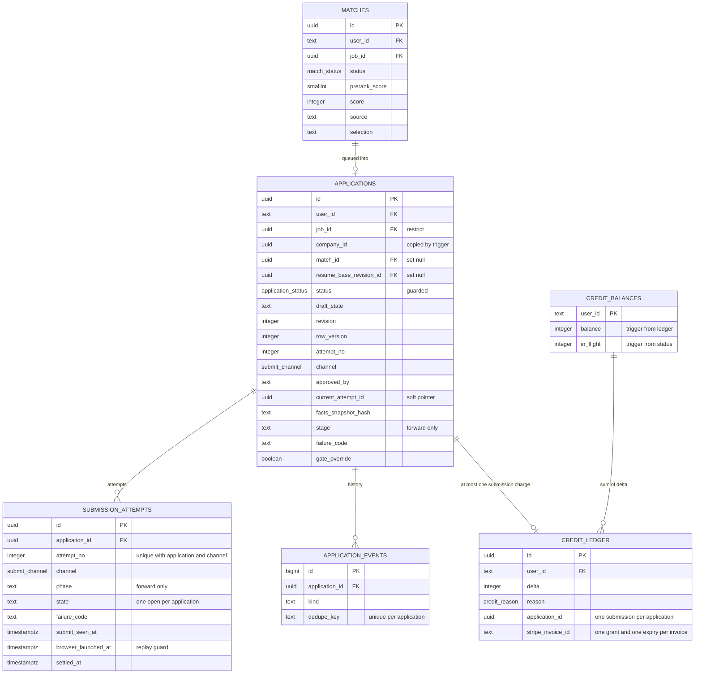
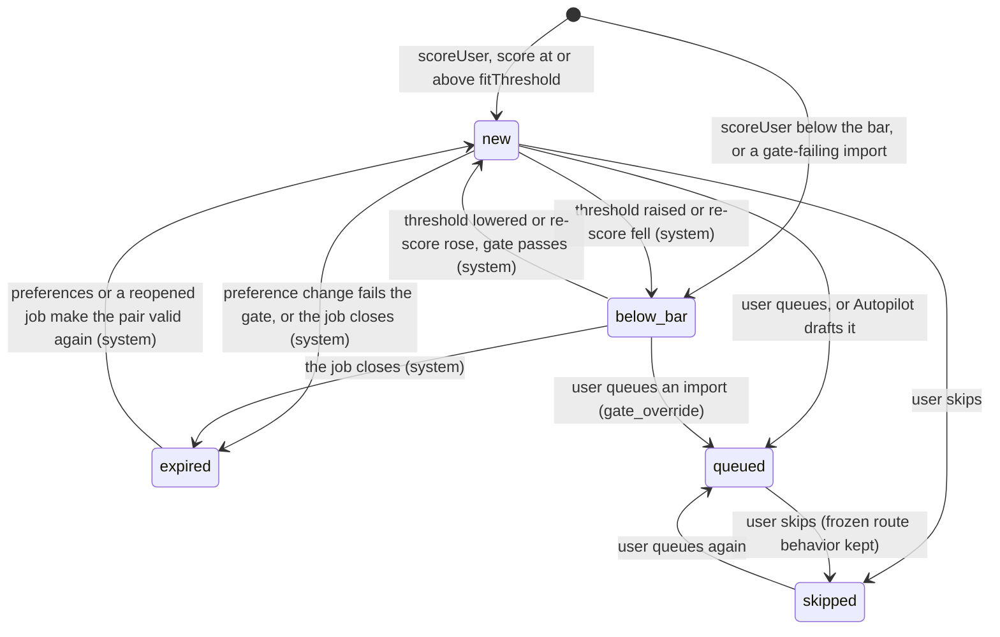

# 02. Database design (integrated): Kairos backend on Postgres 18 and DBOS Transact

Status: integrated design for implementation, revision 1, written 2026-10-23 (project calendar date 2026-10-16 for the spec set). It merges the six domain drafts under `_db/` (`identity-profile.md`, `catalog-matching.md`, `applications.md`, `billing.md`, `messaging.md`, `platform.md`) into one consistent schema, written against `01-architecture.md` revision 2 (ADR-001, postgres-durable on DBOS Transact 5.3.0, Anthropic agents), `04-matching.md`, the spike results in `_research/spike-s-d1-local.md`, the resume workspace contract (`docs/superpowers/specs/2026-10-23-resume-workspace/README.md`, sections 3, 6, 7 and 8), and the current schema (`server/drizzle/0000_init.sql`, `0001_resume_workspace.sql`, `server/src/db/schema/*.ts`).

**Precedence.** Where this document differs from a domain draft, this document wins, and section 2 says why. Where a domain draft carries detail this document only summarizes (long function bodies that did not change, per-domain row-size arithmetic, per-domain test fixtures), the draft section named in the text is the authoritative text and is part of this specification. Where this document differs from `01-architecture.md` B.10, this document wins for the schema and section 2 lists the change so the architecture text can be reconciled. The spike S-D1 correction table overrides both.

Skills applied: `database-architect` (domain, access patterns and scale first; lifecycle and migration safety), `postgresql-optimization` (index strategy from queries, partial and covering indexes, autovacuum and configuration) and `ecc:database-migrations` (expand, backfill, switch, contract; schema and data migrations separate; concurrent index builds outside the migrator transaction; forward-only in production). All three loaded. Their intake questions are answered by the architecture: the database is Postgres 18, the ORM is Drizzle 0.45.4 with drizzle-kit 0.31.11, the driver is `pg` 8, the scale target is 10,000 users at public beta.

**Validation.** Every SQL statement of sections 7 and 8.3 (245 statements, together with the draft validators, `effective_plan()` and the partition functions they call) was applied to a scratch `postgres:18` container (PostgreSQL 18.6) on 2026-10-23: all 55 tables, 4 unlogged tables, the views and functions were created; the foreign-key index check of 11.4 returned zero rows and caught a deliberately unindexed probe; `matches_status_guard` refused every illegal actor transition; `job_ghost_verdict_v`, `refresh_ghost_verdicts`, `job_fresh_at`, `store_form_questions` (as `kairos_applier`) and `archive_user_ledger` behaved as specified. The container was removed. The migration sequence of section 14 and the tests of section 17 are specified, not yet run.

Evidence tags: **[V]** verified against a repository file, a domain draft that executed the SQL, or the spike; **[est]** an estimate to be replaced by beta measurements in phase P8; **[verify]** a behavior that a named spike must prove before the phase that depends on it (S-P1 Postgres 18 and PITR on Railway, S-B1 Better Auth, S-D1 DBOS, S-A1 Anthropic, S-G1 Gmail forwarding, S-AP2 applier submit interception).

---

## 1. Summary

| Item | Value |
|---|---|
| Engine | Railway `postgres-ssl:18` with pgBackRest PITR; extension `pg_trgm` |
| Databases | `kairos` (business state, schema `public`, plus schema `dbos` for the datasource table) and `kairos_dbos` (DBOS checkpoints, owned by the SDK) |
| Tables in `kairos.public` | **55** (19 exist today: the 17 of `0000_init.sql` plus `resumes` and `resume_revisions` of `0001_resume_workspace.sql`; 36 are new) |
| Other relations | `dbos.transaction_completion`; views `applier_payload_v`, `scan_target_v`, `job_ghost_verdict_v`; weekly partitions of `llm_calls`; the transient `matches_shadow` during phase P4 only |
| Postgres enum types | 9, all existing: `application_status`, `ats_provider`, `billing_interval`, `credit_reason`, `email_kind`, `fact_kind`, `match_status` (gains `below_bar`, server only), `plan_id`, `submit_channel`. Every new closed set is `text` with a named `CHECK` |
| Partitioned tables | 1: `llm_calls` (weekly range partitions, dropped after 90 days) |
| Unlogged tables | 4: `verified_claims`, `tailor_cache`, `rate_limits`, `auth_rate_limit` |
| Runtime roles | `kairos_api`, `kairos_worker`, `kairos_applier`, `kairos_readonly`; owner `kairos_migrator`; DBOS roles `dbos_api`, `dbos_worker`, `dbos_applier`, owner `dbos_migrator` |
| Applier surface | 2 views (`applier_payload_v`, `scan_target_v`), 6 `SECURITY DEFINER` functions (`claim_cloud_attempt`, `mark_browser_launched`, `mark_attempt_phase`, `record_attempt_result`, `store_form_questions`, `heartbeat_executor`), `SELECT` on `ops_flags` and `EXECUTE` on `ops_flag_on` |
| Size after 12 months at the cost-model ceiling [est] | about 108 GB in `kairos` and `kairos_dbos` together (section 12.4); realistic first year about 60 to 70 GB |
| Write load at growth [est] | about 13 DBOS checkpoint writes a second on average (about 55 per submitted application, target 60, alert 80), about 10 business row writes a second on average, peaks about 10 times higher |
| Migration | 32 ordered migrations, `0002` to `0033`, over phases P1 to P7, the contract releases and phase 2; every step additive until the contract releases; the recorded contract suite stays green after every step (section 14) |

The design rests on six rules that every section applies:

1. **The database refuses what would cost money, send twice or break the truth lock**, through unique and partial unique indexes, `CHECK` constraints and guard triggers, so that a workflow bug, a replay (spike S-D1 proved that `forkWorkflow` replays from step 0) or a manual repair cannot violate an invariant silently.
2. **Every write a workflow can repeat is idempotent in the database**: an `ON CONFLICT` target, a conditional `UPDATE ... WHERE <expected state>`, or a dedupe key.
3. **Personal content is minimal, bounded, encrypted where it is never searched, and expires.** Control and telemetry tables hold ids, codes and counts only.
4. **Every foreign key has an index whose leading column is the referencing column**, so account erasure and retention cascades are index scans.
5. **One table, one writer module** (the `01-architecture.md` B.2 lint rule); the privilege matrix of section 4 makes the split real.
6. **Additive change only until a contract release**, which follows a soak and a pre-check that proves the data satisfies the new rule.

---

## 2. How the drafts were merged: conflicts and their resolution

Each row names the conflict, the sources, the decision taken here, and the reason. Rows marked **(new)** are gaps no draft covered.

| # | Conflict | Sources | Resolution in this document | Reason |
|---|---|---|---|---|
| R-1 | Who owns the matching version counters: trigger-bumped `profiles.preferences_version` and `profiles.facts_version`, or code-bumped `user_match_state.prefs_version` and `.facts_version` | identity Q-1 and X-3, catalog X3, architecture B.7.3, 04-matching 12.2 | The authoritative counters are on `profiles`, bumped only by triggers. `user_match_state.prefs_version` means "the `preferences_version` the last backfill processed" and `user_match_state.rescored_facts_version` means "the `facts_version` the last re-score used". `user_match_state.facts_version` is not created. Backfill id `backfill:<userId>:<profiles.preferences_version>`; re-score selection `p.facts_version > ums.rescored_facts_version` | A counter bumped in application code is forgotten on the third write path; a trigger cannot be. One counter per fact, two meanings, no duplication |
| R-2 | `facts.resume_profile_id` on delete: `CASCADE` (architecture) or `SET NULL` (identity D1) | identity D1 | `ON DELETE SET NULL`; slot deletion goes through `delete_resume_slot()`, which removes only unconfirmed imported facts | A confirmed fact can be cited by submitted applications; cascading it away breaks citations and destroys attested statements |
| R-3 | `resumes.resume_profile_id` on delete: `SET NULL` (0001) or `CASCADE` (identity D11) | identity D11 | `ON DELETE CASCADE` | An orphaned base resume would be counted as the user's no-slot resume by `resumes_user_slot_uq` |
| R-4 | `applications.resume_base_revision_id`: no foreign key (identity X-1 option) or `SET NULL` foreign key (applications) | identity X-1, applications X1 | Foreign key `ON DELETE SET NULL` plus `applications_base_revision_idx`; `prune_resume_revisions()` never deletes a referenced revision | The key protects against a dangling anchor; pruning keeps referenced rows, so the action fires only on slot deletion |
| R-5 | `applications.job_id` and `jobs.company_id`: `CASCADE` today | catalog D16 and X1, applications X2 | Both become `ON DELETE RESTRICT` in the contract releases | A deleted company or job must never delete users' applications; retention deletes only unreferenced jobs and companies are deactivated, never deleted |
| R-6 | Primary-key defaults: `uuidv7()` (identity, catalog, applications, billing, platform) versus `gen_random_uuid()` (messaging) | all | `uuidv7()` is the default for every uuid primary key of a new table and of every existing table that grows above 100,000 rows (`jobs`, `matches`, `applications`, `facts`, `employments`, `resume_revisions`, `credit_ledger`, `inbound_emails`, `notifications`, `saved_searches`, `board_requests`, `submission_attempts`, `reminders`, `rehearsal_sessions`, `offer_pause_candidates`, `eval_runs`). Small tables keep `gen_random_uuid()` (`companies`, `resume_profiles`, `resumes`, `saved_answers`, `contact_messages`). Existing v4 values stay; application code may supply a v4 id (`crypto.randomUUID()`) where it needs the id before the insert (the encryption AAD of `inbound_emails`) | Time-ordered keys keep the primary-key and foreign-key indexes of large tables dense and make retention deletes touch contiguous pages; both frozen clients treat ids as opaque strings and `z.uuid()` accepts v7 |
| R-7 | Global lock order: billing rule L1 (`credit_balances` first), identity rules I1 and I2 (`profiles` first), identity rule A1 (`credit_balances`, `autopilot_settings`, `applications`), applications rule A-1 | billing 2.2, identity 2.2, applications 2.2 | One global order, section 5.1: `credit_balances` < `profiles` < identity children < `autopilot_settings` < `applications` by id < `submission_attempts` < `reminders` and other application children | No transaction takes `profiles` before `credit_balances` and then the reverse; the subscription sync, the only path that writes both, locks `credit_balances` first |
| R-8 | Rehearsal call ids: `rehearsal_turns.llm_call_id` (architecture, platform) or `question_call_id` and `feedback_call_id` (applications) | applications 3.7, platform 2 | `question_call_id` and `feedback_call_id`, plain `bigint`, no foreign key | A turn has two model calls (the next question and the feedback); one column would lose one of them |
| R-9 | `ops_flags.key` is a closed catalogue (platform), but applications needs `verification_full_log` and `ap2_verified`, and 04-matching section 23 overrides `matching.*` and `catalog.*` configuration keys through `ops_flags` | platform 4.8, applications X5, 04-matching 23 | The key `CHECK` admits the platform list, `verification_full_log`, `ap2_verified`, `extension_only:<ats>`, `host_backoff:<host>` and configuration overrides `^(matching|catalog)\.[a-z0-9_]{2,60}$` whose value is `detail->'value'`. Code validates override keys against `MATCHING_DEFAULTS` | One flag table, still typo-proof for kill switches; overrides are audited by the same trigger |
| R-10 | The applier surface: architecture "one view and five functions"; catalog adds `scan_target_v`; platform adds `heartbeat_executor` | architecture B.10.4, catalog D5, platform P13 | Two views and six functions (section 4.3) | `scanForm` needs a job's apply URL and the applier cannot write tables, so it cannot heartbeat otherwise |
| R-11 | `facts_snapshot_hash` definition: "sha256 of sorted (id, text, confirmed_at)" (architecture, applications) or the SQL function of identity D14 (adds `kind` and `confirmed`, epoch-microsecond time) | identity D14, applications 3.1 | The identity function `facts_snapshot_hash(user_id, fact_ids)` is the only definition; `approveCore` calls it in SQL | Two implementations of one hash drift |
| R-12 | Verification summary keys: `itemKind`, `itemId`, `reason` (architecture B.10.2) or `kind`, `ref`, `rule` (applications X7, `verificationSummarySchema`) | applications X7 | `kind`, `ref`, `rule` | Matches the shared zod schema the web reads |
| R-13 | The `match_status` value `below_bar` used in the same migration that adds it | catalog D17 | `0006_catalog_00_enum_below_bar` ships in a release of its own (P1); no migration applied in the same deploy uses the value | Drizzle's migrator applies all pending files in one transaction, and a new enum value cannot be used before its transaction commits |
| R-14 | `jobs.last_seen_at` as a per-poll heartbeat (architecture, 04-matching 2.4) | catalog D1 | Written only on insert, reopen, change and import; freshness is `job_fresh_at(j, c)` using `companies.last_success_at` | Saves about 7.2 million row versions a day at base and 29 million at growth |
| R-15 | Notification opt-outs: messaging asked for them, identity added three `profiles.notify_*` flags, platform added purpose `unsubscribe` | messaging Q-3, identity D5, platform P10 | `action_tokens` with purpose `unsubscribe` carry `entity_id` in (`digest`, `outcome_report`, `autopilot_summary`, `reminders`); consuming one sets `profiles.notify_weekly_report`, `notify_autopilot_summary` or `notify_reminders` to false, and for `digest` sets every `saved_searches.frequency` of the user to `off` | Every non-transactional email has a stored preference and a one-click opt-out |
| R-16 | Better Auth's `rateLimit` table: platform says identity owns it; identity does not list it | platform 9.3 | **(new)** `auth_rate_limit`, an unlogged table in identity-profile, used through Better Auth's `rateLimit.storage = "database"` with `modelName: "auth_rate_limit"` [verify the option names in S-B1] | Auth limits must be shared across api replicas and fail closed |
| R-17 | The ledger archive at account deletion runs in a `BEFORE DELETE` trigger on `"user"`; a large account is erased in batches (applications first), which nulls `credit_ledger.application_id` before the trigger copies the rows | billing 3.4 | **(new)** `archive_user_ledger(user_id)` is a callable `SECURITY DEFINER` function; the erasure workflow calls it as its first step, and the trigger calls the same function (idempotent through `ON CONFLICT (ledger_id) DO NOTHING`) | The archive keeps `application_id`, and the batch delete stays within the worker's statement timeout |
| R-18 | `matches` status moves by the user versus the system; the frozen skip route has no status condition today | catalog D10, `routes/matches.ts` | **(new)** `matches_status_guard` uses the transaction actor: a user action (`kairos.actor = 'user'`) may set `queued` or `skipped` from any state; a system action may move only among `new`, `below_bar` and `expired` and never out of `queued` or `skipped` | Keeps the frozen skip and queue routes' behavior and makes "a user's decision is never overridden" a database rule |
| R-19 | Catalog draft ends at section 7: `matches`, `user_match_state`, the views and functions of its section 10 and its migration plan are missing | catalog | **(new)** Designed here in sections 7.2, 8 and 14 from `01-architecture.md` B.7 and B.10.2 and `04-matching.md` sections 5, 6, 12 and 18 | Completes the domain |
| R-20 | `applier_payload_v` columns | applications 5.8, billing 11.1 | Billing's two trailing columns `past_due_since` and `effective_plan` are included; the view is `security_barrier` | Plan eligibility in SQL equals TypeScript `effectivePlan` |
| R-21 | Checkpoint budget figures: architecture A.8 "about 37 per submitted application"; B.5.7 "751,000 writes a day, target 40, alert 60" | spike S-D1 | About 6 fixed writes per workflow, about 1.1 million writes a day, about 55 per submitted application, target 60, alert at 80 | Spike measurement (11 writes direct, 12 queued for a two-transaction workflow) |
| R-22 | Contact-message erasure needs the account email after the cascade | messaging 5.4, platform P11 | `deletion_tasks.contact_email_enc` carries the email encrypted until `contact_done_at` | The email no longer exists in `"user"` after the cascade |
| R-23 | `ai_usage` exhausted response: architecture B.8.10 said 402; owner decision D of the contract says 429 `rate_limited` | architecture A.10, platform 4.4 | 429 `rate_limited` with `details.reason = 'daily_allowance'` | The frozen `web/lib/api.ts` already maps 429 |
| R-24 | Index naming collisions and duplicates (`applications_user_status_idx`, `facts_user_idx`, `session_user_id_idx`, `resume_revisions_resume_idx`, `credit_ledger_user_idx`, `credit_ledger_invoice_uq`, `matches_user_status_idx`, `jobs_title_trgm_idx`, `jobs_search_idx`) | all | Each superseded index is dropped in its domain's contract step or never created (section 11.3 lists every drop) | A strict prefix of another index or an index no query uses costs writes and saves nothing |

---

## 3. Conventions

### 3.1 Keys, types and names

| Topic | Rule |
|---|---|
| User reference | `"user".id` is Better Auth's `text` id; every user-owned table has `user_id text NOT NULL REFERENCES "user"(id) ON DELETE CASCADE` unless section 7 says otherwise |
| Surrogate keys | `uuid`, default per R-6; append-only high-volume tables use `bigint GENERATED ALWAYS AS IDENTITY` (`application_events`, `verification_results`, `job_ghost_evidence`, `ops_audit`); `llm_calls` uses a plain sequence because identity columns on partitioned parents are avoided |
| Natural keys | Stripe ids (`text`), Postmark message ids, `(kind, entity_id)` of `email_sends`, `token_hash` of `action_tokens`, `user_hash` of `deletion_tasks`, `executor_id` of `dbos_executors` |
| Time | `timestamptz` everywhere, UTC; `now()` in triggers is the transaction start time, which is intended; `date` columns named `day` are UTC days, `received_on` is a UTC day |
| Closed sets | The 9 existing Postgres enums stay (they are mirrored in `shared/` and read by the frozen clients). Every new closed set is `text` plus a named `CHECK`, so adding a value is a `NOT VALID` constraint swap plus `VALIDATE`, never an `ALTER TYPE` |
| Names | `<table>_<meaning>_ck` for checks, `_uq` for unique indexes, `_idx` for other indexes, `_brin` for BRIN indexes, `_fk` (Drizzle style `<table>_<col>_<ref>_<refcol>_fk`) for foreign keys, `<table>_<what>_bu`, `_biu`, `_ai`, `_aiud`, `_bud`, `_bd` for triggers by timing |
| Codes in text columns | `^[a-z0-9_:.-]{1,80}$` for failure codes, issue codes, dedupe keys and error codes; never free text from users or models |
| JSON columns | Each has a type check (`jsonb_typeof`), an element bound and a size bound (`octet_length(col::text)` for exact limits on small values, `pg_column_size` for abuse guards on large ones). The zod schemas in `shared/` stay the exact validation |
| Money | Never stored as currency; credits are integers; model cost is `numeric` USD in `llm_calls`, `llm_cost_daily`, `user_daily_usage`, `eval_runs` |
| Hashes | Content and token hashes are SHA-256: `bytea` (32 bytes) in platform tables, lower-case hex `text` (64 characters) where a draft or a frozen contract already used text (`facts.source_span_hash`, `applications.facts_snapshot_hash`, `jobs.content_hash`, `resume_profiles.source_hash`); `resumes.document_hash` is `md5` hex for change detection only (Q-6) |

### 3.2 The transaction-local actor `kairos.actor`

Set with `SELECT set_config('kairos.actor', $1, true)` (transaction-local, safe under PgBouncer transaction mode), read by `kairos_actor()`. Values: `user` (a request by the signed-in owner, including a workflow the user started), `autopilot` (the Autopilot actor of `queueMatch` and `approveCore`; it can queue a `new` match and nothing else that is guarded here), `ops` (an operator repair with an `ops_audit` row), `migration:<name>` (a migration that changes audited rows), unset (workers, parsers, agents, sweepers). A non-`user` actor can never confirm, unconfirm or edit a fact. Guards that read it: `facts_guard`, `employments_guard`, `profiles_guard`, `resumes_guard`, `matches_status_guard`, `feature_flags_audit`. The helper `asActor(tx, "user")` in `server/src/lib/actor.ts` is called first by every user-facing write path; forgetting it fails closed (`check_violation`), never silently.

### 3.3 Encryption envelope

Columns holding personal content that is never searched are encrypted in the application with AES-256-GCM under the versioned key list `DATA_KEKS` (api and worker only). Stored as `bytea`: `keyVersion (1 byte) || nonce (12) || ciphertext || tag (16)`; additional authenticated data `<table>:<row key>:<column>`. The database checks only shape (`octet_length(col) >= 29` and size caps). Encrypted columns: `resume_profiles.source_text_enc`, `profiles.sensitive_answers_enc`, `inbound_emails.text_body_enc`, `inbound_emails.preview_enc`, `deletion_tasks.contact_email_enc`. Not encrypted, with reasons in identity 2.4: `facts.text`, `resumes.document`, `profiles.preferences` (read on every draft and gate run); rehearsal answers (30-day retention, applications Q-3).

### 3.4 Constraint rollout

A constraint that guards existing data is added `NOT VALID` in the expand migration, the data is fixed by a backfill, a `DO` block asserts zero violations, and the constraint is validated (`SHARE UPDATE EXCLUSIVE`, which does not block writes). Section 7 shows final-state DDL as a fresh `CREATE TABLE`; section 14 gives the `NOT VALID` order. Constraints that the skeleton's still-running code would violate ship in the domain's contract migration (for example `applications_approval_shape_ck`, `inbound_emails_offer_needs_rule_ck`, `jobs_raw_size_ck`).

### 3.5 HOT discipline

Columns updated on hot paths are kept out of every index key and predicate so the update is heap-only: `applications.lease_session_id`, `lease_expires_at`, `current_attempt_id`, `row_version`, `verification`, `questions`, `resume_pdf_key`, `facts_snapshot_hash`, `prepared_at`, `receipt`, `receipt_summary`, `revision`; `submission_attempts.heartbeat_at`, `phase`; `credit_balances.balance`, `in_flight`; `session.updated_at` is indexed by design (one refresh a day per session); `profiles.facts_version`; `user_daily_usage` and `ai_usage` counters; `dbos_executors.last_seen_at`; `rate_limits.points`. Tables with frequent same-row updates get a `fillfactor` below 100 (section 13.2).

### 3.6 No row-level security

Queries filter by the session user id in one data-access layer (INV-11); the database adds same-owner triggers on every cross-tenant reference (`assert_same_owner`, `applications_assert_owner`, `rehearsal_sessions_bind`) rather than RLS, because RLS needs a per-request `SET LOCAL` on pooled connections and every worker query crosses users by design.

---

## 4. Roles, privileges and connections

### 4.1 Roles

```sql
-- provisioning script ops/provision-roles.sql, run once per environment as the Railway superuser (not by drizzle)
CREATE ROLE kairos_migrator LOGIN;            -- owns every object in kairos; runs migrations before deploy
CREATE ROLE kairos_api      LOGIN;            -- api process, through PgBouncer
CREATE ROLE kairos_worker   LOGIN;            -- worker process, through PgBouncer
CREATE ROLE kairos_applier  LOGIN;            -- applier process, through PgBouncer: two views and six functions only
CREATE ROLE kairos_readonly LOGIN;            -- analytics and support, column-limited
ALTER DATABASE kairos OWNER TO kairos_migrator;
REVOKE ALL ON SCHEMA public FROM PUBLIC;
GRANT USAGE ON SCHEMA public TO kairos_api, kairos_worker, kairos_applier, kairos_readonly;
ALTER ROLE kairos_api      SET statement_timeout = '10s';
ALTER ROLE kairos_worker   SET statement_timeout = '120s';
ALTER ROLE kairos_applier  SET statement_timeout = '5s';
ALTER ROLE kairos_readonly SET statement_timeout = '60s';
ALTER ROLE kairos_api      SET idle_in_transaction_session_timeout = '30s';
ALTER ROLE kairos_worker   SET idle_in_transaction_session_timeout = '30s';
ALTER ROLE kairos_applier  SET idle_in_transaction_session_timeout = '30s';
ALTER ROLE kairos_readonly SET default_transaction_read_only = on;
-- DBOS system database roles: platform 5.2 (dbos_migrator owns kairos_dbos; dbos_api, dbos_worker, dbos_applier have DML on schema dbos only and no CONNECT on kairos)
```

Default privileges grant `SELECT, INSERT, UPDATE, DELETE` on new tables to `kairos_api` and `kairos_worker` (architecture B.10.4); every migration that creates a table then revokes to the matrix below in the same file. `TRUNCATE` and `REFERENCES` are never granted to a runtime role. Account-deletion cascades and `SET NULL` actions run with the owner's privileges, so narrowed `DELETE` and `UPDATE` rights never block erasure.

### 4.2 Privilege matrix (final state, asserted by the grant test T-12)

`S` select, `I` insert, `U` update, `D` delete, `(cols)` column-limited, `fn` reached only through functions, `none` no access.

| Table | `kairos_api` | `kairos_worker` | `kairos_applier` | `kairos_readonly` |
|---|---|---|---|---|
| `user` | SIUD | SD | none | none |
| `session`, `verification` | SIUD | SD | none | none |
| `account` | SIUD | S | none | none |
| `auth_rate_limit` | SIUD | none | none | none |
| `profiles` | SIU | SIU | none | S(user_id, onboarding_step, timezone, applications_paused_at, forwarding_state, created_at) |
| `resume_profiles` | SIUD | SU | none | S(id, user_id, name, is_default, source_kind, parse_status, created_at) |
| `employments`, `facts` | SIUD | SIUD | none | none |
| `saved_answers` | SIUD | SIU | none | none |
| `resumes`, `resume_revisions` | SIUD | SIU | none | none |
| `autopilot_settings` | SIU | SU | none | S |
| `saved_searches` | SIUD | SU | none | none |
| `companies`, `jobs` | SIU | SIUD | fn (views) | S |
| `form_questions` | S | SIUD | fn (`store_form_questions`) | none |
| `job_ghost_evidence` | S | SIUD | none | S |
| `ghost_reports` | SI | SD | none | none |
| `board_requests` | SIU | SUD | none | S |
| `matches` | SIU | SIUD | none | S |
| `user_match_state` | SIU | SIU | none | S |
| `applications` | SIUD | SIUD | fn (`applier_payload_v`, `claim_cloud_attempt`) | S(all except resume_lines, answers, cover_letter, receipt, questions, resume_line_entries, failure_reason, lease_session_id) |
| `submission_attempts` | SIU | SIU | fn | S(all except evidence, session_id) |
| `verification_results` | SI | SID | none | S |
| `application_events` | SI | SI | none | S |
| `reminders` | none | SIUD | none | S |
| `rehearsal_sessions` | SIU | SU | none | none |
| `rehearsal_turns` | SIU | SD | none | none |
| `subscriptions` | SIU | SIU | fn (view) | S(user_id, plan, "interval", status, current_period_end, cancel_at_period_end, collection_paused, created_at) |
| `credit_ledger` | SI | SI | none | S |
| `credit_balances` | S, U(updated_at) | S, U(updated_at) | none | S |
| `credit_ledger_archive` | none | S | none | S |
| `stripe_events` | SIU | SIUD | none | none |
| `offer_pause_candidates` | SIU | SIU | none | S |
| `inbound_emails` | SI | SIUD | none | none |
| `forwarding_verifications` | SIUD | SIUD | none | none |
| `email_sends` | SIU | SIUD | none | S |
| `notifications` | SIU | SIUD | none | none |
| `contact_messages` | SI | SIUD | none | none |
| `llm_calls` | I | SI, U(user_hash) | none | none |
| `llm_cost_daily` | S | SIU | none | S |
| `user_daily_usage` | SIU | SIUD | none | S |
| `ai_usage` | SIU | SD | none | none |
| `verified_claims` | SIU | SIUD | none | none |
| `tailor_cache` | SIU | SD | none | none |
| `eval_runs` | S | SI | none | none |
| `ops_flags` | SIU | SIU | S | none |
| `feature_flags` | SIU | S | none | none |
| `action_tokens` | SIU | SIUD | none | none |
| `deletion_tasks` | SIU | SIUD | none | none |
| `ops_audit` | SI | SI | none | none |
| `dbos_executors` | S, fn | SD, fn | fn | none |
| `metrics_minute` | S | SIUD | none | S |
| `rate_limits` | SIUD | fn (`rate_limits_purge`) | none | none |
| `dbos.transaction_completion` | SIUD | SIUD | none | none |

Notes: `kairos_api` has no `UPDATE` or `DELETE` on `inbound_emails` (the internet-facing role cannot rewrite evidence that feeds billing pauses) and no `DELETE` on `email_sends`, `contact_messages`, `notifications`. `UPDATE` and `DELETE` on `credit_ledger`, `credit_ledger_archive`, `application_events` and `ops_audit` are granted to no runtime role, and triggers block them for the owner too. Writes to `credit_balances` happen only in `SECURITY DEFINER` trigger functions.

### 4.3 The applier surface

```sql
GRANT SELECT ON applier_payload_v, scan_target_v, ops_flags TO kairos_applier;
GRANT EXECUTE ON FUNCTION claim_cloud_attempt(uuid, int, text), mark_browser_launched(uuid), mark_attempt_phase(uuid, text),
                          record_attempt_result(uuid, text, text, jsonb), store_form_questions(uuid, smallint, jsonb),
                          heartbeat_executor(text, text, text, text, text), ops_flag_on(text) TO kairos_applier;
```

The applier has no table privilege, no model key, no data key and no Stripe key. Its database credential can read the cloud payload of approved applications only and write attempt state through the functions, each of which checks state and caps its input.

### 4.4 Connections

PgBouncer (transaction mode) carries every `kairos` application pool, including the DBOS Drizzle datasource [verify in the Railway half of S-D1]; DBOS system pools connect directly to `kairos_dbos` (DBOS holds a `LISTEN` connection per process). Budget at growth (architecture B.4.2, platform 5.2): PgBouncer server side 108 connections; direct DBOS 60 (api 3 x 4, worker 4 x 6, applier 8 x 3); migrator, readonly and superuser reserve 10; total 178 of `max_connections = 200`. Alert when PgBouncer `cl_waiting` is above 0 for a minute or server connections exceed 180. Nothing in the schema uses session state: no session advisory locks (only `pg_advisory_xact_lock`), no `SET` outside `SET LOCAL` or `set_config(..., true)`, no `LISTEN` on `kairos`, no temporary tables, no prepared statements that outlive a transaction (`pg` with named statements disabled through PgBouncer, or PgBouncer 1.24 `max_prepared_statements` [verify S-P1]).

---

## 5. Concurrency: lock order and transactional patterns

### 5.1 One global lock order

Every transaction that locks more than one of these rows locks them in this order:

1. `credit_balances` row of the user (`lockCreditBalance(tx, userId)`: `ensure_credit_balance`, then `SELECT ... FOR UPDATE`)
2. `profiles` row of the user (`lockProfile(tx, userId)`: `SELECT 1 FROM profiles WHERE user_id = $1 FOR NO KEY UPDATE`)
3. identity children: `resume_profiles`, `resumes`, `resume_revisions`, `employments`, `facts`, `saved_answers`, `saved_searches` (once `profiles` is held, their mutual order is free: the `profiles` lock is the per-user mutex for identity writes)
4. `autopilot_settings` row
5. `applications` rows, ordered by `id`
6. `submission_attempts` rows
7. application children: `reminders`, `rehearsal_sessions`; then `offer_pause_candidates`, `notifications`, `email_sends`, `application_events` inserts (inserts take no lock that another path waits on)

| Rule | Paths | Locks taken |
|---|---|---|
| L1 (billing) | Any transaction that moves `applications.status` into or out of `{approved, submitting}`: `approveCore` (user, resend, Autopilot), `recordOutcome`, withdraw of an approved row, `leaseSweeper`, return-to-draft, Autopilot off, failure-spike pause, plan-change pause | 1, then 4 if Autopilot settings change, then 5, then 6 |
| I1, I2, I3 (identity) | Every write of `facts`, `employments`, a slot create or delete, `PUT /api/resume`, restore, saved-search insert, time-zone change | 2, then 3 |
| A1 (Autopilot) | `PUT /api/autopilot` off, spike pause, plan-change pause, owner freeze | 1, 4, 5 |
| Subscription sync | `processStripeEvent` and `billing-reconcile` when they clear `profiles.applications_paused_at` and pause Autopilot | 1, then 2, then 4, then 5 |
| `claim_cloud_attempt` | `approved` to `submitting` (inside the set, so the in-flight trigger does not touch the balance) | 5 only |
| `classifyEmail` | stage update, events, offer-pause candidate | 5 (one row) only |
| Rehearsal turn | | the session row alone |

The in-flight trigger (`applications_in_flight`) updates `credit_balances` after the guarded status change, which is why rule L1 takes the balance row first. DBOS steps that run these transactions retry once on SQLSTATE `40P01` and `40001`; test T-2 interleaves every path and asserts zero deadlocks.

### 5.2 Transactional patterns used

| Pattern | Statement shape | Used for |
|---|---|---|
| Insert-once | `INSERT ... ON CONFLICT (<key>) DO NOTHING RETURNING id`; no row means already done | `queueMatch`, the charge, invoice grants, free grant, Stripe and Postmark ingest, events, notifications, reminders, action tokens, ghost reports, verification results |
| Conditional transition | `UPDATE ... SET status = $to WHERE id = $1 AND status = $from RETURNING ...`; zero rows means another actor won (409 `conflict` or a workflow no-op) | Every state machine; the guard triggers are the backstop |
| Claim with lease | `UPDATE ... SET claimed_until = now() + interval ... WHERE ... AND (claimed_until IS NULL OR claimed_until < now()) RETURNING` | Job cards, `email_sends`, `pollTick`, extension visibility lease |
| Queue claim | `SELECT ... ORDER BY <due> LIMIT n FOR UPDATE SKIP LOCKED` inside the updating statement | Digests, offer-pause apply, deletion tasks, retention batches, reminders consumption |
| Guarded upsert | `INSERT ... ON CONFLICT DO UPDATE SET used = used + $n WHERE used + $n <= $limit RETURNING used` | F11 allowances; the limit is a parameter read from `shared/src/plans.ts` |
| Store then process | Insert the raw event in the request transaction, process it in a workflow keyed by its id | Stripe events, inbound mail |
| Derived cache maintained by trigger | `AFTER` trigger on the source table updates a one-row cache in the same transaction | `credit_balances`, `profiles.facts_version` |
| Recompute, never increment | Roll-ups replace their value from source rows | `llm_cost_daily`, ghost verdicts |

Exclusion constraints were considered for every invariant; none is about overlapping ranges, so partial unique indexes cover every case (one open attempt, one pending pause, one active rehearsal session, one default slot, one free grant). The one range-shaped rule, non-overlapping `llm_calls` partitions, is enforced by Postgres partitioning itself.

---

## 6. Entity-relationship diagrams

### 6.1 All 55 tables

Every foreign key, with its delete rule. Dotted lines are logical references (ids inside JSON or plain `bigint` without a foreign key).

```mermaid
erDiagram
    USER ||--o{ SESSION : "cascade"
    USER ||--o{ ACCOUNT : "cascade"
    USER ||--|| PROFILES : "cascade"
    USER ||--o{ RESUME_PROFILES : "cascade"
    USER ||--o{ EMPLOYMENTS : "cascade"
    USER ||--o{ FACTS : "cascade"
    USER ||--o{ SAVED_ANSWERS : "cascade"
    USER ||--o{ RESUMES : "cascade"
    USER ||--o| AUTOPILOT_SETTINGS : "cascade"
    USER ||--o{ SAVED_SEARCHES : "cascade"
    RESUME_PROFILES ||--o{ EMPLOYMENTS : "cascade"
    RESUME_PROFILES ||--o{ FACTS : "set null"
    RESUME_PROFILES ||--o| RESUMES : "cascade"
    EMPLOYMENTS ||--o{ FACTS : "set null"
    RESUMES ||--o{ RESUME_REVISIONS : "cascade"

    COMPANIES ||--o{ JOBS : "restrict"
    COMPANIES ||--o{ BOARD_REQUESTS : "set null"
    JOBS ||--o| FORM_QUESTIONS : "cascade"
    JOBS ||--o{ JOB_GHOST_EVIDENCE : "cascade"
    JOBS ||--o{ GHOST_REPORTS : "cascade"
    JOBS ||--o{ MATCHES : "cascade"
    JOBS ||--o{ TAILOR_CACHE : "cascade"
    USER ||--o{ GHOST_REPORTS : "cascade"
    USER ||--o{ BOARD_REQUESTS : "cascade"
    USER ||--o{ MATCHES : "cascade"
    USER ||--|| USER_MATCH_STATE : "cascade"

    USER ||--o{ APPLICATIONS : "cascade"
    JOBS ||--o{ APPLICATIONS : "restrict"
    MATCHES ||--o| APPLICATIONS : "set null"
    RESUME_PROFILES ||--o{ APPLICATIONS : "set null"
    RESUME_REVISIONS ||--o{ APPLICATIONS : "set null"
    APPLICATIONS ||--o{ SUBMISSION_ATTEMPTS : "cascade"
    USER ||--o{ SUBMISSION_ATTEMPTS : "cascade"
    APPLICATIONS ||--o{ VERIFICATION_RESULTS : "cascade"
    APPLICATIONS ||--o{ APPLICATION_EVENTS : "cascade"
    USER ||--o{ APPLICATION_EVENTS : "cascade"
    APPLICATIONS ||--o{ REMINDERS : "cascade"
    MATCHES ||--o{ REMINDERS : "cascade"
    USER ||--o{ REMINDERS : "cascade"
    APPLICATIONS ||--o{ REHEARSAL_SESSIONS : "cascade"
    USER ||--o{ REHEARSAL_SESSIONS : "cascade"
    REHEARSAL_SESSIONS ||--o{ REHEARSAL_TURNS : "cascade"
    APPLICATIONS ||--o{ SAVED_ANSWERS : "source, set null"

    USER ||--|| SUBSCRIPTIONS : "cascade"
    USER ||--|| CREDIT_BALANCES : "cascade"
    USER ||--o{ CREDIT_LEDGER : "cascade, archived first"
    APPLICATIONS ||--o{ CREDIT_LEDGER : "set null"
    USER ||--o{ STRIPE_EVENTS : "cascade"
    USER ||--o{ OFFER_PAUSE_CANDIDATES : "cascade"
    INBOUND_EMAILS ||--o| OFFER_PAUSE_CANDIDATES : "cascade"
    APPLICATIONS ||--o{ OFFER_PAUSE_CANDIDATES : "set null"
    CREDIT_LEDGER }o..|| CREDIT_LEDGER_ARCHIVE : "copied at erasure"

    USER ||--o{ INBOUND_EMAILS : "cascade"
    APPLICATIONS ||--o{ INBOUND_EMAILS : "set null"
    USER ||--o{ FORWARDING_VERIFICATIONS : "cascade"
    USER ||--o{ EMAIL_SENDS : "cascade"
    USER ||--o{ NOTIFICATIONS : "cascade"

    USER ||--o{ USER_DAILY_USAGE : "cascade"
    USER ||--o{ AI_USAGE : "cascade"
    USER ||--o{ TAILOR_CACHE : "cascade"
    USER ||--o{ ACTION_TOKENS : "cascade"
    LLM_CALLS ||..o{ LLM_COST_DAILY : "rolled up"
    LLM_CALLS }o..o| MATCHES : "llm_call_id, no key"
    LLM_CALLS }o..o| VERIFICATION_RESULTS : "llm_call_id, no key"
    LLM_CALLS }o..o| REHEARSAL_TURNS : "call ids, no key"
    FACTS }o..o{ APPLICATIONS : "fact ids in resume_lines and answers"
    FACTS }o..o{ RESUMES : "fact ids in document"
    OPS_FLAGS ||..o{ OPS_AUDIT : "audited by trigger"
    FEATURE_FLAGS ||..o{ OPS_AUDIT : "audited by trigger"
    DELETION_TASKS ||..o{ LLM_CALLS : "scrubs user_hash"
    USER ||..o| DELETION_TASKS : "user_hash, survives the user"
    CONTACT_MESSAGES ||..o| DELETION_TASKS : "erased by email"
    VERIFICATION {
        text id PK
    }
    AUTH_RATE_LIMIT {
        text id PK
    }
    VERIFIED_CLAIMS {
        bytea claim_hash PK
    }
    EVAL_RUNS {
        uuid id PK
    }
    DBOS_EXECUTORS {
        text executor_id PK
    }
    METRICS_MINUTE {
        text name PK
    }
    RATE_LIMITS {
        varchar key PK
    }
```



Tables with no foreign key at all (`verification`, `auth_rate_limit`, `verified_claims`, `eval_runs`, `dbos_executors`, `metrics_minute`, `rate_limits`, `llm_calls`, `llm_cost_daily`, `ops_flags`, `feature_flags`, `ops_audit`, `deletion_tasks`, `contact_messages`) have no foreign key by design: they are control data, caches or telemetry, or they must outlive the rows they describe.

### 6.2 The money and sending core, with key columns



---

## 7. Target schema

Final-state DDL for all 55 tables, written as a fresh `CREATE TABLE` per table so that one block shows every column, key and check. Section 14 is how the existing 19 tables get there without downtime; a fresh database is built by applying the migrations in order (14.1), so the listing order here (by domain) is not a creation order (for example `saved_answers` references `applications`). Comments name the invariant or query each object serves; the per-domain draft section in brackets carries the long-form rationale, row-size arithmetic and alternative designs considered.

### 7.1 Domain `identity-profile` (14 tables; writer modules `identity`, `profile`, `resume`) [identity 3]

```sql
-- 7.1.1 Better Auth core tables. Column sets are Better Auth's and do not change; indexes and checks are added.
CREATE TABLE "user" (
  id             text        PRIMARY KEY,
  name           text        NOT NULL,
  email          text        NOT NULL,
  email_verified boolean     NOT NULL DEFAULT false,
  image          text,
  created_at     timestamptz NOT NULL DEFAULT now(),
  updated_at     timestamptz NOT NULL DEFAULT now(),
  CONSTRAINT user_email_unique  UNIQUE (email),
  CONSTRAINT user_email_len_ck  CHECK (char_length(email) BETWEEN 3 AND 254),
  CONSTRAINT user_name_len_ck   CHECK (char_length(name) <= 200)
);
CREATE UNIQUE INDEX user_email_lower_uq        ON "user" (lower(email));                       -- no case-variant duplicate accounts
CREATE INDEX        user_unverified_created_idx ON "user" (created_at) WHERE NOT email_verified; -- 14-day purge, sign-up reconciler

CREATE TABLE session (
  id         text        PRIMARY KEY,
  expires_at timestamptz NOT NULL,
  token      text        NOT NULL,
  created_at timestamptz NOT NULL DEFAULT now(),
  updated_at timestamptz NOT NULL DEFAULT now(),          -- refreshed at most once a day; "seen in 7 days" eligibility
  ip_address text,
  user_agent text,
  user_id    text        NOT NULL REFERENCES "user"(id) ON DELETE CASCADE,
  CONSTRAINT session_token_unique UNIQUE (token),
  CONSTRAINT session_expiry_ck    CHECK (expires_at > created_at)
);
CREATE INDEX session_user_updated_idx ON session (user_id, updated_at DESC);  -- listSessions, eligibility EXISTS, cascade

CREATE TABLE account (
  id                       text        PRIMARY KEY,
  account_id               text        NOT NULL,
  provider_id              text        NOT NULL,              -- 'credential' or 'google'
  user_id                  text        NOT NULL REFERENCES "user"(id) ON DELETE CASCADE,
  access_token             text,                              -- nulled by the Better Auth hook (S-B1) or encrypted
  refresh_token            text,
  id_token                 text,
  access_token_expires_at  timestamptz,
  refresh_token_expires_at timestamptz,
  scope                    text,                              -- 'openid email profile' only; never a mail scope (INV-6)
  password                 text,                              -- the user's own Kairos password hash, never an employer password
  created_at               timestamptz NOT NULL DEFAULT now(),
  updated_at               timestamptz NOT NULL DEFAULT now(),
  CONSTRAINT account_credential_password_ck CHECK (provider_id <> 'credential' OR password IS NOT NULL)
);
CREATE INDEX        account_user_id_idx         ON account (user_id);
CREATE UNIQUE INDEX account_provider_account_uq ON account (provider_id, account_id);                  -- one identity, one user
CREATE UNIQUE INDEX account_one_credential_uq   ON account (user_id) WHERE provider_id = 'credential'; -- one password per user

CREATE TABLE verification (
  id         text        PRIMARY KEY,
  identifier text        NOT NULL,
  value      text        NOT NULL,                            -- hashed OTP; one-time tokens stored hashed (storeToken: "hashed", S-B1)
  expires_at timestamptz NOT NULL,
  created_at timestamptz NOT NULL DEFAULT now(),
  updated_at timestamptz NOT NULL DEFAULT now()
);
CREATE INDEX verification_identifier_idx ON verification (identifier);

-- (new, R-16) Better Auth's database rate-limit store, shared by every api replica; lost on a crash by design.
CREATE UNLOGGED TABLE auth_rate_limit (
  id           text    PRIMARY KEY,
  key          text    NOT NULL,                              -- e.g. '<ip>/sign-in/email'
  count        integer NOT NULL,
  last_request bigint  NOT NULL,                              -- epoch milliseconds
  CONSTRAINT auth_rate_limit_key_uq UNIQUE (key)
) WITH (fillfactor = 60);
-- [verify in S-B1] Better Auth 1.7.10 rateLimit { storage: "database", modelName: "auth_rate_limit" } and its exact field names.

-- 7.1.2 profiles: one row per user; the fit gate's preferences, the forwarding key, pause flag, opt-outs and version counters.
CREATE TABLE profiles (
  user_id                  text        PRIMARY KEY REFERENCES "user"(id) ON DELETE CASCADE,
  phone                    text,
  city                     text,
  country                  text,
  linkedin_url             text,                              -- printed as text; never visited (INV-6)
  github_url               text,
  portfolio_url            text,
  preferences              jsonb,                             -- shared Preferences; null until onboarding step 3
  onboarding_step          text        NOT NULL DEFAULT 'resume',
  forwarding_address       text        NOT NULL,              -- u-<id8>-<hex8>@replies.kairos.app, the only inbound-mail key
  forwarding_state         text        NOT NULL DEFAULT 'not_started',   -- machine owned by messaging (16.x, messaging 6.1)
  applications_paused_at   timestamptz,                       -- offer pause; approveCore skips with 'paused'
  normalized_email_hash    text,                              -- HMAC of the normalized address; Free-grant abuse rule
  sensitive_answers_enc    bytea,                             -- EEO, disability, veteran, visa, salary answers; never sent to a model
  timezone                 text        NOT NULL DEFAULT 'UTC',
  preferences_version      integer     NOT NULL DEFAULT 0,    -- bumped by profiles_guard (R-1)
  facts_version            integer     NOT NULL DEFAULT 0,    -- bumped by the facts statement triggers (R-1)
  notify_weekly_report     boolean     NOT NULL DEFAULT true,
  notify_autopilot_summary boolean     NOT NULL DEFAULT true,
  notify_reminders         boolean     NOT NULL DEFAULT true,
  created_at               timestamptz NOT NULL DEFAULT now(),
  updated_at               timestamptz NOT NULL DEFAULT now(),
  CONSTRAINT profiles_forwarding_address_unique UNIQUE (forwarding_address),
  CONSTRAINT profiles_onboarding_step_ck   CHECK (onboarding_step IN ('resume','confirm-facts','done')),
  CONSTRAINT profiles_forwarding_address_ck CHECK (forwarding_address = lower(forwarding_address)
                                                   AND forwarding_address ~ '^[a-z0-9._+-]+@[a-z0-9.-]+\.[a-z]{2,}$'),
  CONSTRAINT profiles_forwarding_state_ck  CHECK (forwarding_state IN
                                                   ('not_started','awaiting_verification','verified_pending_first_mail','active','stale')),
  CONSTRAINT profiles_lengths_ck           CHECK (char_length(phone) <= 40 AND char_length(city) <= 120 AND char_length(country) <= 120),
  CONSTRAINT profiles_urls_ck              CHECK (linkedin_url  ~* '^https?://[^[:space:]]+$' AND char_length(linkedin_url)  <= 300
                                              AND github_url    ~* '^https?://[^[:space:]]+$' AND char_length(github_url)    <= 300
                                              AND portfolio_url ~* '^https?://[^[:space:]]+$' AND char_length(portfolio_url) <= 300),
  CONSTRAINT profiles_email_hash_ck        CHECK (normalized_email_hash ~ '^[0-9a-f]{64}$'),
  CONSTRAINT profiles_sensitive_enc_ck     CHECK (octet_length(sensitive_answers_enc) BETWEEN 29 AND 16384),
  CONSTRAINT profiles_preferences_ck       CHECK (preferences IS NULL OR preferences_valid(preferences)),   -- threshold 50..95, cap 1..5
  CONSTRAINT profiles_versions_ck          CHECK (preferences_version >= 0 AND facts_version >= 0)
);
CREATE INDEX profiles_normalized_email_idx ON profiles (normalized_email_hash) WHERE normalized_email_hash IS NOT NULL;
-- Triggers: profiles_guard_bu (immutable key and forwarding address, forward-only onboarding, time-zone validation,
-- preferences_version bump), profiles_timezone_digest_au (recompute saved_searches.next_digest_at).

-- 7.1.3 resume_profiles: one row per resume slot (plans allow 1, 1, 3, 10; limit read from shared/src/plans.ts).
CREATE TABLE resume_profiles (
  id              uuid        PRIMARY KEY DEFAULT gen_random_uuid(),
  user_id         text        NOT NULL REFERENCES "user"(id) ON DELETE CASCADE,
  name            text        NOT NULL,
  is_default      boolean     NOT NULL DEFAULT false,
  source_text     text,                                       -- legacy plaintext; nulled in the contract step, then dropped
  source_text_enc bytea,                                      -- AAD resume_profiles:<id>:source_text; STORAGE EXTERNAL
  source_hash     text,                                       -- sha256 hex of the normalized source; parse:<id>:<hash8>
  source_kind     text        NOT NULL DEFAULT 'paste',
  file_key        text,                                       -- uploads/<user_id>/<id>.<ext> in R2
  parse_status    text        NOT NULL DEFAULT 'pending',
  parse_attempts  smallint    NOT NULL DEFAULT 0,
  parse_error     text,
  parser_version  smallint,
  parsed_at       timestamptz,
  created_at      timestamptz NOT NULL DEFAULT now(),
  updated_at      timestamptz NOT NULL DEFAULT now(),
  CONSTRAINT resume_profiles_name_ck         CHECK (char_length(btrim(name)) BETWEEN 1 AND 80),
  CONSTRAINT resume_profiles_source_ck       CHECK (source_text IS NOT NULL OR source_text_enc IS NOT NULL),
  CONSTRAINT resume_profiles_source_len_ck   CHECK (char_length(source_text) <= 60000),
  CONSTRAINT resume_profiles_enc_ck          CHECK (octet_length(source_text_enc) >= 29),
  CONSTRAINT resume_profiles_hash_ck         CHECK (source_hash ~ '^[0-9a-f]{64}$'),
  CONSTRAINT resume_profiles_kind_ck         CHECK (source_kind IN ('paste','upload_pdf','upload_docx','linkedin_pdf')),
  CONSTRAINT resume_profiles_file_key_ck     CHECK (starts_with(file_key, 'uploads/' || user_id || '/')),
  CONSTRAINT resume_profiles_parse_status_ck CHECK (parse_status IN ('pending','parsing','parsed','failed')),
  CONSTRAINT resume_profiles_parse_error_ck  CHECK (parse_error ~ '^[a-z0-9_]{1,40}$'),
  CONSTRAINT resume_profiles_parse_shape_ck  CHECK ((parse_status <> 'failed' OR parse_error IS NOT NULL)
                                                    AND (parse_status <> 'parsed' OR parsed_at IS NOT NULL)),
  CONSTRAINT resume_profiles_attempts_ck     CHECK (parse_attempts BETWEEN 0 AND 10)
);
ALTER TABLE resume_profiles ALTER COLUMN source_text_enc SET STORAGE EXTERNAL;
CREATE INDEX        resume_profiles_user_idx          ON resume_profiles (user_id);                        -- slot list, plan count, cascade
CREATE UNIQUE INDEX resume_profiles_one_default_uq    ON resume_profiles (user_id) WHERE is_default;       -- one default slot
CREATE INDEX        resume_profiles_parse_pending_idx ON resume_profiles (updated_at) WHERE parse_status IN ('pending','parsing');

-- 7.1.4 employments (F3): one job per slot; provenance like facts; not citable itself.
CREATE TABLE employments (
  id                uuid        PRIMARY KEY DEFAULT uuidv7(),
  user_id           text        NOT NULL REFERENCES "user"(id) ON DELETE CASCADE,
  resume_profile_id uuid        REFERENCES resume_profiles(id) ON DELETE CASCADE,
  title             text        NOT NULL,
  company           text        NOT NULL,
  location          text,
  start_month       text,                                     -- 'YYYY-MM'
  end_month         text,                                     -- null while current
  is_current        boolean     NOT NULL DEFAULT false,
  asserted_by       text        NOT NULL DEFAULT 'import',
  confirmed         boolean     NOT NULL DEFAULT false,
  confirmed_at      timestamptz,
  import_key        text,                                     -- sha256 of normalized title|company|start_month (re-parse identity)
  created_at        timestamptz NOT NULL DEFAULT now(),
  updated_at        timestamptz NOT NULL DEFAULT now(),
  CONSTRAINT employments_title_ck        CHECK (char_length(btrim(title))   BETWEEN 1 AND 200),
  CONSTRAINT employments_company_ck      CHECK (char_length(btrim(company)) BETWEEN 1 AND 200),
  CONSTRAINT employments_location_ck     CHECK (char_length(location) <= 120),
  CONSTRAINT employments_start_month_ck  CHECK (start_month ~ '^\d{4}-(0[1-9]|1[0-2])$'),
  CONSTRAINT employments_end_month_ck    CHECK (end_month   ~ '^\d{4}-(0[1-9]|1[0-2])$'),
  CONSTRAINT employments_dates_ck        CHECK (start_month IS NULL OR end_month IS NULL OR start_month <= end_month),
  CONSTRAINT employments_current_ck      CHECK (NOT is_current OR end_month IS NULL),
  CONSTRAINT employments_asserted_by_ck  CHECK (asserted_by IN ('user','import','model')),
  CONSTRAINT employments_confirmed_at_ck CHECK (confirmed = (confirmed_at IS NOT NULL)),
  CONSTRAINT employments_import_key_ck   CHECK (import_key ~ '^[0-9a-f]{64}$')
);
CREATE UNIQUE INDEX employments_import_uq ON employments (resume_profile_id, import_key);  -- re-parse never duplicates; FK index
CREATE INDEX        employments_user_idx  ON employments (user_id);
-- Triggers: employments_guard_biu (provenance and actor), employments_owner_profile (assert_same_owner).

-- 7.1.5 facts: the fact bank; citable only when confirmed (truth lock layer 1).
CREATE TABLE facts (
  id                uuid        PRIMARY KEY DEFAULT uuidv7(),
  user_id           text        NOT NULL REFERENCES "user"(id) ON DELETE CASCADE,
  resume_profile_id uuid        REFERENCES resume_profiles(id) ON DELETE SET NULL,   -- R-2
  employment_id     uuid        REFERENCES employments(id) ON DELETE SET NULL,
  kind              fact_kind   NOT NULL,
  text              text        NOT NULL,
  source_span       text,
  source_span_hash  text,                                     -- import identity; never returned by a route
  asserted_by       text        NOT NULL DEFAULT 'import',
  confirmed         boolean     NOT NULL DEFAULT false,
  confirmed_at      timestamptz,                              -- part of facts_snapshot_hash
  created_at        timestamptz NOT NULL DEFAULT now(),
  updated_at        timestamptz NOT NULL DEFAULT now(),
  CONSTRAINT facts_text_ck         CHECK (char_length(btrim(text)) BETWEEN 3 AND 400),
  CONSTRAINT facts_source_span_ck  CHECK (char_length(source_span) <= 1000),
  CONSTRAINT facts_span_hash_ck    CHECK (source_span_hash ~ '^[0-9a-f]{64}$'),
  CONSTRAINT facts_asserted_by_ck  CHECK (asserted_by IN ('user','import','model')),
  CONSTRAINT facts_confirmed_at_ck CHECK (confirmed = (confirmed_at IS NOT NULL))
);
CREATE UNIQUE INDEX facts_import_identity_uq ON facts (resume_profile_id, source_span_hash);  -- re-parse idempotent; FK index
CREATE INDEX        facts_user_created_idx   ON facts (user_id, created_at);                  -- GET /api/profile/facts; cascade
CREATE INDEX        facts_user_confirmed_idx ON facts (user_id) WHERE confirmed;              -- every pipeline read of citable facts
CREATE INDEX        facts_employment_idx     ON facts (employment_id) WHERE employment_id IS NOT NULL;
-- Triggers: facts_guard_biu (actor: only a user confirms, unconfirms or edits; edit sets asserted_by 'user'), facts_owner_profile,
-- facts_owner_employment (assert_same_owner), facts_bump_ins/upd/del (statement level, profiles.facts_version).

-- 7.1.6 saved_answers: approved answers to recurring non-sensitive questions.
CREATE TABLE saved_answers (
  id                    uuid        PRIMARY KEY DEFAULT gen_random_uuid(),
  user_id               text        NOT NULL REFERENCES "user"(id) ON DELETE CASCADE,
  question_key          text        NOT NULL,
  label                 text        NOT NULL,
  answer                text        NOT NULL,
  approved              boolean     NOT NULL DEFAULT false,
  approved_at           timestamptz,
  proposed_by           text        NOT NULL DEFAULT 'user',
  source_application_id uuid        REFERENCES applications(id) ON DELETE SET NULL,
  last_used_at          timestamptz,
  created_at            timestamptz NOT NULL DEFAULT now(),
  updated_at            timestamptz NOT NULL DEFAULT now(),
  CONSTRAINT saved_answers_key_ck           CHECK (question_key = lower(btrim(question_key)) AND char_length(question_key) BETWEEN 1 AND 200),
  CONSTRAINT saved_answers_label_ck         CHECK (char_length(btrim(label)) BETWEEN 1 AND 500),
  CONSTRAINT saved_answers_answer_ck        CHECK (char_length(answer) <= 5000 AND (NOT approved OR char_length(btrim(answer)) > 0)),
  CONSTRAINT saved_answers_approved_ck      CHECK (approved = (approved_at IS NOT NULL)),
  CONSTRAINT saved_answers_proposed_ck      CHECK (proposed_by IN ('user','system')),
  CONSTRAINT saved_answers_not_sensitive_ck CHECK (NOT is_sensitive_question_text(question_key)
                                                   AND NOT is_sensitive_question_text(label))   -- INV-9 backstop
);
CREATE UNIQUE INDEX saved_answers_user_question_uq ON saved_answers (user_id, question_key);
CREATE INDEX        saved_answers_source_app_idx   ON saved_answers (source_application_id) WHERE source_application_id IS NOT NULL;

-- 7.1.7 resumes: the base resume of one slot (decision D: tailored edits live in the application draft).
CREATE TABLE resumes (
  id                uuid        PRIMARY KEY DEFAULT gen_random_uuid(),
  user_id           text        NOT NULL REFERENCES "user"(id) ON DELETE CASCADE,
  resume_profile_id uuid        REFERENCES resume_profiles(id) ON DELETE CASCADE,   -- R-3; null = the no-slot resume
  document          jsonb       NOT NULL,                     -- ResumeInput validated by resumeSchema; fact ids inside
  template          text        NOT NULL DEFAULT 'kairos-single-v1',
  version           integer     NOT NULL DEFAULT 1,           -- bumped by resumes_guard when document changes
  document_hash     text        GENERATED ALWAYS AS (md5(document::text)) STORED,   -- change detection only
  created_at        timestamptz NOT NULL DEFAULT now(),
  updated_at        timestamptz NOT NULL DEFAULT now(),
  CONSTRAINT resumes_user_slot_uq      UNIQUE NULLS NOT DISTINCT (user_id, resume_profile_id),
  CONSTRAINT resumes_document_shape_ck CHECK (jsonb_typeof(document) = 'object' AND jsonb_typeof(document->'sections') = 'array'
                                              AND octet_length(document::text) <= 400000),
  CONSTRAINT resumes_template_ck       CHECK (template ~ '^[a-z0-9][a-z0-9-]{0,39}$'),
  CONSTRAINT resumes_version_ck        CHECK (version >= 1)
);
CREATE UNIQUE INDEX resumes_user_uq     ON resumes (user_id);   -- skeleton rule; dropped in the release that enables resume_slots_multi
CREATE INDEX        resumes_profile_idx ON resumes (resume_profile_id) WHERE resume_profile_id IS NOT NULL;
ALTER TABLE resumes SET (autovacuum_vacuum_scale_factor = 0.05, autovacuum_analyze_scale_factor = 0.05);

-- 7.1.8 resume_revisions (F4): the document as it was before a change; immutable except name.
CREATE TABLE resume_revisions (
  id             uuid        PRIMARY KEY DEFAULT uuidv7(),
  resume_id      uuid        NOT NULL REFERENCES resumes(id) ON DELETE CASCADE,
  document       jsonb       NOT NULL,
  document_hash  text        GENERATED ALWAYS AS (md5(document::text)) STORED,
  resume_version integer     NOT NULL,
  reason         text        NOT NULL DEFAULT 'save',
  name           text,
  created_by     text        NOT NULL DEFAULT 'user',
  created_at     timestamptz NOT NULL DEFAULT now(),
  CONSTRAINT resume_revisions_reason_ck     CHECK (reason IN ('save','pre_ai','pre_autopilot','restore','import','fact_change')),
  CONSTRAINT resume_revisions_created_by_ck CHECK (created_by IN ('user','system')),
  CONSTRAINT resume_revisions_name_ck       CHECK (char_length(btrim(name)) BETWEEN 1 AND 80),
  CONSTRAINT resume_revisions_doc_ck        CHECK (jsonb_typeof(document) = 'object' AND octet_length(document::text) <= 400000),
  CONSTRAINT resume_revisions_version_ck    CHECK (resume_version >= 1)
);
CREATE INDEX        resume_revisions_resume_created_idx ON resume_revisions (resume_id, created_at DESC, id DESC);
CREATE UNIQUE INDEX resume_revisions_name_uq            ON resume_revisions (resume_id, lower(name)) WHERE name IS NOT NULL;
-- Written only by snapshot_resume() and ensure_resume_revision(); pruned by prune_resume_revisions() (100 newest + named + referenced).

-- 7.1.9 autopilot_settings: opt-in record; no row means off.
CREATE TABLE autopilot_settings (
  user_id          text        PRIMARY KEY REFERENCES "user"(id) ON DELETE CASCADE,
  enabled          boolean     NOT NULL DEFAULT false,
  threshold        smallint    NOT NULL DEFAULT 85,           -- effective threshold = max(threshold, preferences.fitThreshold)
  daily_send_cap   smallint    NOT NULL,                      -- at most plans.ts autopilotDailySendCap, checked in code
  enabled_at       timestamptz,
  consent_version  smallint,                                  -- AUTOPILOT_CONSENT_VERSION accepted at opt-in
  paused_at        timestamptz,
  paused_reason    text,
  counter_reset_at timestamptz,                               -- start of the failure-spike window
  created_at       timestamptz NOT NULL DEFAULT now(),
  updated_at       timestamptz NOT NULL DEFAULT now(),
  CONSTRAINT autopilot_threshold_ck     CHECK (threshold BETWEEN 80 AND 95),
  CONSTRAINT autopilot_cap_ck           CHECK (daily_send_cap BETWEEN 0 AND 1000),   -- sanity ceiling, not a plan limit
  CONSTRAINT autopilot_reason_ck        CHECK (paused_reason IN ('failure_spike','owner_freeze','plan_change')),
  CONSTRAINT autopilot_pause_pair_ck    CHECK ((paused_at IS NULL) = (paused_reason IS NULL)),
  CONSTRAINT autopilot_pause_enabled_ck CHECK (enabled OR paused_at IS NULL),
  CONSTRAINT autopilot_consent_ck       CHECK (NOT enabled OR (enabled_at IS NOT NULL AND consent_version IS NOT NULL AND consent_version >= 1))
);
CREATE INDEX autopilot_settings_on_idx ON autopilot_settings (user_id) WHERE enabled;
-- Trigger: autopilot_settings_guard_biu (enabled_at, counter_reset_at, pause clearing).

-- 7.1.10 saved_searches (F6): at most 10 per user; hourly digest claim.
CREATE TABLE saved_searches (
  id             uuid        PRIMARY KEY DEFAULT uuidv7(),
  user_id        text        NOT NULL REFERENCES "user"(id) ON DELETE CASCADE,
  name           text        NOT NULL,
  filters        jsonb       NOT NULL DEFAULT '{}',          -- {minScore?, roles?, companies?, remoteOnly?}
  frequency      text        NOT NULL DEFAULT 'daily',
  last_digest_at timestamptz,
  next_digest_at timestamptz,                                -- 08:00 local, set by trigger; null exactly when off
  created_at     timestamptz NOT NULL DEFAULT now(),
  updated_at     timestamptz NOT NULL DEFAULT now(),
  CONSTRAINT saved_searches_name_ck      CHECK (char_length(btrim(name)) BETWEEN 1 AND 60),
  CONSTRAINT saved_searches_filters_ck   CHECK (saved_search_filters_valid(filters)),
  CONSTRAINT saved_searches_frequency_ck CHECK (frequency IN ('off','daily','weekly')),
  CONSTRAINT saved_searches_next_ck      CHECK ((frequency = 'off') = (next_digest_at IS NULL))
);
CREATE UNIQUE INDEX saved_searches_user_name_uq ON saved_searches (user_id, lower(name));
CREATE INDEX        saved_searches_due_idx      ON saved_searches (next_digest_at) WHERE frequency <> 'off';
-- Trigger: saved_searches_guard_biu (limit of 10 under the profiles lock as check_violation saved_searches_limit_ck; due time; updated_at).
```

### 7.2 Domain `catalog-matching` (8 tables; writer modules `catalog`, `matching`) [catalog 4 to 7; sections 7.2.7 and 7.2.8 are new here, R-19]

```sql
-- 7.2.1 companies: one row per public board; polling schedule and health; queue partition hosts.
CREATE TABLE companies (
  id                 uuid         PRIMARY KEY DEFAULT gen_random_uuid(),
  name               text         NOT NULL,
  ats                ats_provider NOT NULL,
  board_token        text         NOT NULL,
  careers_url        text,                                    -- display only, never fetched
  priority           boolean      NOT NULL DEFAULT false,     -- 5-minute polling, capped at 300 by refresh-priority
  active             boolean      NOT NULL DEFAULT true,
  inactive_reason    text,
  last_polled_at     timestamptz,
  last_poll_error    text,                                    -- short code, never a response body
  last_success_at    timestamptz,                             -- last trustworthy listing (200 accepted, or 304); job_fresh_at
  etag               text,
  next_poll_at       timestamptz  NOT NULL DEFAULT now(),
  empty_streak       smallint     NOT NULL DEFAULT 0,
  consecutive_errors smallint     NOT NULL DEFAULT 0,
  api_region         text         NOT NULL DEFAULT 'us',
  api_host           text         NOT NULL,                   -- partition key of the DBOS queue 'poll'
  apply_host         text         NOT NULL,                   -- partition key of the DBOS queue 'cloud-apply'
  domains            text[]       NOT NULL DEFAULT '{}',      -- lower-case employer mail domains for reply linking
  discovered_by      text         NOT NULL DEFAULT 'seed',
  created_at         timestamptz  NOT NULL DEFAULT now(),
  CONSTRAINT companies_name_ck          CHECK (char_length(name) BETWEEN 1 AND 200),
  CONSTRAINT companies_board_token_ck   CHECK (board_token ~ '^[A-Za-z0-9_.-]{1,100}$'),
  CONSTRAINT companies_counters_ck      CHECK (empty_streak >= 0 AND consecutive_errors >= 0),
  CONSTRAINT companies_discovered_by_ck CHECK (discovered_by IN ('seed','import')),
  CONSTRAINT companies_active_reason_ck CHECK ((active AND inactive_reason IS NULL)
                                           OR (NOT active AND inactive_reason IN ('board_not_found','import_pending','owner'))),
  CONSTRAINT companies_domains_lc_ck    CHECK (domains::text = lower(domains::text) AND cardinality(domains) <= 20),
  CONSTRAINT companies_hosts_ck         CHECK (                -- the only hosts any process will poll or send a browser to (INV-6, SSRF)
        (ats = 'greenhouse' AND api_region = 'us' AND api_host = 'boards-api.greenhouse.io'
                            AND apply_host IN ('boards.greenhouse.io','job-boards.greenhouse.io'))
     OR (ats = 'lever'      AND api_region = 'us' AND api_host = 'api.lever.co'    AND apply_host = 'jobs.lever.co')
     OR (ats = 'lever'      AND api_region = 'eu' AND api_host = 'api.eu.lever.co' AND apply_host = 'jobs.eu.lever.co')
     OR (ats = 'ashby'      AND api_region = 'us' AND api_host = 'api.ashbyhq.com' AND apply_host = 'jobs.ashbyhq.com'))
);
CREATE UNIQUE INDEX companies_ats_board_uq    ON companies (ats, board_token);
CREATE INDEX        companies_due_idx         ON companies (next_poll_at) WHERE active;
CREATE INDEX        companies_domains_gin_idx ON companies USING gin (domains);
CREATE INDEX        companies_name_lc_idx     ON companies (lower(name));
CREATE INDEX        companies_review_idx      ON companies (created_at) WHERE discovered_by = 'import' AND NOT active;
ALTER TABLE companies SET (fillfactor = 60, autovacuum_vacuum_scale_factor = 0.05, autovacuum_analyze_scale_factor = 0.05);

-- 7.2.2 jobs: the shared catalog; deterministic gate columns written only by normalizePosting (INV-1).
CREATE TABLE jobs (
  id                    uuid        PRIMARY KEY DEFAULT uuidv7(),
  company_id            uuid        NOT NULL REFERENCES companies(id) ON DELETE RESTRICT,   -- R-5
  external_id           text        NOT NULL,
  title                 text        NOT NULL,
  location              text,
  remote                boolean     NOT NULL DEFAULT false,
  department            text,
  description_text      text,                                 -- null only after the 180-day purge
  description_purged_at timestamptz,
  apply_url             text        NOT NULL,
  salary_min_usd        integer,
  salary_max_usd        integer,
  posted_at             timestamptz,
  first_seen_at         timestamptz NOT NULL DEFAULT now(),
  closed_at             timestamptz,
  closed_by             text,
  source                text        NOT NULL DEFAULT 'board',
  raw                   jsonb,                                -- at most 1 KB of provider payload
  content_hash          text,
  updated_at            timestamptz NOT NULL DEFAULT now(),
  visible_at            timestamptz NOT NULL DEFAULT now(),   -- insert, reopen, content change; the matching window
  last_seen_at          timestamptz NOT NULL DEFAULT now(),   -- insert, reopen, change, import (R-14); not per poll
  next_check_at         timestamptz,                          -- imported jobs of unpolled companies: 12-hour recheck
  unlisted              boolean     NOT NULL DEFAULT false,
  injection_suspect     boolean     NOT NULL DEFAULT false,   -- Autopilot never sends to a suspect job
  ghost_verdict         text        NOT NULL DEFAULT 'none',  -- cache of job_ghost_verdict_v
  title_lc              text        NOT NULL DEFAULT '',      -- JavaScript toLowerCase(), never Postgres lower()
  location_lc           text        NOT NULL DEFAULT '',
  title_norm            text,
  location_norm         text,
  title_senior_flag     boolean     NOT NULL DEFAULT false,
  title_junior_flag     boolean     NOT NULL DEFAULT false,
  seniority_hint        text,
  sponsorship_hint      text,
  hints_version         smallint    NOT NULL DEFAULT 0,       -- 0 = never computed; stale rows are treated as unknown
  description_hash      text,
  simhash               bigint      NOT NULL DEFAULT 0,
  family_id             uuid,                                 -- id of the oldest member; no FK by design; NOT NULL after contract
  card                  jsonb,                                -- JobCard written once per job version by jd-analyst
  card_version          smallint,
  card_content_hash     text,
  card_claimed_until    timestamptz,
  search_tsv            tsvector,                             -- ranking input only; cleared 14 days after close
  CONSTRAINT jobs_source_ck           CHECK (source IN ('board','manual_url')),
  CONSTRAINT jobs_closed_by_ck        CHECK (closed_by IN ('poll','posting_fetch','questions_404','apply_page')),
  CONSTRAINT jobs_closed_coherent_ck  CHECK ((closed_at IS NULL) = (closed_by IS NULL)),
  CONSTRAINT jobs_seniority_hint_ck   CHECK (seniority_hint IN ('intern','entry','mid','senior','staff_plus','manager','unknown')),
  CONSTRAINT jobs_sponsorship_hint_ck CHECK (sponsorship_hint IN ('no_sponsorship','sponsors')),
  CONSTRAINT jobs_ghost_verdict_ck    CHECK (ghost_verdict IN ('none','possible','likely')),
  CONSTRAINT jobs_hints_coherent_ck   CHECK (hints_version = 0 OR (title_lc <> '' AND title_norm IS NOT NULL AND location_norm IS NOT NULL
                                              AND seniority_hint IS NOT NULL AND description_hash IS NOT NULL AND family_id IS NOT NULL)),
  CONSTRAINT jobs_description_ck      CHECK (description_text IS NOT NULL OR description_purged_at IS NOT NULL),
  CONSTRAINT jobs_lengths_ck          CHECK (char_length(external_id) BETWEEN 1 AND 200 AND char_length(title) BETWEEN 1 AND 500
                                              AND (location IS NULL OR char_length(location) <= 500)
                                              AND (department IS NULL OR char_length(department) <= 200)
                                              AND char_length(apply_url) <= 2000),
  CONSTRAINT jobs_salary_ck           CHECK ((salary_min_usd IS NULL OR salary_min_usd >= 0) AND (salary_max_usd IS NULL OR salary_max_usd >= 0)
                                              AND (salary_min_usd IS NULL OR salary_max_usd IS NULL OR salary_min_usd <= salary_max_usd)),
  CONSTRAINT jobs_apply_url_host_ck   CHECK (apply_url ~ '^https://(boards\.greenhouse\.io|job-boards\.greenhouse\.io|jobs\.lever\.co|jobs\.eu\.lever\.co|jobs\.ashbyhq\.com)/'),
  CONSTRAINT jobs_card_ck             CHECK (card IS NULL OR (jsonb_typeof(card) = 'object' AND octet_length(card::text) <= 16384
                                              AND card_version IS NOT NULL AND card_content_hash IS NOT NULL)),
  CONSTRAINT jobs_description_len_ck  CHECK (description_text IS NULL OR char_length(description_text) <= 60000),
  CONSTRAINT jobs_raw_size_ck         CHECK (raw IS NULL OR octet_length(raw::text) <= 1024)
);
CREATE UNIQUE INDEX jobs_company_external_uq  ON jobs (company_id, external_id);         -- poll and import conflict target; FK index
CREATE INDEX jobs_first_seen_idx       ON jobs (first_seen_at);                          -- ghost repost scan, frozen feed order
CREATE INDEX jobs_visible_open_idx     ON jobs (visible_at) WHERE closed_at IS NULL;     -- incremental and express prefilter windows
CREATE INDEX jobs_title_lc_trgm_idx    ON jobs USING gin (title_lc gin_trgm_ops)    WHERE closed_at IS NULL;   -- backfill role predicate
CREATE INDEX jobs_location_lc_trgm_idx ON jobs USING gin (location_lc gin_trgm_ops) WHERE closed_at IS NULL;
CREATE INDEX jobs_company_open_idx     ON jobs (company_id) WHERE closed_at IS NULL;     -- poll close step, open counts
CREATE INDEX jobs_family_idx           ON jobs (family_id) INCLUDE (description_hash);   -- card reuse, repost evidence
CREATE INDEX jobs_repost_lookup_idx    ON jobs (company_id, title_norm, first_seen_at DESC);   -- assignFamily
CREATE INDEX jobs_hints_stale_idx      ON jobs (hints_version) WHERE closed_at IS NULL;  -- refreshHints
CREATE INDEX jobs_closed_idx           ON jobs (closed_at) WHERE closed_at IS NOT NULL;  -- retention bands
CREATE INDEX jobs_recheck_idx          ON jobs (next_check_at) WHERE next_check_at IS NOT NULL AND closed_at IS NULL;
ALTER TABLE jobs SET (fillfactor = 85, autovacuum_vacuum_scale_factor = 0.02, autovacuum_vacuum_insert_scale_factor = 0.05,
                      autovacuum_analyze_scale_factor = 0.02, toast.autovacuum_vacuum_scale_factor = 0.05);

-- 7.2.3 form_questions: cache of public form structure (never user answers).
CREATE TABLE form_questions (
  job_id         uuid        PRIMARY KEY REFERENCES jobs(id) ON DELETE CASCADE,
  source         text        NOT NULL,
  parser_version smallint    NOT NULL,
  questions      jsonb       NOT NULL DEFAULT '[]',          -- FormQuestion[]
  questions_hash text        NOT NULL,                       -- set by form_questions_derive
  question_count smallint    NOT NULL,                       -- set by form_questions_derive
  scanned_at     timestamptz NOT NULL DEFAULT now(),
  CONSTRAINT form_questions_source_ck  CHECK (source IN ('greenhouse_api','browser_scan','unknown')),
  CONSTRAINT form_questions_shape_ck   CHECK (jsonb_typeof(questions) = 'array' AND jsonb_array_length(questions) <= 150
                                              AND octet_length(questions::text) <= 131072),
  CONSTRAINT form_questions_unknown_ck CHECK (source <> 'unknown' OR questions = '[]'::jsonb),
  CONSTRAINT form_questions_hash_ck    CHECK (questions_hash ~ '^[0-9a-f]{64}$')
);
-- Trigger: form_questions_derive (BEFORE INSERT OR UPDATE OF questions).

-- 7.2.4 job_ghost_evidence (F2): one row per (job, criterion) that holds; counts and dates only.
CREATE TABLE job_ghost_evidence (
  id             bigint      GENERATED ALWAYS AS IDENTITY PRIMARY KEY,
  job_id         uuid        NOT NULL REFERENCES jobs(id) ON DELETE CASCADE,
  kind           text        NOT NULL,
  evidence_class text        GENERATED ALWAYS AS (CASE WHEN kind IN ('silent_applications','user_reports')
                                                       THEN 'outcome' ELSE 'structural' END) STORED,
  detail         jsonb       NOT NULL DEFAULT '{}',
  created_at     timestamptz NOT NULL DEFAULT now(),
  updated_at     timestamptz NOT NULL DEFAULT now(),
  CONSTRAINT job_ghost_evidence_kind_ck   CHECK (kind IN ('repost_pattern','long_open','unlisted','silent_applications','user_reports')),
  CONSTRAINT job_ghost_evidence_detail_ck CHECK (jsonb_typeof(detail) = 'object' AND octet_length(detail::text) <= 1024),
  CONSTRAINT job_ghost_evidence_job_kind_uq UNIQUE (job_id, kind)
);

-- 7.2.5 ghost_reports (F2): one report per user per job (the abuse and privacy gate).
CREATE TABLE ghost_reports (
  job_id     uuid        NOT NULL REFERENCES jobs(id)   ON DELETE CASCADE,
  user_id    text        NOT NULL REFERENCES "user"(id) ON DELETE CASCADE,
  reason     text,
  created_at timestamptz NOT NULL DEFAULT now(),
  PRIMARY KEY (job_id, user_id),
  CONSTRAINT ghost_reports_reason_ck CHECK (reason IN ('no_response','reposted','fake','other'))
);
CREATE INDEX ghost_reports_user_idx ON ghost_reports (user_id);

-- 7.2.6 board_requests (F7): unsupported pasted links; host and path only; never fetched.
CREATE TABLE board_requests (
  id           uuid        PRIMARY KEY DEFAULT uuidv7(),
  user_id      text        NOT NULL REFERENCES "user"(id) ON DELETE CASCADE,
  host         text        NOT NULL,
  path         text        NOT NULL,
  detected_ats text,
  times_seen   integer     NOT NULL DEFAULT 1,
  status       text        NOT NULL DEFAULT 'open',
  company_id   uuid        REFERENCES companies(id) ON DELETE SET NULL,
  created_at   timestamptz NOT NULL DEFAULT now(),
  last_seen_at timestamptz NOT NULL DEFAULT now(),
  resolved_at  timestamptz,
  CONSTRAINT board_requests_user_target_uq UNIQUE (user_id, host, path),
  CONSTRAINT board_requests_host_ck     CHECK (host ~ '^[a-z0-9]([a-z0-9.-]{0,251}[a-z0-9])?$' AND host !~ '^[0-9.]+$'),
  CONSTRAINT board_requests_path_ck     CHECK (path ~ '^/[A-Za-z0-9._~%/+=@:,-]{0,199}$'),
  CONSTRAINT board_requests_ats_ck      CHECK (detected_ats IS NULL OR detected_ats ~ '^[a-z0-9_-]{1,40}$'),
  CONSTRAINT board_requests_status_ck   CHECK (status IN ('open','added','rejected')),
  CONSTRAINT board_requests_resolved_ck CHECK ((status = 'open') = (resolved_at IS NULL)),
  CONSTRAINT board_requests_company_ck  CHECK (status = 'added' OR company_id IS NULL),
  CONSTRAINT board_requests_times_ck    CHECK (times_seen >= 1)
);
CREATE INDEX board_requests_open_idx    ON board_requests (host, path) WHERE status = 'open';
CREATE INDEX board_requests_company_idx ON board_requests (company_id) WHERE company_id IS NOT NULL;

-- 7.2.7 matches (designed here, R-19): scored (user, job) pairs only; hard-filter rejections are never stored (C-1).
CREATE TABLE matches (
  id                uuid         PRIMARY KEY DEFAULT uuidv7(),
  user_id           text         NOT NULL REFERENCES "user"(id) ON DELETE CASCADE,
  job_id            uuid         NOT NULL REFERENCES jobs(id) ON DELETE CASCADE,
  passed_filters    boolean      NOT NULL DEFAULT true,     -- skeleton column; false only for a gate-failing import
  score             integer,                                -- fit-scorer, 0..100
  reasons           jsonb        NOT NULL DEFAULT '[]',     -- scorer reason strings (frozen response field)
  status            match_status NOT NULL DEFAULT 'new',    -- new, queued, skipped, expired, below_bar (server only)
  created_at        timestamptz  NOT NULL DEFAULT now(),
  source            text         NOT NULL DEFAULT 'pipeline',
  selection         text         NOT NULL DEFAULT 'ranked',
  family_id         uuid,                                   -- = jobs.family_id; one match per user per family; NOT NULL after contract
  prerank_score     smallint,                               -- F1 at pre-rank
  scorer_version    text,                                   -- 'fit-scorer@v<N>'
  must_have_hits    jsonb,
  llm_call_id       bigint,                                 -- llm_calls.id, no FK (partition may be dropped)
  scored_at         timestamptz,
  status_changed_at timestamptz  NOT NULL DEFAULT now(),    -- set by matches_status_guard; retention clock
  CONSTRAINT matches_score_ck            CHECK (score IS NULL OR score BETWEEN 0 AND 100),
  CONSTRAINT matches_prerank_ck          CHECK (prerank_score IS NULL OR prerank_score BETWEEN 0 AND 100),
  CONSTRAINT matches_source_ck           CHECK (source IN ('pipeline','manual_url')),
  CONSTRAINT matches_selection_ck        CHECK (selection IN ('ranked','explore','express','backfill','rebalance','rescore','import')),
  CONSTRAINT matches_source_selection_ck CHECK ((source = 'manual_url') = (selection = 'import')),
  CONSTRAINT matches_failed_gate_ck      CHECK (passed_filters OR (source = 'manual_url' AND status <> 'new')),   -- never shown in the feed
  CONSTRAINT matches_new_scored_ck       CHECK (status <> 'new' OR score IS NOT NULL),
  CONSTRAINT matches_reasons_ck          CHECK (jsonb_typeof(reasons) = 'array' AND jsonb_array_length(reasons) <= 12
                                                AND octet_length(reasons::text) <= 4096),
  CONSTRAINT matches_must_have_ck        CHECK (must_have_hits IS NULL OR (jsonb_typeof(must_have_hits) IN ('array','object')
                                                AND octet_length(must_have_hits::text) <= 2048)),
  CONSTRAINT matches_scorer_version_ck   CHECK (scorer_version IS NULL OR scorer_version ~ '^[a-z][a-z0-9-]{1,40}@v[0-9]{1,4}$')
);
CREATE UNIQUE INDEX matches_user_job_uq     ON matches (user_id, job_id);                    -- one match per (user, job); user FK index
CREATE INDEX        matches_user_new_idx    ON matches (user_id, created_at DESC) INCLUDE (score, job_id) WHERE status = 'new';
CREATE INDEX        matches_user_family_idx ON matches (user_id, family_id);                 -- prefilter NOT EXISTS per family
CREATE INDEX        matches_job_idx         ON matches (job_id);                             -- job FK cascade; retention reference check
CREATE INDEX        matches_retention_idx   ON matches (status_changed_at) WHERE status IN ('below_bar','expired');
CREATE INDEX        matches_created_idx     ON matches (created_at);                         -- 14-day quality metrics
-- Trigger: matches_status_guard_bu (section 8.3).

-- 7.2.8 user_match_state (designed here, R-1, R-19): cursor, pacing bucket and processed versions per user.
CREATE TABLE user_match_state (
  user_id                text        PRIMARY KEY REFERENCES "user"(id) ON DELETE CASCADE,
  cursor_at              timestamptz NOT NULL DEFAULT now(),   -- upper bound of the last processed visibility window
  next_match_at          timestamptz NOT NULL DEFAULT now(),   -- now() + plan.matchCadenceMinutes after a run
  prefs_version          integer     NOT NULL DEFAULT 0,       -- profiles.preferences_version the last backfill processed
  rescored_facts_version integer     NOT NULL DEFAULT 0,       -- profiles.facts_version the last re-score used
  bucket_tokens          real        NOT NULL DEFAULT 5,       -- scoring token bucket, burst at most 5
  bucket_at              timestamptz NOT NULL DEFAULT now(),
  last_scored_at         timestamptz,
  first_eligible_at      timestamptz,                          -- cold-start rules (04-matching 16)
  rebalanced_on          date,                                 -- local day of the last rebalance
  top_gaps               jsonb       NOT NULL DEFAULT '[]',    -- requirement terms most often missing (ids and terms only)
  updated_at             timestamptz NOT NULL DEFAULT now(),
  CONSTRAINT user_match_state_versions_ck CHECK (prefs_version >= 0 AND rescored_facts_version >= 0),
  CONSTRAINT user_match_state_bucket_ck   CHECK (bucket_tokens >= 0 AND bucket_tokens <= 5),
  CONSTRAINT user_match_state_gaps_ck     CHECK (jsonb_typeof(top_gaps) = 'array' AND jsonb_array_length(top_gaps) <= 20
                                                 AND octet_length(top_gaps::text) <= 4096)
);
CREATE INDEX user_match_state_due_idx ON user_match_state (next_match_at);
ALTER TABLE user_match_state SET (fillfactor = 70);
```

`matches` write rules: `scoreUser` chunks insert with `ON CONFLICT (user_id, job_id) DO NOTHING` and increment `user_daily_usage.scored` in the same transaction; a score at or above the user's `fitThreshold` writes `new`, otherwise `below_bar`; the import route writes `source = 'manual_url'`, `selection = 'import'`, and a gate failure as `passed_filters = false, status = 'below_bar'`; `reconcileMatchesForPrefs` and the re-score use `UPDATE ... WHERE status IN ('new','below_bar')` (never touching `queued` or `skipped`, R-18). `user_match_state` rows are created by the `PUT /api/profile/preferences` transaction (`INSERT ... ON CONFLICT (user_id) DO NOTHING`), by the migration backfill and by the reconciler M-3 (section 8.6); `candidatePage` locks its page's rows `FOR UPDATE` in `user_id` order inside one datasource transaction so a tick and a backfill of one user cannot both spend the same bucket tokens.

### 7.3 Domain `applications` (7 tables; writer modules `applications`, `submission`, `coaching`) [applications 3]

```sql
-- 7.3.1 applications: one application of one user to one job; the center of every money, truth and duplicate-send invariant.
CREATE TABLE applications (
  id                      uuid               PRIMARY KEY DEFAULT uuidv7(),
  user_id                 text               NOT NULL REFERENCES "user"(id) ON DELETE CASCADE,
  job_id                  uuid               NOT NULL REFERENCES jobs(id) ON DELETE RESTRICT,              -- R-5
  company_id              uuid               NOT NULL,                     -- copied from jobs by trigger; immutable; no FK (jobs.company_id is one)
  match_id                uuid               REFERENCES matches(id) ON DELETE SET NULL,
  resume_profile_id       uuid               REFERENCES resume_profiles(id) ON DELETE SET NULL,
  resume_base_revision_id uuid               REFERENCES resume_revisions(id) ON DELETE SET NULL,      -- R-4
  status                  application_status NOT NULL DEFAULT 'draft',
  draft_state             text               NOT NULL DEFAULT 'pending',
  draft_issue             text,
  revision                integer            NOT NULL DEFAULT 1,           -- preparation generation: prepare:<id>:<revision>
  row_version             integer            NOT NULL DEFAULT 0,           -- optimistic concurrency: ETag, reverify:<id>:<row_version>
  channel                 submit_channel,
  approved_by             text,
  approved_at             timestamptz,
  attempt_no              integer            NOT NULL DEFAULT 0,           -- incremented by every approval; apply:<id>:<attempt_no>
  current_attempt_id      uuid,                                            -- soft pointer to submission_attempts; verified nightly
  lease_session_id        text,                                            -- extension visibility lease (10 minutes)
  lease_expires_at        timestamptz,
  resume_lines            jsonb              NOT NULL DEFAULT '[]',        -- ResumeLine[], each citing confirmed fact ids
  resume_line_entries     jsonb,                                           -- {lineId: entryId} for lines not in the base document
  answers                 jsonb              NOT NULL DEFAULT '[]',        -- ApplicationAnswer[]
  cover_letter            text,
  questions               jsonb,                                           -- question snapshot with plan and sensitive flag; null after scrub
  verification            jsonb,                                           -- VerificationSummary {state, promptVersion, checked, supported, escalated, dropped[{kind,ref,rule}], verifiedAt}
  facts_snapshot_hash     text,                                            -- facts_snapshot_hash(user_id, fact ids) at preparation
  resume_pdf_key          text,
  prepared_at             timestamptz,
  gate_override           boolean            NOT NULL DEFAULT false,       -- below_bar manual import; Autopilot never sends it
  receipt                 jsonb,
  receipt_summary         jsonb,                                           -- {filled, total, skipped, generated}
  stage                   text,                                            -- reply-driven, forward only
  failure_code            text,
  failure_reason          text,
  submitted_at            timestamptz,                                     -- server time, never a client clock
  terminal_at             timestamptz,                                     -- set by the guard on entering submitted, failed, withdrawn
  content_scrubbed_at     timestamptz,
  created_at              timestamptz        NOT NULL DEFAULT now(),
  updated_at              timestamptz        NOT NULL DEFAULT now(),
  CONSTRAINT applications_draft_state_ck  CHECK (draft_state IN ('pending','ready','failed','needs_facts','stale','expired')),
  CONSTRAINT applications_draft_issue_ck  CHECK (draft_issue IS NULL OR draft_issue ~ '^[a-z0-9_:.-]{1,80}$'),
  CONSTRAINT applications_counters_ck     CHECK (revision >= 1 AND row_version >= 0 AND attempt_no >= 0),
  CONSTRAINT applications_approved_by_ck  CHECK (approved_by IS NULL OR approved_by IN ('user','autopilot')),
  CONSTRAINT applications_failure_code_ck CHECK (failure_code IS NULL OR failure_code IN ('challenge','posting_closed','required_missing',
                                                 'applier_error','unconfirmed','timeout','no_report','plan_lapsed','cloud_unavailable_for_ats',
                                                 'extension_reported')),
  CONSTRAINT applications_stage_ck        CHECK (stage IS NULL OR stage IN ('applied','in_review','assessment','interviewing','offer','rejected')),
  CONSTRAINT applications_approval_shape_ck CHECK ((status IN ('approved','submitting','submitted','failed')
                                                    AND approved_at IS NOT NULL AND approved_by IS NOT NULL AND channel IS NOT NULL)
                                                 OR (status = 'draft' AND approved_at IS NULL AND approved_by IS NULL AND channel IS NULL)
                                                 OR status IN ('withdrawn','refunded')),
  CONSTRAINT applications_failed_shape_ck CHECK ((status <> 'failed' OR failure_code IS NOT NULL)
                                                 AND (failure_code IS NULL OR status IN ('failed','withdrawn','refunded'))),
  CONSTRAINT applications_submitted_shape_ck CHECK (status = 'refunded' OR ((status = 'submitted') = (submitted_at IS NOT NULL))),
  CONSTRAINT applications_stage_shape_ck  CHECK (status <> 'submitted' OR stage IS NOT NULL),
  CONSTRAINT applications_lease_ck        CHECK ((lease_session_id IS NULL) = (lease_expires_at IS NULL)
                                                 AND (lease_session_id IS NULL OR (status IN ('approved','submitting') AND channel = 'extension'))),
  CONSTRAINT applications_submitting_ck   CHECK (status <> 'submitting' OR current_attempt_id IS NOT NULL),
  CONSTRAINT applications_autopilot_ck    CHECK (approved_by IS DISTINCT FROM 'autopilot' OR gate_override = false),
  CONSTRAINT applications_expired_ck      CHECK (draft_state <> 'expired' OR (status IN ('draft','withdrawn') AND resume_lines = '[]'::jsonb
                                                 AND answers = '[]'::jsonb AND cover_letter IS NULL AND resume_pdf_key IS NULL)),
  CONSTRAINT applications_scrub_ck        CHECK (content_scrubbed_at IS NULL OR status IN ('submitted','withdrawn')),
  CONSTRAINT applications_json_ck         CHECK (jsonb_typeof(resume_lines) = 'array' AND jsonb_array_length(resume_lines) <= 200
                                                 AND jsonb_typeof(answers) = 'array' AND jsonb_array_length(answers) <= 200
                                                 AND (questions IS NULL OR (jsonb_typeof(questions) = 'array' AND jsonb_array_length(questions) <= 200))
                                                 AND (verification IS NULL OR (jsonb_typeof(verification) = 'object'
                                                      AND verification->>'state' IN ('none','pending','passed','failed') AND pg_column_size(verification) <= 16384))
                                                 AND (resume_line_entries IS NULL OR (jsonb_typeof(resume_line_entries) = 'object' AND pg_column_size(resume_line_entries) <= 16384))
                                                 AND (receipt IS NULL OR jsonb_typeof(receipt) = 'object')
                                                 AND (receipt_summary IS NULL OR jsonb_typeof(receipt_summary) = 'object')),
  CONSTRAINT applications_text_ck         CHECK ((facts_snapshot_hash IS NULL OR facts_snapshot_hash ~ '^[0-9a-f]{64}$')
                                                 AND (resume_pdf_key IS NULL OR char_length(resume_pdf_key) <= 200)
                                                 AND (failure_reason IS NULL OR char_length(failure_reason) <= 500)
                                                 AND (lease_session_id IS NULL OR char_length(lease_session_id) <= 100))
);
-- Invariant index (INV-4): one application per (user, job). The other indexes are in section 11.
CREATE UNIQUE INDEX applications_user_job_uq ON applications (user_id, job_id);
ALTER TABLE applications SET (fillfactor = 90, autovacuum_vacuum_scale_factor = 0.02, autovacuum_analyze_scale_factor = 0.05);
ALTER TABLE applications ALTER COLUMN resume_lines SET COMPRESSION lz4, ALTER COLUMN answers SET COMPRESSION lz4,
                         ALTER COLUMN questions SET COMPRESSION lz4, ALTER COLUMN cover_letter SET COMPRESSION lz4,
                         ALTER COLUMN receipt SET COMPRESSION lz4, ALTER COLUMN verification SET COMPRESSION lz4;   -- [verify lz4 in S-P1]
-- Triggers: applications_fill_company_bi, applications_immutable_keys_bu, applications_assert_owner_biu, applications_guard_status_bu
-- (versions 1 to 3), applications_guard_draft_state_bu, applications_guard_stage_bu (this domain), applications_in_flight_aiud (billing).

-- 7.3.2 submission_attempts: one row per send attempt, both channels; the attempt-phase protocol.
CREATE TABLE submission_attempts (
  id                  uuid           PRIMARY KEY DEFAULT uuidv7(),       -- settle:<attempt_id>
  application_id      uuid           NOT NULL REFERENCES applications(id) ON DELETE CASCADE,
  user_id             text           NOT NULL REFERENCES "user"(id) ON DELETE CASCADE,
  attempt_no          integer        NOT NULL,
  channel             submit_channel NOT NULL,
  ats                 ats_provider   NOT NULL,
  approved_by         text,
  phase               text           NOT NULL DEFAULT 'claimed',
  state               text           NOT NULL DEFAULT 'open',
  failure_code        text,
  evidence            jsonb,                                              -- never field values; nulled 90 days after settlement
  session_id          text,
  lease_conflict      boolean        NOT NULL DEFAULT false,
  duplicate_reports   integer        NOT NULL DEFAULT 0,
  late_confirmation   boolean        NOT NULL DEFAULT false,
  worker_identity     text,
  browser_launched_at timestamptz,                                        -- replay guard: never click again
  submit_seen_at      timestamptz,
  heartbeat_at        timestamptz,
  started_at          timestamptz    NOT NULL DEFAULT now(),
  finished_at         timestamptz,
  settled_at          timestamptz,
  CONSTRAINT submission_attempts_app_attempt_uq UNIQUE (application_id, attempt_no, channel),
  CONSTRAINT submission_attempts_no_ck          CHECK (attempt_no >= 1 AND duplicate_reports >= 0),
  CONSTRAINT submission_attempts_phase_ck       CHECK (phase IN ('claimed','navigating','filling','submit_seen','reported')),
  CONSTRAINT submission_attempts_state_ck       CHECK (state IN ('open','submitted','failed','needs_check')),
  CONSTRAINT submission_attempts_code_ck        CHECK (failure_code IS NULL OR failure_code IN ('challenge','posting_closed','required_missing',
                                                       'applier_error','unconfirmed','timeout','no_report','plan_lapsed','cloud_unavailable_for_ats',
                                                       'extension_reported')),
  CONSTRAINT submission_attempts_approved_by_ck CHECK (approved_by IS NULL OR approved_by IN ('user','autopilot')),
  CONSTRAINT submission_attempts_finished_ck    CHECK ((state = 'open') = (finished_at IS NULL)),
  CONSTRAINT submission_attempts_result_ck      CHECK ((state = 'open' AND failure_code IS NULL)
                                                    OR (state = 'submitted' AND (failure_code IS NULL OR late_confirmation))
                                                    OR (state = 'failed' AND failure_code IS NOT NULL)
                                                    OR (state = 'needs_check' AND failure_code IN ('unconfirmed','timeout','no_report'))),
  CONSTRAINT submission_attempts_settled_ck     CHECK ((settled_at IS NULL OR state <> 'open')
                                                    AND NOT (state = 'failed' AND settled_at IS NOT NULL AND failure_code IN ('unconfirmed','timeout','no_report'))),
  CONSTRAINT submission_attempts_channel_ck     CHECK ((channel = 'extension' OR session_id IS NULL)
                                                    AND (channel = 'cloud' OR (worker_identity IS NULL AND browser_launched_at IS NULL
                                                         AND submit_seen_at IS NULL AND heartbeat_at IS NULL))),
  CONSTRAINT submission_attempts_evidence_ck    CHECK (evidence IS NULL OR (jsonb_typeof(evidence) = 'object' AND pg_column_size(evidence) <= 4096
                                                    AND NOT (evidence ?| ARRAY['filledFields','values','answers','receipt']))),
  CONSTRAINT submission_attempts_text_ck        CHECK ((session_id IS NULL OR char_length(session_id) <= 100)
                                                    AND (worker_identity IS NULL OR char_length(worker_identity) <= 100))
);
CREATE UNIQUE INDEX submission_attempts_one_open_uq ON submission_attempts (application_id) WHERE state = 'open';   -- INV-4
ALTER TABLE submission_attempts SET (fillfactor = 80, autovacuum_vacuum_scale_factor = 0.01);
-- Trigger: submission_attempts_guard_bu (forward-only phase, legal state pairs, final closed attempts, submit_seen_at, late_confirmation).

-- 7.3.3 verification_results: per-item truth-lock outcomes; no text column at all (INV-2).
CREATE TABLE verification_results (
  id             bigint      GENERATED ALWAYS AS IDENTITY PRIMARY KEY,
  created_at     timestamptz NOT NULL DEFAULT now(),
  application_id uuid        NOT NULL REFERENCES applications(id) ON DELETE CASCADE,
  run_id         uuid        NOT NULL,                     -- uuidv5 of prepare:<id>:<revision> plus run kind for pipeline runs
  run_kind       text        NOT NULL,
  item_kind      text        NOT NULL,
  item_id        text        NOT NULL,
  verdict        text        NOT NULL,
  rule           text,
  fact_id        uuid,                                     -- no FK: dangles after the fact is deleted, intended
  check_source   text        NOT NULL,
  outcome        text        NOT NULL,
  shadow         boolean     NOT NULL DEFAULT false,
  llm_call_id    bigint,                                   -- no FK
  CONSTRAINT verification_results_enums_ck CHECK (run_kind IN ('prepare','repair','patch','reverify','audit')
      AND item_kind IN ('resume_line','answer','cover_paragraph')
      AND verdict IN ('supported','unsupported','contradicted','uncertain','rule_failed')
      AND check_source IN ('deterministic','verifier','escalation','user_edit','audit')
      AND outcome IN ('kept','dropped','escalated','audited')
      AND (rule IS NULL OR rule IN ('no_fact','unknown_fact','unconfirmed_fact','number_not_in_facts','entity_not_in_facts',
                                    'skill_not_in_facts','contact_data_in_line','length','unsupported_by_cited_facts','unverified'))
      AND char_length(item_id) BETWEEN 1 AND 200),
  CONSTRAINT verification_results_verdict_rule_ck CHECK ((verdict = 'supported' AND rule IS NULL)
      OR (verdict = 'rule_failed' AND rule IN ('no_fact','unknown_fact','unconfirmed_fact','number_not_in_facts','entity_not_in_facts',
                                               'skill_not_in_facts','contact_data_in_line','length'))
      OR (verdict IN ('unsupported','contradicted') AND rule = 'unsupported_by_cited_facts')
      OR (verdict = 'uncertain' AND (rule IS NULL OR rule = 'unverified'))),
  CONSTRAINT verification_results_outcome_ck CHECK ((outcome = 'kept' AND verdict = 'supported' AND check_source IN ('verifier','escalation','user_edit'))
      OR (outcome = 'escalated' AND verdict = 'uncertain' AND rule IS NULL AND check_source IN ('verifier','user_edit'))
      OR (outcome = 'dropped' AND verdict <> 'supported' AND (verdict <> 'uncertain' OR rule = 'unverified')
          AND check_source IN ('deterministic','verifier','escalation'))
      OR (outcome = 'audited' AND check_source = 'audit' AND verdict <> 'rule_failed')),
  CONSTRAINT verification_results_source_ck CHECK ((check_source = 'deterministic') = (verdict = 'rule_failed'))
);
CREATE UNIQUE INDEX verification_results_run_item_uq ON verification_results (run_id, item_kind, item_id, check_source);   -- replay inserts nothing

-- 7.3.4 application_events (F5): append-only history; ids, codes and counts only.
CREATE TABLE application_events (
  id             bigint      GENERATED ALWAYS AS IDENTITY PRIMARY KEY,
  application_id uuid        NOT NULL REFERENCES applications(id) ON DELETE CASCADE,
  user_id        text        NOT NULL REFERENCES "user"(id) ON DELETE CASCADE,
  kind           text        NOT NULL,
  actor          text        NOT NULL,
  detail         jsonb       NOT NULL DEFAULT '{}',
  dedupe_key     text,
  at             timestamptz NOT NULL DEFAULT now(),
  CONSTRAINT application_events_kind_ck   CHECK (kind IN ('drafted','verified','edited','approved','auto_approved','sent','failed','resent',
                                                  'withdrawn','reply_confirmation','reply_rejection','reply_interview','reply_assessment',
                                                  'reply_offer','gone_quiet','reminder_sent')),
  CONSTRAINT application_events_actor_ck  CHECK (actor IN ('user','autopilot','system','employer')),
  CONSTRAINT application_events_dedupe_ck CHECK (dedupe_key IS NULL OR dedupe_key ~ '^[a-z0-9_:.-]{1,100}$'),
  CONSTRAINT application_events_detail_ck CHECK (jsonb_typeof(detail) = 'object' AND pg_column_size(detail) <= 1024
      AND NOT jsonb_path_exists(detail, '$.* ? (@.type() == "object" || @.type() == "array")')
      AND NOT jsonb_path_exists(detail, '$.* ? (@ like_regex "^.{201}")'))
);
CREATE UNIQUE INDEX application_events_dedupe_uq ON application_events (application_id, dedupe_key) WHERE dedupe_key IS NOT NULL;
-- Trigger: application_events_immutable_bud (UPDATE and DELETE refused except inside a foreign-key action).

-- 7.3.5 reminders (F5): advisory rows consumed by the digest; the digest validates, nothing else cancels.
CREATE TABLE reminders (
  id             uuid        PRIMARY KEY DEFAULT uuidv7(),
  user_id        text        NOT NULL REFERENCES "user"(id) ON DELETE CASCADE,
  kind           text        NOT NULL,
  application_id uuid        REFERENCES applications(id) ON DELETE CASCADE,
  match_id       uuid        REFERENCES matches(id) ON DELETE CASCADE,     -- reserved for a saved-match feature; unset in v1
  due_at         timestamptz NOT NULL,
  created_at     timestamptz NOT NULL DEFAULT now(),
  sent_at        timestamptz,
  cancelled_at   timestamptz,
  cancel_reason  text,
  CONSTRAINT reminders_kind_ck       CHECK (kind IN ('no_reply','saved_job_ageing')),
  CONSTRAINT reminders_target_ck     CHECK ((kind = 'no_reply' AND application_id IS NOT NULL AND match_id IS NULL)
                                         OR (kind = 'saved_job_ageing' AND ((application_id IS NOT NULL) <> (match_id IS NOT NULL)))),
  CONSTRAINT reminders_resolution_ck CHECK (NOT (sent_at IS NOT NULL AND cancelled_at IS NOT NULL)
                                         AND ((cancelled_at IS NULL) = (cancel_reason IS NULL))
                                         AND (cancel_reason IS NULL OR cancel_reason IN ('reply_received','draft_resolved','user_opted_out','expired')))
);
CREATE UNIQUE INDEX reminders_app_kind_uq   ON reminders (application_id, kind) WHERE application_id IS NOT NULL;
CREATE UNIQUE INDEX reminders_match_kind_uq ON reminders (match_id, kind)       WHERE match_id IS NOT NULL;

-- 7.3.6 rehearsal_sessions (F9): at most 2 per submitted application, one active at a time.
CREATE TABLE rehearsal_sessions (
  id              uuid        PRIMARY KEY DEFAULT uuidv7(),
  user_id         text        NOT NULL REFERENCES "user"(id) ON DELETE CASCADE,
  application_id  uuid        NOT NULL REFERENCES applications(id) ON DELETE CASCADE,
  ordinal         smallint    NOT NULL,
  questions_asked smallint    NOT NULL DEFAULT 1,
  ended_at        timestamptz,
  end_reason      text,
  created_at      timestamptz NOT NULL DEFAULT now(),
  CONSTRAINT rehearsal_sessions_app_ordinal_uq UNIQUE (application_id, ordinal),
  CONSTRAINT rehearsal_sessions_ordinal_ck CHECK (ordinal BETWEEN 1 AND 2),
  CONSTRAINT rehearsal_sessions_asked_ck   CHECK (questions_asked BETWEEN 1 AND 8),
  CONSTRAINT rehearsal_sessions_end_ck     CHECK ((ended_at IS NULL) = (end_reason IS NULL)
                                                  AND (end_reason IS NULL OR end_reason IN ('completed','requested','expired')))
);
CREATE UNIQUE INDEX rehearsal_sessions_one_active_uq ON rehearsal_sessions (application_id) WHERE ended_at IS NULL;
-- Trigger: rehearsal_sessions_bind_bi (same owner, application submitted).

-- 7.3.7 rehearsal_turns: transcript, one row per question; deleted after 30 days.
CREATE TABLE rehearsal_turns (
  session_id       uuid        NOT NULL REFERENCES rehearsal_sessions(id) ON DELETE CASCADE,
  seq              smallint    NOT NULL,
  question         jsonb       NOT NULL,                   -- {id, text, requirementIds[]}
  answer           text,
  feedback         jsonb,                                  -- {strengths[], gaps[], suggestion, factIds[]}
  question_call_id bigint,                                 -- llm_calls id, no FK (R-8)
  feedback_call_id bigint,
  created_at       timestamptz NOT NULL DEFAULT now(),
  answered_at      timestamptz,
  PRIMARY KEY (session_id, seq),
  CONSTRAINT rehearsal_turns_seq_ck      CHECK (seq BETWEEN 1 AND 8),
  CONSTRAINT rehearsal_turns_answered_ck CHECK ((answer IS NULL) = (feedback IS NULL) AND (answer IS NULL) = (answered_at IS NULL)),
  CONSTRAINT rehearsal_turns_shape_ck    CHECK (jsonb_typeof(question) = 'object' AND pg_column_size(question) <= 2048
                                                AND (feedback IS NULL OR (jsonb_typeof(feedback) = 'object' AND pg_column_size(feedback) <= 4096))
                                                AND (answer IS NULL OR char_length(answer) BETWEEN 1 AND 2000))
);
```

The application status machine has 13 legal pairs (applications 4.1); the draft-state, attempt, verification, stage, reminder and rehearsal machines are in applications 4.2 to 4.7, and the failure-code catalog (which codes charge, which are resendable) in applications 4.8. Section 10 summarizes all of them.

### 7.4 Domain `billing` (6 tables; writer module `billing`) [billing 3]

```sql
-- 7.4.1 subscriptions: local mirror of Stripe; the source of the plan. One row per user from sign-up.
CREATE TABLE subscriptions (
  user_id                text             PRIMARY KEY REFERENCES "user"(id) ON DELETE CASCADE,
  plan                   plan_id          NOT NULL DEFAULT 'free',
  "interval"             billing_interval,
  status                 text             NOT NULL DEFAULT 'active',
  stripe_customer_id     text,
  stripe_subscription_id text,
  current_period_end     timestamptz,
  cancel_at_period_end   boolean          NOT NULL DEFAULT false,
  paused_until           timestamptz,
  collection_paused      boolean          NOT NULL DEFAULT false,
  pause_source           text,
  past_due_since         timestamptz,                         -- grace anchor of effective_plan (7 days)
  stripe_event_created   timestamptz,                         -- ordering guard
  created_at             timestamptz      NOT NULL DEFAULT now(),
  updated_at             timestamptz      NOT NULL DEFAULT now(),
  CONSTRAINT subscriptions_stripe_customer_id_unique     UNIQUE (stripe_customer_id),
  CONSTRAINT subscriptions_stripe_subscription_id_unique UNIQUE (stripe_subscription_id),
  CONSTRAINT subscriptions_status_ck         CHECK (status IN ('active','trialing','past_due','unpaid','canceled','incomplete','incomplete_expired','paused')),
  CONSTRAINT subscriptions_plan_interval_ck  CHECK ((plan = 'free' AND "interval" IS NULL) OR (plan <> 'free' AND "interval" IS NOT NULL)),
  CONSTRAINT subscriptions_paid_has_stripe_ck CHECK (plan = 'free' OR (stripe_customer_id IS NOT NULL AND stripe_subscription_id IS NOT NULL)),
  CONSTRAINT subscriptions_past_due_ck       CHECK ((status = 'past_due') = (past_due_since IS NOT NULL)),
  CONSTRAINT subscriptions_pause_ck          CHECK (collection_paused = (pause_source IS NOT NULL)),
  CONSTRAINT subscriptions_pause_source_ck   CHECK (pause_source IS NULL OR pause_source IN ('offer_email','customer'))
);

-- 7.4.2 credit_ledger: append-only truth of credits. Columns unchanged (GET /api/credits returns whole rows).
CREATE TABLE credit_ledger (
  id                uuid          PRIMARY KEY DEFAULT uuidv7(),
  user_id           text          NOT NULL REFERENCES "user"(id) ON DELETE CASCADE,
  delta             integer       NOT NULL,
  reason            credit_reason NOT NULL,
  application_id    uuid          REFERENCES applications(id) ON DELETE SET NULL,
  stripe_invoice_id text,
  note              text,
  created_at        timestamptz   NOT NULL DEFAULT now(),
  CONSTRAINT credit_ledger_sign_ck  CHECK ((reason IN ('plan_grant','free_grant','refund_failed_submit') AND delta > 0)
                                        OR (reason = 'submission' AND delta = -1)
                                        OR (reason = 'expiry' AND delta < 0)
                                        OR (reason = 'admin_adjustment' AND delta <> 0 AND note IS NOT NULL)),
  CONSTRAINT credit_ledger_shape_ck CHECK ((reason IN ('plan_grant','expiry') AND stripe_invoice_id IS NOT NULL AND application_id IS NULL)
                                        OR (reason = 'free_grant' AND stripe_invoice_id IS NULL AND application_id IS NULL)
                                        OR (reason IN ('submission','refund_failed_submit') AND stripe_invoice_id IS NULL)
                                        OR (reason = 'admin_adjustment' AND stripe_invoice_id IS NULL)),
  CONSTRAINT credit_ledger_note_ck  CHECK (note IS NULL OR note ~ '^[A-Za-z0-9 _:=.,/#-]{1,200}$')   -- codes only, no '@'
);
CREATE UNIQUE INDEX credit_ledger_application_reason_uq ON credit_ledger (application_id, reason) WHERE application_id IS NOT NULL;   -- one charge per application
CREATE UNIQUE INDEX credit_ledger_invoice_reason_uq     ON credit_ledger (stripe_invoice_id, reason) WHERE stripe_invoice_id IS NOT NULL;  -- one grant, one expiry per invoice
CREATE UNIQUE INDEX credit_ledger_one_free_grant_uq     ON credit_ledger (user_id) WHERE reason = 'free_grant';
CREATE INDEX        credit_ledger_user_created_idx      ON credit_ledger (user_id, created_at DESC) INCLUDE (delta);
CREATE INDEX        credit_ledger_created_brin          ON credit_ledger USING brin (created_at);
-- Triggers: credit_ledger_ai (balance cache), credit_ledger_immutable_bud (append-only except FK actions).

-- 7.4.3 credit_balances: O(1) cache and the per-user lock row. No CHECK, deliberately and permanently.
CREATE TABLE credit_balances (
  user_id    text        PRIMARY KEY REFERENCES "user"(id) ON DELETE CASCADE,
  balance    integer     NOT NULL,                         -- = SUM(credit_ledger.delta), maintained by credit_ledger_ai
  in_flight  integer     NOT NULL DEFAULT 0,               -- = count of approved and submitting applications, by applications_in_flight_aiud
  updated_at timestamptz NOT NULL DEFAULT now()            -- the only column runtime roles may update (FOR UPDATE needs one)
);
ALTER TABLE credit_balances SET (fillfactor = 80, autovacuum_vacuum_scale_factor = 0.02, autovacuum_analyze_scale_factor = 0.05);

-- 7.4.4 credit_ledger_archive: audit trail that survives account deletion, under a hash of the user id.
CREATE TABLE credit_ledger_archive (
  ledger_id         uuid          PRIMARY KEY,             -- the original credit_ledger.id; idempotent archive
  user_hash         text          NOT NULL,                -- encode(sha256(convert_to(user_id,'UTF8')),'hex')
  delta             integer       NOT NULL,
  reason            credit_reason NOT NULL,
  stripe_invoice_id text,
  application_id    uuid,                                  -- dangling by design
  note              text,
  created_at        timestamptz   NOT NULL,
  archived_at       timestamptz   NOT NULL DEFAULT now(),
  CONSTRAINT credit_ledger_archive_hash_ck CHECK (user_hash ~ '^[0-9a-f]{64}$')
);
CREATE INDEX credit_ledger_archive_user_hash_idx ON credit_ledger_archive (user_hash, created_at);
CREATE INDEX credit_ledger_archive_invoice_idx   ON credit_ledger_archive (stripe_invoice_id) WHERE stripe_invoice_id IS NOT NULL;

-- 7.4.5 stripe_events: store then process; idempotency record; minimized payload.
CREATE TABLE stripe_events (
  id                 text        PRIMARY KEY,               -- evt_...
  type               text        NOT NULL,
  status             text        NOT NULL DEFAULT 'received',
  outcome            text,
  object_id          text,
  stripe_customer_id text,                                  -- partition key of the DBOS queue 'stripe'
  user_id            text        REFERENCES "user"(id) ON DELETE CASCADE,
  event_created      timestamptz,
  payload            jsonb,                                 -- allowlisted extract, never the raw event
  received_at        timestamptz NOT NULL DEFAULT now(),
  processed_at       timestamptz,
  attempts           integer     NOT NULL DEFAULT 0,
  redrives           smallint    NOT NULL DEFAULT 0,        -- part of the workflow id after an operator redrive
  last_error         text,
  CONSTRAINT stripe_events_status_ck      CHECK (status IN ('received','processed','ignored','dead')),
  CONSTRAINT stripe_events_outcome_ck     CHECK (outcome IS NULL OR outcome IN ('subscription_synced','subscription_stale','grant_applied',
                                              'grant_duplicate','zero_amount','alert_only','unhandled_type','anomaly_no_user','anomaly_unmapped_price')),
  CONSTRAINT stripe_events_consistency_ck CHECK ((status = 'received' AND processed_at IS NULL AND outcome IS NULL)
                                              OR (status IN ('processed','ignored') AND processed_at IS NOT NULL AND outcome IS NOT NULL)
                                              OR (status = 'dead' AND last_error IS NOT NULL)),
  CONSTRAINT stripe_events_last_error_ck  CHECK (last_error IS NULL OR char_length(last_error) <= 120),
  CONSTRAINT stripe_events_payload_ck     CHECK (payload IS NULL OR octet_length(payload::text) <= 4096)
);
CREATE INDEX stripe_events_open_idx   ON stripe_events (received_at) WHERE status IN ('received','dead');
CREATE INDEX stripe_events_object_idx ON stripe_events (object_id, type);
CREATE INDEX stripe_events_user_idx   ON stripe_events (user_id) WHERE user_id IS NOT NULL;

-- 7.4.6 offer_pause_candidates: the 48-hour undo window before a genuine-offer billing pause.
CREATE TABLE offer_pause_candidates (
  id               uuid        PRIMARY KEY DEFAULT uuidv7(),
  user_id          text        NOT NULL REFERENCES "user"(id) ON DELETE CASCADE,
  inbound_email_id uuid        NOT NULL REFERENCES inbound_emails(id) ON DELETE CASCADE,
  application_id   uuid        REFERENCES applications(id) ON DELETE SET NULL,
  state            text        NOT NULL DEFAULT 'pending',
  skip_reason      text,
  apply_after      timestamptz NOT NULL,                     -- created_at + OFFER_PAUSE_UNDO_HOURS (48)
  cancelled_at     timestamptz,
  applied_at       timestamptz,
  attempts         smallint    NOT NULL DEFAULT 0,
  last_error       text,
  created_at       timestamptz NOT NULL DEFAULT now(),
  updated_at       timestamptz NOT NULL DEFAULT now(),
  CONSTRAINT offer_pause_candidates_email_uq UNIQUE (inbound_email_id),
  CONSTRAINT offer_pause_state_ck       CHECK (state IN ('pending','applied','cancelled','skipped','failed')),
  CONSTRAINT offer_pause_skip_reason_ck CHECK (skip_reason IS NULL OR skip_reason IN ('no_active_subscription','already_paused')),
  CONSTRAINT offer_pause_window_ck      CHECK (apply_after > created_at),
  CONSTRAINT offer_pause_consistency_ck CHECK ((state = 'pending'   AND applied_at IS NULL AND cancelled_at IS NULL AND skip_reason IS NULL)
                                            OR (state = 'applied'   AND applied_at IS NOT NULL AND cancelled_at IS NULL AND skip_reason IS NULL)
                                            OR (state = 'cancelled' AND cancelled_at IS NOT NULL AND applied_at IS NULL AND skip_reason IS NULL)
                                            OR (state = 'skipped'   AND skip_reason IS NOT NULL AND applied_at IS NULL AND cancelled_at IS NULL)
                                            OR (state = 'failed'    AND last_error IS NOT NULL AND applied_at IS NULL AND cancelled_at IS NULL)),
  CONSTRAINT offer_pause_last_error_ck  CHECK (last_error IS NULL OR char_length(last_error) <= 120)
);
CREATE UNIQUE INDEX offer_pause_one_pending_uq ON offer_pause_candidates (user_id) WHERE state = 'pending';
CREATE INDEX        offer_pause_due_idx        ON offer_pause_candidates (apply_after) WHERE state = 'pending';
CREATE INDEX        offer_pause_user_idx       ON offer_pause_candidates (user_id, created_at DESC);
CREATE INDEX        offer_pause_application_idx ON offer_pause_candidates (application_id) WHERE application_id IS NOT NULL;   -- application SET NULL (added here)
```

### 7.5 Domain `messaging` (5 tables; writer modules `inbox`, `reports`) [messaging 4, 5]

```sql
-- 7.5.1 inbound_emails: forwarded replies; body encrypted, capped at 16 KB, purged after 180 days.
CREATE TABLE inbound_emails (
  id                  uuid        PRIMARY KEY DEFAULT uuidv7(),   -- the ingest supplies its own id before encrypting (AAD)
  user_id             text        NOT NULL REFERENCES "user"(id) ON DELETE CASCADE,
  application_id      uuid        REFERENCES applications(id) ON DELETE SET NULL,
  provider_message_id text        NOT NULL,                        -- Postmark MessageID; workflow id mail:<MessageID>
  sender              text        NOT NULL,
  subject             text        NOT NULL,
  text_body_enc       bytea,
  preview_enc         bytea,
  attachments         jsonb       NOT NULL DEFAULT '[]',           -- name, type, size only
  spam_score          real,
  hidden_reason       text,
  kind                email_kind,                                  -- resolved tag returned by GET /api/inbox
  rule_kind           email_kind,
  model_kind          email_kind,
  linked_by           text,
  classified_at       timestamptz,
  received_at         timestamptz NOT NULL DEFAULT now(),
  CONSTRAINT inbound_emails_provider_message_id_unique UNIQUE (provider_message_id),
  CONSTRAINT inbound_emails_hidden_reason_ck     CHECK (hidden_reason IS NULL OR hidden_reason IN ('forwarding_confirmation','spam')),
  CONSTRAINT inbound_emails_linked_by_ck         CHECK (linked_by IS NULL OR linked_by IN ('domain','company_name','none')),
  CONSTRAINT inbound_emails_hidden_no_body_ck    CHECK (hidden_reason IS NULL OR (text_body_enc IS NULL AND preview_enc IS NULL)),
  CONSTRAINT inbound_emails_body_preview_pair_ck CHECK ((text_body_enc IS NULL) = (preview_enc IS NULL)),
  CONSTRAINT inbound_emails_classified_ck        CHECK ((kind IS NULL AND rule_kind IS NULL AND model_kind IS NULL AND linked_by IS NULL)
                                                        OR classified_at IS NOT NULL),
  CONSTRAINT inbound_emails_one_classifier_ck    CHECK (rule_kind IS NULL OR model_kind IS NULL),
  CONSTRAINT inbound_emails_offer_needs_rule_ck  CHECK ((kind IS DISTINCT FROM 'offer') OR (rule_kind IS NOT DISTINCT FROM 'offer')),   -- a model alone never yields an offer
  CONSTRAINT inbound_emails_link_reason_ck       CHECK (application_id IS NULL OR linked_by IN ('domain','company_name')),
  CONSTRAINT inbound_emails_sender_len_ck        CHECK (char_length(sender) <= 320),
  CONSTRAINT inbound_emails_subject_len_ck       CHECK (char_length(subject) <= 500),
  CONSTRAINT inbound_emails_body_size_ck         CHECK (octet_length(text_body_enc) <= 16448),
  CONSTRAINT inbound_emails_preview_size_ck      CHECK (octet_length(preview_enc) <= 1200),
  CONSTRAINT inbound_emails_attachments_ck       CHECK (jsonb_typeof(attachments) = 'array' AND jsonb_array_length(attachments) <= 50)
);
CREATE INDEX inbound_emails_user_idx         ON inbound_emails (user_id, received_at);
CREATE INDEX inbound_emails_application_idx  ON inbound_emails (application_id, received_at) WHERE application_id IS NOT NULL;
CREATE INDEX inbound_emails_unclassified_idx ON inbound_emails (received_at) WHERE classified_at IS NULL;
CREATE INDEX inbound_emails_body_purge_idx   ON inbound_emails (received_at) WHERE text_body_enc IS NOT NULL;
CREATE INDEX inbound_emails_hidden_idx       ON inbound_emails (received_at) WHERE hidden_reason IS NOT NULL;

-- 7.5.2 forwarding_verifications: the Gmail confirmation code and link for at most 3 days.
CREATE TABLE forwarding_verifications (
  user_id         text        NOT NULL REFERENCES "user"(id) ON DELETE CASCADE,
  provider        text        NOT NULL,
  code            text,
  confirm_url     text,                                      -- never fetched by the server
  received_at     timestamptz NOT NULL DEFAULT now(),
  expires_at      timestamptz NOT NULL,
  acknowledged_at timestamptz,
  PRIMARY KEY (user_id, provider),
  CONSTRAINT forwarding_verifications_provider_ck CHECK (provider IN ('gmail')),
  CONSTRAINT forwarding_verifications_payload_ck  CHECK (code IS NOT NULL OR confirm_url IS NOT NULL),
  CONSTRAINT forwarding_verifications_code_ck     CHECK (code IS NULL OR code ~ '^[0-9]{6,12}$'),
  CONSTRAINT forwarding_verifications_url_ck      CHECK (confirm_url IS NULL OR (confirm_url ~ '^https://' AND char_length(confirm_url) <= 2048)),
  CONSTRAINT forwarding_verifications_expiry_ck   CHECK (expires_at > received_at AND expires_at <= received_at + interval '3 days')
);

-- 7.5.3 email_sends: one row per outbound notification email, claimed before the send.
CREATE TABLE email_sends (
  kind                text        NOT NULL,
  entity_id           text        NOT NULL,
  user_id             text        REFERENCES "user"(id) ON DELETE CASCADE,
  status              text        NOT NULL DEFAULT 'claimed',
  attempts            smallint    NOT NULL DEFAULT 1,
  claimed_at          timestamptz NOT NULL DEFAULT now(),
  sent_at             timestamptz,
  provider_message_id text,
  error_code          text,
  PRIMARY KEY (kind, entity_id),
  CONSTRAINT email_sends_kind_ck       CHECK (kind IN ('digest','autopilot_hourly','autopilot_paused','resend_available','offer_pause_notice',
                                                       'offer_pause_applied','forwarding_code','outcome_report','return_to_draft','contact_message')),
  CONSTRAINT email_sends_status_ck     CHECK (status IN ('claimed','sent','failed','suppressed')),
  CONSTRAINT email_sends_sent_at_ck    CHECK ((status = 'sent') = (sent_at IS NOT NULL)),
  CONSTRAINT email_sends_error_ck      CHECK (status NOT IN ('failed','suppressed') OR error_code IS NOT NULL),
  CONSTRAINT email_sends_attempts_ck   CHECK (attempts BETWEEN 1 AND 5),
  CONSTRAINT email_sends_entity_len_ck CHECK (char_length(entity_id) BETWEEN 1 AND 200),
  CONSTRAINT email_sends_user_ck       CHECK (user_id IS NOT NULL OR kind = 'contact_message')
);
CREATE INDEX email_sends_user_idx  ON email_sends (user_id, kind, claimed_at DESC) WHERE user_id IS NOT NULL;
CREATE INDEX email_sends_stale_idx ON email_sends (claimed_at) WHERE status = 'claimed';
CREATE INDEX email_sends_age_idx   ON email_sends (claimed_at);
ALTER TABLE email_sends SET (autovacuum_vacuum_scale_factor = 0.05);

-- 7.5.4 notifications: the in-app list; kinds and ids only, titles joined at read time.
CREATE TABLE notifications (
  id         uuid        PRIMARY KEY DEFAULT uuidv7(),
  user_id    text        NOT NULL REFERENCES "user"(id) ON DELETE CASCADE,
  kind       text        NOT NULL,
  entity_id  text        NOT NULL,
  detail     jsonb       NOT NULL DEFAULT '{}',
  created_at timestamptz NOT NULL DEFAULT now(),
  read_at    timestamptz,
  CONSTRAINT notifications_kind_ck              CHECK (kind IN ('autopilot_sent','autopilot_paused','resend_available','offer_pause_notice',
                                                                'reply_important','forwarding_code')),
  CONSTRAINT notifications_entity_len_ck        CHECK (char_length(entity_id) BETWEEN 1 AND 200),
  CONSTRAINT notifications_detail_ck            CHECK (jsonb_typeof(detail) = 'object' AND pg_column_size(detail) <= 1024),
  CONSTRAINT notifications_read_after_create_ck CHECK (read_at IS NULL OR read_at >= created_at)
);
CREATE UNIQUE INDEX notifications_dedupe_uq        ON notifications (user_id, kind, entity_id);
CREATE INDEX        notifications_user_created_idx ON notifications (user_id, created_at DESC, id DESC);
CREATE INDEX        notifications_unread_idx       ON notifications (user_id) WHERE read_at IS NULL;
CREATE INDEX        notifications_age_idx          ON notifications (created_at);
ALTER TABLE notifications SET (autovacuum_vacuum_scale_factor = 0.05);

-- 7.5.5 contact_messages: public form; belongs to no account; erased by email; 12 months.
CREATE TABLE contact_messages (
  id           uuid        PRIMARY KEY DEFAULT gen_random_uuid(),
  name         text        NOT NULL,
  email        text        NOT NULL,
  topic        text        NOT NULL,
  message      text        NOT NULL,
  created_at   timestamptz NOT NULL DEFAULT now(),
  status       text        NOT NULL DEFAULT 'new',
  handled_at   timestamptz,
  received_on  date        NOT NULL DEFAULT ((now() AT TIME ZONE 'UTC')::date),
  message_hash bytea,                                        -- sha256(lower(email) \n topic \n message)
  CONSTRAINT contact_messages_topic_ck   CHECK (topic IN ('support','billing','partnership','press','other')),
  CONSTRAINT contact_messages_status_ck  CHECK (status IN ('new','handled','spam')),
  CONSTRAINT contact_messages_handled_ck CHECK ((status = 'new') = (handled_at IS NULL)),
  CONSTRAINT contact_messages_len_ck     CHECK (char_length(name) BETWEEN 2 AND 120 AND char_length(email) <= 254
                                                AND char_length(message) BETWEEN 10 AND 4000)
);
CREATE UNIQUE INDEX contact_messages_dedupe_uq ON contact_messages (message_hash, received_on);
CREATE INDEX        contact_messages_email_idx ON contact_messages (lower(email));
```

### 7.6 Domain `platform` (15 tables plus `dbos.transaction_completion`; writer modules `llm`, `agents`, `durable`, `lib`) [platform 4, 5.3]

```sql
-- 7.6.1 llm_calls: metadata-only ledger of every billed Anthropic request; weekly partitions; 90 days.
CREATE SEQUENCE llm_calls_id_seq AS bigint;
CREATE TABLE llm_calls (
  id                  bigint        NOT NULL DEFAULT nextval('llm_calls_id_seq'),
  created_at          timestamptz   NOT NULL DEFAULT now(),
  agent_id            text          NOT NULL,
  prompt_version      smallint      NOT NULL,
  prompt_sha256       bytea         NOT NULL,
  model               text          NOT NULL,
  workspace           text          NOT NULL,
  is_batch            boolean       NOT NULL DEFAULT false,
  plan                plan_id,
  user_hash           bytea,                                -- first 16 bytes of HMAC-SHA256(USER_HASH_KEY, user id); scrubbed on erasure
  application_id      uuid,                                 -- logical reference
  job_id              uuid,
  input_refs          jsonb,                                -- ids only
  input_hash          bytea         NOT NULL,
  input_tokens        integer       NOT NULL DEFAULT 0,
  cache_read_tokens   integer       NOT NULL DEFAULT 0,
  cache_write_tokens  integer       NOT NULL DEFAULT 0,
  output_tokens       integer       NOT NULL DEFAULT 0,
  cost_usd            numeric(12,8) NOT NULL DEFAULT 0,
  latency_ms          integer,
  stop_reason         text,
  status              text          NOT NULL,
  attempts            smallint      NOT NULL DEFAULT 1,
  tiered_up           boolean       NOT NULL DEFAULT false,
  error_code          text,
  provider_request_id text,
  CONSTRAINT llm_calls_pk            PRIMARY KEY (id, created_at),
  CONSTRAINT llm_calls_agent_ck      CHECK (agent_id ~ '^[a-z][a-z0-9-]{2,40}$'),
  CONSTRAINT llm_calls_model_ck      CHECK (model ~ '^claude-(haiku|sonnet)-5-5(-[0-9]{8})?$'),   -- Opus 5.5 and Fable 5.1 never in production
  CONSTRAINT llm_calls_workspace_ck  CHECK (workspace IN ('batch','interactive')),
  CONSTRAINT llm_calls_status_ck     CHECK (status IN ('ok','schema_invalid','max_tokens','blocked','error','budget_stopped')),
  CONSTRAINT llm_calls_error_code_ck CHECK ((status = 'ok') = (error_code IS NULL) AND (error_code IS NULL OR error_code ~ '^[a-z0-9_]{1,64}$')),
  CONSTRAINT llm_calls_hash_len_ck   CHECK (octet_length(prompt_sha256) = 32 AND octet_length(input_hash) = 32
                                           AND (user_hash IS NULL OR octet_length(user_hash) = 16)),
  CONSTRAINT llm_calls_counts_ck     CHECK (input_tokens >= 0 AND cache_read_tokens >= 0 AND cache_write_tokens >= 0
                                           AND output_tokens >= 0 AND cost_usd >= 0 AND attempts >= 1),
  CONSTRAINT llm_calls_refs_ck       CHECK (input_refs IS NULL OR (jsonb_typeof(input_refs) = 'object' AND octet_length(input_refs::text) <= 2048)),
  CONSTRAINT llm_calls_batch_ck      CHECK (NOT is_batch OR workspace = 'batch'),
  CONSTRAINT llm_calls_tier_ck       CHECK (NOT tiered_up OR model LIKE 'claude-sonnet-%')
) PARTITION BY RANGE (created_at);
ALTER SEQUENCE llm_calls_id_seq OWNED BY llm_calls.id;
CREATE TABLE llm_calls_default PARTITION OF llm_calls DEFAULT;                 -- alert if it ever holds a row
CREATE INDEX llm_calls_created_brin ON llm_calls USING brin (created_at) WITH (pages_per_range = 32);
CREATE INDEX llm_calls_failures_idx ON llm_calls (agent_id, created_at) WHERE status <> 'ok';
SELECT llm_calls_ensure_partitions(6);                                          -- partitions llm_calls_<IYYY>w<IW>

-- 7.6.2 llm_cost_daily: daily roll-up, recomputed from llm_calls; kept forever.
CREATE TABLE llm_cost_daily (
  day                  date          NOT NULL,
  agent_id             text          NOT NULL,
  workspace            text          NOT NULL,
  plan                 text          NOT NULL,              -- plan_id value or 'none' for system calls
  model                text          NOT NULL,
  is_batch             boolean       NOT NULL,
  calls                integer       NOT NULL,
  calls_ok             integer       NOT NULL DEFAULT 0,
  calls_schema_invalid integer       NOT NULL DEFAULT 0,
  calls_max_tokens     integer       NOT NULL DEFAULT 0,
  calls_blocked        integer       NOT NULL DEFAULT 0,
  calls_error          integer       NOT NULL DEFAULT 0,
  calls_budget_stopped integer       NOT NULL DEFAULT 0,
  calls_tiered_up      integer       NOT NULL DEFAULT 0,
  input_tokens         bigint        NOT NULL DEFAULT 0,
  cache_read_tokens    bigint        NOT NULL DEFAULT 0,
  cache_write_tokens   bigint        NOT NULL DEFAULT 0,
  output_tokens        bigint        NOT NULL DEFAULT 0,
  cost_usd             numeric(14,8) NOT NULL,
  latency_ms_sum       bigint        NOT NULL DEFAULT 0,
  updated_at           timestamptz   NOT NULL DEFAULT now(),
  PRIMARY KEY (day, agent_id, workspace, plan, model, is_batch),
  CONSTRAINT llm_cost_daily_plan_ck      CHECK (plan IN ('free','starter','pro','max','none')),
  CONSTRAINT llm_cost_daily_workspace_ck CHECK (workspace IN ('batch','interactive')),
  CONSTRAINT llm_cost_daily_calls_ck     CHECK (calls = calls_ok + calls_schema_invalid + calls_max_tokens + calls_blocked + calls_error + calls_budget_stopped),
  CONSTRAINT llm_cost_daily_bounds_ck    CHECK (calls_tiered_up <= calls AND cost_usd >= 0)
);

-- 7.6.3 user_daily_usage: per-user UTC-day counters for caps, spend and the demand budget; 90 days.
CREATE TABLE user_daily_usage (
  user_id         text          NOT NULL REFERENCES "user"(id) ON DELETE CASCADE,
  day             date          NOT NULL,
  scored          integer       NOT NULL DEFAULT 0,
  filtered        jsonb         NOT NULL DEFAULT '{}',     -- hard-filter rejections by reason code, counters only (C-1)
  pipeline_usd    numeric(10,6) NOT NULL DEFAULT 0,
  interactive_usd numeric(10,6) NOT NULL DEFAULT 0,
  drafts          integer       NOT NULL DEFAULT 0,
  match_actions   integer       NOT NULL DEFAULT 0,
  autopilot_sends integer       NOT NULL DEFAULT 0,
  updated_at      timestamptz   NOT NULL DEFAULT now(),
  PRIMARY KEY (user_id, day),
  CONSTRAINT user_daily_usage_counts_ck   CHECK (scored >= 0 AND drafts >= 0 AND match_actions >= 0 AND autopilot_sends >= 0
                                                 AND pipeline_usd >= 0 AND interactive_usd >= 0),
  CONSTRAINT user_daily_usage_filtered_ck CHECK (jsonb_typeof(filtered) = 'object' AND octet_length(filtered::text) <= 1024)
) WITH (fillfactor = 80);

-- 7.6.4 ai_usage (F11): per-feature daily allowance counters; limits only in shared/src/plans.ts; 90 days.
CREATE TABLE ai_usage (
  user_id    text        NOT NULL REFERENCES "user"(id) ON DELETE CASCADE,
  day        date        NOT NULL,
  feature    text        NOT NULL,
  used       integer     NOT NULL DEFAULT 0,
  updated_at timestamptz NOT NULL DEFAULT now(),
  PRIMARY KEY (user_id, day, feature),
  CONSTRAINT ai_usage_feature_ck CHECK (feature IN ('resumeSuggestions','jobTailor','applicationDrafts','jobImports','rehearsalTurns')),
  CONSTRAINT ai_usage_used_ck    CHECK (used >= 0)
) WITH (fillfactor = 80);

-- 7.6.5 verified_claims: 24-hour hash cache of verifier verdicts; no text, no user id; unlogged.
CREATE UNLOGGED TABLE verified_claims (
  claim_hash   bytea       PRIMARY KEY,
  verdict      text        NOT NULL,
  check_source text        NOT NULL,
  created_at   timestamptz NOT NULL DEFAULT now(),
  expires_at   timestamptz NOT NULL,
  CONSTRAINT verified_claims_hash_ck    CHECK (octet_length(claim_hash) = 32),
  CONSTRAINT verified_claims_verdict_ck CHECK (verdict IN ('supported','unsupported','contradicted')),   -- 'uncertain' is never cached
  CONSTRAINT verified_claims_source_ck  CHECK (check_source IN ('verifier','escalation')),
  CONSTRAINT verified_claims_expiry_ck  CHECK (expires_at > created_at AND expires_at <= created_at + interval '24 hours')
);
CREATE INDEX verified_claims_expires_idx ON verified_claims (expires_at);

-- 7.6.6 tailor_cache: verified tailor suggestions; served 24 hours, kept 7 days; unlogged.
CREATE UNLOGGED TABLE tailor_cache (
  user_id        text        NOT NULL REFERENCES "user"(id) ON DELETE CASCADE,
  job_id         uuid        NOT NULL REFERENCES jobs(id)   ON DELETE CASCADE,
  input_hash     bytea       NOT NULL,
  prompt_version smallint    NOT NULL,
  suggestions    jsonb       NOT NULL,
  fit            jsonb       NOT NULL,
  created_at     timestamptz NOT NULL DEFAULT now(),
  expires_at     timestamptz NOT NULL,
  PRIMARY KEY (user_id, job_id, input_hash),
  CONSTRAINT tailor_cache_hash_ck   CHECK (octet_length(input_hash) = 32),
  CONSTRAINT tailor_cache_shape_ck  CHECK (jsonb_typeof(suggestions) = 'array' AND jsonb_array_length(suggestions) <= 20 AND jsonb_typeof(fit) = 'object'),
  CONSTRAINT tailor_cache_expiry_ck CHECK (expires_at > created_at AND expires_at <= created_at + interval '24 hours')
);
CREATE INDEX tailor_cache_job_idx ON tailor_cache (job_id);

-- 7.6.7 eval_runs: ship gates, weekly canaries, shadow audits; kept forever.
CREATE TABLE eval_runs (
  id              uuid          PRIMARY KEY DEFAULT uuidv7(),
  run_at          timestamptz   NOT NULL DEFAULT now(),
  kind            text          NOT NULL,
  agent_id        text          NOT NULL,
  prompt_version  smallint      NOT NULL,
  model           text          NOT NULL,
  workspace       text          NOT NULL DEFAULT 'kairos-evals',
  eval_set_hash   text          NOT NULL,
  cases           integer       NOT NULL,
  failed_cases    integer       NOT NULL,
  failed_case_ids text[]        NOT NULL DEFAULT '{}',
  metrics         jsonb         NOT NULL,
  gates           jsonb         NOT NULL,
  passed          boolean       NOT NULL,
  cost_usd        numeric(10,6) NOT NULL DEFAULT 0,
  git_sha         text          NOT NULL,
  CONSTRAINT eval_runs_kind_ck      CHECK (kind IN ('ship_gate','weekly_canary','shadow_audit','model_change')),
  CONSTRAINT eval_runs_workspace_ck CHECK (workspace IN ('kairos-evals','kairos-prod-interactive','kairos-prod-batch')),
  CONSTRAINT eval_runs_cases_ck     CHECK (cases > 0 AND failed_cases BETWEEN 0 AND cases AND cardinality(failed_case_ids) <= 50),
  CONSTRAINT eval_runs_hashes_ck    CHECK (git_sha ~ '^[0-9a-f]{40}$' AND eval_set_hash ~ '^[0-9a-f]{64}$'),
  CONSTRAINT eval_runs_json_ck      CHECK (jsonb_typeof(metrics) = 'object' AND jsonb_typeof(gates) = 'object')
);
CREATE INDEX eval_runs_gate_idx ON eval_runs (agent_id, prompt_version, kind, run_at DESC);

-- 7.6.8 ops_flags: kill switches, automatic freezes and configuration overrides; every change audited by trigger (R-9).
CREATE TABLE ops_flags (
  key        text        PRIMARY KEY,
  active     boolean     NOT NULL DEFAULT true,
  reason     text        NOT NULL,
  detail     jsonb       NOT NULL DEFAULT '{}',            -- counts and ids; configuration overrides store {"value": ...}
  set_by     text        NOT NULL,
  set_at     timestamptz NOT NULL DEFAULT now(),
  expires_at timestamptz,
  updated_at timestamptz NOT NULL DEFAULT now(),
  CONSTRAINT ops_flags_key_ck    CHECK (key ~ '^(pause_polling|pause_scoring|pause_drafting|pause_cloud_apply|llm_batch_paused|llm_paused|approvals_frozen|autopilot_frozen|verification_full_log|ap2_verified)$'
                                     OR key ~ '^(extension_only|host_backoff):[a-z0-9_.-]{1,100}$'
                                     OR key ~ '^(matching|catalog)\.[a-z0-9_]{2,60}$'),
  CONSTRAINT ops_flags_reason_ck CHECK (reason ~ '^[a-z0-9_]{3,64}$'),
  CONSTRAINT ops_flags_set_by_ck CHECK (set_by ~ '^(operator|system|cli|migration):[A-Za-z0-9_.:-]{1,100}$'),
  CONSTRAINT ops_flags_detail_ck CHECK (jsonb_typeof(detail) = 'object' AND octet_length(detail::text) <= 2048),
  CONSTRAINT ops_flags_expiry_ck CHECK (expires_at IS NULL OR expires_at > set_at)
) WITH (fillfactor = 70);

-- 7.6.9 feature_flags: per-user rollout of migration phases; deterministic bucket.
CREATE TABLE feature_flags (
  key             text        PRIMARY KEY,
  enabled         boolean     NOT NULL DEFAULT false,
  rollout_percent smallint    NOT NULL DEFAULT 0,
  plans           plan_id[]   NOT NULL DEFAULT '{}',
  allow_user_ids  text[]      NOT NULL DEFAULT '{}',
  deny_user_ids   text[]      NOT NULL DEFAULT '{}',
  note            text        NOT NULL DEFAULT '',
  updated_by      text        NOT NULL,
  updated_at      timestamptz NOT NULL DEFAULT now(),
  CONSTRAINT feature_flags_key_ck     CHECK (key ~ '^[A-Z][A-Z0-9_]{2,63}$'),
  CONSTRAINT feature_flags_percent_ck CHECK (rollout_percent BETWEEN 0 AND 100),
  CONSTRAINT feature_flags_lists_ck   CHECK (cardinality(allow_user_ids) <= 200 AND cardinality(deny_user_ids) <= 200),
  CONSTRAINT feature_flags_note_ck    CHECK (char_length(note) <= 500 AND note !~ '@'),
  CONSTRAINT feature_flags_by_ck      CHECK (updated_by ~ '^(operator|system|cli|migration):[A-Za-z0-9_.:-]{1,100}$')
);

-- 7.6.10 action_tokens: single-use signed-link registry (resend, offer_pause_undo, unsubscribe).
CREATE TABLE action_tokens (
  token_hash bytea       PRIMARY KEY,                      -- sha256 of the full token
  purpose    text        NOT NULL,
  entity_id  text        NOT NULL,                         -- application id, offer_pause_candidates.id::text, or a mail kind
  user_id    text        NOT NULL REFERENCES "user"(id) ON DELETE CASCADE,
  created_at timestamptz NOT NULL DEFAULT now(),
  expires_at timestamptz NOT NULL,                         -- derived from the triggering event, so a retried mint is a no-op
  used_at    timestamptz,
  CONSTRAINT action_tokens_hash_ck     CHECK (octet_length(token_hash) = 32),
  CONSTRAINT action_tokens_purpose_ck  CHECK (purpose IN ('resend','offer_pause_undo','unsubscribe')),
  CONSTRAINT action_tokens_entity_ck   CHECK (char_length(entity_id) BETWEEN 1 AND 64
                                              AND (purpose <> 'unsubscribe' OR entity_id IN ('digest','outcome_report','autopilot_summary','reminders'))),
  CONSTRAINT action_tokens_expiry_ck   CHECK (expires_at > created_at
                                              AND ((purpose = 'unsubscribe' AND expires_at <= created_at + interval '90 days')
                                                OR (purpose <> 'unsubscribe' AND expires_at <= created_at + interval '7 days'))),
  CONSTRAINT action_tokens_used_ck     CHECK (used_at IS NULL OR used_at >= created_at)
);
CREATE INDEX action_tokens_user_idx ON action_tokens (user_id);

-- 7.6.11 deletion_tasks: per-store erasure tracking; no FK so it survives the cascade it tracks (section 16).
CREATE TABLE deletion_tasks (
  user_hash             text        PRIMARY KEY,
  stage                 text        NOT NULL DEFAULT 'requested',
  requested_by          text        NOT NULL,
  requested_at          timestamptz NOT NULL DEFAULT now(),
  storage_id            text,
  stripe_customer_id    text,
  contact_email_enc     bytea,
  llm_user_hash         bytea,
  tombstone_written_at  timestamptz,
  stripe_done_at        timestamptz,
  db_deleted_at         timestamptz,
  r2_done_at            timestamptz,
  contact_done_at       timestamptz,
  llm_scrubbed_at       timestamptz,
  dbos_retention_due_at timestamptz NOT NULL DEFAULT (now() + interval '14 days'),
  attempts              integer     NOT NULL DEFAULT 0,
  next_attempt_at       timestamptz NOT NULL DEFAULT now(),
  last_error_code       text,
  paged_at              timestamptz,
  completed_at          timestamptz,
  updated_at            timestamptz NOT NULL DEFAULT now(),
  CONSTRAINT deletion_tasks_hash_ck       CHECK (user_hash ~ '^[0-9a-f]{64}$'),
  CONSTRAINT deletion_tasks_stage_ck      CHECK (stage IN ('requested','db_deleted','complete','cancelled')),
  CONSTRAINT deletion_tasks_by_ck         CHECK (requested_by IN ('user','operator')),
  CONSTRAINT deletion_tasks_tombstone_ck  CHECK (stage NOT IN ('db_deleted','complete') OR (db_deleted_at IS NOT NULL AND tombstone_written_at IS NOT NULL)),
  CONSTRAINT deletion_tasks_requested_ck  CHECK (stage <> 'requested' OR db_deleted_at IS NULL),
  CONSTRAINT deletion_tasks_complete_ck   CHECK (stage <> 'complete' OR (stripe_done_at IS NOT NULL AND r2_done_at IS NOT NULL
                                                 AND contact_done_at IS NOT NULL AND llm_scrubbed_at IS NOT NULL)),
  CONSTRAINT deletion_tasks_r2_ck         CHECK (r2_done_at IS NULL OR storage_id IS NULL),
  CONSTRAINT deletion_tasks_stripe_ck     CHECK (stripe_done_at IS NULL OR stripe_customer_id IS NULL),
  CONSTRAINT deletion_tasks_contact_ck    CHECK (contact_done_at IS NULL OR contact_email_enc IS NULL),
  CONSTRAINT deletion_tasks_llm_ck        CHECK (llm_scrubbed_at IS NULL OR llm_user_hash IS NULL),
  CONSTRAINT deletion_tasks_cancelled_ck  CHECK (stage <> 'cancelled' OR (storage_id IS NULL AND stripe_customer_id IS NULL
                                                 AND contact_email_enc IS NULL AND llm_user_hash IS NULL)),
  CONSTRAINT deletion_tasks_completed_ck  CHECK ((stage IN ('complete','cancelled')) = (completed_at IS NOT NULL)),
  CONSTRAINT deletion_tasks_llm_len_ck    CHECK (octet_length(llm_user_hash) = 16),
  CONSTRAINT deletion_tasks_error_ck      CHECK (last_error_code IS NULL OR last_error_code ~ '^[a-z0-9_]{1,64}$')
);
CREATE INDEX deletion_tasks_open_idx ON deletion_tasks (next_attempt_at) WHERE stage IN ('requested','db_deleted');

-- 7.6.12 ops_audit: append-only trail of privileged writes; request_id makes operator scripts idempotent.
CREATE TABLE ops_audit (
  id         bigint      GENERATED ALWAYS AS IDENTITY PRIMARY KEY,
  at         timestamptz NOT NULL DEFAULT now(),
  operator   text        NOT NULL,
  action     text        NOT NULL,
  entity     text        NOT NULL,
  reason     text        NOT NULL,
  detail     jsonb       NOT NULL DEFAULT '{}',
  request_id text,
  CONSTRAINT ops_audit_operator_ck CHECK (operator ~ '^(operator|system|cli|migration):[A-Za-z0-9_.:-]{1,100}$'),
  CONSTRAINT ops_audit_action_ck   CHECK (action ~ '^[a-z][a-z_]{1,30}(\.[a-z][a-z_]{1,30})?$'),
  CONSTRAINT ops_audit_entity_ck   CHECK (char_length(entity) BETWEEN 3 AND 200),
  CONSTRAINT ops_audit_reason_ck   CHECK (char_length(reason) BETWEEN 3 AND 500 AND reason !~ '@'),
  CONSTRAINT ops_audit_detail_ck   CHECK (jsonb_typeof(detail) = 'object' AND octet_length(detail::text) <= 4096)
);
CREATE UNIQUE INDEX ops_audit_request_uq ON ops_audit (operator, request_id) WHERE request_id IS NOT NULL;
CREATE INDEX        ops_audit_at_idx     ON ops_audit (at DESC);
CREATE INDEX        ops_audit_entity_idx ON ops_audit (entity, at DESC);

-- 7.6.13 dbos_executors: heartbeats for orphan recovery (two-pass rule).
CREATE TABLE dbos_executors (
  executor_id         text        PRIMARY KEY,             -- <RAILWAY_SERVICE_NAME>:<RAILWAY_REPLICA_ID>, the DBOS executorID
  service             text        NOT NULL,
  app_version         text        NOT NULL,                -- WORKFLOW_SET_VERSION
  git_sha             text,
  state               text        NOT NULL DEFAULT 'running',
  started_at          timestamptz NOT NULL DEFAULT now(),
  last_seen_at        timestamptz NOT NULL DEFAULT now(),
  stopped_at          timestamptz,
  orphan_suspected_at timestamptz,
  CONSTRAINT dbos_executors_id_ck      CHECK (executor_id ~ '^[A-Za-z0-9_.-]{1,80}:[A-Za-z0-9_.-]{1,80}$'),
  CONSTRAINT dbos_executors_service_ck CHECK (service IN ('api','worker','applier')),
  CONSTRAINT dbos_executors_state_ck   CHECK (state IN ('running','draining','stopped')),
  CONSTRAINT dbos_executors_stopped_ck CHECK ((state = 'stopped') = (stopped_at IS NOT NULL))
) WITH (fillfactor = 50, autovacuum_vacuum_scale_factor = 0, autovacuum_vacuum_threshold = 50);

-- 7.6.14 metrics_minute: one-minute gauges computed from SQL; 30 days.
CREATE TABLE metrics_minute (
  name   text             NOT NULL,
  labels text             NOT NULL DEFAULT '',
  minute timestamptz      NOT NULL,
  value  double precision NOT NULL,
  PRIMARY KEY (name, labels, minute),
  CONSTRAINT metrics_minute_name_ck   CHECK (name ~ '^[a-z][a-z0-9_.]{2,63}$'),
  CONSTRAINT metrics_minute_labels_ck CHECK (char_length(labels) <= 100),
  CONSTRAINT metrics_minute_minute_ck CHECK (date_part('epoch', minute)::numeric % 60 = 0)
) WITH (autovacuum_vacuum_scale_factor = 0.02, autovacuum_analyze_scale_factor = 0.05);
CREATE INDEX metrics_minute_minute_brin ON metrics_minute USING brin (minute) WITH (pages_per_range = 16);

-- 7.6.15 rate_limits: RateLimiterPostgres store (rate-limiter-flexible 11.2.2); unlogged. [verify DDL in S-B1]
CREATE UNLOGGED TABLE rate_limits (
  key    varchar(255) PRIMARY KEY,                         -- api:ip:, api:user:, contact:ip:, signup:ip:, import:user:, writer:user:
  points integer      NOT NULL DEFAULT 0,
  expire bigint                                            -- epoch milliseconds
) WITH (fillfactor = 60, autovacuum_vacuum_scale_factor = 0.02, autovacuum_vacuum_threshold = 500);

-- 7.6.16 dbos.transaction_completion: exactly-once record of the DBOS Drizzle datasource, inside kairos. [verify column set in S-D1]
CREATE SCHEMA IF NOT EXISTS dbos AUTHORIZATION kairos_migrator;
CREATE TABLE IF NOT EXISTS dbos.transaction_completion (
  workflow_id  text    NOT NULL,
  function_num integer NOT NULL,
  output       text,
  error        text,
  created_at   bigint  NOT NULL DEFAULT (extract(epoch FROM clock_timestamp()) * 1000)::bigint,
  PRIMARY KEY (workflow_id, function_num)
) WITH (fillfactor = 70, autovacuum_vacuum_scale_factor = 0.0, autovacuum_vacuum_threshold = 1000, autovacuum_vacuum_cost_delay = 2);
```

`kairos_dbos` (the DBOS system database: `workflow_status`, `operation_outputs`, workflow inputs, queues, schedules, application versions) is owned and migrated by the SDK as `dbos_migrator`; this design never adds a column, index or trigger to it. Its roles, connection budget, retention through `DBOS.deleteWorkflows`, the three read-only views in schema `kairos_ops` and the pins are platform 5.2 and 5.5 to 5.8.

---

## 8. Functions, triggers and views

### 8.1 Rules

- Every function and trigger is raw SQL in a `drizzle-kit generate --custom` migration, created with `CREATE FUNCTION` (or `CREATE OR REPLACE FUNCTION` for a later version) and never edited after it is applied (INV-21).
- A function that must write what its caller cannot is `SECURITY DEFINER`, owned by `kairos_migrator`, with `SET search_path = public, pg_temp`, `REVOKE ALL ... FROM PUBLIC` and an explicit `GRANT EXECUTE`. Every other function is `SECURITY INVOKER`.
- Pure validators used inside `CHECK` constraints stay executable by `PUBLIC`, because a `CHECK` must evaluate for every role that writes the table.
- Every rejected transition raises SQLSTATE `23514` (`check_violation`) with the guard or constraint name, which one handler in the data-access layer maps to 409 `conflict`, 409 `limit_reached` or 422 by name; a cross-tenant reference maps to 500 and an alert (it can only come from a bug).
- No trigger calls the network, a queue or a model.

### 8.2 Inventory

| Object | Kind | Table or caller | Security | Executable by | Authoritative text |
|---|---|---|---|---|---|
| `kairos_actor()` | function, stable | guards | invoker | `PUBLIC` | identity 5.1 |
| `jsonb_text_array_ok`, `jsonb_int_between`, `preferences_valid`, `saved_search_filters_valid`, `is_sensitive_question_text`, `onboarding_rank` | pure validators, immutable | `CHECK`s | invoker | `PUBLIC` | identity 5.1 |
| `next_digest_at(text, text, timestamptz)` | function, stable | `saved_searches` triggers, digest claim | invoker | `PUBLIC` | identity 5.1 |
| `assert_same_owner()` | row trigger, generic | `employments`, `facts` (2), `resumes` | invoker | n/a | identity 5.2 |
| `facts_guard()`, `employments_guard()` | row triggers | `facts`, `employments` | invoker | n/a | identity 5.3 |
| `facts_bump_version_ins/upd/del()` | statement triggers with transition tables | `facts` | invoker | n/a | identity 5.3 |
| `profiles_guard()`, `profiles_timezone_digest()` | row triggers | `profiles` | invoker | n/a | identity 5.4 |
| `facts_snapshot_hash(text, uuid[])` | function, stable | `approveCore`, prepare | invoker | `kairos_api`, `kairos_worker` | identity 5.5 |
| `resume_remove_facts(jsonb, text[])`, `resume_dangling_citations(text)` | functions | citation repair, nightly check | invoker | `kairos_api`, `kairos_worker` | identity 5.5 |
| `resumes_guard()`, `resume_revisions_immutable()` | row triggers | `resumes`, `resume_revisions` | invoker | n/a | identity 5.6 |
| `snapshot_resume(uuid, text, text, int)`, `ensure_resume_revision(uuid)`, `prune_resume_revisions(uuid)` | functions | resume writer, prepare | invoker | `kairos_api`, `kairos_worker` | identity 5.6 |
| `autopilot_settings_guard()`, `saved_searches_guard()` | row triggers | | invoker | n/a | identity 5.7 |
| `create_resume_slot(...)`, `delete_resume_slot(text, uuid)` | routines | slot routes | invoker | `kairos_api`, `kairos_worker` | identity 5.8 |
| `form_questions_derive()` | row trigger | `form_questions` | invoker | n/a | catalog 6.1 |
| `matches_status_guard()` | row trigger | `matches` | invoker | n/a | **8.3 (new)** |
| `job_fresh_at(jobs, companies)` | function, stable | `approveCore`, Autopilot guard 8 | invoker | `kairos_api`, `kairos_worker` | **8.3 (new)** |
| `job_ghost_verdict_v` | view | ghost verdict | invoker | `kairos_api`, `kairos_worker`, `kairos_readonly` | **8.3 (new)** |
| `refresh_ghost_verdicts(uuid[])` | function | `ghost-signals`, report route | invoker | `kairos_api`, `kairos_worker` | **8.3 (new)** |
| `scan_target_v` | view, `security_barrier` | applier `scanForm` | invoker | `kairos_applier` | **8.3 (new)** |
| `store_form_questions(uuid, smallint, jsonb)` | function | applier | definer | `kairos_applier` | **8.3 (final text)** |
| `applications_fill_company()`, `applications_immutable_keys()`, `applications_assert_owner()` | row triggers | `applications` | invoker | n/a | applications 5.1, 5.2 |
| `applications_guard_status()` v1, v2, v3 | row trigger | `applications` | invoker | n/a | applications 5.3 |
| `applications_guard_draft_state()`, `applications_guard_stage()` | row triggers | `applications` | invoker | n/a | applications 5.3 |
| `submission_attempts_guard()` | row trigger | `submission_attempts` | invoker | n/a | applications 5.4 |
| `application_events_immutable()` | row trigger | `application_events` | invoker | n/a | applications 5.5 |
| `rehearsal_sessions_bind()` | row trigger | `rehearsal_sessions` | invoker | n/a | applications 5.6 |
| `claim_cloud_attempt`, `mark_browser_launched`, `mark_attempt_phase`, `record_attempt_result` | functions | applier | definer | `kairos_applier` | applications 5.7 |
| `applier_payload_v` | view, `security_barrier` | applier | invoker | `kairos_applier` | **8.3 (final text)** |
| `effective_plan(plan_id, text, timestamptz)` | function, stable | view, eligibility | invoker | `PUBLIC` | billing 3.1 |
| `ensure_credit_balance(text)` | function | `lockCreditBalance` | definer | `kairos_api`, `kairos_worker` | billing 5 |
| `credit_ledger_apply()` | row trigger `credit_ledger_ai` | `credit_ledger` | definer | n/a | billing 5 |
| `applications_in_flight()` | row trigger `applications_in_flight_aiud` (`AFTER`) | `applications` | definer | n/a | billing 5 |
| `credit_ledger_immutable()` | row trigger | `credit_ledger` | invoker | n/a | billing 5 |
| `archive_user_ledger(text)`, `user_archive_ledger()` | function and `BEFORE DELETE` trigger on `"user"` | erasure | definer | `kairos_worker` | **8.3 (new, R-17)** |
| `llm_calls_ensure_partitions(int)`, `llm_calls_partition_rolled_up(text)`, `llm_calls_drop_old_partitions(int)` | functions | `partitions` schedule | definer | `kairos_worker` | platform 7.2 |
| `llm_cost_rollup_day(date)` | function | `cost-rollup` | invoker | `kairos_worker` | platform 7.2 |
| `kairos_jsonb_add(jsonb, jsonb)` | function, immutable | `user_daily_usage.filtered` | invoker | `kairos_api`, `kairos_worker` | platform 7.3 |
| `ops_flag_on(text)`, `feature_bucket(text, text)`, `feature_enabled(text, text, plan_id)` | functions | every process | invoker | `kairos_api`, `kairos_worker` (`ops_flag_on` also `kairos_applier`) | platform 7.4 |
| `platform_touch_updated_at()`, `ops_flags_audit()`, `feature_flags_audit()`, `ops_audit_immutable()`, `deletion_tasks_guard()` | triggers | platform tables | mixed | n/a | platform 7.5 |
| `heartbeat_executor(...)`, `dbos_orphaned_executors(text)` | functions | every process, orphan sweeper | definer | all three process roles; worker | platform 7.6 |
| `rate_limits_purge()` | function | `housekeeping` | definer | `kairos_worker` | platform 7.7 |

### 8.3 Objects new in this document, or whose final text differs from a draft

```sql
-- matches_status_guard (R-18): a user decision is never overridden; the system moves only among new, below_bar and expired.
-- kairos.actor values used: 'user' (frozen skip and queue routes, the queue workflow started by a user), 'autopilot' (queueMatch
-- for an Autopilot draft), 'ops'; unset for workers.
CREATE FUNCTION matches_status_guard() RETURNS trigger LANGUAGE plpgsql AS $$
DECLARE v_actor text := kairos_actor();
BEGIN
  IF NEW.status = OLD.status THEN RETURN NEW; END IF;
  IF v_actor = 'ops' THEN
    NULL;                                                         -- operator repair, audited by the caller
  ELSIF v_actor = 'user' THEN
    IF NEW.status NOT IN ('queued','skipped') THEN
      RAISE EXCEPTION 'a user action can only queue or skip a match' USING ERRCODE = '23514', CONSTRAINT = 'matches_status_guard';
    END IF;
  ELSIF v_actor = 'autopilot' THEN
    IF NOT (OLD.status = 'new' AND NEW.status = 'queued') THEN
      RAISE EXCEPTION 'Autopilot can only queue a new match' USING ERRCODE = '23514', CONSTRAINT = 'matches_status_guard';
    END IF;
  ELSE
    IF OLD.status IN ('queued','skipped') THEN
      RAISE EXCEPTION 'the system never overrides a user decision (% -> %)', OLD.status, NEW.status
        USING ERRCODE = '23514', CONSTRAINT = 'matches_status_guard';
    END IF;
    IF (OLD.status::text, NEW.status::text) NOT IN (('new','below_bar'), ('new','expired'), ('below_bar','new'),
                                                    ('below_bar','expired'), ('expired','new')) THEN
      RAISE EXCEPTION 'illegal system match transition % -> %', OLD.status, NEW.status
        USING ERRCODE = '23514', CONSTRAINT = 'matches_status_guard';
    END IF;
  END IF;
  NEW.status_changed_at := now();
  RETURN NEW;
END $$;
CREATE TRIGGER matches_status_guard_bu BEFORE UPDATE OF status ON matches FOR EACH ROW EXECUTE FUNCTION matches_status_guard();
-- closeJob(tx, jobId, closedBy) expires only open pairs: UPDATE matches SET status = 'expired' WHERE job_id = $1 AND status IN ('new','below_bar').

-- job_fresh_at (R-14): "seen open recently" without a per-poll heartbeat. A closed job has no freshness.
CREATE FUNCTION job_fresh_at(j jobs, c companies) RETURNS timestamptz LANGUAGE sql STABLE PARALLEL SAFE AS $$
  SELECT CASE WHEN j.closed_at IS NOT NULL THEN NULL
              WHEN j.source = 'board' AND c.active AND c.last_success_at IS NOT NULL THEN greatest(j.last_seen_at, c.last_success_at)
              ELSE j.last_seen_at END
$$;
-- Autopilot guard 8 and approveCore: ... JOIN companies c ON c.id = j.company_id WHERE job_fresh_at(j, c) > now() - interval '6 hours'

-- job_ghost_verdict_v (F2): the single SQL definition of the verdict. Structural evidence alone never reaches 'likely'.
CREATE VIEW job_ghost_verdict_v AS
SELECT j.id AS job_id,
       CASE WHEN (e.outcome_n >= 1 AND e.structural_n >= 1) OR e.outcome_n >= 2 THEN 'likely'
            WHEN e.total_n >= 1 THEN 'possible'
            ELSE 'none' END AS verdict,
       e.outcome_n, e.structural_n
  FROM jobs j
  CROSS JOIN LATERAL (SELECT count(*) FILTER (WHERE g.evidence_class = 'outcome')    AS outcome_n,
                             count(*) FILTER (WHERE g.evidence_class = 'structural') AS structural_n,
                             count(*)                                                AS total_n
                        FROM job_ghost_evidence g WHERE g.job_id = j.id) e;
-- outcome_n >= 2 means both outcome kinds hold, because (job_id, kind) is unique. ghostVerdict() in TypeScript is tested against this view.

CREATE FUNCTION refresh_ghost_verdicts(p_job_ids uuid[] DEFAULT NULL) RETURNS integer LANGUAGE plpgsql AS $$
DECLARE n integer;
BEGIN
  WITH target AS (
    SELECT unnest(p_job_ids) AS id WHERE p_job_ids IS NOT NULL
    UNION
    SELECT g.job_id FROM job_ghost_evidence g WHERE p_job_ids IS NULL
    UNION
    SELECT j.id FROM jobs j WHERE p_job_ids IS NULL AND j.ghost_verdict <> 'none'      -- jobs_ghost_flagged_idx
  )
  UPDATE jobs j SET ghost_verdict = v.verdict
    FROM target t JOIN job_ghost_verdict_v v ON v.job_id = t.id
   WHERE j.id = t.id AND j.ghost_verdict IS DISTINCT FROM v.verdict;
  GET DIAGNOSTICS n = ROW_COUNT;
  RETURN n;
END $$;
REVOKE ALL ON FUNCTION refresh_ghost_verdicts(uuid[]) FROM PUBLIC;
GRANT EXECUTE ON FUNCTION refresh_ghost_verdicts(uuid[]), job_fresh_at(jobs, companies) TO kairos_api, kairos_worker;

-- scan_target_v (R-10): what the applier may scan. Lever and Ashby forms only; Greenhouse comes from its public API.
CREATE VIEW scan_target_v WITH (security_barrier = true) AS
SELECT j.id AS job_id, j.apply_url, j.external_id, c.ats, c.apply_host
  FROM jobs j JOIN companies c ON c.id = j.company_id
 WHERE j.closed_at IS NULL AND c.ats IN ('lever','ashby');

-- store_form_questions (final): accepts only a scan target; hash and count are derived by form_questions_derive.
CREATE OR REPLACE FUNCTION store_form_questions(p_job_id uuid, p_parser_version smallint, p_questions jsonb) RETURNS void
LANGUAGE plpgsql SECURITY DEFINER SET search_path = public, pg_temp AS $$
BEGIN
  IF NOT EXISTS (SELECT 1 FROM scan_target_v WHERE job_id = p_job_id) THEN
    RAISE EXCEPTION 'job % is not a scan target', p_job_id USING ERRCODE = '42501';
  END IF;
  INSERT INTO form_questions (job_id, source, parser_version, questions)
  VALUES (p_job_id, 'browser_scan', p_parser_version, p_questions)
  ON CONFLICT (job_id) DO UPDATE
     SET source = EXCLUDED.source, parser_version = EXCLUDED.parser_version, questions = EXCLUDED.questions, scanned_at = now();
END $$;   -- form_questions_shape_ck rejects more than 150 questions or 128 KB inside this statement

-- applier_payload_v (final): applications 5.8 plus billing's two trailing plan columns (R-20).
CREATE OR REPLACE VIEW applier_payload_v WITH (security_barrier = true) AS
SELECT a.id AS application_id, a.user_id, a.status, a.channel, a.attempt_no, a.current_attempt_id,
       a.answers, a.resume_lines, a.cover_letter, a.resume_pdf_key,
       j.apply_url, j.closed_at, j.external_id, c.ats, c.apply_host,
       s.plan, s.status AS subscription_status, s.current_period_end,
       s.past_due_since, effective_plan(s.plan, s.status, s.past_due_since) AS effective_plan
  FROM applications a
  JOIN jobs j          ON j.id = a.job_id
  JOIN companies c     ON c.id = j.company_id
  JOIN subscriptions s ON s.user_id = a.user_id
 WHERE a.status IN ('approved','submitting') AND a.channel = 'cloud';

-- archive_user_ledger (R-17): callable first step of erasure; the BEFORE DELETE trigger on "user" calls the same function.
CREATE FUNCTION archive_user_ledger(p_user_id text) RETURNS integer
LANGUAGE sql SECURITY DEFINER SET search_path = public, pg_temp AS $$
  WITH ins AS (
    INSERT INTO credit_ledger_archive (ledger_id, user_hash, delta, reason, stripe_invoice_id, application_id, note, created_at)
    SELECT l.id, encode(sha256(convert_to(p_user_id, 'UTF8')), 'hex'), l.delta, l.reason, l.stripe_invoice_id,
           l.application_id, l.note, l.created_at
      FROM credit_ledger l WHERE l.user_id = p_user_id
    ON CONFLICT (ledger_id) DO NOTHING
    RETURNING 1)
  SELECT count(*)::int FROM ins
$$;
CREATE FUNCTION user_archive_ledger() RETURNS trigger
LANGUAGE plpgsql SECURITY DEFINER SET search_path = public, pg_temp AS $$
BEGIN
  PERFORM archive_user_ledger(OLD.id);
  RETURN OLD;
END $$;
CREATE TRIGGER user_archive_ledger_bd BEFORE DELETE ON "user" FOR EACH ROW EXECUTE FUNCTION user_archive_ledger();
REVOKE ALL ON FUNCTION archive_user_ledger(text) FROM PUBLIC;
GRANT EXECUTE ON FUNCTION archive_user_ledger(text) TO kairos_worker;

-- Applier grants (section 4.3) and views for analytics
GRANT SELECT ON applier_payload_v, scan_target_v TO kairos_applier;
GRANT SELECT ON job_ghost_verdict_v TO kairos_api, kairos_worker, kairos_readonly;
```

One partial index supports `refresh_ghost_verdicts` and is added to the index plan: `jobs_ghost_flagged_idx ON jobs (id) WHERE ghost_verdict <> 'none'` (a few percent of open jobs).

### 8.4 Trigger order per table

Postgres fires triggers of one event in name order. The names below give the required order.

| Table and event | Order | Why |
|---|---|---|
| `applications` BEFORE UPDATE | `applications_assert_owner_biu`, `applications_guard_draft_state_bu`, `applications_guard_stage_bu`, `applications_guard_status_bu`, `applications_immutable_keys_bu` | All are independent checks; the status guard sets `updated_at` and `terminal_at` |
| `applications` AFTER | `applications_in_flight_aiud` | Sees the guarded result, updates `credit_balances` |
| `facts` | BEFORE `facts_guard_biu`, `facts_owner_employment`, `facts_owner_profile`; AFTER statement `facts_bump_del`, `facts_bump_ins`, `facts_bump_upd` | Provenance first; version bump after the rows are final |
| `deletion_tasks` BEFORE UPDATE | `deletion_tasks_guard_bu` before `deletion_tasks_touch_bu` | A refused update never touches `updated_at` |
| `"user"` BEFORE DELETE | `user_archive_ledger_bd` | Copies the ledger before the cascade removes it |

### 8.5 Scheduled reconcilers and invariant checks that read this schema

All run as DBOS scheduled workflows on the worker with deterministic ids containing their period, carry ids and counts only in their checkpoints, and repair through the same workflows and conditional statements as normal work. Grouping keeps checkpoint writes low (one workflow per period, several steps).

| Id | Schedule | Detects | Repair or response | Source |
|---|---|---|---|---|
| R-1 to R-12 | `identity-tick` (5 min), `identity-hourly`, `identity-nightly`, `identity-weekly`, erasure step | Unverified purge, session and verification sweep, stuck parse, sign-up without profile, default slot, dangling citations, cross-tenant scan, digest lag, Autopilot plan consistency, revision overflow, orphan uploads, erasure verification | As listed | identity 6 |
| M-1 | `catalog-tick` (5 min) | Users with `profiles.preferences IS NOT NULL` and no `user_match_state` row | `INSERT ... ON CONFLICT DO NOTHING` | **new** |
| M-2 | `catalog-nightly` | `jobs.ghost_verdict` differs from `job_ghost_verdict_v` | `refresh_ghost_verdicts(NULL)`; gauge `ghost_verdict_drift` | **new** |
| M-3 | `catalog-tick` | Imported jobs with `next_check_at < now() - 1 hour` | Gauge; `recheckImportedJobs` picks them up; page above 100 | **new** |
| M-4 | `catalog-nightly` | `matches` with `status = 'new'` and `score IS NULL`, or `passed_filters = false` and `source = 'pipeline'` | Cannot exist after the contract checks; the query proves they are validated | **new** |
| Lease, reconcile-apply, reconcile-prepare, reconcile-settle, return-to-draft, draft-expiry, failed-expiry, scrub, reminders, submission-health; checks I-1 to I-10 | 1 min to daily | | | applications 6 |
| Drift, missing balance, negative balance, uncharged and unsubmitted charges, invoice without grant, stuck Stripe event, overdue offer pause | 5 min to nightly | | Pages, `approvals_frozen` | billing 6 |
| Unclassified mail, stuck notification email, forwarding expiry and stale sweep | 5 min, daily | | | messaging 8 |
| Partitions, roll-up, orphan recovery, retention, checkpoint metric | 1 min to daily | | | platform 5, 7.7 |
| FK index check | CI and nightly | Any foreign key whose referencing columns are not the leading columns of an index (query in section 11.4) | Fails CI; pages in production | **new** |

---

## 9. Invariants and their database guards

Every product invariant, the database mechanism that enforces it (where one is possible), and what remains in code. "Code" items are tested by the named tests of the domain drafts and section 17.

| Invariant | Database guard | Remains in code |
|---|---|---|
| INV-1 Fit gate before any model call; threshold (default 75); per-company cap (default 2 per 30 days); sponsorship filter | `preferences_valid()` bounds threshold 50..95 and cap 1..5; `jobs_hints_coherent_ck` keeps stale hint rows from claiming a version; `matches_failed_gate_ck` keeps a gate failure out of the feed; per-company count is an index-only scan of `applications_company_cap_idx` with `company_id` copied by trigger; `jd-analyst` cards live on the shared `jobs` row, not per user | `GatePassed` created only by `admit()`; gateway spy test |
| INV-2 Truth lock: every line, answer and paragraph cites confirmed facts owned by the user; violations store nothing | `facts_guard` (only a user confirms); `facts_confirmed_at_ck`; same-owner triggers on every fact reference; `facts_snapshot_hash()` compared at approval; guard v3 refuses approval unless `draft_state = 'ready'` and `verification.state = 'passed'`; `verification_results` and `application_events` have no text columns; citation repair `resume_remove_facts`; nightly `resume_dangling_citations` and I-8 | Deterministic lock and `checkClaims` before every store; verifier |
| INV-3 Approval before send by default; Autopilot only within every guard | Status guard has no pair from `draft` to `submitting` or `submitted`; `claim_cloud_attempt` selects only `approved` rows with the matching `attempt_no`; `applications_approval_shape_ck`; `applications_autopilot_ck` (Autopilot never sends a gate override); `autopilot_consent_ck` (no opt-in without time and consent version); `autopilot_pause_enabled_ck`; `ops_flags` `autopilot_frozen`, `approvals_frozen`; `jobs.injection_suspect`, `jobs.ghost_verdict`, `job_fresh_at` read by the guards | `approveCore` guards, spike pause rule, per-day send cap from `plans.ts` |
| INV-4 One application per (user, job); two tabs submit once | `applications_user_job_uq`; `submission_attempts_one_open_uq`; `submission_attempts_app_attempt_uq`; extension lease columns and `applications_lease_ck`; `mark_browser_launched` replay guard; nightly I-1 and I-2 | Request workflow ids |
| INV-5 Credits: charge only on `submitted`; never on `failed`; one per application; one grant per invoice; rollover cap; pause only on a genuine offer | `credit_ledger_application_reason_uq`, `credit_ledger_invoice_reason_uq`, `credit_ledger_one_free_grant_uq`, `credit_ledger_sign_ck`, `credit_ledger_shape_ck`, ledger immutability trigger and revoke; `credit_balances` triggers; late confirmation only after an ambiguous code (status and attempt guards); `inbound_emails_offer_needs_rule_ck`; `offer_pause_one_pending_uq`, `offer_pause_candidates_email_uq`, the 48-hour `apply_after` | `rolloverExpiry` (pure, tested), `recordOutcome` |
| INV-6 Never automate LinkedIn, never store employer passwords, never read a mailbox | No credential column for any employer; `account.scope` holds only sign-in scopes; `companies_hosts_ck` and `jobs_apply_url_host_ck` pin every polled and browsed host to the five ATS hosts; inbound mail only through `profiles.forwarding_address` | Host allowlists in adapters and the egress guard |
| INV-7 Independent verifier passes before approval | Guard v3; I-7 | Verifier and escalation |
| INV-8 No CAPTCHA solving or evasion; a challenged cloud run fails without charge | `record_attempt_result` accepts `challenge` as a failure code only; failed attempts never insert a ledger row | Challenge detection |
| INV-9 Sensitive questions are never answered by a model | `saved_answers_not_sensitive_ck` (`is_sensitive_question_text`, a superset of `classifySensitive`); `profiles.sensitive_answers_enc` is never selected by an agent path; scrub of sensitive values 7 days after a terminal state | `classifySensitive` before every draft; gateway spy test |
| INV-10 Plan limits and prices only from `shared/src/plans.ts`; cloud only on Pro and Max | No plan number in any table or function; limits are parameters (`create_resume_slot`, allowance upsert); `effective_plan()` mirrors TypeScript; `applier_payload_v.effective_plan` | Grep test |
| INV-11 Queries scoped by the session user | Same-owner triggers on every cross-tenant reference; nightly cross-tenant scan | Data-access layer |
| INV-12 Stripe signature; replays ignored | `stripe_events` primary key; store then process; `stripe_events_consistency_ck` | Raw-body check |
| INV-13 Ledger never updated or deleted by a user path | `REVOKE UPDATE, DELETE`; `credit_ledger_immutable` (also for the owner); same for `application_events`, `ops_audit` | |
| INV-14, INV-15 Untrusted input and minimum data to providers | `llm_calls` holds no prompt or completion; checkpoints carry ids only (seeded-PII scan of `kairos_dbos` and `dbos.transaction_completion`); `application_events.detail` scalars only; `notifications.detail` ids only | Fencing, schemas |
| INV-18, INV-22 Approval needs available credits; balance derived | `credit_balances` maintained only by triggers; no `CHECK` so a received submission is always recordable; nightly drift check | `approveCore` checks `balance - in_flight` under the row lock |
| INV-21 Migrations never edited after applied | Drizzle journal checksums; `drizzle-kit check` in CI | Review gate |
| INV-23 Closed postings never charge | `posting_closed` is a non-resendable failure code; `closeJob` sets `closed_by = 'apply_page'`; `jobs_closed_coherent_ck` | Settlement |
| Autopilot hands-off rules: off switch, spike pause, receipts, notification per send | Rule A1 lock order; `autopilot_settings` checks; `notifications_dedupe_uq (user_id, kind, entity_id)` makes one `autopilot_sent` notification per application; `application_events` `auto_approved` then `sent` is the receipt trail | `submission-health` |
| Workspace contract: one base resume per slot; revisions before AI runs; tailored edits in the draft | `resumes_user_slot_uq`, `resumes_user_uq` until slots ship; `snapshot_resume` and `ensure_resume_revision` are the only revision writers; `resume_revisions_immutable`; `applications.resume_base_revision_id` with `SET NULL` | Routes |
| F11 allowance cannot be overspent by a race | The guarded upsert of `ai_usage` enforces the limit in the statement that spends it | Refund on provider failure |
| Erasure reaches every store | `ON DELETE CASCADE` from `"user"` on every user-owned table, each backed by an index; `deletion_tasks` checks forbid `complete` with an identifier left | Erasure workflow (section 16) |

---

## 10. State machines (summary)

Each machine is a column (or derived columns), a closed `CHECK` set, conditional `UPDATE` statements in its writer module and, for the money and sending ones, a guard trigger. Full diagrams and actor tables are in the cited draft sections.

| Machine | Stored as | Guard in the database | Draft section |
|---|---|---|---|
| Fact confirmation and provenance | `facts.confirmed`, `confirmed_at`, `asserted_by` | `facts_guard`, `facts_confirmed_at_ck` | identity 4.1, 4.2 |
| Resume-slot parse | `resume_profiles.parse_status` | `resume_profiles_parse_shape_ck`, conditional claim | identity 4.3 |
| Onboarding | `profiles.onboarding_step` | `profiles_guard` (forward only, silent) | identity 4.4 |
| Autopilot | derived from `enabled`, `paused_at` | `autopilot_*_ck`, `autopilot_settings_guard` | identity 4.5 |
| Account | `"user".email_verified`, existence | Better Auth; erasure | identity 4.6 |
| Digest cycle | `saved_searches.next_digest_at` | `saved_searches_next_ck`, trigger | identity 4.7 |
| Match status | `matches.status` | `matches_status_guard` (section 8.3) | this document |
| Job open or closed | `jobs.closed_at`, `closed_by` | `jobs_closed_coherent_ck`; reopen rule in the upsert | catalog 5.7 |
| Board request | `board_requests.status` | `board_requests_resolved_ck`, `_company_ck` | catalog 7 |
| Application status (13 legal pairs) | `applications.status` | `applications_guard_status` v1 to v3 | applications 4.1 |
| Draft state | `applications.draft_state` | `applications_guard_draft_state` (expired is terminal), `applications_expired_ck` | applications 4.2 |
| Submission attempt | `submission_attempts.phase`, `state` | `submission_attempts_guard`, result and settled checks | applications 4.3 |
| Verification state | `applications.verification->>'state'` | `applications_json_ck`; guard v3 | applications 4.4 |
| Reply-driven stage | `applications.stage` | `applications_guard_stage` (forward only, rejected final) | applications 4.5 |
| Reminder | `reminders.sent_at`, `cancelled_at` | `reminders_resolution_ck` | applications 4.6 |
| Rehearsal session | `rehearsal_sessions.ended_at` | partial unique, `rehearsal_sessions_end_ck`, bind trigger | applications 4.7 |
| Subscription | `subscriptions.status`, `plan` | status and shape checks; ordering guard in code | billing 4.1 |
| Credit reservation and charge | `credit_balances.in_flight` and a ledger row | triggers and partial unique indexes | billing 4.2 |
| Stripe event | `stripe_events.status` | `stripe_events_consistency_ck` | billing 4.4 |
| Offer pause | `offer_pause_candidates.state` | `offer_pause_consistency_ck`, one pending per user | billing 4.5 |
| Forwarding connection | `profiles.forwarding_state` | `profiles_forwarding_state_ck` | messaging 6.1 |
| Inbound mail processing | derived from `classified_at`, `hidden_reason`, `text_body_enc` | `inbound_emails_*_ck` | messaging 6.2 |
| Outbound email | `email_sends.status` | status checks, claim statement | messaging 6.3 |
| Contact message | `contact_messages.status` | `contact_messages_handled_ck` | messaging 6.4 |
| Notification | `notifications.read_at` | `notifications_read_after_create_ck` | messaging 6.5 |
| Deletion task | `deletion_tasks.stage` | checks plus `deletion_tasks_guard` | platform 6.1 |
| Model-call outcome | `llm_calls.status` (immutable rows) | status and error-code checks | platform 6.2 |
| Ops flag, feature flag, action token, executor, allowance, partitions, caches, eval gate | | | platform 6.3 to 6.9 |

**Match status** (new here):



---

## 11. Index plan

### 11.1 Principles

1. An index exists only for a named query, an invariant, or a foreign key's referencing side. Each row below names which.
2. Partial indexes whose predicate the serving query repeats literally, so the planner can use them; partial indexes that hold only unfinished work (sweepers, reconcilers) stay small forever.
3. Columns updated on hot paths stay out of index keys and predicates (section 3.5).
4. `INCLUDE` columns where a hot read becomes index-only (`matches_user_new_idx`, `applications_company_cap_idx`, `credit_ledger_user_created_idx`, `jobs_family_idx`). Drizzle cannot express `INCLUDE`; the TypeScript schema declares the key columns and the migration SQL creates the index under the same name.
5. BRIN only on append-only, time-ordered tables (`credit_ledger`, `submission_attempts`, `verification_results`, `llm_calls`, `metrics_minute`); never on tables whose old pages are reused by retention deletes (catalog D3 rejected it for `matches`).
6. Indexes on tables above 1 million rows are built with `CREATE INDEX CONCURRENTLY` from a script outside the migrator transaction (section 14.1), then declared in the migration with `IF NOT EXISTS`.

### 11.2 Every index

`U` unique, `P` partial, `I` covering (`INCLUDE`), `G` GIN, `B` BRIN. Primary keys are listed only when they serve a query beyond identity.

| Table | Index | Definition | Kind | Serves |
|---|---|---|---|---|
| `user` | `user_email_unique` | `(email)` | U | Better Auth lookup |
| `user` | `user_email_lower_uq` | `(lower(email))` | U | No case-variant duplicate accounts |
| `user` | `user_unverified_created_idx` | `(created_at) WHERE NOT email_verified` | P | 14-day purge R-1, sign-up reconciler R-4 |
| `session` | `session_token_unique` | `(token)` | U | Session lookup H-1 (about 200,000 a day) |
| `session` | `session_user_updated_idx` | `(user_id, updated_at DESC)` | | `listSessions`, eligibility "seen in 7 days", cascade |
| `account` | `account_user_id_idx` | `(user_id)` | | `getAccounts`, cascade |
| `account` | `account_provider_account_uq` | `(provider_id, account_id)` | U | One external identity per user |
| `account` | `account_one_credential_uq` | `(user_id) WHERE provider_id = 'credential'` | UP | One password per user |
| `verification` | `verification_identifier_idx` | `(identifier)` | | OTP and one-time-token checks |
| `auth_rate_limit` | `auth_rate_limit_key_uq` | `(key)` | U | Better Auth limiter upsert |
| `profiles` | `profiles_forwarding_address_unique` | `(forwarding_address)` | U | Postmark webhook lookup H-9 |
| `profiles` | `profiles_normalized_email_idx` | `(normalized_email_hash) WHERE ... IS NOT NULL` | P | Free-grant abuse check at Free approval |
| `resume_profiles` | `resume_profiles_user_idx` | `(user_id)` | | Slot list, plan count, cascade |
| `resume_profiles` | `resume_profiles_one_default_uq` | `(user_id) WHERE is_default` | UP | One default slot; default-slot lookup H-7 |
| `resume_profiles` | `resume_profiles_parse_pending_idx` | `(updated_at) WHERE parse_status IN ('pending','parsing')` | P | Stuck-parse reconciler R-3 |
| `employments` | `employments_import_uq` | `(resume_profile_id, import_key)` | U | Re-parse idempotence; slot FK side |
| `employments` | `employments_user_idx` | `(user_id)` | | Cascade, account-wide list |
| `facts` | `facts_import_identity_uq` | `(resume_profile_id, source_span_hash)` | U | Re-parse idempotence; slot `SET NULL` side |
| `facts` | `facts_user_created_idx` | `(user_id, created_at)` | | `GET /api/profile/facts` ordered; cascade |
| `facts` | `facts_user_confirmed_idx` | `(user_id) WHERE confirmed` | P | Citable facts H-4 (about 100,000 a day), eligibility |
| `facts` | `facts_employment_idx` | `(employment_id) WHERE employment_id IS NOT NULL` | P | Employment `SET NULL`, entry facts |
| `saved_answers` | `saved_answers_user_question_uq` | `(user_id, question_key)` | U | One answer per question; cascade |
| `saved_answers` | `saved_answers_source_app_idx` | `(source_application_id) WHERE ... IS NOT NULL` | P | Application `SET NULL` |
| `resumes` | `resumes_user_slot_uq` | `(user_id, resume_profile_id) NULLS NOT DISTINCT` | U | One base resume per slot; `GET /api/resume?profileId=` |
| `resumes` | `resumes_user_uq` | `(user_id)` | U | Skeleton rule until slots ship |
| `resumes` | `resumes_profile_idx` | `(resume_profile_id) WHERE ... IS NOT NULL` | P | Slot cascade |
| `resume_revisions` | `resume_revisions_resume_created_idx` | `(resume_id, created_at DESC, id DESC)` | | Revision list H-8, latest lookup, pruning, cascade |
| `resume_revisions` | `resume_revisions_name_uq` | `(resume_id, lower(name)) WHERE name IS NOT NULL` | UP | Unique revision names |
| `autopilot_settings` | `autopilot_settings_on_idx` | `(user_id) WHERE enabled` | P | Plan-change sync, global freeze fan-out, hourly summary |
| `saved_searches` | `saved_searches_user_name_uq` | `(user_id, lower(name))` | U | Unique names; list; cascade |
| `saved_searches` | `saved_searches_due_idx` | `(next_digest_at) WHERE frequency <> 'off'` | P | Hourly digest claim |
| `companies` | `companies_ats_board_uq` | `(ats, board_token)` | U | Seed and import upsert |
| `companies` | `companies_due_idx` | `(next_poll_at) WHERE active` | P | `pollTick` claim |
| `companies` | `companies_domains_gin_idx` | `USING gin (domains)` | G | Reply linking by sender domain |
| `companies` | `companies_name_lc_idx` | `(lower(name))` | | Reply linking by company name |
| `companies` | `companies_review_idx` | `(created_at) WHERE discovered_by = 'import' AND NOT active` | P | Owner review of imported boards |
| `jobs` | `jobs_company_external_uq` | `(company_id, external_id)` | U | Poll and import conflict target; company FK side |
| `jobs` | `jobs_first_seen_idx` | `(first_seen_at)` | | Ghost repost scan |
| `jobs` | `jobs_visible_open_idx` | `(visible_at) WHERE closed_at IS NULL` | P | Incremental and express prefilter (about 190,000 a day) |
| `jobs` | `jobs_title_lc_trgm_idx` | `USING gin (title_lc gin_trgm_ops) WHERE closed_at IS NULL` | GP | Backfill and rebalance role predicate |
| `jobs` | `jobs_location_lc_trgm_idx` | `USING gin (location_lc gin_trgm_ops) WHERE closed_at IS NULL` | GP | Location predicate |
| `jobs` | `jobs_company_open_idx` | `(company_id) WHERE closed_at IS NULL` | P | Poll close step, open counts |
| `jobs` | `jobs_family_idx` | `(family_id) INCLUDE (description_hash)` | I | Card reuse, repost evidence |
| `jobs` | `jobs_repost_lookup_idx` | `(company_id, title_norm, first_seen_at DESC)` | | `assignFamily` |
| `jobs` | `jobs_hints_stale_idx` | `(hints_version) WHERE closed_at IS NULL` | P | `refreshHints` |
| `jobs` | `jobs_closed_idx` | `(closed_at) WHERE closed_at IS NOT NULL` | P | Retention bands |
| `jobs` | `jobs_recheck_idx` | `(next_check_at) WHERE next_check_at IS NOT NULL AND closed_at IS NULL` | P | `recheckImportedJobs` |
| `jobs` | `jobs_ghost_flagged_idx` | `(id) WHERE ghost_verdict <> 'none'` | P | `refresh_ghost_verdicts(NULL)` |
| `form_questions` | primary key | `(job_id)` | U | Point lookup; `store_form_questions` conflict target |
| `job_ghost_evidence` | `job_ghost_evidence_job_kind_uq` | `(job_id, kind)` | U | Upsert per criterion; evidence for up to 100 jobs; job FK side |
| `ghost_reports` | primary key | `(job_id, user_id)` | U | One report per user per job; job FK side |
| `ghost_reports` | `ghost_reports_user_idx` | `(user_id)` | | Cascade |
| `board_requests` | `board_requests_user_target_uq` | `(user_id, host, path)` | U | One row per pasted link; cascade |
| `board_requests` | `board_requests_open_idx` | `(host, path) WHERE status = 'open'` | P | Owner queue |
| `board_requests` | `board_requests_company_idx` | `(company_id) WHERE company_id IS NOT NULL` | P | Company `SET NULL` |
| `matches` | `matches_user_job_uq` | `(user_id, job_id)` | U | One match per pair; scoring skip check; user cascade |
| `matches` | `matches_user_new_idx` | `(user_id, created_at DESC) INCLUDE (score, job_id) WHERE status = 'new'` | PI | Frozen `GET /api/matches`, digest, unacted count (demand budget) |
| `matches` | `matches_user_family_idx` | `(user_id, family_id)` | | Prefilter "one match per family" |
| `matches` | `matches_job_idx` | `(job_id)` | | Job cascade; retention reference check; `closeJob` expiry |
| `matches` | `matches_retention_idx` | `(status_changed_at) WHERE status IN ('below_bar','expired')` | P | 30-day retention |
| `matches` | `matches_created_idx` | `(created_at)` | | 14-day quality metrics |
| `user_match_state` | `user_match_state_due_idx` | `(next_match_at)` | | `candidateTick` |
| `applications` | `applications_user_job_uq` | `(user_id, job_id)` | U | INV-4; user cascade |
| `applications` | `applications_list_idx` | `(user_id, updated_at DESC, id DESC)` | | `GET /api/applications` |
| `applications` | `applications_user_status_updated_idx` | `(user_id, status, updated_at DESC, id DESC)` | | List with `?status=`; weekly report |
| `applications` | `applications_job_idx` | `(job_id)` | | `RESTRICT` check at job retention; ghost silent applications |
| `applications` | `applications_match_idx` | `(match_id) WHERE match_id IS NOT NULL` | P | Match `SET NULL`; queue check |
| `applications` | `applications_resume_profile_idx` | `(resume_profile_id) WHERE ... IS NOT NULL` | P | Slot `SET NULL` |
| `applications` | `applications_base_revision_idx` | `(resume_base_revision_id) WHERE ... IS NOT NULL` | P | Revision pruning check; revision `SET NULL` |
| `applications` | `applications_ext_queue_idx` | `(user_id, approved_at) WHERE status = 'approved' AND channel = 'extension'` | P | Extension queue; 14-day return-to-draft |
| `applications` | `applications_ext_claim_idx` | `(id) WHERE status = 'submitting' AND channel = 'extension'` | P | `leaseSweeper` expired claims |
| `applications` | `applications_cloud_approved_idx` | `(approved_at) WHERE status = 'approved' AND channel = 'cloud'` | P | `reconcile-apply` |
| `applications` | `applications_draft_work_idx` | `(updated_at) WHERE status = 'draft' AND draft_state IN ('pending','stale')` | P | `reconcile-prepare` |
| `applications` | `applications_draft_age_idx` | `(updated_at) WHERE status = 'draft' AND draft_state <> 'expired'` | P | `draft-expiry`, `saved_job_ageing` reminders |
| `applications` | `applications_failed_age_idx` | `(terminal_at) WHERE status = 'failed'` | P | `failed-expiry` |
| `applications` | `applications_company_cap_idx` | `(user_id, created_at DESC) INCLUDE (company_id) WHERE status IN ('draft','approved','submitting','submitted')` | PI | Per-company cap, index-only |
| `applications` | `applications_autopilot_idx` | `(user_id, approved_at) WHERE approved_by = 'autopilot'` | P | Autopilot daily cap, `sentToday`, hourly summary |
| `applications` | `applications_submitted_at_idx` | `(submitted_at) WHERE submitted_at IS NOT NULL` | P | Reminders scan, hourly charge check |
| `applications` | `applications_scrub_due_idx` | `(terminal_at) WHERE content_scrubbed_at IS NULL AND status IN ('submitted','withdrawn')` | P | 7-day scrub |
| `submission_attempts` | `submission_attempts_app_attempt_uq` | `(application_id, attempt_no, channel)` | U | One attempt per number; application FK side |
| `submission_attempts` | `submission_attempts_one_open_uq` | `(application_id) WHERE state = 'open'` | UP | INV-4; `leaseSweeper` (open rows only) |
| `submission_attempts` | `submission_attempts_unsettled_idx` | `(finished_at) WHERE state <> 'open' AND settled_at IS NULL` | P | `reconcile-settle` |
| `submission_attempts` | `submission_attempts_user_idx` | `(user_id, started_at DESC)` | | Spike rule per user; cascade |
| `submission_attempts` | `submission_attempts_scrub_idx` | `(settled_at) WHERE evidence IS NOT NULL OR session_id IS NOT NULL` | P | 90-day evidence nulling |
| `submission_attempts` | `submission_attempts_started_brin` | `USING brin (started_at) WITH (pages_per_range = 16)` | B | `submission-health` |
| `verification_results` | `verification_results_run_item_uq` | `(run_id, item_kind, item_id, check_source)` | U | Replay inserts nothing |
| `verification_results` | `verification_results_app_idx` | `(application_id, created_at)` | | Quality review; cascade |
| `verification_results` | `verification_results_created_brin` | `USING brin (created_at)` | B | Dashboards, 90-day retention |
| `application_events` | `application_events_dedupe_uq` | `(application_id, dedupe_key) WHERE dedupe_key IS NOT NULL` | UP | Idempotent writers |
| `application_events` | `application_events_app_idx` | `(application_id, at, id)` | | Timeline; "has a reply"; cascade |
| `application_events` | `application_events_user_idx` | `(user_id, at DESC)` | | Hourly Autopilot summary; user cascade |
| `reminders` | `reminders_app_kind_uq` | `(application_id, kind) WHERE application_id IS NOT NULL` | UP | One reminder per kind; application cascade |
| `reminders` | `reminders_match_kind_uq` | `(match_id, kind) WHERE match_id IS NOT NULL` | UP | Match cascade |
| `reminders` | `reminders_due_idx` | `(due_at) WHERE sent_at IS NULL AND cancelled_at IS NULL` | P | Digest scheduler |
| `reminders` | `reminders_user_idx` | `(user_id, created_at DESC)` | | Weekly cap; cascade |
| `rehearsal_sessions` | `rehearsal_sessions_app_ordinal_uq` | `(application_id, ordinal)` | U | At most 2 per application; application FK side |
| `rehearsal_sessions` | `rehearsal_sessions_one_active_uq` | `(application_id) WHERE ended_at IS NULL` | UP | One active session |
| `rehearsal_sessions` | `rehearsal_sessions_user_idx` | `(user_id, created_at DESC)` | | "My sessions"; cascade |
| `subscriptions` | `subscriptions_stripe_customer_id_unique`, `subscriptions_stripe_subscription_id_unique` | `(stripe_customer_id)`, `(stripe_subscription_id)` | U | Webhook mapping |
| `credit_ledger` | `credit_ledger_application_reason_uq` | `(application_id, reason) WHERE application_id IS NOT NULL` | UP | One charge per application; application `SET NULL` |
| `credit_ledger` | `credit_ledger_invoice_reason_uq` | `(stripe_invoice_id, reason) WHERE ... IS NOT NULL` | UP | One grant and one expiry per invoice |
| `credit_ledger` | `credit_ledger_one_free_grant_uq` | `(user_id) WHERE reason = 'free_grant'` | UP | One free grant per user |
| `credit_ledger` | `credit_ledger_user_created_idx` | `(user_id, created_at DESC) INCLUDE (delta)` | I | `GET /api/credits`; nightly recount index-only; cascade |
| `credit_ledger` | `credit_ledger_created_brin` | `USING brin (created_at)` | B | Hourly charge checks, revenue dashboards |
| `credit_ledger_archive` | `credit_ledger_archive_user_hash_idx` | `(user_hash, created_at)` | | Support reconstruction |
| `credit_ledger_archive` | `credit_ledger_archive_invoice_idx` | `(stripe_invoice_id) WHERE ... IS NOT NULL` | P | Disputes |
| `stripe_events` | `stripe_events_open_idx` | `(received_at) WHERE status IN ('received','dead')` | P | Reconciler, dead alarm |
| `stripe_events` | `stripe_events_object_idx` | `(object_id, type)` | | Invoice check, support |
| `stripe_events` | `stripe_events_user_idx` | `(user_id) WHERE user_id IS NOT NULL` | P | Cascade |
| `offer_pause_candidates` | `offer_pause_candidates_email_uq` | `(inbound_email_id)` | U | One candidate per email; email cascade |
| `offer_pause_candidates` | `offer_pause_one_pending_uq` | `(user_id) WHERE state = 'pending'` | UP | One pending pause per user |
| `offer_pause_candidates` | `offer_pause_due_idx` | `(apply_after) WHERE state = 'pending'` | P | 15-minute apply sweep |
| `offer_pause_candidates` | `offer_pause_user_idx` | `(user_id, created_at DESC)` | | Cascade, history |
| `offer_pause_candidates` | `offer_pause_application_idx` | `(application_id) WHERE application_id IS NOT NULL` | P | Application `SET NULL` (added here so the FK check has no exception) |
| `inbound_emails` | `inbound_emails_provider_message_id_unique` | `(provider_message_id)` | U | Webhook idempotency |
| `inbound_emails` | `inbound_emails_user_idx` | `(user_id, received_at)` | | `GET /api/inbox`, flood cap, cascade |
| `inbound_emails` | `inbound_emails_application_idx` | `(application_id, received_at) WHERE ... IS NOT NULL` | P | Timeline, outcome report, ghost signals, application `SET NULL` |
| `inbound_emails` | `inbound_emails_unclassified_idx` | `(received_at) WHERE classified_at IS NULL` | P | Unclassified reconciler |
| `inbound_emails` | `inbound_emails_body_purge_idx` | `(received_at) WHERE text_body_enc IS NOT NULL` | P | 180-day body purge |
| `inbound_emails` | `inbound_emails_hidden_idx` | `(received_at) WHERE hidden_reason IS NOT NULL` | P | 30-day hidden-row delete |
| `email_sends` | primary key | `(kind, entity_id)` | U | Claim statement (idempotency) |
| `email_sends` | `email_sends_user_idx` | `(user_id, kind, claimed_at DESC) WHERE user_id IS NOT NULL` | P | Hourly Autopilot email check; cascade |
| `email_sends` | `email_sends_stale_idx` | `(claimed_at) WHERE status = 'claimed'` | P | Stuck notification reconciler |
| `email_sends` | `email_sends_age_idx` | `(claimed_at)` | | 120-day retention |
| `notifications` | `notifications_dedupe_uq` | `(user_id, kind, entity_id)` | U | One notification per event; cascade |
| `notifications` | `notifications_user_created_idx` | `(user_id, created_at DESC, id DESC)` | | `GET /api/notifications` keyset |
| `notifications` | `notifications_unread_idx` | `(user_id) WHERE read_at IS NULL` | P | Badge count, mark all read |
| `notifications` | `notifications_age_idx` | `(created_at)` | | 90-day retention |
| `contact_messages` | `contact_messages_dedupe_uq` | `(message_hash, received_on)` | U | Double-submit protection |
| `contact_messages` | `contact_messages_email_idx` | `(lower(email))` | | Erasure by email |
| `llm_calls` | `llm_calls_created_brin` | `USING brin (created_at) WITH (pages_per_range = 32)` | B | Roll-up, last-minute gauges |
| `llm_calls` | `llm_calls_failures_idx` | `(agent_id, created_at) WHERE status <> 'ok'` | P | Failure investigation, refusal alarm |
| `llm_cost_daily` | primary key | `(day, agent_id, workspace, plan, model, is_batch)` | U | Roll-up upsert; day-range reads |
| `user_daily_usage` | primary key | `(user_id, day)` | U | Every counter upsert; demand budget range |
| `ai_usage` | primary key | `(user_id, day, feature)` | U | Guarded allowance upsert |
| `verified_claims` | `verified_claims_expires_idx` | `(expires_at)` | | 10-minute purge |
| `tailor_cache` | `tailor_cache_job_idx` | `(job_id)` | | Job cascade at retention |
| `eval_runs` | `eval_runs_gate_idx` | `(agent_id, prompt_version, kind, run_at DESC)` | | Deploy gate, Autopilot eval gate |
| `action_tokens` | `action_tokens_user_idx` | `(user_id)` | | Cascade |
| `deletion_tasks` | `deletion_tasks_open_idx` | `(next_attempt_at) WHERE stage IN ('requested','db_deleted')` | P | Erasure claim, 24-hour page |
| `ops_audit` | `ops_audit_request_uq` | `(operator, request_id) WHERE request_id IS NOT NULL` | UP | Idempotent operator scripts |
| `ops_audit` | `ops_audit_at_idx`, `ops_audit_entity_idx` | `(at DESC)`, `(entity, at DESC)` | | Admin page, entity history |
| `metrics_minute` | `metrics_minute_minute_brin` | `USING brin (minute)` | B | All series at a minute, retention |

Tables with no index beyond their primary key, by design: `profiles` (beyond the two above), `autopilot_settings`, `user_match_state` (beyond the due index), `credit_balances`, `forwarding_verifications`, `ops_flags`, `feature_flags`, `dbos_executors`, `rate_limits`, `dbos.transaction_completion`.

### 11.3 Indexes dropped or never created

| Index | Disposition | Replaced by | Step |
|---|---|---|---|
| `session_user_id_idx` | Dropped | `session_user_updated_idx` (strict prefix) | `0030_identity_04_contract` |
| `facts_user_idx` | Dropped | `facts_user_created_idx` | same |
| `resume_revisions_resume_idx` | Dropped | `resume_revisions_resume_created_idx` | same |
| `resumes_user_uq` | Dropped | `resumes_user_slot_uq` | `0033_identity_06_multi_slot` (the release that enables `resume_slots_multi`) |
| `applications_user_status_idx` | Dropped | `applications_user_status_updated_idx` | `0028_apps_08_contract` |
| `matches_user_status_idx` | Dropped | `matches_user_new_idx` plus `matches_user_job_uq` | `0029_catalog_05_contract` |
| `credit_ledger_user_idx` | Dropped | `credit_ledger_user_created_idx` | `0009_billing_02_ledger_balances` |
| `credit_ledger_invoice_uq` | Dropped | `credit_ledger_invoice_reason_uq` (same rows protected) | same migration (billing D1) |
| `jobs_title_trgm_idx`, `jobs_search_idx` (architecture B.10.2) | Never created | `jobs_title_lc_trgm_idx`; `search_tsv` is a ranking input only (catalog D2) | |
| `matches_below_bar_idx` (architecture) | Never created | `matches_retention_idx` on `status_changed_at` (catalog D3) | |
| `submission_attempts_open_idx` (architecture) | Never created | `submission_attempts_one_open_uq` (keeps heartbeats HOT) | |
| `llm_calls_agent_time_idx` (architecture) | Never created | BRIN plus the partial failures index (platform P1) | |

### 11.4 Foreign-key index check (CI and nightly)

```sql
-- Every foreign key must be served by an index whose leading columns are the referencing columns.
SELECT c.conrelid::regclass AS table_name, c.conname AS foreign_key
  FROM pg_constraint c
 WHERE c.contype = 'f'
   AND c.connamespace = 'public'::regnamespace
   AND NOT EXISTS (
         SELECT 1 FROM pg_index i
          WHERE i.indrelid = c.conrelid
            AND (string_to_array(i.indkey::text, ' ')::int2[])[1:cardinality(c.conkey)] = c.conkey);
-- Expected result: zero rows. Partial indexes count, because a foreign-key lookup (col = $1) implies col IS NOT NULL.
```

---

## 12. Partitioning, retention and capacity

### 12.1 Partitioning decisions

| Table | Partitioned | Reason | Trigger to revisit |
|---|---|---|---|
| `llm_calls` | Yes, weekly `RANGE (created_at)`, partitions named `llm_calls_<IYYY>w<IW>`, created 6 weeks ahead, detached and dropped after 90 days once rolled up | About 260,000 rows a day; expiry becomes `DROP` instead of a 24-million-row `DELETE`; no unique key other than `(id, created_at)` is needed | n/a |
| `applications` | No | `UNIQUE (user_id, job_id)` (INV-4) cannot omit a partition key | `pg_total_relation_size` above 60 GB: move heavy columns of terminal rows older than 12 months to `application_content` (applications 3.1) |
| `application_events` | No | Timeline is by application; dedupe index keyed by application | Above 25 GB: purge events of applications terminal for 24 months (applications Q-5) |
| `credit_ledger` | No | Three unique invariants without a time column | Above 40 GB or 100 million rows: `credit_charges (application_id PRIMARY KEY)` registry, then quarterly partitions (billing 3.2) |
| `verification_results` | No | 77,000 rows a day at the sparse default | Above 500,000 rows a day: weekly partitions with the replay key moved to `ON CONFLICT` on a `created_at`-prefixed key |
| `inbound_emails` | No | Global unique `provider_message_id` | 25 million rows or 40 GB: monthly partitions plus `inbound_message_ids` side table (messaging 4.6) |
| `email_sends`, `notifications` | No | Global idempotency keys | n/a at 10,000 users |
| `jobs`, `matches` | No | Unique keys without time; retention deletes are index-driven | `jobs` above 50 GB |
| `metrics_minute` | No | 4.3 million narrow rows; BRIN-assisted daily delete | n/a |
| `matches_shadow` | Not partitioned; transient | Created `LIKE matches` in P4 step 3, dropped after the cohort cut-over | n/a |

### 12.2 Retention, one table

Every rule runs in a DBOS schedule on the worker, in batches (5,000 rows by `ctid` or `FOR UPDATE SKIP LOCKED`, at most 50 batches a run), idempotent, reporting `maintenance.deleted{table}`.

| Data | Rule | Schedule | Index |
|---|---|---|---|
| Unverified accounts | Deleted after 14 days (cascade) | `identity-nightly` R-1 | `user_unverified_created_idx` |
| `session`, `verification` | 7 days and 1 day after expiry | `identity-nightly` R-2 | sequential (small) |
| `auth_rate_limit`, `rate_limits` | Expired rows removed continuously; unlogged | Better Auth, library, `housekeeping` | key |
| `resume_profiles.source_text` | Nulled once ciphertext exists, then dropped (contract) | migration | |
| `resume_revisions` | 100 newest per resume plus named plus referenced | on write; R-10 daily | `resume_revisions_resume_created_idx` |
| `jobs.search_tsv` | Cleared 14 days after close | `retention` | `jobs_closed_idx` |
| `jobs` closed and unreferenced | Deleted after 180 days (cascades `form_questions`, ghost rows, `tailor_cache`) | `retention` | `jobs_closed_idx`, `applications_job_idx`, `matches_job_idx` |
| `jobs` closed and referenced | `description_text`, `card`, `raw` purged after 180 days | `retention` | `jobs_closed_idx` |
| `form_questions` | 30 days after the job closes | `retention` | primary key join |
| `job_ghost_evidence` | Recomputed daily; stale kinds deleted | `ghost-signals` | unique key |
| `board_requests` | Resolved: 180 days after resolution; open: 365 days after last seen | `retention` | sequential (small) |
| `matches` `below_bar`, `expired` | 30 days after `status_changed_at` | `retention` | `matches_retention_idx` |
| `matches` `new`, `skipped` never queued | 90 days after the job closes | `retention` | `matches_job_idx` with `jobs_closed_idx` |
| `applications` unapproved drafts | Content cleared after 30 days (`draft_state = 'expired'`) | `draft-expiry` | `applications_draft_age_idx` |
| `applications` `failed` | Withdrawn after 90 days | `failed-expiry` | `applications_failed_age_idx` |
| `applications` sensitive answer values, receipt values of sensitive fields, `questions` | Blanked 7 days after `submitted` or `withdrawn` | `scrub-applications` | `applications_scrub_due_idx` |
| `applications` other content | With the account | | |
| `submission_attempts.evidence`, `session_id` | Nulled 90 days after settlement | `retention` | `submission_attempts_scrub_idx` |
| `verification_results` | 90 days | `retention` | primary key order |
| `application_events` | With the account (audit) | | |
| `reminders` | 90 days after `sent_at` or `cancelled_at` | `retention` | sequential |
| `rehearsal_turns` | 30 days; active sessions ended `expired` | `retention` | primary key |
| `rehearsal_sessions` | With the account (keeps the 2-session limit) | | |
| `credit_ledger`, `credit_balances`, `subscriptions` | With the account; ledger archived under a hash first | erasure | |
| `credit_ledger_archive` | Indefinitely (billing Q-2) | | |
| `stripe_events` `processed`, `ignored` | 90 days | `retention` | sequential (small) |
| `offer_pause_candidates` | With the account | | |
| `inbound_emails` body and preview | Nulled after 180 days | `retention` | `inbound_emails_body_purge_idx` |
| `inbound_emails` hidden rows | 30 days | `retention` | `inbound_emails_hidden_idx` |
| `forwarding_verifications` | Deleted at expiry (3 days) or at the first real mail | `retention`, `classifyEmail` | sequential |
| `email_sends` | 120 days | `retention` | `email_sends_age_idx` |
| `notifications` | 90 days | `retention` | `notifications_age_idx` |
| `contact_messages` | 12 months; spam 30 days; by email at erasure | `retention`, erasure | `contact_messages_email_idx` |
| `llm_calls` | Partitions dropped after 90 days once rolled up (rows live 90 to 97 days) | `partitions` | partition bounds |
| `llm_cost_daily`, `eval_runs`, `ops_audit` | Forever | | |
| `user_daily_usage`, `ai_usage` | 90 days | `retention` | sequential |
| `verified_claims` | 24 hours | `housekeeping` (10 min) | `verified_claims_expires_idx` |
| `tailor_cache` | Served 24 hours, deleted after 7 days | `retention` | sequential |
| `action_tokens` | 7 days after expiry | `retention` | sequential |
| `deletion_tasks` | 24 months after completion | `retention` | sequential |
| `dbos_executors` | 7 days after last seen | `dbos-retention` hourly | sequential |
| `metrics_minute` | 30 days | `metrics` | `metrics_minute_minute_brin` |
| `dbos.transaction_completion` | Safety sweep after 21 days (the datasource deletes rows when a workflow finishes) | `dbos-retention` | sequential |
| `kairos_dbos` workflows | 2 days after completion (queues `poll`, `candidates`, `score`, `notify`, `batch-llm`, schedules) or 14 days (all others), through `DBOS.listWorkflows` with `completedBefore` and `DBOS.deleteWorkflows(ids, true)` in batches of 500 | `dbos-retention` daily 03:30 UTC | DBOS-owned |
| R2 objects | Uploads with the slot or account; tailored PDFs 90 days after submission or withdrawal; renders 30 days unused; failure snapshots 14 days; tombstones 60 days | R2 lifecycle, erasure | |
| Backups | PITR about 4 weeks; weekly encrypted logical dumps 4 weeks (`pg_dump --no-unlogged-table-data`) | Railway, R2 lifecycle | |

### 12.3 Row and size projections at 10,000 users after 12 months [est]

Growth case of the cost model (about 20,200 submitted applications a day). The applications figures assume that volume from day one and are therefore a ceiling; the first year at the beta ramp is about half.

| Domain | Largest tables (rows) | Size with indexes | Notes |
|---|---|---|---|
| identity-profile | `facts` 490,000; `resume_revisions` 265,000 (worst 1.06 million) | about 1.0 GB (worst about 5 GB) | Revisions are the only growing table |
| catalog-matching | `jobs` 4.6 million (1.15 million at base); `matches` about 4 million live | about 24 GB (jobs 21.5, matches 1.9, form questions 0.5) | Jobs at base about 5.4 GB |
| applications | `applications` 9.3 million; `application_events` 43 million; `submission_attempts` 8.2 million | about 60 GB | Ceiling; about 30 GB at the ramp |
| billing | `credit_ledger` 7.5 million | about 2.0 GB | Ceiling 11 GB a year if every paid user spends the full allowance |
| messaging | `inbound_emails` 3.1 million (1.5 million with body) | about 9 GB | Bodies bounded by the 180-day purge |
| platform in `kairos` | `llm_calls` 23 to 25 million live; `metrics_minute` 4.3 million | about 9.5 GB | Bounded by retention |
| `kairos_dbos` | about 6.1 million live rows | about 2.8 GB | Alert above 5 GB |
| **Total** | | **about 108 GB** at the ceiling, about 60 to 70 GB at the ramp | |

The architecture sizes the volume at 100 GB at base and 150 GB at growth. At the ceiling the 150 GB volume is about 72% full after one year before WAL and bloat; the disk alarm at 70% therefore fires within the first year if volume really runs at the ceiling. Response, in order of cost: grow the volume to 250 GB (cheapest, no code); then the archive levers above (`application_content`, events purge). Monthly size report: `pg_total_relation_size` per table, alerting on the per-table triggers of 12.1.

Write rates at growth [est]: business tables about 10 row writes a second on average (applications 2.1, events 1.4, attempts 1.2 including HOT heartbeats, ledger 0.25, balances 0.7, matches 1.5, llm_calls 3, rest under 1), peaks about 10 times higher in US evening hours; DBOS checkpoints about 13 writes a second on average and 50 at peak (about 55 per submitted application). WAL about 1.5 GB a day [est], within the PITR archive budget. The trigger that moves `kairos_dbos`, `llm_calls`, `llm_cost_daily` and `metrics_minute` to a second Postgres (architecture A.7: 400 checkpoint writes a second sustained, 60% CPU for 7 days, or 25,000 users) needs no schema change: no foreign key from another domain points at those tables.

---

## 13. Postgres configuration and maintenance

### 13.1 Server parameters (growth sizing 4 vCPU, 16 GB) [verify each is settable on Railway in S-P1]

| Parameter | Value | Reason |
|---|---|---|
| `max_connections` | 200 | Section 4.4 budget of 178 |
| `shared_buffers` | 4 GB | 25% of memory |
| `effective_cache_size` | 12 GB | |
| `work_mem` | 16 MB | Sorts of per-user result sets; batch jobs set `SET LOCAL work_mem = '128MB'` |
| `maintenance_work_mem` | 1 GB | Concurrent index builds, vacuum |
| `max_wal_size` / `checkpoint_timeout` | 8 GB / 15 min | Smooth checkpoints under DBOS write bursts |
| `random_page_cost` | 1.1 | SSD volumes |
| `default_toast_compression` | `lz4` | JSON and text columns compress about 2.5 to 3 times [verify the image has lz4] |
| `autovacuum_max_workers` / `autovacuum_naptime` | 4 / 20 s | Many small hot tables |
| `track_io_timing` | on | Query diagnosis |
| `idle_in_transaction_session_timeout` | 30 s (per role, section 4.1) | No transaction spans a network call |
| `lock_timeout` | 5 s for runtime roles; 2 s inside the partition detach | Fail fast instead of queueing behind DDL |
| `shared_preload_libraries` | `pg_stat_statements` | Slow-query review |

### 13.2 Per-table storage parameters

`fillfactor` below 100 on rows updated in place: `companies` 60, `credit_balances` 80, `submission_attempts` 80, `applications` 90, `jobs` 85, `user_match_state` 70, `user_daily_usage` 80, `ai_usage` 80, `ops_flags` 70, `dbos_executors` 50, `rate_limits` 60, `auth_rate_limit` 60, `dbos.transaction_completion` 70. Lower autovacuum scale factors on hot or large tables as given in section 7. Partitions of `llm_calls` keep defaults (insert-only).

### 13.3 Maintenance runbook items

- Weekly: `pg_stat_user_indexes` report of unused indexes (`idx_scan = 0` for 30 days) reviewed before any drop; bloat estimate for `applications`, `jobs`, `matches`, `credit_balances`.
- Monthly: size report (12.3), `REINDEX CONCURRENTLY` of any index above 40% bloat.
- Every deploy: `drizzle-kit check`; schema-drift test of `kairos_dbos` views; FK index check (11.4).
- Never: `VACUUM FULL` on a hot table (it takes `ACCESS EXCLUSIVE`); `pg_repack` is the tool if a rewrite is ever needed [verify availability on Railway].

---

## 14. Migration from the current 19 tables

### 14.1 Tooling: the Drizzle generate flow

1. **Schema files.** One TypeScript file per domain under `server/src/db/schema/`: `auth.ts` (Better Auth tables and `auth_rate_limit`), `profile.ts` (the other identity tables), `catalog.ts` (`companies`, `jobs`, `form_questions`, `job_ghost_evidence`, `ghost_reports`, `board_requests`; it replaces `jobs.ts`), `matching.ts` (`matches`, `user_match_state`), `applications.ts` (`applications`, `verification_results`, `application_events`, `reminders`), `submission.ts` (`submission_attempts`), `coaching.ts` (`rehearsal_sessions`, `rehearsal_turns`), `billing.ts`, `messaging.ts` (takes `inboundEmails` from `applications.ts` and `contactMessages` from `billing.ts`), `platform.ts`, `enums.ts`, `relations.ts`, re-exported from `index.ts` with unchanged export names (moving a table between files generates no SQL). The domain drafts' section 10 (identity 10, catalog per table, applications 10, billing 10, messaging 11, platform 8) are the sketches; `matches` and `user_match_state` follow 7.2.7 and 7.2.8 in the same style (`text(name, { enum })` for text sets, `check()`, `.where()` for partial indexes, `uniqueIndex().on(...).nullsNotDistinct()` where needed). `enums.ts` changes `matchStatus` to `pgEnum("match_status", MATCH_STATUSES_DB)` with `MATCH_STATUSES_DB = [...MATCH_STATUSES, "below_bar"]`; `shared/` does not change.
2. **Generate.** `npm run db:generate -w @auto-career/server -- --name <name>` writes the structural SQL and the snapshot. Raw SQL that drizzle-kit cannot express is a separate custom migration: `npx drizzle-kit generate --custom --name <name>` (functions, triggers, views, grants, `NOT VALID` and `VALIDATE`, `INCLUDE`, partitioning, `UNLOGGED`, storage parameters, `COMPRESSION`, backfill SQL). Before a generated file is applied anywhere it may be hand-amended (for example `CREATE INDEX IF NOT EXISTS`, `NOT VALID`); once applied it is never edited (INV-21).
3. **Config.** `drizzle.config.ts` gains `schemaFilter: ["public"]` (the `dbos` schema is not drizzle's) and `tablesFilter: ["*", "!llm_calls_20*", "!llm_calls_default", "!matches_shadow"]`; `drizzle-kit push` is forbidden against any shared database; `drizzle-kit check` runs in CI and fails on snapshot drift.
4. **Apply.** `server/src/migrate.ts` switches from `drizzle-orm/postgres-js/migrator` to `drizzle-orm/node-postgres/migrator` with the `pg@8` driver (spike S-D1 pin) and connects with `MIGRATION_DATABASE_URL` as `kairos_migrator`, directly to Postgres (not through PgBouncer), as the api's pre-deploy command. It sets `SET lock_timeout = '5s'` and retries the whole run up to three times on `lock_not_available`. Drizzle's migrator applies all pending files in **one transaction**; three consequences are rules here:
   - `CREATE INDEX CONCURRENTLY` and `VALIDATE CONSTRAINT` on tables above 1 million rows run from ops scripts outside the migrator **before** the migration that declares them (`server/scripts/catalog-indexes.sql`, `applications-indexes.sql`, `validate-constraints.sql`, one statement per transaction); the migration repeats them idempotently (`CREATE INDEX IF NOT EXISTS`; validating a valid constraint is a no-op).
   - A new enum value is never used in the deploy that adds it (R-13).
   - A table rewrite (`GENERATED ... STORED`, `ALTER COLUMN TYPE`) is allowed only while the table is small; every such rewrite here ships before the paid beta.
5. **Fresh databases** (development, Testcontainers on `postgres:18`, the restore drill) are built by applying every migration from `0000` in order; there is no separate create script, so production and tests run the same SQL. Roles come from `ops/provision-roles.sql` first; `kairos_dbos` from `ops/provision-dbos.sql`.

### 14.2 What happens to each existing table

| Existing table | Target | Change kind | Domain migrations |
|---|---|---|---|
| `user`, `session`, `account`, `verification` | Same | Indexes and checks; `session_user_id_idx` replaced | 0005, 0030 |
| `profiles` | Same | 10 columns, 9 checks, 1 index, 2 triggers | 0005, 0017, 0022 |
| `resume_profiles` | Same | 9 columns, `source_text` nullable then dropped, 2 indexes, 11 checks | 0005, 0022, 0030, 0032 |
| `facts` | Same | 5 columns, FK to `SET NULL`, 3 indexes (one replaces `facts_user_idx`), 5 checks, 6 triggers | 0005, 0017, 0022, 0030 |
| `saved_answers` | Same | 5 columns, 1 index, 6 checks | 0005, 0022 |
| `resumes` | Same | 3 columns (one generated), FK to `CASCADE`, unique and partial indexes, 3 checks, 2 triggers | 0005, 0017, 0033 |
| `resume_revisions` | Same | 5 columns (one generated), index replaced, 1 partial unique, 5 checks, 1 trigger | 0005, 0017, 0030 |
| `companies` | Same | 11 columns, 7 checks, 4 indexes, storage parameters | 0008 |
| `jobs` | Same | 27 columns, 13 checks, 11 indexes, FK to `RESTRICT` | 0018, 0023, 0024, 0029 |
| `matches` | Same | 10 columns, 10 checks, 5 indexes (one replaces `matches_user_status_idx`), guard trigger; enum gains `below_bar` | 0006, 0018, 0023, 0024, 0029 |
| `applications` | Same | 23 columns, 17 checks, 16 indexes, 7 triggers, FK `job_id` to `RESTRICT` | 0012 to 0014, 0025, 0026, 0028 |
| `inbound_emails` | Same | 9 columns, `text_body` nullable then dropped, 13 checks, 4 indexes | 0010, 0016, 0031 |
| `contact_messages` | Same | 4 columns, 4 checks, 2 indexes | 0010 |
| `credit_ledger` | Same | Columns unchanged (frozen response); 3 checks, 2 new unique indexes, 2 replaced indexes, immutability | 0009 |
| `stripe_events` | Same | 11 columns, 5 checks, 3 indexes | 0007, 0021 |
| `subscriptions` | Same | 5 columns, 6 checks | 0007 |
| (36 new tables) | | `employments`, `autopilot_settings`, `saved_searches`, `auth_rate_limit`; `form_questions`, `job_ghost_evidence`, `ghost_reports`, `board_requests`, `user_match_state`; `submission_attempts`, `verification_results`, `application_events`, `reminders`, `rehearsal_sessions`, `rehearsal_turns`; `credit_balances`, `credit_ledger_archive`, `offer_pause_candidates`; `forwarding_verifications`, `email_sends`, `notifications`; the 15 platform tables | per phase below |

No existing column is renamed or retyped, and no column a frozen client reads is dropped. The three dropped columns (`resume_profiles.source_text`, `inbound_emails.text_body`, and none other) are read by no frozen route after their switch release.

### 14.3 Ordered migrations

Numbers give the apply order; the journal index is assigned when the file is merged. "Old code" means the skeleton paths that still serve users not yet on the new flag; every migration up to the contract releases is compatible with them.

| # | Name | Phase and release | Content | Gate before it ships |
|---|---|---|---|---|
| 0002 | `platform_00_dbos_datasource` | P1 R1 | `CREATE EXTENSION IF NOT EXISTS pg_trgm`; schema `dbos`, `dbos.transaction_completion`, grants | Roles provisioned; S-P1 passed (Postgres 18, PITR, `uuidv7()`, lz4) |
| 0003 | `platform_01_control_plane` | P1 R1 | `ops_flags`, `feature_flags`, `ops_audit` and their triggers and functions, `dbos_executors`, `heartbeat_executor`, `dbos_orphaned_executors`, `rate_limits`, `rate_limits_purge`, `metrics_minute`; seed `feature_flags` (section 15) | |
| 0004 | `platform_02_llm_ledger` | P1 R1 | Sequence and partitioned `llm_calls` with 6 partitions, `llm_cost_daily`, `user_daily_usage`, `ai_usage`, `kairos_jsonb_add`, partition and roll-up functions | |
| 0005 | `identity_01_expand` | P1 R1 | Identity M1.1 to M1.8: validators, new columns, `employments`, `autopilot_settings`, `saved_searches`, `auth_rate_limit`; FK swaps of `facts.resume_profile_id` and `resumes.resume_profile_id`; generated `document_hash` columns (rewrites two small tables); `NOT VALID` checks; data backfills B-1 to B-4 | Identity M0 preflight returns zero violations (identity 8.3) |
| 0006 | `catalog_00_enum_below_bar` | P1 R1, **last file of the release** | `ALTER TYPE match_status ADD VALUE IF NOT EXISTS 'below_bar'` | No migration of R1 uses the value (R-13) |
| 0007 | `billing_01_subscriptions_events` | P2 | Subscriptions columns and checks, `stripe_events` store-then-process columns (status default `processed` during the window), `effective_plan()` | Billing M1 pre-checks pass |
| 0008 | `catalog_01_companies` | P2 | Companies columns; host backfill B-5; `api_host`, `apply_host` `SET NOT NULL`; checks; indexes; storage parameters | Every company maps to one allowlisted host pair (pre-check) |
| 0009 | `billing_02_ledger_balances` | P2 | `LOCK TABLE credit_ledger, applications IN SHARE MODE`; ledger constraints and indexes; `credit_balances` with backfill B-9 and both triggers; `credit_ledger_archive`, `archive_user_ledger`, archive and immutability triggers; grants | Billing M2 pre-checks pass |
| 0010 | `messaging_01_expand` | P2 | `inbound_emails` columns (`text_body` nullable), early checks and indexes; `contact_messages` columns and backfill B-12; `forwarding_verifications`, `email_sends`, `notifications` | |
| 0011 | `platform_03_links_erasure` | P2 | `action_tokens`, `deletion_tasks`, `deletion_tasks_guard` | Pulled forward from P6 (platform P18) |
| 0012 | `apps_01_expand` | P2 | 23 `applications` columns (constant defaults, no rewrite), `id` default `uuidv7()`; `submission_attempts`, `application_events` with all their constraints and indexes; early `NOT VALID` checks; triggers including status guard **v1**; applier functions; `applier_payload_v` (needs 0007 and 0008); grants | |
| 0013 | `apps_02_backfill` | P2 | Backfill B-8 (applications 8.3) then `VALIDATE` of the early checks | |
| 0014 | `apps_03_indexes` | P2 | The 16 new `applications` indexes (plain build while the table is small; `CONCURRENTLY` script above 1 million rows) | |
| 0015 | `billing_03_offer_pause` | P2 | `offer_pause_candidates` | |
| 0016 | `messaging_02_constraints` | P3 start | `inbound_emails_link_reason_ck`, `_classified_ck`, `_offer_needs_rule_ck`; validate length checks | BullMQ `classify-email` drained; backfill B-13 done |
| 0017 | `identity_02_triggers_routines` | P3 start | Identity 5.2 to 5.8: same-owner, provenance and actor guards, version bumps, revision functions, slot routines | Code that sets `kairos.actor` on every user path has run in production for 3 days with zero `facts_actor_required` errors (identity M2a) |
| 0018 | `catalog_02_intake` | P3 | `jobs`: `source` check, `closed_by`, `description_purged_at`, `next_check_at`, `description_text` nullable, `id` default `uuidv7()`; `form_questions` with `form_questions_derive`, `scan_target_v`, `store_form_questions`; `board_requests`; `matches`: `source`, `selection`, `prerank_score`, `scorer_version`, `must_have_hits`, `llm_call_id`, `scored_at`, `status_changed_at`, `passed_filters` default `true`, `id` default `uuidv7()`, `NOT VALID` checks, `matches_status_guard` | Skip and queue routes set `kairos.actor = 'user'` (shipped in P2) |
| 0019 | `apps_04_verification` | P3 | `verification_results` | |
| 0020 | `platform_04_verifier_caches` | P3 | `verified_claims`, `tailor_cache`, `eval_runs` | |
| 0021 | `billing_04_contract` | P3 | `stripe_events.status` default `received`; `processed_at` default dropped | Old inline webhook path deleted; cut-over stable 7 days |
| 0022 | `identity_03_validate` | P3 end | `VALIDATE` of every identity `NOT VALID` constraint | Backfills B-1 to B-4 complete |
| 0023 | `catalog_03_matching` | P4 | `jobs` hint, family, card, ghost and freshness columns; `job_ghost_evidence`, `ghost_reports`, `user_match_state` with backfill B-7; `matches.family_id`; `job_fresh_at`, `job_ghost_verdict_v`, `refresh_ghost_verdicts`; matching indexes (built first by `catalog-indexes.sql` with `CONCURRENTLY`); `jobs` checks `NOT VALID`; `matches_shadow` (`LIKE matches INCLUDING DEFAULTS`) | |
| 0024 | `catalog_04_validate` | P4 end | Validate jobs, companies and matches checks after backfills B-6 and B-10 | Every open job has `hints_version >= 1` and a `family_id` |
| 0025 | `apps_05_guard_v2` | P5 window | Status guard **v2** (`draft_state = 'ready'` gate) | `PREPARE_V2` at 100% for 14 days |
| 0026 | `apps_06_guard_v3` | P5, before Autopilot opens | Status guard **v3** (verification gate) | Verifier enforcing 14 days; shadow audit at or below 1% false accept; I-7 clean 14 days |
| 0027 | `apps_07_engagement` | P6 | `reminders`, `rehearsal_sessions`, `rehearsal_turns`, `rehearsal_sessions_bind` | |
| 0028 | `apps_08_contract` | After P7 | Late constraints (`applications_approval_shape_ck`, `_failed_shape_ck`, `_stage_shape_ck`, `_submitting_ck`) validated; `company_id SET NOT NULL`; `job_id` to `RESTRICT`; drop `applications_user_status_idx`; `SET COMPRESSION lz4`; storage parameters | `LIFECYCLE_V2` flag removed from code; every pre-check returns 0 |
| 0029 | `catalog_05_contract` | After P7 | `jobs.company_id` to `RESTRICT`; `jobs.family_id` and `matches.family_id` `SET NOT NULL`; `jobs_description_len_ck`, `jobs_raw_size_ck`; drop `matches_user_status_idx` and `matches_shadow` | `MATCHING_V2` at 100%; BullMQ `poll-boards` and `score-matches` deleted |
| 0030 | `identity_04_contract` | After P7 | Drop `session_user_id_idx`, `facts_user_idx`, `resume_revisions_resume_idx`; null `resume_profiles.source_text` where ciphertext exists (batched script first) | Seven days with no scan of the dropped indexes (`pg_stat_user_indexes`) |
| 0031 | `messaging_03_contract` | After P7 | Recreate `inbound_emails_hidden_no_body_ck` without `text_body`; drop `text_body` | Zero rows with `text_body IS NOT NULL` |
| 0032 | `identity_05_drop_source_text` | One release after 0030 | Drop `resume_profiles.source_text` | Previous release reads only ciphertext |
| 0033 | `identity_06_multi_slot` | Phase 2 | Drop `resumes_user_uq` | The release that enables `resume_slots_multi` |

### 14.4 Data backfills

Schema and data changes are separate statements; backfills that need TypeScript run as idempotent scripts in batches of 500 to 5,000 rows, select only rows that still need work, write an `ops_audit` row, and report remaining rows.

| Id | Backfill | Where | Rule |
|---|---|---|---|
| B-1 | `resume_profiles.source_hash` | `server/scripts/backfill-resume-sources.ts` after 0005 | TypeScript normalizer (the same one the parser uses) |
| B-2 | `facts.confirmed_at`, `asserted_by`, legacy `source_span_hash` | SQL in 0005 | identity 8.4 M1.5; hash assigned to the oldest duplicate only |
| B-3 | `resumes.resume_profile_id` adoption, `resume_revisions.resume_version` | SQL in 0005 | identity 8.4 M1.7 |
| B-4 | Default saved search "My matches" for finished onboarding | SQL in 0005 | identity 8.4 M1.8 |
| B-5 | `companies.api_host`, `apply_host`, `api_region`, `inactive_reason` | SQL in 0008 | Greenhouse: `boards-api.greenhouse.io`, apply host the most common host of the company's `jobs.apply_url` (default `job-boards.greenhouse.io`); Lever: `eu` when any job URL is on `jobs.eu.lever.co`, else `us`; Ashby fixed; inactive rows get `owner` |
| B-6 | Job hint columns, `content_hash`, `description_hash`, `simhash`, families, `raw = NULL` | `server/scripts/backfill-jobs.ts` in P4 | `normalizePosting` in TypeScript, never SQL; `family_id = id`, then `assignFamily` over open jobs by `first_seen_at` |
| B-7 | `user_match_state` rows | SQL in 0023 | One row per user with preferences; `prefs_version = profiles.preferences_version`, `rescored_facts_version = profiles.facts_version`, `cursor_at = now() - interval '1 day'` |
| B-8 | Applications: `company_id`, approval facts, failure codes, `draft_state`, `terminal_at`, one attempt per sent row, `stage`, history events | SQL in 0013 | applications 8.3 statements 1 to 8 |
| B-9 | `credit_balances` | SQL in 0009 under `LOCK ... IN SHARE MODE` | `balance = SUM(delta)`, `in_flight = count(approved, submitting)` |
| B-10 | Legacy `matches` | SQL in 0024 | `source = 'manual_url'`, `selection = 'import'` where the job is `manual_url`; gate-failing imports with `skipped` and no application become `below_bar`; pipeline rows with `passed_filters = false` and no application are deleted (C-1); `new` rows with a null score become `expired`; `family_id` from the job |
| B-11 | `subscriptions.created_at`, `past_due_since`; `stripe_events.received_at`, `outcome` | SQL in 0007 | billing M1 |
| B-12 | `contact_messages.received_on`, `message_hash` (earlier same-day duplicates keep a null hash) | SQL in 0010 | messaging 10.1 |
| B-13 | `inbound_emails` classification markers; sender and subject truncation; body encryption | `server/scripts/backfill-inbound.ts` in P2 | messaging 10.3 |
| B-14 | `resume_profiles.source_text_enc` | `encrypt-sources` job in P3 | Dual write from P3; backfill; reads prefer ciphertext |

### 14.5 Zero-downtime order

The order every change follows, and why each step is safe for the running code:

1. **Expand**: add nullable or constant-default columns (metadata-only on Postgres 18), new tables, new indexes, `NOT VALID` constraints, triggers that old code satisfies. The previous release keeps working because it never reads the new columns and never violates the new rules.
2. **Dual write**: ship code that writes both the old and the new shape (encryption: plaintext and ciphertext; webhooks: inline and store-then-process paths sharing the `stripe_events` primary key).
3. **Backfill** in batches, idempotent, outside peak hours.
4. **Validate** constraints (`SHARE UPDATE EXCLUSIVE`, does not block writes); for tables above 1 million rows, from the ops script outside the migrator.
5. **Switch reads** behind a flag (`billing_cache_reads`, `WORKSPACE_API`, `MATCHING_V2` by cohort, `LIFECYCLE_V2` 1% to 100%); the recorded contract suite runs against a restored dump after every step.
6. **Contract** one release later: drop old indexes and columns, tighten `NOT NULL` and `RESTRICT`, after the gate of 14.3.

Lock budget per statement: catalog-only `ALTER TABLE` (add column with constant default, add `NOT VALID` constraint, add trigger) takes `ACCESS EXCLUSIVE` for milliseconds under `lock_timeout = '5s'`; the one deliberate write block is billing's `LOCK ... IN SHARE MODE` in 0009 (well under a second at beta size, measured in billing T-10); the two table rewrites (generated columns on `resumes` and `resume_revisions`) ship in P1 while those tables hold a few hundred rows.

The overlap with BullMQ: an entity is never processed by both engines, because the new workflow ids and the old job ids derive from the same entity ids, every processor is state-conditional, and per-user flags route each user to one engine (architecture B.14 draining rule). Queues drain in the order `cloud-apply`, `classify-email` (P2), `tailor-application`, `parse-resume` (P3), `poll-boards`, `score-matches` (P4); Redis and BullMQ are removed in P7.

### 14.6 Rollback

| Step | Rollback |
|---|---|
| Expand migrations (0002 to 0027) | Redeploy the previous image; the schema stays (every addition is compatible with old code). A defect in a new object is fixed forward by a new migration; `down` files exist for the FK swaps of 0005 (two `ALTER` pairs) and are never needed for data |
| Guard triggers (0017, 0018, 0025, 0026) | `CREATE OR REPLACE FUNCTION` with the previous version, or `DROP TRIGGER`; the rule stays enforced in code |
| Flags | `feature_flags.enabled = false` (instant, audited) |
| Backfills | Idempotent; re-run after a fix |
| Contract migrations (0028 to 0033) | Forward-only. They wait for a soak and a pre-check; PITR (about 4 weeks) is the safety net. `deletion_tasks` and `ops_audit` have no down script (evidence) |

---

## 15. Seed data

| Seed | Rows | Where | Idempotency |
|---|---|---|---|
| `feature_flags` | `LIFECYCLE_V2`, `PREPARE_V2`, `WORKSPACE_API`, `MATCHING_V2`, `CLOUD_APPLY_V2`, `AUTOPILOT`, all `enabled = false`, `updated_by = 'migration:platform_01'`, plus `resume_slots_multi` added by the phase-2 migration | 0003 (platform 9.2) | `ON CONFLICT (key) DO NOTHING`; each insert audited by trigger |
| `ops_flags` | None (a missing row means off) | | |
| `llm_calls` partitions | Current week plus 6 | 0004 `llm_calls_ensure_partitions(6)`, then the daily `partitions` schedule | Function is idempotent |
| `companies` | About 2,000 public boards | New `server/src/db/seed.ts`, script `db:seed` (`tsx --env-file=.env src/db/seed.ts`), reading `server/data/companies.seed.json` (`[{ name, ats, boardToken, region?, priority? }]`) | `INSERT ... ON CONFLICT (ats, board_token) DO UPDATE SET name, priority`; hosts come from the catalog module's `hostsFor(ats, region)`, so `companies_hosts_ck` can never be violated by a seed; `discovered_by = 'seed'` |
| Plans | None: limits and prices live only in `shared/src/plans.ts` | | |
| Development and test fixtures | 4 users (Free, Starter, Pro, Max) with profiles, one slot, 45 facts (30 confirmed), a base resume, preferences, `subscriptions` rows; credits only through `credit_ledger` rows (never by writing `credit_balances`); 200 jobs on the five real ATS hosts with synthetic ids; drafts in each status | `server/test/fixtures/seed-dev.ts`, used by Testcontainers and local development only | Truncate-and-load; never run against production (refuses when `NODE_ENV=production`) |
| Staging fake ATS | No schema change: `jobs_apply_url_host_ck` pins real hosts, so the staging applier container resolves the five ATS hostnames to the fake ATS with a hosts-file override | Staging deploy config | n/a |

---

## 16. Data deletion and data-subject rights (DPDP Act 2023, GDPR)

### 16.1 Personal data inventory

| Category | Where | Protection | Retention |
|---|---|---|---|
| Account identity (name, email) | `"user"`, `account`, `session` (IP, user agent) | Access limited to api and worker; not readable by `kairos_readonly` | With the account; sessions 7 days after expiry |
| Contact details, links | `profiles` | Column-limited readonly grant excludes them | With the account |
| Work authorization, salary floor | `profiles.preferences` | Read by the fit gate; never sent to a model in the scorer profile block | With the account |
| Sensitive answers (EEO, disability, veteran, visa, salary) | `profiles.sensitive_answers_enc`; copies in `applications.answers` while needed | AES-256-GCM; never sent to a model (INV-9); copies blanked 7 days after a terminal state | With the account |
| Resume source and parsed facts | `resume_profiles.source_text_enc`, `facts`, `employments`, `resumes`, `resume_revisions`; uploads in R2 | Source encrypted; minimized prompts | With the slot or account |
| Applications content | `applications`, `submission_attempts.evidence` | No field values in evidence; scrub after 7 days; evidence nulled at 90 days | With the account |
| Employer replies | `inbound_emails` | Body encrypted, 16 KB cap, purged at 180 days | Metadata with the account |
| Practice answers | `rehearsal_turns` | 30-day deletion | 30 days |
| Billing | `subscriptions`, `credit_ledger`, `stripe_events` (minimized payload), Stripe | No card or address data stored | Ledger archived under a hash at deletion |
| Contact form | `contact_messages` | Not readable by `kairos_readonly` | 12 months; erased by email |
| Pseudonymous telemetry | `llm_calls.user_hash` (HMAC), `user_daily_usage`, `ai_usage` | No content | 90 to 97 days; scrubbed at erasure |
| Workflow checkpoints | `kairos_dbos` | Ids only (seeded-PII scan in CI) | 2 or 14 days after completion |
| Backups | PITR, weekly dumps (no unlogged tables) | Encrypted at rest | About 28 days; tombstone replay |

### 16.2 Erasure workflow

Entry point: the account deletion request (Better Auth `deleteUser` with its `beforeDelete` hook, or `DELETE /api/me`, whichever the frozen web uses [verify in S-B1 that the hook can defer the row deletion to the worker]). Workflow id `erasure:<user_hash>`; every step is idempotent and checkpoints only the hash and counts.

| Step | Where | Statement or action | Records |
|---|---|---|---|
| 0 | api, in the request | Delete the user's `session` rows (immediate sign-out everywhere); turn Autopilot off under rule A1; upsert `deletion_tasks` with `user_hash`, `llm_user_hash`, `contact_email_enc`, `storage_id`, `stripe_customer_id` (platform 4.11); write the R2 tombstone `tombstones/<user_hash>.json`; set `tombstone_written_at`; enqueue the workflow; answer 202 | `deletion_tasks` row `requested` |
| 1 | worker | Cancel the Stripe subscription and delete the Stripe customer unless an open invoice or dispute requires keeping it (idempotency key `erase:<user_hash>`); `UPDATE deletion_tasks SET stripe_done_at = now(), stripe_customer_id = NULL` | `stripe_done_at` |
| 2 | worker | Wait while `SELECT 1 FROM submission_attempts WHERE user_id = $1 AND state = 'open'` returns a row (at most 15 minutes, then the leaseSweeper has closed it) | |
| 3 | worker | `SELECT archive_user_ledger($1)` (keeps `application_id` in the archive, R-17) | archive rows |
| 4 | worker, loop | `lockCreditBalance(tx, $1)`; `DELETE FROM applications WHERE id IN (SELECT id FROM applications WHERE user_id = $1 ORDER BY id LIMIT 500)` until zero rows (cascades attempts, events, verification results, reminders, rehearsals; `SET NULL` on ledger, inbound mail, saved answers, offer pauses) | counts |
| 5 | worker, one transaction | `DELETE FROM "user" WHERE id = $1` (the archive trigger is a no-op now; the cascade removes every remaining row of every domain); `UPDATE deletion_tasks SET stage = 'db_deleted', db_deleted_at = now()` | `db_deleted_at` |
| 6 | worker | Delete R2 prefixes `uploads/`, `resumes/`, `renders/`, `applier-failures/` of `storage_id`; `SET r2_done_at = now(), storage_id = NULL` | `r2_done_at` |
| 7 | worker | Decrypt `contact_email_enc`; `DELETE FROM contact_messages WHERE lower(email) = lower($email)`; `SET contact_done_at = now(), contact_email_enc = NULL` | `contact_done_at` |
| 8 | worker | `UPDATE llm_calls SET user_hash = NULL WHERE user_hash = $llm_user_hash AND created_at >= now() - interval '98 days'`; `SET llm_scrubbed_at = now(), llm_user_hash = NULL` | `llm_scrubbed_at` |
| 9 | worker | `UPDATE deletion_tasks SET stage = 'complete', completed_at = now()` (the checks refuse it while any store is undone) | `complete` |
| Verify | worker | Identity R-12 counts for every user-owned table return zero; platform T-7 full-schema scan in the drill | page on any row |

Outside the database: `kairos_dbos` checkpoints of the user's workflows hold ids only and are deleted by `dbos-retention` within 14 days (`deletion_tasks.dbos_retention_due_at`); PITR and weekly dumps age out within about 28 days, and the restore runbook replays every tombstone so a restore never resurrects a deleted user; Postmark keeps outbound message metadata for its retention period and receives no reply bodies from Kairos; Sentry and logs carry no personal content by design (ids only); Anthropic requests run under the zero-data-retention addendum (architecture P8 gate). A deletion task that does not reach `complete` within 24 hours pages once.

### 16.3 Data-subject rights

Statutory references are given for orientation and are to be confirmed by counsel [verify]: GDPR Articles 15 to 21; DPDP Act 2023 sections 11 (access), 12 (correction and erasure), 13 (grievance redressal), 14 (nomination).

| Right | Mechanism | Response time |
|---|---|---|
| Access and portability | `server/scripts/export-user.ts <userId>`: JSON of every row the user owns in the tables of 16.1 (decrypting encrypted columns), plus R2 uploads; run by an operator with an `ops_audit` row (`user.export`); self-service export is a later feature (FR-60) | Within 30 days (GDPR); DPDP timelines per its rules [verify] |
| Correction | Profile, preferences, fact and resume routes (the user edits directly); contact form for anything else | Immediate (self-service) |
| Erasure | Section 16.2; a single slot can be deleted alone through `delete_resume_slot` | Database within minutes; backups within about 28 days |
| Withdrawal of consent | Autopilot off (`autopilot_settings.enabled = false`, consent version recorded at opt-in); notification opt-outs (`profiles.notify_*`, `action_tokens` purpose `unsubscribe`); account deletion | Immediate |
| Restriction and objection | Pause automation (Autopilot off, saved searches `off`); offer pause undo | Immediate |
| Grievance | Contact form topic `support`, triage state in `contact_messages`; alert for `new` rows older than 3 days | Per the privacy notice [verify] |
| Nomination (DPDP section 14) | Not supported in v1 (open question Q-DB-12) | |

---

## 17. Tests the integrated schema needs

The domain test lists (identity T-1 to T-19, catalog per table, applications T-1 to T-17, billing T-1 to T-14, messaging section 12, platform T-1 to T-16) stand. These cross-domain tests are added; all run on Testcontainers `postgres:18` with the migrations applied in order and the roles provisioned.

| Id | Test | Pass criterion |
|---|---|---|
| T-DB-1 | Grant matrix of section 4.2 for all 55 tables, the views and every function, for the four runtime roles | Exactly the matrix; the applier can use only its two views and six functions plus `ops_flags` |
| T-DB-2 | Cross-domain lock order: 1,000 random interleavings per user of subscription sync, fact edit, slot create, `PUT /api/resume`, `approveCore`, `recordOutcome`, withdraw, Autopilot off, offer-pause apply, `classifyEmail`, with `deadlock_timeout = 200ms` | Zero `40P01`; balances equal the ledger recount |
| T-DB-3 | Foreign-key index check (11.4) | Zero rows |
| T-DB-4 | Migration replay: restore the skeleton seed, apply 0002 to 0033 one release at a time, run the recorded contract suite and the 41 existing tests after each | Green after every step; checksums of untouched columns equal |
| T-DB-5 | Erasure drill: a user with rows in every user-owned table and R2 objects; run 16.2; scan every text, jsonb and bytea column of `kairos` for the user id, email and seeded markers | `complete` within the run; no match anywhere; `credit_ledger_archive` rows keep `application_id` |
| T-DB-6 | `matches_status_guard` matrix: every pair of the five statuses for each actor (`user`, `autopilot`, `ops`, unset) | Exactly the pairs of 8.3 and 10 |
| T-DB-7 | `job_ghost_verdict_v` against TypeScript `ghostVerdict` on all 32 evidence combinations; `refresh_ghost_verdicts` with and without ids | Identical verdicts; idempotent |
| T-DB-8 | `job_fresh_at` vectors: closed job, imported job, inactive company, company never polled, poll newer and older than `last_seen_at` | As specified |
| T-DB-9 | `store_form_questions` as `kairos_applier`: a Greenhouse job, a closed job, an unknown id, 151 questions, 129 KB | Refused; a valid Lever scan stores with derived hash and count |
| T-DB-10 | Replay and fork of every workflow that writes this schema (applications T-5, matching replay test) plus `scoreUser` chunks | No duplicate row in any table; one charge |
| T-DB-11 | Hot-query plans on a seeded growth-size dataset (10,000 users, 1 million applications, 600,000 open jobs, 4 million matches) for the queries named in 11.2 | Named index used; no sequential scan on any table above 10,000 rows |
| T-DB-12 | Checkpoint budget: 1,000 scripted approvals measure `dbos.writes_per_submission` | Within 10% of 55; alert logic fires at 80 |
| T-DB-13 | Restore drill: PITR to a point, replay tombstones, start processes | Deleted users stay deleted; orphan sweeper waits one heartbeat round; no workflow re-sends an application |

---

## 18. Places this document changed because of spike S-D1

| Spike result | Where it changed this document |
|---|---|
| About 6 fixed writes per workflow, about 1.1 million writes a day, about 55 per submitted application; target 60, alert 80 (replaces architecture A.8 "about 37" and B.5.7 "751,000, target 40, alert 60") | Section 1 summary, R-21, 12.3 write rates, T-DB-12 |
| `forkWorkflow` replays from step 0 and re-runs business effects, so rule D1 is mandatory | Rule 2 of section 1 and 5.2 (every repeatable write is idempotent in the database): `application_events.dedupe_key`, `verification_results_run_item_uq`, `claim_cloud_attempt` and `mark_browser_launched` replay guards, parse claim, `matches` and usage counters in one transaction, `email_sends` claim, `action_tokens` deterministic mint; T-DB-10 forks each workflow |
| Queues are database-backed, registered after launch with `await DBOS.registerQueue(name, options)`; `globalConcurrency`, not `concurrency`; no `partitionQueue`: any `partition*` limit partitions the queue and every enqueue must pass a partition key | `companies.api_host` and `companies.apply_host` became `NOT NULL` and moved to P2 (0008) because the `poll` and `cloud-apply` queues are partitioned and an enqueue without a key fails; partition keys stored for `stripe` (`stripe_events.stripe_customer_id`) and for `score`, `prepare`, `autopilot` (`user_id`); identity serializes per user with the `profiles` lock instead of a partitioned queue |
| No garbage-collection call; retention is `listWorkflows` with `completedBefore` and a status filter, then `DBOS.deleteWorkflows(ids, true)` | 12.2 `kairos_dbos` row; `deletion_tasks.dbos_retention_due_at`; 16.2 |
| The datasource deletes `transaction_completion` rows when a workflow finishes; rows remain only for cancelled or forked originals | 7.6.16 table is near empty with a 21-day safety sweep (not a 120,000-rows-a-day table) |
| No public recover-for-other-executors call; cancel then resume is the procedure | `dbos_executors` and `heartbeat_executor` as the sixth applier function (R-10); the database reconcilers of 8.5 remain the liveness path |
| Packages are CommonJS (default import); pin `pg@8` | 14.1: `migrate.ts` moves to `drizzle-orm/node-postgres/migrator` on `pg@8`; the Testcontainers harness uses the default import |
| Exactly-once datasource transactions, proven with 20 executors killed inside a step | Business invariants are written inside datasource transactions (events, results and counters with the change they record), so a step replay cannot duplicate them |

---

## 19. Open questions (each has the default this document implements)

| Id | Question | Default |
|---|---|---|
| Q-DB-1 | Encryption timing: architecture B.14 puts resume-source and reply encryption in P6, after the paid beta opens | `lib/crypto.ts` and `DATA_KEKS` in P1; reply bodies encrypted from P2 (messaging 10.2); resume sources dual-written from P3 and backfilled before P5 ends; `deletion_tasks` in P2. No plaintext personal content is created after P3. Architect to reconcile B.14 |
| Q-DB-2 | The 150 GB growth volume reaches about 72% after one year if volume runs at the cost-model ceiling | Alert at 70%; grow to 250 GB before applying the archive levers |
| Q-DB-3 | Can the Better Auth `beforeDelete` hook defer the row deletion to the worker (16.2)? | [verify in S-B1]; fallback: the frozen delete route enqueues the workflow and answers 202 |
| Q-DB-4 | Encrypt `resumes.document` and `facts.text` too (identity Q-2)? | Not in beta; volumes are encrypted at rest |
| Q-DB-5 | `failed` applications are withdrawn after 90 days, then scrubbed (applications Q-1) | 90 days |
| Q-DB-6 | Allow `PATCH /api/applications/:id` on a `failed` row with `required_missing` (applications Q-4) | Allow (a 404 becomes a 200; backward compatible) |
| Q-DB-7 | Purge `application_events` of applications terminal for 24 months (applications Q-5) | Keep until the table passes 25 GB |
| Q-DB-8 | Statutory retention for `credit_ledger_archive` (billing Q-2) | Keep indefinitely until counsel sets a period |
| Q-DB-9 | `llm_calls` retention 90 days (platform Q-7) | 90 days |
| Q-DB-10 | Bottom-up checkpoint count is 64 per submitted application against the planning 55 (platform Q-4) | Keep target 60, alert 80; merge two prepare steps if the Railway half measures above 60 |
| Q-DB-11 | Orphaned `cloud-apply` workflows must resume on the applier (platform Q-6) | Cancel, and let `reconcile-apply` start a fresh attempt on the applier queue |
| Q-DB-12 | DPDP nomination right and grievance response time | Not supported in v1; counsel to set the grievance SLA in the privacy notice |
| Q-DB-13 | Spam thresholds 5 and 8 (messaging Q-2) | Tune on 14 days of beta mail |
| Q-DB-14 | `md5` for `document_hash` (identity Q-6) | Keep (change detection only) |
| Q-DB-15 | `rehearsal_turns` answers kept 30 days in plain text (applications Q-3) | Keep |

---

## 20. Interface summary (names other documents must use)

**Databases and schemas.** `kairos` (schema `public`; schema `dbos` holds `dbos.transaction_completion`), `kairos_dbos` (DBOS-owned; read-only views in schema `kairos_ops`: `queue_depth_v`, `version_mix_v`, `stuck_workflows_v`).

**Roles.** `kairos_migrator`, `kairos_api`, `kairos_worker`, `kairos_applier`, `kairos_readonly`; `dbos_migrator`, `dbos_api`, `dbos_worker`, `dbos_applier`.

**Tables (55).** identity-profile: `user`, `session`, `account`, `verification`, `auth_rate_limit`, `profiles`, `resume_profiles`, `employments`, `facts`, `saved_answers`, `resumes`, `resume_revisions`, `autopilot_settings`, `saved_searches`. catalog-matching: `companies`, `jobs`, `form_questions`, `job_ghost_evidence`, `ghost_reports`, `board_requests`, `matches`, `user_match_state`. applications: `applications`, `submission_attempts`, `verification_results`, `application_events`, `reminders`, `rehearsal_sessions`, `rehearsal_turns`. billing: `subscriptions`, `credit_ledger`, `credit_balances`, `credit_ledger_archive`, `stripe_events`, `offer_pause_candidates`. messaging: `inbound_emails`, `forwarding_verifications`, `email_sends`, `notifications`, `contact_messages`. platform: `llm_calls` (partitions `llm_calls_<IYYY>w<IW>`, `llm_calls_default`), `llm_cost_daily`, `user_daily_usage`, `ai_usage`, `verified_claims`, `tailor_cache`, `eval_runs`, `ops_flags`, `feature_flags`, `action_tokens`, `deletion_tasks`, `ops_audit`, `dbos_executors`, `metrics_minute`, `rate_limits`. Transient: `matches_shadow` (P4 only).

**Views.** `applier_payload_v`, `scan_target_v`, `job_ghost_verdict_v`.

**Postgres enums.** `application_status` (`draft`, `approved`, `submitting`, `submitted`, `failed`, `refunded`, `withdrawn`), `ats_provider` (`greenhouse`, `lever`, `ashby`), `billing_interval` (`week`, `month`, `quarter`), `credit_reason` (`plan_grant`, `free_grant`, `submission`, `refund_failed_submit`, `admin_adjustment`, `expiry`), `email_kind` (`confirmation`, `rejection`, `interview`, `offer`, `assessment`, `other`), `fact_kind` (`role`, `project`, `skill`, `metric`, `education`, `certification`), `match_status` (`new`, `queued`, `skipped`, `expired`, `below_bar` server only), `plan_id` (`free`, `starter`, `pro`, `max`), `submit_channel` (`extension`, `cloud`).

**Text sets with `CHECK`** (column: values): `profiles.onboarding_step`; `profiles.forwarding_state`; `resume_profiles.source_kind`, `parse_status`; `facts.asserted_by`, `employments.asserted_by` (`user`, `import`, `model`); `resume_revisions.reason` (`save`, `pre_ai`, `pre_autopilot`, `restore`, `import`, `fact_change`), `created_by`; `saved_answers.proposed_by`; `autopilot_settings.paused_reason` (`failure_spike`, `owner_freeze`, `plan_change`); `saved_searches.frequency` (`off`, `daily`, `weekly`); `companies.api_region`, `discovered_by`, `inactive_reason`; `jobs.source` (`board`, `manual_url`), `closed_by`, `seniority_hint`, `sponsorship_hint`, `ghost_verdict` (`none`, `possible`, `likely`); `form_questions.source`; `job_ghost_evidence.kind`, `evidence_class`; `ghost_reports.reason`; `board_requests.status`; `matches.source` (`pipeline`, `manual_url`), `selection` (`ranked`, `explore`, `express`, `backfill`, `rebalance`, `rescore`, `import`); `applications.draft_state` (`pending`, `ready`, `failed`, `needs_facts`, `stale`, `expired`), `approved_by` (`user`, `autopilot`), `failure_code` (10 codes), `stage` (`applied`, `in_review`, `assessment`, `interviewing`, `offer`, `rejected`); `submission_attempts.phase` (`claimed`, `navigating`, `filling`, `submit_seen`, `reported`), `state` (`open`, `submitted`, `failed`, `needs_check`); `verification_results.run_kind`, `item_kind`, `verdict`, `rule`, `check_source`, `outcome`; `application_events.kind` (16 kinds), `actor`; `reminders.kind`, `cancel_reason`; `rehearsal_sessions.end_reason`; `subscriptions.status`, `pause_source`; `stripe_events.status`, `outcome`; `offer_pause_candidates.state`, `skip_reason`; `inbound_emails.hidden_reason`, `linked_by`; `forwarding_verifications.provider`; `email_sends.kind`, `status`; `notifications.kind`; `contact_messages.topic`, `status`; `llm_calls.workspace`, `status`; `ai_usage.feature`; `verified_claims.verdict`, `check_source`; `eval_runs.kind`, `workspace`; `action_tokens.purpose` (`resend`, `offer_pause_undo`, `unsubscribe`); `deletion_tasks.stage`, `requested_by`; `dbos_executors.service`, `state`; the `ops_flags.key` catalogue.

**Key columns and identifiers used across documents.** `"user".id` (text) and every `user_id`; `applications.id`, `revision`, `row_version`, `attempt_no`, `current_attempt_id`, `resume_base_revision_id`, `facts_snapshot_hash`, `company_id`; `submission_attempts.id`; `jobs.id`, `family_id`, `visible_at`, `last_seen_at`, `hints_version`, `content_hash`, `card_version`; `companies.api_host`, `apply_host`, `last_success_at`; `matches.id`, `status`, `prerank_score`, `llm_call_id`; `user_match_state.cursor_at`, `next_match_at`, `prefs_version`, `rescored_facts_version`; `profiles.preferences_version`, `facts_version`, `forwarding_address`, `applications_paused_at`, `timezone`; `resume_profiles.id`, `source_hash`; `resumes.id`, `version`, `document_hash`; `credit_balances.balance`, `in_flight`; `credit_ledger.application_id`, `stripe_invoice_id`; `stripe_events.id`, `stripe_customer_id`, `redrives`; `inbound_emails.id`, `provider_message_id`; `email_sends (kind, entity_id)`; `notifications (user_id, kind, entity_id)`; `action_tokens.token_hash`, `entity_id`; `deletion_tasks.user_hash`; `llm_calls.id`, `user_hash`; `dbos_executors.executor_id`; workflow ids derived from them (`queue:<matchId>`, `prepare:<applicationId>:<revision>`, `reverify:<applicationId>:<rowVersion>`, `apply:<applicationId>:<attemptNo>`, `settle:<attemptId>`, `mail:<MessageID>`, `classify:<inboundEmailId>`, `stripe:<eventId>[:<redrives>]`, `parse:<slotId>:<hash8>[:r<n>]`, `backfill:<userId>:<preferencesVersion>`, `rescore:<userId>:<factsVersion>`, `erasure:<userHash>`). Transaction setting `kairos.actor` (`user`, `autopilot`, `ops`, `migration:<name>`, unset). Queue partition keys: `poll` by `companies.api_host`, `cloud-apply` by `companies.apply_host`, `stripe` by `stripe_events.stripe_customer_id`, `score`, `prepare`, `autopilot` by `user_id`.

**Functions other code calls.** `facts_snapshot_hash`, `ensure_resume_revision`, `snapshot_resume`, `prune_resume_revisions`, `resume_remove_facts`, `resume_dangling_citations`, `create_resume_slot`, `delete_resume_slot`, `next_digest_at`, `kairos_actor`, `job_fresh_at`, `refresh_ghost_verdicts`, `effective_plan`, `ensure_credit_balance`, `archive_user_ledger`, `claim_cloud_attempt`, `mark_browser_launched`, `mark_attempt_phase`, `record_attempt_result`, `store_form_questions`, `heartbeat_executor`, `dbos_orphaned_executors`, `ops_flag_on`, `feature_enabled`, `feature_bucket`, `kairos_jsonb_add`, `llm_calls_ensure_partitions`, `llm_calls_drop_old_partitions`, `llm_calls_partition_rolled_up`, `llm_cost_rollup_day`, `rate_limits_purge`.
