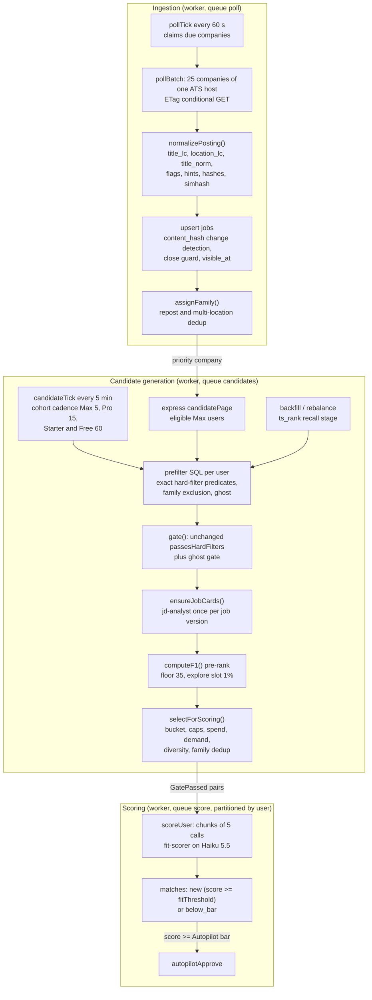
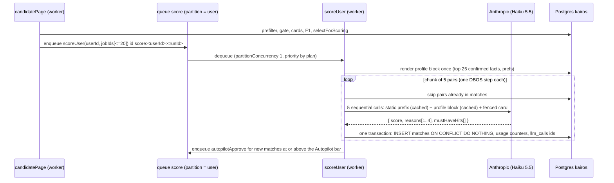

# Kairos matching pipeline at 10,000 users

Revision 1, 2026-10-23. Status: Proposed, implements `01-architecture.md` section B.7 (revision 2) and the `match-candidates` and `fit-scoring` workers of Part C. Owning modules: `server/src/modules/catalog/` (ingestion, normalization, deduplication, job cards) and `server/src/modules/matching/` (gate, pre-rank, pacing, diversity, re-scoring, quality). Database domain: `catalog-matching`.

Inputs read: `01-architecture.md` in full (B.5 queues and workflows, B.7 matching, B.8.4 and B.8.6 fit and import, B.9 agent runtime, B.10 data model, B.11 budgets, B.13 spikes, B.14 phases, Part C); `_research/cost-model.md` sections 2 to 6; `_research/anthropic-models.md`; `_research/requirements.md` (FR-11 to FR-20, FR-53, NFR-2, NFR-4, INV-1, INV-10, OQ-13, conflict 3); `_research/integrations.md` (ATS read APIs); `_research/huntr-tsenta-teardown.md` section 5 (F1, F2, F6, F7); `shared/src/schemas.ts` (`preferencesSchema`, `jobFitSchema`); `shared/src/types.ts`; the skeleton's `server/src/services/fit.ts`, `server/src/jobs/poll-boards.ts`, `server/src/jobs/score-matches.ts`, `server/src/services/ats/types.ts`, `server/src/db/schema/jobs.ts` and `server/src/routes/matches.ts`. Table names follow the architect's inventory (Part C.1) exactly.

Skills applied: `vector-database-engineer` (index choice, filtered ANN, recall versus latency, re-index planning), `embedding-strategies` (model and dimension choice, asymmetric query and passage texts, never mixing vector spaces, retrieval metrics), `hybrid-search-implementation` (lexical plus deterministic retrieval now, reciprocal rank fusion when vectors arrive). All three loaded.

Evidence tags as in the architecture: **[V]** verified in a research file or vendor documentation; **[est]** an estimate to be replaced by beta measurements; **[verify]** a behavior that a named spike must prove before the phase that needs it.

---

## 0. Summary and decisions

The matching pipeline turns about 3,000 new postings a day (12,000 at growth) into about 38,400 matches at or above each user's fit bar for 2,850 scoring-eligible users, spending about $27 a day on models at base and $36 at growth (about $0.0015 to $0.0017 per submitted application). No model is called for a pair that fails the fit gate (INV-1).

| # | Decision | Why |
|---|---|---|
| M-1 | **No embeddings at beta.** Pre-ranking is the deterministic F1 score plus Postgres full-text search. A complete embedding stage (model, texts, refresh, pgvector HNSW) is specified in section 4 as a dormant stage that switches on only through the measured trigger of `01-architecture.md` A.7 | Owner decision A: the Anthropic API has no embedding model, and the policy forbids a second provider. A local in-process model keeps the trigger path inside that policy |
| M-2 | **Exact SQL prefilter, not an approximate one.** Every SQL predicate either reproduces a `passesHardFilters` rule exactly (on columns computed by the same TypeScript code) or is omitted. The superset property is proved by a property test | `passesHardFilters` stays unchanged (pinned by `landing-fit-sample.test.ts`); exact predicates make the property test meaningful instead of probabilistic |
| M-3 | **Reposts and multi-location copies form a job family.** One match per user per family | Stops a repost from re-scoring and re-suggesting a role the user already saw, queued or skipped; feeds the F2 repost criterion |
| M-4 | **Two-stage retrieval for large scopes.** Backfill and rebalance retrieve by `ts_rank` (lexical recall stage), then rank by F1 (deterministic precision stage). Incremental windows skip the recall stage | The recall stage bounds how many job cards a single user can trigger |
| M-5 | **An exploration slot measures the F1 floor in production.** 1% of gate-passed pairs, at most one per user per day, are scored regardless of F1 | Gives an unbiased weekly estimate of how many good pairs the floor drops; this number drives the embeddings trigger |
| M-6 | **An express lane for priority companies.** New postings at a priority company go straight to eligible Max users | Meets the 5-minute priority freshness target end to end, not only at ingestion |
| M-7 | **F1 decides which matches to re-score** after facts change | Only pairs whose deterministic score moved get a new model call |
| M-8 | **Diversity is enforced when matches are created**, never by reordering the frozen feed | `GET /api/matches` order (score, then first seen) and its limit of 100 are frozen |

Reconciliations with `01-architecture.md` that the database specification (`02-database.md`) must apply:

1. `jobs.salary_max_usd` already exists in the skeleton (`server/src/db/schema/jobs.ts`); the `ADD COLUMN salary_max_usd` line in B.10.2 is dropped. Matching uses the existing column.
2. `passesHardFilters` returns `reasons: string[]`, not one `reason`. `gate()` (section 6.4) returns the array, ordered for display by FR-17.
3. The per-company cap counts applications in `draft`, `approved`, `submitting` and `submitted` (the predicate of `applications_company_cap_idx`). The skeleton counted every status; failed and withdrawn applications no longer use up the cap because the employer never received them.
4. The trigram index is built on a new `jobs.title_lc` column (TypeScript lower case), not on `title`, so the SQL predicate matches the TypeScript rule character for character (section 6.2).
5. New users get a cold-start demand budget (section 8.4), because the B.7.4 formula would otherwise allow only 10 scoring calls on day one while B.7.9 promises 15 synchronous backfill scores.

---

## 1. Pipeline overview



| Stage | Module function | Runs in | Model | Base per day | Growth per day |
|---|---|---|---|---|---|
| Poll | `pollCompanies` | `pollBatch` step | none | 168,000 polls | 552,000 polls |
| Normalize, upsert, family | `normalizePosting`, `upsertPostings`, `assignFamily` | same step | none | 3,000 new jobs | 12,000 |
| Eligibility and cohort | `selectDueUsers` | `candidateTick` | none | 2,850 users | 2,850 |
| Prefilter | `buildPrefilterQuery` | `candidatePage` step `prefilterAndGate` | none | 8.55 M pair checks, about 3% survive | 34.2 M |
| Gate | `gate` (wraps `passesHardFilters`) | same step | none | 256,500 passes | 1,026,000 |
| Job card | `ensureJobCards` | step `ensureJobCards` | `jd-analyst` | 3,112 calls (with imports) | 10,200 |
| Pre-rank | `computeF1` (mode `prerank`) | step `prerankAndPace` | none | about 153,900 above floor | about 615,600 |
| Selection | `selectForScoring` | same step | none | 115,100 pairs | 132,000 |
| Scoring | `scoreChunk` | `scoreUser` | `fit-scorer` | 115,100 calls | 132,000 |
| Matches at or above bar | | | | 38,400 (35%) | 44,000 |

Volumes are the cost model's row D (`cost-model.md` section 5) **[est]**; the F1 floor replaces the embedding floor with the same 60% keep target.

---

## 2. Ingestion, normalization and deduplication

### 2.1 Polling cadence

Polling keeps the skeleton's ATS adapters (`server/src/services/ats/`, `NormalizedJob`) and moves scheduling to DBOS (`pollTick`, `pollBatch`, `01-architecture.md` B.5.4).

| Rule | Value |
|---|---|
| Standard companies | Every 30 minutes (FR-13), `next_poll_at = now() + 30 min x (0.9 + 0.2 x random())` so polls spread evenly |
| Priority companies (`companies.priority = true`, FR-53, cap 300) | Every 5 minutes, jitter of plus or minus 20 seconds |
| Claim | `pollTick` claims `active AND next_poll_at <= now()` with `FOR UPDATE SKIP LOCKED`, at most 2,000 per tick, ordered by `priority DESC, next_poll_at`; groups them by ATS API host into batches of 25 |
| Conditional requests | `If-None-Match: <companies.etag>`; a 304 only advances `next_poll_at` and `last_polled_at` [V: weak ETags on all three boards] |
| Politeness | Partition key = ATS API host (`boards-api.greenhouse.io`, `api.lever.co`, `api.eu.lever.co`, `api.ashbyhq.com`); `partitionConcurrency: 4`; at most 1 request per second per board; Ashby never more often than its `max-age=60` [V] |
| Errors | 404 board: `active = false` (kept from the skeleton). 403 or 429: the host partition pauses 15 minutes (`host_backoff` flag) and `next_poll_at` moves out by 15 minutes. Other errors: `consecutive_errors += 1`, next poll in `min(30 min x 2^errors, 6 h)` |
| Empty-board guard | A board that returns zero postings while it has open jobs increments `companies.empty_streak`; jobs are closed only when the board returned at least one posting, or when `empty_streak >= 2` (two consecutive empty polls at least 25 minutes apart) |

### 2.2 `normalizePosting`

Every posting from a poll or an import passes through one pure function before it touches the database. The function is deterministic, has no I/O, and is versioned by `HINTS_VERSION`.

```ts
// server/src/modules/catalog/normalize.ts
import type { NormalizedJob } from "../../services/ats/types";

export const HINTS_VERSION = 1;                 // bump when any rule below changes; see section 2.5
export const DESCRIPTION_MAX_CHARS = 60_000;    // longer descriptions are cut; the cut is logged as a metric

export type SeniorityHint = "intern" | "entry" | "mid" | "senior" | "staff_plus" | "manager" | "unknown";

export interface NormalizedPosting {
  externalId: string;
  title: string;                 // trimmed, inner whitespace collapsed; otherwise as published
  titleLc: string;               // title.toLowerCase(), exactly as passesHardFilters lowers it
  titleNorm: string;             // dedup key part (rules below)
  location: string | null;
  locationLc: string;            // (location ?? "").toLowerCase()
  locationNorm: string;          // dedup key part (rules below)
  remote: boolean;
  department: string | null;
  descriptionText: string;       // htmlToText (kept), cut to DESCRIPTION_MAX_CHARS
  applyUrl: string;              // per-ATS normalization kept (FR-14)
  postedAt: Date | null;
  salaryMinUsd: number | null;   // yearly USD, adapter-parsed (FR-15)
  salaryMaxUsd: number | null;
  titleSeniorFlag: boolean;      // SENIOR_TITLE.test(title), the regex exported from services/fit.ts
  titleJuniorFlag: boolean;      // JUNIOR_TITLE.test(title)
  seniorityHint: SeniorityHint;  // seniorityOf(title)
  sponsorshipHint: "no_sponsorship" | "sponsors" | null; // section 2.3
  contentHash: string;           // sha256 hex of the canonical JSON of every field above except hashes
  descriptionHash: string;       // sha256 hex of normalizeForHash(descriptionText)
  simhash: bigint;               // 64-bit SimHash of description shingles, stored as signed bigint
  hintsVersion: number;          // HINTS_VERSION
  rawTrimmed: unknown;           // at most 1 KB of the provider payload (B.10.2)
}

export declare function normalizePosting(job: NormalizedJob): NormalizedPosting;
```

Rules:

| Field | Rule |
|---|---|
| `titleLc`, `locationLc` | JavaScript `toLowerCase()` on the published strings. These two columns exist so that SQL compares exactly the strings `passesHardFilters` compares (section 6.2) |
| `titleNorm` | `titleLc` after Unicode NFKC; parenthesized and bracketed suffixes removed (`(remote)`, `[hybrid]`, `(m/f/d)`); requisition ids removed (`\b(req|r|jr|job)[ -#]?\d{3,}\b`, trailing ` - \d{4,}`); every character except letters, digits, `+`, `#`, `.` and `/` replaced by a space; whitespace collapsed. Seniority words are kept (a "Senior" repost of a "Staff" role is a different role) |
| `locationNorm` | `locationLc` after NFKC; `remote`, `hybrid`, `onsite`, `on-site`, `anywhere` and punctuation removed; tokens sorted and joined by one space (so "New York, NY" and "NY, New York" agree); empty string when nothing remains |
| `seniorityHint` | First match wins on `titleLc`: `\b(intern|internship|co-?op)\b` intern; `\b(new grad|graduate|entry|junior|jr\.?|associate)\b` entry; `\b(staff|principal|distinguished|fellow|architect)\b` staff_plus; `\b(head of|director|vp|vice president|manager)\b` manager; `\b(senior|sr\.?|lead)\b` senior; `\b(ii|iii|2|3|mid)\b` mid; otherwise `unknown`. Used by F1 and the job card only, never by the gate |
| `sponsorshipHint` | Section 2.3 |
| `normalizeForHash` | Lower case, NFKC, digits replaced by `0`, whitespace collapsed, boilerplate lines removed when they match the shared EEO and benefits patterns (`equal opportunity employer`, `reasonable accommodation`, `e-verify`); used only for hashes |
| `simhash` | Tokens of `normalizeForHash(descriptionText)` with stop words removed; 5-token shingles; each shingle hashed with the first 8 bytes of `node:crypto` MD5; standard SimHash with weight 1 per shingle. Descriptions under 40 tokens set `simhash = 0` and never join a family by SimHash |

`normalizePosting` is pure TypeScript with stdlib hashing only. A unit test pins `titleNorm`, `locationNorm`, `seniorityHint` and `sponsorshipHint` on 120 fixture postings taken from the integration recordings.

### 2.3 Sponsorship hint and the phrase list

`sponsorshipHint = "no_sponsorship"` exactly when `NO_SPONSORSHIP.test(descriptionText)`, where `NO_SPONSORSHIP` is the regex exported from `server/src/services/fit.ts` (today: unable to sponsor, not able to sponsor, cannot sponsor, can't sponsor, no visa sponsorship, sponsorship is not available, must be a US citizen). `sponsors` is set when `\b(will|can|able to) sponsor\b|\bvisa sponsorship (is )?available\b|\bsponsorship available\b` matches and `NO_SPONSORSHIP` does not; otherwise null.

The gate uses only `no_sponsorship`, through `passesHardFilters` itself. When the owner signs off the phrase list (open question OQ-13), the list replaces the regex inside `services/fit.ts` (the one place both the gate and the hint read it), `HINTS_VERSION` increments, and section 2.5 recomputes every open job. `sponsors` is informational (F1 and the scorer prompt); it never overrides `no_sponsorship`.

### 2.4 Upsert

`upsertPostings(companyId, postings)` writes chunks of 500 rows (S-05: 500 rows x 27 columns stays far below the 65,535 bind-parameter limit):

```sql
INSERT INTO jobs AS j (company_id, external_id, title, title_lc, title_norm, location, location_lc, location_norm,
                       remote, department, description_text, apply_url, posted_at, salary_min_usd, salary_max_usd,
                       title_senior_flag, title_junior_flag, seniority_hint, sponsorship_hint, hints_version,
                       content_hash, description_hash, simhash, raw, source, search_tsv,
                       first_seen_at, visible_at, last_seen_at, updated_at)
VALUES (...)                                                         -- one row per posting
ON CONFLICT (company_id, external_id) DO UPDATE SET
  title = EXCLUDED.title, title_lc = EXCLUDED.title_lc, title_norm = EXCLUDED.title_norm,
  location = EXCLUDED.location, location_lc = EXCLUDED.location_lc, location_norm = EXCLUDED.location_norm,
  remote = EXCLUDED.remote, department = EXCLUDED.department, description_text = EXCLUDED.description_text,
  apply_url = EXCLUDED.apply_url, posted_at = EXCLUDED.posted_at,
  salary_min_usd = EXCLUDED.salary_min_usd, salary_max_usd = EXCLUDED.salary_max_usd,
  title_senior_flag = EXCLUDED.title_senior_flag, title_junior_flag = EXCLUDED.title_junior_flag,
  seniority_hint = EXCLUDED.seniority_hint, sponsorship_hint = EXCLUDED.sponsorship_hint,
  hints_version = EXCLUDED.hints_version, content_hash = EXCLUDED.content_hash,
  description_hash = EXCLUDED.description_hash, simhash = EXCLUDED.simhash, raw = EXCLUDED.raw,
  search_tsv = EXCLUDED.search_tsv,
  closed_at = NULL,
  visible_at = now(), last_seen_at = now(), updated_at = now()
WHERE j.content_hash IS DISTINCT FROM EXCLUDED.content_hash
   OR j.closed_at IS NOT NULL                                        -- reopen (fixes D-19)
RETURNING j.id, (xmax = 0) AS inserted, j.company_id, j.family_id;
```

Then, in the same transaction:

- `UPDATE jobs SET last_seen_at = now() WHERE company_id = $1 AND external_id = ANY($listed) AND closed_at IS NULL` for unchanged postings (a cheap heartbeat for the long-open ghost criterion).
- Close: `UPDATE jobs SET closed_at = now() WHERE company_id = $1 AND closed_at IS NULL AND source = 'board' AND NOT (external_id = ANY($listed))`, guarded by the empty-board rule. Jobs with `source = 'manual_url'` of an inactive company are closed only by a 404 from `fetchPosting` (section 2.8).
- `assignFamily` for every inserted row (section 2.6).
- The injection canary (`injection_suspect`, `01-architecture.md` SP-5) for inserted or changed rows.

`search_tsv` at upsert is `setweight(to_tsvector('english', title), 'A') || setweight(to_tsvector('english', left(description_text, 20000)), 'C')`; when the job card is written, the card's hard-skill, tool and certification keywords are added with weight `B` (`UPDATE jobs SET search_tsv = ... WHERE id = $1`).

A content change clears nothing on existing `matches`: a user who already has a match for the job keeps it, and the matches exclusion keeps the changed job from being scored twice for that user. The change does reset the card through `card_content_hash` (section 3.2), so new users see a fresh card.

### 2.5 Hint recomputation

When `HINTS_VERSION` increases, the daily `housekeeping` schedule runs `refreshHints`: open jobs with `hints_version < HINTS_VERSION` are re-normalized in batches of 2,000 (`jobs_hints_stale_idx`). Until a row is refreshed, the SQL prefilter treats its flags as unknown (section 6.2), so the superset property holds during the backfill. At 150,000 open jobs the refresh takes about 75 batches of about 2 seconds **[est]**.

### 2.6 Deduplication of reposts and multi-location copies (job families)

Three kinds of duplicates reach the catalog:

| Kind | Example | Detection |
|---|---|---|
| Same posting, same id | Board re-lists the same `external_id` | `UNIQUE (company_id, external_id)` (kept) |
| Repost | The employer closes posting 4411 and opens 4987 with the same text a week later | Same `company_id`, same `title_norm`, SimHash Hamming distance at most 3, first seen within 180 days of the earlier job (open or closed) |
| Multi-location copy | One role published once per city | Same rule: same company, same `title_norm`, near-identical description, different `location_norm` |

All three share one mechanism: `jobs.family_id`. A job that does not join an existing family gets `family_id = id`.

```ts
// server/src/modules/catalog/family.ts
export const REPOST_SIMHASH_MAX_DISTANCE = 3;
export const REPOST_LOOKBACK_DAYS = 180;
/** Sets family_id for newly inserted jobs; existing rows never change family. Returns families joined. */
export declare function assignFamily(tx: Tx, insertedJobIds: string[]): Promise<{ joined: number }>;
```

```sql
-- For each inserted job $id (title_norm $t, company $c, simhash $s, description length >= 40 tokens):
SELECT family_id
FROM jobs
WHERE company_id = $c
  AND title_norm = $t
  AND id <> $id
  AND first_seen_at > now() - interval '180 days'
  AND simhash <> 0
  AND bit_count((simhash # $s)::bit(64)) <= 3
ORDER BY first_seen_at
LIMIT 1;
-- found: UPDATE jobs SET family_id = <found> WHERE id = $id
-- none:  UPDATE jobs SET family_id = id      WHERE id = $id
```

The lookup reads `jobs_repost_lookup_idx (company_id, title_norm, first_seen_at DESC)`, so it scans a handful of rows per insert. `bit_count` on `bit` exists in Postgres 14 and later [V].

Effects of a family:

1. **One match per user per family.** The prefilter excludes a job when the user has any `matches` row in the same family (`matches.family_id`, set from `jobs.family_id` at insert). A user who skipped a role is not shown its repost; a user who applied is not invited to apply to the copy. A `below_bar` match counts while it exists (30 days, then the repost may be scored again on its new merits).
2. **Best location within a run.** When one run admits several jobs of one family for a user, `selectForScoring` keeps one: the first whose location satisfies the user's first listed location, else the remote one when `remoteOk`, else the most recently visible.
3. **Card reuse.** `ensureJobCards` copies the card from a family member with the same `description_hash` and the current `card_version` instead of calling `jd-analyst` (section 3.2). Multi-location copies therefore cost one card.
4. **F2 repost evidence.** `repost_pattern` holds when a family has at least 3 members with the same `location_norm` in 120 days and at least one of them closed before the next opened. `ghost-signals` (daily) computes it from the family; `job_ghost_evidence.detail` stores the counts and dates only.

Cross-company duplicates (one role posted by an agency and by the employer) are out of scope: Kairos polls employer boards only, and the per-company cap is per employer.

### 2.7 Visibility and the matching window

`visible_at` is set on insert, on reopen and on a content change (section 2.4). Candidate generation reads `visible_at` windows (section 5.2), so a reopened or materially changed job reaches users who have no match for it yet.

### 2.8 Imported jobs (F7)

`POST /api/jobs/import` (`01-architecture.md` B.8.6) calls `normalizePosting` and the same upsert with `source = 'manual_url'` for a new row, then `assignFamily`. A company created by import is `active = false`, so it is not polled until the owner activates it (open question 18 of the architecture). Matching treats an imported job like any other only after its company is activated; until then only the importing user has a match for it.

---

## 3. Structured requirements extraction (the job card)

### 3.1 What the card is

The job card (`JobCard`, `01-architecture.md` B.7.7) is written by `jd-analyst` (Haiku 5.5) once per job version and shared by every user, F1, the scorer prompt, the workspace fit route and the tailor. It never feeds the gate: deterministic fields (adapter salary, the sponsorship phrase list, the title flags) win over card fields on conflict.

| Field | Used by |
|---|---|
| `requirements[3..25]` with `terms`, `required`, `kind` | F1 requirements coverage; scorer prompt (top 12, required first); tailor; rehearsal questions |
| `keywords[0..40]` with `count`, `group` | F1 keyword match; `search_tsv` weight B; workspace keyword list |
| `mustHaves[3..8]` | Scorer prompt; `matches.must_have_hits` |
| `seniority`, `yearsMin` | F1 seniority (after the deterministic hint) and requirements coverage |
| `sponsorship`, `salary`, `remote` | Display and scorer context only |
| `disqualifiers` | Shown to the user; never decided by the model |
| `summary` (at most 120 tokens) | Scorer prompt |

### 3.2 When a card is created: lazily, once, by claim-or-wait

`ensureJobCards(jobIds)` (module `catalog`, exported to `matching` and `resume`) runs only for jobs that passed the gate for at least one user, for an imported job, or for a workspace fit or tailor request:

1. **Fresh card**: `card IS NOT NULL AND card_version = JD_CARD_VERSION AND card_content_hash = content_hash`. Use it.
2. **Family reuse**: a job in the same `family_id` with the same `description_hash` and a fresh card. Copy `card`, set `card_content_hash = content_hash`, no model call.
3. **Claim**: `UPDATE jobs SET card_claimed_until = now() + interval '60 seconds' WHERE id = $1 AND (card IS NULL OR card_version < $v OR card_content_hash IS DISTINCT FROM content_hash) AND (card_claimed_until IS NULL OR card_claimed_until < now()) RETURNING id`.
4. The winner calls `jd-analyst` with the title, the location and the description fenced as untrusted text and cut to 2,500 tokens (head 2,000 plus the last 500, where requirements sections often sit); `postValidate` normalizes every `terms` entry and keyword through the shared vocabulary (`normalizeTerm`, the alias-aware list of about 2,000 technology terms used by F1 and `checkClaims`); then it writes `card`, `card_version`, `card_content_hash`, adds keyword weights to `search_tsv` and clears the claim.
5. Losers re-read every 500 ms for up to 15 seconds, then throw a retryable step error (DBOS retries after 10 seconds).

Bounds:

| Bound | Value | On breach |
|---|---|---|
| Cards per company per hour | `matching.card_max_per_company_hour` = 100 | Remaining jobs of that company wait for the next tick (a new board with hundreds of postings cannot burst) |
| Cards per backfill or rebalance run | `min(4 x K, 400)` where K is the run's scoring allowance (section 8) | Jobs beyond the bound are not considered in that run |
| `jd-analyst` daily envelope | $8 base, $20 growth (`dailyEnvelopeUsd`) | 80%: email; 100%: cards defer to the next UTC day, jobs without a card are ranked on lexical rank only and are not scored that day |
| `jd-analyst` failure | SDK retries, Sonnet 5.5 within 2% of the day's calls, else the job is deferred | The job stays out of the run; the next tick retries |

`JD_CARD_VERSION` is the `jd-analyst` prompt version. A new version is applied lazily (a stale card is recreated when next needed) and, for open jobs that were carded in the last 14 days, through the Message Batches API (`batchAnalyze`, public text only, 50% price).

### 3.3 Card cost

| Item | Base | Growth |
|---|---|---|
| Cards a day (lazy, plus imports and workspace) | 3,112 | 10,200 |
| Family reuse rate | 10% to 20% of would-be calls **[est]** | same |
| Expected cost per call | $0.00073 | $0.00073 |
| Daily spend | about $2.27 | about $7.45 |

### 3.4 Injection safety

The description is untrusted. It is fenced, cut, and analyzed by a model whose output is a strict schema of short strings; `postValidate` drops requirement or keyword strings longer than 160 characters, containing URLs or email addresses, or containing instruction-like phrases (`ignore`, `system prompt`, `you are`, `score this`). The deterministic injection canary sets `jobs.injection_suspect`; such a job is still matched (the user may want it) but its card is built with a second-pass instruction to treat the text strictly as data, and Autopilot never acts on it (`01-architecture.md` B.6.3).

---

## 4. Embeddings and the vector index

### 4.1 Decision for the beta: no embeddings

Owner decision A puts every model call on the Anthropic API, which offers no embedding model, and forbids a second provider. The architecture therefore removes pgvector and the vector store (`01-architecture.md` A.9). What embeddings would have done is covered as follows:

| Embedding role in the original plan | Replacement at beta |
|---|---|
| Pre-rank floor before the scorer (keep about 60%) | F1 deterministic score with a calibrated floor (section 7) |
| Candidate retrieval for onboarding backfill over 150,000 to 600,000 open jobs | Postgres full-text search: `ts_rank_cd(search_tsv, query)` over the exact prefilter (section 5.4) |
| Fact retrieval for drafting agents | Deterministic requirement-to-fact mapping plus BM25-style term overlap (`01-architecture.md` B.9.7) |

The risk (R5) is that lexical and requirement-based ranking misses good matches that use different words. It is measured continuously (section 14.4, the exploration recall) and offline (section 15). If F1 pre-rank recall falls below 0.85 for two consecutive weekly evaluations, the dormant stage below is switched on.

### 4.2 The dormant embedding stage (activated only by the A.7 trigger)

Everything in this section is specified so that activation is a configuration and migration task, not a design task. None of it is built or migrated at beta.

**Model.** `Xenova/bge-small-en-v1.5` (BAAI bge-small-en-v1.5, MIT license, ONNX export, int8 quantized, about 34 MB), run in-process with `@huggingface/transformers` (transformers.js) inside the worker, in a `worker_threads` pool of 2 threads per worker replica. In-process inference sends nothing to a third party, so it stays inside decision A and the privacy invariant. Exact package version: pinned from the npm registry at activation time, at least two weeks old [verify at activation].

| Property | Value | Why |
|---|---|---|
| Dimensions | 384 | Smallest strong English retrieval model in the BGE family; storage and HNSW memory scale with dimension |
| Maximum input | 512 tokens; Kairos texts are built to at most 256 | Keeps inference near 15 to 25 ms per text on one vCPU **[est, measured in spike S-V1]** |
| Normalization | L2-normalized at encode time; cosine distance (`<=>`) in pgvector | Standard for BGE |
| Asymmetry | User profile texts are queries and get the BGE query instruction prefix `Represent this sentence for searching relevant passages: `; job texts are passages without a prefix | BGE is trained for asymmetric retrieval |
| Fallback | Voyage AI only after the owner approves it as a new sub-processor (A.7); a different model means a full re-embed into a new column, never mixed vectors | Vectors from two models are not comparable |

**What is embedded.**

| Entity | Text (at most 256 tokens) | Source | Refresh trigger |
|---|---|---|---|
| Job | `title_norm` + ` | ` + seniority (hint, else card) + ` | ` + must-haves joined by `; ` + ` | ` + up to 10 required requirement texts, then preferred ones + ` | ` + up to 15 `hard_skill`, `tool` and `certification` keywords by count | The job card, never the raw description (cards are shorter, de-boilerplated and already fenced against injection) | New card written (`card_version` or `card_content_hash` change). Closed jobs have their vector row deleted |
| User | Query prefix + target roles joined by `, ` + ` | ` + preferred seniority levels + ` | ` + the 3 most recent confirmed role-fact titles + ` | ` + up to 30 confirmed skill terms ordered by how many confirmed facts mention them | Confirmed facts and preferences only; contact data, work authorization and the salary floor are never part of the text | `prefs_version` or `facts_version` change, debounced 10 minutes (the vector is recomputed by the next `candidatePage` for that user) |

**Cost.** No API cost. Compute: about 12,400 texts a day at growth x 20 ms = about 4 CPU-minutes a day **[est]**; a full re-embed of 600,000 open jobs takes about 3.3 CPU-hours, run over a night on the `batch-llm` queue's worker threads. Memory: about 150 MB per worker replica for the model and two threads. Storage at growth: 600,000 x 768 bytes (halfvec) = 460 MB of vectors plus about 1.4 GB of HNSW graph **[est]**; at base about 0.35 GB in total.

**Storage and index (pgvector).** Activation requires the `vector` extension on the production Postgres. Spike S-V1 (section 22) confirms that Railway's `postgres-ssl:18` image ships pgvector 0.8 or later with pgBackRest PITR intact [verify]; if it does not, the vectors are stored in the same tables as `real[]` and similarity is computed exactly in the worker (section 4.4), which is fast enough at this size.

```sql
-- Created only when the embeddings trigger fires (migration name: embeddings_v1)
CREATE EXTENSION IF NOT EXISTS vector;

CREATE TABLE job_embeddings (
  job_id     uuid PRIMARY KEY REFERENCES jobs(id) ON DELETE CASCADE,
  model      text        NOT NULL,              -- 'bge-small-en-v1.5-int8'
  card_hash  text        NOT NULL,              -- sha256 of the embedded text; skips re-encoding unchanged text
  embedding  halfvec(384) NOT NULL,
  created_at timestamptz NOT NULL DEFAULT now()
);
-- Only open jobs keep a row (deleted on close), so the index covers the live catalog only.
CREATE INDEX CONCURRENTLY job_embeddings_hnsw_idx
  ON job_embeddings USING hnsw (embedding halfvec_cosine_ops)
  WITH (m = 16, ef_construction = 64);

CREATE TABLE user_embeddings (
  user_id       text PRIMARY KEY REFERENCES "user"(id) ON DELETE CASCADE,
  model         text        NOT NULL,
  source_hash   text        NOT NULL,           -- sha256 of the embedded text
  embedding     halfvec(384) NOT NULL,
  prefs_version integer     NOT NULL,
  facts_version integer     NOT NULL,
  updated_at    timestamptz NOT NULL DEFAULT now()
);
```

| HNSW parameter | Value | Reasoning |
|---|---|---|
| `m` | 16 | pgvector default; good recall for 384 dimensions at up to a few million vectors |
| `ef_construction` | 64 | pgvector default; build of 600,000 vectors in under 10 minutes with `maintenance_work_mem = 1GB` and 2 parallel workers **[est]** |
| `hnsw.ef_search` | 100 for backfill and rebalance queries (top 400); 40 for any query with `LIMIT` at most 40 | `ef_search` must be at least the `LIMIT`; 100 gives recall@100 above 0.95 in published pgvector benchmarks at this scale **[est, measured in S-V1]** |
| `hnsw.iterative_scan` | `relaxed_order` | The prefilter's `WHERE` clause removes about 97% of jobs; iterative scans keep returning rows until `LIMIT` is met instead of returning too few (pgvector 0.8) |
| `hnsw.max_scan_tuples` | 20,000 | Bounds the cost of a very selective filter; when exhausted the query falls back to exact scan of the prefiltered set |
| Recall target | Recall@100 of at least 0.95 against exact search on 200 sampled users weekly (`matching-eval` schedule) | Measured, not assumed |
| Maintenance | Rows of closed jobs deleted daily; `REINDEX INDEX CONCURRENTLY job_embeddings_hnsw_idx` monthly or when dead tuples exceed 20% | HNSW deletes leave graph tombstones |

**Never mix vector spaces.** `model` is stored on every row; queries filter `model = $active_model`. A model change adds rows under the new model name for every open job and user (dual write), switches `matching.embedding_model` when coverage reaches 100%, then deletes the old rows.

### 4.3 How vectors join the ranking when active (hybrid fusion)

Vectors never replace the gate or F1; they add a third ranked list, fused by reciprocal rank fusion (RRF, k = 60):

`fused(job) = 1/(60 + rank_F1(job)) + 1/(60 + rank_lexical(job)) + 1/(60 + rank_vector(job))`

- **Incremental windows** (small job sets): the user vector is dotted with every window job's vector in the worker (exact); F1 and vector ranks are fused; the F1 floor still applies, lowered by `matching.f1_floor_hybrid_delta` (default 5 points) for jobs in the top 20% of the vector rank, so semantically strong jobs with different vocabulary pass.
- **Backfill and rebalance** (large scopes): the recall stage takes the union of the top `min(4 x K, 400)` by lexical rank and the top `min(4 x K, 400)` by an HNSW query over the prefiltered set, then fuses all three ranks.

The stage stays on only while the offline evaluation shows fused pre-rank recall at least 5 points above F1-only recall (section 15); otherwise it is switched off again (`matching.embeddings_enabled = false`) and the tables are kept for 30 days.

### 4.4 Activation runbook (summary)

1. Two consecutive weekly evaluations below 0.85 F1 pre-rank recall (section 14.4); the owner is emailed with the numbers.
2. Spike S-V1 (2 days): pgvector on `postgres-ssl:18` with PITR, encode latency, recall@100, memory per worker.
3. Migration `embeddings_v1`; worker image gains the model files; `matching.embeddings_enabled` stays false.
4. Night re-embed of open jobs and eligible users; HNSW build.
5. Shadow week: fused ranks are computed and logged next to F1-only ranks; exploration recall compared.
6. Switch on by cohort (Max, Pro, Starter, Free) when shadow recall beats F1-only by at least 5 points.

---

## 5. Candidate generation

### 5.1 Modes

One workflow, `candidatePage` (queue `candidates`), runs every mode. Its input is ids only.

```ts
// server/src/modules/matching/candidates.ts
export type CandidateMode = "incremental" | "express" | "backfill" | "rebalance" | "rescore";

export interface CandidatePageInput {
  mode: CandidateMode;
  userIds: string[];              // 1..100, one cohort
  windowUpperIso?: string;        // incremental: fixed at tick start so a replay sees the same window
  jobIds?: string[];              // express: the new or changed jobs of one priority company (1..500)
  prefsVersion?: number;          // backfill: the version that started it
  factsVersion?: number;          // rescore
}
```

| Mode | Started by | Scope of jobs | Retrieval stage | Workflow id | Priority on `candidates` |
|---|---|---|---|---|---|
| `incremental` | `candidateTick` every 5 minutes | `visible_at` window since the user's cursor | none (window is small) | `cand:<tickEpoch>:<cohort>:<page>` | Max 10, Pro 20, Starter 30, Free 40 |
| `express` | `pollBatch` after upserting new or changed jobs of a priority company | Those job ids | none | `express:<companyId>:<epochMinute>:<page>` | 5 |
| `backfill` | `PUT /api/profile/preferences`; first parsed and confirmed resume | Open jobs | lexical, top `min(4 x K, 400)` | `backfill:<userId>:<prefsVersion>` | 15 |
| `rebalance` | `rebalanceTick` hourly, for users whose local time is 06:00 to 06:59 | Open jobs visible in the last 14 days | lexical, top `min(4 x K, 400)` | `rebal:<userId>:<localDate>` | 35 |
| `rescore` | `rescoreTick` daily 04:00 UTC | The user's recent matches (section 12.2) | none | `rescore:<userId>:<factsVersion>` | 45 |

Steps of `candidatePage`, each ids-only (`01-architecture.md` B.5.6):

1. `prefilterAndGate`: per user, the prefilter query (section 6.2) for the mode's scope, then `gate()` on the survivors in TypeScript. Writes `user_daily_usage.filtered` reason counters. Output: counts.
2. `ensureJobCards`: cards for distinct gate-passed jobs, bounded per section 3.2. Output: counts.
3. `prerankAndPace`: `computeF1` in pre-rank mode per pair, floor and exploration (section 7), `selectForScoring` (sections 8 and 9), `admit()` for each selected pair; enqueue `scoreUser` per user with the selected job ids; advance the cursor (incremental only); store `user_match_state.top_gaps`. Output: counts.

Because steps 1 and 3 recompute from the database, a replayed step produces the same pairs or fewer (pairs scored in between are excluded by the matches check), so no pair is paid twice.

### 5.2 Incremental windows and cohort cadence

As in `01-architecture.md` B.7.3, with these details fixed:

- `candidateTick` selects eligible users (section 5.5) with `next_match_at <= now()`, ordered by plan (Max, Pro, Starter, Free) then `next_match_at`, at most 5,000 per tick, and enqueues pages of 100 users of one cohort. `windowUpperIso = now() - 15 seconds` is fixed at tick start.
- Scope: `visible_at > cursor_at - interval '2 minutes' AND visible_at <= $upper AND closed_at IS NULL`.
- After step 3 commits: `cursor_at = $upper`, `next_match_at = now() + plan.matchCadenceMinutes`.
- If the downstream `scoreUser` fails, its final step moves `cursor_at` back to the window start (fixes D-21).

Window sizes (average, peak is about 3x):

| Cohort | Cadence | Jobs per window, base | Jobs per window, growth |
|---|---|---|---|
| Max | 5 min | 10 | 42 |
| Pro | 15 min | 31 | 125 |
| Starter, Free | 60 min | 125 | 500 |

### 5.3 Express lane for priority companies

After `pollBatch` upserts a priority company (`companies.priority = true`) and at least one row was inserted, reopened or changed, it enqueues `express` pages covering all eligible Max users (255 a day at base, at most 300 by the FR-53 cap logic of their activity) with those job ids. The express run uses the same steps, pacing and caps as an incremental run, and does not move `cursor_at`; the next incremental tick sees the same jobs and skips them through the matches check (and gate work on a handful of jobs is negligible). This brings a priority posting into a Max user's feed within about 2 minutes of ingestion (section 13).

### 5.4 Backfill and rebalance: two-stage retrieval

Large scopes (150,000 open jobs at base, 600,000 at growth) use a lexical recall stage before the gate:

1. **Allowance first.** `K` = the number of pairs this run may score (section 8). If `K = 0`, the run ends.
2. **Recall stage.** The prefilter query with scope "open jobs" (backfill) or "visible in the last 14 days" (rebalance), ordered by `ts_rank_cd(j.search_tsv, $q) DESC, j.visible_at DESC`, `LIMIT min(4 x K, 400)`. The query `$q` is `plainto_tsquery('english', role_1) || ... || plainto_tsquery('english', skill_1) || ...` over the user's target roles and up to 15 confirmed skill terms (by fact count). Ranking is not filtering: a job with no term overlap still ranks, last.
3. **Gate, cards, F1 and selection** as in every mode; F1 decides the order of what is scored.

Backfill specifics (`01-architecture.md` B.7.9): the first `matching.backfill_sync_pairs` (15) selected pairs are scored on the `score` queue at backfill priority so the feed is not empty after onboarding; the rest go to Message Batches through `batchScore` only if the Anthropic zero-data-retention terms cover batch (architecture open question 11), otherwise to the `score` queue at backfill priority. Backfill draws from the daily cap and never adds to it.

Rebalance purpose: recover the best pairs that per-run pacing dropped (a Starter user's hourly window can hold more survivors than the bucket allows), and pairs that a company cap blocked until a 30-day application aged out. It may use up to `matching.rebalance_cap_share` (25%) of the plan's `dailyScoringCap`, bypassing the bucket's burst limit but not the cap, the spend cap or the demand budget. It runs once per user per local day (`user_match_state.rebalanced_on`).

### 5.5 Eligibility

A user is scoring-eligible at tick time when every condition holds; the first failing condition is the `pausedReason` shown in `GET /api/usage/today` (section 17):

| Order | Condition | `pausedReason` when false |
|---|---|---|
| 1 | `ops_flags.pause_scoring` is off and `llm_paused` is off | `global_pause` |
| 2 | `profiles.preferences IS NOT NULL` | `no_preferences` |
| 3 | At least 1 confirmed fact (`facts_user_confirmed_idx`) | `no_confirmed_facts` |
| 4 | A session seen in the last 7 days | `inactive` |
| 5 | Available credits (`credit_balances.balance - in_flight`) above 0 | `no_credits` |
| 6 | Billing not paused (`profiles.applications_paused_at IS NULL`) | `billing_paused` |
| 7 | `user_daily_usage.scored < plan.dailyScoringCap` | `daily_cap` |
| 8 | `user_daily_usage.pipeline_usd < plan.dailyModelSpendCapUsd` | `spend_cap` |
| 9 | Unacted `new` matches at most 2 x the demand budget | `unread_matches` |

```sql
-- candidateTick, one cohort (simplified; plan from subscriptions, limits from plans.ts passed as parameters)
SELECT ums.user_id
FROM user_match_state ums
JOIN profiles p           ON p.user_id = ums.user_id AND p.preferences IS NOT NULL AND p.applications_paused_at IS NULL
JOIN credit_balances cb   ON cb.user_id = ums.user_id AND cb.balance - cb.in_flight > 0
JOIN subscriptions s      ON s.user_id = ums.user_id AND s.plan = $plan
LEFT JOIN user_daily_usage d ON d.user_id = ums.user_id AND d.day = current_date
WHERE ums.next_match_at <= now()
  AND EXISTS (SELECT 1 FROM session se WHERE se.user_id = ums.user_id AND se.updated_at > now() - interval '7 days')
  AND EXISTS (SELECT 1 FROM facts f WHERE f.user_id = ums.user_id AND f.confirmed)
  AND coalesce(d.scored, 0) < $dailyScoringCap
  AND coalesce(d.pipeline_usd, 0) < $dailySpendCap
ORDER BY ums.next_match_at
LIMIT 5000;
```

The unread-matches pause (condition 9) is evaluated per user in step 3, since it needs the demand budget.

---

## 6. Hard filters in SQL and the gate

### 6.1 The rule set (unchanged)

The fit gate is `passesHardFilters(job, prefs, recentApplicationsToCompany)` from `server/src/services/fit.ts`, moved to `server/src/modules/matching/hard-filters.ts` without any change to logic or reason strings. Its rules, with the reason string each produces:

| Rule | Reason string (pinned) | FR-17 display order |
|---|---|---|
| Seniority: junior-only preferences and `SENIOR_TITLE` matches the title | `Title is more senior than you asked for` | 1 |
| Seniority: senior-only preferences and `JUNIOR_TITLE` matches | `Title is more junior than you asked for` | 1 |
| Sponsorship: the user needs sponsorship and `NO_SPONSORSHIP` matches the description | `Posting says it does not sponsor visas` | 2 |
| Per-company cap reached | `You hit your per-company limit for the last 30 days` | 3 |
| Role: no target role has all its words (longer than 2 characters) in the title | `Title does not match your roles` | 4 |
| Location: not remote-and-remote-ok, list not empty, no listed location contained in the job location | `Location is outside your list` | 4 |
| Excluded company (case-insensitive equality) | `Company is on your exclude list` | 4 |
| Excluded keyword in title or description | `Mentions excluded keyword "<keyword>"` | 4 |
| Posted salary maximum below the floor | `Posted salary is below your floor` | 4 |

The function collects every failing reason. `gate()` orders a copy of the array by the FR-17 display order (stable within a group) for any response that shows a reason; the function itself and its output order are untouched, so the landing test stays green.

### 6.2 The exact SQL prefilter

The prefilter runs per user, so every user's preferences become plain parameters. Each predicate is either the exact SQL form of a rule above, computed on columns written by the same TypeScript code, or it is left to TypeScript.

```ts
// server/src/modules/matching/prefilter.ts
export interface UserPrefilter {
  userId: string;
  roleWordPatterns: string[][];    // per role: LIKE patterns '%' + escapeLike(word) + '%' for words of length > 2 of role.toLowerCase().split(/\s+/)
  anyRoleMatchesAll: boolean;      // true when some role has no word longer than 2 characters (Array.every on [] is true)
  wantsJuniorOnly: boolean;        // prefs.seniority.every(s => s === "intern" || s === "entry")
  wantsSeniorOnly: boolean;        // prefs.seniority.every(s => s === "senior" || s === "lead")
  noLocations: boolean;            // prefs.locations.length === 0
  remoteOk: boolean;
  locationPatterns: string[];      // '%' + escapeLike(l.toLowerCase()) + '%'
  salaryFloorUsd: number | null;
  needsSponsorship: boolean;       // workAuthorization in needs_sponsorship_now, needs_sponsorship_later, opt_stem_opt
  cappedCompanyIds: string[];      // companies where companyApplicationCount >= prefs.maxApplicationsPerCompanyPer30Days
}

export type PrefilterScope =
  | { kind: "window"; fromIso: string; toIso: string }
  | { kind: "jobs"; jobIds: string[] }
  | { kind: "open"; visibleSinceIso: string | null; rankQuery: string[]; limit: number };

export declare function toUserPrefilter(userId: string, prefs: Preferences, companyCounts: Map<string, number>): UserPrefilter;
export declare function buildPrefilterQuery(f: UserPrefilter, scope: PrefilterScope): SQL;  // drizzle sql template
```

The generated SQL (parameters shown as names):

```sql
SELECT j.id
FROM jobs j
WHERE j.closed_at IS NULL
  AND j.ghost_verdict <> 'likely'                                     -- ghost gate (F2)
  -- scope: one of
  AND j.visible_at > :from AND j.visible_at <= :to                    -- window
  -- or  AND j.id = ANY(:jobIds)                                      -- express
  -- or  AND (:visibleSince IS NULL OR j.visible_at > :visibleSince)  -- backfill / rebalance
  -- role: exact form of titleMatchesRole on title_lc
  AND ( :anyRoleMatchesAll
        OR (j.title_lc LIKE :r1w1 AND j.title_lc LIKE :r1w2)          -- role 1, all words
        OR (j.title_lc LIKE :r2w1)                                    -- role 2 ...
      )
  -- seniority: exact, unknown while hints are stale
  AND NOT (:wantsJuniorOnly AND j.hints_version = :hv AND j.title_senior_flag)
  AND NOT (:wantsSeniorOnly AND j.hints_version = :hv AND j.title_junior_flag)
  -- location: exact form of the location rule on location_lc
  AND (:noLocations OR (:remoteOk AND j.remote) OR j.location_lc LIKE ANY(:locationPatterns))
  -- salary: exact
  AND (:salaryFloor::int IS NULL OR j.salary_max_usd IS NULL OR j.salary_max_usd >= :salaryFloor)
  -- sponsorship: exact, unknown while hints are stale
  AND (NOT :needsSponsorship OR j.hints_version <> :hv OR j.sponsorship_hint IS DISTINCT FROM 'no_sponsorship')
  -- per-company cap: exact (same count the gate receives)
  AND NOT (j.company_id = ANY(:cappedCompanyIds))
  -- one match per user per family
  AND NOT EXISTS (SELECT 1 FROM matches m WHERE m.user_id = :userId AND m.family_id = j.family_id)
-- open scope only:
ORDER BY ts_rank_cd(j.search_tsv, :tsquery) DESC, j.visible_at DESC
LIMIT :limit;
```

Left to TypeScript (the SQL is looser here, which keeps the superset property): excluded companies and excluded keywords. Both are rare and cheap to check on the 3% that survive.

Exactness notes, each covered by the property test:

- `title_lc` and `location_lc` are written by JavaScript `toLowerCase()`, the same call `passesHardFilters` makes, so `LIKE '%w%'` on them equals `String.prototype.includes` on the same strings (byte-wise substring on valid UTF-8 equals UTF-16 substring for valid strings). `escapeLike` escapes `\`, `%` and `_`. Postgres `lower()` is never used, because its case mapping depends on the collation and can differ from JavaScript.
- A role whose words are all 2 characters or shorter (for example "QA") matches every title in `passesHardFilters` (`[].every` is true); `anyRoleMatchesAll` reproduces that.
- `title_senior_flag`, `title_junior_flag` and `sponsorship_hint` come from the same exported regexes (`SENIOR_TITLE`, `JUNIOR_TITLE`, `NO_SPONSORSHIP`). A row with a stale `hints_version` is treated as unknown, which can only keep more rows.
- The company count is one query for all users of a page, and the same numbers are passed to `gate()`.

### 6.3 Per-company cap count

```sql
-- companyApplicationCounts(userIds): one query per page of up to 100 users
SELECT a.user_id, j.company_id, count(*)::int AS n
FROM applications a
JOIN jobs j ON j.id = a.job_id
WHERE a.user_id = ANY(:userIds)
  AND a.created_at > now() - interval '30 days'
  AND a.status IN ('draft','approved','submitting','submitted')
GROUP BY a.user_id, j.company_id;
```

It reads `applications_company_cap_idx (user_id, created_at DESC) WHERE status IN (...)`. The same count guards `queueMatch` and `approveCore` at write time (`01-architecture.md` B.5.4, B.6.4), so a match created before the cap was reached cannot be sent past it.

### 6.4 `gate()` and `admit()`

```ts
// server/src/modules/matching/gate.ts
export type GateResult = { ok: true } | { ok: false; reasons: string[] };   // reasons in FR-17 display order

export function gate(job: JobForGate, prefs: Preferences, ctx: GateContext): GateResult {
  const r = passesHardFilters(toFitJob(job), prefs, ctx.recentApplicationsToCompany);  // unchanged
  const reasons = orderByFr17(r.reasons);
  if (job.ghostVerdict === "likely") reasons.push("Likely ghost posting");            // new, separate reason
  return reasons.length === 0 ? { ok: true } : { ok: false, reasons };
}

export type Selection = "ranked" | "explore" | "express" | "backfill" | "rebalance" | "rescore" | "import";

/** The only constructor of GatePassed. Requires a passed gate and either F1 at or above the floor or selection "explore". */
export declare function admit(
  job: JobForGate, ctx: GateContext, f1: number, floor: number, selection: Selection,
): GatePassed | null;
```

`GatePassed` gains `selection: Selection` (written to `matches.selection`). The lint rule forbidding `as GatePassed` and the gateway spy test (zero `fit-scorer` calls for every hard-filter and ghost fixture) are as in `01-architecture.md` B.7.5.

### 6.5 Superset property test

`server/test/matching/prefilter-superset.int.test.ts` (Testcontainers Postgres 18):

1. A seeded generator builds 10,000 `(job, preferences, companyCount)` fixtures, biased toward edges: roles with only short words, titles with non-ASCII letters (`İ`, `ß`, `é`), `%` and `_` in locations, null locations, salary equal to the floor, stale `hints_version`, each `workAuthorization` value, counts equal to the cap.
2. Jobs are inserted through `normalizePosting` and `upsertPostings`.
3. For each fixture: if `passesHardFilters(...).pass` is true, the prefilter query must return the job. One counterexample fails CI.
4. A second assertion measures tightness: among fixtures that fail only on SQL-expressible rules, the prefilter must exclude at least 99%.

---

## 7. Pre-rank: F1, the floor and exploration

### 7.1 F1 in pre-rank mode

F1 (`computeF1`, `01-architecture.md` B.7.7) runs with `resumeText = null` and an options argument added by this specification:

```ts
// server/src/modules/matching/f1.ts (addition)
export interface F1Options {
  mode: "prerank" | "display";
  /** Credit for a requirement or keyword covered only by unconfirmed imported facts. 0 in display mode always. */
  unconfirmedCredit: 0 | 0.5;
}
export declare function computeF1(input: F1Input, opts?: F1Options): F1Result;   // default { mode: "display", unconfirmedCredit: 0 }
```

- `display` (the workspace fit route, the tailor, imports): unchanged; unconfirmed matches are reported as `unconfirmed` and earn nothing.
- `prerank`: `has_fact` keywords score 1 (no resume text exists), and during cold start (section 16) requirements and keywords covered only by unconfirmed facts with `asserted_by = 'import'` earn half credit. Pre-rank output is never shown and never sent to a model, so this does not touch the truth lock.

Fact terms (`F1Input.facts[].terms`) are extracted once per user per `facts_version` with `extractTerms(text)` over the shared vocabulary and held in memory for the step.

### 7.2 The floor

| Parameter | Value | Notes |
|---|---|---|
| `matching.f1_floor` | 35 | Initial; calibrated in spike S-F1 so that the floor drops under 2% of pairs the scorer rates 75 or more while keeping about 60% of gate-passed pairs |
| `matching.f1_floor_cold_start` | 20 | Section 16 |
| Calibration cadence | Weekly, from the exploration sample (section 14.4) and the offline set (section 15) | A change of more than 5 points needs owner sign-off (it moves cost) |

Pairs below the floor are dropped for this run; they are not stored. They can come back through rebalance if the user's facts change.

### 7.3 The exploration slot

To measure what the floor drops, `selectForScoring` admits one extra pair with `selection = 'explore'`:

- For each user run, every gate-passed pair (above or below the floor) has probability `matching.explore_rate` (0.01) of being the run's exploration candidate; at most `matching.explore_max_per_user_day` (1) per user per UTC day.
- The pair is scored normally and counts against the user's cap and spend; if its score clears the user's bar it becomes a normal `new` match.
- `matches.prerank_score` and `matches.selection` let the weekly evaluation compute floor recall without bias (section 14.4).

Cost: about 1,000 calls a day at base (one per user on about a third of eligible users' days) x $0.00021 = about $0.21 a day **[est]**.

### 7.4 Ordering

Within a run, admitted candidates are ordered by F1 descending, then by `visible_at` descending, then by job id (deterministic). Lexical rank decides only which jobs enter the run in backfill and rebalance (section 5.4); it is never added to F1 while embeddings are off.

---

## 8. Per-user daily scoring budget by plan

### 8.1 Plan fields (from `shared/src/plans.ts`, additive, `01-architecture.md` B.7.4)

| Plan | `dailyScoringCap` | `dailyModelSpendCapUsd` (pipeline) | `matchCadenceMinutes` | Bucket refill a day (1.25 x cap) | Rebalance share (25%) |
|---|---|---|---|---|---|
| Free | 20 | $0.05 | 60 | 25 | 5 |
| Starter | 120 | $0.20 | 60 | 150 | 30 |
| Pro | 140 | $0.25 | 15 | 175 | 35 |
| Max | 350 | $0.50 | 5 | 437.5 | 87 |

`dailyScoringCap = ceil(1.1 x (applicationsPerCycle / 30) / (0.35 fit yield x 0.9 submit success))`, rounded, so each paid plan can reach its allowance. Limits come only from `plans.ts` (INV-10); the matching module reads them through `planFor(userId)`.

### 8.2 The allowance of one run

```ts
// server/src/modules/matching/pacing.ts
export interface ScoringBudget {
  bucketTokens: number;     // after refill: min(burst, tokens + elapsedDays x 1.25 x cap)
  capRemaining: number;     // dailyScoringCap - user_daily_usage.scored
  spendRemaining: number;   // dailyModelSpendCapUsd - user_daily_usage.pipeline_usd
  demandRemaining: number;  // demandBudget - scored today
}
export declare function runAllowance(b: ScoringBudget, mode: CandidateMode, plan: Plan): number;
```

| Mode | `K` (pairs this run may score) |
|---|---|
| `incremental`, `express` | `min(floor(bucketTokens), capRemaining, floor(spendRemaining / 0.00021), demandRemaining)` with burst 5 |
| `backfill` | `min(capRemaining, floor(spendRemaining / 0.00021), demandRemaining)`; no burst limit |
| `rebalance` | `min(ceil(0.25 x cap), capRemaining, floor(spendRemaining / 0.00021), demandRemaining)`; no burst limit |
| `rescore` | `min(20, next day's capRemaining)`; counted against the next UTC day (section 12.2) |

`0.00021` is `fit-scorer`'s expected cost per call (`AgentSpec.expectedCostUsd`), read from the agent registry, not hard-coded in matching.

### 8.3 Demand budget

`demandBudget = clamp(10 + 2.5 x avgDailyMatchActions(last 3 days), 10, dailyScoringCap)`, where an action is a queue, a skip or an Autopilot draft (`user_daily_usage.match_actions`). Scoring pauses for a user while their unacted `new` matches (open jobs) exceed `2 x demandBudget`.

### 8.4 Cold-start demand budget

For the first 3 days after a user first becomes eligible (`user_match_state.first_eligible_at`), `demandBudget = min(dailyScoringCap, 40)`, so the 15 synchronous backfill pairs and the first day's incremental runs are not starved by a history the user does not have yet. Free users are therefore bound by their cap of 20.

### 8.5 Spend cap behavior

As in `01-architecture.md` B.7.4: scoring stops at `dailyModelSpendCapUsd` until 00:00 UTC; user-initiated drafting continues to 1.5x; Autopilot stops at 1.0x. The scorer charges `user_daily_usage.pipeline_usd` in the same transaction that writes the match (section 10.2).

---

## 9. Diversity

One company must not flood a user's feed or their scoring budget. Enforced in `selectForScoring`, after ordering and before `admit()`:

| Rule | Config key | Default |
|---|---|---|
| One job per family per run, best location first (section 2.6) | none | always |
| At most N scored pairs per company per user per UTC day | `matching.max_scored_per_company_day` | 4 |
| At most N open `new` matches per company per user | `matching.max_open_new_per_company` | 3 |
| Never more pairs from one company than its remaining application cap plus 1 | none | always |
| Round-robin across companies when a run has more candidates than `K` | none | always |

Round-robin: candidates are grouped by company, each group ordered by F1; the selector takes the best remaining candidate of the company whose best remaining candidate has the highest F1, then moves that company to the back of the rotation until every other company with a candidate within 10 F1 points has had a turn. This is a simple maximal-marginal-relevance rule with company identity as the only redundancy signal.

```ts
// server/src/modules/matching/select.ts
export interface RankedCandidate {
  jobId: string; companyId: string; familyId: string; f1: number; visibleAt: Date;
  locationRank: number;            // 0 = matches the user's first listed location, then remote, then others
  companyCapRemaining: number;
  companyScoredToday: number;
  companyOpenNew: number;
}
export declare function selectForScoring(
  candidates: RankedCandidate[], k: number, floor: number, explore: { rate: number; usedToday: boolean; rng: () => number },
): { pairs: { jobId: string; f1: number; selection: Selection }[]; dropped: { belowFloor: number; diversity: number; budget: number } };
```

`rng` is seeded with `hash(userId, workflowId)` so a replayed step selects the same exploration pair.

Ingestion-side diversity: `ensureJobCards` limits cards per company per hour (section 3.2), so a new board with hundreds of postings cannot crowd out other companies' cards in a tick.

---

## 10. Batch formation for LLM scoring

### 10.1 One call per pair, batched per user

`fit-scorer` scores one `(user, job)` pair per call. Multi-job prompts were considered and rejected: the cached profile block already makes the per-call overhead about $0.000018, so packing 5 jobs into one call would save under 10%, while one injected posting could skew five scores and one schema failure would lose five results.

Calls are grouped per user to keep the profile block in the 5-minute prompt cache:



| Parameter | Value | Why |
|---|---|---|
| Pairs per `scoreUser` | at most 20 | Bounds one workflow to about 30 seconds; larger runs split into several workflows |
| Pairs per step (chunk) | 5 | One checkpoint per 5 calls (`01-architecture.md` B.5.7 write budget) |
| Minimum batch | 3 pairs, or 60 minutes since the user's last scoring call | Fewer, warmer batches keep the profile prefix cached (cost model: 90% hit on the profile block) |
| `score` queue | `partitionQueue` by user, `partitionConcurrency: 1`, `concurrency: 24`, `rateLimit 1,200 per minute`, priorities Max 10, Pro 20, Starter 30, Free 40, backfill +5 | Per-user cache locality and fairness; 2x the peak of 12 calls in flight |

### 10.2 The scorer call

Input (`01-architecture.md` B.9.2 and B.9.5): static prefix (rubric, anchors, schema notes, about 1,024 tokens, cache breakpoint 1); the per-user profile block (roles, seniority and location preferences, top 25 confirmed facts by kind priority and recency, about 900 tokens, cache breakpoint 2; never contact details, work authorization or the salary floor); then the fenced variable block: job title, company, location and remote flag, card `summary`, `mustHaves`, the top 12 requirements (required first) and the card seniority. The raw description is not sent: the card is shorter, de-boilerplated and already analyzed for injection. About 2,500 input tokens, 120 output, `max_tokens` 200.

Each chunk step's transaction:

```sql
INSERT INTO matches (id, user_id, job_id, family_id, passed_filters, score, reasons, status,
                     source, selection, prerank_score, scorer_version, must_have_hits, llm_call_id, scored_at, created_at)
VALUES (gen_random_uuid(), :userId, :jobId, :familyId, true, :score, :reasons,
        CASE WHEN :score >= :fitThreshold THEN 'new'::match_status ELSE 'below_bar'::match_status END,
        'pipeline', :selection, :f1, :scorerVersion, :mustHaveHits, :llmCallId, now(), now())
ON CONFLICT (user_id, job_id) DO NOTHING;

INSERT INTO user_daily_usage (user_id, day, scored, pipeline_usd)
VALUES (:userId, current_date, :n, :usd)
ON CONFLICT (user_id, day) DO UPDATE
  SET scored = user_daily_usage.scored + EXCLUDED.scored,
      pipeline_usd = user_daily_usage.pipeline_usd + EXCLUDED.pipeline_usd;
```

`fitThreshold` is read inside the transaction, so a preference change during scoring uses the new bar.

### 10.3 Message Batches

Backfill beyond the first 15 pairs and nightly re-scores go through `batchScore` (queue `batch-llm`) only when the zero-data-retention terms cover batch requests; otherwise they run on the `score` queue at backfill priority. Batch results are applied with the same transaction (idempotent through `ON CONFLICT DO NOTHING`); expired or errored requests are re-queued on `score`. Batch price is 50% (about $0.000105 per call).

### 10.4 Failures

| Failure | Handling |
|---|---|
| 429, 5xx, timeout | SDK retries (2); then the step fails and DBOS retries the step after 10 s, 30 s, 90 s; then the workflow fails, `cursor_at` is moved back (incremental) and the pairs return on the next tick |
| Schema failure | One repair re-ask; then the pair is skipped for this run (no row written, counted in `matching_scorer_failures_total`) |
| `refusal` stop reason | Pair skipped, `llm_calls.status = 'blocked'`, never retried |
| Spend envelope at 100% for `fit-scorer` | Scoring pauses globally until 00:00 UTC (B.11.2); the shedding order puts backfill and re-scores first |

---

## 11. Thresholds and written reasons

### 11.1 Thresholds

| Threshold | Value | Source | Effect |
|---|---|---|---|
| Fit bar | `prefs.fitThreshold`, 50 to 95, default 75 (FR-11) | `preferencesSchema`, `DEFAULT_PREFERENCES` | Score at or above: `new` (in the feed); below: `below_bar` (server only, deleted after 30 days) |
| Autopilot bar | Default 85, minimum 80 (architecture open question 14) | `autopilot_settings` | New pipeline match at or above it with `ghost_verdict = 'none'`, `injection_suspect = false` and `source = 'pipeline'` enqueues `autopilotApprove` |
| F1 floor | 35 (cold start 20) | `ops_flags` key `matching.f1_floor` | Pre-rank cut before any scorer call |
| F1 band | poor below 50, fair 50 to 74, great 75 and above | `jobFitSchema.band` | Workspace display only |
| Ghost | `likely` excluded by the gate; `possible` shown with evidence; Autopilot skips `possible` and `likely` | F2 | |

### 11.2 Written reasons

Every match carries 1 to 4 reasons (FR-18), shown in the feed. Rules enforced by `fit-scorer`'s `postValidate`:

| Rule | Check |
|---|---|
| Length | Each reason at most 20 words and 160 characters |
| Grounding | Each reason refers to the job (title, requirement, must-have, seniority, location) or to the user's confirmed facts or preferences; a reason containing a number must contain a number that appears in the card or in the profile block |
| Polarity matches the score | A score at or above the user's bar has at least one positive reason; a score below 50 has at least one gap reason |
| No protected attributes | No reason mentions age, gender, race, ethnicity, religion, nationality, citizenship, visa or sponsorship status, disability, pregnancy, marital status or sexual orientation (a fixed pattern list shared with `classifySensitive`). Sponsorship is a deterministic gate rule, never a model reason |
| No contact data or links | No URL, email address or phone number |
| Must-have hits | `mustHaveHits` entries must be indices into the card's `mustHaves` |

A violation triggers the single repair re-ask; a second violation drops the offending reasons; if none remains, the pair is skipped. Gate failures (imports and `GET /api/jobs/:jobId/fit` for `below_bar` imports) show the fixed reason strings from section 6.1, never model text.

---

## 12. Re-scoring when preferences or facts change

### 12.1 Preferences change (immediate)

`PUT /api/profile/preferences` (frozen route; response unchanged) runs, in its transaction, `prefs_version = prefs_version + 1` and enqueues `backfill:<userId>:<prefsVersion>`. The backfill workflow's first step, `reconcileMatchesForPrefs`, then applies:

| Change | Action on existing matches | Model calls |
|---|---|---|
| Any change | Each `new` match on an open job whose job now fails `gate()` under the new preferences becomes `expired` (an existing `match_status` value, already hidden by `GET /api/matches`) | none |
| `fitThreshold` raised | `new` matches with `score < new bar` become `below_bar` | none |
| `fitThreshold` lowered | `below_bar` matches on open jobs with `score >= new bar` that pass `gate()` become `new` | none |
| Roles, locations, seniority, salary or authorization changed | Backfill under the new preferences (section 5.4) | within the day's cap |

`queued` and `skipped` matches never change. A skip is the user's decision.

### 12.2 Facts change (nightly, F1-guided)

Confirming, editing or removing a fact bumps `user_match_state.facts_version` (debounced: one bump per transaction). The `rescoreTick` schedule (daily 04:00 UTC) enqueues `rescore:<userId>:<factsVersion>` for users with `facts_version > rescored_facts_version` who were active in the last 7 days.

The rescore run recomputes F1 (pre-rank mode) for the user's matches created in the last 21 days on open jobs and selects at most 20 pairs:

1. `below_bar` matches with `score >= fitThreshold - 15` whose F1 rose by at least `matching.rescore_f1_delta` (5) since `matches.prerank_score`, ordered by F1 gain;
2. then `new` matches whose F1 fell by at least 10 points (a removed or corrected fact), ordered by F1 loss.

Re-scored pairs replace `score`, `reasons`, `prerank_score`, `scorer_version`, `llm_call_id` and `scored_at` with an `UPDATE ... WHERE status IN ('new','below_bar')` (never touching `queued` or `skipped`); the status follows the bar. Calls count against the next UTC day's cap and go through Message Batches when allowed. `rescored_facts_version` is set to the version the run used. F1 decides what is worth a model call, so a fact edit that changes no requirement coverage costs nothing.

### 12.3 Job content change

A changed job (new `content_hash`) gets a new card on next use. Existing matches are not re-scored (the user already judged them); users without a match see it again through `visible_at`.

---

## 13. Freshness service levels

NFR-2: new postings seen within 30 minutes, within 5 minutes for priority companies. "Seen" is ingestion. This specification also sets an end-to-end feed target per plan, because users judge freshness by their feed.

| Measure | Definition | Target (p95) | Metric |
|---|---|---|---|
| Poll lateness | `pollBatch` start minus the company's `next_poll_at` | 2 minutes | `matching_poll_lateness_seconds{tier}` |
| Ingestion lag, standard | `jobs.first_seen_at - jobs.posted_at` for providers that publish a posting time [verify field per ATS in S-I1], else bounded by interval plus lateness | 30 minutes | `matching_ingest_lag_seconds{tier="standard"}` |
| Ingestion lag, priority | Same, priority companies | 5 minutes | `matching_ingest_lag_seconds{tier="priority"}` |
| Feed lag, Max, priority company (express lane) | `matches.created_at - jobs.first_seen_at` for pipeline matches | 3 minutes after ingestion (8 minutes end to end) | `matching_feed_lag_seconds{plan="max",tier="priority"}` |
| Feed lag, Max, other companies | Same | 10 minutes after ingestion | `matching_feed_lag_seconds{plan="max"}` |
| Feed lag, Pro | Same | 20 minutes after ingestion | `matching_feed_lag_seconds{plan="pro"}` |
| Feed lag, Starter and Free | Same | 65 minutes after ingestion | `matching_feed_lag_seconds{plan=...}` |

Feed lag counts only pairs scored in `incremental` or `express` mode (backfill and rebalance pick older jobs by design) and excludes pairs delayed by pacing (the pair's job entered a run but the bucket deferred it), which are counted separately as `matching_pairs_deferred_total`.

Capacity behind the targets: 168,000 polls a day at base (1.9 per second) and 552,000 at growth (6.4 per second) across 4 host partitions of concurrency 4; scoring peaks at 7.7 calls per second with 24 concurrent slots (`01-architecture.md` B.7.11). Alerts: poll lateness p95 above 5 minutes for 15 minutes (email; add a worker replica per the runbook); feed lag p95 above 2x target for an hour (email).

---

## 14. Quality metrics and the 70% target

### 14.1 Primary metric

PRD success metric: "70% of suggested matches are queued, not skipped" (`docs/01-prd.md`), measured over 14 days.

```sql
-- match_queue_rate_14d, per plan (computed hourly by the metrics schedule into metrics_minute)
SELECT s.plan,
       count(*) FILTER (WHERE m.status = 'queued')::float
         / nullif(count(*) FILTER (WHERE m.status IN ('queued','skipped')), 0) AS queue_rate
FROM matches m
JOIN subscriptions s ON s.user_id = m.user_id
LEFT JOIN applications a ON a.match_id = m.id
WHERE m.created_at > now() - interval '14 days'
  AND m.source = 'pipeline'
  AND m.selection <> 'explore'
  AND (a.id IS NULL OR a.approved_by IS DISTINCT FROM 'autopilot')
GROUP BY s.plan;
```

Definition choices: the denominator is matches the user acted on (queued or skipped); untouched matches are measured separately as coverage. Autopilot-queued matches are excluded, because the user did not choose them. Exploration pairs are excluded from the headline and reported separately (they are a measurement, not a recommendation).

| Metric | Definition | Target | Alarm |
|---|---|---|---|
| `match_queue_rate_14d` | Above | at least 0.70 | below 0.60 for 7 consecutive days: email with the breakdown below |
| `match_action_coverage_14d` | Acted / (`new` matches shown, open job, created 14 days ago or more recently) | at least 0.50 | below 0.30: the demand budget is too generous |
| `draft_approve_rate_14d` | Approved / drafts prepared from pipeline matches | at least 0.85 (cost model) | below 0.75 |
| `callback_rate_28d` | FR-52 definition, pipeline matches only | tracked, no target at beta | |
| `ghost_report_rate_14d` | Ghost reports / submitted | tracked | above 2% |
| Calibration | Queue rate per 5-point score bucket from 50 to 100 | Non-decreasing in score | a bucket 10 points higher with a lower queue rate for 2 weeks: email |

### 14.2 Breakdown dashboard

`GET /api/admin/matching/quality` (admin only) returns, for the last 14 days: queue rate by plan, score bucket, F1 bucket, `selection`, `seniority_hint`, ATS, company concentration (share of a user's matches from their top company), cold-start versus active users, and scorer prompt version. This is the first place to look when the 70% target is missed.

### 14.3 Levers when the target is missed

In order: (1) scorer rubric and anchors (a new `fit-scorer` prompt version, gated by its eval); (2) the F1 floor; (3) diversity limits; (4) skip feedback in pre-rank, deferred: a per-user demotion of title families the user skipped at least 3 times in 30 days, switched on only if the queue rate stays below 0.60 for a plan cohort for 2 weeks after levers 1 to 3 (`matching.skip_feedback_enabled`, default false). The user's own fit bar is never changed by the system.

### 14.4 Production pre-rank recall (exploration)

Weekly, from exploration pairs of the last 7 days:

`recall_at_floor(f) = |explore pairs with score >= 75 and prerank_score >= f| / |explore pairs with score >= 75|`

with a Wilson 95% interval. Expected sample: about 7,000 exploration pairs a week, about 2,000 of them at 75 or more **[est]**, which gives an interval of about plus or minus 2 points. Results go to `eval_runs` with `agent_id = 'matching-prerank'`. Two consecutive weeks below 0.85 fire the embeddings trigger (section 4.4, `01-architecture.md` A.7). The same data proposes the next floor: the highest floor whose recall stays at or above 0.98 with a keep rate of 50% to 70%.

---

## 15. Offline ranking evaluation on labelled pairs

### 15.1 Data sets

All under `server/evals/matching/`, synthetic profiles over public posting text (the evaluation rule of `01-architecture.md` B.9.10: no production personal data).

| File | Content | Size | Labels |
|---|---|---|---|
| `pairs.jsonl` | Profile (preferences plus 5 to 60 facts) and job (title, company, location, description) | 500 pairs, shared with the `fit-scorer` eval set | Grade 0 (no fit), 1 (weak), 2 (fit), 3 (strong); owner-labelled, with a second labeller (Opus 5.5 grader in `kairos-evals`) and disagreements resolved by the owner |
| `retrieval.jsonl` | 100 personas, each with 100 candidate jobs drawn from a frozen snapshot of open postings that pass the persona's hard filters | 10,000 pairs | Same grades, Opus 5.5 grader with an owner audit of 10% |
| `cold-start.jsonl` | 30 personas with 1 to 7 confirmed facts and 10 to 30 unconfirmed imported facts | 30 x 50 pairs | Same grades |

Personas cover the audience: OPT and STEM OPT new grads, laid-off tech workers (mid and senior), Indian applicants to US roles, career switchers; 20% are thin profiles. A `split` field separates `calib` (60%) from `test` (40%); thresholds are tuned on `calib` only.

```ts
// server/evals/matching/types.ts
export interface LabelledPair {
  pairId: string;
  personaId: string;
  split: "calib" | "test";
  profile: { prefs: Preferences; facts: { id: string; kind: FactKind; text: string; confirmed: boolean; assertedBy: "user" | "import" | "model" }[] };
  job: { title: string; company: string; location: string | null; remote: boolean; descriptionText: string; salaryMaxUsd: number | null };
  label: 0 | 1 | 2 | 3;
  labeller: "owner" | "grader" | "owner_audit";
}
```

### 15.2 Metrics and pass bars

`npm run eval:matching -w @auto-career/server` runs the real code path (normalize, card from a recorded `jd-analyst` output, gate, F1, lexical rank) without live model calls.

| Metric | Definition | Pass bar |
|---|---|---|
| Floor recall | Share of grade 2 and 3 pairs kept by the F1 floor | at least 0.98 on `test` |
| Floor keep rate | Share of gate-passed pairs kept | 0.50 to 0.70 |
| F1 AUC | Area under the ROC curve of F1 for grade at least 2 versus at most 1 | at least 0.75 |
| F1 NDCG@20 | Per persona on `retrieval.jsonl`, graded gains 0 to 3 | at least 0.70 |
| Lexical recall@400 | Share of grade 2 and 3 jobs inside the top 400 by `ts_rank_cd` (backfill recall stage), on a 2,000-job distractor pool per persona | at least 0.90 |
| Cold-start floor recall | Floor recall on `cold-start.jsonl` with the cold-start floor | at least 0.95 |
| Scorer Spearman | `fit-scorer` score versus label (from the agent eval) | at least 0.70 (B.9.10) |
| End-to-end NDCG@10 | Final order (scorer score for pairs above the floor) on `retrieval.jsonl` | at least 0.75 |

CI runs the evaluation on any change under `server/src/modules/matching/`, `server/src/modules/catalog/normalize.ts`, the vocabulary, or the `jd-analyst` and `fit-scorer` prompts; a failing bar blocks the merge. Results go to `eval_runs` (`agent_id = 'matching-prerank'`, `prompt_version` = the F1 and vocabulary version, `metrics` jsonb). The weekly `matching-eval` schedule re-runs the test split plus the production exploration recall (section 14.4) and, when embeddings are active, the HNSW recall@100 check.

---

## 16. Cold start

| Situation | Behavior |
|---|---|
| No preferences | Not eligible (`no_preferences`); onboarding sends the user to preferences |
| Preferences but no confirmed fact | Not eligible (`no_confirmed_facts`); scoring an empty profile would waste calls and show meaningless reasons. `GET /api/usage/today` returns the state so the web can ask the user to confirm facts |
| 1 to 7 confirmed facts (thin profile) | Eligible. Pre-rank uses `matching.f1_floor_cold_start` (20) and gives half credit to unconfirmed imported facts (section 7.1). Scoring is capped at `matching.cold_start_daily_cap` (15) per day until the user has 8 confirmed facts, so a weak profile does not spend the plan's full cap on low-confidence scores |
| First 3 days of eligibility | Cold-start demand budget (section 8.4); backfill scores the first 15 pairs synchronously |
| 8 or more confirmed facts | Normal rules |
| New job with no card | Lazy card on first gate pass (section 3.2) |
| New company with no history | No special rule; ghost evidence starts at `none` |

Fact-gap nudges: at the end of each run, step 3 aggregates the F1 `missing` requirement terms across the run's gate-passed jobs and stores the 5 most frequent in `user_match_state.top_gaps` (`[{ term, jobs }]`, public job vocabulary only). They are returned in `GET /api/usage/today` so the web can ask "Do you have experience with Kubernetes? 14 of today's jobs ask for it." Answering creates a fact through the existing fact routes (`asserted_by = 'user'`, unconfirmed until confirmed), never an automatic line (the truth lock rule of decision 5).

---

## 17. API surface

No frozen route changes. Matching adds no new route; it adds one optional field to a route the architecture already adds:

`GET /api/usage/today` (new in `01-architecture.md` B.8.10) gains the optional field `matching`:

```ts
// shared/src/schemas.ts (additive)
export const matchingStatusSchema = z.object({
  state: z.enum(["active", "cold_start", "paused"]),
  pausedReason: z.enum([
    "global_pause", "no_preferences", "no_confirmed_facts", "inactive", "no_credits",
    "billing_paused", "daily_cap", "spend_cap", "unread_matches",
  ]).nullable(),
  confirmedFacts: z.number().int().min(0),
  factGoal: z.number().int().min(0),              // 8
  nextRunAt: z.string().nullable(),               // ISO time of user_match_state.next_match_at
  lastScoredAt: z.string().nullable(),
  topGaps: z.array(z.object({ term: z.string().max(60), jobs: z.number().int().min(1) })).max(5),
});
export type MatchingStatus = z.infer<typeof matchingStatusSchema>;
```

Related optional fields owned by other specifications and only produced here: `ghost` on match and fit responses (`01-architecture.md` B.7.8); `matchId` on `GET /api/jobs/:jobId/fit` (B.8.4). `GET /api/matches` keeps its exact shape, filter (`status = 'new'`, open job), order (score, then first seen) and limit of 100.

Admin only: `GET /api/admin/matching/quality` (section 14.2).

---

## 18. Data model changes for `02-database.md` (domain `catalog-matching`)

All additive (NFR-10). Backfills run in batches of 5,000 rows.

```sql
-- jobs: exact gate columns, dedup keys, family, hint versioning
ALTER TABLE jobs
  ADD COLUMN title_lc          text     NOT NULL DEFAULT '',
  ADD COLUMN location_lc       text     NOT NULL DEFAULT '',
  ADD COLUMN title_norm        text,
  ADD COLUMN location_norm     text,
  ADD COLUMN title_senior_flag boolean  NOT NULL DEFAULT false,
  ADD COLUMN title_junior_flag boolean  NOT NULL DEFAULT false,
  ADD COLUMN description_hash  text,
  ADD COLUMN simhash           bigint   NOT NULL DEFAULT 0,
  ADD COLUMN family_id         uuid,
  ADD COLUMN hints_version     smallint NOT NULL DEFAULT 0;
-- jobs.salary_max_usd already exists; do not add it again (reconciliation 1).

-- Replaces jobs_title_trgm_idx from 01-architecture.md B.10.2 (reconciliation 4)
CREATE INDEX CONCURRENTLY jobs_title_lc_trgm_idx    ON jobs USING gin (title_lc gin_trgm_ops)    WHERE closed_at IS NULL;
CREATE INDEX CONCURRENTLY jobs_location_lc_trgm_idx ON jobs USING gin (location_lc gin_trgm_ops) WHERE closed_at IS NULL;
CREATE INDEX CONCURRENTLY jobs_family_idx           ON jobs (family_id);
CREATE INDEX CONCURRENTLY jobs_repost_lookup_idx    ON jobs (company_id, title_norm, first_seen_at DESC);
CREATE INDEX CONCURRENTLY jobs_hints_stale_idx      ON jobs (hints_version) WHERE closed_at IS NULL;

-- matches: family dedup and selection provenance
ALTER TABLE matches
  ADD COLUMN family_id uuid,
  ADD COLUMN selection text NOT NULL DEFAULT 'ranked'
    CHECK (selection IN ('ranked','explore','express','backfill','rebalance','rescore','import'));
CREATE INDEX CONCURRENTLY matches_user_family_idx ON matches (user_id, family_id);
CREATE INDEX CONCURRENTLY matches_user_new_idx    ON matches (user_id, created_at DESC) WHERE status = 'new';

-- user_match_state (table defined in 01-architecture.md B.7.3): additive columns
ALTER TABLE user_match_state
  ADD COLUMN first_eligible_at      timestamptz,
  ADD COLUMN rescored_facts_version integer NOT NULL DEFAULT 0,
  ADD COLUMN rebalanced_on          date,
  ADD COLUMN top_gaps               jsonb   NOT NULL DEFAULT '[]';
```

Backfill order for existing rows: compute `title_lc`, `location_lc`, `title_norm`, `location_norm`, flags, hints, hashes and `hints_version` with `normalizePosting` in TypeScript (never in SQL); set `family_id = id` for all existing jobs, then run `assignFamily` over open jobs ordered by `first_seen_at` so reposts join the oldest member; set `matches.family_id` from `jobs.family_id`. After the backfill, `ALTER TABLE jobs ALTER COLUMN family_id SET NOT NULL` and `ALTER TABLE matches ALTER COLUMN family_id SET NOT NULL` in the contract release.

Row and storage growth from matching (base): `matches` about 116,600 rows a day; `below_bar` (about 65%) kept 30 days, `new` and `skipped` until 90 days after the job closes: about 3.5 million live rows, about 1.6 GB with indexes **[est]**. `jobs` about 150,000 open plus closed rows kept up to 180 days, about 1.5 GB with descriptions and `search_tsv` **[est]**.

The dormant `job_embeddings` and `user_embeddings` tables (section 4.2) are not part of any beta migration.

---

## 19. Capacity and cost

### 19.1 Model spend from matching

| Item | Base calls a day | Base $ a day | Growth calls a day | Growth $ a day |
|---|---|---|---|---|
| `fit-scorer` (incremental, express, backfill, rebalance, rescore, explore, imports) | 115,100 | 24.17 | 132,000 | 27.72 |
| of which exploration | about 1,000 | 0.21 | about 1,000 | 0.21 |
| `jd-analyst` cards | 3,112 | 2.27 | 10,200 | 7.45 |
| Embeddings (dormant) | 0 | 0 | 0 | 0 |
| **Total** | | **26.44** | | **35.17** |
| **Per submitted application** (17,600 / 20,200 a day) | | **$0.0015** | | **$0.0017** |

Per submitted application: 6.5 scoring calls x $0.00021 plus 0.18 cards (base) or 0.50 cards (growth) x $0.00073. This is inside the architecture's $0.0076 all-in figure (`01-architecture.md` B.12).

### 19.2 Compute and database

| Item | Base | Growth |
|---|---|---|
| `candidatePage` runs a day (pages of 100 users) | about 1,900, 2 to 4 s each | about 1,900, 3 to 6 s each |
| Prefilter queries a day (one per user per run) | about 190,000 (2.2 per second), 1 to 5 ms each on the window index | same count, 2 to 8 ms |
| Backfill and rebalance queries a day | about 2,950, 50 to 300 ms each | about 2,950, 100 to 600 ms each |
| Gate evaluations in TypeScript a day | about 256,500 passes from about 350,000 prefilter survivors | about 1.03 M from about 1.4 M |
| Postgres CPU from matching | under 0.5 vCPU average | under 1 vCPU average |
| Worker memory per replica for matching | under 200 MB (job descriptions cached per page) | under 300 MB |

### 19.3 Load test targets (phase P8)

At 1.5x growth volumes on staging with a stub Anthropic endpoint: `candidateTick` completes every cohort tick within its 5-minute period; no `candidatePage` above 30 seconds; feed lag targets of section 13 met at p95; scoring calls within 20% of the cost model's row D scaled to the test users.

---

## 20. Observability

Gauges and counters are written to `metrics_minute` by the `metrics` schedule and exported through OpenTelemetry. Names:

| Metric | Type | Labels |
|---|---|---|
| `matching_poll_lateness_seconds` | histogram | `tier` (`standard`, `priority`) |
| `matching_ingest_lag_seconds` | histogram | `tier`, `ats` |
| `matching_feed_lag_seconds` | histogram | `plan`, `tier` |
| `matching_jobs_upserted_total` | counter | `kind` (`inserted`, `changed`, `reopened`, `closed`) |
| `matching_repost_joined_total` | counter | `kind` (`repost`, `multi_location`) |
| `matching_cards_total` | counter | `outcome` (`fresh`, `family_reuse`, `created`, `deferred`, `wait_timeout`) |
| `matching_prefilter_survivors_total` | counter | `mode` |
| `matching_gate_rejections_total` | counter | `reason` (the pinned strings, mapped to slugs) |
| `matching_f1_keep_ratio` | gauge | `plan`, `cold_start` |
| `matching_pairs_selected_total` | counter | `plan`, `selection` |
| `matching_pairs_deferred_total` | counter | `cause` (`bucket`, `cap`, `spend`, `demand`, `diversity`) |
| `matching_scorer_failures_total` | counter | `kind` (`schema`, `refusal`, `timeout`, `rate_limit`) |
| `matching_queue_rate_14d` | gauge | `plan` |
| `matching_action_coverage_14d` | gauge | `plan` |
| `matching_prerank_recall_7d` | gauge | none |
| `matching_users_paused` | gauge | `reason` |
| `matching_hnsw_recall_at_100` | gauge | only when embeddings are active |

Alerts (email unless stated): poll lateness and feed lag (section 13); `matching_queue_rate_14d` below 0.60 for 7 days; `matching_prerank_recall_7d` below 0.85 (two weeks in a row is the embeddings trigger); card `wait_timeout` above 1% of card requests for an hour; scorer failures above 2% for 30 minutes; `fit-scorer` cache read share below 55% for an hour (B.9.5); `score` queue waiting above 5,000 (B.11.3 back-pressure applies automatically).

---

## 21. Testing

| Test | Kind | Asserts |
|---|---|---|
| `landing-fit-sample.test.ts` | Existing, unchanged | Reason strings and outcomes of `passesHardFilters` |
| `matching/prefilter-superset.int.test.ts` | Property, Testcontainers | Section 6.5 |
| `matching/no-model-before-gate.test.ts` | Gateway spy | Zero `fit-scorer` and `jd-analyst` calls for fixtures failing each hard filter and the ghost gate (INV-1); `jd-analyst` only for jobs that passed for at least one user |
| `catalog/normalize.test.ts` | Unit | Section 2.2 rules on 120 recorded postings; determinism |
| `catalog/family.int.test.ts` | Integration | Repost, multi-location copy, different role, short description, 180-day lookback, idempotent re-run |
| `matching/f1.property.test.ts` | Property | Monotonicity, unverifiable inputs never raise the score, determinism, display mode never credits unconfirmed facts |
| `matching/select.test.ts` | Unit | Diversity rules, family best-location rule, exploration seeded by workflow id, allowance per mode |
| `matching/replay.int.test.ts` | DBOS on Testcontainers | Killing the worker inside `prerankAndPace` and inside a scoring chunk produces no duplicate `matches` row and no double usage counter |
| `matching/prefs-reconcile.int.test.ts` | Integration | Section 12.1 table, `queued` and `skipped` untouched |
| `matching/rescore.int.test.ts` | Integration | Section 12.2 selection; no call when F1 did not move |
| `matching/window.int.test.ts` | Integration | Commit-order skew inside the 2-minute overlap; cursor rollback on scorer failure |
| `eval:matching` | Offline evaluation | Section 15 pass bars |

---

## 22. Migration (phase P4 of `01-architecture.md` B.14)

| Step | Content | Flag | Exit |
|---|---|---|---|
| 1 | Migrations of section 18; TypeScript backfill of the new job columns and families | none | Every open job has `hints_version = 1` and a `family_id` |
| 2 | `pollTick` and `pollBatch` on DBOS with `normalizePosting`, upsert, close guard, families, express lane disabled; BullMQ `poll-boards` stops producing | `MATCHING_V2_POLL` | Ingestion lag targets met for 3 days; `poll-boards` drained |
| 3 | `candidateTick`, `candidatePage` (all modes), `scoreUser` in shadow: writes go to `matches_shadow` (created `LIKE matches`) while the old `score-matches` loop (with the P1 interim caps) writes real matches | `MATCHING_V2` = shadow | Shadow reproduces at least 90% of the old above-bar matches after caps; scoring volume within 20% of row D for live users; spike S-F1 passed |
| 4 | Cut-over by cohort: Max, Pro, Starter, Free | `MATCHING_V2` per cohort | `score-matches` drained; express lane enabled; `matches_shadow` dropped |
| 5 | Exploration slot, weekly `matching-eval`, quality dashboard | `matching.explore_rate` | First weekly recall published |

Spikes owned by this specification:

| Spike | Purpose | Pass | Time box | Gates |
|---|---|---|---|---|
| S-F1 (from the architecture) | F1 floor and lexical retrieval against labelled pairs | Floor drops under 2% of grade 2 and 3 pairs at about 60% keep; lexical recall@400 at least 0.90; retrieval recall for drafting at least 0.85 | 2 days | P4 step 3 |
| S-M1 | Repost and multi-location detection on 30 days of recorded polls from 200 boards | Precision at least 0.98 on 200 hand-checked family joins; zero joins across different roles | 1 day | P4 step 2 |
| S-V1 (only when the embeddings trigger fires) | pgvector on `postgres-ssl:18` with PITR; transformers.js encode latency and memory; HNSW recall@100 at `ef_search` 100 | Extension available with PITR intact; encode p95 under 50 ms; recall@100 at least 0.95 | 2 days | Embedding activation |

---

## 23. Configuration keys

Defaults live in `server/src/modules/matching/config.ts` (`MATCHING_DEFAULTS`); any key can be overridden at runtime through `ops_flags` (10-second cache, an `ops_audit` row per change). Plan limits are never configuration: they come from `shared/src/plans.ts`.

| Key | Default | Section |
|---|---|---|
| `matching.f1_floor` | 35 | 7.2 |
| `matching.f1_floor_cold_start` | 20 | 16 |
| `matching.cold_start_fact_goal` | 8 | 16 |
| `matching.cold_start_daily_cap` | 15 | 16 |
| `matching.cold_start_demand_days` | 3 | 8.4 |
| `matching.cold_start_demand_budget` | 40 | 8.4 |
| `matching.explore_rate` | 0.01 | 7.3 |
| `matching.explore_max_per_user_day` | 1 | 7.3 |
| `matching.bucket_burst` | 5 | 8.2 |
| `matching.bucket_refill_factor` | 1.25 | 8.2 |
| `matching.window_overlap_seconds` | 120 | 5.2 |
| `matching.window_lag_seconds` | 15 | 5.2 |
| `matching.min_batch_pairs` | 3 | 10.1 |
| `matching.min_batch_wait_minutes` | 60 | 10.1 |
| `matching.score_pairs_per_workflow` | 20 | 10.1 |
| `matching.score_pairs_per_step` | 5 | 10.1 |
| `matching.backfill_sync_pairs` | 15 | 5.4 |
| `matching.recall_multiplier` | 4 | 5.4 |
| `matching.recall_max` | 400 | 5.4 |
| `matching.rebalance_window_days` | 14 | 5.4 |
| `matching.rebalance_cap_share` | 0.25 | 5.4 |
| `matching.rescore_max_pairs` | 20 | 12.2 |
| `matching.rescore_near_bar_points` | 15 | 12.2 |
| `matching.rescore_f1_delta` | 5 | 12.2 |
| `matching.rescore_f1_drop` | 10 | 12.2 |
| `matching.max_scored_per_company_day` | 4 | 9 |
| `matching.max_open_new_per_company` | 3 | 9 |
| `matching.card_max_per_company_hour` | 100 | 3.2 |
| `matching.skip_feedback_enabled` | false | 14.3 |
| `matching.embeddings_enabled` | false | 4 |
| `matching.embedding_model` | `bge-small-en-v1.5-int8` | 4.2 |
| `matching.f1_floor_hybrid_delta` | 5 | 4.3 |
| `matching.hnsw_ef_search` | 100 | 4.2 |
| `catalog.repost_simhash_max_distance` | 3 | 2.6 |
| `catalog.repost_lookback_days` | 180 | 2.6 |
| `catalog.standard_poll_minutes` | 30 | 2.1 |
| `catalog.priority_poll_minutes` | 5 | 2.1 |

Environment variables: none new at beta. When embeddings are activated: `EMBEDDING_MODEL_DIR` (path of the bundled ONNX files in the worker image) and `EMBEDDING_THREADS` (default 2).

---

## 24. Open questions for the owner

1. **Company-cap statuses.** The cap now counts `draft`, `approved`, `submitting` and `submitted` applications, so failed and withdrawn applications no longer use it up. Confirm (the skeleton counted every status).
2. **One match per job family.** A user who skipped a role is not shown its repost or its copy in another city. Confirm, or allow reposts after 60 days.
3. **Thin profiles.** Scoring needs at least one confirmed fact and is limited to 15 calls a day until 8 facts are confirmed. Confirm both numbers.
4. **Feed freshness targets per plan.** Max priority 8 minutes end to end, Max 10 minutes after ingestion, Pro 20, Starter and Free 65 (driven by the 60-minute cadence the architecture set for Starter). Confirm, or shorten Starter's cadence to 30 minutes (adds no model cost, about 50% more `candidatePage` runs).
5. **Exploration.** One scored pair per user per day at most may be outside the pre-rank floor to measure what the floor misses (about $6 a month). Confirm.
6. **Embeddings trigger path.** If the trigger fires, the default is an in-process local model (no new provider, no data leaves Kairos). Confirm that this stays within decision A.
