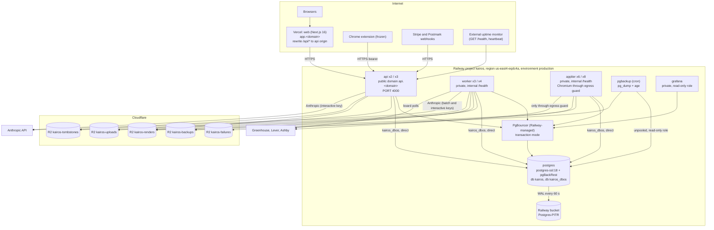
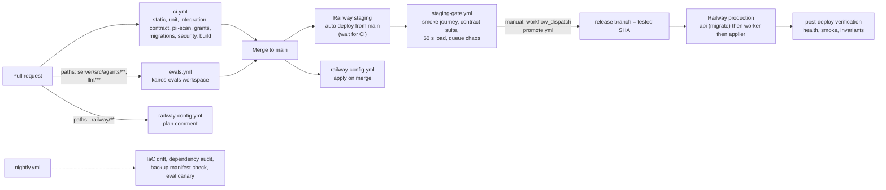

# Kairos backend infrastructure and operations

Revision 1, 2026-10-23. Status: Proposed, awaiting owner approval. This document implements the infrastructure, operations, security and privacy parts of ADR-001 (`01-architecture.md`, revision 2: postgres-durable on DBOS Transact 5.3.0, Anthropic-only agents) for the paid beta and for 10,000 users.

Inputs read in full: `01-architecture.md`; the research files `anthropic-models.md`, `stack-options.md`, `integrations.md`, `cost-model.md`, `as-built.md`, `spike-s-d1-local.md` (its correction table overrides `01-architecture.md` wherever they differ); the sibling specifications `03-agent-runtime.md`, `04-matching.md`, `05-api.md` and `_db/platform.md` as far as they were written when this document was prepared; the skeleton's `server/Dockerfile`, `server/Dockerfile.applier`, `server/build.mjs`, `server/package.json`, `server/.env.example` and `server/src/lib/env.ts`. Railway behavior was checked against docs.railway.com on 2026-10-23 (replicas, pricing, point-in-time recovery, PgBouncer, healthchecks, deployment teardown, variables, Infrastructure as Code); Anthropic retention against the Anthropic privacy center; Postmark pricing against postmarkapp.com/pricing.

Skills applied: `railway:use-railway` (resource model, preflight, environments, private networking, CLI and IaC routing), `observability-engineer` (SLIs and SLOs, error budgets and burn rates, alert noise control, cost of telemetry), `security-auditor` (trust boundaries, data-flow tracing, SSRF with IP pinning, least privilege, adversarial analysis of every feature). All three loaded. No skill failed to load.

Evidence tags as in the architecture: **[V]** verified in vendor documentation or in a research file; **[est]** an estimate to be replaced by beta measurements; **[verify]** a behavior the design depends on that a named spike must prove. New spikes defined here: S-INF1 to S-INF5 and S-AP4 (section 12).

How to read this document: sections 1 to 3 describe where code runs and how it gets there (topology, environments, CI/CD); section 4 the secrets; section 5 backups and recovery; sections 6 and 7 observability and security; section 8 privacy; section 9 the capacity plan; section 10 the runbook list; section 11 the monthly cost; section 12 the build order, spikes and open questions; section 13 the interface names other documents must use.

---

## 0. Summary of decisions, changes the S-D1 spike forced, and deltas from the architecture

### 0.1 Decisions in one table

| Area | Decision |
|---|---|
| Platform | Railway, one project `kairos`, three environments (`production`, `staging`, ephemeral `pr-<n>`), region US East (Virginia, `us-east4-eqdc4a`) for every service. Web stays on Vercel (same-origin `/api/*` rewrite). |
| Topology | Services `api`, `worker`, `applier`, `postgres`, `pgbackup` (cron), `grafana`; Railway-managed PgBouncer in front of `postgres`. No Redis. Replicas 2/3/6 at base and 3/4/8 at growth, all fixed counts (no horizontal autoscaler at launch). |
| Config | Railway Infrastructure as Code (`.railway/railway.ts`), planned on pull requests and applied on merge. Config as Code (`railway.json`) is not used: Railway stops reading it on 2026-12-01 [V]. |
| Deploy | Staging from `main` after CI; production from the `release` branch, moved by a manual promotion workflow; migrations run as the api's pre-deploy command with the migrator role over the unpooled connection; expand-only; rollback is redeploying the previous commit. |
| Secrets | Railway sealed variables for every long-lived secret, `preserve()` in IaC, per-process credentials, Anthropic workspace keys per process class, no secret in CI except the evals key and a project-scoped Railway token. |
| Recovery | Railway pgBackRest point-in-time recovery (weekly full, daily differential, WAL every 60 seconds, 4-week window), daily encrypted core logical dump and weekly full encrypted logical dump to a separate provider (Cloudflare R2), a 2-minute money journal. RPO 2 minutes typical (5 minutes committed), RTO 2 hours for a database loss. |
| Observability | pino JSON logs, Sentry (errors and sampled traces), `metrics_minute` gauges, a Grafana dashboard service reading only aggregate views, an in-process alert evaluator with a dead-man's switch and an external uptime monitor. Nine SLOs with burn-rate alerts. |
| Security | Threat model with twelve trust boundaries; `safeFetch` for every server-side fetch (fixed hosts, resolved-address check, no redirects); a hardened applier (sandbox spike, forward-proxy egress guard that also covers loopback, non-root, shared-memory sizing, no secrets beyond its role); five security recommendations that change other specifications (section 7.9). |
| Privacy | Anthropic is the only model provider (OpenRouter is gone); a field-level data map; one retention schedule; deletion complete in live stores within 24 hours and in backups and processors within 45 days; GDPR Article 9 handling for EEO and disability answers. |
| Capacity | Sized with the cost model's volumes and the spike's corrected checkpoint budget (about 1.1 million writes a day, 13 a second average, about 52 at peak). The primary has about 2x headroom on CPU and 1.5x on connections. |
| Cost | Platform cost without model spend: **$578 a month at base, $782 at growth** (production Railway, R2 and Sentry $407 and $539; staging, previews, backup cron and dashboards $67; Vercel, Postmark, paging and small tools $104 and $176). That adds about $0.0003 per submitted application to the architecture's infrastructure line; the all-in cost becomes about $0.0079 blended and $0.0082 on Pro and Max, under the $0.01 ceiling (section 11). |

### 0.2 Places changed because of the S-D1 spike (local half, 2026-10-23)

The spike's correction table overrides `01-architecture.md`. Every place this document uses a corrected fact is listed here.

| # | Spike finding | Where this document uses it |
|---|---|---|
| 1 | About 6 fixed checkpoint writes per workflow plus 1 per step and 2 per datasource transaction: about 1.1 M writes a day instead of 751,000, about 55 per submitted application, about 13 writes a second on average | Capacity (section 9.3), WAL and storage estimates (9.5), autovacuum settings for the DBOS tables (1.7), the metric `durable.checkpoint_writes_per_submitted` with **target 60 and email alert at 80** (6.6), dashboards (6.8) |
| 2 | No `partitionQueue` option; any `partition*` limit partitions the queue and every enqueue must pass a partition key | Capacity table of queues (9.4) and the scale signals use `globalConcurrency` and `partitionConcurrency` only; the runbook for changing a queue limit (R-DBOS-6) |
| 3 | `concurrency` is a deprecated alias of `globalConcurrency` | Section 9.4 and the interface list (13) use `globalConcurrency` |
| 4 | Queues are database-backed and registered after launch with `await DBOS.registerQueue(name, options)`, default `onConflict: update_if_latest_version`, so queue settings can change at runtime | Rolling deploys cannot revert a queue limit changed in an incident (4.6 and R-DBOS-6); the staging rehearsal of a queue change (3.8) |
| 5 | There is no garbage-collection call; retention uses `listWorkflows` with `completedBefore` and `deleteWorkflows(ids, deleteChildren?)` | `dbos-retention` batch size 2,000 ids, one batch per 5 seconds, and the bloat monitor (1.7, 6.6) |
| 6 | There is no public recover-for-other-executors call; cancel plus resume is proven | The orphan sweeper is the only recovery path for dead executors, so its metric `durable.orphans` and its alert are page-level (6.6), and runbook R-DBOS-1 |
| 7 | `forkWorkflow` replays from step 0, so rule D1 (state-conditional workflows) is mandatory | The version-bump procedure (3.9), a CI check, and the staging rehearsal before any bump |
| 8 | DBOS 5.3.0 packages are CommonJS: default import in ESM | Build: `server/build.mjs` keeps `@dbos-inc/*` external and the source uses `import dbosSdk from "@dbos-inc/dbos-sdk"` (3.3); the image installs them with `npm ci` |
| 9 | Pin `pg@8` (DeprecationWarning, removed in pg 9) | Dependency policy: `pg` exact `8.23.1`, Renovate rule `allowedVersions: "<9"` (3.10) |
| 10 | The Railway half of S-D1 is still open (executor ids, PgBouncer, 50 crashes across three process types, timing) | Acceptance criteria are kept in S-D1 and extended by S-INF1 (section 12); the replica environment variables `RAILWAY_SERVICE_NAME` and `RAILWAY_REPLICA_ID` are now **verified** in Railway's variable reference [V], so `executorID = <service>:<replicaId>` is confirmed except for behavior across redeploys |
| 11 | The local run used Postgres 17; production is Postgres 18 | CI runs the integration suite and the PII scan on Postgres 18 Testcontainers (3.2) |

### 0.3 Deltas from `01-architecture.md` and the sibling specifications

Each delta has a reason. None changes an architectural decision; two (PgBouncer and dump frequency) change an operational choice.

| # | `01-architecture.md` says | This document says | Reason |
|---|---|---|---|
| X1 | PgBouncer as its own service, image pinned by digest, per-role pools 15, 25 and 4 (44 server connections), 108 of 200 connections at growth | Railway-managed PgBouncer (transaction mode), `DEFAULT_POOL_SIZE = 20` per role, 60 worst-case server connections, **134 of 200** at growth, 118 at base (section 9.2). Fallback: the self-run service of the architecture | Railway's feature gives `DATABASE_URL` (pooled), `DATABASE_UNPOOLED_URL`, rewrites variable references, and is operated by Railway; one fewer image to pin and patch for a solo operator [V]. Per-role pool sizes are not configurable in it |
| X2 | Weekly encrypted logical dumps | Daily encrypted **core** dump (money, identity and application tables) plus weekly full dump; a 2-minute **money journal** to R2 | A logical-dump restore has RPO up to 7 days if the PITR archive is lost; the journal and the daily core dump cut the money-critical gap to minutes (section 5) |
| X3 | One R2 token scoped by prefix (`resumes/`, `applier-failures/`) | Five R2 buckets, tokens scoped per bucket (`kairos-uploads`, `kairos-renders`, `kairos-failures`, `kairos-backups`, `kairos-tombstones`) | R2 API tokens scope to buckets, not prefixes [verify S-INF1] |
| X4 | Process sizes "0.5 vCPU, 0.75 GB" for the api, "1 vCPU, 1.5 GB" for the worker | Those are the **expected use** (what the cost model bills); the configured **limits** are 1 vCPU and 1 GB (api) and 2 vCPU and 2 GB (worker) | Railway bills usage, not limits, so headroom is free and a limit only bounds runaway cost [V] |
| X5 | Sentry traces: api 10%, polls 1%, applier 100% | Per-route sampler with a monthly span budget of about 6 million (section 6.3) | 10% of 2.16 M requests a day would exceed any plan; sampling rates are chosen from the budget |
| X6 | Egress $10 base and $25 growth | $31 and $39 (section 11.1) | The estimate now itemizes PITR archive uploads, dumps, Anthropic request bodies and API responses |
| X7 | Email is Postmark, cost not itemized | Two outbound message streams (transactional, broadcast) plus inbound; about 35,000 and 95,000 emails a month; $48 and $120 (section 11.3) | Digests and Autopilot emails are volume; mixing them with one-time codes would risk OTP deliverability |
| X8 | Applier egress guard: refuse private addresses and `.internal` names | Also launch Chromium with `--proxy-bypass-list=<-loopback>` so loopback is not exempt from the proxy, and WebRTC non-proxied UDP disabled (section 7.5) | Chromium bypasses a proxy for `localhost` and loopback by default; without the flag the guard is blind to loopback requests |
| X9 | Applier role: one view and five functions | `_db/platform.md` adds a sixth function, `heartbeat_executor`. This document recommends replacing the view with a per-attempt function (section 7.9, H1) | Least privilege: a compromised browser process should not be able to read every queued application |
| X10 | Alerts "emailed or paged" without a mechanism | An `alert-evaluator` schedule in the worker, plus an external uptime monitor and a heartbeat that detects the evaluator's own death (section 6.7) | A solo operator needs an alert path that survives the failure of the system it watches |
| X11 | Dashboards are "saved queries" | A Grafana service on Railway with a read-only role `kairos_metrics` that sees aggregate tables and views only (section 6.8) | One place to look; no database exposure |
| X12 | `max_connections = 200` | Kept, plus the full parameter table for the 8 GB and 16 GB sizes (section 1.7) | Needed for implementation |
| X13 | Backups: "Railway PITR range (about 4 weeks)" | Confirmed [V] with its limits: window starts at the first post-enable base backup, a 5 GiB WAL queue cap truncates the window during a sustained bucket outage, minor image tags cannot be pinned, restore creates a sibling service (section 5) | These shape the runbook and the alerts |

---

## 1. Railway topology

### 1.1 Project, environments and services

One Railway project, `kairos`, owned by a Pro workspace (Pro: 42 replicas per service, resource limits up to the plan's CPU and memory per replica [V]).



| Service | Source | Role | Public? | Volume |
|---|---|---|---|---|
| `api` | GitHub `server/Dockerfile`, start `node dist/api.js` | HTTP API, request workflows, synchronous AI routes, webhooks | Yes: `api.<domain>` (custom domain, TLS by Railway) | None |
| `worker` | Same Dockerfile, start `node dist/worker.js` | Every non-browser queue and every scheduled workflow | No | None |
| `applier` | GitHub `server/Dockerfile.applier`, start `node dist/applier.js` | `cloud-apply` and `scan-form` queues, Playwright | No | None |
| `postgres` | Railway Postgres template, image `postgres-ssl:18` (major tag; minor pins are not supported with point-in-time recovery [V]) | Databases `kairos` and `kairos_dbos` | No public TCP proxy in production. Operators connect by `railway ssh` or a short-lived TCP proxy that is deleted after use | Railway volume (100 GB base, 150 GB growth) plus the archive bucket |
| PgBouncer | Railway Connection Pooling feature on `postgres`, transaction mode | Pooled application connections | No | None |
| `pgbackup` | GitHub `ops/pgbackup/Dockerfile` (Postgres 18 client, `age`, `rclone`), Railway cron | Daily core dump, weekly full dump, manifest, restore verification | No | None (ephemeral `/tmp`, 100 GB) |
| `grafana` | Docker image `grafana/grafana-oss` pinned by digest | Dashboards | Owner-only through Railway's private network and a TCP proxy that is disabled by default [verify S-INF4]; no public domain | 1 GB volume |

Names are exactly these in every environment. The architecture's "pgbouncer" service is the Railway feature in this design (delta X1).

Environments:

| Environment | Purpose | Created by | Data | Detail |
|---|---|---|---|---|
| `production` | Paid beta and public beta | IaC apply on merge to `main` | Real | Section 1 |
| `staging` | Release gate, restore drills, chaos and load rehearsals | IaC apply on merge to `main` | Synthetic only | Section 2 |
| `pr-<n>` | Optional ephemeral review environment, created by a pull request label `preview` | Railway pull request environments | Synthetic only | Section 2 |

### 1.2 Sizing: expected use, limits and replica counts

Railway bills the CPU and memory a service actually uses, per minute, with no reservation [V]. A resource limit therefore costs nothing until used, and each replica may use up to its limit. The architecture's sizes are the expected use that the cost model bills; the limits below add headroom so that a spike cannot throttle a replica.

| Service | Base replicas | Growth replicas | Expected use per replica | Limit per replica | Node heap (`--max-old-space-size`) | Why |
|---|---|---|---|---|---|---|
| `api` | 2 | 3 | 0.5 vCPU, 0.75 GB | 1 vCPU, 1 GB | 768 MB | 25 requests a second on average and 150 at peak (stack-options load model); one replica keeps working when another restarts; Better Auth and Zod parsing are the CPU cost |
| `worker` | 3 | 4 | 1 vCPU, 1.5 GB | 2 vCPU, 2 GB | 1,536 MB | 40-call model semaphore, up to 2 Typst child processes (256 MB each), one parser thread (128 MB heap), DBOS runtime |
| `applier` | 6 | 8 | 2 vCPU, 4 GB (idle about 0.4 GB for the warm browser) | 2 vCPU, 4 GB | 1,024 MB | 4 browser contexts per replica, 1.5x peak headroom, S-AP1 confirms the memory per context |
| `postgres` | 1 | 1 | 2 of 4 vCPU on average | 4 vCPU, 8 GB (base) or 16 GB (growth); vertical to 8 vCPU and 32 GB | n/a | Section 9.1 |
| PgBouncer | 1 | 1 | under 0.1 vCPU | Railway default | n/a | 1,000 client connections per replica, 94 clients used at growth |
| `pgbackup` | 0 or 1 (cron) | 0 or 1 (cron) | 1 vCPU for about 1 hour a day | 2 vCPU, 4 GB | n/a | A dump reads the whole database once |
| `grafana` | 1 | 1 | 0.1 vCPU, 0.3 GB | 0.5 vCPU, 0.5 GB | n/a | A handful of dashboards, queries every 60 seconds |

The `RAILWAY_*` limits (CPU and memory per replica) are set in the service settings (Railway's IaC reference does not document a field for them) and recorded in `ops/railway-limits.json`; the nightly drift check (section 6.7) compares the file with the Railway API and emails any difference [verify S-INF1 that the API returns them].

Applier memory budget per replica (4 GB limit, S-AP1 measures): Node process and DBOS 250 MB; Chromium browser process 350 MB; four contexts at 600 MB each (ATS pages with a reCAPTCHA or hCaptcha widget, images, fonts and media blocked) 2,400 MB; `/dev/shm` backed by memory 1,024 MB (see 1.5). Total about 4.0 GB at four busy contexts, which is why the replica recycles the browser every 25 contexts and `APPLIER_CONCURRENCY` is **4**, not higher. If S-AP1 measures more than 750 MB per context the concurrency drops to 3 and replicas rise to 8 at base and 11 at growth (about +$37 a month at growth).

### 1.3 Autoscaling policy

Railway scales a replica's CPU and memory automatically up to its limits (vertical, usage-billed) but does not add replicas by itself; a replica count is a fixed setting [V]. Decision: **fixed replica counts, changed by a one-line pull request to `.railway/railway.ts`, with alerts that say when**.

| Service | Scale-out signal (alert, email) | Action | Scale-in |
|---|---|---|---|
| `api` | p95 latency above 300 ms for 15 minutes with CPU above 70%, or 5xx above 1% | `replicas + 1` (max 6) | Never automatic; review monthly |
| `worker` | `prepare` p95 queue wait above 2 minutes, or `score` waiting above 5,000, or the oldest due poll more than 5 minutes late, for 10 minutes | `replicas + 1` (max 8); then `WORKER_QUEUES` split if one family needs more than 4 replicas (A.7) | Never automatic |
| `applier` | `cloud-apply` waiting above 30 for 10 minutes, or p95 approve-to-start above 10 minutes | `replicas + 1` (max 16) | Never automatic; a replica is removed only by a deploy during a low-traffic window, after its drain |
| `postgres` | CPU above 70% for a week, memory pressure (page cache hit ratio below 98%), disk above 70%, or connections above 80% | Resize vertically in the dashboard, then the A.7 triggers | None |

Why no autoscaler: a replica that is removed while it holds a browser mid-submit loses an attempt (it settles as `unconfirmed`, section 5 of the architecture), so scale-in must be a deliberate deploy with a 180-second drain; scale-out is safe and is a one-line change that takes effect in about 2 minutes. A `scale-advisor` step inside `ops-monitors` only evaluates the table and sends the email; it never changes Railway. Trigger to automate scale-out later: three scale-out emails in a month on the same service (the A.7 "applier autoscaling" trigger generalizes to every service).

### 1.4 Private networking, ingress and DNS

- All services in an environment share Railway's private network with internal DNS `<service>.railway.internal` [V]. `worker`, `applier`, `postgres`, PgBouncer, `pgbackup` and `grafana` have no public domain. Only `api` has one.
- The Railway environment may be IPv6-only on private networking for projects created before dual-stack; before S-P1 completes, set `NODE_OPTIONS=--dns-result-order=ipv6first` on every service and require that PgBouncer listens on `::` [verify S-P1].
- DNS and TLS: the domain's DNS is hosted at Cloudflare (needed for R2 custom endpoints and for a later proxy). `app.<domain>` points at Vercel, `api.<domain>` at the Railway `api` domain (Cloudflare record in "DNS only" mode at launch), `reply.<domain>` carries the Postmark inbound MX, `mail.<domain>` the DKIM and Return-Path records. Railway issues the API certificate.
- Cloudflare proxying of `api.<domain>` is **not enabled at launch** (150 requests a second peak does not need a WAF). Trigger to enable: sustained rate-limit rejections above 20% of requests for 10 minutes, or any volumetric attack. Enabling it changes the client-IP chain: `TRUSTED_PROXY_HOPS_DIRECT` and `TRUSTED_PROXY_HOPS_VERCEL` (05-api, section 5.5) each rise by one, the API must reject requests that do not carry the secret header `X-Origin-Verify` (`ORIGIN_VERIFY_SECRET`, set by a Cloudflare transform rule), and the signed-link and webhook routes must keep working through the proxy. This is documented in runbook R-NET-1 and rehearsed on staging before it is ever needed.
- Egress: Railway containers share outbound IPs that can change. Static outbound IPs are offered on Pro [verify S-INF1]; if available, enable them for `worker` and `applier` so ATS operators see one stable, contactable address, and so the soak test S-I1 and any block report map to one IP. This is stability, not evasion (INV-8).
- The Postgres service has public networking off. If an operator needs a console, use `railway ssh` into the service or create a TCP proxy for the duration of the work and delete it afterwards (`ops_audit` entry written by the operator script).

### 1.5 Images, build and start

Both images are built by Railway from the repository (builds are free [V]) using the Dockerfiles in `server/`, with these changes to the skeleton's files (all P1):

| Change | Reason |
|---|---|
| Base `node:22.18-slim` (and the Playwright base `mcr.microsoft.com/playwright:v1.64.1-noble`) referenced by digest in the Dockerfile (`FROM node:22.18-slim@sha256:...`) and bumped by Renovate | The skeleton used the floating `node:22-slim` and Playwright 1.64.0; the architecture pins 22.18.x and 1.64.1 |
| `package.json` ranges become exact versions (`"drizzle-orm": "0.45.4"`) | The skeleton uses caret ranges; the architecture pins exactly |
| Remove `bullmq`, `ioredis`, `express-rate-limit`, `postgres` at P7; add `pg`, `@dbos-inc/dbos-sdk`, `@dbos-inc/drizzle-datasource`, `rate-limiter-flexible`, `@aws-sdk/*`, `@sentry/node`, OpenTelemetry packages, `unpdf`, `mammoth` | Architecture B.3 |
| Typst CLI in the `server` image: download the pinned release (0.13.1), verify its published SHA-256 with `sha256sum -c`, install to `/usr/local/bin/typst`; copy `server/templates/` and the bundled Inter fonts | F10 renderer; checksum verification against a supply-chain swap |
| Add `ca-certificates` and `tini`; `ENTRYPOINT ["/usr/bin/tini", "--"]` | Correct signal forwarding so `SIGTERM` reaches Node and zombie Typst or Chromium children are reaped |
| Final stage copies `server/drizzle/` (already done) and `server/templates/` | Migrations and templates travel with the image |
| `ARG EXPECTED_BUNDLE_SHA256` and a `RUN` step that fails the build when `sha256sum server/dist/*.js` differs from it (production builds only) | Promotion proof: the production build must produce the bundle that CI produced and staging ran (section 3.6) |
| Applier: `RAILWAY_SHM_SIZE_BYTES=1073741824` on the service, Chromium launched with the sandbox enabled unless S-AP4 shows it cannot run (7.5), `USER pwuser` (already) | Railway's default `/dev/shm` is 64 MB, which crashes Chromium tabs [V: variable reference]; non-root user |
| `server/build.mjs`: keep `@dbos-inc/*` in `external` (they are CommonJS) and install them in the image | Spike correction 8 |

Start commands and ports:

| Service | Start command | Port | Health endpoint |
|---|---|---|---|
| `api` | `node dist/api.js` | `PORT` (Railway-injected, default 4000) | `GET /health` and its alias `GET /api/health` (reachable through the Vercel rewrite), public |
| `worker` | `node dist/worker.js` | `PORT` (internal only) | `GET /health`, internal: role, DBOS launch state, Postgres connectivity |
| `applier` | `node dist/applier.js` | `PORT` (internal only) | `GET /health`, internal: adds browser liveness (a context can be opened and closed within 5 seconds) |
| `pgbackup` | `/app/run.sh` (cron) | none | exit code |

Railway's healthcheck runs only at deploy time, from the host `healthcheck.railway.app`, and waits for any 2xx [V]; the `api` must accept that Host header. `GET /health` returns 200 `{status, role, version, checks}` when Postgres answers and DBOS reports launched, 503 `{status: "unhealthy", checks}` otherwise (the architecture: 503 only when Postgres fails; DBOS state is informational in `checks.durable` for the api, and a failure to launch DBOS fails the worker and applier health because they cannot do any work without it).

### 1.6 Deployment settings per service

| Setting | `api` | `worker` | `applier` | Source |
|---|---|---|---|---|
| `healthcheck` path and timeout | `/health`, 60 s | `/health`, 120 s (DBOS recovery at launch can take time) | `/health`, 120 s | IaC |
| `preDeploy` | `node dist/migrate.js` (api only) | none | none | IaC |
| `RAILWAY_DEPLOYMENT_DRAINING_SECONDS` | 60 | 60 | 180 | Service variable [V]; maximum allowed value [verify S-INF1] |
| `RAILWAY_DEPLOYMENT_OVERLAP_SECONDS` | 20 | 0 | 0 | Service variable. The api overlaps the old and new deployments by 20 seconds so no request is dropped; workers do not overlap because two generations dequeuing the same queue is allowed by DBOS (same `applicationVersion`) but wastes nothing and is unnecessary |
| Restart policy | `ALWAYS` | `ALWAYS` | `ALWAYS` | Dashboard setting |
| `RAILWAY_HEALTHCHECK_TIMEOUT_SEC` | 60 | 120 | 120 | Service variable |
| Replica count | 2 or 3 | 3 or 4 | 6 or 8 | IaC |

Process shutdown contract (architecture rule D9), implemented in `durable/shutdown.ts` and exercised by test T-INF-3:

1. `SIGTERM`: stop dequeuing (`DBOS` queue listeners stop), stop accepting HTTP connections (api: `server.close()`), mark the executor `state = 'draining'` in `dbos_executors`.
2. Wait for steps in flight: api and worker up to 45 seconds, applier up to 170 seconds (a submit that has already reached `submit_seen` is allowed to finish and report).
3. Close pools, flush Sentry (2 seconds), exit 0. If the deadline passes, exit 1; DBOS recovery and the orphan sweeper settle whatever was in flight.
4. Railway sends `SIGKILL` after the draining time; the draining time is always larger than the process deadline by at least 10 seconds.

### 1.7 Postgres service configuration

`postgres-ssl:18` with pgBackRest PITR enabled (section 5.1). `max_connections = 200` and the parameters below are set through the service's start command or `postgresql.conf` include as the Railway Postgres image allows [verify S-P1 which can be set, and that the archiver's settings are not overwritten]. `pg_stat_statements` needs `shared_preload_libraries` and a restart; enabling it is an owner-run, user-only operation per the Railway skill (the `enable-pg-stats` script), done inside the S-P1 maintenance window.

| Parameter | Base (4 vCPU, 8 GB) | Growth (4 vCPU, 16 GB) | Reason |
|---|---|---|---|
| `max_connections` | 200 | 200 | Section 9.2 |
| `shared_buffers` | 2 GB | 4 GB | 25% of RAM |
| `effective_cache_size` | 5 GB | 11 GB | Planner hint |
| `work_mem` | 16 MB | 24 MB | About 60 active queries at peak |
| `maintenance_work_mem` | 512 MB | 1 GB | Index builds, vacuum |
| `wal_compression` | `lz4` | `lz4` | Full-page images after checkpoints dominate WAL; smaller archive, less egress |
| `max_wal_size` / `min_wal_size` | 8 GB / 2 GB | 8 GB / 2 GB | Fewer forced checkpoints |
| `checkpoint_timeout` / `checkpoint_completion_target` | 15 min / 0.9 | 15 min / 0.9 | Smooth I/O |
| `random_page_cost` / `effective_io_concurrency` | 1.1 / 200 | 1.1 / 200 | SSD volume [verify with fio in S-P1] |
| `synchronous_commit` | `on` | `on` | Money rows are never acknowledged before they are durable |
| `archive_timeout` | 60 s (set by the image [V]) | 60 s | RPO |
| `autovacuum_max_workers` / `autovacuum_naptime` / `autovacuum_vacuum_cost_limit` | 4 / 15 s / 2000 | 4 / 15 s / 2000 | Hot small tables (`credit_balances`, `user_daily_usage`, `ai_usage`, DBOS status rows) |
| Per-table `autovacuum_vacuum_scale_factor` | 0.02 on `credit_balances`, `applications`, `matches`, `user_match_state`, `user_daily_usage`, `ai_usage`, `rate_limits`; 0.02 on the DBOS `workflow_status`, `operation_outputs` and `workflow_inputs` tables in `kairos_dbos` | same | The spike's 1.1 M checkpoint writes a day create churn; retention deletes create dead tuples |
| `idle_in_transaction_session_timeout` | 30 s per runtime role | same | B.10.4 |
| `statement_timeout` per role | `kairos_api` 10 s, `kairos_worker` 120 s, `kairos_applier` 5 s, `kairos_metrics` 10 s, `kairos_readonly` 30 s | same | B.10.4 |
| `lock_timeout` | 5 s for the migrator | same | A migration never queues behind a long transaction |
| `log_min_duration_statement` | 500 ms | 500 ms | Slow query log to Railway logs |
| `log_lock_waits` / `deadlock_timeout` | on / 1 s | on / 1 s | |
| `track_io_timing`, `track_activity_query_size` | on, 2048 | on, 2048 | |
| `ssl` | on (the `-ssl` image); every client uses `sslmode=require` | same | In-transit encryption even on the private network |

Roles: the five roles of B.10.4 (`kairos_migrator`, `kairos_api`, `kairos_worker`, `kairos_applier`, `kairos_readonly`) plus two added by this document: `kairos_backup` (member of `pg_read_all_data`, used only by `pgbackup`, statement timeout 0) and `kairos_metrics` (SELECT on `metrics_minute`, `llm_cost_daily` and the dashboard views of 6.8 only). Both are created by a custom migration in P1. DBOS system-database credentials stay per process type (`dbos_api`, `dbos_worker`, `dbos_applier`).

### 1.8 Infrastructure as Code

The topology lives in `.railway/railway.ts` (one file, no partials), applied by `railwayapp/config` on merge and planned on every pull request that touches `.railway/**`; a nightly job runs `railway config plan --detailed-exit-code` and emails when the live environment has drifted from the file (exit code 2). Sketch (field names from the IaC reference [V]; exact helper names are confirmed against `railway` 3.x at implementation):

```ts
// .railway/railway.ts
import { defineRailway, github, postgres, preserve, project, service } from "railway/iac";

export default defineRailway((ctx) => {
  const prod = ctx.environment === "production";
  const repo = (root: string) => github("<owner>/auto-career", { branch: prod ? "release" : "main", rootDirectory: root });

  const db = postgres("postgres");

  const api = service("api", {
    source: repo("."),
    env: { RAILWAY_DOCKERFILE_PATH: "server/Dockerfile", RAILWAY_DEPLOYMENT_DRAINING_SECONDS: "60",
           RAILWAY_DEPLOYMENT_OVERLAP_SECONDS: "20", RAILWAY_HEALTHCHECK_TIMEOUT_SEC: "60",
           DATABASE_URL: db.env.DATABASE_URL, DATABASE_UNPOOLED_URL: db.env.DATABASE_UNPOOLED_URL,
           BETTER_AUTH_SECRET: preserve(), STRIPE_SECRET_KEY: preserve(), ANTHROPIC_KEY_INTERACTIVE: preserve() /* ... section 4 */ },
    start: "node dist/api.js",
    healthcheck: "/health", healthcheckTimeout: 60,
    preDeploy: "node dist/migrate.js",
    replicas: prod ? 3 : 1,                        // 2 until growth; see section 1.2
    domains: [{ domain: prod ? "api.<domain>" : "api-staging.<domain>", port: 4000 }],
  });
  const worker = service("worker", {
    source: repo("."),
    env: { RAILWAY_DOCKERFILE_PATH: "server/Dockerfile", RAILWAY_DEPLOYMENT_DRAINING_SECONDS: "60", /* ... */ },
    start: "node dist/worker.js", healthcheck: "/health", healthcheckTimeout: 120,
    replicas: prod ? 4 : 1,
  });
  const applier = service("applier", {
    source: repo("."),
    env: { RAILWAY_DOCKERFILE_PATH: "server/Dockerfile.applier", RAILWAY_DEPLOYMENT_DRAINING_SECONDS: "180",
           RAILWAY_SHM_SIZE_BYTES: "1073741824", APPLIER_CONCURRENCY: "4", /* ... */ },
    start: "node dist/applier.js", healthcheck: "/health", healthcheckTimeout: 120,
    replicas: prod ? 8 : 1,
  });
  return project("kairos", { resources: [db, api, worker, applier /* pgbackup, grafana */] });
});
```

The sketch shows growth counts for production; the file carries base counts (2, 3, 6) until the capacity triggers in 9.6 fire. Replica counts, domains, variables and healthchecks live in this file; sealed secrets are set once with `railway variables` and referenced by `preserve()`. The Railway project token used by the apply workflow is scoped to one environment (production and staging have separate tokens).

### 1.9 Region, residency and latency

All services run in US East (Virginia). Reasons: the ATS hosts and Anthropic's inference are US-hosted, the audience is US job boards, and Railway Postgres and Vercel's `iad1` function region are co-located so the rewrite adds under 5 ms. Users in India and Europe pay 120 to 250 ms of extra round-trip time, acceptable for an application that is not interactive at the keystroke level. Data residency: Kairos stores personal data of EU and Indian users in the United States; section 8.8 lists the transfer mechanisms. A European region is a later option only (the databases cannot move without a restore and a maintenance window), triggered by a customer or regulatory requirement.

---

## 2. Environments

### 2.1 Overview

| | Local | Preview (`pr-<n>`) | Staging | Production |
|---|---|---|---|---|
| Purpose | Development and tests | Review one change end to end | Release gate, drills, chaos, load | Customers |
| Where | Developer machine, `docker compose` | Railway ephemeral environment (label `preview`, deleted on merge or after 3 days) | Railway environment `staging` | Railway environment `production` |
| Services | Postgres 18, Mailpit, MinIO, fake ATS, Anthropic stub, Stripe CLI | `api`, `worker`, `applier`, Postgres template (no PITR), all 1 replica | Same as production, 1 replica each, PITR on | Section 1 |
| Data | Seeded synthetic users (`npm run seed -- --users 50`) | Same seed on first boot | Seed plus synthetic load users | Real |
| Anthropic | Stub (`ANTHROPIC_BASE_URL=http://localhost:4010`, recorded fixtures) | Stub | `kairos-staging` workspace, $20 a day spend limit | `kairos-prod-batch`, `kairos-prod-interactive` |
| Stripe | Test mode, `stripe listen` | Test mode | Test mode with test clocks | Live |
| Postmark | Mailpit (SMTP sink) | Postmark sandbox server | Postmark sandbox server (no delivery) | Live servers |
| ATS | Fake ATS server (`ops/fake-ats`) | Fake ATS | Fake ATS plus a daily real-board poll of 20 boards with the applier disabled | Real boards |
| Cloud applier | Runs against the fake ATS only | Fake ATS only | Fake ATS only (the real ATS hosts are never contacted with test accounts) | Real |
| Sentry | Off | `environment = preview` | `environment = staging` | `environment = production` |
| R2 buckets | MinIO | `-staging` buckets with prefix `pr-<n>/` | `kairos-*-staging` | `kairos-*` |
| Web | `localhost:3000` | Vercel preview, rewrite to `api-staging.<domain>` | `staging.<domain>` on Vercel | `app.<domain>` |

Rules that hold in every non-production environment:

1. **No production data, ever.** No dump restore into staging or local, no copy of a production row into a fixture. Debugging uses `kairos_readonly` in production and `llm_calls` sample rebuilds (6.9), or a synthetic reproduction.
2. Different secrets in every environment; no secret is shared between environments; staging Anthropic and Stripe keys can do no harm if leaked.
3. Staging and previews cannot send email to real addresses (Postmark sandbox) and cannot call real employer forms (the cloud applier's host allowlist in staging contains only the fake ATS host; enforced by `APPLIER_ALLOWED_HOSTS`, section 7.5).
4. Production-only switches are refused by `parseEnv` outside production: `ANTHROPIC_BASE_URL` is rejected in production, `STRIPE_SECRET_KEY` must start with `sk_live_` in production and `sk_test_` elsewhere, and the Postmark token class is checked the same way.

### 2.2 Local

`docker-compose.yml` (replaces the skeleton's Postgres and Redis file):

| Service | Image | Purpose |
|---|---|---|
| `postgres` | `postgres:18` with `pg_trgm`, two databases `kairos` and `kairos_dbos`, roles created by the same migration script as production | Business state and checkpoints |
| `pgbouncer` (optional profile `pooled`) | `edoburu/pgbouncer` pinned by digest, transaction mode | Reproduce pooled behavior when debugging |
| `mailpit` | `axllent/mailpit` | Catches every email, including OTP codes |
| `minio` | `minio/minio`, buckets created at start | R2 stand-in (S3 API) |
| `fake-ats` | `ops/fake-ats` (Node), Greenhouse, Lever and Ashby lookalikes: board JSON, posting pages, apply forms, a confirmation page, switches for challenge, closed posting and slow response | Everything that touches an employer |
| `anthropic-stub` | `ops/anthropic-stub` (Node), serves recorded responses by `(agent, input hash)` and failure modes (429, 529, timeout, refusal, `max_tokens`) | No network, no cost |

Commands: `npm run dev:api`, `dev:worker`, `dev:applier` (kept), `npm run seed`, `npm run typst:install` (downloads and verifies the pinned binary), `npm test` (unit), `npm run test:int` (Testcontainers), `npm run eval -- --agent <id>` (needs `ANTHROPIC_KEY_EVALS`, refused for production workspace keys).

### 2.3 Preview environments

A pull request with the label `preview` creates `pr-<n>` from the staging template (Railway pull request environments) [V]; `.railway/railway.ts` has a `pr` configuration: one replica per service, Postgres without PITR, `ANTHROPIC_BASE_URL` set to a stub service inside the environment, the fake ATS service added. Vercel previews of `web/` point their rewrite at the staging API (`api-staging.<domain>`) and are added to `CSRF_ALLOWED_ORIGINS` there as a pattern entry for the team's preview hostname (suffix match, one wildcard label); the production list never contains them. Cost: about $10 a month for typical use [est]. Previews are deleted on merge and by a nightly job after 3 days.

### 2.4 Staging

Production's topology at one replica per service, with PITR enabled so that the restore drills of section 5.5 run on staging without touching production data. Staging runs the release gates (3.5), the monthly chaos test (process kills during scripted approvals, R-DBOS-8), the 24-hour load test before public beta (9.7) and every DBOS version bump rehearsal (3.9). Staging is shut down (replicas 0 on `worker` and `applier`) outside rehearsal windows, so its idle cost is Postgres and the volume only; the $45 a month in section 11 assumes it runs about 25% of the time [est].

### 2.5 Production

Section 1. Production changes are made by one of three paths only: a merged pull request (code and IaC), a runbook step recorded in `ops_audit` (flags, manual database writes), or an emergency dashboard action that must be mirrored into `.railway/railway.ts` within 24 hours (the nightly drift check enforces it).

### 2.6 Configuration and feature flags across environments

| Mechanism | Used for | Where it lives |
|---|---|---|
| Environment variables | Endpoints, credentials, resource sizes, origins | Railway variables per environment (section 4) |
| `ops_flags` | Kill switches and operational pins | Database, 10-second cache, audited |
| `feature_flags` | Per-user rollout of migration phases (`LIFECYCLE_V2`, `PREPARE_V2`, `WORKSPACE_API`, `MATCHING_V2`, `CLOUD_APPLY_V2`, `AUTOPILOT`) | Database |
| `shared/src/plans.ts` | Plan limits and prices | Code, never configuration (INV-10) |
| `MATCHING_DEFAULTS` etc. | Tunables with defaults in code, overridable through `ops_flags` | Code plus database |

---

## 3. CI/CD

### 3.1 Pipeline overview



### 3.2 `ci.yml` (every pull request and every push to `main`)

Jobs run in parallel on `ubuntu-latest` with Node 22.18; the required checks are marked R. Typical wall time 12 minutes [est]; about 25 runner-minutes per run.

| Job | R | What it does | Fails when |
|---|---|---|---|
| `static` | R | `npm ci --ignore-scripts` then an allow-listed `npm rebuild esbuild`; `tsc --noEmit` for `shared`, `server`, `web`; ESLint with the boundary rules (B.2: module `index.ts` imports only, only `durable/` imports `@dbos-inc/*`, only `llm/gateway.ts` imports `@anthropic-ai/sdk`, only `modules/billing/ledger.ts` inserts into `credit_ledger`, no `as GatePassed`); the ids-only schema rule for workflow inputs and outputs; the workflow-hash check (3.9); a grep test that no plan limit or price is hard-coded outside `shared/src/plans.ts`; a grep test that `OPENROUTER` appears nowhere in the repository | Any rule violation |
| `unit` | R | `vitest run` (41 existing tests plus new ones), Zod env schema tests per process role (`env.roles.test.ts`, 4.4) | Any failure |
| `integration` | R | Testcontainers Postgres 18 with DBOS launched in three roles; invariant tests (charge once under concurrent reports, approval credit race, one grant per invoice, Stripe redelivery, nothing sent before approval, no model call for a hard-filter failure or a sensitive question); process-kill replay tests (kill inside `prerankAndPace`, inside a scoring chunk, inside `generateAndVerify`); the grant test T-1 of `_db/platform.md` | Any failure |
| `pii-scan` | R | `durable/pii-scan.test.ts` (B.5.6): seeds marker strings in name, email, resume text, facts, answers and an inbound email, runs every pipeline, scans every text and JSON column of `kairos_dbos`; also scans a captured Sentry event, a captured log buffer and a captured trace for the markers | One marker found |
| `contract` | R | Replays the recorded calls of `web/lib/api.ts`, `web/hooks/*.ts` and `extension/src/lib/api.ts` against the API on Testcontainers, including the workspace hooks | Any shape, status or error-code difference |
| `migrations` | R | Applies all migrations to an empty database; applies the new migrations on top of the previous release's schema with data from the seed; runs the expand-only linter (3.7); `drizzle-kit check`; verifies every `CREATE INDEX CONCURRENTLY` file is flagged `-- kairos:no-transaction` | Linter or apply failure |
| `typst` | R | Golden tests: renders 20 fixture resumes and compares text layers, page counts and line breaks with the stored goldens (S-T1) | Any difference |
| `security` | R | `gitleaks` on the diff and history of the branch, `osv-scanner` on the lockfile, `npm audit signatures`, Semgrep with the repository's rule pack (SSRF sinks: `fetch`, `undici`, `http.request` outside `safeFetch`; `child_process` outside the Typst renderer; `eval`; raw SQL string concatenation), image scan with Trivy (High and Critical, unfixed ignored) | A new High or Critical finding |
| `build` | R | `node server/build.mjs`; `sha256sum server/dist/*.js` published as the artifact `bundle.sha256`; `docker build` of both images (not pushed); SBOM with Syft attached to the run | Build failure |
| `web-typecheck` | | Type-checks `web/` against the shared types (only when `shared/**` changed) | Failure |

Branch protection on `main`: every required check green, branches up to date, no force push, linear history, commits signed (GitHub vigilant mode for the single operator). A second reviewer does not exist; the automated gates stand in for one.

### 3.3 Build details

- The server bundle is built once per commit by `build.mjs` (esbuild 0.28.2, one file per entry point: `api.js`, `worker.js`, `applier.js`, `migrate.js`). The CI artifact `bundle.sha256` is the reference for 3.6.
- `@dbos-inc/dbos-sdk` and `@dbos-inc/drizzle-datasource` are CommonJS packages and stay external; source files use `import dbosSdk from "@dbos-inc/dbos-sdk"; const { DBOS } = dbosSdk;` (S-D1 correction 8). The image installs production dependencies with `npm ci --omit=dev` and the existing removal of unused peers.
- Source maps are produced and uploaded to Sentry at deploy time by the `release` job (`sentry-cli sourcemaps upload`); the images ship the maps but the services run with `--enable-source-maps` off to avoid the memory cost, and Sentry resolves them server-side.
- Railway builds the images itself from the Dockerfiles (builds are free [V]); CI also builds them so a Dockerfile error fails the pull request, not the deploy.

### 3.4 Repositories, branches and triggers

| Branch | Deploys to | Trigger | Gate |
|---|---|---|---|
| `main` | `staging` | Railway GitHub integration, "wait for CI" on | `ci.yml` green |
| `release` | `production` | Railway GitHub integration on the `release` branch | `promote.yml` fast-forwards `release` to a SHA that passed `staging-gate.yml` |
| pull request | `pr-<n>` | Label `preview` | None |

Railway deploys the three services from the same commit in no guaranteed order; the order that matters (api and its migration first) is enforced by the promotion workflow (3.6) through service-level "wait for" ordering where Railway offers it, and otherwise by the compatibility rule: migrations are expand-only, so a worker or applier that starts before the migration still runs correctly on the old schema, and an old worker keeps running on the new one.

### 3.5 `staging-gate.yml` (after every deploy to staging)

Runs against `api-staging.<domain>`; must be green for a SHA to be promotable.

| Step | Detail | Pass |
|---|---|---|
| Health | `GET /health` on the api, internal health of worker and applier through `railway ssh`/logs | All 200 within 5 minutes of deploy |
| Smoke journey | `scripts/smoke.mjs`: sign up, verify OTP (Mailpit-equivalent sandbox read), upload a resume, prepare a draft, edit one line, approve, cloud apply against the fake ATS, extension report path, Autopilot send for a test user, workspace tailor and import, Stripe test-clock invoice | Every step succeeds; one credit charged once |
| Contract suite | The same recorded calls, against the deployed staging API through the Vercel staging rewrite | Green |
| Queue chaos (short) | 100 scripted approvals while one worker and one applier replica are restarted | Every application terminal within 10 minutes, zero duplicate attempts |
| Load smoke | k6, 60 seconds at 150 requests a second against read routes and 20 a second against writes | p95 under 300 ms for reads, error rate under 0.5% |
| Invariants | The hourly invariant queries of B.5.8 run once | No findings |
| Migration dry run | The migrations in the SHA were applied by staging's pre-deploy; a second apply is a no-op | Idempotent |

### 3.6 Promotion and the production deploy sequence

`promote.yml` (manual, `workflow_dispatch` with the SHA; only the owner can run it). Steps:

1. Verify the SHA has a green `ci.yml`, `staging-gate.yml` and (when agents changed) `evals.yml`; verify `bundle.sha256` from CI. Refuse otherwise.
2. If the SHA contains migrations: create a labelled Railway volume backup (`railway postgres pitr backup create --service postgres --name pre-<sha7>` [V: command in Railway docs]) and wait for it to finish. PITR alone would restore the data, but a named backup gives a clean, fast restore point before a schema change.
3. Fast-forward `release` to the SHA. Railway starts the production builds; the production Dockerfile build asserts `EXPECTED_BUNDLE_SHA256` (set by the workflow as a build variable) equals the bundle it just built, so production runs the same bytes staging ran.
4. **api**: build, pre-deploy migration (3.7), start, `/health` within 60 seconds, 20-second overlap, then the old deployment drains for 60 seconds.
5. **worker** (starts when api is healthy): new replicas launch DBOS with the same `WORKFLOW_SET_VERSION`; the old ones drain for 60 seconds. If `WORKFLOW_SET_VERSION` changed, the version-migrate procedure (3.9) runs.
6. **applier** (last, and only when no application is in phase `submit_seen`; the workflow checks `submission_attempts` and waits up to 10 minutes): drains up to 180 seconds.
7. Post-deploy verification: health of all services; the synthetic journey of section 6.7 against production with the monitoring test account (read-only routes only; no applications are created in production by tests); the invariant queries; Sentry release marked deployed; the deploy recorded in `ops_audit` (`action = 'deploy'`, SHA, who).
8. Automatic rollback: if step 7 fails within 15 minutes, the workflow fast-forwards `release` back to the previous SHA (a redeploy of the previous commit; schema is compatible by the expand-only rule) and pages.

Deploy windows: weekdays 08:00 to 16:00 in the owner's time zone; no production deploy with a migration on a Friday or before a holiday; none during an incident or while `approvals_frozen` is set; the emergency path (a revert) is allowed at any time.

### 3.7 Migrations

Migrations are SQL files generated by `drizzle-kit generate` (plain schema changes) or `drizzle-kit generate --custom` (partitions, triggers, roles, functions) and are never edited after they are applied (INV-21).

Runner (`server/src/migrate.ts`, kept, extended):

| Behavior | Rule |
|---|---|
| Role and connection | Role `kairos_migrator`, connection `DATABASE_UNPOOLED_URL` (direct to Postgres: `CREATE INDEX CONCURRENTLY`, advisory locks and `SET` need a dedicated session; Railway documents this for PgBouncer [V]) |
| Serialization | `pg_advisory_lock(7281551)` for the whole run, so two simultaneous deploys cannot migrate at once |
| Timeouts | `SET lock_timeout = '5s'`; a statement that cannot get its lock retries up to 3 times with 10-second pauses, then fails the deploy |
| Transactions | Ordinary migration files run in one transaction each. Files whose first line is `-- kairos:no-transaction` run statement by statement without a transaction (needed for `CREATE INDEX CONCURRENTLY`, `DROP INDEX CONCURRENTLY`, `ALTER TYPE ... ADD VALUE`); such a file must contain only idempotent statements (`IF NOT EXISTS`) so a retry after a partial run is safe |
| Time budget | The pre-deploy command must finish within 5 minutes; anything slower is a backfill (below), not a migration |
| Output | One line per migration to Railway logs; `ops_audit` row with the migration names |

Expand-only linter (`scripts/lint-migrations.mjs`, CI job `migrations`): rejects `DROP TABLE`, `DROP COLUMN`, `ALTER COLUMN ... TYPE`, `RENAME`, `SET NOT NULL` without a prior backfill marker, `ADD COLUMN ... NOT NULL` without `DEFAULT`, `CREATE INDEX` without `CONCURRENTLY` on tables above 100,000 rows, and any `ALTER TYPE ... ADD VALUE` inside a transaction. An override requires a `-- kairos:contract <reason>` header and is allowed only in a release that follows the release that stopped using the object (expand, backfill, switch, contract across at least two releases, NFR-10).

Backfills (`UPDATE facts SET confirmed_at = created_at WHERE confirmed`, `jobs.search_tsv`, encryption of existing raw sources, hints on existing jobs) run as DBOS workflows `backfill:<name>:<batch>` on the `notify` queue's capacity: batches of 1,000 rows, one batch per second per worker, resumable by a stored cursor in `ops_flags` (key `backfill:<name>` holding the last primary key, added to the closed flag catalogue of `_db/platform.md`), throttled when primary CPU exceeds 60%. They are started by the release that needs them and removed from the code two releases later.

Rollback: there is no schema rollback. Every migration is compatible with the previous release's code, so reverting is redeploying the previous commit. A migration that proves wrong is fixed forward with a new migration; data damage is repaired from PITR (R-DR-1).

### 3.8 Eval gates

`evals.yml` runs when a pull request touches `server/src/agents/**`, `server/src/llm/prices.ts`, the model registry or `server/evals/**`.

| Step | Detail |
|---|---|
| Selection | Changed agent directories map to agent ids; a change to the gateway, the fence or `checkClaims` runs the full suite |
| Execution | `npm run eval -- --agent <id>` against the `kairos-evals` Anthropic workspace (key `ANTHROPIC_KEY_EVALS`, available only to this workflow on same-repository pull requests through an environment secret with required reviewers off and branch restriction to pull requests from the repository; fork pull requests never run it) |
| Graders | Deterministic metrics first (schema validity, id membership, number containment, leakage counts); rubric items graded by Opus 5.5 offline (03, section 13) |
| Gate | Pass bars of B.9.10 per agent (for example `claim-verifier` false accept at most 1% overall and on the self-preference subset; protected-question leakage 0; `reply-classifier` zero `offer` on the 40 "offer you an interview" cases) |
| Cost cap | Per run $5, per month $200 on the `kairos-evals` workspace limit; a run that would exceed the cap aborts and fails the check |
| Output | JSON artifact; `scripts/ship-gate.mjs` at promotion verifies that for every agent the committed prompt fingerprint and model id appear in a passing artifact of the SHA's history (the pre-deploy step inserts the `eval_runs` ship-gate rows, `_db/platform.md` P7; CI never holds production credentials) |
| Model drift | Nightly `model-drift` and the weekly canary (B.9.10) run in production on schedule, not in CI; a regression emails and, for `claim-verifier`, sets `autopilot_frozen` |

Monthly evals spend [est]: about 20 pull requests that touch an agent at $3 each, a weekly 50-case canary per agent ($3 a week), the monthly full-suite calibration run ($15): about $120, outside the per-application cost.

### 3.9 DBOS workflow versioning and queue changes

`WORKFLOW_SET_VERSION` (in `server/src/durable/version.ts`) is the DBOS `applicationVersion`. CI computes a hash of the step sequence of every file in `durable/workflows/**` (names and order of steps, transactions and enqueues, extracted from the source by a small AST script) and compares it with `durable/version.json`. Outcomes:

| Change | Required | CI check |
|---|---|---|
| No change to any step sequence | Nothing | Hash equal |
| A step added, removed or reordered | Wrap the new path in `DBOS.patch("<yyyymmdd>-<slug>")` and keep the old path; update `version.json` | Hash recorded together with the patch marker |
| Incompatible rewrite | Bump `WORKFLOW_SET_VERSION` and update `version.json` | The job also asserts that each workflow's first step is a conditional read or claim (rule D1), because `forkWorkflow(id, 0)` **replays from step 0 and re-runs business effects** (S-D1 finding 5) |
| Bump rehearsal | Mandatory on staging before production: start 50 workflows of the old version, bump, run `dbos-version-migrate`, assert every business effect happened once | Part of `staging-gate.yml` when `version.json` changed |

On a bump the `dbos-version-migrate` schedule forks every non-terminal workflow of an older version onto the new one and cancels the original; the old version stops being recoverable by new executors, which is why the bump rehearsal exists.

Queues are database-backed and registered after launch with `await DBOS.registerQueue(name, options)` using the default `onConflict: update_if_latest_version` (S-D1 finding 4). Consequences for operations: (1) a limit changed at runtime (R-DBOS-6, for example `score.globalConcurrency` lowered during an Anthropic incident) is overwritten by the next deploy of a newer version, so the same change is committed to `durable/queues.ts` within the day; (2) rolling deploys never revert a queue setting to an older version's value; (3) queue options are part of the release notes of any deploy that changes them.

### 3.10 Dependencies and supply chain

| Rule | Mechanism |
|---|---|
| Exact pins, lockfile committed | `package.json` has no caret or tilde; `.npmrc` sets `save-exact=true`; CI fails on a range |
| New versions at least 14 days old | Renovate `minimumReleaseAge: "14 days"`; security updates bypass the delay |
| Scripts off by default | `npm ci --ignore-scripts`, then an explicit `npm rebuild esbuild`; `PLAYWRIGHT_SKIP_BROWSER_DOWNLOAD=1` (the image supplies Chromium) |
| `pg` stays on major 8 | Renovate `allowedVersions: "<9"` for `pg` (S-D1: DBOS logs a deprecation removed in pg 9) |
| Better Auth as a set | Renovate group `better-auth` pins every `@better-auth/*` package to one version together |
| Base images by digest | `FROM node:22.18-slim@sha256:...`, `mcr.microsoft.com/playwright:v1.64.1-noble@sha256:...`, Grafana and `pgbackup` bases; Renovate updates digests weekly |
| Typst binary | Pinned release asset plus SHA-256 in the Dockerfile |
| Provenance | CI signs the SBOM and the bundle hash with `cosign` keyless (GitHub OIDC); the promotion workflow verifies the signature |
| Dependency alerts | GitHub Dependabot alerts on; `osv-scanner` nightly; a Critical advisory in a runtime dependency creates a same-day fix task and a page if it is exploitable (SSRF, RCE) |
| Node end of life | Node 22 ends 2027-04-30; the Node 24 move is a P-later task due in Q1 2027 with a staging soak of one week |

### 3.11 CI secrets and access

GitHub Actions secrets (repository): `RAILWAY_TOKEN_STAGING` and `RAILWAY_TOKEN_PRODUCTION` (project tokens scoped to one environment each; the production one is available only to `promote.yml` and `railway-config.yml` through a protected environment with the owner as required reviewer), `ANTHROPIC_KEY_EVALS` (environment `evals`), `SENTRY_AUTH_TOKEN` (source maps and releases only), `COSIGN` needs none (keyless). Nothing in CI can read production application secrets or the database. Third-party GitHub Actions are pinned by commit SHA.

---

## 4. Secrets

### 4.1 Principles

1. A secret exists only in the processes that need it; the environment schema of each process refuses to boot when it finds a variable that process must not hold (4.4).
2. Long-lived secrets are Railway **sealed variables** (not visible in the dashboard or API after they are set) [V]; IaC references them with `preserve()`; the master copy of every secret that cannot be re-created lives in the owner's password manager emergency kit.
3. Each credential is scoped: database passwords per role, R2 tokens per bucket, Anthropic keys per workspace, project tokens per environment.
4. No secret in the repository, in images, in logs, in traces or in checkpoints (the log redaction list, `beforeSend` and the PII scan check this).
5. Rotation is a procedure with a rehearsal, not a heroic act (4.6).

### 4.2 Variable inventory

Names are exact. "Prod only" means `parseEnv` rejects it elsewhere; "Non-prod only" means it is rejected in production.

| Group | Variables | Holders | Class |
|---|---|---|---|
| Runtime | `NODE_ENV`, `LOG_LEVEL`, `PORT`, `GIT_SHA` (`${{RAILWAY_GIT_COMMIT_SHA}}`), `SENTRY_DSN`, `NODE_OPTIONS` | api, worker, applier | Config |
| Railway provided | `RAILWAY_SERVICE_NAME`, `RAILWAY_REPLICA_ID`, `RAILWAY_ENVIRONMENT_NAME`, `RAILWAY_PRIVATE_DOMAIN`, `RAILWAY_GIT_COMMIT_SHA` | all | Provided [V] |
| Deployment | `RAILWAY_DOCKERFILE_PATH`, `RAILWAY_DEPLOYMENT_DRAINING_SECONDS`, `RAILWAY_DEPLOYMENT_OVERLAP_SECONDS`, `RAILWAY_HEALTHCHECK_TIMEOUT_SEC`, `RAILWAY_SHM_SIZE_BYTES` (applier) | per service | Config [V] |
| Database | `DATABASE_URL` (pooled, per-role user), `DATABASE_UNPOOLED_URL` (api for the migration only, `pgbackup`), `DBOS_SYSTEM_DATABASE_URL` (direct, per-process-type user `dbos_api`, `dbos_worker`, `dbos_applier`), `DBOS_SYS_POOL_SIZE`, `DB_POOL_MAX`, `DB_POOLED_HOST`, `DB_DIRECT_HOST`, `DB_PORT` (shared, for cutover) | api, worker, applier | Secret (URLs, passwords) |
| Auth | `BETTER_AUTH_SECRET` (sealed), `BETTER_AUTH_URL`, `API_PUBLIC_ORIGIN`, `WEB_ORIGIN`, `EXTENSION_ORIGIN`, `CSRF_ALLOWED_ORIGINS`, `TRUSTED_PROXY_HOPS_VERCEL`, `TRUSTED_PROXY_HOPS_DIRECT`, `FRESH_SESSION_MAX_AGE_SEC`, `ADMIN_USER_IDS`, `GOOGLE_CLIENT_ID`, `GOOGLE_CLIENT_SECRET` (sealed) | api (worker needs `BETTER_AUTH_SECRET` only if it signs links; it does not: links use `LINK_SIGNING_KEY`) | Secret and config. `BETTER_AUTH_URL` semantics are owned by 05-api (the skeleton used the web origin; 05-api section 5.1 uses the public API origin; the single value is fixed by spike S-B1) |
| Email | `POSTMARK_SERVER_TOKEN` (transactional stream), `POSTMARK_BROADCAST_TOKEN`, `EMAIL_FROM`, `INBOUND_EMAIL_DOMAIN`, `INBOUND_WEBHOOK_SECRET` (legacy `?token=` route, removed one week after cut-over), `POSTMARK_INBOUND_PATH_SECRET`, `POSTMARK_INBOUND_USER`, `POSTMARK_INBOUND_PASSWORD` (sealed) | api (inbound secrets), worker (send tokens), api (OTP sends) | Secret. The three `POSTMARK_INBOUND_*` names are proposed here and must be matched in 05-api |
| Payments | `STRIPE_SECRET_KEY` (sealed; `sk_live_` in production), `STRIPE_WEBHOOK_SECRET` (sealed), `STRIPE_PRICES` | api, worker | Secret |
| LLM | `ANTHROPIC_KEY_INTERACTIVE` (api, worker), `ANTHROPIC_KEY_BATCH` (**worker only**), `ANTHROPIC_KEY_EVALS` (CI only), `ANTHROPIC_ADMIN_KEY` (worker, only if S-A1 finds a read-only usage credential), `ANTHROPIC_WORKSPACE_ID_INTERACTIVE`, `ANTHROPIC_WORKSPACE_ID_BATCH`, `ANTHROPIC_BASE_URL` (non-prod only), `LLM_GATEWAY`, `LLM_MAX_CONCURRENCY`, `LLM_RPM_HAIKU`, `LLM_RPM_SONNET`, `USER_HASH_KEY` (api, worker; sealed) | api, worker | Secret |
| Cryptography | `DATA_KEKS` (api, worker; sealed; `v2:<base64>,v1:<base64>`), `LINK_SIGNING_KEY` (sealed), `LINK_SIGNING_KEY_PREVIOUS` (optional, accepted for verification only during a rotation) | api, worker | Secret |
| Object storage | `R2_ENDPOINT`, `R2_ACCESS_KEY_ID`, `R2_SECRET_ACCESS_KEY`, `R2_BUCKET_UPLOADS`, `R2_BUCKET_RENDERS`, `R2_BUCKET_FAILURES`, `R2_BUCKET_BACKUPS`, `R2_BUCKET_TOMBSTONES` | api, worker, applier (each with its own token, 4.3) | Secret |
| Worker | `WORKER_QUEUES` (default: all worker queues) | worker | Config |
| Applier | `CHROMIUM_EXECUTABLE_PATH`, `APPLIER_CONCURRENCY` (4), `FILLER_SCRIPT_PATH` (`/app/filler.js`), `APPLIER_ALLOWED_HOSTS` (the five ATS hosts in production; the fake ATS host in staging), `APPLIER_RECYCLE_AFTER` (25) | applier | Config |
| Operations | `ALERT_PAGE_WEBHOOK_URL` (sealed), `ALERT_EMAIL_TO`, `HEARTBEAT_URL` (worker, sealed), `HEARTBEAT_URL_BACKUP` (`pgbackup`, sealed), `ORIGIN_VERIFY_SECRET` (api, only when the Cloudflare proxy is on) | worker, api, pgbackup | Secret |
| Backup | `DATABASE_BACKUP_URL` (role `kairos_backup`, direct), `BACKUP_AGE_RECIPIENTS` (public keys), `R2_*` for `kairos-backups` | `pgbackup` | Secret |
| Grafana | `GF_SECURITY_ADMIN_PASSWORD`, `GRAFANA_DB_URL` (role `kairos_metrics`) | `grafana` | Secret |
| Removed | `REDIS_URL` (at P7), `ANTHROPIC_API_KEY`, `ANTHROPIC_MODEL_FAST`, `ANTHROPIC_MODEL_SMART` (at P3, `LLM_GATEWAY=legacy` only), `INBOUND_WEBHOOK_SECRET` (after the one-week overlap); no `OPENROUTER_*` variable exists anywhere | | |

### 4.3 R2 credentials: one token per process class and bucket

| Bucket | Content | api | worker | applier | `pgbackup` | Lifecycle |
|---|---|---|---|---|---|---|
| `kairos-uploads` | Encrypted resume uploads | read, write | read, write | none | none | Deleted with the account; originals removed 30 days after a successful parse unless the user keeps them |
| `kairos-renders` | Tailored application PDFs and the render cache | read, write | read, write | **read** | none | 90 days after submission or withdrawal; renders 30 days unused |
| `kairos-failures` | Applier failure snapshots (only when no personal field is visible) | none | read | **write** | none | 14 days |
| `kairos-backups` | Dumps, manifests, the money journal | none | write (journal) | none | write | Core dumps 7 days, full dumps 28 days, journal 35 days; no public access; versioning on |
| `kairos-tombstones` | Deletion tombstones | write | write, read | none | none | None (a tombstone is tiny and must outlive every backup); versioning on; retention lock [verify S-INF1] |

Tokens are created per bucket and per permission class; the applier's two tokens are separate so a stolen read token cannot write a failure object and vice versa [verify S-INF1 that R2 tokens scope to a bucket and a permission level]. Every bucket has public access off and no custom domain. Presigned URLs for the extension are minted by the api for `kairos-renders` only and expire in 10 minutes.

### 4.4 Per-process environment schemas

`server/src/lib/env.ts` becomes `envFor(role)` with a Zod schema per process role. Each role schema lists its required variables **and** a forbidden list; `parseEnv` fails the boot with every offending name (never its value) when a forbidden variable is present.

| Role | Forbidden variables |
|---|---|
| `api` | `ANTHROPIC_KEY_BATCH`, `ANTHROPIC_KEY_EVALS`, `ANTHROPIC_ADMIN_KEY`, `DATABASE_BACKUP_URL`, `BACKUP_AGE_RECIPIENTS`, `R2_BUCKET_BACKUPS`, `R2_BUCKET_FAILURES` |
| `worker` | `ORIGIN_VERIFY_SECRET`, `GF_*`, `DATABASE_BACKUP_URL`, `APPLIER_*` |
| `applier` | Every `ANTHROPIC_*`, `STRIPE_*`, `POSTMARK_*`, `DATA_KEKS`, `LINK_SIGNING_KEY*`, `USER_HASH_KEY`, `BETTER_AUTH_*`, `GOOGLE_*`, `ALERT_*`, `DATABASE_BACKUP_URL` |
| `pgbackup` | Everything except `DATABASE_BACKUP_URL`, `BACKUP_AGE_RECIPIENTS`, `R2_*` for backups, `HEARTBEAT_URL_BACKUP` |

Test `env.roles.test.ts` boots each schema with a variable from its forbidden list and asserts the failure; the grant and environment tests together make the "applier holds no model, Stripe or data key" claim of the architecture a tested property.

### 4.5 Who can reach what (people and accounts)

One operator, so the control is the accounts themselves:

| System | Control |
|---|---|
| GitHub | Hardware security key, vigilant commit signing, push protection for secrets on, branch protection, protected environment for production deployments |
| Railway | Hardware key, workspace with a single member plus a recovery contact; project tokens per environment; no personal access token stored anywhere |
| Cloudflare (DNS, R2) | Hardware key; API tokens per bucket; the account owner token is not stored in any service |
| Stripe | Hardware key; restricted API key for the api and worker (no payout or account settings permissions); webhook endpoint secret per environment |
| Anthropic Console | Hardware key; one workspace per process class with its own key and spend limit |
| Postmark, Sentry, Vercel | Hardware key or TOTP; Vercel project token not stored in Railway |
| Domain registrar | Hardware key; registrar lock on; DNS at Cloudflare with DNSSEC |
| Password manager | Master password plus hardware key; an offline emergency kit (printed or encrypted USB in a second location) holds the secrets that cannot be re-created: `DATA_KEKS`, `BACKUP_AGE_RECIPIENTS` private keys, the registrar and password-manager recovery codes |

A second trusted person gets read access to the emergency kit location only (the "bus factor" mitigation), decided by the owner.

### 4.6 Rotation schedule and procedures

| Secret | Interval | Procedure (zero downtime) |
|---|---|---|
| Anthropic keys | Quarterly, and at once on suspicion | Create a new key in the same workspace; set the new variable on staging, run the smoke journey; set it on production; redeploy; confirm `llm_calls` shows the new key's traffic (the key id is recorded by the gateway as `workspace`, not the key); revoke the old key after 24 hours |
| Database role passwords | Yearly, and on staff or laptop loss | `ALTER ROLE ... PASSWORD`, update the sealed variable, redeploy the service that uses it, in the order api, worker, applier; the pooled and direct connection strings change together; the applier last |
| `BETTER_AUTH_SECRET` | Yearly | Better Auth supports a list of secrets for rotation in current versions [verify S-B1]; if not, rotation signs everyone out and is scheduled for a low-traffic hour with a notice |
| `DATA_KEKS` | Yearly | Prepend a new version (`v3:`); new writes use it, reads use all; a backfill workflow re-encrypts old rows lazily; the old version is kept for the 28-day backup window and for the life of any dump that contains data under it; never deleted while a dump needs it |
| `LINK_SIGNING_KEY` | Yearly | Set `LINK_SIGNING_KEY_PREVIOUS` to the old value and `LINK_SIGNING_KEY` to the new one; remove the previous after 7 days (the token lifetime) |
| `USER_HASH_KEY` | Only on suspicion | Re-keys `llm_calls.user_hash` going forward only; old rows age out in 90 days (03, section 16) |
| Stripe restricted key, webhook secret | Yearly | Roll the key in Stripe; update; for the webhook secret keep both endpoints active during the roll |
| Postmark tokens and inbound secrets | Yearly | Create the new server token; update; for inbound, set both URLs in Postmark for one day |
| R2 tokens | Yearly | Create the replacement token per bucket; update the service; revoke the old one |
| Railway project tokens | Yearly | Re-create; update the GitHub secret |
| Grafana admin password, uptime monitor keys | Yearly | Change in place |

Compromise response (R-SEC-1): rotate the affected secret first, then investigate; order of urgency: `DATA_KEKS` leak (re-encrypt and notify under the breach plan, section 8.9), database password, Anthropic key (revoke, check Console spend), Stripe key, session secret (forces sign-out), R2 tokens.

### 4.7 Secret hygiene tests

| Test | Mechanism |
|---|---|
| No secret in the repository | `gitleaks` on every push and nightly over history; GitHub push protection |
| No secret in logs | A unit test feeds every secret-shaped value through the pino redaction paths and asserts `[REDACTED]`; the log buffer is scanned in the `pii-scan` job |
| No secret in images | CI step `docker history` and a Trivy secret scan on both images |
| `.env.example` has placeholders only | A test asserts every value is empty or an obvious placeholder |
| Role isolation | `env.roles.test.ts` (4.4) and the grant test T-1 |

---

## 5. Backups, point-in-time recovery, RPO and RTO

### 5.1 Layers

| Layer | What | Mechanism | Frequency | Retention | Protects against |
|---|---|---|---|---|---|
| L1 PITR | Whole cluster (both databases) | Railway `postgres-ssl:18` with pgBackRest: every WAL segment archived to a Railway bucket (`archive_timeout = 60`), full backup weekly, differential daily [V] | Continuous | Last 4 full backups, about 4 weeks [V] | Bad migration, bad deploy, accidental delete, corruption, volume loss |
| L2 Named volume backup | Cluster | `railway postgres pitr backup create --name pre-<sha7>` before a deploy with migrations [V] | Per risky deploy | 7 days (deleted by the promotion workflow) | A fast, labelled restore point |
| L3 Core logical dump | Money, identity and application tables | `pg_dump` custom format, encrypted with `age`, to `kairos-backups` | Daily 02:10 UTC | 7 days | Loss of the PITR archive, Railway account or region problems |
| L4 Full logical dump | Everything except telemetry | Same, weekly | Sunday 03:00 UTC | 28 days | Same, plus rebuilding the catalog |
| L5 Money journal | New ledger rows and attempt state changes (ids, states, timestamps, no personal text) | Worker schedule `money-journal`, ndjson to `kairos-backups` | Every 2 minutes | 35 days | Duplicate sends and lost charges after a restore to an older point |
| L6 Tombstones | One object per deleted user (`tombstones/<userHash>.json`) | Written by the deletion hook | On deletion | Forever | Resurrecting deleted users after a restore |
| L7 Git | Code, IaC, migrations, dashboards, runbooks | GitHub | Continuous | Forever | Everything that is not data |

Providers differ on purpose: L1 and L2 live in Railway, L3 to L6 in Cloudflare R2. A Railway-wide problem does not take the dumps with it.

### 5.2 Point-in-time recovery: what Railway provides and what it does not

Facts from Railway's documentation [V]:

- PITR archives every WAL segment with pgBackRest, pushes asynchronously (a stalled bucket cannot block writes), takes a weekly full and a daily differential backup, and keeps the last 4 full backups.
- The restore window starts at the first base backup taken after PITR is enabled; it is not retroactive.
- Under a sustained bucket outage a 5 GiB queue cap trips and pgBackRest **drops WAL to keep the database running**; the PITR window then truncates silently. This is why archive lag is alerted (below).
- A restore creates a brand-new sibling service `postgres-restored-YYYYMMDD-HHMM` with its own volume; the source service is never touched; cutting over is manual. The restored fork is a plain non-archiving database until PITR is enabled on it (it then gets its own bucket and a new window).
- Minor-version pinning is not supported with PITR; keep `postgres-ssl:18`.
- Cost is bucket storage plus egress for uploads; restore traffic is free.
- CLI: `railway postgres pitr status | enable | restore --at <ISO time> | backup create`.

Monitoring (worker schedule `metrics`, through the `SECURITY DEFINER` function `ops_archive_status()` that reads `pg_stat_archiver`): `pg.wal_archive_lag_s` (now minus `last_archived_time`), `pg.wal_archive_failed_count` (increase). Alerts: lag above 180 seconds for 5 minutes: email; above 600 seconds, or any increase in failed count that persists 10 minutes: **page** (the architecture's "archive lag above 10 minutes"). The nightly job also runs `railway postgres pitr status` from the operator's CLI only when asked; the in-database metrics are the source of truth.

### 5.3 Logical dumps (`pgbackup`)

The `pgbackup` service is a Railway cron service (schedule configured in the service settings [verify S-INF1 whether IaC carries a cron field]) whose image has the Postgres 18 client, `age` and `rclone`. It connects with `DATABASE_BACKUP_URL` (direct, role `kairos_backup`, member of `pg_read_all_data`).

```sh
# ops/pgbackup/run.sh (core dump; the full dump drops the --exclude-table-data list for jobs and adds companies detail)
set -euo pipefail
ts=$(date -u +%Y%m%dT%H%M%SZ)
pg_dump "$DATABASE_BACKUP_URL" --format=custom --compress=zstd:3 --no-owner --no-unlogged-table-data \
  --exclude-table-data='public.llm_calls*' --exclude-table-data=public.metrics_minute \
  --exclude-table-data=public.session --exclude-table-data=public.verification \
  --exclude-table-data=public.jobs --exclude-table-data=public.rate_limits \
  | age -R /app/recipients.txt \
  | rclone rcat "r2:$R2_BUCKET_BACKUPS/core/kairos-$ts.dump.age" --s3-upload-concurrency 4
# manifest: row counts per table, schema hash, dump size, duration; written beside the dump and pinged to HEARTBEAT_URL_BACKUP
```

| Item | Rule |
|---|---|
| Core dump contents | Whole schema; data of every table except the exclusions above. `jobs` (large, rebuilt by polling) is excluded from the core dump and included in the weekly full dump; `matches` is included because it holds user decisions. The three unlogged tables never leave the database (`--no-unlogged-table-data`, `_db/platform.md`) |
| `kairos_dbos` | Not dumped: ids-only checkpoints that PITR covers and that the business reconcilers can re-derive. After a logical restore the reconcilers of B.5.8 re-create missing work |
| Encryption | Streamed through `age` to the public keys in `BACKUP_AGE_RECIPIENTS` (two keys: the owner's and a recovery key); the private keys are offline (4.5). Columns already encrypted by `DATA_KEKS` stay encrypted inside the dump |
| Size and duration [est] | Core about 3 GB compressed at growth, 25 to 40 minutes; full about 6 GB, 50 to 70 minutes; memory under 1 GB |
| Heartbeat | The script pings `HEARTBEAT_URL_BACKUP` with the manifest summary on success; the external monitor expects a ping daily (core) and weekly (full) and pages after 6 hours of silence |
| Verification | After upload the job runs `pg_restore --list` on the plaintext before encryption (structure readable), and the weekly check (6.7) compares the manifest row counts with the live database: any table that shrank by more than 20% day over day, or a core dump smaller than 60% of the previous one, emails |
| Retention | R2 lifecycle rules: `core/` 7 days, `full/` 28 days, `journal/` 35 days |

### 5.4 The money journal

`money-journal` (worker schedule, every 2 minutes, `ops-monitors`) appends one object per run, `journal/<yyyy>/<mm>/<dd>/<hhmm>-<executor>.ndjson`, to `kairos-backups`. Lines (opaque ids and enums only, no emails or text):

```json
{"t":"ledger","id":"<credit_ledger id>","user":"<user id>","delta":-1,"reason":"submission","application":"<uuid>","at":"<iso>"}
{"t":"attempt","id":"<uuid>","application":"<uuid>","attempt_no":2,"channel":"cloud","phase":"submit_seen","state":"submitted","failure_code":null,"at":"<iso>"}
{"t":"status","application":"<uuid>","status":"submitted","at":"<iso>"}
```

A cursor object `journal/cursor.json` records the last ledger id and the last `settled_at`/`finished_at`/`started_at` seen; it is re-derived from the newest journal object if lost. Purpose: after a restore to an older point (or from a dump), `scripts/journal-reconcile.mjs` lists every application that the journal shows as submitted or charged but that the restored database shows otherwise, so that the operator can mark them `needs_check` (no automatic resend) and repair the ledger through `admin_adjustment` rows with `ops_audit`. Without the journal a restore could silently re-open an application that the employer already received, and a user could resend it.

User ids in the journal are opaque identifiers but are personal data under GDPR (pseudonymous); the 35-day retention matches the backup window, and a deleted user's lines are not rewritten (documented in section 8.7).

### 5.5 Objectives

| Scenario | RPO | RTO | Mechanism |
|---|---|---|---|
| Process crash or deploy | 0 | 2 minutes | Restart policy; DBOS recovery at launch; orphan sweeper |
| Postgres container restart (volume intact) | 0 (`synchronous_commit = on`) | 5 to 15 minutes | Railway restarts the service; connections retry; DBOS resumes |
| Bad migration, bad deploy that wrote bad data, accidental delete | 2 minutes typical, **5 minutes committed** | **2 hours** | PITR to the chosen second into a sibling service (R-DR-1) |
| Volume or service loss | Same, if the archive bucket is intact | 2 hours | PITR from the bucket |
| PITR archive truncated or lost | 24 hours for core tables, 7 days for `jobs` and the rest; the money journal narrows ledger and attempts to 2 minutes | 6 hours | Logical restore into a new Postgres, then journal reconcile and re-poll (R-DR-2) |
| Railway region or account problem | Same as the previous row | 12 hours | Restore the dumps into a new project in another Railway region (or another host), repoint DNS (R-DR-3) |
| Accidental R2 deletion of uploads | n/a (originals only) | 1 hour | Versioning on `kairos-uploads` (30 days); users can re-upload; PDFs are re-rendered from the database |
| Secret loss (`DATA_KEKS`) | n/a | n/a | Encrypted columns are unrecoverable without it: the emergency kit is the only backup (4.5) |

The 2-hour RTO is derived from S-P1: provisioning the sibling service, replaying WAL (about 10 to 25 minutes for a day of WAL at 8 GB raw [est]), validating, adding PgBouncer, changing the two shared variables and redeploying three services (about 10 minutes). S-P1 must measure under 60 minutes for the restore itself.

What the customer sees during a database outage: the web shows a degraded banner from the status page (6.7); `GET /health` returns 503; approvals, sends and settlement pause but nothing is lost; the extension queue is empty until recovery; webhooks from Stripe and Postmark return 5xx and are redelivered later (Stripe retries for 3 days, Postmark until 200).

### 5.6 Restore and cutover (summary; the runbooks hold the commands)

| Step | R-DR-1 (PITR) |
|---|---|
| 1 | Declare the incident; set `approvals_frozen`, `pause_polling`, `pause_scoring`, `pause_cloud_apply`, `autopilot_frozen` (if the database still answers; otherwise the apis are already failing health) |
| 2 | Choose the restore point: the last second before the damage, from `ops_audit`, deploy times and Sentry |
| 3 | `railway postgres pitr restore --service postgres --at <ISO time>`; wait for `postgres-restored-<stamp>` to finish first boot and recovery |
| 4 | Verify on the sibling: `pg_stat_archiver`, row counts against the manifest of the last dump, the invariant queries of B.5.8, the application and ledger counts around the restore point |
| 5 | Add PgBouncer to the sibling (`railway postgres pgbouncer add --service <sibling> --pool-mode transaction`) and enable PITR on it; **protection is reduced until its first base backup completes**, so immediately start an ad hoc logical dump of the sibling |
| 6 | Cut over: change `DB_POOLED_HOST`, `DB_DIRECT_HOST` (and `DB_PORT`) in the shared variables to the sibling in one staged change; deploy api, worker, applier in that order. The old service stays running, unused, for 7 days |
| 7 | Replay tombstones (`scripts/replay-tombstones.mjs --after <restore point>`: deletes any user created or still present whose tombstone is newer than the restore point and re-runs erasure for it) |
| 8 | Reconcile money: `scripts/journal-reconcile.mjs`, then `billing-reconcile --since <restore point minus 1 day>` against Stripe (Stripe keeps events 30 days [verify]); redeliver Postmark inbound messages from the activity feed since the restore point (45-day retention) |
| 9 | Run the reconcilers once (B.5.8), then lift the flags one by one: polling, scoring, approvals, cloud apply, Autopilot; watch the dashboards for 1 hour |
| 10 | Post-incident review within 48 hours; if user data was lost, the notification and legal steps of section 8.9 |

### 5.7 Drills and verification

| Drill | Schedule | Where | Pass |
|---|---|---|---|
| Backup manifest and heartbeat check | Daily, automatic | `pgbackup`, external monitor | Dump present, size and row counts plausible |
| Decrypt and restore the latest core dump | Monthly, by the owner with the offline key | Throwaway Postgres 18 on staging | Restores; counts match the manifest; takes under 60 minutes |
| PITR restore of production into a sibling service, verify, delete | Before launch, then monthly for 3 months, then quarterly | Production project (restore does not touch the source [V]) | RTO measured and under 2 hours; tombstone replay works |
| Logical restore into a new project in another region | Once before public beta, then yearly | New Railway project | Service comes up from dumps in under 12 hours |
| Journal reconcile on a deliberately old restore | Before public beta | Staging | Reports every planted submitted application |
| Secret-loss tabletop | Yearly | Paper | Emergency kit can re-create every non-derivable secret |

Each drill appends a dated entry (duration, problems, fixes) to `docs/runbook/drills.md`; an unrun drill is itself an email alert after its due date.

### 5.8 High availability, when

Railway offers Postgres HA clusters with PITR [V]; the design does not use them at launch (cost about 2 to 3 times the database line, one more moving part). Trigger to move: a single database-host incident that blocks approvals or sends for more than 15 minutes in any quarter, or 5,000 paying users, whichever comes first. The move is a restore into an HA cluster and a cutover (R-DR-1 steps 3 to 6).

---

## 6. Observability

### 6.1 Principles and the signal map

1. **Alert on symptoms users or money feel; investigate with causes.** Pages come from SLO burn, invariant breaks and dead-man's switches; CPU and memory are email-level unless they predict a symptom.
2. **Metadata only.** No signal carries resume text, facts, answers, email bodies, prompts or completions (INV-15). Correlation is by ids and hashes.
3. **Each signal has one home and a retention that matches its cost.** Nothing is stored twice for convenience.
4. **Every alert has a runbook and an owner action; an alert nobody acts on is deleted.** A page budget of at most 2 a week is tracked in the weekly review.
5. **Telemetry cost is bounded by design** (sampling budgets, a Sentry spend cap, `metrics_minute` retention of 30 days).

| Signal | Tool | Written by | Retention | Read by |
|---|---|---|---|---|
| Structured logs | pino JSON to stdout, Railway logs | api, worker, applier, `pgbackup` | Railway plan retention (7 to 30 days) [verify S-INF4]; nothing depends on logs older than 7 days | Operator during an incident |
| Errors and traces | Sentry (`@sentry/node` 11.8.0, OpenTelemetry provider) | Same | 90 days (events), sampled traces | Operator; Sentry alert rules for new issues |
| Gauges and counters | `metrics_minute` (Postgres) plus Sentry gauges for the few that need Sentry-side alerts | The `metrics` schedule (every minute) and per-replica http counters | 30 days | Grafana, `alert-evaluator` |
| Model telemetry | `llm_calls` (weekly partitions, 90 days), `llm_cost_daily` (forever) | Gateway | As stated | Cost roll-up, quality samples, Grafana |
| Business audit | `application_events`, `submission_attempts`, `credit_ledger`, `ops_audit`, `verification_results` | Application code | Per B.10.6 | Support, invariants, Grafana |
| Durable state | `durable.queueStats()` over `kairos_dbos`, `GET /api/admin/workflows` | `durable/` | Live | Operator, `metrics` |
| Uptime | External monitor (two regions) plus status page | Third party | Vendor | Phone page |
| Dashboards | Grafana (self-hosted on Railway) over `metrics_minute` and views | | | Operator |

### 6.2 Logs

Format: one JSON object per line (`pino` 10.4.0, `pino-http` 11.0.0), ISO timestamp, level, `service` (`api`, `worker`, `applier`, `pgbackup`), `replica` (`RAILWAY_REPLICA_ID`), `version` (`GIT_SHA`), `requestId`, `workflowId`, `queue`, `userHash` (HMAC, 03 section 10.2), `applicationId` (uuid), `agent`, `msg`, plus event-specific fields.

| Level | Used for | Examples |
|---|---|---|
| `error` | Unexpected failures that need a human | Unhandled exception, `invalid_request` from Anthropic, a reconciler repair that failed, an egress-guard block of a private address |
| `warn` | Handled anomalies | Retries, repairs, tier-ups, rate-limit responses from ATS or Anthropic, duplicate reports, lease conflicts, a poll backing off |
| `info` | One line per request that is not a 2xx read, one line per workflow end, one line per model call (`msg: "llm call"`), one line per attempt phase change, one line per deploy and per sweeper repair | |
| `debug` | Off in production; enabled per process with `LOG_LEVEL` for an hour during an incident | |

Volume policy: `pino-http` logs every non-2xx and every request slower than 500 ms, and samples 2% of the remaining 2xx responses; the worker logs workflow ends, not steps. Expected volume at growth: about 400,000 lines a day for the api, 600,000 for the worker (including 250,000 model-call lines), 40,000 for the applier [est], well below Railway's per-replica log rate limit [verify S-INF4].

Redaction (extends 03, section 10.4; configured once in `lib/logger.ts` and tested): `req.headers.authorization`, `req.headers.cookie`, `res.headers["set-cookie"]`, `*.password`, `*.otp`, `*.token`, `*.secret`, `*.apiKey`, `*.system`, `*.messages`, `*.content`, `*.prompt`, `*.completion`, `*.userBlock`, `*.untrusted`, `*.facts`, `*.text`, `*.answers`, `*.resumeLines`, `*.coverLetter`, `*.body`, `err.response.body`, `err.error`; URL query strings are cut at the `?` for every logged URL (Postmark inbound and signed links carry secrets in path or query), and the Postmark inbound path secret segment is replaced by `[secret]` by a custom serializer. The `pii-scan` CI job proves it.

Never logged: email addresses of end users (use `userHash`), names, resume or fact text, answers, model payloads, employer form field values, session tokens.

### 6.3 Errors and traces

Sentry configuration (all three processes): `sendDefaultPii: false`; `beforeSend` and `beforeSendTransaction` drop `request.data`, `request.cookies`, `request.headers` except an allowlist (`user-agent`, `x-request-id`, `content-type`), breadcrumbs from `api.anthropic.com`, and any extra containing the redacted keys above; the user context is `{ id: userHash }` only; release tag is `GIT_SHA`; environment from `RAILWAY_ENVIRONMENT_NAME`. Fingerprints group by error code for `KairosStepError(code)`.

OpenTelemetry through Sentry's provider (B.11.4): Express, `pg`, undici (Anthropic, ATS, Stripe, R2), and DBOS workflow and step spans. Content capture is off (`OTEL_INSTRUMENTATION_GENAI_CAPTURE_MESSAGE_CONTENT=false`). Railway's own tracing feature stays disabled so spans are exported once; the `OTEL_*` variables Railway would inject are not used.

Sampling and the span budget (a `tracesSampler` function; targets are per month at growth, about 6 million spans in total [est], with Sentry's pay-as-you-go spend capped at $50 a month on top of the $26 Team plan [verify current Sentry quotas]):

| Source | Rate | Traces a day | Spans a trace | Spans a day |
|---|---|---|---|---|
| api routes `POST /api/applications/approve`, `POST /api/extension/report`, `POST /api/webhooks/*`, resend and withdraw | 100% | about 18,000 | 6 | 108,000 |
| api, all other routes | 0.5% of about 2.1 million requests | 10,500 | 6 | 63,000 |
| `applyCloud`, `settleAttempt` | 20% | 3,400 | 12 | 41,000 |
| `prepareApplication` | 5% | 1,400 | 15 | 21,000 |
| `scoreUser`, `candidatePage`, `pollBatch` | 1% | 450 | 10 | 4,500 |
| Everything with an error | The error event is always sent; its trace only if sampled | | | |
| **Total** | | | | **about 238,000, about 7 million a month** |

The sampler is tuned in the first beta month so the monthly total fits the budget; the sampler reads `SENTRY_TRACES_BUDGET_SCALE` (default 1.0) so a single variable scales all rates. Attempt evidence lives in `submission_attempts` and `application_events`, not in traces, so the 20% sampling of `applyCloud` costs no auditability.

Correlation: `x-request-id` is accepted from the Vercel rewrite or generated, returned in the response header, logged on every line, set as the Sentry tag `requestId`, and stored on the DBOS workflow as a tag for request workflows; a workflow id is logged on every line inside a step; `llm_calls.request_id` holds the Anthropic `request-id` header. From any of these an operator can reach the other three.

### 6.4 Metrics: `metrics_minute`

Writers:

- Each api replica keeps in-memory counters and histogram buckets and flushes them every minute with `INSERT ... ON CONFLICT (name, labels, minute) DO UPDATE SET value = metrics_minute.value + EXCLUDED.value` (counters add across replicas). About 40 series a minute across 3 replicas: 120 writes a minute.
- The worker `metrics` schedule (one execution a minute across replicas, DBOS schedule exactly-once [V]) computes the gauges below from SQL, `durable.queueStats()`, `pg_stat_*` through `SECURITY DEFINER` functions, and the Anthropic semaphore states (03, section 12.2), and writes them. The architecture's series count of 4.3 million rows (30 days) holds.
- Every process writes `process.heartbeat{service,replica}` through `heartbeat_executor` (every 15 seconds) and exports Node runtime gauges once a minute.

Notation: `name{label=value}` is stored as `name` plus `labels` (`metrics_minute` primary key `(name, labels, minute)`); the dotted LLM names of 03 (`llm.calls.<agent>.<status>`) are kept exactly as 03 defines them.

| Metric | Type | Definition | Used by |
|---|---|---|---|
| `http.requests{group,class}` | counter | Responses by route group (`auth`, `read`, `write`, `approve`, `extension`, `webhook`, `workspace`, `admin`) and class (`2xx`,`4xx`,`5xx`) | S1, dashboards |
| `http.latency_bucket{group,le}` | counter | Count of responses at or below `le` ms (50, 100, 200, 300, 500, 1000, 2000, 5000) | S2 |
| `node.event_loop_lag_ms_p99{service}` | gauge | From `perf_hooks.monitorEventLoopDelay` | Capacity, alert |
| `node.rss_mb{service,replica}`, `node.heap_used_mb{service,replica}` | gauge | | Capacity, leak detection |
| `db.pool_waiting{service}` | gauge | `pg.Pool.waitingCount` at flush time | Pool exhaustion alert |
| `db.pool_wait_ms_p95{service}` | gauge | Time to acquire a client | |
| `pg.connections{role,state}` | gauge | From `pg_stat_activity` through a definer function | Connection budget |
| `pg.cache_hit_ratio` | gauge | `blks_hit / (blks_hit + blks_read)` for `kairos` | Capacity |
| `pg.db_size_gb{db}`, `pg.volume_used_pct` | gauge | `pg_database_size`, volume metric from Railway if exposed else `pg_ls_waldir` plus data size | Disk alert |
| `pg.oldest_xact_s`, `pg.locks_waiting`, `pg.deadlocks` | gauge/counter | `pg_stat_activity`, `pg_locks`, `pg_stat_database` | Long transaction alert |
| `pg.wal_archive_lag_s`, `pg.wal_archive_failed_count` | gauge | `ops_archive_status()` (5.2) | Page |
| `pg.xid_age` | gauge | `max(age(datfrozenxid))` | Wraparound alert (email at 1.0 billion, page at 1.5 billion) |
| `pg.dead_tuples_pct{table}` | gauge | For the hot tables of 1.7 | Autovacuum health |
| `durable.queue.enqueued{queue}`, `durable.queue.pending{queue}`, `durable.queue.oldest_age_s{queue}` | gauge | `durable.queueStats()` | Backlog alerts, scale signals |
| `durable.queue.wait_p95_s{queue}` | gauge | From completed workflows in the last 15 minutes | `prepare` and `cloud-apply` SLOs |
| `durable.orphans` | gauge | Pending workflows whose executor has not been seen for 90 seconds | Page when above 0 for 15 minutes |
| `durable.executors_alive{service}` | gauge | `dbos_executors` rows seen in the last 45 seconds | Replica loss |
| `durable.checkpoint_writes_per_submitted` | gauge | Hourly: checkpoint writes in `kairos_dbos` and `dbos.transaction_completion` per application that reached `submitted` (S-D1: about 55) | **Target 60, email at 80** |
| `durable.sys_db_size_gb` | gauge | Size of `kairos_dbos` | Email above 6 GB |
| `durable.retention_lag_days` | gauge | Age of the oldest terminal workflow on high-volume queues | Retention health |
| `applier.contexts_in_use{replica}`, `applier.browser_restarts` | gauge/counter | | Capacity |
| `applier.context_rss_mb_p95` | gauge | RSS of the browser process divided by open contexts | S-AP1 sizing check |
| `applier.egress_blocked{reason}` | counter | Requests refused by the guard (`private_address`, `internal_name`, `port`, `host_not_allowed`) | Security email on any private-address block |
| `applier.challenge_rate{ats}` | gauge | Challenged attempts over attempts, 24 hours | The 30% extension-only rule |
| `submissions.submitted_1h`, `submissions.failed_rate{ats,channel}`, `submissions.unconfirmed_1h` | gauge | From `submission_attempts` | FR-56 alert |
| `autopilot.sends_1h`, `autopilot.skips_1h{reason}`, `autopilot.failure_rate_1h` | gauge | | Spike rules |
| `billing.ledger_drift_users`, `billing.negative_balances`, `billing.in_flight_drift_users` | gauge | The nightly and hourly invariants | Page |
| `billing.stripe_unprocessed_oldest_age_s` | gauge | Oldest `stripe_events.status = 'received'` | Page above 1,800 |
| `inbound.unclassified_oldest_age_s` | gauge | Oldest `classified_at IS NULL` | Email above 900 |
| `ingest.injection_suspects` | counter | Postings marked `injection_suspect` by the deterministic canary | Weekly review |
| `email.sent{kind,stream}` | counter | From `email_sends` | Volume and cost watch |
| `llm.*` | | As defined in 03, section 12.2 (calls, cost, cache share, latency, schema failures, tier-up, escalation, refusal, breaker, shed level, `llm.cost_per_submitted_24h`, `llm.rpm.<model>`) | Cost alarms |
| `process.heartbeat{service,replica}` | counter | | Executor liveness |
| `ops.alert_evaluator_ok` | gauge | 1 when the evaluator completed its last run | Dead-man's switch |
| `backup.last_success_age_s{kind}` | gauge | From the manifest objects (`core`, `full`, `journal`) | Backup alerts |

### 6.5 Model (LLM) observability

The model runtime owns its detail (`03-agent-runtime.md` section 12); this document adds the infrastructure view.

- One `llm_calls` row per billed request (metadata only) is the trace of model use. A quality or cost investigation starts from a row: the `input_refs` ids rebuild the exact prompt from Postgres; if the source rows were deleted the sample cannot be rebuilt, which is intended (B.9.8).
- Cost is watched at six layers (B.11.2) and on the `Spend and cost per submission` dashboard: `llm.cost_usd.today` against the envelope table of B.12.1, `llm.cost_per_submitted_24h` against $0.0075 (email) and $0.01 (page and batch pause), cache share per agent, tier-up and escalation rates.
- Anthropic-side telemetry: the nightly reconciliation compares the sum of `llm_calls.cost_usd` with the Anthropic usage and cost report for each workspace (drift above 2% emails); the Console spend limits of the two production workspaces ($2,500 batch, $7,500 interactive a month, or lower after the tier decision of 03 section 19) are the last line.
- A Langfuse-style prompt browser is not built (deferred, A.7); the weekly review of 50 rebuilt samples replaces it.

### 6.6 Service level objectives

Windows are 30 days. SLIs are computed from `metrics_minute` (HTTP) or from business tables (the rest) by the `metrics` schedule and stored as `slo.<id>.good` and `slo.<id>.total` counters per minute, so burn rates are cheap to evaluate.

| Id | SLI (good events over valid events) | Objective | Error budget (30 days) | Source |
|---|---|---|---|---|
| S1 API availability | Responses that are not 5xx over all responses on `/api/*`, excluding `/health`, webhooks and 429 from the limiter | 99.5% | 0.5% of requests (about 216 minutes of total outage) | `http.requests` |
| S2 API read latency | Read-group responses within 300 ms over all read-group responses | 95% (NFR-1) | 5% | `http.latency_bucket` |
| S3 Draft readiness | `prepareApplication` runs that end `draft_state in ('ready','needs_facts')` within 60 seconds of `queueMatch` | 95% (p50 under 15 s as a dashboard line) | 5% | `application_events` (`drafted` to `verified`) |
| S4 Approval to attempt start | Human-approved cloud applications whose first `submission_attempts.started_at` is within 10 minutes of `approved_at` (Autopilot sends excluded; they follow their spread schedule) | 95% | 5% | `applications`, `submission_attempts` |
| S5 Settlement | Attempts settled (`settled_at` set, or `needs_check` recorded) within 10 minutes of `finished_at` or of the stale-heartbeat deadline | 99.9% | 0.1% | `submission_attempts` |
| S6 Ingestion freshness | Due polls executed within 5 minutes of `next_poll_at` for priority companies and within 30 minutes for standard ones (NFR-2) | 95% priority, 99% standard | 5% and 1% | `companies`, `pollBatch` ends |
| S7 Billing events | Stripe events processed (`status = 'processed'`) within 10 minutes of `received_at` | 99.9% | 0.1% | `stripe_events` |
| S8 Reply classification | Inbound emails classified within 10 minutes of receipt | 99% | 1% | `inbound_emails` |
| S9 Builder suggestions | `POST /api/resume/suggestions` for line and entry scopes answered within 14 seconds (and 429 refusals for a spent allowance excluded) | 95% (p95 14 s, B.8.5) | 5% | `http.latency_bucket{group=workspace}` |

Burn-rate alerts (multi-window, so a spike that already ended does not page): burn rate is the observed error rate divided by the budget fraction.

| Alert | Long window and short window | Burn rate | Severity |
|---|---|---|---|
| Fast burn | 1 hour and 5 minutes | at least 14.4 (2% of the monthly budget in an hour) | **Page** for S1, S4, S5, S7; email for S2, S3, S6, S8, S9 |
| Slow burn | 6 hours and 30 minutes | at least 6 | Email |
| Trend | 3 days | at least 1 | Weekly review item |

For S1 this means a page at an error rate of 7.2% in the last hour and the last 5 minutes. S5 is special: its budget is so small that any single unsettled attempt older than 10 minutes pages immediately (the architecture's "stuck submissions" alert), independent of burn rate.

**Error-budget policy.** When S1 or S5 has consumed more than 50% of its monthly budget, deploys other than reliability fixes pause until the window recovers; when any SLO exhausts its budget the next sprint's first task is its cause. SLO values are revisited after 60 days of beta data (they are proposals until then).

Correctness is not an SLO. Invariants (one charge per application, no dual submission, no negative balance, citation integrity, ledger and in-flight drift) are alerts with zero tolerance (6.7).

### 6.7 Alerting

#### Routing and mechanics

| Severity | Meaning | Channel | Response |
|---|---|---|---|
| SEV1 page | Money, correctness or availability harm now | Phone push and call through the paging webhook (`ALERT_PAGE_WEBHOOK_URL`), plus email | Act within 15 minutes, any hour |
| SEV2 email | Degradation that will become SEV1 or a limit about to be hit | Email (`ALERT_EMAIL_TO`) | Act the same business day |
| SEV3 review | Trend, tuning, hygiene | Weekly digest email | Weekly review |

The `alert-evaluator` (worker schedule, every minute, part of `ops-monitors`) evaluates `ALERT_RULES` in `server/src/ops/alerts.ts`. A rule is `{ id, query (SQL over metrics_minute or business tables), for (duration), severity, runbook, dedupeWindow, resolves }`. Firing state is written as the series `alert.firing{id}` (0 or 1); the first firing sends one message (email idempotency by `email_sends` with `kind = 'alert'` and `entity_id = <id>:<firstFiredAt>`), re-notifies a page every 30 minutes while firing, and sends one "resolved" email. Maintenance windows use the `ops_flags` key `alerts_muted` with `expires_at` (added to the closed flag catalogue of `_db/platform.md`); a muted window never mutes SEV1 invariant rules. Payloads carry the rule id, summary, a runbook path and a Grafana link, never user data.

Because the evaluator runs on the system it watches, three independent paths exist:

1. **Heartbeat (dead-man's switch).** The worker pings `HEARTBEAT_URL` once a minute when `ops.alert_evaluator_ok = 1`; the external monitor pages after 5 minutes without a ping. This covers: the worker down, Postgres down, DBOS stuck, Railway outage.
2. **External HTTP checks** from two regions every minute: `https://api.<domain>/health` (expect 200 and `"status":"ok"`) and `https://app.<domain>/api/health` (the same handler exposed under the rewritten prefix as `GET /api/health`, which proves the whole path through Vercel; `GET /health` and `GET /api/health` return the same body). Failing for 3 minutes pages.
3. **Backup heartbeats** (`HEARTBEAT_URL_BACKUP`, daily and weekly) and the IaC drift nightly (GitHub Actions emails on failure).

The external service also hosts the public status page at `status.<domain>` with components Web, API, Cloud applier and Email; the owner posts incident updates there from a phone.

#### Alert catalogue

Thresholds are starting values, reviewed after 60 days of beta traffic. "Page" = SEV1, "Email" = SEV2.

| Id | Condition | For | Severity | Runbook |
|---|---|---|---|---|
| A-AVAIL-1 | External check fails | 3 min | Page | R-HEALTH-1 |
| A-AVAIL-2 | S1 fast burn | 5 min | Page | R-HEALTH-1 |
| A-AVAIL-3 | Heartbeat missing | 5 min | Page | R-HEALTH-2 |
| A-PG-1 | Database unreachable, or `GET /health` 503 | 2 min | Page | R-PG-1 |
| A-PG-2 | `pg.wal_archive_lag_s` above 600, or failed archive count rising | 10 min | Page | R-DR-4 |
| A-PG-3 | Archive lag above 180 | 5 min | Email | R-DR-4 |
| A-PG-4 | Volume usage above 85% | 5 min | Page | R-PG-2 |
| A-PG-5 | Volume usage above 70% | 15 min | Email | R-PG-2 |
| A-PG-6 | CPU above 85% (Railway metric or `pg_stat` proxy) | 10 min | Email | R-PG-3 |
| A-PG-7 | CPU above 70% | 7 days | Review | R-PG-3 |
| A-PG-8 | Server connections above 80% of 200, or `db.pool_waiting` above 0 on any service | 2 min | Email | R-PG-4 |
| A-PG-9 | Transaction older than 60 seconds, or lock waits above 20 | 2 min | Email | R-PG-5 |
| A-PG-10 | `pg.cache_hit_ratio` below 98% | 30 min | Email | R-PG-3 |
| A-PG-11 | `pg.xid_age` above 1.0 billion (page at 1.5) | 1 h | Email, Page | R-PG-6 |
| A-PG-12 | Dead tuples above 20% on a hot table | 1 h | Email | R-PG-6 |
| A-DUR-1 | `durable.orphans` above 0 | 15 min | Page | R-DBOS-1 |
| A-DUR-2 | A `prepare`, `cloud-apply` or `settle` workflow pending above 30 minutes | 1 min | Page | R-DBOS-2 |
| A-DUR-3 | `durable.executors_alive{service}` below the configured replica count | 3 min | Email | R-DBOS-3 |
| A-DUR-4 | `durable.checkpoint_writes_per_submitted` above 80 (target 60) | 1 day | Email | R-DBOS-4 |
| A-DUR-5 | `durable.sys_db_size_gb` above 6 (expected about 4 at growth), or `durable.retention_lag_days` above 16 | 1 h | Email | R-DBOS-5 |
| A-DUR-6 | Queue backlog: `score` waiting above 20,000; `prepare` p95 wait above 5 minutes; `cloud-apply` waiting above 30 | 10 min | Email | R-SCALE-1 |
| A-DUR-7 | `score` waiting above 5,000, `prepare` p95 wait above 2 minutes, oldest due poll above 5 minutes late (scale signals) | 10 min | Email | R-SCALE-1 |
| A-SUB-1 | An open attempt unsettled more than 10 minutes after the sweeper should have settled it | 1 min | Page | R-SUB-1 |
| A-SUB-2 | More than one attempt with `state in ('submitted','needs_check')` for one application (dual submission) | 1 min | Page, sets `approvals_frozen` | R-SUB-2 |
| A-SUB-3 | Per ATS: at least 10 attempts and above 20% failed in an hour (at most once per 6 hours per ATS, FR-56) | 1 h | Email | R-SUB-3 |
| A-SUB-4 | `applier.challenge_rate{ats}` above 30% with at least 20 attempts in 24 hours | 15 min | Email; the monitor sets `extension_only:<ats>` | R-SUB-4 |
| A-SUB-5 | Any duplicate report or lease conflict | 0 | Email | R-SUB-5 |
| A-SUB-6 | `applier.egress_blocked{reason=private_address}` above 0 | 0 | Email (security) | R-SEC-3 |
| A-AUTO-1 | Autopilot global spike (at least 20 attempts in an hour and failures above 25%) | 0 | Page, sets `autopilot_frozen` | R-AUTO-1 |
| A-BILL-1 | Negative balance, ledger or in-flight drift, or `invoice.paid` without a grant after 1 hour | 0 | Page, `approvals_frozen` for drift | R-BILL-1 |
| A-BILL-2 | `billing.stripe_unprocessed_oldest_age_s` above 1,800 | 1 min | Page | R-BILL-2 |
| A-BILL-3 | Stripe webhook signature failures above 5 in 10 minutes | 10 min | Email | R-BILL-3 |
| A-LLM-1 | Anthropic 401, 403 or spend-limit errors | 0 | Page | R-LLM-1 |
| A-LLM-2 | All-in cost above $0.01 per submission over 24 hours, or an agent at 100% of its envelope | 0 | Page, batch agents pause | R-LLM-2 |
| A-LLM-3 | Model cost above $0.0075 per submission over 24 hours; envelope at 80%; reconciliation drift above 2%; all-in above $0.009 over 7 days | 0 | Email | R-LLM-2 |
| A-LLM-4 | Verifier shadow-audit false-accept estimate above 1% | 0 | Page, `autopilot_frozen` | R-LLM-3 |
| A-LLM-5 | Tier-up above 2% for an agent; escalations above 10% of drafts; scorer cache share below 55% for an hour; refusals above 0.5%; `max_tokens` above 1%; repair success below 50%; model drift or a deprecation notice | 1 h | Email | R-LLM-4 |
| A-LLM-6 | Anthropic 429 above 2% of calls | 5 min | Email | R-LLM-5 |
| A-DATA-1 | A `deletion_tasks` row not complete after 24 hours | 0 | Page | R-PRIV-2 |
| A-DATA-2 | Backup missing: core dump older than 30 hours, full dump older than 8 days, journal older than 10 minutes | 0 | Page for journal and core, Email for full | R-DR-5 |
| A-DATA-3 | A scheduled drill overdue | 0 | Email | R-DR-6 |
| A-SEC-1 | Admin route used, `ops_audit` row written (informational), more than 10 in a day | 0 | Email | R-SEC-2 |
| A-SEC-2 | Auth failure spike (401 above 20% of auth requests over 5 minutes, at least 200 requests), or one IP above the limiter 1,000 times in 10 minutes | 5 min | Email | R-SEC-4 |
| A-SEC-3 | A dependency advisory (Critical or High) in a runtime package | 0 | Email, Page if exploitable remotely | R-SEC-5 |
| A-SEC-4 | A user above 3x their `dailyModelSpendCapUsd` (gateway bug or abuse) | 0 | Email | R-LLM-2 |
| A-NODE-1 | Event loop lag p99 above 200 ms, or heap above 80% of the limit, on any replica | 15 min | Email | R-NODE-1 |
| A-NODE-2 | Applier RSS per context above 900 MB, or browser restarts above 10 an hour | 15 min | Email | R-APPLIER-1 |
| A-NODE-3 | A replica restarted more than 3 times in an hour | 0 | Email | R-NODE-2 |
| A-INBOUND-1 | `inbound.unclassified_oldest_age_s` above 900 | 5 min | Email | R-INBOUND-1 |
| A-EMAIL-1 | Postmark bounce rate above 2% or spam complaints above 0.1% (read weekly from the Postmark dashboard; Postmark also emails the owner) | weekly | Review | R-EMAIL-1 |
| A-CFG-1 | IaC drift (nightly plan exit 2), or `ops/railway-limits.json` differs from Railway | 0 | Email | R-OPS-1 |
| A-SLO-1 | Slow-burn or trend alerts of 6.6 | | Email, Review | per SLO |

Noise control: a rule needs a runbook and a measured false-positive rate under 1 in 20 firings after the first month or it is changed; SEV2 rules for one subsystem are grouped into one email per hour; the page budget is 2 a week and the first month's pages are reviewed individually.

On-call estimate (from the architecture): about 1 hour a day in the first beta month; afterwards 1 to 3 emails a week and about 1 page a month, because the common failures heal themselves (DBOS recovery, orphan sweeper, reconcilers, lease sweeper, retries and tier-up, daily Stripe reconciliation).

### 6.8 Dashboards (Grafana)

Grafana (`grafana-oss`, pinned by digest) runs on Railway with provisioning from `ops/grafana/` in git (data sources and dashboards as code, so it has no state worth backing up). It connects with role `kairos_metrics` through PgBouncer. The role has `SELECT` only on `metrics_minute`, `llm_cost_daily` and the `ops_*` views below, which are owned by `kairos_migrator` and expose aggregates only; it cannot read any user table. Access: no public domain; the owner reaches it through a Railway TCP proxy that is created for the session and disabled afterwards, or through `railway ssh` port forwarding [verify S-INF4]; login with a strong password plus TOTP. Dashboards refresh every 60 seconds.

```sql
-- migration platform_ops_views (custom), owned by kairos_migrator, selected by kairos_metrics
CREATE VIEW ops_submission_health_v AS
SELECT date_trunc('hour', started_at) AS hour, ats::text AS ats, channel::text AS channel,
       count(*) AS attempts,
       count(*) FILTER (WHERE state = 'submitted') AS submitted,
       count(*) FILTER (WHERE state = 'failed')    AS failed,
       count(*) FILTER (WHERE state = 'needs_check') AS needs_check,
       count(*) FILTER (WHERE failure_code = 'challenge') AS challenged
  FROM submission_attempts
 WHERE started_at > now() - interval '7 days'
 GROUP BY 1, 2, 3;

CREATE VIEW ops_billing_integrity_v AS
SELECT (SELECT count(*) FROM credit_balances b
         WHERE b.balance <> COALESCE((SELECT sum(delta) FROM credit_ledger l WHERE l.user_id = b.user_id), 0)) AS ledger_drift_users,
       (SELECT count(*) FROM credit_balances WHERE balance < 0) AS negative_balances,
       (SELECT count(*) FROM stripe_events WHERE status = 'received' AND received_at < now() - interval '10 minutes') AS stripe_stuck;
-- the drift subquery is O(users x ledger); the dashboard reads the nightly metric instead and uses the view only on demand.
```

`ops_funnel_v` (daily counters from `user_daily_usage` and matches, applications and submissions by day) and `ops_cost_per_submitted_v` (24-hour model spend from the `llm.cost_usd.*` metric series divided by `submissions.submitted_1h` summed over 24 hours) follow the same pattern: aggregate columns only, no user id, no free text. Views are owned by `kairos_migrator` and run with their owner's rights, so `kairos_metrics` needs no privilege on the underlying tables.

| Dashboard | Panels (series) |
|---|---|
| 1 Overview | S1 to S9 attainment and remaining budget; page count this week; active alerts; deploys and versions |
| 2 Pipeline funnel | New postings, gate passes, `GatePassed` pairs, scored, matches at or above the bar, drafts, approvals, submissions per hour (`ops_funnel_v` from `user_daily_usage` and counters) |
| 3 Spend and cost per submission | `llm.cost_usd.today` against envelopes per agent, `llm.cost_per_submitted_24h`, cost by workspace, cache share, tier-up and escalation rates, Anthropic RPM against limits, shed level |
| 4 Durable queues | `durable.queue.*` per queue, orphans, executors alive, checkpoint writes per submitted application with the 60 and 80 lines, `kairos_dbos` size, retention lag |
| 5 Applier health | Contexts in use against capacity, attempts by phase, failure rate and challenge rate per ATS, browser restarts, RSS per context, egress blocks, `needs_check` count |
| 6 Billing integrity | Ledger and in-flight drift, negative balances, unprocessed Stripe events, grants per invoice, rollover expiry totals, offer-pause candidates |
| 7 Autopilot | Sends, skips by reason, failure rate, paused users, frozen flags |
| 8 Platform | CPU, memory, event loop lag, connections, cache hit ratio, WAL archive lag, volume use, slow queries (from `pg_stat_statements` through a definer function), http latency histograms |

### 6.9 Investigating without bodies

| Question | Path |
|---|---|
| "My application was not sent" | `application_events` timeline (`GET /api/applications/:id/events` or the readonly role), `submission_attempts` row (phase, state, failure code, evidence), DBOS workflow `apply:<id>:<n>` status, Sentry trace by `requestId` or workflow id |
| "The tailored line is wrong" | `verification_results` rows, `llm_calls` rows for the application (ids), rebuild the prompt from `input_refs` through the admin sample route (admin session, audited in `ops_audit`) |
| "I was charged twice" | `credit_ledger` rows (partial unique index makes a duplicate impossible), `application_events`, the money journal object for the time window |
| "Why was a job not matched" | `passesHardFilters` re-run on demand with the stored preferences (reasons are computed, never stored per pair), `user_daily_usage.filtered` counters |
| A production data fix | An operator script that writes an `ops_audit` row first, with a reason and a request id (idempotency) |

### 6.10 Incident management

| Item | Rule |
|---|---|
| Severity | SEV1: money wrong, duplicate sends, data exposure, full outage; SEV2: degraded function with workaround; SEV3: minor |
| First 10 minutes | Acknowledge the page; freeze the blast radius using the kill switches in `ops_flags` (`approvals_frozen`, `pause_cloud_apply`, `autopilot_frozen`, `pause_polling`, `llm_paused`); post "investigating" to the status page for SEV1 |
| Communication | The status page for availability; a direct email to affected users for money or privacy incidents (templates in `docs/runbook/comms/`) |
| After | A blameless postmortem within 48 hours for every SEV1 and any SEV2 that used an error budget: timeline from `ops_audit`, `application_events` and Sentry; five-whys; at least one prevention task with an owner and date; filed in `docs/runbook/postmortems/` |
| Game days | Quarterly: one of R-DR-1, a worker kill during approvals, an Anthropic outage simulation with the stub, a leaked-key drill |

---

## 7. Security

This section summarizes the threat model and specifies the controls that live in infrastructure and in the process boundary: server-side fetching, the applier, network and database access, detection and testing. Application-level controls (authorization matrix, truth lock, injection fencing, webhooks) are specified in `01-architecture.md` B.11.5 and `05-api.md` and are referenced, not repeated.

### 7.1 Assets and objectives

| Asset | Why it matters | Protection objective |
|---|---|---|
| Resumes, facts, work authorization, EEO, disability, veteran and salary answers | Sensitive personal data (DPDP Act 2023, GDPR; EEO and disability data are special-category data under GDPR Article 9) | Confidentiality, minimum exposure to processors, erasure |
| Sessions and the extension bearer token | Account takeover leads to sends in the user's name | Confidentiality, short exposure |
| The credit ledger, balances and Stripe state | Money | Integrity, one charge per application |
| What is sent to employers | The user's reputation | Integrity: approved content only, never twice |
| Anthropic keys, Stripe keys | Cost and money abuse | Confidentiality, scope, spend limits |
| `DATA_KEKS` | Decrypts raw sources, email bodies, sensitive answers | Confidentiality, availability |
| Postgres and its backups | Everything above | Confidentiality, integrity, availability |
| The applier's browser session with hostile pages | A code-execution foothold inside the network | Containment |

### 7.2 Trust boundaries and the data flow across them

Data flow traced from entry to storage (the `security-auditor` method: follow every input across every boundary, and look for places where a privileged component ignores the checks of an outer one).

| Id | Boundary | Data crossing | Attacker position | Controls | Where specified |
|---|---|---|---|---|---|
| TB1 | Browser, Vercel, API | Session cookie, JSON bodies, resume uploads | Any internet user; a malicious site (CSRF); a user trying other users' ids (IDOR) | `SameSite=Lax` cookies, `originGuard`, session lookup on every query, 404 for foreign ids, helmet, rate limits on Postgres, `TRUSTED_PROXY_HOPS_*` set from S-B1 evidence | 05-api 5 |
| TB2 | Extension, API | Bearer session token, queue payloads, reports | Malware with the token; a second tab | Visibility lease, idempotent `recordOutcome`, bearer skips the CSRF check only because it is not ambient, token cleared on sign-out | B.6.6 |
| TB3 | Stripe, API | Webhook events | Anyone who can POST to the URL | Raw-body signature with a 5-minute tolerance, store then process, refetch from Stripe | B.6.11 |
| TB4 | Postmark, API | Inbound email JSON | Anyone who learns the URL; an email sender (untrusted content) | Path secret and Basic credentials compared in constant time, 403 on failure, 16 KB body cap, bodies encrypted, content fenced before any model sees it | B.6.12 |
| TB5 | api, worker, applier, Postgres | SQL | A compromised process | Five roles, applier limited to one view and functions, append-only ledger and events, statement timeouts, separate DBOS credentials | B.10.4, 1.7 |
| TB6 | api, worker, Anthropic | Prompts (minimized), structured responses | A malicious job description or resume (prompt injection); a compromised key | Fencing, schemas, `checkClaims`, verifier without job text, workspaces and spend limits, no tools | 03 |
| TB7 | worker, api, ATS public APIs | Board JSON and HTML (untrusted) | A malicious or compromised board; a poisoned URL stored in a job | `safeFetch` (7.4), host allowlist, size and time caps, strict parsers, injection canary | 7.4 |
| TB8 | applier, employer forms | A hostile page loaded in Chromium | A malicious or compromised employer page or third-party script | Sandbox, egress guard, host allowlist, fresh context per attempt, no secrets, role limits | 7.5 |
| TB9 | applier, Postgres | Claim, payload, results | A compromised browser escaping to the container | Role `kairos_applier`, definer functions, `idle_in_transaction_session_timeout`, recommendations H1 and H2 | 7.5, 7.9 |
| TB10 | Services, R2 | Files | Leaked token; a misrouted object | Bucket-scoped tokens, public access off, app-layer encryption for uploads, 10-minute presigned URLs | 4.3 |
| TB11 | Operator, production | Console access, scripts | Stolen operator credentials; an operator error | Hardware keys, audited scripts (`ops_audit`), no standing database credentials on a laptop, IaC with reviewed plans | 4.5 |
| TB12 | CI and supply chain | Dependencies, images, workflow secrets | A malicious package or action; a poisoned pull request | Exact pins, 14-day delay, `--ignore-scripts`, SBOM and signatures, pinned actions, no production secrets in CI | 3.10, 3.11 |

### 7.3 Threat model

STRIDE classes: S spoofing, T tampering, R repudiation, I information disclosure, D denial of service, E elevation of privilege. Residual risk after the listed controls: L low, M medium, H high.

| # | Threat | Class | Asset | Principal controls | Detect | Residual |
|---|---|---|---|---|---|---|
| T1 | Account takeover by credential stuffing | S | Sessions | Email OTP verification, hashed OTP storage, auth rate limits that fail closed, sign-up limits (3 per IP per day), password minimum 10 | A-SEC-2 | M |
| T2 | IDOR on any resource, including workspace and Autopilot routes | I, T | Sensitive data | Every query filters by session user; 404 for foreign ids; authorization matrix test with two users on every route in CI | Matrix test, A-SEC-1 | L |
| T3 | Mass assignment | T | Application state | Named fields only; Zod schemas | Tests | L |
| T4 | CSRF against cookie sessions | T | State | `SameSite=Lax`, `originGuard` on mutating routes, signed-link pages use GET to show and POST to act | Tests | L |
| T5 | Stolen extension token | S | Sends | Token lifetime, sign-out clears leases, approval still needs the user; the extension sends only on user action | A-SUB-5 | M |
| T6 | Forged Stripe or Postmark webhook | S, T | Money, replies | Signature or path secret plus Basic credentials, constant-time compare, no state change on an unverified call | A-BILL-3 | L |
| T7 | Duplicate send after a crash | T | Employer relationship | Attempt protocol, replay guard, status guard, 50-crash test | A-SUB-2 | L |
| T8 | Double charge or lost charge | T | Money | Partial unique indexes, balance lock, nightly drift, money journal | A-BILL-1 | L |
| T9 | Prompt injection from a job description, form question or email | T, E | Truth, sends | Fencing, no tools, deterministic validation of every output, verifier without job text, `checkClaims`, canary and Autopilot guards | Evals, A-LLM-4 | M |
| T10 | SSRF through ATS data or the paste-a-URL route | I, E | Internal network, metadata | The server never fetches a user URL; `safeFetch` for every outbound call to a board; applier egress guard (7.4, 7.5) | A-SEC-3, `applier.egress_blocked` | L |
| T11 | Malicious uploaded file (PDF, DOCX, zip bomb) | D, E | Worker | 5 MB cap, magic-byte check, capped worker thread (128 MB heap, 20 s, 10 pages, 40,000 characters), DOCX entry limits, no macros, no link following | Sentry, `parse` queue errors | L |
| T12 | Browser exploit from a hostile employer page | E | Applier container | Chromium sandbox (S-AP4), non-root, no secrets beyond the applier role, egress guard, recycled browser, fresh context per attempt | Egress blocks, crash rate | M |
| T13 | Leaked database credential | I | Everything | Per-role credentials, applier role is nearly empty, sealed variables, rotation | Auth failures in `pg` logs | M |
| T14 | Leaked Anthropic key | E | Cost | Workspace spend limits, per-process keys, daily envelopes, A-LLM-1 and the Console limit | A-LLM-2, A-SEC-4 | L |
| T15 | Leaked `DATA_KEKS` | I | Encrypted columns | Sealed variable, held only by api and worker, rotation by versions, emergency kit | Access reviews | M |
| T16 | Cross-tenant leak through a shared cache | I | Facts, drafts | `tailor_cache` keyed by user, `verified_claims` keyed by a content hash with no text, unlogged tables, no cross-user keys | Tests | L |
| T17 | Supply-chain compromise of a dependency | T, E | Everything | 7.10 and 3.10 | A-SEC-3, osv-scanner | M |
| T18 | Operator error in production | T | Data | Audited scripts with request ids, `lock_timeout`, no schema rollback, backups, deploy windows | `ops_audit` review | M |
| T19 | Denial of service on the API | D | Availability | Rate limits (120 per minute per IP, 600 per user), Cloudflare proxy trigger (1.4), replicas | A-AVAIL-2 | M |
| T20 | Quota exhaustion of an ATS or Anthropic through abuse | D | Pipeline | Per-host partitions and backoff, per-user caps, allowances, global envelopes and shedding order | A-DUR-6, A-LLM-6 | L |
| T21 | A spammer uses signed resend links or the contact route | D | Email reputation | Single-use tokens, rate limits, separate Postmark streams | A-EMAIL-1 | L |
| T22 | Repudiation: "I never approved that" | R | Disputes | `application_events` (append-only) with actor, `approved_by`, receipts, Autopilot notifications | Support review | L |
| T23 | Information leak through logs, Sentry or traces | I | Sensitive data | Redaction, `beforeSend`, metadata-only traces, `pii-scan` CI | CI, weekly sample | L |
| T24 | Admin route abuse | E | Everything | Session user in `ADMIN_USER_IDS`, fresh session, 404 for others, reason on every write, `ops_audit` | A-SEC-1 | L |
| T25 | Vercel or Cloudflare account takeover | S | Web and DNS | Hardware keys, registrar lock, DNSSEC, no production secrets in Vercel | Vendor alerts | M |

### 7.4 SSRF guards for server-side fetching

**Rule.** No component fetches a URL that a user supplied, and every outbound HTTP call to a board or an employer-adjacent host goes through one function, `safeFetch`. The paste-a-URL route (B.8.6) already parses the pasted URL into a board token and posting id and calls fixed API hosts; `safeFetch` makes that guarantee mechanical for the ATS adapters too.

Call sites and their allowlists (the only places the code base issues an outbound request that is not to a vendor SDK):

| Call site | Allowed hosts (exact) | Notes |
|---|---|---|
| Greenhouse adapter | `boards-api.greenhouse.io` | `/v1/boards/{token}/jobs[...]`, token regex `^[A-Za-z0-9_.-]{1,100}$` |
| Lever adapter | `api.lever.co`, `api.eu.lever.co` | Region chosen from the stored `companies.apply_host` (`jobs.lever.co` or `jobs.eu.lever.co`), never from a user-supplied URL |
| Ashby adapter | `api.ashbyhq.com` | |
| Applier precheck (posting still open) | the same API hosts | Never the human-facing page |
| Vendor SDKs (Stripe, Postmark, Anthropic, R2, Sentry) | Fixed by each SDK's base URL; `ANTHROPIC_BASE_URL` is refused in production | Not routed through `safeFetch` but pinned by `parseEnv` |
| Uptime heartbeat and alert webhook | Hosts parsed from `HEARTBEAT_URL` and `ALERT_PAGE_WEBHOOK_URL` at boot and compared with a fixed list of provider domains | An operator-set variable, not user input |

```ts
// server/src/lib/safe-fetch.ts (specification-level)
import { Agent, request } from "undici";
import { lookup } from "node:dns/promises";
import { isIP } from "node:net";

const BLOCKED_V4 = [/^0\./, /^10\./, /^127\./, /^169\.254\./, /^172\.(1[6-9]|2\d|3[01])\./, /^192\.168\./, /^100\.(6[4-9]|[7-9]\d|1[01]\d|12[0-7])\./, /^192\.0\.0\./, /^198\.1[89]\./, /^2(2[4-9]|[3-5]\d)\./];
const isBlockedAddress = (ip: string): boolean => {
  if (ip.includes(":")) {
    const l = ip.toLowerCase();
    if (l === "::" || l === "::1" || l.startsWith("fc") || l.startsWith("fd") || l.startsWith("fe8") || l.startsWith("fe9") || l.startsWith("fea") || l.startsWith("feb")) return true; // unspecified, loopback, unique-local (Railway private net), link-local
    const mapped = l.match(/^::ffff:(\d+\.\d+\.\d+\.\d+)$/);
    return mapped ? BLOCKED_V4.some((r) => r.test(mapped[1]!)) : false;
  }
  return BLOCKED_V4.some((r) => r.test(ip));
};

export interface SafeFetchOptions {
  allowedHosts: readonly string[];       // exact hostnames
  timeoutMs?: number;                    // default 10_000
  maxBytes?: number;                     // default 2 * 1024 * 1024
  headers?: Record<string, string>;      // User-Agent identifies Kairos; no cookies, no credentials
}

/** GET only, https only, port 443 only, no redirects, address checked at connect time. */
export async function safeFetchJson(url: string, opts: SafeFetchOptions): Promise<unknown> {
  const u = new URL(url);
  if (u.protocol !== "https:" || u.port !== "" || u.username || u.password) throw new KairosStepError("ssrf_scheme");
  if (!opts.allowedHosts.includes(u.hostname) || isIP(u.hostname)) throw new KairosStepError("ssrf_host");
  const agent = new Agent({
    connect: {
      // The address that is checked is the address that is connected to: no second resolution, so no DNS rebinding.
      lookup: (hostname, _o, cb) => lookup(hostname, { all: false }).then(
        (r) => (isBlockedAddress(r.address) ? cb(new Error("ssrf_address"), "", 0) : cb(null, r.address, r.family)),
        (e) => cb(e, "", 0)),
    },
    headersTimeout: opts.timeoutMs ?? 10_000, bodyTimeout: opts.timeoutMs ?? 10_000,
  });
  const res = await request(u, { method: "GET", dispatcher: agent, maxRedirections: 0, headers: opts.headers });
  if (res.statusCode >= 300 && res.statusCode < 400) throw new KairosStepError("ssrf_redirect");
  if (res.statusCode === 304 || res.statusCode === 404 || res.statusCode >= 500 || res.statusCode === 429) { /* returned to the adapter as a typed result */ }
  const chunks: Buffer[] = []; let size = 0;
  for await (const c of res.body) { size += c.length; if (size > (opts.maxBytes ?? 2_097_152)) { res.body.destroy(); throw new KairosStepError("response_too_large"); } chunks.push(c); }
  return JSON.parse(Buffer.concat(chunks).toString("utf8"));
}
```

Properties and tests (`safe-fetch.test.ts`, CI job `unit`): a literal IP host is refused; a hostname that resolves to 10.0.0.1, 127.0.0.1, 169.254.169.254, `fd12::1` or `::ffff:10.0.0.1` is refused at connect time; a host not in the list is refused; a 302 to an internal address is refused (redirects are never followed; ATS JSON APIs do not redirect); a response above 2 MB aborts; a rebinding resolver that answers a public address first and a private one second is refused because only the connect-time address is used; `http:` and non-443 ports are refused. A Semgrep rule fails CI on `fetch(`, `undici.request(` and `http.request(` anywhere outside `lib/safe-fetch.ts`, the SDK wrappers and the test directory.

Related controls:

- **Data that becomes a URL.** `jobs.apply_url` and `jobs.url` come from ATS responses (untrusted). They are validated when stored (`https:`, host in the five-host allowlist, no credentials) and re-validated in the applier precheck. The applier never navigates to anything else (7.5). `companies.board_token` is validated by the regex above at insert (seed, import) and at use.
- **HTML in descriptions.** `jobs.description_text` is plain text (HTML stripped at upsert); the web must render it as text, never as HTML (H6).
- **Parsers.** ATS responses parse with strict Zod schemas that ignore unknown fields; a schema failure marks the poll `parse_error` for that company and backs it off; no response body is ever evaluated or templated.
- **Politeness and identity.** Polls send `User-Agent: KairosBot/1.0 (+https://<domain>/bot)`, honor `ETag`/`If-None-Match`, stay within 1 request a second per board and about 5 concurrent per host [V: integrations.md], and back off 15 minutes on 403 or 429 (`host_backoff`). A public page at `/bot` states the purpose and how an employer can ask to be excluded; exclusions go into `companies.active = false`.

### 7.5 The cloud applier: browser sandboxing and egress policy

The applier loads hostile content (employer pages and their third-party scripts) in a headless Chromium inside a container that sits on the same private network as Postgres. Containment layers, in order:

**Layer 1: the Chromium sandbox and the container user.** The image runs as non-root `pwuser` (already in the skeleton; `RAILWAY_RUN_UID` is set explicitly to its uid). Chromium is started with its sandbox **enabled**. Playwright's documentation requires either a user-namespace-capable runtime or `--no-sandbox`; Railway's container runtime may not provide the former. Spike **S-AP4** (1 day, before P5): launch Chromium without `--no-sandbox` in the Railway runtime and run the three ATS forms. If it works, the sandbox stays on and the spike's result is recorded. If it fails, the applier runs with `--no-sandbox` under **documented risk acceptance** and the other layers carry the weight: a renderer exploit then yields code execution as `pwuser` in the container, which can reach what the applier role can reach (7.9, H1 and H2 narrow that) and the Railway private network (Postgres, PgBouncer) with the applier's own credentials only.

**Layer 2: the browser launch.**

| Flag or setting | Purpose |
|---|---|
| `--proxy-server=http://127.0.0.1:<port>` and `--proxy-bypass-list=<-loopback>` | Every request, including to `localhost` and loopback, goes to the in-process egress guard, which refuses them. Without `<-loopback>`, Chromium bypasses the proxy for loopback by default and the guard would be blind to it (delta X8) |
| `--host-resolver-rules="MAP * ~NOTFOUND, EXCLUDE 127.0.0.1"` | Direct name resolution by the browser fails; names are resolved only by the guard, so a name never resolves behind the guard's back [verify S-AP3] |
| `--force-webrtc-ip-handling-policy=disable_non_proxied_udp` | WebRTC cannot send UDP around the proxy |
| `--disable-extensions`, `--disable-background-networking`, `--disable-component-update`, `--disable-sync`, `--no-first-run`, `--mute-audio`, `--disable-features=Translate,MediaRouter,OptimizationHints` | Smaller attack surface, fewer background connections |
| `--js-flags=--max-old-space-size=512` and a per-context RSS watchdog that kills a context above 900 MB | A runaway page cannot take the replica |
| Shared memory | `RAILWAY_SHM_SIZE_BYTES=1073741824` (default 64 MB crashes Chromium tabs [V]); `--disable-dev-shm-usage` is therefore not used |

**Layer 3: the context and page policy.** One fresh browser context per attempt, never reused, closed in `finally`; no persistent storage; `serviceWorkers: "block"`; `permissions: []` (no geolocation, camera, microphone, notifications); `acceptDownloads: false`; `ignoreHTTPSErrors: false`; images, fonts and media blocked by route; a `route` handler for the ATS apply endpoint writes the `submit_seen` marker before `route.continue()` (B.6.7); top-level navigation allowed only to the five ATS hosts (the filler's own navigation and the ATS redirects to its own domains pass; a top-level navigation elsewhere aborts the attempt as `applier_error`); popups are closed on creation; JavaScript dialogs are dismissed; at most 20 top-level navigations and 8 minutes wall clock per attempt; `bypassCSP` stays on only because the unchanged `filler.js` must be injected.

**Layer 4: the egress guard** (`applier/egress-guard.ts`, Node `http`, `net`, `dns`; spec of B.11.5 with these additions). For every `CONNECT` and plain request it:

1. refuses ports other than 443 and 80 and hostnames equal to `localhost` or ending `.internal`, `.railway.internal`, `.local`, `.localdomain`, plus numeric hosts that are not public (IPv4 shorthand such as `2130706433`, octal and hexadecimal forms are normalized before the check);
2. resolves the name once and refuses loopback, RFC 1918, link-local (169.254.0.0/16 including 169.254.169.254), carrier-grade NAT (100.64.0.0/10), benchmarking (198.18.0.0/15), multicast and reserved ranges, IPv6 unspecified, loopback, unique-local (`fc00::/7`, which covers Railway's private network), link-local, IPv4-mapped and 6to4 and NAT64 forms of any of these;
3. connects to **that validated address**, so DNS rebinding and redirects pass the same check;
4. enforces `APPLIER_ALLOWED_HOSTS` for top-level navigations (via a request header Playwright adds to document requests: `Sec-Fetch-Dest: document`), allows any public host for subresources (reCAPTCHA, hCaptcha and the ATS's own CDNs must load);
5. counts every refusal in `applier.egress_blocked{reason}` and logs it at `error` with the host (no URL path); a refusal of a private address means a page tried to reach the network and raises A-SUB-6 immediately.

The guard does not change the egress IP and does no rotation, so it is not proxy rotation or bot-detection evasion (INV-8). The browser keeps Playwright's default headless user agent; no stealth plugin, fingerprint change or CAPTCHA solving exists in the image.

**Layer 5: what the process can reach** (blast radius if the browser were fully compromised):

| Resource | Reachable? | Detail |
|---|---|---|
| Postgres `kairos` | Yes, as `kairos_applier` | One view (`applier_payload_v`) and the definer functions; with H1 only the claimed attempt's payload |
| Postgres `kairos_dbos` | Yes, as `dbos_applier` | Ids-only checkpoints; cannot reach `kairos` |
| R2 | Read `kairos-renders`, write `kairos-failures` | H2 narrows the read to the claimed attempt's key |
| Anthropic, Stripe, Postmark, `DATA_KEKS`, session secrets | No | Not present in the environment (`env.roles.test.ts`) |
| Other services over the private network | Network yes, authentication no | `worker`, `api` internal ports expose only `/health`; Grafana requires a password; PgBouncer and Postgres require role passwords |
| The internet | Yes | Intended |

**Layer 6: lifecycle.** The browser is recycled every 25 contexts (`APPLIER_RECYCLE_AFTER`) and on any crash; the replica restarts on memory above 3.6 GB; failure snapshots are taken only when no filled personal field is visible, otherwise only the DOM path of the failing element is stored (B.10.6); `kairos-failures` objects expire in 14 days.

### 7.6 Network and platform controls

| Control | Detail |
|---|---|
| Public surface | Only `api.<domain>` (Railway) and `app.<domain>` (Vercel) and `status.<domain>` (status page vendor); no database, worker, applier or Grafana public endpoint |
| TLS | Railway terminates TLS for `api`; HSTS (helmet) with `max-age=31536000; includeSubDomains`; every Postgres client uses `sslmode=require`; R2 and every vendor over TLS |
| API headers | helmet defaults, `Cache-Control: no-store` on authenticated JSON, a strict CSP on server-rendered signed-link pages (`default-src 'none'; form-action 'self'; style-src 'unsafe-inline'`), CORS only for `WEB_ORIGIN` and `EXTENSION_ORIGIN`, admin routes excluded from CORS |
| Host header | The API accepts its own domain, the Railway-generated domain (only until the custom domain is live) and `healthcheck.railway.app` |
| Private network | Services resolve each other by `*.railway.internal`; nothing relies on network position for authentication |
| Postgres exposure | No TCP proxy in production by default; any temporary proxy is created and deleted by an audited script |
| Rate limits | `rate-limiter-flexible` on Postgres (B.11.5); the Cloudflare proxy is the escalation (1.4) |
| `security.txt` | `/.well-known/security.txt` on `app.<domain>` and `api.<domain>` with a contact address and a disclosure policy (RFC 9116) |

### 7.7 Data protection controls

| Layer | Control |
|---|---|
| In transit | TLS everywhere; `sslmode=require`; webhooks over HTTPS only |
| At rest, platform | Railway volumes encrypted at rest [V per architecture]; R2 encrypts objects at rest; the PITR bucket and dumps are encrypted by their providers, and dumps are additionally `age`-encrypted |
| At rest, application | AES-256-GCM under `DATA_KEKS` for resume source text, uploaded files, inbound email bodies and the profile's sensitive answers; ciphertext format `k<version>.<nonce>.<ciphertext>.<tag>`; the applier and the backup service never hold the key |
| Keys | Versioned list, newest first; rotation by adding a version; the emergency kit holds the only offline copy (4.5) |
| Minimization | Prompts built only by the gateway from allowlisted fields (B.9.5); checkpoints ids-only (B.5.6); logs and traces metadata-only (6.2, 6.3); sensitive answer values blanked 7 days after a terminal state |
| Segregation | Separate Anthropic workspaces and keys per process class; separate R2 buckets and tokens; separate database roles; per-environment secrets and no production data outside production |

### 7.8 Detection and response

| Source | Signal | Action |
|---|---|---|
| `ops_audit` | Every manual production write and every admin route use | Daily digest; A-SEC-1 above 10 a day |
| Auth | 401 rate, limiter rejections, OTP failures per IP | A-SEC-2 |
| Applier | Egress blocks, challenge rates, crashes | A-SUB-6, A-SUB-4, A-NODE-2 |
| Gateway | Spend per user above 3x cap, refusals, injection-canary hits (a canary hit sets `jobs.injection_suspect` and counts in `ingest.injection_suspects`) | A-SEC-4, weekly review |
| Dependency and secret scanners | New advisories, a secret in a commit | A-SEC-3, immediate rotation (R-SEC-1) |
| Postgres | Failed logins (log line), connections from an unexpected role, long transactions | Email; investigate R-SEC-1 |
| Stripe and Cloudflare | Vendor alerts to the owner's email | Manual |

Incident response for security events follows 6.10 with the privacy steps of 8.9. Evidence is preserved before remediation: Railway logs exported for the window, the Sentry issues, `ops_audit`, `application_events`, `llm_calls` ids, and the DBOS workflow list.

### 7.9 Hardening recommendations that change other specifications

These are recommendations from the infrastructure and security review. Each names the specification that owns the change; none changes a decision of ADR-001. Until accepted, the architecture's design stands and the residual risk of the matching threat row (T12, T13) is "medium".

| Id | Recommendation | Owner spec | Reason and cost |
|---|---|---|---|
| H1 | Replace the view `applier_payload_v` with a `SECURITY DEFINER` function `get_applier_payload(p_attempt_id uuid, p_worker text)` that returns the payload only for an open cloud attempt whose `worker_identity = p_worker`; the applier role then has no table or view access, only functions | `_db/applications.md` (B.10.4) | A compromised applier today can read every queued cloud application's answers, resume lines and cover letters; with the function it can read only the attempt it claimed. Cost: one function, one test |
| H2 | Give the applier's R2 read token no list permission (Object Read only, if R2 offers that level without listing) so it can fetch only the key it received from H1; PDF keys are SHA-256 content hashes, unguessable. If R2 cannot separate list from read, the worker copies the PDF into a short-lived `kairos-apply` bucket at approval (7-day lifecycle) | 05-api and the workflow `applyCloud` | Narrows the same blast radius for PDFs [verify S-INF1] |
| H3 | `kairos_readonly` and `kairos_metrics` get `statement_timeout`, a connection limit of 3, and the support runbook requires an `ops_audit` entry before any read of a user's rows; sensitive columns (`answers`, `resume_lines`, `cover_letter`, `sensitive_answers_enc`, `text_body_enc`, `source_text_enc`) are excluded from `kairos_readonly` grants by column | `_db/platform.md`, `_db/identity-profile.md` | Support access is the likeliest real-world leak; column grants cost nothing |
| H4 | `safeFetch` is mandatory for every ATS adapter and for the applier precheck; the adapters' constructors take a `SafeFetcher` | `04-matching.md` (catalog adapters) | 7.4 |
| H5 | Autopilot approvals and resends require a session that is "fresh" (already in 05-api for `PUT /api/autopilot`); additionally, turning Autopilot on emails the user a notification with an "off" link (a signed action token) | `05-api.md`, B.6.3 | An attacker with a stolen session could otherwise turn on hands-off sending silently |
| H6 | The web renders `jobs.description_text`, form-question labels and any model output as text, never as HTML; the CSP forbids inline scripts | frontend plan | Closes stored XSS from ATS content |
| H7 | A seventh definer function is not added for `heartbeat_executor` unless H1 is accepted (the platform spec already adds it as a sixth function); heartbeats from the applier use it | `_db/platform.md` | Consistency with `_db/platform.md` P13 |

### 7.10 Security testing programme

| Test | When | Scope |
|---|---|---|
| Static analysis (Semgrep with the repository rule pack, CodeQL) | Every pull request | SSRF sinks, `child_process`, raw SQL, `eval`, prototype pollution, missing `await` on authorization |
| Dependency and secret scanning | Every pull request and nightly | `osv-scanner`, `npm audit signatures`, `gitleaks`, Trivy |
| Authorization matrix test | Every build | Every route with two users and with no session, including admin, workspace and Autopilot routes |
| Grant and environment-schema tests | Every build | T-1 of `_db/platform.md`; `env.roles.test.ts` |
| SSRF suite | Every build, and S-AP3 against the live guard | `safeFetch` cases of 7.4; the guard: private literal, internal hostname, rebinding name, redirect to an internal address, IPv4 shorthand and mapped forms, loopback through `<-loopback>` |
| Injection evals | Every agent change and weekly canary | Injection cases in every eval set (B.9.10) |
| DAST | Weekly against staging | OWASP ZAP baseline plus authenticated scan with a test user |
| Upload parser fuzz | Monthly | Malformed, huge and nested PDF and DOCX corpora through `parseResume` in the capped thread |
| Chaos and recovery | Per phase gates and quarterly | 50-crash test, restore drills (5.7) |
| External penetration test | Once before public beta | Scope: auth and session handling, IDOR, the webhook routes, the upload parser, the applier egress guard and sandbox, the admin surface; estimated one-off cost $4,000 to $8,000 [est], not in the monthly cost |
| Vulnerability disclosure | From the paid beta | `security.txt`, an inbox, a 5-business-day acknowledgement target |

---

## 8. Privacy

Kairos processes resumes, work authorization, EEO answers and employer replies for job seekers in the United States, India and elsewhere. It is the data controller (India: data fiduciary). This section is the engineering view; the privacy notice, terms and consent screens are written from it by the owner and counsel, and several items are marked for counsel.

### 8.1 Regimes and the principles the system implements

| Regime | What it asks | How the system answers |
|---|---|---|
| India DPDP Act 2023 | Notice and consent for specified purposes, purpose limitation, accuracy, storage limitation, security safeguards, breach intimation, a grievance contact, erasure on withdrawal | Consent at sign-up and at each new purpose (Autopilot, forwarding address, AI features); the data map (8.3); the retention schedule (8.6); erasure (8.7); breach plan (8.9) |
| GDPR (EU and UK users) | Lawful basis (Art. 6), special categories only with explicit consent (Art. 9), transparency (13, 14), access, portability, erasure (15, 17, 20), processors under contract (28), records (30), security (32), breach notification within 72 hours (33, 34), DPIA for high-risk processing (35) | The same, plus explicit consent for EEO and disability answers, Data Processing Agreements with every processor (8.4), a DPIA before public beta (8.10) |
| US state privacy laws | Notice, access, deletion, opt-out of sale or targeted advertising | No sale, no advertising, no cross-context tracking; the deletion and export paths serve them |
| CAN-SPAM | Unsubscribe in non-transactional email | Broadcast stream with an unsubscribe `action_tokens` purpose (`unsubscribe`, `_db/platform.md`) |

Principles implemented in code (and tested): **purpose limitation** (a field is used only for the feature that collected it), **data minimization** (the gateway builds prompts from allowlists; checkpoints, logs and traces hold ids only), **storage limitation** (the schedule in 8.6, enforced by schedules and lifecycle rules), **integrity and confidentiality** (section 7), **accountability** (`ops_audit`, event ledger, data map and DPIA kept in `docs/privacy/`).

### 8.2 Classes of data

Aligned with 03, section 10.1:

| Class | Examples | Stored in | May reach a model | Special handling |
|---|---|---|---|---|
| P0 Public | Job postings, job cards, company names | `jobs`, `companies` | Yes | None |
| P1 Personal, minimized | Confirmed facts, role and seniority preferences, resume lines, user notes, saved answers to non-sensitive questions | `facts`, `employments`, `resumes`, `resume_revisions`, `saved_answers`, `applications` | Only the subset an agent needs | Fenced as untrusted; never in logs |
| P2 Contact and identity | Name, email, phone, street address, links, account ids | `user`, `profiles`, `account` | **No** (redacted before any prompt) | `userHash` replaces it in telemetry |
| P3 Sensitive | Work authorization, visa and sponsorship status, salary floor, EEO, disability, veteran, gender, race, sexual orientation answers | `profiles.sensitive_answers_enc` (AES-256-GCM), copied into an application only to fill a form, blanked 7 days after a terminal state | **Never** | GDPR Article 9 explicit consent where applicable; deterministic classification (INV-9) |
| P4 Third-party personal | Recruiter names and addresses in forwarded replies | `inbound_emails` (body encrypted, 16 KB cap) | Minimized: redacted subject and excerpt to `reply-classifier` only | Deleted after 180 days |
| P5 Operational | `userHash`, request ids, IPs in rate limiter keys | Logs, `llm_calls`, `rate_limits` | Hash only, as `metadata.user_id` | Short retention |

### 8.3 Field-level data map

For each category: where it is stored, which processor receives it (beyond Railway, which hosts everything), and why. "Anthropic" lists the agents (`B.9.5`).

| Data | Stored | Processors that receive it | Purpose | Not sent to |
|---|---|---|---|---|
| Account email, name | Postgres (`user`) | Postmark (to send), Stripe (customer email, name), Google (only if the user signs in with Google), Sentry never (hash only) | Account, receipts, notifications, billing | Anthropic, R2, logs |
| Password hash, OTP hash, sessions | Postgres (Better Auth tables) | None | Authentication | Everything else |
| Phone, city, links (LinkedIn, GitHub, portfolio) | Postgres (`profiles`, resume document) | R2 (inside rendered PDFs); the employer (inside the application, by the user's approval); Vercel in transit | Filling forms, the resume | Anthropic (redacted before prompts) |
| Resume source file or pasted text | R2 `kairos-uploads` (encrypted) and `resume_profiles.source_text_enc` | Anthropic `resume-parser` only, **after** header redaction (no name, email, phone, address, links) | Extract facts | Logs, traces, Sentry |
| Facts, employments, resume document and revisions | Postgres | Anthropic: confirmed facts relevant to a job or scope (at most 60) to `fit-scorer` (top 25), `resume-tailor`, `resume-writer`, `answer-drafter`, `cover-letter-writer`, `interview-coach`; the cited facts to `claim-verifier` and escalation | Matching, tailoring, verification | Anthropic: unconfirmed facts (except the user's own new note), contact data |
| Preferences (roles, seniority, locations, remote) | Postgres | Anthropic: role, seniority and location preferences to `fit-scorer` | Matching | Anthropic: salary floor, work authorization |
| Work authorization, visa, salary expectations | Postgres (encrypted), copied to application rows | The employer (form fill) | Filling form fields from the fixed table | **Anthropic, Sentry, logs, checkpoints** |
| EEO, disability, veteran, gender, race, sexual orientation answers | Postgres (encrypted) | The employer (form fill), only if the user chose to provide them | Filling voluntary self-identification fields | **Anthropic, logs, traces, checkpoints** (INV-9) |
| Application content (lines, answers, cover letter) | Postgres (`applications`), R2 PDF | The employer (on send); Anthropic during drafting (drafts are generated from facts, then discarded by the provider per its retention) | The application | Logs |
| Forwarded employer replies | Postgres (`inbound_emails`, body encrypted) | Postmark (receives them first); Anthropic `reply-classifier`: redacted subject and 550-token excerpt for mail the rules cannot tag | Reply tracking | Sender address, attachments |
| Payment data | Stripe only (card data never touches Kairos); Postgres holds Stripe ids and the credit ledger | Stripe | Billing | Everything else |
| Usage, spend and allowance counters | Postgres | None | Caps, cost control | |
| `llm_calls` metadata | Postgres (`user_hash`, ids, token counts, cost) | None | Cost, quality | No prompt or completion bodies anywhere |
| IP addresses | In-memory limiter keys and `rate_limits` (unlogged), Railway edge logs, Vercel logs | Vercel (request logs), Railway | Abuse control | Application tables |
| Product analytics | **None collected** at launch | | | |
| Error and trace metadata | Sentry | Sentry | Reliability | Bodies, cookies, headers, text |

### 8.4 Sub-processors and what each can see

| Processor | Role | Personal data | Region | Retention at the processor | Contract status |
|---|---|---|---|---|---|
| Railway | Hosting, database, logs, PITR bucket | Everything stored in Postgres (some encrypted by `DATA_KEKS`), logs (hashes only) | US East | Database: until deleted; backups about 28 days; logs per plan | Sign the DPA; request SCCs and the list of Railway's sub-processors |
| Vercel | Hosts the web; its rewrite proxies every API request and response | API traffic in transit, including resume content and form answers; request logs (metadata) | US (`iad1` for functions) | Logs per plan | DPA; configure minimal log retention; no body logging |
| Anthropic | Model provider | Minimized prompts (8.5) | US | Default: inputs and outputs deleted within 30 days [V, Anthropic privacy center]; zero-data-retention addendum requested | Commercial terms; DPA; ZDR addendum before beta (open question 11) |
| Cloudflare | DNS, R2 | Encrypted uploads, PDFs, renders, dumps (`age`), journal, tombstones | Chosen at bucket creation (US East hint) | Lifecycle rules (4.3) | DPA |
| Stripe | Payments | Email, name, billing details, subscription | US | Per Stripe, legal retention | Stripe DPA |
| Postmark (Wildbit/ActiveCampaign) | Outbound email and inbound parsing | Email addresses, message content (digests, OTPs, forwarded replies) | US | Messages 45 days by default (custom up to 365 on higher plans) [V] | DPA |
| Sentry | Errors and traces | Hashed user id, route names, error codes; no bodies | US | 90 days | DPA; data scrubbing on |
| Google | Sign-in only for users who choose Google | OAuth profile (name, email) | | Per Google | Google API terms |
| External uptime and status service | Checks and status page | None | | | No personal data; no DPA needed beyond terms |
| GitHub | Source and CI | None (synthetic test data only) | | | |

Vercel appears because the web and the API are joined by a same-origin rewrite: the browser talks to Vercel, Vercel talks to Railway. It is a processor of API traffic, and the privacy notice lists it as such.

### 8.5 The model provider's data policy (Anthropic) and what replaces OpenRouter

The locked decision of 2026-10-15 (OpenRouter with zero-data-retention routing) is superseded by owner decision A of 2026-10-23: Anthropic API directly, Claude models only. Consequences for privacy:

- **No gateway, no routing layer.** Data goes from Kairos to Anthropic over TLS and nowhere else; there is no OpenRouter account, key, variable or provider-routing policy, and a CI test asserts the string `OPENROUTER` appears nowhere in the repository. The sub-processor list has one fewer entry than the earlier design.
- **Retention.** By default Anthropic deletes API inputs and outputs from its backend within 30 days, with exceptions for legal compliance and Usage Policy enforcement (flagged content can be kept up to 2 years, classification scores up to 7 years) [V, privacy center]. The privacy notice states the 30-day default, and the zero-data-retention addendum (open question 11 of the architecture) is requested before the paid beta: it would remove the 30-day tail for the Messages API.
- **Features and eligibility** (03, section 10.5): the Messages API, prompt caching and structured outputs are eligible for zero data retention; **Message Batches are not** (29-day retention). Therefore `batchEligible` is `never` for every agent that sees personal data, and the Batch API is used only for `jd-analyst` on public posting text; `outcome-analyst` and `fit-scorer` backfill run on synchronous queues.
- **Training.** Anthropic does not train on commercial API data by default (as the architecture states; the contract language is confirmed with the addendum).
- **Identifiers.** The only identifier sent is `metadata.user_id = userHash(userId)` (HMAC, stable per user, meaningless without `USER_HASH_KEY`); no email, name, job id or application id.
- **What is sent** is exactly the allowlist of B.9.5 and the table in 8.3, built only by the gateway; a gateway configuration test asserts the field allowlists, a spy test asserts no sensitive fixture reaches a model call (INV-9), and the PII scan asserts no marker reaches a checkpoint or log.
- **Residency.** Anthropic inference is US-based by default; the `inference_geo` option (1.1x price) is not used.
- **Automated processing notice.** The privacy notice and consent screens state that AI drafts content from the user's confirmed facts, that a verifier checks every claim, that nothing is sent without approval unless the user turns Autopilot on, and that the user can turn it off at any time.
- **User-visible controls.** Deleting a fact removes it from future prompts immediately (prompt blocks are rebuilt per call); `tailor_cache` and `verified_claims` are purged for that user on a fact change that affects their hash inputs; there is no model memory of a user.

### 8.6 Retention schedule

One schedule for the whole platform. Database rows follow B.10.6; this table adds the infrastructure and processor stores. "Mechanism" names the enforcing schedule or rule.

| Store or data | Retention | Mechanism |
|---|---|---|
| Account, profile, facts, resumes, revisions, applications, events | Until account deletion (revisions: 100 newest plus named; drafts cleared after 30 days unapproved) | Cascade; `draft-expiry` |
| Sensitive answers copied into applications | 7 days after the application reaches `submitted`, `failed` or `withdrawn` | `retention` |
| `matches` below bar | 30 days | `retention` |
| `inbound_emails` bodies | 180 days (16 KB cap, encrypted); metadata with the account | `retention` |
| `rehearsal_turns` | 30 days | `retention` |
| `forwarding_verifications` | 3 days | `retention` |
| `stripe_events` | 90 days | `retention` |
| `credit_ledger`, `credit_ledger_archive` | Kept for audit; after deletion only under a one-way user hash | Trigger `user_archive_ledger` |
| `llm_calls` | 90 days (weekly partitions); `user_hash` scrubbed on erasure | `partitions`, `erasure` |
| `llm_cost_daily` | Forever (no user dimension) | None |
| `verification_results` | 90 days | `retention` |
| `verified_claims`, `tailor_cache` | 24 hours and 7 days | `retention` (unlogged tables, never in backups) |
| `user_daily_usage`, `ai_usage` | 90 days | `retention` |
| `kairos_dbos` workflows | 2 days (high-volume queues) or 14 days (others) | `dbos-retention` (`deleteWorkflows` in batches) |
| `metrics_minute` | 30 days | `retention` |
| `ops_audit`, `deletion_tasks` | Forever and 24 months after completion | Design |
| Railway logs | Plan retention, assume 7 days for planning; contain hashes only | Platform |
| Sentry events and traces | 90 days; hashed ids only | Sentry project setting |
| R2 `kairos-uploads` | With the account; originals 30 days after a successful parse unless kept | Lifecycle, `erasure` |
| R2 `kairos-renders` | 90 days after submission or withdrawal; renders 30 days unused | Lifecycle, `erasure` |
| R2 `kairos-failures` | 14 days | Lifecycle |
| R2 `kairos-backups` | Core dumps 7 days, full dumps 28 days, journal 35 days | Lifecycle |
| R2 `kairos-tombstones` | Forever (an opaque hash, no personal data) | None |
| Railway PITR archive | About 4 weeks (the last 4 full backups) | Railway |
| Named volume backups | 7 days | `promote.yml` cleanup |
| Postmark messages (outbound and inbound) | 45 days (default) | Postmark setting |
| Stripe | Per Stripe and tax law; customer deleted on account deletion except legally required invoices | `erasure` |
| Anthropic | 30 days default; zero retention if the addendum is signed | Provider |
| Vercel logs | Plan default, metadata only | Platform |
| Grafana | No personal data | |
| Money journal | 35 days (pseudonymous ids) | Lifecycle |

### 8.7 Deletion and erasure

Account deletion (Better Auth `deleteUser` with the `beforeDelete` hook, B.6.11, pulled into phase P2 as `_db/platform.md` P18 recommends) runs as a tracked task:

| Step | Store | When | Verification |
|---|---|---|---|
| 1 | Stripe subscription cancelled (idempotency key `cancel:<userId>`); `deletion_tasks` row and R2 tombstone `tombstones/<userHash>.json` written | At the request | `stripe_done_at`, tombstone object exists |
| 2 | Database cascade removes the user's rows; the ledger is copied to `credit_ledger_archive` under the user hash by the `BEFORE DELETE` trigger | In the same transaction | Row counts for the user are zero (checked by the `erasure` schedule) |
| 3 | `erasure` schedule (every 5 minutes) deletes R2 prefixes (`kairos-uploads`, `kairos-renders`, `kairos-failures` under the user's id) and scrubs `llm_calls.user_hash` | Within 5 minutes to 1 hour | `r2_done_at`, `llm_scrubbed_at` |
| 4 | Contact messages by email address are erased (`contact_done_at`); the Stripe customer is deleted where law allows | Within 24 hours | Timestamps in `deletion_tasks` |
| 5 | `kairos_dbos` rows carry ids that no longer resolve; they expire within 14 days | Automatic | `dbos_retention_due_at` |
| 6 | The task reaches `complete` only when every per-store timestamp is set (a database check); a task incomplete after 24 hours pages (A-DATA-1) | | |

The tail that is **not** immediate, stated in the privacy notice: backups (Railway PITR and the dumps) contain the data for up to **28 days**; Anthropic up to 30 days (or none under the addendum); Postmark up to **45 days**; Vercel and Sentry per their schedules (metadata and hashes only); the money journal up to 35 days (pseudonymous ids, no text). The notice therefore promises "removed from live systems within 24 hours and from backups and processors within 45 days". After any restore, tombstone replay (5.6) re-deletes users who were deleted after the restore point, so a restore never resurrects a deleted account.

Rights requests: **access and portability** (FR-60) through a documented operator script `scripts/export-user.mjs <userId>` that produces a JSON and PDF bundle (profile, facts, resumes, applications with receipts, events, ledger) within 30 days, after identity confirmation through a fresh session; **correction** through the product (facts and profile are editable); **withdrawal of consent** (Autopilot, forwarding, AI features) through settings with immediate effect; **restriction** by account deletion or by pausing (`applications_paused_at`).

### 8.8 Cross-border transfers and residency

Personal data of Indian and EU users is stored and processed in the United States (Railway US East, Anthropic, Cloudflare US hint, Stripe, Postmark, Sentry, Vercel). Mechanisms: DPDP Act 2023 allows transfer outside India except to countries the government restricts by notification (none restricted at the time of writing [verify with counsel]); for GDPR, Standard Contractual Clauses (and the EU-US Data Privacy Framework where a processor is certified [verify per processor]) plus a transfer impact note in the DPIA. EU region hosting is not offered at launch (section 1.9); the trigger and migration path are recorded there.

### 8.9 Breach response (R-PRIV-1)

| Clock | Action |
|---|---|
| 0 to 1 hour | Contain (rotate secrets, set kill switches, revoke sessions if needed); preserve evidence (7.8); open the incident record |
| Within 24 hours | Assess: which data classes, how many users, which jurisdictions, whether the data was encrypted (`DATA_KEKS`-encrypted columns are not exposed by a database-only leak), whether sensitive categories (P3) were involved |
| Within 72 hours | GDPR: notify the competent supervisory authority where the breach is likely to risk individuals' rights (Art. 33). India: intimate the Data Protection Board and affected users as the DPDP Rules require; the Rules' exact timings (a detailed report within 72 hours) are to be confirmed by counsel at the time [verify] |
| Without undue delay | Notify affected users where the risk is high (Art. 34) with what happened, what data, what to do, and a contact; template in `docs/runbook/comms/breach-user.md` |
| After | Postmortem with prevention tasks (6.10); update the DPIA and the risk register |

### 8.10 Privacy by design in the delivery process

| Control | Where |
|---|---|
| Data map, DPIA and records of processing kept in `docs/privacy/` and reviewed at each phase gate; the DPIA is completed before public beta (large-scale CV data, special-category answers, automated sending on the user's behalf) | Owner and counsel |
| New personal field or new processor requires a data-map change in the same pull request (a CI check on `_db` migrations that add a column named in an allowlist of personal-data words fails without the matching map entry) | CI `static` |
| Consent records: timestamped consent rows for terms, privacy notice version, Autopilot, forwarding and Article 9 answers are stored with the profile (field set owned by `_db/identity-profile.md`) | Application |
| Minimization tests: gateway field allowlists, sensitive-fixture spy test, PII checkpoint scan, log redaction test | CI |
| Age: the product is for adults; the terms require 18 or older; no age field is collected | Terms |
| Cookies: only essential cookies (`better-auth.session_token`, `better-auth.session_data`); no analytics or advertising cookies, so no consent banner is required at launch (counsel to confirm) | Web |
| Vendor review before adding a processor: purpose, data, region, retention, DPA, sub-processors, exit path | Owner |

### 8.11 Items for counsel

1. The DPDP Rules timing for breach intimation and the consent manager regime.
2. Whether EEO and disability answers need an Article 9 explicit-consent screen separate from the general terms (the design assumes yes).
3. Whether Vercel as a rewrite proxy requires disclosure beyond the sub-processor list.
4. The precise retention wording for backups and processors (28 and 45 days).
5. Transfer mechanisms for each processor and the DPIA threshold for Autopilot.

---

## 9. Capacity plan for 10,000 users

### 9.1 Load model

All volumes come from the cost model and the architecture (B.7.1, B.12); nothing here is new traffic. "Base" is 2,000 companies, "growth" 10,000 companies; both have 10,000 registered users, 3,500 daily active users and 2,850 users eligible for scoring.

| Quantity | Base | Growth | Source |
|---|---|---|---|
| API requests a second, average and peak | 25 and 150 | 25 and 150 | stack-options load model |
| Postings polled a day | 3,000 new | 12,000 new; 552,000 polls | cost model |
| Scoring calls (`fit-scorer`) a day | 116,632 | 133,500 | B.12.1 |
| Drafts prepared a day | about 24,000 | 27,700 | B.5.7 |
| Applications submitted a day | 17,600 | 20,200 | B.12.3 |
| Cloud applier runs a day (Pro and Max) | about 7,400 | 8,580 | B.5.7 |
| Concurrent browser contexts at peak | 16.4 | 21.5 | B.12.4 |
| Anthropic requests a minute, average and peak | 150 and 700 | 170 and 800 | B.12.4 |
| Interactive workspace calls in flight at peak | 15 | 15 | B.12.4 |
| Peak to average ratio assumed for write load | 4 | 4 | B.5.7 |

### 9.2 Postgres

CPU (growth, 4 vCPU): about 2 vCPU on average (application about 1.6, matching SQL about 0.3, checkpoints about 0.1, per B.12.4); the S-D1 correction raises the checkpoint share from 0.1 to about 0.15 vCPU, so the average stays near 2.0. Peak about 3.0. Headroom before a resize: 2x on average, 1.3x at peak; the resize path is 8 vCPU (the A.7 triggers move `kairos_dbos` and telemetry out before 25,000 users). Memory: 16 GB with `shared_buffers` 4 GB; the working set (open jobs, hot user rows, indexes) is about 8 to 10 GB [est], hence the 98% cache-hit alert.

Connection budget (worst case, with Railway-managed PgBouncer at `DEFAULT_POOL_SIZE = 20` per role, delta X1):

| Client | Pools | Server connections, base | Server connections, growth |
|---|---|---|---|
| PgBouncer pool `kairos_api` (clients: api replicas x 10) | up to 20 | 20 | 20 |
| PgBouncer pool `kairos_worker` (clients: replicas x 12 including the DBOS datasource) | up to 20 | 20 | 20 |
| PgBouncer pool `kairos_applier` | up to 20 | 20 | 20 |
| PgBouncer pools `kairos_metrics`, `kairos_readonly` | role connection limit 3 each | 6 | 6 |
| DBOS system pools, direct to `kairos_dbos` (api pool 3 + listener 1, worker pool 5 + 1, applier pool 2 + 1 per replica) | | 8 + 18 + 18 = 44 | 12 + 24 + 24 = 60 |
| `pgbackup`, migration, operator console | | 5 | 5 |
| Reserved for superuser (`superuser_reserved_connections`) | | 3 | 3 |
| **Total worst case** | | **118 of 200 (1.7x)** | **134 of 200 (1.5x)** |

Expected use is far lower (PgBouncer opens server connections lazily and closes idle ones): about 40 to 60 at growth [est]. The budget is load-tested in P1 and P8; A-PG-8 alerts at 160 server connections. Client connections: api 3 x 10 + worker 4 x 12 + applier 8 x 2 = 94 against Railway's default 1,000 per PgBouncer replica.

Storage and growth (growth case; the volume is 150 GB):

| Component | Month 6 | Month 12 | Note |
|---|---|---|---|
| Business data and indexes in `kairos` | about 40 GB | about 75 GB | B.12.4 |
| Catalog at 10,000 companies | +13 GB | +13 GB | |
| `kairos_dbos` (hot) | about 4 GB | about 4 GB | Steady state with 2-day and 14-day retention; S-D1 row counts unchanged (the correction is about write count, not row count) |
| `llm_calls` live partitions | included above (about 6 GB at 25 million rows) | | 90 days |
| WAL on disk | up to 8 GB (`max_wal_size`) plus an archive backlog reserve of 5 GiB | | If the bucket stalls the archive queue is capped at 5 GiB [V] |
| **Total** | about 70 GB | about 105 GB | Volume alert at 70% (105 GB) fires around month 11; resize live to 250 GB at month 9 (Railway volumes resize online up to 1 TB [V]) |

Write load: business writes about 1.5 million row writes a day plus the checkpoint writes of 9.3. WAL, with `wal_compression = lz4`: about 8 GB a day raw and about 2.5 GB compressed [est]; the archive bucket holds about 28 days of compressed WAL plus four fulls, about 170 GB, and its egress is the largest part of the $13 PITR line in section 11.2.

### 9.3 DBOS checkpoint budget, corrected by S-D1

S-D1 measured about 6 fixed writes per workflow plus 1 per step and 2 per datasource transaction (the architecture had assumed about 3 fixed). Scaling the architecture's B.5.7 rows by the measured ratio:

| Workflow type | Runs a day (growth) | Writes a day (corrected) |
|---|---|---|
| `pollBatch` | 22,080 | 130,000 |
| Schedules (`pollTick`, `candidateTick`, sweepers, monitors, metrics) | about 4,000 | 53,000 |
| `candidatePage` | 1,880 | 19,000 |
| `scoreUser` | 19,000 | 141,000 |
| `prepareApplication` | 27,700 | 410,000 |
| `approveApplications`, `resendApplication` | 4,900 | 37,000 |
| `autopilotApprove` | 6,700 | 50,000 |
| `applyCloud` | 8,580 | 89,000 |
| `settleAttempt` | 8,580 | 64,000 |
| `scanForm` | 2,000 | 15,000 |
| Email, Stripe, parse, notify | about 14,000 | 104,000 |
| **Total** | | **about 1.11 million**, **13 a second on average, about 52 at peak** |
| **Per submitted application (20,200 a day)** | | **about 55** |

The unit metric `durable.checkpoint_writes_per_submitted` has **target 60 and an email alert at 80** (A-DUR-4); the A.7 move of `kairos_dbos` to a second Postgres still triggers at 400 writes a second sustained, 60% primary CPU for 7 days, or 25,000 registered users. At 52 a second peak the system is at one eighth of that trigger. If the metric drifts above 80, the first lever is coarser steps in `prepareApplication` (the largest contributor, 37% of writes), the second is shortening the 14-day retention of `prepare` workflows to 7 days (reduces size, not write count).

### 9.4 Queues and processes

Queue options use the names of DBOS 5.3.0 (S-D1 corrections 2 and 3): `globalConcurrency` (replaces `concurrency`), `workerConcurrency` (per process), `partitionConcurrency` (which makes the queue partitioned; every enqueue passes a partition key), `rateLimit`. No `partitionQueue` option exists.

| Queue (process) | Options | Peak demand | Provisioned | Headroom | Scale signal |
|---|---|---|---|---|---|
| `poll` (worker) | `partitionConcurrency` 4 per ATS host, `workerConcurrency` 4 | 13 polls a second; about 7 in flight | 3 hosts x 4 = 12 partitions of work, 16 per 4 replicas | 1.5x | Oldest due poll above 5 minutes late |
| `candidates` (worker) | `globalConcurrency` 4, `workerConcurrency` 2 | 1 to 2 pages in flight | 4 | 2x | `candidates` waiting above 50 |
| `score` (worker) | `partitionConcurrency` 1 per user, `globalConcurrency` 24, `rateLimit` 1,200 per 60 s | 12 calls in flight, 7.7 a second | 24 and 20 a second | 2x | `score` waiting above 5,000 |
| `prepare` (worker) | `partitionConcurrency` 2 per user, `globalConcurrency` 32, `workerConcurrency` 8 | about 17 | 32 | 1.9x | p95 wait above 2 minutes |
| `reverify` (worker) | `globalConcurrency` 8 | 1 to 3 | 8 | Large | |
| `autopilot` (worker) | `partitionConcurrency` 1 per user, `globalConcurrency` 8 | 1 to 4 | 8 | 2x | |
| `cloud-apply` (applier) | `partitionConcurrency` 8 per apply host, `workerConcurrency` 4, `rateLimit` 240 per 60 s | 21.5 contexts | 32 (8 replicas x 4) | 1.5x | Waiting above 30 for 10 minutes |
| `scan-form` (applier) | `globalConcurrency` 4, `workerConcurrency` 1 | 1 | 4 | Large | |
| `settle`, `email`, `stripe`, `parse`, `notify`, `batch-llm` (worker) | `globalConcurrency` 8, 8, 4, 4, 4, 2 (`stripe` partitioned by customer, `parse` `workerConcurrency` 1) | Low | | Large | |

Process headroom summary (growth): api 3 replicas for 150 peak requests a second (about 50 per replica at about 5 ms CPU each: 0.25 vCPU of the 1 vCPU limit); worker 4 replicas (CPU dominated by JSON, Zod and `checkClaims`, expected 1 vCPU each); applier 8 replicas for 21.5 peak contexts (32 slots).

### 9.5 Anthropic and external limits

| Resource | Peak load | Needed limit | Note |
|---|---|---|---|
| Haiku 5.5 requests a minute | about 700 (800 including Sonnet) | 2,000 RPM requested | The Build tier covers rate limits; the monthly spend cap (about $4,100 against a $1,000 Build cap) requires the Scale or a Custom tier, applied for before beta passes about 2,500 users (03 section 19, question 1) |
| Haiku input and output tokens a minute | about 1.5 M and 120 k | 4 M and 400 k | Cache reads may or may not count toward input limits [verify S-A1] |
| Sonnet 5.5 requests a minute | about 100 | 200 RPM | `resume-writer`, escalations, `interview-coach` |
| In-process concurrency | about 45 calls in flight | 4 x 40 (worker) + 3 x 20 (api) = 220 slots | 429s halve the semaphore for 60 seconds |
| Greenhouse, Lever, Ashby polls | 6.4 a second average, 13 peak | About 1 a second per board, 5 concurrent per host | S-I1 soak confirms from Railway egress |
| Stripe API | Tens a day | Default | |
| Postmark | About 3 emails a minute average, bursts after the 08:00 digest hour | Plan volume and rate | Spread digests across the hour with jitter |
| R2 | About 25 requests a second | Far above | |

### 9.6 Scale triggers and the growth path

| Trigger (measured) | Action | Owner section |
|---|---|---|
| Any scale signal in 1.3 or 9.4 for 10 minutes | Add a replica by pull request | R-SCALE-1 |
| Primary CPU above 60% for 7 days, checkpoint writes above 400 a second, or 25,000 registered users | Move `kairos_dbos`, `llm_calls`, `llm_cost_daily`, `metrics_minute` to an ops Postgres | A.7 |
| Read p95 above 300 ms with primary CPU above 70% for a week | Read replica for GET routes | A.7 |
| Volume above 70% | Live volume resize | R-PG-2 |
| Server connections above 160 | Reduce pools, add a PgBouncer replica (Railway: 1 to 6 replicas, each adds `DEFAULT_POOL_SIZE` server connections), then raise `max_connections` with the memory it needs | R-PG-4 |
| Database-host incident above 15 minutes, or 5,000 paying users | Postgres HA cluster | 5.8 |
| Any plan at more than 5% of active users at a cap | Review `plans.ts` allowances | B.12.3 |

Growth to 50,000 users follows B.12.6; the infrastructure consequences are worker replicas 8 to 10, applier replicas 30 to 40 (Pro allows 42 per service [V]), the second Postgres, a read replica and Anthropic limits at about 5x.

### 9.7 Load and capacity test (S-INF5, phase P8)

| Item | Plan |
|---|---|
| Environment | Staging scaled to the growth topology for the test window (4 worker, 8 applier, 3 api, Postgres 4 vCPU and 16 GB with PITR), synthetic data: 10,000 users, 500,000 open jobs, 30 days of history |
| Dependencies | `anthropic-stub` replaying recorded latency distributions per agent captured in S-A1, with 429 and 529 injection; `fake-ats` serving 10,000 boards with the real ETag, 304 and 403 behaviors |
| Tool | k6 for HTTP (150 requests a second peak mix from the recorded contract calls), a scripted driver for approvals and Autopilot, a replay of 10,000 recorded Stripe events |
| Duration | 24 hours at 1.5x growth volumes, with an 8-hour soak at 1.0x for memory leaks (applier RSS, worker heap) |
| Chaos during the run | Kill random replicas of each service every 10 minutes; restart Postgres once; stub 429 storm for 10 minutes; ATS 403 storm on one host; Stripe burst of 5,000 events in 2 minutes; a deploy mid-run |
| Measurements | p50, p95, p99 per route group; queue waits; connection counts; Postgres CPU, cache hit ratio, WAL per hour; `durable.checkpoint_writes_per_submitted`; checkpoints per second at peak; restore time on the loaded database; applier RSS per context; Anthropic RPM; cost per submission with stub prices |
| Pass | S1 to S9 met under load; zero duplicate attempts, zero double charges, every application terminal within 10 minutes; connection budget held; checkpoint writes within 25% of 9.3; no replica above 85% memory; the numbers of B.12 reproduced within 25% |
| Output | A dated capacity report appended to `docs/runbook/capacity.md`; this section's tables updated |

---

## 10. Runbooks

Each runbook is a file `docs/runbook/<id>.md` with the headings Symptoms, Impact, Check, Fix, Verify, Escalate, and a "last rehearsed" date. A runbook marked **rehearse** is exercised once on staging before the phase that needs it (the architecture's rule).

| Id | Title | Trigger | Core steps | Rehearse before |
|---|---|---|---|---|
| R-HEALTH-1 | API unavailable or high 5xx | A-AVAIL-1, A-AVAIL-2 | Check Railway deployment status and `/health`; check Postgres (`R-PG-1`); roll back the last deploy (R-DEPLOY-1); add replicas if CPU-bound | P1 |
| R-HEALTH-2 | Heartbeat missing | A-AVAIL-3 | Check worker deployments, DBOS launch, Postgres reachability, then Railway status | P1 |
| R-PG-1 | Database unreachable | A-PG-1 | Railway service status and logs; restart; if the volume is lost go to R-DR-1 | P1 |
| R-PG-2 | Disk space | A-PG-4, A-PG-5 | Find the growth (`pg_total_relation_size`, WAL, archive backlog); resize the volume live; fix a stuck archive; check retention schedules ran | P1 |
| R-PG-3 | CPU or cache pressure | A-PG-6, A-PG-7, A-PG-10 | `pg_stat_statements` top queries; add or fix an index with `CONCURRENTLY`; resize vertically | P4 |
| R-PG-4 | Connection exhaustion | A-PG-8 | Check pools and `pg_stat_activity` by role; terminate idle in transaction; add a PgBouncer replica; fix a leak | P1 |
| R-PG-5 | Long transactions and locks | A-PG-9 | Identify the blocker; terminate it with an audited `pg_terminate_backend`; find the code path | P2 |
| R-PG-6 | Vacuum, bloat, transaction id age | A-PG-11, A-PG-12 | Run `VACUUM (VERBOSE)` on the table; tune per-table autovacuum; check long transactions holding the horizon | P4 |
| R-DR-1 | PITR restore | Data damage, volume loss | Section 5.6 steps 1 to 10 | **Yes, before the paid beta** |
| R-DR-2 | Logical dump restore | PITR archive lost | Fetch and decrypt dump; restore to a new Postgres 18 with `session_replication_role = replica` for the core data; load jobs from the full dump or re-poll; journal reconcile; validate foreign keys; cut over | **Yes** |
| R-DR-3 | Region or account loss | Railway-wide incident | New Railway project in another region from IaC; R-DR-2; repoint DNS (TTL 300 s); update Vercel rewrite | Yearly |
| R-DR-4 | WAL archive lag or failure | A-PG-2, A-PG-3 | `railway postgres pitr status`; check the Railway bucket and credentials; make a manual logical dump now; restore archiving; confirm the window did not truncate | P1 |
| R-DR-5 | Backup missing | A-DATA-2 | Run `pgbackup` by hand; check `kairos_backup` role, R2 token, disk space on `/tmp`, `age` recipients | P1 |
| R-DR-6 | Drill overdue | A-DATA-3 | Schedule and run the drill of 5.7 | n/a |
| R-DBOS-1 | Orphaned workflows | A-DUR-1 | List `PENDING` workflows with dead executors; `DBOS.cancelWorkflow` then `resumeWorkflow` (the only recovery call, S-D1); `cloud-apply` workflows are re-enqueued, never resumed past `runBrowser` | **Yes, P1** |
| R-DBOS-2 | Stuck workflow | A-DUR-2 | `GET /api/admin/workflows`; read the business row (rule D1); cancel and resume, or fork from step 0 only if the workflow is state-conditional; never fork `applyCloud` | **Yes, P2** |
| R-DBOS-3 | Executor loss | A-DUR-3 | Check Railway replica status; the orphan sweeper heals; confirm `dbos_executors` | P1 |
| R-DBOS-4 | Checkpoint budget exceeded | A-DUR-4 | Compare writes per workflow type; coarsen steps; shorten retention; check the second-Postgres trigger | P4 |
| R-DBOS-5 | System database size or retention lag | A-DUR-5 | Run `dbos-retention` manually in batches of 2,000 (`deleteWorkflows`); check autovacuum on the DBOS tables | P2 |
| R-DBOS-6 | Change a queue limit at runtime | Incident | `DBOS.registerQueue(name, options)` with the new value from an admin script; record in `ops_audit`; commit the same value to `durable/queues.ts` within the day | P2 |
| R-DBOS-7 | Bump `WORKFLOW_SET_VERSION` | Incompatible workflow rewrite | 3.9: staging rehearsal with 50 old-version workflows; deploy; `dbos-version-migrate`; verify no old-version `PENDING` remain | **Yes** |
| R-DBOS-8 | Chaos rehearsal | Monthly on staging, per phase gate | Kill api, worker, applier processes during 1,000 scripted approvals; assert zero duplicates, zero double charges, all terminal in 10 minutes | **Yes, P2 exit** |
| R-DBOS-9 | Swap the engine for pg-boss | A.7 trigger | B.5.9 | If triggered |
| R-SCALE-1 | Add a replica | A-DUR-6, A-DUR-7, A-AVAIL-2 | Edit `replicas` in `.railway/railway.ts`; pull request; merge; verify `durable.executors_alive` | P1 |
| R-SUB-1 | Stuck submission | A-SUB-1 | Read the attempt phase; run `leaseSweeper` manually; settle by the decision table (B.6.8) | **Yes, P2** |
| R-SUB-2 | Duplicate or dual submission | A-SUB-2 | `approvals_frozen` is already set; list attempts; tell the user which employer received two; mark one attempt `needs_check`; correct the ledger (`admin_adjustment` with note); find the cause before unfreezing | **Yes, P2** |
| R-SUB-3 | ATS failure spike | A-SUB-3 | Set `pause_cloud_apply` or `extension_only:<ats>`; check the ATS and fixtures; resume | P5 |
| R-SUB-4 | Challenge rate above 30% | A-SUB-4 | Confirm `extension_only:<ats>` is set; email affected users the extension path; no evasion | P5 |
| R-SUB-5 | Duplicate report or lease conflict | A-SUB-5 | Read the attempt row counters; confirm one charge; contact the user if two sessions sent | P2 |
| R-AUTO-1 | Autopilot freeze and unfreeze | A-AUTO-1, A-LLM-4 | Inspect skips and failures by reason; fix the cause; clear `autopilot_frozen` only after one hour of clean `submission-health` | P5 |
| R-BILL-1 | Ledger drift or negative balance | A-BILL-1 | `approvals_frozen`; compute differences per user; repair with `ops_audit` scripted adjustments; unfreeze | **Yes, P2** |
| R-BILL-2 | Stripe event backlog | A-BILL-2 | Check `stripe` queue and `processStripeEvent` errors; redrive events; reconcile with `billing-reconcile` | P2 |
| R-BILL-3 | Webhook signature failures | A-BILL-3 | Check `STRIPE_WEBHOOK_SECRET` per environment; check for replay or spoofing; roll the secret | P2 |
| R-BILL-4 | Manual grant or refund | Support | Script with `request_id`, note and `ops_audit` | P2 |
| R-LLM-1 | Anthropic auth or spend error | A-LLM-1 | `llm_paused` or `llm_batch_paused` is set; check the Console; rotate or raise the limit; clear the flag; the durable backlog drains | P1 |
| R-LLM-2 | Runaway cost | A-LLM-2, A-LLM-3, A-SEC-4 | Find the agent and user from `llm_cost_daily` and `llm_calls`; lower the envelope; set the shed level; fix the loop or abuse | P3 |
| R-LLM-3 | Verifier shadow-audit failure | A-LLM-4 | `autopilot_frozen` is set; pin the previous verifier prompt (`prompt_pin`); re-judge the sample; fix and re-run the eval | P3 |
| R-LLM-4 | Roll back a prompt or model | Quality regression | Set `prompt_pin:<agent>` or `model_pin:<agent>` in `ops_flags` (03, section 16); confirm in `llm_calls` | P3 |
| R-LLM-5 | Anthropic outage or 429 storm | A-LLM-6 | Follow the shedding order (B.11.3); approvals and sends of ready drafts continue; communicate on the status page | **Yes, P3** |
| R-APPLIER-1 | Memory leak or Chromium crash | A-NODE-2 | Check RSS per context and restarts; lower `APPLIER_CONCURRENCY`; recycle; check `/dev/shm` | P5 |
| R-NODE-1 | Event loop lag or heap pressure | A-NODE-1 | Check the slow route or step; heap snapshot on a replica; add a replica | P4 |
| R-NODE-2 | Crash loop | A-NODE-3 | Read logs and Sentry; roll back; check env validation errors | P1 |
| R-INBOUND-1 | Unclassified inbound mail | A-INBOUND-1 | Check the `email` queue and Postmark delivery; redeliver from the activity feed | P6 |
| R-EMAIL-1 | Deliverability | A-EMAIL-1 | Check SPF, DKIM, DMARC, stream reputation; pause broadcast stream sends | P6 |
| R-NET-1 | Enable the Cloudflare proxy | 1.4 trigger | Turn on the proxy for `api.<domain>`, set `ORIGIN_VERIFY_SECRET`, raise `TRUSTED_PROXY_HOPS_*` by one, verify signed links and webhooks | **Yes, on staging** |
| R-OPS-1 | IaC or limits drift | A-CFG-1 | `railway config plan`; mirror dashboard changes into the file | P1 |
| R-SEC-1 | Secret or credential compromise | Suspicion | 4.6 order of urgency; rotate; check `ops_audit`, Console spend, Stripe, Railway logs; breach assessment (R-PRIV-1) | **Yes, tabletop** |
| R-SEC-2 | Admin audit review | A-SEC-1 | Read the day's `ops_audit` rows; confirm each has a reason | P2 |
| R-SEC-3 | Egress guard private-address hit | A-SUB-6 | Read the attempt and host; treat as a possible browser compromise: recycle the replica, check the page, review the applier role's recent queries | P5 |
| R-SEC-4 | Authentication attack | A-SEC-2 | Tighten limits by IP range; enable the Cloudflare proxy if volumetric | P1 |
| R-SEC-5 | Dependency advisory | A-SEC-3 | Assess exploitability; patch or mitigate; deploy; scan again | P0 |
| R-PRIV-1 | Personal data breach | Incident | 8.9 | **Yes, tabletop** |
| R-PRIV-2 | Stalled erasure | A-DATA-1 | Inspect `deletion_tasks` stage; re-run the failing store; manual removal with `ops_audit` | P2 |
| R-PRIV-3 | Data subject request | Request | Verify identity (fresh session); run `export-user.mjs` or the erasure path; respond within 30 days | P6 |
| R-DEPLOY-1 | Roll back a deploy | Failed post-deploy check | Fast-forward `release` to the previous SHA; confirm health; schema is compatible by the expand-only rule | P1 |
| R-DEPLOY-2 | Failed migration | Pre-deploy failure | The old deployment keeps serving (a failing pre-deploy stops the new deploy [V]); read the error; fix forward with a new migration; if a partial `no-transaction` file ran, the idempotent statements are re-run | P1 |
| R-DEPLOY-3 | Hotfix | Production bug | Branch from `release`, minimal change, CI, staging gate, promote | P1 |

Three runbooks in detail (the others follow the same shape).

**R-SUB-2 Duplicate or dual submission** (the highest-impact correctness incident):

1. Confirm `approvals_frozen` and `pause_cloud_apply` are set (A-SUB-2 sets the first; set the second by hand).
2. Query: `SELECT id, channel, state, phase, started_at, finished_at, failure_code, session_id FROM submission_attempts WHERE application_id = $1 ORDER BY started_at;` and the application's `application_events`.
3. Decide which attempt the employer received: a `submitted` attempt with confirmation evidence is the first; a `needs_check` or second `submitted` is the duplicate. The employer's confirmation emails (forwarded replies) are linked to the application and show how many arrived.
4. Ensure the ledger has exactly one `submission` row for the application (the partial unique index guarantees it); if the user was charged for nothing, insert a `refund_failed_submit` through the audited script.
5. Contact the user with a plain explanation and the employer name (template in `docs/runbook/comms/duplicate-send.md`).
6. Find the cause: DBOS replay of `runBrowser`, a missed `mark_browser_launched`, two extension sessions, a manual resend with acknowledgement. Fix and add a regression test before clearing the flags.

**R-DBOS-1 and R-DBOS-2 Orphaned and stuck workflows:**

1. `GET /api/admin/workflows?status=PENDING&olderThan=15m` shows workflow id, name, queue, executor, version, age; compare with `dbos_executors`.
2. An orphan (executor unseen for more than 90 seconds): the sweeper cancels and resumes it automatically each minute; if it did not, run the same two calls by hand from an admin script (`cancelWorkflow(id)`, `resumeWorkflow(id)`).
3. `applyCloud`: never resume past `runBrowser`; read `submission_attempts.phase` and `browser_launched_at`; if `browser_launched_at` is set, settle by the decision table (B.6.8) and let `settleAttempt` run; do not re-enqueue.
4. A workflow that is alive but not progressing: read the business row; if rule D1 makes the workflow a no-op, cancel it and let the reconciler re-derive the work (B.5.8).
5. After a `WORKFLOW_SET_VERSION` bump use `dbos-version-migrate`; forking replays from step 0 and re-runs business effects (S-D1), which is safe only for state-conditional workflows.

**R-SEC-1 Secret compromise:**

1. Rotate first, in this order: `DATA_KEKS` (add a new version, start lazy re-encryption) if the encryption key could have leaked; database role passwords; the Anthropic key (revoke in the Console and check spend); `STRIPE_SECRET_KEY`; `BETTER_AUTH_SECRET` (signs everyone out); R2 tokens; the GitHub and Railway tokens.
2. Preserve evidence: export Railway logs for the window, Sentry issues, `ops_audit`, the list of recent sessions.
3. Determine what the credential could reach (4.2 inventory, 7.5 blast radius table) and whether data left: R2 access logs, Postgres connection logs, Anthropic usage.
4. If personal data was or may have been accessed: R-PRIV-1.
5. Close the root cause (leaked in a log, a laptop, a commit) and add a detection (a scanner rule, a redaction path).

---

## 11. Monthly infrastructure cost

Prices: Railway $20 per vCPU-month, $10 per GB-month, $0.05 per GB egress, $0.15 per GB-month of volume, Pro plan $20 a month including $20 of usage [V]; Railway builds are free [V]. Postmark Platform $18 a month for 10,000 emails plus $1.20 per extra 1,000, inbound included [V, checked 2026-10-23]. Other vendor prices are estimates [est] to be confirmed when each account is created.

### 11.1 Production platform (Railway, R2, Sentry)

Lines are from the architecture's B.12.2 unless marked; "changed" lines are where this document's design differs.

| Item | Base (2,000 companies) | Growth (10,000 companies) | Basis |
|---|---|---|---|
| api | $14 (2 replicas) | $21 (3) | B.12.2 |
| worker | $78 (3) | $104 (4) | B.12.2 |
| applier | $82 (6) | $111 (8) | B.12.2 (runs, scans, idle replicas) |
| Postgres 18 with PITR (`kairos`, `kairos_dbos`) | $125 (4 vCPU, 8 GB, 100 GB) | $182 (4 vCPU, 16 GB, 150 GB) | B.12.2 |
| PITR bucket and logical dumps storage | $4 | $6 | About 170 GB of archive at $0.015 plus 50 GB of dumps (section 5) |
| PgBouncer | $5 | $5 | Railway-managed pooling (X1), same line as the self-run service |
| Cloudflare R2 (five buckets) | $12 | $15 | Uploads about 3 GB, renders about 165 GB at 90 days, backups about 50 GB, failures and tombstones small |
| Sentry Team | $26 | $26 | |
| Sentry pay-as-you-go overage (traces) | $10 | $10 | About 7 million spans a month against the plan quota, capped at $50 in the Sentry project [est] (changed) |
| Railway Pro fee | $20 | $20 | Includes $20 of usage |
| Egress | $31 | $39 | Itemized below (changed) |
| **Production subtotal** | **$407** | **$539** | |

Egress itemization (Railway outbound at $0.05 per GB):

| Stream | Base | Growth |
|---|---|---|
| API responses to Vercel and extension (about 3 KB average, 25 a second) | 195 GB | 195 GB |
| Anthropic request bodies (about 12 KB each, 117,000 and 133,500 scoring calls plus 100,000 other calls a day) | 70 GB | 90 GB |
| R2 uploads (PDFs, renders, uploads) | 60 GB | 60 GB |
| Applier submissions (PDF and form posts) | 22 GB | 26 GB |
| PITR archive uploads (WAL, differentials, fulls, compressed) | 180 GB | 270 GB |
| Logical dumps (core daily about 2 GB base and 3 GB growth, full weekly) | 70 GB | 120 GB |
| Postmark, Sentry, Stripe and the rest | 20 GB | 25 GB |
| **Total** | **617 GB, $31** | **786 GB, $39** | |

### 11.2 Operations and non-production

| Item | Monthly | Basis |
|---|---|---|
| Staging environment (one replica of each service, Postgres 4 vCPU on demand, PITR on, running about 25% of the time) | $45 | Section 2.4 [est] |
| Preview environments | $10 | About 6 environment-days a month [est] |
| `pgbackup` cron service | $3 | About 25 service-hours a month at 1 vCPU and 2 GB |
| Grafana | $9 | 0.1 vCPU, 0.3 GB, 1 GB volume |
| **Operations subtotal** | **$67** | Same at base and growth |

### 11.3 Services outside Railway

| Item | Base | Growth | Basis |
|---|---|---|---|
| Vercel Pro (web) | $20 | $20 | One seat [est]; the web bandwidth is small |
| Postmark | $48 | $120 | Platform plan; about 35,000 and 95,000 emails a month: one-time codes 4,000; resend offers batched per user per hour 20,000; Autopilot hourly emails 18,000; receipts and notices 2,000; digests 51,000 at growth [est] (growth: $18 + 85 x $1.20; base: $18 + 25 x $1.20) |
| External uptime monitor, phone paging and status page | $25 | $25 | Paid tier for 1-minute checks and calls [est, verify] |
| Domain and DNS (Cloudflare DNS is free) | $2 | $2 | |
| Password manager and hardware keys (amortized) | $5 | $5 | |
| GitHub (Team, one seat; Actions minutes within the plan) | $4 | $4 | About 1,500 runner-minutes a month [est] |
| **Subtotal** | **$104** | **$176** | |

### 11.4 Totals and what they do to the unit cost

| | Base | Growth |
|---|---|---|
| Production platform (11.1) | $407 | $539 |
| Operations and non-production (11.2) | $67 | $67 |
| Services outside Railway (11.3) | $104 | $176 |
| **Monthly platform cost without model spend** | **$578** | **$782** |
| Budget with a 15% contingency | $665 | $899 |
| Submitted applications a month | 528,000 | 606,000 |
| Platform cost per submitted application | $0.00109 | $0.00129 |
| Memo: Anthropic evals, canaries and calibration (development spend, not per application) | about $120 | about $120 |
| Memo: one-off external penetration test, DPIA counsel review | $4,000 to $8,000; counsel quote | |

Effect on the architecture's cost per submitted application (B.12.3): the architecture's non-applier infrastructure share was $0.0008 including a 20% contingency; the full platform without contingency, including email, Vercel, staging, monitoring and Grafana, is ($782 − $111) / 606,000 = **$0.00111**, which is **$0.0003 higher**. Resulting all-in cost at growth:

| | Free | Starter | Pro | Max | Blended |
|---|---|---|---|---|---|
| Model (B.12.3) | $0.0065 | $0.0068 | $0.0068 | $0.0068 | |
| Platform without applier | $0.0011 | $0.0011 | $0.0011 | $0.0011 | |
| Cloud applier ($111 / 258,000 runs x 0.78) | $0 | $0 | $0.00034 | $0.00034 | |
| **All-in** | **$0.0076** | **$0.0079** | **$0.0082** | **$0.0082** | **about $0.0079** |
| Lowest revenue per application (full use, quarterly) | n/a | $0.015 | $0.0264 | $0.021 | |
| Cost as a share of that revenue | n/a | 53% | 31% | 39% | |

The TRD ceiling of about $0.01 is met on every plan (at most 82%). The architecture's revised internal target of $0.008 is met by the blend and by Free and Starter, and missed on Pro and Max by $0.0002 (2.5%) because the cost model never included email, Vercel, staging or monitoring. The cheapest levers, in order: `resume-writer` on Haiku 5.5 if it passes its eval (about −$0.0016, open question 13 of the architecture), staging switched off outside rehearsals (already assumed), and annual instead of monthly Postmark volume tiers. No lever is needed to meet the ceiling.

Sensitivity: Sentry overage at its $50 cap adds $40 a month ($0.00007); Postmark volume doubling adds about $100; applier at 11 replicas (if S-AP1 forces 3 contexts per replica) adds $37; a second Postgres (A.7 trigger) adds about $120 and removes load from the primary; Postgres HA multiplies the database line by about 2 to 3 (about +$250).

---

## 12. Build order, spikes, risks and open questions

### 12.1 What infrastructure work lands in each migration phase

| Phase | Infrastructure and operations deliverables | Exit evidence |
|---|---|---|
| P0 Safety net | `.railway/railway.ts` imported with `railway config pull` and planned clean; staging environment; `ci.yml` jobs (static, unit, contract, security, build, migrations linter); exact pins and Renovate rules; the password-manager emergency kit; external monitor and a free status page on `/health`; gitleaks; this document's `env.roles` tests drafted | CI green on the skeleton; `railway config plan` reports no drift |
| P1 Foundations | Postgres 18 with PITR, `pg` driver, Railway PgBouncer, roles (`kairos_migrator`, `kairos_api`, `kairos_worker`, `kairos_applier`, `kairos_readonly`, `kairos_backup`, `kairos_metrics`), `DATABASE_UNPOOLED_URL` migrations with `no-transaction` support; `envFor(role)`; R2 buckets and tokens; `pgbackup` daily and weekly; drain handling and `/health` for worker and applier; Sentry config and sampler; `metrics_minute` writers and the `metrics` schedule; `alert-evaluator` with A-AVAIL, A-PG, A-DUR, A-DATA-2 rules and the heartbeat; Grafana with dashboards 1, 3, 4, 8; first restore drill; S-INF1, S-P1, S-D1 (Railway half) | S-D1, S-P1, S-A1, S-B1, S-INF1 passed; restore drill timed; every page-level alert fired once on staging |
| P2 Money, sending, deletion | Money journal and `journal-reconcile`; billing and submission alerts; deletion tasks, erasure, tombstones and replay (pulled forward from P6); runbooks R-SUB-1, R-SUB-2, R-BILL-1, R-DBOS-1, R-DBOS-2, R-DBOS-8 rehearsed; chaos harness on staging | The P2 chaos test; PITR drill with tombstone replay |
| P3 Verifier and workspace | Typst binary and checksum in the image; eval gates in CI (`evals.yml`) with the `kairos-evals` workspace; LLM alerts and dashboards; runbooks R-LLM-1 to R-LLM-5; upload parser limits in tests | S-A2 and S-T1 passed |
| P4 Matching v2 | Poll politeness and `KairosBot` identity; static outbound IP if available; queue and scale-signal alerts; S-I1; `candidates` and `score` capacity checks | S-F1 and S-I1 passed |
| P5 Applier hardening and Autopilot | `safeFetch`; egress guard with `<-loopback>`; S-AP4 (sandbox), S-AP1, S-AP2, S-AP3; shared memory; recommendations H1 to H7 decided; Autopilot alerts; pen-test scope prepared | 50-crash test and SSRF suite pass; S-AP4 decision recorded |
| **Paid beta gate** | The P0 to P5 deliverables plus: R-DR-1 and R-DR-2 rehearsed; the secret rotation of 4.6 done once on staging; Anthropic tier decision; counsel reviewed the privacy notice and consent screens | Checklist signed by the owner |
| P6 Billing, replies, privacy | DSAR export script, retention schedules complete, outcome and email deliverability alerts, DPIA, drift and drill alerts | Erasure drill including restore with tombstone replay |
| P7 Decommission Redis | Remove the Redis service and `REDIS_URL` from IaC; confirm bills | |
| P8 Load and launch gates | S-INF5 load test, DR region drill (R-DR-3), external pen test, status page upgraded, SLO values reviewed against 14 days of beta data, cost model re-run with real egress and Postmark numbers | Every [est] in section 11 replaced or confirmed |

### 12.2 Spikes

New spikes (those already in the architecture keep their ids and gain the infrastructure acceptance items listed under "extends").

| Id | Purpose | Method | Pass | Time box | Gates |
|---|---|---|---|---|---|
| S-INF1 | Railway mechanics this design assumes | Verify: maximum `RAILWAY_DEPLOYMENT_DRAINING_SECONDS` (need 180); sealed variables with `preserve()`, reference variables and pre-deploy; resource limits readable through the API; static outbound IP; cron service configuration in IaC; R2 token scoping (bucket level, object read without list, retention lock); `railway postgres pgbouncer` with DBOS datasource in transaction mode; `executorID` stability across a rolling deploy; deploy gating order between services | Each item confirmed, or its fallback recorded | 2 days | P1 |
| S-INF2 | Vercel rewrite limits | Through the real rewrite: header chain for `TRUSTED_PROXY_HOPS_*` (shared with S-B1), response time limits (a 30-second `resume` suggestion), a 5 MB PDF upload, a 4 MB PDF download, streaming, `Set-Cookie` relay | A 30 s request and a 5 MB upload pass; otherwise the upload route moves to a direct API origin call with the cookie issue solved | 1 day | P1 |
| S-INF3 | Backup and restore numbers | S-P1's restore timing on a loaded database (50 GB), pgBackRest archive health, `age` dump and restore of the core dump, tombstone replay, journal reconcile on a deliberately old restore | RTO under 2 hours total; restore step under 60 minutes; RPO as in 5.5 | 2 days | P1 exit and again before paid beta |
| S-INF4 | Observability volume and cost | One week of staging traffic replay: log lines a day, Railway log retention and rate limit, Sentry spans against quota, Grafana access path to a private service, `metrics_minute` write rate | Within the budgets of 6.2, 6.3 and 6.4 | 2 days | P1 |
| S-INF5 | Load and capacity | Section 9.7 | Pass criteria of 9.7 | 3 days plus a 24-hour run | P8 |
| S-AP4 | Chromium sandbox on Railway | Launch Chromium without `--no-sandbox` as `pwuser` and run the three ATS forms | Works: sandbox stays on. Fails: `--no-sandbox` under recorded risk acceptance and H1 and H2 required | 1 day | P5 |

Extends: **S-D1 (Railway half)**: executor ids from `RAILWAY_SERVICE_NAME` and `RAILWAY_REPLICA_ID` across a rolling deploy, the datasource through Railway PgBouncer, 50 forced crashes across api, worker and applier, every application terminal within 10 minutes, checkpoint writes within 25% of the corrected 1.11 million a day; the integration suite on Postgres 18 (the local run used 17). **S-P1**: `pg_trgm`, `max_connections = 200` and the parameter table of 1.7, IPv6 versus IPv4 on the private network, `pg_stat_statements`, volume I/O with `fio`, PITR restore timing, archive-lag metric through `ops_archive_status()`. **S-AP1** (memory per context and drain), **S-AP2**, **S-AP3** as in the architecture plus the loopback and `host-resolver-rules` checks of 7.5. **S-B1** shares the Vercel header-chain probe with S-INF2.

### 12.3 Risks

| Id | Risk | Likelihood | Impact | Mitigation | Fallback |
|---|---|---|---|---|---|
| I1 | A Railway assumption in 1 to 4 is wrong (drain maximum, sealed variables, R2 scoping, cron in IaC) | Medium | Low to medium | S-INF1 before P1 exit | Dashboard-managed settings mirrored in `ops/railway-limits.json`; per-prefix R2 naming; a GitHub Actions cron for the dump |
| I2 | Railway Postgres has one host and no HA; a host incident takes the product down | Medium | High | Restore drills, 2-hour RTO, status page, HA trigger (5.8) | Move to HA sooner |
| I3 | PITR window silently truncated by a bucket outage (5 GiB cap) | Low | High | Archive-lag alerts, daily core dump, money journal | Logical restore (R-DR-2) |
| I4 | The applier's Chromium sandbox cannot run on Railway | Medium | Medium | S-AP4; compensating controls; H1 and H2 | Risk acceptance, or move the applier to a runtime that supports user namespaces |
| I5 | One operator misses a page | Medium | Medium | Dead-man's switch, external checks, phone calls, auto-freeze flags that stop harm without a human, 2 pages a week budget | A second person on the paging rota |
| I6 | Alert fatigue or telemetry cost overrun | Medium | Low | Noise rules (6.7), Sentry cap, sampler scale variable | Raise thresholds, lower sampling |
| I7 | A secret that cannot be re-created (`DATA_KEKS`) is lost | Low | High | Emergency kit, annual tabletop | None: encrypted columns unrecoverable; users re-import |
| I8 | Third-party price or policy changes (Postmark, Sentry, Railway egress) | Medium | Low | Cost re-run at P8 and each quarter | Provider switch (Resend for email, a different error tool) behind the existing seams |
| I9 | Cloudflare or Vercel account compromise | Low | High | Hardware keys, registrar lock, DNSSEC, no production secrets in Vercel | R-SEC-1 |
| I10 | The privacy tail (28 days backups, 45 days processors) is rejected by counsel or a regulator | Low | Medium | Documented in the notice; tombstone replay | Shorten Postmark retention (Pro plan) and the dump windows |

### 12.4 Open questions for the owner

1. **PgBouncer.** Use Railway's managed Connection Pooling (118 and 134 worst-case connections of 200 at base and growth, no image to pin) instead of the architecture's self-run service? Confirm, or keep the self-run service and per-role pool sizes (delta X1).
2. **Dump frequency and journal.** Daily core dump, weekly full dump and a 2-minute money journal (adds about $6 a month of egress and a worker schedule) instead of weekly dumps only. Confirm (delta X2).
3. **Paging.** Which phone channel will you accept (push plus phone call from an uptime service at about $25 a month)? Is a 15-minute response at any hour realistic for a solo beta, or should Autopilot and cloud applying be limited to hours you are reachable until a second person exists?
4. **Staging cost.** Staging runs about 25% of the time ($45 a month). Confirm, or keep it always on (about $120).
5. **Sandbox risk.** If S-AP4 shows Chromium cannot sandbox on Railway, do you accept `--no-sandbox` with the compensating controls, or require another runtime for the applier?
6. **Hardening recommendations H1 to H7** (section 7.9): accept, especially H1 and H2 (a per-attempt payload function and a list-less applier R2 token) and H5 (an email with an off link when Autopilot is turned on).
7. **Postgres HA trigger.** Move to HA after one host incident longer than 15 minutes in a quarter, or at 5,000 paying users. Confirm.
8. **Cloudflare proxy trigger.** Keep the API unproxied at launch and enable the proxy only on a volumetric attack or sustained limiter rejections. Confirm.
9. **External penetration test** before public beta ($4,000 to $8,000) and a public disclosure policy from the paid beta. Confirm budget.
10. **SLO values** (S1 99.5%, S5 99.9%, and the others in 6.6) are proposals; confirm they are the right promises for the beta.
11. **Static outbound IP** for the worker and applier if Railway offers it (stable identity for ATS operators). Confirm you want it.
12. **Emergency kit and second person.** Who holds the second copy of `DATA_KEKS` and the backup decryption key, and who can act if you are unreachable?
13. **Counsel items** in 8.11, including whether EEO and disability answers need a separate Article 9 consent screen.
14. **Region.** United States only for the paid beta, with an EU region only on a customer or regulatory trigger (1.9). Confirm.
15. **Postmark plan.** Platform plan with transactional and broadcast streams (digests and reports in the broadcast stream). Confirm, and confirm that digests are spread across the 08:00 hour with jitter.

---

## 13. Interface names other documents must use

### 13.1 Services, environments and files

Railway project `kairos`; services `api`, `worker`, `applier`, `postgres`, `pgbackup`, `grafana` (PgBouncer is the Railway Connection Pooling feature of `postgres`); environments `production`, `staging`, `pr-<n>`; branches `main` (staging) and `release` (production); files `.railway/railway.ts`, `ops/railway-limits.json`, `ops/pgbackup/run.sh`, `ops/fake-ats/`, `ops/anthropic-stub/`, `ops/grafana/`, `docs/runbook/<id>.md`, `docs/privacy/`; workflows `ci.yml`, `evals.yml`, `staging-gate.yml`, `promote.yml`, `railway-config.yml`, `nightly.yml`; domains `app.<domain>`, `api.<domain>`, `api-staging.<domain>`, `status.<domain>`, `reply.<domain>`, `mail.<domain>`.

### 13.2 Environment variables (additions and fixed meanings; existing names from `server/src/lib/env.ts` are unchanged)

`DATABASE_URL` (pooled), `DATABASE_UNPOOLED_URL`, `DBOS_SYSTEM_DATABASE_URL`, `DBOS_SYS_POOL_SIZE`, `DB_POOL_MAX`, `DB_POOLED_HOST`, `DB_DIRECT_HOST`, `DB_PORT`, `DATABASE_BACKUP_URL`, `BACKUP_AGE_RECIPIENTS`, `ANTHROPIC_KEY_INTERACTIVE`, `ANTHROPIC_KEY_BATCH`, `ANTHROPIC_KEY_EVALS`, `ANTHROPIC_ADMIN_KEY`, `ANTHROPIC_WORKSPACE_ID_INTERACTIVE`, `ANTHROPIC_WORKSPACE_ID_BATCH`, `ANTHROPIC_BASE_URL`, `LLM_GATEWAY`, `LLM_MAX_CONCURRENCY`, `LLM_RPM_HAIKU`, `LLM_RPM_SONNET`, `USER_HASH_KEY`, `DATA_KEKS`, `LINK_SIGNING_KEY`, `LINK_SIGNING_KEY_PREVIOUS`, `POSTMARK_SERVER_TOKEN`, `POSTMARK_BROADCAST_TOKEN`, `POSTMARK_INBOUND_PATH_SECRET`, `POSTMARK_INBOUND_USER`, `POSTMARK_INBOUND_PASSWORD`, `R2_ENDPOINT`, `R2_ACCESS_KEY_ID`, `R2_SECRET_ACCESS_KEY`, `R2_BUCKET_UPLOADS`, `R2_BUCKET_RENDERS`, `R2_BUCKET_FAILURES`, `R2_BUCKET_BACKUPS`, `R2_BUCKET_TOMBSTONES`, `WORKER_QUEUES`, `APPLIER_CONCURRENCY`, `APPLIER_ALLOWED_HOSTS`, `APPLIER_RECYCLE_AFTER`, `ALERT_PAGE_WEBHOOK_URL`, `ALERT_EMAIL_TO`, `HEARTBEAT_URL`, `HEARTBEAT_URL_BACKUP`, `ORIGIN_VERIFY_SECRET`, `SENTRY_DSN`, `SENTRY_TRACES_BUDGET_SCALE`, `GIT_SHA`, `TRUSTED_PROXY_HOPS_VERCEL`, `TRUSTED_PROXY_HOPS_DIRECT`, `RAILWAY_SHM_SIZE_BYTES`, `RAILWAY_DEPLOYMENT_DRAINING_SECONDS`, `RAILWAY_DEPLOYMENT_OVERLAP_SECONDS`, `RAILWAY_HEALTHCHECK_TIMEOUT_SEC`, `RAILWAY_DOCKERFILE_PATH`. Executor id: `${RAILWAY_SERVICE_NAME}:${RAILWAY_REPLICA_ID}`. Removed: `REDIS_URL`, `ANTHROPIC_API_KEY`, `ANTHROPIC_MODEL_FAST`, `ANTHROPIC_MODEL_SMART`, `INBOUND_WEBHOOK_SECRET`; no `OPENROUTER_*` anywhere.

### 13.3 Functions, modules and scripts

`envFor(role)` (`server/src/lib/env.ts`), `safeFetchJson(url, { allowedHosts, timeoutMs, maxBytes, headers })` and `isBlockedAddress` (`server/src/lib/safe-fetch.ts`), `durable.queueStats()` (`server/src/durable/`), `ops_archive_status()` (SQL definer function), `ALERT_RULES` (`server/src/ops/alerts.ts`), `alert-evaluator`, `money-journal`, `dbos-version-migrate`, `dbos-retention`, `leaseSweeper` (existing names), `scripts/ship-gate.mjs`, `scripts/lint-migrations.mjs`, `scripts/journal-reconcile.mjs`, `scripts/replay-tombstones.mjs`, `scripts/export-user.mjs`, `scripts/smoke.mjs`; migration header `-- kairos:no-transaction`; advisory lock key `7281551` for migrations; routes `GET /health` and `GET /api/health` (identical body, the second reaches the api through the Vercel rewrite), internal `GET /health` on the worker and applier `PORT`.

### 13.4 Database roles and objects added here

Roles `kairos_backup` (`pg_read_all_data`, statement timeout 0) and `kairos_metrics` (SELECT on `metrics_minute`, `llm_cost_daily` and the views below); connection limit 3 on `kairos_readonly` and `kairos_metrics`; views `ops_submission_health_v`, `ops_billing_integrity_v`, `ops_funnel_v`, `ops_cost_per_submitted_v`; function `ops_archive_status()`; `ops_flags` key `alerts_muted` (with `expires_at`) to be added to the closed catalogue of `_db/platform.md`.

### 13.5 Metrics (stored as `metrics_minute.name` plus `labels`)

`http.requests{group,class}`, `http.latency_bucket{group,le}`, `node.event_loop_lag_ms_p99{service}`, `node.rss_mb`, `node.heap_used_mb`, `db.pool_waiting{service}`, `db.pool_wait_ms_p95{service}`, `pg.connections{role,state}`, `pg.cache_hit_ratio`, `pg.db_size_gb{db}`, `pg.volume_used_pct`, `pg.oldest_xact_s`, `pg.locks_waiting`, `pg.deadlocks`, `pg.wal_archive_lag_s`, `pg.wal_archive_failed_count`, `pg.xid_age`, `pg.dead_tuples_pct{table}`, `durable.queue.enqueued{queue}`, `durable.queue.pending{queue}`, `durable.queue.oldest_age_s{queue}`, `durable.queue.wait_p95_s{queue}`, `durable.orphans`, `durable.executors_alive{service}`, `durable.checkpoint_writes_per_submitted` (target 60, alert 80), `durable.sys_db_size_gb`, `durable.retention_lag_days`, `applier.contexts_in_use`, `applier.browser_restarts`, `applier.context_rss_mb_p95`, `applier.egress_blocked{reason}`, `applier.challenge_rate{ats}`, `submissions.submitted_1h`, `submissions.failed_rate{ats,channel}`, `submissions.unconfirmed_1h`, `autopilot.sends_1h`, `autopilot.skips_1h{reason}`, `autopilot.failure_rate_1h`, `billing.ledger_drift_users`, `billing.negative_balances`, `billing.in_flight_drift_users`, `billing.stripe_unprocessed_oldest_age_s`, `inbound.unclassified_oldest_age_s`, `ingest.injection_suspects`, `email.sent{kind,stream}`, `backup.last_success_age_s{kind}`, `process.heartbeat{service,replica}`, `ops.alert_evaluator_ok`, `alert.firing{id}`, `slo.<id>.good`, `slo.<id>.total` (S1 to S9), plus every `llm.*` of 03 section 12.2.

### 13.6 Alert, SLO and runbook ids

SLOs `S1` to `S9` (6.6). Alerts `A-AVAIL-1..3`, `A-PG-1..12`, `A-DUR-1..7`, `A-SUB-1..6`, `A-AUTO-1`, `A-BILL-1..3`, `A-LLM-1..6`, `A-DATA-1..3`, `A-SEC-1..4`, `A-NODE-1..3`, `A-INBOUND-1`, `A-EMAIL-1`, `A-CFG-1`, `A-SLO-1` (6.7). Runbooks as listed in section 10 (`R-HEALTH-*`, `R-PG-*`, `R-DR-*`, `R-DBOS-*`, `R-SCALE-1`, `R-SUB-*`, `R-AUTO-1`, `R-BILL-*`, `R-LLM-*`, `R-APPLIER-1`, `R-NODE-*`, `R-INBOUND-1`, `R-EMAIL-1`, `R-NET-1`, `R-OPS-1`, `R-SEC-*`, `R-PRIV-*`, `R-DEPLOY-*`).

### 13.7 Objectives and numbers to quote

RPO 5 minutes committed (2 typical) and RTO 2 hours for a database loss; logical-dump restore RPO 24 hours for core tables, RTO 6 hours; PITR window about 4 weeks; backups leave within 28 days, processors within 45 days; connection budget 118 of 200 (base) and 134 of 200 (growth) worst case; checkpoint writes about 1.11 million a day, 13 a second average, about 52 peak, about 55 per submitted application, target 60, alert 80; platform cost without model spend $578 and $782 a month, $0.0011 per submitted application; all-in $0.0076 (Free), $0.0079 (Starter), $0.0082 (Pro and Max), about $0.0079 blended.

