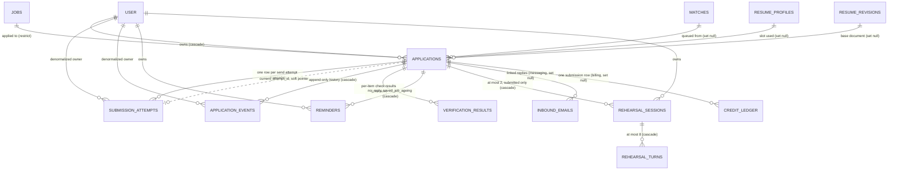
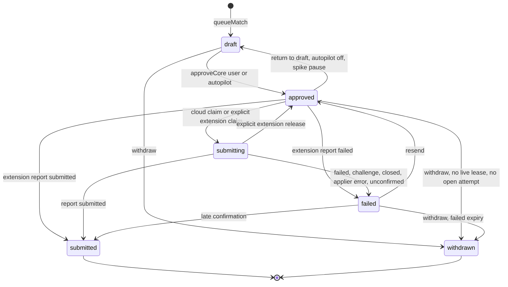
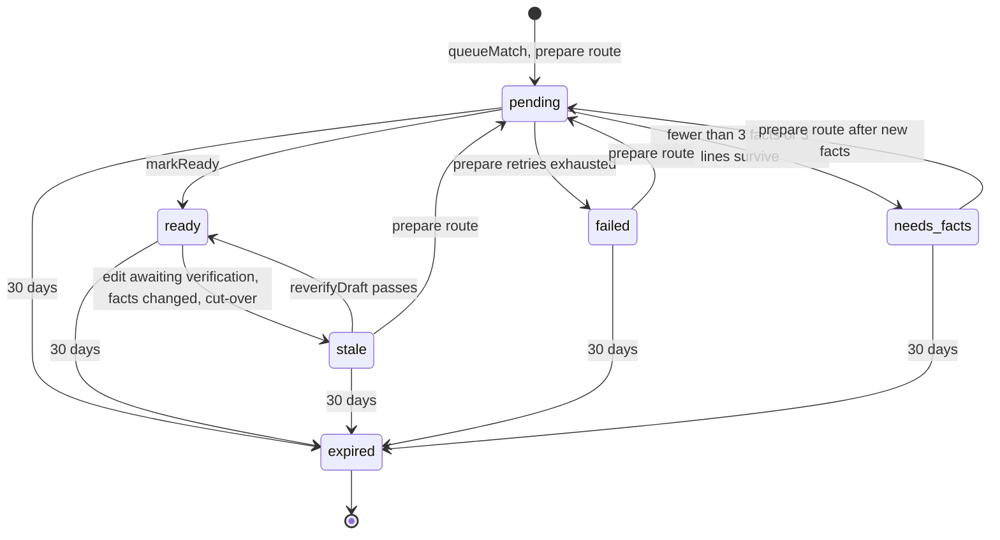
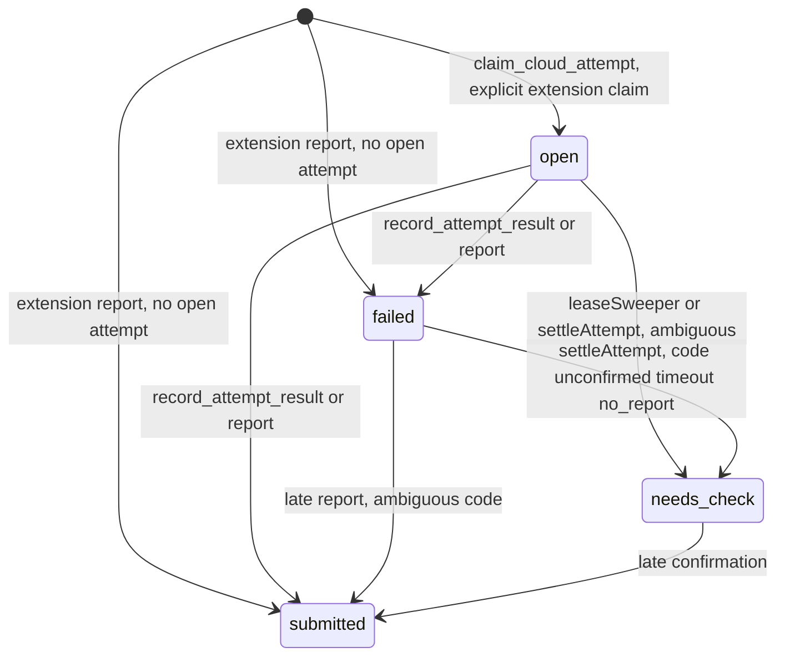
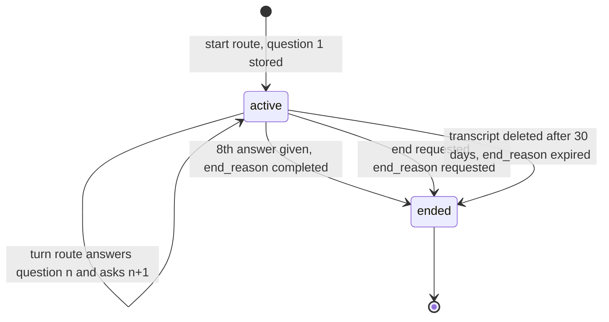

# Database design: domain `applications` (Applications and submission)

Status: design for implementation. Written 2026-10-23 against `01-architecture.md` revision 2 (ADR-001, postgres-durable on DBOS Transact 5.3.0, Anthropic agents), the spike S-D1 results in `_research/spike-s-d1-local.md`, `server/src/db/schema/*.ts`, `server/drizzle/0000_init.sql`, `0001_resume_workspace.sql`, `docs/05-backend-schema.md`, the sibling domain documents in `_db/` and the API contract in `05-api.md`.

Postgres 18 (`postgres-ssl:18`), database `kairos`, schema `public`. Application pools go through PgBouncer in transaction mode, so nothing here relies on session state: no session advisory locks, no `SET` outside `SET LOCAL` or `set_config(..., true)`. DBOS checkpoints live in the separate database `kairos_dbos` and are not part of this document.

## 0. Scope, and what this document changes in the architecture

This document owns seven tables: `applications` (the existing table, extended), `submission_attempts`, `verification_results`, `application_events`, `reminders`, `rehearsal_sessions` and `rehearsal_turns`. Other domains are designed in parallel; every cross-domain name below is exactly the architect's inventory name (`"user"`, `jobs`, `companies`, `matches`, `facts`, `resume_profiles`, `resume_revisions`, `inbound_emails`, `credit_ledger`, `credit_balances`, `subscriptions`, `profiles`, `autopilot_settings`, `notifications`, `email_sends`, `action_tokens`, `ops_flags`, `llm_calls`, `ai_usage`).

The application lifecycle is the center of the product: every money, truth and duplicate-send invariant ends in a row of this domain. The design therefore puts as much of each invariant as possible into Postgres constraints and triggers, so that a bug in a workflow, a replay after a crash or a manual repair cannot violate it silently.

### 0.1 Invariants this domain must make true in the database

| Invariant (requirements id) | Mechanism in this domain (section) |
|---|---|
| Nothing is sent before the user approves it, or before Autopilot approves it within every guard (INV-3) | Trigger `applications_guard_status` allows only the legal pairs of 4.1; no pair leads from `draft` to `submitting` or `submitted`; `claim_cloud_attempt` selects only `approved` rows; the approval-shape `CHECK` forbids `approved` without `channel`, `approved_at` and `approved_by` (3.1, 5.3) |
| A draft that is not `ready` and `passed` cannot be approved (INV-2, INV-7) | Guard version 3 rejects `draft` or `failed` to `approved` unless `draft_state = 'ready'` and `verification.state = 'passed'` (5.3). Ships in the contract migration, after the 14-day soak, so a code rollback never meets it (8.4) |
| One application per (user, job); two tabs submit once (INV-4) | Existing unique index `applications_user_job_uq`; `submission_attempts_one_open_uq` (one open attempt per application); `UNIQUE (application_id, attempt_no, channel)` (3.1, 3.2) |
| Autopilot never sends an imported or gate-overridden job (INV-3) | `applications_autopilot_ck`: `approved_by = 'autopilot'` requires `gate_override = false` (3.1) |
| A genuine `failed` to `submitted` late confirmation is possible only after an ambiguous failure (INV-5, RL-2) | Guard allows `failed` to `submitted` only when `OLD.failure_code IN ('unconfirmed','timeout','no_report')`; attempt guard allows `failed` or `needs_check` to `submitted` only for the same codes (5.3, 5.4) |
| An application has at most one open attempt, and an attempt only moves forward (INV-4) | Partial unique index; attempt guard trigger forbids backward phase moves and illegal state pairs (3.2, 5.4) |
| The event history is append-only (INV-13 spirit, F5) | `REVOKE UPDATE, DELETE` from runtime roles plus trigger `application_events_immutable`; replays are idempotent through `dedupe_key` (3.4, 5.5) |
| No unverified text is ever stored (INV-2) | `verification_results` has no text column at all; `submission_attempts.evidence` is capped and may not hold field values; `application_events.detail` may hold only short scalars (3.2, 3.3, 3.4) |
| Every row belongs to one user and cross-user references cannot be written (INV-11) | `user_id` on every table; trigger `applications_assert_owner` for `match_id`, `resume_profile_id` and `resume_base_revision_id`; trigger `rehearsal_sessions_bind` for the application owner (5.2, 5.6) |
| Sensitive answers do not outlive their usefulness (NFR-20, NFR-21) | `content_scrubbed_at` and the scrub job: sensitive answer values, receipt values and the questions snapshot are blanked 7 days after a terminal state (3.1, 6.3) |
| Closed postings never charge (INV-23) | Failure code `posting_closed` is not resendable and settlement calls the catalog's `closeJob` (4.8) |
| A submission the employer received is always recordable (RL-1, RL-3) | No `CHECK` or trigger in this domain can reject a `submitted` report that the state machine otherwise allows; ambiguous attempts stay `needs_check`, never `failed` forever (4.3) |

### 0.2 Deviations from, and additions to, `01-architecture.md` (B.6, B.10)

The architect's DDL is the starting point. These are the points where this document differs, each with its reason, so the architect can reconcile the final text.

| # | Architect text | This document | Reason |
|---|---|---|---|
| D1 | `applications` has no company column; the company cap joins `jobs` | New `applications.company_id`, filled by a `BEFORE INSERT` trigger from `jobs`, immutable afterwards, no foreign key. `applications_company_cap_idx` keeps its name and key and gains `INCLUDE (company_id)` | The cap count runs for every user of every candidate page (`04-matching.md` 6.3) and again at queue and approval. With `company_id` in the index it is an index-only scan with no join to `jobs`. The trigger makes the value correct by construction. `04-matching.md` keeps working unchanged because its join still returns the same numbers |
| D2 | `applications.current_attempt_id uuid` (type only) | Kept as a plain `uuid` pointer with no foreign key and no index; written only by the applier functions and the submission module; verified nightly (6.2) | A foreign key between `applications` and `submission_attempts` is circular, and `ON DELETE SET NULL` on the pointer would force an index on a 9-million-row table so that the cascade of each attempt row can find its application. The pointer is only a convenience for the applier view |
| D3 | `submission_attempts_open_idx (heartbeat_at) WHERE state = 'open'` | Dropped. The leaseSweeper reads the one-open partial unique index, which already contains exactly the open rows | A heartbeat every 10 seconds (B.6.7) updates `heartbeat_at`. If that column is indexed, every heartbeat is a non-HOT update that inserts an entry into every index of the table (about 77,000 a day on average, up to about 400,000 if every run lasted the 8-minute cap). Without it, heartbeats are HOT updates |
| D4 | Unsettled index predicate `phase = 'reported' AND settled_at IS NULL` | `state <> 'open' AND settled_at IS NULL` | The leaseSweeper closes stale attempts in the phase they stopped in (`filling`, `submit_seen`), not `reported`. The architect's reconciler would never see a closed attempt whose `settleAttempt` enqueue was lost |
| D5 | `application_events.id bigserial`, index `(application_id, at)` | `bigint GENERATED ALWAYS AS IDENTITY`; index `(application_id, at, id)`; new `dedupe_key`; new index on `(user_id, at DESC)`; scalar-only `CHECK` on `detail`; immutability trigger in addition to `REVOKE` | Identity columns need no sequence grant. `dedupe_key` makes every writer idempotent: spike S-D1 proved that `forkWorkflow` replays from step 0 and re-runs business effects. The `user_id` index serves the hourly Autopilot summary and the foreign-key cascade on account deletion (without it every account deletion scans tens of millions of rows) |
| D6 | `verification_results` lists a row per claim, all verdicts | Sparse recording: rows for every non-supported item, every escalation, every audit and, while `ops_flags.verification_full_log` is set (the 7-day shadow week and the first enforcement weeks), every supported item. New columns `run_id`, `run_kind`, `outcome`, `shadow`. New check source `audit`. No text and no detail column. Not partitioned | Writing a row for every supported item would be about 614,000 rows a day and 55 million live rows. Supported items are reproducible from the stored application, its `verification` summary and `llm_calls`. The weekly shadow audit needs a durable place for its verdicts. A text column would store unverified text (INV-2) |
| D7 | Status guard with 12 pairs | 13 pairs: adds `submitting` to `approved` for an explicit extension release (extension channel only). Three versions of the function, phased (5.3). Sets `updated_at` and the new `terminal_at` | `POST /api/extension/release` is a route in B.6.6 but the state machine had no pair for it. The phased versions keep the rollback rule of NFR-10 |
| D8 | B.10.6: sensitive answer values blanked 7 days after `submitted`, `failed` or `withdrawn` | Same 7 days for `submitted` and `withdrawn`. A `failed` application is resendable for as long as it exists, so it is not scrubbed; instead a `failed` application is withdrawn automatically after 90 days and then scrubbed after 7 more. New columns `terminal_at` (set by the guard), `content_scrubbed_at`, `receipt_summary` | Scrubbing a resendable failure would leave a resend that always skips with `required_answers_missing`, and `PATCH` only edits drafts, so the user could never fix it. Open question Q-1. `receipt_summary` lets the questions snapshot be dropped after the scrub, saving about 25% of the bytes of a terminal row |
| D9 | Few constraints on `applications` | Shape constraints: approval shape, failed code, submitted shape, lease shape, expired content, Autopilot, submitting pointer, JSON shapes (3.1) | The state machine is only as strong as the rows allowed to exist |
| D10 | Extension queue query rewrites the lease on every poll | The lease columns are in no index, and a lease is renewed only when under 5 minutes remain; the response still lists every pickable row (3.1) | The queue is polled by every open side panel. Rewriting up to 20 wide rows per poll with 17 indexes defeats HOT updates |
| D11 | `applications.stage` set only by replies | `stage = 'applied'` is set by `recordOutcome` in the transaction that sets `submitted`; a guard trigger makes later moves forward-only; `stage` may be set on any status (a confirmation email for a `failed` application is the strongest sign of a late confirmation) | Messaging's UPDATE would otherwise fail a `CHECK` that ties `stage` to `submitted` |
| D12 | `kairos_readonly` can read all of `applications` and `submission_attempts` | Column-level `SELECT` without `resume_lines`, `answers`, `cover_letter`, `receipt`, `questions` and `evidence` | Analytics and support need statuses, counts and timings, not a user's answers |
| D13 | `applications.id` default `gen_random_uuid()` | Default `uuidv7()` for new rows; existing v4 rows stay | Time-ordered keys keep the primary key and every foreign key index of a 9-million-row table dense |
| D14 | `submission_attempts` columns per B.10.5 | Adds `submit_seen_at` and `late_confirmation`, the attempt guard trigger, evidence rules that exclude field values, and a `CHECK` set (3.2) | The settlement decision table (B.6.8) reasons about timing, and the guard makes the legal transitions a database fact |
| D15 | `reminders`: `application_id` or `match_id`, kinds `no_reply` and `saved_job_ageing` | Same columns plus `state` columns `sent_at`, `cancelled_at`, `cancel_reason`; in version 1 `saved_job_ageing` targets a draft application waiting for approval, because `matches` has no starred or saved state; `match_id` is kept for a later saved-match feature. The digest validates each reminder against live state before sending | No hooks in approve, withdraw or classify paths; one consumer owns cancellation |
| D16 | `rehearsal_*`: session and turn columns | Database-enforced bounds: `ordinal` 1 to 2 per application, `seq` 1 to 8 per session, one active session per application, an application-binding trigger; two call ids per turn; transcripts deleted after 30 days while the session row stays so the 2-session limit holds | The F9 rules (at most 2 sessions per application, at most 8 questions, bound to a submitted application) become constraints |
| D17 | `applications.revision` and `row_version` both exist, not distinguished | `revision` is the preparation generation (workflow id `prepare:<id>:<revision>`); `row_version` is the optimistic-concurrency counter (ETag, `If-Match`, `reverify:<id>:<rowVersion>`). `05-api.md` 10.5 says the prepare id uses the row version; it must use `revision` | The reconciler of B.5.8 must recompute the id of the live prepare workflow from the row, and `row_version` changes on every `PATCH` |
| D18 | Applier functions in B.10.4 | Final text in 5.7: `claim_cloud_attempt` inserts the attempt before it moves the application, `record_attempt_result` accepts only the failure codes the applier may produce and caps the evidence, `mark_attempt_phase` records `submit_seen_at`, the view is `security_barrier` and gains billing's two trailing plan columns | Billing asked for the plan columns (`_db/billing.md` 11.1); the others are hardening of the functions the applier role is allowed to call |

### 0.3 What this domain asks of other domains

| # | To | Request |
|---|---|---|
| X1 | `identity-profile` | `resume_revisions` pruning must keep a revision while `applications.resume_base_revision_id` references it. This domain provides the index it asked for (X-1): `applications_base_revision_idx` and a foreign key `ON DELETE SET NULL` as a safety net |
| X2 | `catalog-matching` | Accepted: `applications.job_id` becomes `ON DELETE RESTRICT` (their X1) in the contract migration; `applications.match_id` stays `ON DELETE SET NULL` with `applications_match_idx`; settlement calls `closeJob(tx, jobId, 'apply_page')` for `posting_closed` (their X2); `approveCore` and Autopilot guard 8 use `job_fresh_at(j, c)` (their X6) |
| X3 | `billing` | The in-flight trigger `applications_in_flight_aiud` is theirs and fires `AFTER`, so it sees the result of my `BEFORE` guard. Lock rule L1 is adopted for withdraw, leaseSweeper, return-to-draft, failed-expiry and Autopilot-off. `applier_payload_v` gains `past_due_since` and `effective_plan` as trailing columns (5.8) |
| X4 | `messaging` | `classifyEmail` writes `applications.stage` (forward-only trigger, 5.3) and `application_events` with `dedupe_key = 'mail:<inboundEmailId>'`. The digest job consumes reminders through `modules/applications/reminders.ts` and writes its `email_sends` row in the same transaction (3.5) |
| X5 | `platform` | New `ops_flags` keys: `verification_full_log` (6.1), `ap2_verified` (S-AP2 proven, 4.8). Existing keys used: `approvals_frozen`, `autopilot_frozen`, `pause_cloud_apply`, `extension_only:<ats>`. `llm_call_id` columns here are plain `bigint` without foreign keys, as the platform document requires |
| X6 | `architecture` (B.6, B.10) | Update B.6.2 (the extra pair), B.10.2 (new columns), B.10.5 (`dedupe_key`, attempt columns, dropped index), B.5.8 (unsettled predicate, dual-submission check) and B.10.6 (scrub and failed-expiry). Section 11.3 lists every place the spike changed this document |
| X7 | `api` (`05-api.md`) | Prepare workflow id uses `revision` (D17). A `failed` application with code `required_missing` must be editable (`PATCH` allowed for `failed` rows with that code), otherwise the "allowed after the user fixes the answers" row of B.6.8 can never be satisfied (Q-4). The stored `verification` summary uses the key names of `verificationSummarySchema` (`kind`, `ref`, `rule`), not the `itemKind`, `itemId`, `reason` of B.10.2 |

## 1. Domain map



### 1.1 Who writes each table

Single-writer rule (B.2): each table has one TypeScript module that writes it; the grant matrix in 2.3 makes the split real.

| Table | Writer module (`server/src/modules/`) | Called from |
|---|---|---|
| `applications` | `applications/` for `queueMatch`, `approveCore`, `prepareApplication`, `PATCH`, withdraw, return-to-draft, draft expiry, failed expiry, scrub; `submission/` for `recordOutcome` (the only code that sets `submitted`, or `failed` from a report, B.2 rule 6) and the extension queue lease; the applier role through `claim_cloud_attempt` only; `inbox/` for `stage` only | api routes, request workflows `queueMatch`, `approveApplications`, `resendApplication`; worker queues `prepare`, `reverify`, `autopilot`, `settle`; schedules |
| `submission_attempts` | The four applier functions of 5.7 (insert at claim, phase, result); `submission/` (`settleAttempt`, `leaseSweeper`, extension report rows) | applier queue `cloud-apply`; worker queue `settle`; api `POST /api/extension/report` |
| `verification_results` | `applications/verification.ts` | `prepareApplication` step `generateAndVerify`, `reverifyDraft`, `PATCH` (api), the weekly shadow audit schedule |
| `application_events` | `applications/events.ts` (`appendEvent(tx, ...)`), called in the transaction of the change it records, by every module that changes an application | All of the above, `classifyEmail`, `reminders` schedule |
| `reminders` | `applications/reminders.ts` | `reminders` schedule (create), digest workflow (consume, cancel) |
| `rehearsal_sessions`, `rehearsal_turns` | `coaching/` | api routes `POST /api/applications/:id/rehearsals`, `POST /api/rehearsals/:sessionId/turns`; `retention` schedule (delete) |

### 1.2 Workflows that touch this domain (names as fixed by spike S-D1)

Queues are database-backed and registered after launch with `await DBOS.registerQueue(name, options)`; partitioning is implied by any `partition*` limit, so `cloud-apply` sets `partitionConcurrency: 8` and every enqueue passes the partition key `companies.apply_host`; `settle` and `prepare` use `globalConcurrency` (8 and 32). Workflow ids are the idempotency keys; the database is the second line (rule D1: a workflow's first step is a conditional read or claim).

| Workflow (id) | What it does to this domain | Replay safety (what the database adds) |
|---|---|---|
| `queueMatch` (`queue:<matchId>`) | Inserts the draft (`ON CONFLICT (user_id, job_id) DO NOTHING`), event `drafted` | Unique index; event `dedupe_key = 'drafted'` |
| `prepareApplication` (`prepare:<applicationId>:<revision>`) | Writes lines, answers, letter, `verification`, `verification_results`, `draft_state`, PDF key; event `verified` | `verification_results` unique on `(run_id, item_kind, item_id, check_source)`; event `dedupe_key = 'verified:<revision>:<rowVersion>'` |
| `reverifyDraft` (`reverify:<applicationId>:<rowVersion>`) | Same, for a stored edit | Same |
| `approveApplications`, `resendApplication`, `autopilotApprove` | `approveCore`: status to `approved`, `attempt_no + 1`, event `approved` or `auto_approved` | Conditional `UPDATE ... WHERE status = <expected>`; event `dedupe_key = 'approved:<attemptNo>'` |
| `applyCloud` (`apply:<applicationId>:<attemptNo>`) | The four applier functions | `claim_cloud_attempt` returns the existing attempt on replay; `mark_browser_launched` is false on replay |
| `settleAttempt` (`settle:<attemptId>`) | `recordOutcome`: application result, attempt `settled_at`, events `sent` or `failed` | Status checks under the balance and application locks; event `dedupe_key = 'sent'` or `'failed:<attemptNo>'` |
| `classifyEmail` (`classify:<inboundEmailId>`) | `stage`, events `reply_*` | `dedupe_key = 'mail:<inboundEmailId>'`; forward-only stage trigger |
| Schedules (`leaseSweeper`, `return-to-draft`, `draft-expiry`, `failed-expiry`, `scrub-applications`, `reminders`, `retention`, `submission-health`) | Section 6 | Conditional updates; `ON CONFLICT DO NOTHING` |

## 2. Cross-cutting rules for this domain

### 2.1 Conventions

- Primary keys: `uuid DEFAULT uuidv7()` for new surrogate keys (native in Postgres 18); `bigint GENERATED ALWAYS AS IDENTITY` for `application_events` and `verification_results`, which are high-volume append-only tables whose ids are never user-chosen; `text` for the Better Auth `"user".id`.
- All timestamps are `timestamptz`. `now()` in triggers is the transaction start time, which is intended.
- Stable, widely shared sets keep their `pgEnum`: `application_status` and `submit_channel` (defined in `shared/`, mirrored in `server/src/db/schema/enums.ts`, unchanged). Lifecycle and vocabulary sets that evolve are `text` with a named `CHECK`, so adding a value is a `NOT VALID` plus `VALIDATE` pair rather than an `ALTER TYPE` (which cannot run in the same transaction as its first use, D17 of the catalog document). Section 2.4 lists every set.
- Codes stored in text columns (`draft_issue`, `failure_code`, `detail` values) match `^[a-z0-9_:.-]{1,80}$`; no free text from users or models is stored in a code column.
- JSON columns have shape `CHECK`s (`jsonb_typeof`, array length, `pg_column_size`). `pg_column_size` measures the stored, possibly compressed size, so the limits are abuse guards, not exact byte limits; the zod schemas in `shared/` stay the exact validation.
- Every constraint that guards existing data is added `NOT VALID` and then `VALIDATE`d after a `DO` block has asserted that the data is clean (section 8). `applications` is small until the paid beta (fewer than 10,000 rows [est; count before P2]), so plain `CREATE INDEX` inside a migration is acceptable then; every index added afterwards uses `CREATE INDEX CONCURRENTLY` from `server/scripts/applications-indexes.sql`, applied outside the migrator transaction (the catalog document's D17 explains why the Drizzle migrator cannot run it inline).
- Big text and JSON columns of `applications` use `COMPRESSION lz4` (`ALTER COLUMN ... SET COMPRESSION lz4`), which compresses JSON about 2.5 to 3 times and decompresses faster than the default `pglz`. The `postgres-ssl:18` image must be built with lz4; spike S-P1 confirms it [verify]. If it is not, the default compression applies and the size projections in section 7 grow by about 40%.
- Row-level security is not used (same reason as the identity document). Ownership is a `WHERE user_id = $session` filter in the data-access layer plus the same-owner triggers of section 5.

### 2.2 Lock order

The architect's global order (B.6.4) is: (1) the user's `credit_balances` row, (2) `applications` rows ordered by `id`, (3) `submission_attempts` rows. `_db/billing.md` extends it as rule L1: any transaction that moves an application into or out of `{approved, submitting}` locks the balance row first. This domain adds:

| Rule | Statement |
|---|---|
| A-1 Same order everywhere | Every path that writes this domain follows L1 and then locks applications by `id`, then the attempt, then (if it needs them) `reminders`. `rehearsal_sessions` is locked alone: a turn locks its session row `FOR UPDATE` and never touches `applications` rows (the application is read without a lock; it is terminal) |
| A-2 Paths covered by L1 | `approveCore` (user, resend, Autopilot), `recordOutcome` (reads `user_id` without a lock, locks the balance row, then the application row), withdraw of an `approved` row, `leaseSweeper` (one transaction per user), return-to-draft, `failed-expiry` (does not cross the in-flight boundary, so no balance lock), `PUT /api/autopilot` off and the failure-spike pause. `claim_cloud_attempt` does not cross the boundary (`approved` to `submitting` stays inside `{approved, submitting}`), so it takes no balance lock and only the application row lock |
| A-3 Triggers never lock upward | The guard triggers of this domain read or lock only the row being changed and, for the same-owner check, read parent rows without locks. They never touch `credit_balances`; that is the billing trigger's job and it runs `AFTER` |
| A-4 Retries | DBOS steps that run a transaction of this domain retry once on SQLSTATE `40P01` (deadlock) or `40001`; a concurrency test (T-2) interleaves every path above and asserts zero `40P01` |

### 2.3 Privilege matrix (extends B.10.4)

Default privileges in the architecture grant `SELECT, INSERT, UPDATE, DELETE` on every new table to `kairos_api` and `kairos_worker`, so each migration of this domain explicitly revokes. Final state, asserted by the grant test (T-12):

| Table | `kairos_api` | `kairos_worker` | `kairos_applier` | `kairos_readonly` |
|---|---|---|---|---|
| `applications` | `SELECT, INSERT, UPDATE, DELETE` | `SELECT, INSERT, UPDATE, DELETE` | none (reaches its rows through `applier_payload_v` and the functions of 5.7) | `SELECT` on all columns except `resume_lines`, `answers`, `cover_letter`, `receipt`, `questions`, `resume_line_entries`, `failure_reason`, `lease_session_id` |
| `submission_attempts` | `SELECT, INSERT, UPDATE` (extension report rows) | `SELECT, INSERT, UPDATE` | none (functions only) | `SELECT` on all columns except `evidence`, `session_id` |
| `verification_results` | `SELECT, INSERT` | `SELECT, INSERT, DELETE` (retention) | none | `SELECT` |
| `application_events` | `SELECT, INSERT` | `SELECT, INSERT` | none | `SELECT` |
| `reminders` | none | `SELECT, INSERT, UPDATE, DELETE` | none | `SELECT` |
| `rehearsal_sessions` | `SELECT, INSERT, UPDATE` | `SELECT, UPDATE` (retention ends still-active sessions) | none | none |
| `rehearsal_turns` | `SELECT, INSERT, UPDATE` | `SELECT, DELETE` (retention) | none | none |

`UPDATE` and `DELETE` on `application_events` are revoked from every runtime role (and blocked for the table owner by the trigger of 5.5); the identity sequence needs no grant because identity columns need only `INSERT` on the table. `TRUNCATE` and `REFERENCES` are never granted. Account-deletion cascades run with the owner's privileges, so the narrowed rights do not block them; the immutability trigger allows deletes that arrive from a foreign-key action (5.5). The five applier functions run `SECURITY DEFINER` and are `EXECUTE`-granted to `kairos_applier` only; `EXECUTE` is revoked from `PUBLIC`.

### 2.4 Enumerations

Existing Postgres enums (unchanged): `application_status` (`draft`, `approved`, `submitting`, `submitted`, `failed`, `refunded`, `withdrawn`) and `submit_channel` (`extension`, `cloud`). `refunded` is never set by a code path (the ledger correction `refund_failed_submit` leaves the application `submitted`).

New vocabularies, each a `text` column with a `CHECK` and a TypeScript constant exported from `server/src/db/schema/applications.ts` (those marked "shared" are also exported from `shared/` per `05-api.md` 4):

| Name | Column | Values | Shared |
|---|---|---|---|
| `DRAFT_STATES` | `applications.draft_state` | `pending`, `ready`, `failed`, `needs_facts`, `stale`, `expired` | yes |
| `APPROVERS` | `applications.approved_by`, `submission_attempts.approved_by` | `user`, `autopilot` | no |
| `FAILURE_CODES` | `applications.failure_code`, `submission_attempts.failure_code` | `challenge`, `posting_closed`, `required_missing`, `applier_error`, `unconfirmed`, `timeout`, `no_report`, `plan_lapsed`, `cloud_unavailable_for_ats`, `extension_reported` | yes |
| `AMBIGUOUS_FAILURE_CODES` | subset used in constraints | `unconfirmed`, `timeout`, `no_report` | no |
| `APPLICATION_STAGES` | `applications.stage` | `applied`, `in_review`, `assessment`, `interviewing`, `offer`, `rejected` | yes |
| `VERIFICATION_STATES` | `applications.verification->>'state'` | `none`, `pending`, `passed`, `failed` (a `NULL` column means `none`) | yes |
| `ATTEMPT_PHASES` | `submission_attempts.phase` | `claimed`, `navigating`, `filling`, `submit_seen`, `reported` | no |
| `ATTEMPT_STATES` | `submission_attempts.state` | `open`, `submitted`, `failed`, `needs_check` | no |
| `EVENT_KINDS` | `application_events.kind` | `drafted`, `verified`, `edited`, `approved`, `auto_approved`, `sent`, `failed`, `resent`, `withdrawn`, `reply_confirmation`, `reply_rejection`, `reply_interview`, `reply_assessment`, `reply_offer`, `gone_quiet`, `reminder_sent` | yes |
| `EVENT_ACTORS` | `application_events.actor` | `user`, `autopilot`, `system`, `employer` | no |
| `QUESTION_PLANS` | `applications.questions[].plan` | `profile`, `sensitive`, `saved_answer`, `free_text` | no |
| `VERIFICATION_ITEM_KINDS` | `verification_results.item_kind` | `resume_line`, `answer`, `cover_paragraph` | no |
| `VERIFICATION_VERDICTS` | `verification_results.verdict` | `supported`, `unsupported`, `contradicted`, `uncertain`, `rule_failed` | no |
| `CLAIM_RULES` | `verification_results.rule` | `no_fact`, `unknown_fact`, `unconfirmed_fact`, `number_not_in_facts`, `entity_not_in_facts`, `skill_not_in_facts`, `contact_data_in_line`, `length`, `unsupported_by_cited_facts`, `unverified` | yes |
| `VERIFICATION_CHECK_SOURCES` | `verification_results.check_source` | `deterministic`, `verifier`, `escalation`, `user_edit`, `audit` | no |
| `VERIFICATION_RUN_KINDS` | `verification_results.run_kind` | `prepare`, `repair`, `patch`, `reverify`, `audit` | no |
| `VERIFICATION_OUTCOMES` | `verification_results.outcome` | `kept`, `dropped`, `escalated`, `audited` | no |
| `REMINDER_KINDS` | `reminders.kind` | `no_reply`, `saved_job_ageing` | no |
| `REMINDER_CANCEL_REASONS` | `reminders.cancel_reason` | `reply_received`, `draft_resolved`, `user_opted_out`, `expired` | no |
| `REHEARSAL_END_REASONS` | `rehearsal_sessions.end_reason` | `completed`, `requested`, `expired` | no |

## 3. Tables

### 3.1 `applications`

**Purpose.** One application of one user to one job: the draft the pipeline prepares, the review the user approves, the send state, the receipt and the reply-driven stage. It is the central row of the product and the largest table of the database. A unique `(user_id, job_id)` pair means a retry can never send twice. Preparation progress lives in `draft_state`; `status` keeps its seven values because `shared/src/types.ts` and both frozen clients read them.

**Columns** (final state; "existing" marks columns of the current table, "new" marks additions):

| Column | Type | Null | Default | Notes |
|---|---|---|---|---|
| `id` | `uuid` | no | `uuidv7()` | Primary key. Default changes from `gen_random_uuid()` (D13); existing rows keep their v4 ids. Existing |
| `user_id` | `text` | no | | Owner. Existing; immutable (5.2) |
| `job_id` | `uuid` | no | | Existing; immutable; `ON DELETE RESTRICT` after the contract migration |
| `company_id` | `uuid` | no | trigger | New. Copied from `jobs.company_id` by `applications_fill_company` on insert (D1); immutable; `NOT NULL` after the backfill |
| `match_id` | `uuid` | yes | | The match this draft came from. Existing |
| `resume_profile_id` | `uuid` | yes | | The resume slot used. Existing |
| `resume_base_revision_id` | `uuid` | yes | | New. The `resume_revisions` row the tailored lines started from (B.8.2). Set by `prepareApplication` |
| `status` | `application_status` | no | `'draft'` | Existing; transitions guarded by trigger (4.1) |
| `draft_state` | `text` | no | `'pending'` | New. Preparation state (4.2) |
| `draft_issue` | `text` | yes | | New. A short code explaining `failed`, `needs_facts` or an Autopilot skip (`autopilot_skipped:<reason>`); at most 80 characters |
| `revision` | `integer` | no | `1` | New. Preparation generation; bumped by the prepare route, a facts change that forces re-preparation and the cut-over (D17) |
| `row_version` | `integer` | no | `0` | New. Optimistic-concurrency counter. Bumped by every statement that changes `status`, `draft_state`, `resume_lines`, `answers`, `cover_letter`, `questions` or `verification`; not bumped by lease, pointer or heartbeat writes |
| `channel` | `submit_channel` | yes | | Chosen at approval. Existing |
| `approved_by` | `text` | yes | | New. `user` or `autopilot`; set at approval, cleared on return to draft |
| `approved_at` | `timestamptz` | yes | | Existing. Set at approval and at every resend; cleared on return to draft |
| `attempt_no` | `integer` | no | `0` | New. Incremented by every approval (`approveCore`); the number the claim must match. Never decreases |
| `current_attempt_id` | `uuid` | yes | | New. Soft pointer to the latest `submission_attempts` row (D2) |
| `lease_session_id` | `text` | yes | | New. Better Auth session id holding the extension visibility lease (B.6.6) or an explicit claim |
| `lease_expires_at` | `timestamptz` | yes | | New. Lease end; 10 minutes after the last renewal |
| `resume_lines` | `jsonb` | no | `'[]'` | Existing. `ResumeLine[]`, each citing confirmed fact ids. Cleared when a draft expires |
| `resume_line_entries` | `jsonb` | yes | | New. `{ [lineId]: entryId }` for lines not in the base document (B.8.7) |
| `answers` | `jsonb` | no | `'[]'` | Existing. `ApplicationAnswer[]` with `source` in `profile`, `saved_answer`, `generated`, `user_edit` |
| `cover_letter` | `text` | yes | | Existing |
| `questions` | `jsonb` | yes | | New. Snapshot of the form questions used, with the plan and the sensitive flag of each (`Question[]` below). Null for legacy rows and after the scrub |
| `verification` | `jsonb` | yes | | New. Summary of the last verification run (`VerificationSummary` below). Null means `none` |
| `facts_snapshot_hash` | `text` | yes | | New. SHA-256 (hex) of the sorted `(id, text, confirmed_at)` of every cited fact; compared again at approval |
| `resume_pdf_key` | `text` | yes | | New. R2 key of the tailored PDF (content-hash key, reused when it exists) |
| `prepared_at` | `timestamptz` | yes | | New. When `draft_state` last became `ready` |
| `gate_override` | `boolean` | no | `false` | New. True when the match was `below_bar` and `source = 'manual_url'`; Autopilot never sends such a row |
| `receipt` | `jsonb` | yes | | Existing. What the filler reported (`Receipt`). Values of sensitive fields are blanked by the scrub |
| `receipt_summary` | `jsonb` | yes | | New. `{ filled, total, skipped, generated }`, computed at settlement so the questions snapshot can be dropped by the scrub (D8); null for legacy rows, which the API computes on read |
| `stage` | `text` | yes | | New. Reply-driven stage (4.5). Set to `applied` in the transaction that sets `submitted` |
| `failure_code` | `text` | yes | | New. One of `FAILURE_CODES` while `status = 'failed'`; kept on `withdrawn` |
| `failure_reason` | `text` | yes | | Existing. Plain-words reason shown in the web app; at most 500 characters |
| `submitted_at` | `timestamptz` | yes | | Existing. Server time of the recorded submission (D-27); never a client clock |
| `terminal_at` | `timestamptz` | yes | | New. Set by the guard trigger when `status` enters `submitted`, `failed` or `withdrawn`, cleared when it leaves; the clock for the scrub and failed-expiry |
| `content_scrubbed_at` | `timestamptz` | yes | | New. When the scrub blanked sensitive values and dropped `questions` |
| `created_at` | `timestamptz` | no | `now()` | Existing |
| `updated_at` | `timestamptz` | no | `now()` | Existing. Set by the guard on status change and explicitly by content writes; not by lease or pointer writes |

**JSON shapes** (TypeScript types in `server/src/db/schema/applications.ts`; the zod schemas in `shared/` remain the exact validation):

```ts
export interface Receipt {                         // existing
  filledFields: { fieldKey: string; label: string; value: string }[];
  confirmationText?: string;
  channel: "extension" | "cloud";
}
export interface Question {                        // element of applications.questions
  fieldKey: string; label: string;
  type: "text" | "textarea" | "select" | "multiselect" | "checkbox" | "file" | "other";
  required: boolean; options: string[];
  sensitive: boolean;                              // EEO, disability, veteran, gender, race, sexual orientation, salary, visa, sponsorship
  plan: "profile" | "sensitive" | "saved_answer" | "free_text";   // how prepareApplication decided to answer it
}
export interface VerificationSummary {             // applications.verification; shape of verificationSummarySchema plus bookkeeping
  state: "none" | "pending" | "passed" | "failed";
  promptVersion: string;                           // e.g. "claim-verifier@v3"
  checked: number; supported: number; escalated: number;
  dropped: { kind: "resume_line" | "answer" | "cover_letter"; ref: string; rule: ClaimRule }[];   // ids and rules only, never text
  verifiedAt: string | null;
}
export interface ReceiptSummary { filled: number; total: number; skipped: number; generated: number }
```

**Primary key.** `id`.

**Foreign keys.**

| Column | References | On delete | Why |
|---|---|---|---|
| `user_id` | `"user"(id)` | `CASCADE` | Account deletion removes the user's applications (and, through them, attempts, events, results, reminders and rehearsals). Run it from a worker workflow, not the api's 10-second statement budget (`_db/billing.md` 3.4) |
| `job_id` | `jobs(id)` | `RESTRICT` (was `CASCADE`) | A deleted job must never silently delete users' applications (catalog request X1). Retention deletes only unreferenced jobs, so this costs nothing |
| `match_id` | `matches(id)` | `SET NULL` | Existing. Match retention deletes old matches; the application survives |
| `resume_profile_id` | `resume_profiles(id)` | `SET NULL` | Existing. Deleting a resume slot keeps the application |
| `resume_base_revision_id` | `resume_revisions(id)` | `SET NULL` | New. Safety net behind the identity domain's pruning rule (X1) |
| `current_attempt_id`, `company_id` | none | n/a | Deliberately (D1, D2). `company_id` is trigger-guaranteed and `jobs.company_id` is itself a foreign key |

**Unique and partial unique indexes (the invariants).**

```sql
CREATE UNIQUE INDEX applications_user_job_uq ON applications (user_id, job_id);   -- existing: one application per (user, job), INV-4
```

No other uniqueness lives on this table: one open attempt per application and one attempt per `(application, attempt_no, channel)` are enforced on `submission_attempts` (3.2), and the one charge per application on `credit_ledger` (billing).

**Other indexes.** Each index below names the query it serves. All partial indexes use predicates that the serving query implies literally, so the planner can use them.

| Index | Definition | Query it serves |
|---|---|---|
| `applications_list_idx` | `(user_id, updated_at DESC, id DESC)` | `GET /api/applications` without a status filter: `WHERE user_id = $1 ORDER BY updated_at DESC, id DESC LIMIT 200`, cursor on `(updated_at, id)`; the outcome and billing screens' recent-activity reads |
| `applications_user_status_updated_idx` | `(user_id, status, updated_at DESC, id DESC)` | The same list with `?status=`; replaces the existing `applications_user_status_idx (user_id, status)` (dropped in the contract migration); also serves the weekly outcome report's "submitted in the last 28 days" (`status = 'submitted' AND updated_at >= $cutoff`, a superset of `submitted_at >= $cutoff` because `updated_at` is at least `submitted_at`) |
| `applications_job_idx` | `(job_id)` | `ON DELETE RESTRICT` check when a job is deleted by retention; "applications for this job" in ghost signals (`silent_applications`) and the catalog's reference counts |
| `applications_match_idx` | `(match_id) WHERE match_id IS NOT NULL` | `ON DELETE SET NULL` when match retention deletes rows; "has this match an application" at queue time |
| `applications_resume_profile_idx` | `(resume_profile_id) WHERE resume_profile_id IS NOT NULL` | `ON DELETE SET NULL` when a resume slot is deleted (and on every slot of an account deletion) |
| `applications_base_revision_idx` | `(resume_base_revision_id) WHERE resume_base_revision_id IS NOT NULL` | The identity domain's pruning check "no application references this revision" and the foreign key action (X1) |
| `applications_ext_queue_idx` | `(user_id, approved_at) WHERE status = 'approved' AND channel = 'extension'` | The extension queue (below), `GET /api/extension/queue`, every open side panel; also the 14-day return-to-draft scan (the whole partial index holds only unsent extension approvals) |
| `applications_ext_claim_idx` | `(id) WHERE status = 'submitting' AND channel = 'extension'` | `leaseSweeper` every minute: expired explicit extension claims (`lease_expires_at < now()` is filtered on the few rows). Keyed on `id` so that lease writes touch no index |
| `applications_cloud_approved_idx` | `(approved_at) WHERE status = 'approved' AND channel = 'cloud'` | Reconciler "cloud approval with no live apply workflow" (B.5.8), every 5 minutes |
| `applications_draft_work_idx` | `(updated_at) WHERE status = 'draft' AND draft_state IN ('pending','stale')` | Reconcilers "draft with no live prepare workflow" and "stale draft with no live reverify workflow" (B.5.8) |
| `applications_draft_age_idx` | `(updated_at) WHERE status = 'draft' AND draft_state <> 'expired'` | Daily `draft-expiry`: drafts untouched for 30 days |
| `applications_failed_age_idx` | `(terminal_at) WHERE status = 'failed'` | Daily `failed-expiry`: failed applications older than 90 days |
| `applications_company_cap_idx` | `(user_id, created_at DESC) INCLUDE (company_id) WHERE status IN ('draft','approved','submitting','submitted')` | The per-company cap (`companyApplicationCounts`, `queueMatch`, `approveCore`): per-company counts for the last 30 days, mostly as an index-only scan. Existing name and key kept (D1) |
| `applications_autopilot_idx` | `(user_id, approved_at) WHERE approved_by = 'autopilot'` | `GET /api/autopilot` `sentToday`, Autopilot guard 9 (daily cap), the hourly Autopilot summary |
| `applications_submitted_at_idx` | `(submitted_at) WHERE submitted_at IS NOT NULL` | Hourly `reminders` scan (applications submitted 14 to 17 days ago), the hourly "charged versus submitted" check, cost-per-submission queries |
| `applications_scrub_due_idx` | `(terminal_at) WHERE content_scrubbed_at IS NULL AND status IN ('submitted','withdrawn')` | `scrub-applications` (7 days after a terminal state). Holds about 175,000 entries at growth (a week of terminal rows) |

`INCLUDE` is not expressible in the Drizzle index builder (`_db/billing.md` 3.2 has the same note): the TypeScript schema declares `applications_company_cap_idx` on the two key columns and the migration SQL creates it with `INCLUDE`, under the same name. `drizzle-kit` compares snapshots, not the live database, so there is no diff.

**HOT discipline.** `applications` rows are wide and updated several times in their life. An update is HOT (heap-only, no index entries) only when it changes no column that appears in any index key or predicate. These columns are in no index and must stay out of any future index: `lease_session_id`, `lease_expires_at`, `current_attempt_id`, `row_version`, `verification`, `questions`, `resume_pdf_key`, `facts_snapshot_hash`, `prepared_at`, `receipt`, `receipt_summary`, `revision`. Columns that are in indexes (`status`, `draft_state`, `channel`, `approved_at`, `approved_by`, `updated_at`, `terminal_at`, `submitted_at`, `content_scrubbed_at`, `match_id`, `resume_profile_id`, `resume_base_revision_id`) change only on lifecycle events. `fillfactor = 90` leaves room for HOT chains on the hot path.

**Extension queue query** (replaces the architect's B.6.6 statement; D10). The lease is renewed only when the session does not hold it or less than 5 minutes remain, so a side panel polling every 30 seconds writes a row about every 5 minutes instead of every poll; the response still lists every row the caller may see:

```sql
WITH picked AS (
  SELECT id, lease_session_id, lease_expires_at
    FROM applications
   WHERE user_id = $user AND status = 'approved' AND channel = 'extension'
     AND (lease_session_id IS NULL OR lease_expires_at < now() OR lease_session_id = $session)
   ORDER BY approved_at
   LIMIT 20
   FOR UPDATE SKIP LOCKED
), renewed AS (
  UPDATE applications a
     SET lease_session_id = $session, lease_expires_at = now() + interval '10 minutes'
    FROM picked p
   WHERE a.id = p.id
     AND (p.lease_session_id IS DISTINCT FROM $session OR p.lease_expires_at < now() + interval '5 minutes')
  RETURNING a.id
)
SELECT a.id, a.answers, a.resume_lines, a.cover_letter, a.resume_pdf_key, a.job_id
  FROM applications a JOIN picked p ON p.id = a.id
 ORDER BY a.approved_at;
```

**Check constraints.** Thirteen are added `NOT VALID` in the expand migration and validated after the backfill; four (`applications_approval_shape_ck`, `applications_failed_shape_ck`, `applications_stage_shape_ck`, `applications_submitting_ck`) are added in the contract migration, because the skeleton's code that still runs for some users writes rows they would reject (8.2). Each expression uses only immutable functions.

```sql
ALTER TABLE applications
  ADD CONSTRAINT applications_draft_state_ck CHECK (draft_state IN ('pending','ready','failed','needs_facts','stale','expired')),
  ADD CONSTRAINT applications_draft_issue_ck CHECK (draft_issue IS NULL OR draft_issue ~ '^[a-z0-9_:.-]{1,80}$'),
  ADD CONSTRAINT applications_counters_ck    CHECK (revision >= 1 AND row_version >= 0 AND attempt_no >= 0),
  ADD CONSTRAINT applications_approved_by_ck CHECK (approved_by IS NULL OR approved_by IN ('user','autopilot')),
  ADD CONSTRAINT applications_failure_code_ck CHECK (failure_code IS NULL OR failure_code IN
    ('challenge','posting_closed','required_missing','applier_error','unconfirmed','timeout','no_report',
     'plan_lapsed','cloud_unavailable_for_ats','extension_reported')),
  ADD CONSTRAINT applications_stage_ck       CHECK (stage IS NULL OR stage IN
    ('applied','in_review','assessment','interviewing','offer','rejected')),

  -- Approval shape: a row that left draft carries who approved it, when and on which channel.
  -- A draft carries none of them, which is what "return to draft" must clear. Withdrawn rows keep what they had.
  ADD CONSTRAINT applications_approval_shape_ck CHECK (
        (status IN ('approved','submitting','submitted','failed')
           AND approved_at IS NOT NULL AND approved_by IS NOT NULL AND channel IS NOT NULL)
     OR (status = 'draft' AND approved_at IS NULL AND approved_by IS NULL AND channel IS NULL)
     OR status IN ('withdrawn','refunded')),

  -- A failed row always has a code; only failed (and withdrawn-after-failed) rows may keep one.
  ADD CONSTRAINT applications_failed_shape_ck CHECK (
        (status <> 'failed' OR failure_code IS NOT NULL)
    AND (failure_code IS NULL OR status IN ('failed','withdrawn','refunded'))),

  -- submitted_at is set exactly for submitted rows (refunded is reserved for operators and unconstrained).
  ADD CONSTRAINT applications_submitted_shape_ck CHECK (
        status = 'refunded' OR ((status = 'submitted') = (submitted_at IS NOT NULL))),
  ADD CONSTRAINT applications_stage_shape_ck CHECK (status <> 'submitted' OR stage IS NOT NULL),

  -- Lease: both columns or neither, and only while an extension send is possible.
  ADD CONSTRAINT applications_lease_ck CHECK (
        (lease_session_id IS NULL) = (lease_expires_at IS NULL)
    AND (lease_session_id IS NULL OR (status IN ('approved','submitting') AND channel = 'extension'))),

  ADD CONSTRAINT applications_submitting_ck CHECK (status <> 'submitting' OR current_attempt_id IS NOT NULL),
  ADD CONSTRAINT applications_autopilot_ck  CHECK (approved_by IS DISTINCT FROM 'autopilot' OR gate_override = false),

  -- Draft expiry clears content in the same statement (B.10.6).
  ADD CONSTRAINT applications_expired_ck CHECK (draft_state <> 'expired' OR (
        status IN ('draft','withdrawn') AND resume_lines = '[]'::jsonb AND answers = '[]'::jsonb
        AND cover_letter IS NULL AND resume_pdf_key IS NULL)),
  ADD CONSTRAINT applications_scrub_ck CHECK (content_scrubbed_at IS NULL OR status IN ('submitted','withdrawn')),

  ADD CONSTRAINT applications_json_ck CHECK (
        jsonb_typeof(resume_lines) = 'array' AND jsonb_array_length(resume_lines) <= 200
    AND jsonb_typeof(answers) = 'array'      AND jsonb_array_length(answers) <= 200
    AND (questions IS NULL OR (jsonb_typeof(questions) = 'array' AND jsonb_array_length(questions) <= 200))
    AND (verification IS NULL OR (jsonb_typeof(verification) = 'object'
         AND verification->>'state' IN ('none','pending','passed','failed') AND pg_column_size(verification) <= 16384))
    AND (resume_line_entries IS NULL OR (jsonb_typeof(resume_line_entries) = 'object' AND pg_column_size(resume_line_entries) <= 16384))
    AND (receipt IS NULL OR jsonb_typeof(receipt) = 'object')
    AND (receipt_summary IS NULL OR jsonb_typeof(receipt_summary) = 'object')),
  ADD CONSTRAINT applications_text_ck CHECK (
        (facts_snapshot_hash IS NULL OR facts_snapshot_hash ~ '^[0-9a-f]{64}$')
    AND (resume_pdf_key IS NULL OR char_length(resume_pdf_key) <= 200)
    AND (failure_reason IS NULL OR char_length(failure_reason) <= 500)
    AND (lease_session_id IS NULL OR char_length(lease_session_id) <= 100));
```

**Storage parameters.**

```sql
ALTER TABLE applications SET (fillfactor = 90, autovacuum_vacuum_scale_factor = 0.02, autovacuum_analyze_scale_factor = 0.05);
ALTER TABLE applications
  ALTER COLUMN resume_lines SET COMPRESSION lz4, ALTER COLUMN answers SET COMPRESSION lz4,
  ALTER COLUMN questions SET COMPRESSION lz4,    ALTER COLUMN cover_letter SET COMPRESSION lz4,
  ALTER COLUMN receipt SET COMPRESSION lz4,      ALTER COLUMN verification SET COMPRESSION lz4;
```

**Partitioning and retention.**

- Not partitioned. The invariant `UNIQUE (user_id, job_id)` does not contain a time column, and a partitioned table cannot enforce a unique index that omits the partition key; partitioning would move INV-4 out of the database. Escape hatch when `pg_total_relation_size('applications')` passes 60 GB (about 18 months at the cost-model volume): move the heavy columns of terminal rows older than 12 months (`resume_lines`, `answers`, `cover_letter`, `receipt`, `verification`) into a sibling table `application_content (application_id uuid PRIMARY KEY, ...)` and keep a stub, or offload them to R2; the frozen `GET /api/applications/:id` reads through one function. This is not built now; the trigger is the monthly size report.
- Content retention, all by schedules in section 6: unapproved drafts clear their content after 30 days (`draft_state = 'expired'`); `submitted` and `withdrawn` rows are scrubbed 7 days after `terminal_at` (sensitive answer values blanked, receipt values of sensitive fields blanked, `questions` set to null, `content_scrubbed_at` set); `failed` rows are withdrawn after 90 days and then scrubbed; non-sensitive content stays for the life of the account (NFR-23). Deleting the account cascades.
- Row-count projection and sizes are in section 7.

### 3.2 `submission_attempts`

**Purpose.** One row per send attempt of an application, for both channels. It carries the attempt-phase protocol of the cloud applier (`claimed`, `navigating`, `filling`, `submit_seen`, `reported`), the evidence behind a settlement, the lease conflicts and duplicate reports of the extension, and the `needs_check` state for ambiguous outcomes. Settlement reads this row, never a workflow result (B.6.8). The applier role writes it only through functions; the worker and api write it through the submission module.

**Columns.**

| Column | Type | Null | Default | Notes |
|---|---|---|---|---|
| `id` | `uuid` | no | `uuidv7()` | Primary key; the id in `settle:<attemptId>` |
| `application_id` | `uuid` | no | | Owner application |
| `user_id` | `text` | no | | Denormalized owner (scoping, spike rule, cascade) |
| `attempt_no` | `integer` | no | | Equals `applications.attempt_no` at approval |
| `channel` | `submit_channel` | no | | |
| `ats` | `ats_provider` | no | | Health and challenge-rate grouping |
| `approved_by` | `text` | yes | | `user` or `autopilot`, copied at claim or report |
| `phase` | `text` | no | `'claimed'` | `ATTEMPT_PHASES`; only moves forward |
| `state` | `text` | no | `'open'` | `ATTEMPT_STATES` (4.3) |
| `failure_code` | `text` | yes | | `FAILURE_CODES`; kept on a late-confirmed attempt as history |
| `evidence` | `jsonb` | yes | | `AttemptEvidence` below; at most 4 KB; never field values; nulled 90 days after settlement |
| `session_id` | `text` | yes | | Extension channel: Better Auth session that claimed or reported |
| `lease_conflict` | `boolean` | no | `false` | A `submitted` report came from a session other than the live lease holder |
| `duplicate_reports` | `integer` | no | `0` | Further `submitted` reports for an application that was already `submitted` |
| `late_confirmation` | `boolean` | no | `false` | Set by the guard when `failed` or `needs_check` moves to `submitted` |
| `worker_identity` | `text` | yes | | Cloud: DBOS executor id, for forensics |
| `browser_launched_at` | `timestamptz` | yes | | Written outside the checkpoint by `mark_browser_launched`; non-null on replay means "never click again" |
| `submit_seen_at` | `timestamptz` | yes | | New (D14). When the route handler saw the ATS apply `POST` and wrote the marker |
| `heartbeat_at` | `timestamptz` | yes | | Cloud: last `mark_attempt_phase` |
| `started_at` | `timestamptz` | no | `now()` | |
| `finished_at` | `timestamptz` | yes | | Set exactly when the state leaves `open` |
| `settled_at` | `timestamptz` | yes | | Set by `settleAttempt` after the application result and charge decision were applied |

```ts
export interface AttemptEvidence {
  confirmationText?: string;       // the employer's own confirmation wording, at most 2,048 characters
  filledFieldKeys?: string[];      // field keys only, never values
  applyResponseStatus?: number;    // HTTP status of the apply POST seen by the route handler
  challenge?: "recaptcha" | "hcaptcha" | "interstitial" | "other";
  detail?: string;                 // a code such as "closed_banner", "required_empty:3"
}
```

**Primary key.** `id`.

**Foreign keys.** `application_id` references `applications(id)` `ON DELETE CASCADE`; `user_id` references `"user"(id)` `ON DELETE CASCADE`.

**Unique and partial unique indexes (the invariants).**

```sql
-- One attempt per (application, attempt number, channel): a duplicate or replayed report is recorded on the same row.
ALTER TABLE submission_attempts ADD CONSTRAINT submission_attempts_app_attempt_uq UNIQUE (application_id, attempt_no, channel);

-- At most one open attempt per application (INV-4): two workers can never both be sending.
CREATE UNIQUE INDEX submission_attempts_one_open_uq ON submission_attempts (application_id) WHERE state = 'open';
```

The unique constraint is also the index that serves the `application_id` foreign key and every lookup of "the attempts of this application". A second `submitted` attempt for one application is deliberately **not** blocked by an index: a real second submission that the employer received must still be recordable. `recordOutcome` never creates one (a second `submitted` report increments `duplicate_reports` on the existing row), and the dual-submission check of 6.2 pages on any case that slips through.

**Other indexes.**

| Index | Definition | Query it serves |
|---|---|---|
| `submission_attempts_unsettled_idx` | `(finished_at) WHERE state <> 'open' AND settled_at IS NULL` | Reconciler "attempt closed but not settled" every 5 minutes (B.5.8, D4): enqueue `settleAttempt` |
| `submission_attempts_user_idx` | `(user_id, started_at DESC)` | Per-user failure-spike rule (last 24 hours of the user's Autopilot attempts), the user foreign-key cascade on account deletion |
| `submission_attempts_scrub_idx` | `(settled_at) WHERE evidence IS NOT NULL OR session_id IS NOT NULL` | Daily `retention`: null `evidence` and `session_id` 90 days after settlement. Holds about 2 million entries (90 days of attempts) and shrinks as rows are nulled; `evidence` and `session_id` are written once per attempt, so heartbeats stay HOT |
| `submission_attempts_started_brin` | `USING brin (started_at) WITH (pages_per_range = 16)` | `submission-health` every 15 minutes: per-ATS failure rate in the last hour, challenge rate in the last 24 hours, global Autopilot rate in the last hour. The table is append-mostly in time order, so a BRIN index of a few kilobytes finds the last day's pages |

The leaseSweeper (stale heartbeats, runs over `WHERE state = 'open'`) reads the partial unique index above, which holds only open rows, usually fewer than 100 (D3).

**Check constraints.**

```sql
ALTER TABLE submission_attempts
  ADD CONSTRAINT submission_attempts_no_ck CHECK (attempt_no >= 1 AND duplicate_reports >= 0),
  ADD CONSTRAINT submission_attempts_phase_ck CHECK (phase IN ('claimed','navigating','filling','submit_seen','reported')),
  ADD CONSTRAINT submission_attempts_state_ck CHECK (state IN ('open','submitted','failed','needs_check')),
  ADD CONSTRAINT submission_attempts_code_ck CHECK (failure_code IS NULL OR failure_code IN
    ('challenge','posting_closed','required_missing','applier_error','unconfirmed','timeout','no_report',
     'plan_lapsed','cloud_unavailable_for_ats','extension_reported')),
  ADD CONSTRAINT submission_attempts_approved_by_ck CHECK (approved_by IS NULL OR approved_by IN ('user','autopilot')),
  -- finished_at is set exactly when the attempt is closed
  ADD CONSTRAINT submission_attempts_finished_ck CHECK ((state = 'open') = (finished_at IS NULL)),
  -- result and code shape
  ADD CONSTRAINT submission_attempts_result_ck CHECK (
        (state = 'open'        AND failure_code IS NULL)
     OR (state = 'submitted'   AND (failure_code IS NULL OR late_confirmation))
     OR (state = 'failed'      AND failure_code IS NOT NULL)
     OR (state = 'needs_check' AND failure_code IN ('unconfirmed','timeout','no_report'))),
  -- settlement promotes an ambiguous failure to needs_check; a settled failed attempt is never ambiguous
  ADD CONSTRAINT submission_attempts_settled_ck CHECK (
        (settled_at IS NULL OR state <> 'open')
    AND NOT (state = 'failed' AND settled_at IS NOT NULL AND failure_code IN ('unconfirmed','timeout','no_report'))),
  -- channel-specific columns
  ADD CONSTRAINT submission_attempts_channel_ck CHECK (
        (channel = 'extension' OR session_id IS NULL)
    AND (channel = 'cloud' OR (worker_identity IS NULL AND browser_launched_at IS NULL AND submit_seen_at IS NULL AND heartbeat_at IS NULL))),
  ADD CONSTRAINT submission_attempts_evidence_ck CHECK (evidence IS NULL OR (
        jsonb_typeof(evidence) = 'object' AND pg_column_size(evidence) <= 4096
    AND NOT (evidence ?| ARRAY['filledFields','values','answers','receipt']))),
  ADD CONSTRAINT submission_attempts_text_ck CHECK (
        (session_id IS NULL OR char_length(session_id) <= 100) AND (worker_identity IS NULL OR char_length(worker_identity) <= 100));
```

Note on `needs_check` and `failed` for ambiguous codes: the applier can only write `submitted` or `failed` (5.7), so an ambiguous outcome first appears as `failed` with `timeout`; `settleAttempt`, or the leaseSweeper for a stale open attempt, closes it as `needs_check`. While the row is `failed` with an ambiguous code and `settled_at` is null, a late `submitted` report is still accepted.

**Storage parameters.** `fillfactor = 80` and `autovacuum_vacuum_scale_factor = 0.01`. Heartbeat and phase updates are HOT because no index contains `heartbeat_at` or `phase`. `state` and `settled_at` appear in the predicates of two partial indexes and change once or twice per attempt, which is the only non-HOT update an attempt makes.

**Partitioning and retention.** Not partitioned (the unique constraint has no time column). Rows are kept for the life of the account (audit, dual-submission detection, health history). `evidence` and `session_id` are set to null 90 days after `settled_at` by the daily `retention` schedule (the application keeps `receipt.confirmationText`). Row-count projection in section 7.

### 3.3 `verification_results`

**Purpose.** The durable record of semantic and deterministic truth-lock checks (layers 2 and 3 of B.9.6) on the items of an application: which items were dropped and by which rule, which went to escalation, which the weekly shadow audit judged again. It serves three readers: the quality review ("why was this line dropped"), the monthly false-reject and false-accept measurements, and the weekly shadow audit that decides whether Autopilot stays enabled. The canonical, user-facing summary stays on `applications.verification`. This table holds **no text of any claim or fact**: dropped text is never stored (the store-nothing rule, INV-2), so a row names an item by its id and the rule that removed it.

**What is recorded (D6).** Writing one row per supported item would be about 614,000 rows a day. A supported item is reproducible from the stored application, its `verification` summary and the `llm_calls` row, so the default policy is sparse:

| Recorded always | Recorded only while `ops_flags.verification_full_log` is set |
|---|---|
| Every item removed by layers 1 or 2 (`rule_failed`, source `deterministic`) | Every item the verifier judged `supported` |
| Every item the verifier judged `unsupported`, `contradicted` or `uncertain`; the escalation row of every escalated item | |
| Every audit verdict (source `audit`) | |
| Every supported item of a **shadow** run (`shadow = true`) | |

The flag is set for the 7-day shadow week of P3 and the first enforcement weeks, so the verifier's production verdicts can be compared item by item with the enforced pipeline and with the escalation audit. A user edit that passes the verifier writes no row (the item's current state is its stored text and the `verification` summary); an edit that fails is a 422 and stores nothing.

**Columns.**

| Column | Type | Null | Default | Notes |
|---|---|---|---|---|
| `id` | `bigint` | no | identity | Primary key; `GENERATED ALWAYS AS IDENTITY` |
| `created_at` | `timestamptz` | no | `now()` | |
| `application_id` | `uuid` | no | | |
| `run_id` | `uuid` | no | | One verification run: a `generateAndVerify` step, a repair pass, a `PATCH`, a `reverifyDraft` or one audit batch. Deterministic for pipeline runs (`uuidv5` of `prepare:<applicationId>:<revision>` plus the run kind), so a replay inserts nothing new |
| `run_kind` | `text` | no | | `prepare`, `repair`, `patch`, `reverify`, `audit` |
| `item_kind` | `text` | no | | `resume_line`, `answer`, `cover_paragraph` |
| `item_id` | `text` | no | | The resume line id, the answer `fieldKey`, or `p<n>` for the n-th letter paragraph; at most 200 characters |
| `verdict` | `text` | no | | `supported`, `unsupported`, `contradicted`, `uncertain`, `rule_failed` |
| `rule` | `text` | yes | | A `CLAIM_RULES` value; see the coupling rules below |
| `fact_id` | `uuid` | yes | | The fact the failing rule concerns (`unknown_fact`, `unconfirmed_fact`); no foreign key, so it dangles after the fact is deleted, which is intended |
| `check_source` | `text` | no | | `deterministic`, `verifier`, `escalation`, `user_edit`, `audit`. `audit` is an addition to the architect's list (D6) |
| `outcome` | `text` | no | | `kept`, `dropped`, `escalated`, `audited`: what this verdict caused. In a shadow run it records what the verdict would have caused |
| `shadow` | `boolean` | no | `false` | True for rows written while the verifier did not yet enforce |
| `llm_call_id` | `bigint` | yes | | The `llm_calls` row of the model call that produced the verdict; plain `bigint`, no foreign key (the partition may be dropped before this row) |

**Primary key.** `id`.

**Foreign keys.** `application_id` references `applications(id)` `ON DELETE CASCADE`. There is no `user_id` column: ownership is reached through the application, and account deletion cascades through `applications`.

**Unique and partial unique indexes.**

```sql
-- A run records each (item, source) at most once: a replayed or forked pipeline run inserts nothing (spike S-D1 check 5).
CREATE UNIQUE INDEX verification_results_run_item_uq ON verification_results (run_id, item_kind, item_id, check_source);
```

**Other indexes.**

| Index | Definition | Query it serves |
|---|---|---|
| `verification_results_app_idx` | `(application_id, created_at)` | Support and the quality review ("all checks of this application"); the foreign-key cascade when an application is deleted |
| `verification_results_created_brin` | `USING brin (created_at)` | Daily dashboards (drops by rule, false-reject rate), the weekly audit's rate query, and the daily retention scan. Rows are inserted in time order, so BRIN is a few kilobytes |

**Check constraints.**

```sql
ALTER TABLE verification_results
  ADD CONSTRAINT verification_results_enums_ck CHECK (
        run_kind IN ('prepare','repair','patch','reverify','audit')
    AND item_kind IN ('resume_line','answer','cover_paragraph')
    AND verdict IN ('supported','unsupported','contradicted','uncertain','rule_failed')
    AND check_source IN ('deterministic','verifier','escalation','user_edit','audit')
    AND outcome IN ('kept','dropped','escalated','audited')
    AND (rule IS NULL OR rule IN ('no_fact','unknown_fact','unconfirmed_fact','number_not_in_facts','entity_not_in_facts',
         'skill_not_in_facts','contact_data_in_line','length','unsupported_by_cited_facts','unverified'))
    AND char_length(item_id) BETWEEN 1 AND 200),

  -- verdict and rule belong together
  ADD CONSTRAINT verification_results_verdict_rule_ck CHECK (
        (verdict = 'supported'  AND rule IS NULL)
     OR (verdict = 'rule_failed' AND rule IN ('no_fact','unknown_fact','unconfirmed_fact','number_not_in_facts',
                                              'entity_not_in_facts','skill_not_in_facts','contact_data_in_line','length'))
     OR (verdict IN ('unsupported','contradicted') AND rule = 'unsupported_by_cited_facts')
     OR (verdict = 'uncertain' AND (rule IS NULL OR rule = 'unverified'))),

  -- outcome follows verdict and source
  ADD CONSTRAINT verification_results_outcome_ck CHECK (
        (outcome = 'kept'      AND verdict = 'supported' AND check_source IN ('verifier','escalation','user_edit'))
     OR (outcome = 'escalated' AND verdict = 'uncertain' AND rule IS NULL AND check_source IN ('verifier','user_edit'))
     OR (outcome = 'dropped'   AND verdict <> 'supported' AND (verdict <> 'uncertain' OR rule = 'unverified')
                               AND check_source IN ('deterministic','verifier','escalation'))
     OR (outcome = 'audited'   AND check_source = 'audit' AND verdict <> 'rule_failed')),
  ADD CONSTRAINT verification_results_source_ck CHECK ((check_source = 'deterministic') = (verdict = 'rule_failed'));
```

**Partitioning and retention.** Not partitioned: at the sparse default the table receives about 77,000 rows a day (about 3 per draft), which a daily batch delete handles without bloat. Retention is 90 days (B.10.6): the daily `retention` schedule runs `DELETE FROM verification_results WHERE id IN (SELECT id FROM verification_results WHERE created_at < now() - interval '90 days' ORDER BY id LIMIT 20000 FOR UPDATE SKIP LOCKED)` until no row is deleted (ids and `created_at` rise together, so the oldest rows are at the front of the primary key). Escape hatch: if full logging is left on for weeks (614,000 rows a day) or the row rate otherwise passes 500,000 a day, switch to weekly range partitions on `created_at` with the primary key `(id, created_at)` and drop partitions instead of deleting; the unique index would then need `created_at` in its key, so the replay guard would move to `ON CONFLICT` on a `run_id`-prefixed key that includes it. Row-count projection in section 7.

### 3.4 `application_events`

**Purpose.** The append-only history of an application (F5): drafted, verified, edited, approved, sent, failed, resent, withdrawn, each employer reply, gone quiet, reminder sent. It feeds `GET /api/applications/:id/events` (the timeline), the hourly Autopilot summary email, the reply-driven tracker, ghost-job signals (`silent_applications`) and the invariant checks. It is written in the same transaction as the change it records, so history and state cannot disagree. A row never contains personal content: `detail` holds ids, codes and counts only.

**Columns.**

| Column | Type | Null | Default | Notes |
|---|---|---|---|---|
| `id` | `bigint` | no | identity | Primary key; `GENERATED ALWAYS AS IDENTITY`. Returned by the API as `id` and used as the cursor tie-breaker |
| `application_id` | `uuid` | no | | |
| `user_id` | `text` | no | | Denormalized owner |
| `kind` | `text` | no | | `EVENT_KINDS` |
| `actor` | `text` | no | | `user`, `autopilot`, `system`, `employer` |
| `detail` | `jsonb` | no | `'{}'` | Scalars only (strings of at most 200 characters, numbers, booleans, null); at most 1,024 bytes |
| `dedupe_key` | `text` | yes | | New (D5). Makes a writer idempotent: unique per application when set. Never exposed |
| `at` | `timestamptz` | no | `now()` | |

**Allowed `detail` keys per kind** (all scalars; the TypeScript helper `appendEvent` has one overload per kind, so a key outside this table does not compile):

| Kind | Actor | Detail keys | `dedupe_key` | Written by |
|---|---|---|---|---|
| `drafted` | `user` or `autopilot` | `source` (`pipeline`, `manual_url`) | `drafted` | `queueMatch` |
| `verified` | `system` | `revision`, `state`, `checked`, `supported`, `dropped`, `escalated` | `verified:<revision>:<rowVersion>` | `prepareApplication`, `reverifyDraft` |
| `edited` | `user` | `rowVersion`, `lines`, `answers`, `letter` (counts and a boolean) | none | `PATCH` |
| `approved` | `user` | `attemptNo`, `channel` | `approved:<attemptNo>` | `approveCore` |
| `auto_approved` | `autopilot` | `attemptNo`, `channel` | `approved:<attemptNo>` | `approveCore` (Autopilot actor) |
| `sent` | `system` | `attemptNo`, `channel`, `late` (late confirmation) | `sent` | `recordOutcome` |
| `failed` | `system` | `attemptNo`, `channel`, `code` | `failed:<attemptNo>` | `recordOutcome` |
| `resent` | `user` | `attemptNo`, `channel`, `acknowledged` | `resent:<attemptNo>` | `approveCore` (mode resend), together with `approved` |
| `withdrawn` | `user` or `system` | `from` (previous status), `reason` (`user`, `failed_expired`, `autopilot_off`) | `withdrawn` | withdraw route, `failed-expiry` |
| `reply_confirmation`, `reply_rejection`, `reply_interview`, `reply_assessment`, `reply_offer` | `employer` | `inboundEmailId`, `stage` | `mail:<inboundEmailId>` | `classifyEmail` |
| `gone_quiet` | `system` | `days` | `gone_quiet` | `reminders` schedule |
| `reminder_sent` | `system` | `reminderId`, `kind` | `reminder:<reminderId>` | digest workflow |

Return-to-draft and Autopilot-off write no event: the list of kinds is part of the API contract (`EVENT_KINDS`), and the next `approved` event, with its higher `attemptNo`, shows that an approval was undone and made again. `auto_approved` followed by `sent` is the receipt trail of Autopilot (B.6.3 step 5).

**Primary key.** `id`.

**Foreign keys.** `application_id` references `applications(id)` `ON DELETE CASCADE`; `user_id` references `"user"(id)` `ON DELETE CASCADE`.

**Unique and partial unique indexes.**

```sql
-- Idempotent writers: workflow replays, forked workflows (spike S-D1 check 5), sweepers and reconcilers cannot duplicate an event.
-- Callers write: INSERT ... ON CONFLICT (application_id, dedupe_key) WHERE dedupe_key IS NOT NULL DO NOTHING
CREATE UNIQUE INDEX application_events_dedupe_uq ON application_events (application_id, dedupe_key) WHERE dedupe_key IS NOT NULL;
```

**Other indexes.**

| Index | Definition | Query it serves |
|---|---|---|
| `application_events_app_idx` | `(application_id, at, id)` | `GET /api/applications/:id/events` (`ORDER BY at, id`, cursor on `(at, id)`); the foreign-key cascade; "has a reply event" tests in reminders and ghost signals |
| `application_events_user_idx` | `(user_id, at DESC)` | The hourly Autopilot summary (`WHERE user_id = $1 AND kind IN ('auto_approved','sent') AND at > $lastEmailAt`); the foreign-key cascade on account deletion (without it every account deletion would scan the whole table) |

**Check constraints.**

```sql
ALTER TABLE application_events
  ADD CONSTRAINT application_events_kind_ck CHECK (kind IN ('drafted','verified','edited','approved','auto_approved','sent','failed','resent',
    'withdrawn','reply_confirmation','reply_rejection','reply_interview','reply_assessment','reply_offer','gone_quiet','reminder_sent')),
  ADD CONSTRAINT application_events_actor_ck CHECK (actor IN ('user','autopilot','system','employer')),
  ADD CONSTRAINT application_events_dedupe_ck CHECK (dedupe_key IS NULL OR dedupe_key ~ '^[a-z0-9_:.-]{1,100}$'),
  -- scalars only, short strings only: an event can never carry a claim, an answer or a letter paragraph
  ADD CONSTRAINT application_events_detail_ck CHECK (
        jsonb_typeof(detail) = 'object' AND pg_column_size(detail) <= 1024
    AND NOT jsonb_path_exists(detail, '$.* ? (@.type() == "object" || @.type() == "array")')
    AND NOT jsonb_path_exists(detail, '$.* ? (@ like_regex "^.{201}")'));
```

**Immutability.** `REVOKE UPDATE, DELETE` from the runtime roles (2.3), plus trigger `application_events_immutable` (5.5) for the table owner and scripts. Foreign-key cascades (account deletion, application deletion) are allowed through.

**Partitioning and retention.** Not partitioned. The timeline query is by application, which a time partition cannot prune, and the dedupe index is keyed on the application (a unique index on a partitioned table must contain the partition key). Events are kept for the life of the account (B.10.6: "kept for audit; events deleted with the account"). That is about 43 million rows and 14.5 GB a year at the cost-model volume (section 7). Trigger to revisit: `pg_total_relation_size('application_events')` above 25 GB; the action is a purge of events of applications that reached a terminal state more than 24 months ago through a `SECURITY DEFINER` function that sets a transaction-local flag the immutability trigger honors, with an `ops_audit` row. Open question Q-5.

### 3.5 `reminders`

**Purpose.** F5 nudges. A reminder is an advisory row created by an hourly schedule and consumed by the daily digest email (messaging); it never produces its own email. Two kinds: `no_reply` (a submitted application with no linked reply 14 days after it was sent) and `saved_job_ageing` (a prepared draft waiting for approval for 7 days). Because `matches` has no starred or saved state, version 1 of `saved_job_ageing` targets the **draft application** the user created with "Prepare draft" (D15); the `match_id` column exists so a later saved-match feature needs no migration, and no version 1 writer sets it.

**Design rule: the digest validates, nothing cancels.** No approve, withdraw, classify or expiry path touches `reminders`. The digest workflow re-reads the live application for each reminder it is about to send and marks the reminder `cancelled` (with a reason) when it no longer applies. One consumer owns every cancellation, so there is no write path to forget.

**Columns.**

| Column | Type | Null | Default | Notes |
|---|---|---|---|---|
| `id` | `uuid` | no | `uuidv7()` | Primary key; used in `dedupe_key = 'reminder:<id>'` |
| `user_id` | `text` | no | | |
| `kind` | `text` | no | | `no_reply` or `saved_job_ageing` |
| `application_id` | `uuid` | yes | | The submitted application (`no_reply`) or the waiting draft (`saved_job_ageing`) |
| `match_id` | `uuid` | yes | | Reserved for a saved-match feature; never set in version 1 |
| `due_at` | `timestamptz` | no | | `submitted_at + 14 days` or the draft's `updated_at + 7 days` |
| `created_at` | `timestamptz` | no | `now()` | |
| `sent_at` | `timestamptz` | yes | | Set in the digest transaction |
| `cancelled_at` | `timestamptz` | yes | | |
| `cancel_reason` | `text` | yes | | `reply_received`, `draft_resolved`, `user_opted_out`, `expired` |

**Primary key.** `id`. **Foreign keys.** `user_id` to `"user"(id)`, `application_id` to `applications(id)`, `match_id` to `matches(id)`, all `ON DELETE CASCADE` (a reminder about a vanished row is meaningless).

**Unique and partial unique indexes.**

```sql
-- One reminder per kind per application (the schedule re-scans a 3-day window every hour and relies on ON CONFLICT DO NOTHING).
-- The leading column is application_id, and an equality on it implies the predicate, so this also serves the foreign-key cascade.
CREATE UNIQUE INDEX reminders_app_kind_uq   ON reminders (application_id, kind) WHERE application_id IS NOT NULL;
CREATE UNIQUE INDEX reminders_match_kind_uq ON reminders (match_id, kind)       WHERE match_id IS NOT NULL;
```

**Other indexes.**

| Index | Definition | Query it serves |
|---|---|---|
| `reminders_due_idx` | `(due_at) WHERE sent_at IS NULL AND cancelled_at IS NULL` | The hourly digest scheduler: users with at least one pending reminder due (`SELECT DISTINCT user_id ... WHERE sent_at IS NULL AND cancelled_at IS NULL AND due_at <= now()`). The index holds only unfinished reminders, so it stays small |
| `reminders_user_idx` | `(user_id, created_at DESC)` | The per-user weekly cap (at most 3 new `no_reply` reminders per user per ISO week), the digest's per-user read, the user foreign-key cascade |

**Check constraints.**

```sql
ALTER TABLE reminders
  ADD CONSTRAINT reminders_kind_ck   CHECK (kind IN ('no_reply','saved_job_ageing')),
  ADD CONSTRAINT reminders_target_ck CHECK (
        (kind = 'no_reply' AND application_id IS NOT NULL AND match_id IS NULL)
     OR (kind = 'saved_job_ageing' AND ((application_id IS NOT NULL) <> (match_id IS NOT NULL)))),
  ADD CONSTRAINT reminders_resolution_ck CHECK (
        NOT (sent_at IS NOT NULL AND cancelled_at IS NOT NULL)
    AND ((cancelled_at IS NULL) = (cancel_reason IS NULL))
    AND (cancel_reason IS NULL OR cancel_reason IN ('reply_received','draft_resolved','user_opted_out','expired')));
```

**Creation (hourly `reminders` schedule).** Candidate query for `no_reply`; the weekly cap (`REMINDER_WEEKLY_CAP = 3`, oldest silent application first) and `profiles.notify_reminders` are applied in TypeScript, and the insert plus the `gone_quiet` event are one transaction:

```sql
SELECT a.id, a.user_id, a.submitted_at
  FROM applications a
  JOIN profiles p ON p.user_id = a.user_id AND p.notify_reminders
 WHERE a.submitted_at >= now() - interval '17 days' AND a.submitted_at < now() - interval '14 days'   -- applications_submitted_at_idx
   AND a.status = 'submitted' AND a.stage = 'applied'
   AND NOT EXISTS (SELECT 1 FROM application_events e WHERE e.application_id = a.id AND e.kind LIKE 'reply\_%')
 ORDER BY a.submitted_at;
-- then, per chosen row, in one transaction:
INSERT INTO reminders (user_id, kind, application_id, due_at) VALUES ($1, 'no_reply', $2, $3 + interval '14 days')
  ON CONFLICT (application_id, kind) WHERE application_id IS NOT NULL DO NOTHING RETURNING id;
INSERT INTO application_events (application_id, user_id, kind, actor, detail, dedupe_key)
  VALUES ($2, $1, 'gone_quiet', 'system', '{"days":14}', 'gone_quiet') ON CONFLICT (application_id, dedupe_key) WHERE dedupe_key IS NOT NULL DO NOTHING;
```

The 3-day window re-scans each submitted application about 72 times; the unique index makes every repeat a no-op and lets an hour of downtime heal itself without a cursor. `saved_job_ageing` uses `WHERE status = 'draft' AND draft_state <> 'expired' AND draft_state = 'ready' AND updated_at < now() - interval '7 days' AND updated_at >= now() - interval '10 days'` on `applications_draft_age_idx` (the query repeats the index predicate literally).

**Consumption (daily digest, one transaction per user).** The digest inserts its `email_sends` row first (`ON CONFLICT DO NOTHING`; zero rows means it was already sent today and the transaction ends), then:

```sql
SELECT r.id, r.kind, r.application_id, r.due_at, a.status, a.stage, a.draft_state, a.updated_at,
       EXISTS (SELECT 1 FROM application_events e WHERE e.application_id = a.id AND e.kind LIKE 'reply\_%') AS has_reply
  FROM reminders r JOIN applications a ON a.id = r.application_id
 WHERE r.user_id = $1 AND r.sent_at IS NULL AND r.cancelled_at IS NULL AND r.due_at <= now()
 ORDER BY r.due_at
 LIMIT 10
 FOR UPDATE OF r SKIP LOCKED;
```

Each row is then decided in TypeScript: `no_reply` is valid while `status = 'submitted' AND stage = 'applied' AND NOT has_reply`, otherwise cancelled with `reply_received`; `saved_job_ageing` is valid while `status = 'draft' AND draft_state = 'ready'`, otherwise `draft_resolved`; a reminder more than 30 days past due is `expired`; a user who has switched `profiles.notify_reminders` off gets `user_opted_out`. Valid reminders are marked `sent_at = now()` and get an event `reminder_sent` (`dedupe_key = 'reminder:<id>'`).

**Partitioning and retention.** Not partitioned. The daily `retention` schedule deletes reminders whose `sent_at` or `cancelled_at` is older than 90 days. Row-count projection in section 7.

### 3.6 `rehearsal_sessions`

**Purpose.** F9, bounded interview rehearsal: a practice interview bound to one application the user has already submitted. The session row carries the limits; the questions and answers are in `rehearsal_turns`. It is not a chat agent: one model call per turn, no tools, at most 8 questions, at most 2 sessions per application.

**Columns.**

| Column | Type | Null | Default | Notes |
|---|---|---|---|---|
| `id` | `uuid` | no | `uuidv7()` | Primary key; the `sessionId` of the API |
| `user_id` | `text` | no | | Owner; must equal the application's owner (trigger 5.6) |
| `application_id` | `uuid` | no | | The submitted application the session is bound to |
| `ordinal` | `smallint` | no | | 1 or 2: which session of this application; unique per application |
| `questions_asked` | `smallint` | no | `1` | The `questionsAsked` of the API; the first question exists when the session is created |
| `ended_at` | `timestamptz` | yes | | Null while the session is active |
| `end_reason` | `text` | yes | | `completed` (8th answer given), `requested`, `expired` (transcript deleted before the session ended) |
| `created_at` | `timestamptz` | no | `now()` | |

**Primary key.** `id`. **Foreign keys.** `user_id` to `"user"(id)` and `application_id` to `applications(id)`, both `ON DELETE CASCADE`.

**Unique and partial unique indexes (the F9 limits as constraints).**

```sql
-- At most two sessions per application, numbered 1 and 2 (the CHECK below caps the ordinal; 422 limit_reached when the insert would be a third)
ALTER TABLE rehearsal_sessions ADD CONSTRAINT rehearsal_sessions_app_ordinal_uq UNIQUE (application_id, ordinal);
-- At most one active session per application: two tabs cannot burn the allowance in parallel
CREATE UNIQUE INDEX rehearsal_sessions_one_active_uq ON rehearsal_sessions (application_id) WHERE ended_at IS NULL;
```

**Other indexes.** `rehearsal_sessions_user_idx (user_id, created_at DESC)`: the user foreign-key cascade and "my sessions". The application foreign key is served by the unique constraint.

**Check constraints.**

```sql
ALTER TABLE rehearsal_sessions
  ADD CONSTRAINT rehearsal_sessions_ordinal_ck CHECK (ordinal BETWEEN 1 AND 2),
  ADD CONSTRAINT rehearsal_sessions_asked_ck   CHECK (questions_asked BETWEEN 1 AND 8),
  ADD CONSTRAINT rehearsal_sessions_end_ck     CHECK ((ended_at IS NULL) = (end_reason IS NULL)
    AND (end_reason IS NULL OR end_reason IN ('completed','requested','expired')));
```

The session is bound to a submitted application by trigger `rehearsal_sessions_bind` (5.6): it rejects a session whose `user_id` differs from the application's owner or whose application is not `submitted`. `submitted` is terminal, so the binding stays true for the life of the row.

**Partitioning and retention.** Not partitioned. Session rows are kept for the life of the account so that the 2-session limit holds; the daily `retention` schedule deletes the turns of sessions older than 30 days and ends any still-active session with `end_reason = 'expired'`. Row-count projection in section 7.

### 3.7 `rehearsal_turns`

**Purpose.** The transcript of a rehearsal session, one row per question. The question is stored when it is asked (`answer` null); the user's answer, the coach's feedback and the answer time are written when the user answers. Questions come from the gap between the job card's requirements and the user's confirmed facts; the user's answer is fenced as untrusted text when sent to the model, and feedback cites only fact ids that belong to the input.

**Columns.**

| Column | Type | Null | Default | Notes |
|---|---|---|---|---|
| `session_id` | `uuid` | no | | |
| `seq` | `smallint` | no | | 1 to 8: the n-th question of the session |
| `question` | `jsonb` | no | | `{ id, text, requirementIds[] }` (`rehearsalQuestionSchema`); at most 2 KB |
| `answer` | `text` | yes | | The user's answer, 1 to 2,000 characters; null until answered |
| `feedback` | `jsonb` | yes | | `{ strengths[], gaps[], suggestion, factIds[] }` (`rehearsalFeedbackSchema`); at most 4 KB; null until answered |
| `question_call_id` | `bigint` | yes | | `llm_calls` id of the call that produced this question (the previous turn's call, or the start call for `seq = 1`) |
| `feedback_call_id` | `bigint` | yes | | `llm_calls` id of the call that produced this turn's feedback |
| `created_at` | `timestamptz` | no | `now()` | When the question was asked |
| `answered_at` | `timestamptz` | yes | | |

**Primary key.** `(session_id, seq)`. **Foreign keys.** `session_id` to `rehearsal_sessions(id)` `ON DELETE CASCADE`.

**Unique and partial unique indexes.** The primary key makes the turn number unique per session, so a retried request that tries to insert the same next question inserts nothing; together with `CHECK (seq BETWEEN 1 AND 8)` it caps a session at 8 questions regardless of the counter on the session row.

**Other indexes.** None. Every read is by session (the primary key prefix); retention deletes by `created_at` over a table that holds only 30 days of rows (about 30,000), where a sequential scan costs less than an index would.

**Check constraints.**

```sql
ALTER TABLE rehearsal_turns
  ADD CONSTRAINT rehearsal_turns_seq_ck CHECK (seq BETWEEN 1 AND 8),
  ADD CONSTRAINT rehearsal_turns_answered_ck CHECK (
        (answer IS NULL) = (feedback IS NULL) AND (answer IS NULL) = (answered_at IS NULL)),
  ADD CONSTRAINT rehearsal_turns_shape_ck CHECK (
        jsonb_typeof(question) = 'object' AND pg_column_size(question) <= 2048
    AND (feedback IS NULL OR (jsonb_typeof(feedback) = 'object' AND pg_column_size(feedback) <= 4096))
    AND (answer IS NULL OR char_length(answer) BETWEEN 1 AND 2000));
```

**Partitioning and retention.** Not partitioned. Transcripts are deleted after 30 days (B.8.9): the daily `retention` schedule deletes turns with `created_at < now() - interval '30 days'` and ends still-active sessions. Answers are user-typed practice text; they are not column-encrypted (B.11.5 does not list them) and rely on the short retention. Open question Q-3. Row-count projection in section 7.

## 4. State machines this domain owns

### 4.1 Application status (`applications.status`)

`status` keeps its seven values. `refunded` is reserved for an operator and has no automated path. Every transition is a conditional `UPDATE ... WHERE status = <expected>`; zero rows means another actor won, and the API returns 409 `conflict` (or the workflow ends as a no-op). The database backs this with trigger `applications_guard_status` (5.3), which rejects any pair not listed below with SQLSTATE `23514`.



| From | To | Performed by | Guard and side effects (one transaction, lock order of 2.2) | Charge |
|---|---|---|---|---|
| (none) | `draft` | `queueMatch` (user or Autopilot actor) | Owned match; company cap (index-only count); at most 50 drafts in `pending`; `INSERT ... ON CONFLICT (user_id, job_id) DO NOTHING`; `draft_state = 'pending'`; event `drafted` | none |
| `draft` | `approved` | `approveCore` | Balance row locked first; `draft_state = 'ready'` and `verification.state = 'passed'` (guard v3); `facts_snapshot_hash` unchanged; credits available; sets `channel`, `approved_by`, `approved_at`, `attempt_no + 1`, `row_version + 1`; the billing trigger adds 1 to `in_flight`; event `approved` or `auto_approved` | reserves 1 |
| `draft` | `withdrawn` | withdraw route | Owned; event `withdrawn` | none |
| `approved` | `draft` | `return-to-draft` schedule; `PUT /api/autopilot` off; failure-spike pause | Balance row locked first (L1). Clears `channel`, `approved_by`, `approved_at`, lease columns (the approval-shape `CHECK` requires it); keeps `attempt_no`; extension channel 14 days unsent, or `approved_by = 'autopilot'` with no attempt | releases 1 |
| `approved` | `withdrawn` | withdraw route | Balance row locked first; no live lease (`lease_expires_at IS NULL OR < now()`) and no open attempt; event `withdrawn` | releases 1 |
| `approved` | `submitting` | `claim_cloud_attempt` (cloud) or `POST /api/extension/claim` (explicit claim) | `attempt_no` equals the approved number; inserts the attempt first, then sets `current_attempt_id` in the same statement as the status; 10-minute lease for the extension | none (in-flight unchanged) |
| `submitting` | `approved` | `POST /api/extension/release` (future extension release) | Extension channel only (the guard checks it); the same transaction closes the explicit claim's open attempt as `failed` with code `extension_reported` and `evidence.detail = 'released'`, and clears the lease | none (in-flight unchanged) |
| `approved` or `submitting` | `submitted` | `recordOutcome` | Balance row, then application row; ledger insert guarded by billing's unique index; sets `submitted_at`, `receipt`, `receipt_summary`, `stage = 'applied'`, clears lease and failure columns; event `sent` | charges 1 |
| `approved` or `submitting` | `failed` | `recordOutcome`, `leaseSweeper` | Sets `failure_code`, `failure_reason`; clears lease; events `failed` | releases 1, no charge |
| `failed` | `approved` | `resendApplication` (`approveCore`, mode resend) | Resendable code, or an ambiguous code with `acknowledgeUnconfirmed`; stored content still `ready` and `passed`; clears `failure_code`, `failure_reason`; `attempt_no + 1`; events `approved` and `resent` | reserves 1 |
| `failed` | `submitted` | `recordOutcome` (late confirmation) | Guard requires `OLD.failure_code IN ('unconfirmed','timeout','no_report')`; attempt `late_confirmation = true`; event `sent` with `late = true` | charges 1 |
| `failed` | `withdrawn` | withdraw route; `failed-expiry` (90 days) | Owned; event `withdrawn` with reason `user` or `failed_expired` | none |

The pair `submitting` to `approved` exists only for a future extension release that uses explicit claims (B.6.6); the frozen extension never produces it. An explicit extension claim inserts an open attempt (channel `extension`) in the same transaction that sets the status to `submitting`; a release closes that attempt and returns the application to `approved` in one transaction, so a released claim leaves a record and there is never an open attempt for an application that is not `submitting`.

### 4.2 Draft state (`applications.draft_state`)

Meaningful while `status = 'draft'`; for other statuses it keeps the value the application had when it left `draft` (`ready` for anything that was sent). `expired` is terminal.



| From | To | Performed by | Condition |
|---|---|---|---|
| (new row) | `pending` | `queueMatch`, `POST /api/applications/:id/prepare` | `revision` is set to 1 on insert and incremented by the prepare route; the workflow id is `prepare:<id>:<revision>` |
| `pending` | `ready` | `prepareApplication` step `markReady`; `reverifyDraft` | `verification.state = 'passed'`, PDF key written, `facts_snapshot_hash` and `prepared_at` set; event `verified` |
| `pending` | `failed` | `prepareApplication` after its retries | `draft_issue` holds a short code; content is empty (the store-nothing rule) |
| `pending` | `needs_facts` | `prepareApplication` | Fewer than 3 confirmed facts or fewer than 3 resume lines survived verification |
| `ready` | `stale` | `PATCH` when the verifier is unavailable; `approveCore` on a changed facts hash; the P3 cut-over; the identity domain's citation repair | The draft cannot be approved (`verification_pending` or `facts_changed`) until `reverifyDraft` returns it to `ready` |
| `stale` | `ready` | `reverifyDraft` | Verification passes |
| `failed`, `needs_facts`, `stale` | `pending` | prepare route | A conditional update; `revision + 1`; `draft_issue` cleared |
| any non-terminal | `expired` | `draft-expiry` (daily) | `status = 'draft'`, `updated_at < now() - 30 days`; content columns and the PDF key are cleared in the same statement (`applications_expired_ck`) |

The database refuses any change away from `expired` (trigger `applications_guard_draft_state`, 5.3).

### 4.3 Submission attempt (`submission_attempts.phase` and `state`)

Phase records how far a cloud attempt got and only moves forward. State is the result.



Phase order: `claimed` (row inserted, application `submitting`), `navigating` (page load), `filling` (challenge detection and filler), `submit_seen` (the route handler saw the ATS apply `POST`; `submit_seen_at` set), `reported` (the result function ran). The extension channel inserts rows directly in `reported` with the final state, because it has no phases.

| From | To | Performed by | Condition |
|---|---|---|---|
| (none) | `open`, phase `claimed` | `claim_cloud_attempt` | Application `approved`, channel cloud, `attempt_no` matches; replay returns the existing id |
| (none) | `submitted` or `failed`, phase `reported` | `recordOutcome` for an extension report with no open attempt | Closed row, `finished_at = started_at`; `session_id` set; `lease_conflict` when another session held a live lease |
| `open` | `submitted` | `record_attempt_result` (applier), `recordOutcome` | Confirmation seen; `failure_code` null |
| `open` | `failed` | `record_attempt_result`, `recordOutcome` | `failure_code` is one the applier may write (5.7) |
| `open` | `needs_check` | `leaseSweeper`, `settleAttempt` | Stale heartbeat or run cap in phase `filling` (until S-AP2 passes) or `submit_seen`, or a replayed browser step at those phases; code `unconfirmed`; explicit extension claim expired without a report: code `no_report` |
| `failed` | `needs_check` | `settleAttempt` | `failure_code IN ('unconfirmed','timeout','no_report')` and `settled_at` null; the application becomes `failed` with the same code |
| `failed`, `needs_check` | `submitted` | `recordOutcome` | A genuine `submitted` report; the guard checks the ambiguous code and sets `late_confirmation = true`; one charge |
| any closed | same | `recordOutcome` | A repeated `submitted` report increments `duplicate_reports`; a report from a non-holder sets `lease_conflict` |

`needs_check` never resolves by itself: the user checks the employer's confirmation email first, and either a late `submitted` report arrives or the user resends with an acknowledgement. The decision table that maps outcomes to application status, charge and resendability is the failure-code catalog in 4.8.

### 4.4 Verification state (`applications.verification->>'state'`)

`none` (a null column), `pending`, `passed`, `failed`. It is a summary the pipeline and `PATCH` write; the approval gate reads it.

| From | To | Performed by | Meaning |
|---|---|---|---|
| none | `passed` | `prepareApplication`, `reverifyDraft` | Every stored item is supported (items that were not are dropped and listed in `dropped`) |
| none | `failed` | `prepareApplication` | Fewer than 3 lines survived: `draft_state = 'needs_facts'`, content empty, `dropped` lists ids and rules |
| `passed` | `pending` | `PATCH` with the verifier unavailable; the P3 cut-over (existing unverified drafts start as `none` and become `pending` with `draft_state = 'stale'`) | An edit is stored awaiting verification |
| `pending` | `passed` | `reverifyDraft` | |
| `passed` | `passed` | `PATCH` | Only changed items are re-verified; unchanged items keep their verdicts through `verified_claims` |

A user edit that fails layers 1 to 3 never reaches this column: it is a 422 and nothing is stored.

### 4.5 Reply-driven stage (`applications.stage`)

`applied` (set by `recordOutcome` with `submitted`), `in_review`, `assessment`, `interviewing`, `offer`, `rejected`. Rank: `applied` 1, `in_review` 2, `assessment` 3, `interviewing` 4, `offer` 5; `rejected` is allowed from any stage and final. The only writers after `recordOutcome` are `classifyEmail` (messaging) through `UPDATE applications SET stage = $s WHERE id = $a AND (stage IS NULL OR rank(stage) < rank($s) OR $s = 'rejected') AND stage IS DISTINCT FROM 'rejected'`. Trigger `applications_guard_stage` (5.3) is the backstop: it rejects any move to a lower rank and any move out of `rejected`. A null stage may move to any stage (a reply can reach an application that is not `submitted`, for example a confirmation email for a `failed` application with an ambiguous code, which is evidence for a late confirmation).

### 4.6 Reminder (`reminders`)

`pending` (both timestamps null) to `sent` (digest included it) or `cancelled` (the digest found it no longer applies, or the user opted out, or it expired). No other transition; a resolved row never changes.

### 4.7 Rehearsal session (`rehearsal_sessions`)



A turn request locks the session row `FOR UPDATE`, requires `ended_at IS NULL` (else 409 `conflict`), writes the answer and feedback on the open turn, inserts the next turn (`seq + 1`, `questions_asked + 1`) unless `seq = 8`, in which case it sets `ended_at` and `end_reason = 'completed'` and returns `nextQuestion: null`. The allowance unit (`rehearsalTurns`) is consumed in the same transaction and refunded if the model call fails (platform document, F11).

### 4.8 Failure-code catalog (the settlement decision table of B.6.8 as data)

| `failure_code` | Written by | Attempt state | Application | Charge | Resendable | Notes |
|---|---|---|---|---|---|---|
| `challenge` | applier (`record_attempt_result`) | `failed` | `failed` | none | yes, through the extension (INV-8) | Cloud challenge rate above 30% over 24 hours with at least 20 attempts sets `ops_flags.extension_only:<ats>` |
| `posting_closed` | applier precheck or browser | `failed` | `failed` | none | **no** | Settlement calls the catalog's `closeJob(tx, jobId, 'apply_page')`, which sets `jobs.closed_at` and expires the match (INV-23, FR-42) |
| `required_missing` | applier (the filler refused, AC-11) | `failed` | `failed` | none | yes, after the user fixes the answers | Fixing needs `PATCH` on a failed row (request X7, Q-4) |
| `applier_error` | applier; `settleAttempt` for a stale attempt in `claimed` or `navigating`, or a replay before `filling` | `failed` | `failed` | none | yes | |
| `plan_lapsed`, `cloud_unavailable_for_ats` | applier precheck | `failed` | `failed` | none | yes, through the extension | |
| `timeout` | applier (outer timeout after `submit_seen`) | `failed`, then `needs_check` at settlement | `failed` | none | only with `acknowledgeUnconfirmed` | Late confirmation possible |
| `unconfirmed` | `leaseSweeper`, `settleAttempt` (stale or replayed in `filling`, until S-AP2 passes, or in `submit_seen`) | `needs_check` | `failed` | none | only with `acknowledgeUnconfirmed` | Late confirmation possible. `ops_flags.ap2_verified` records that interception is proven; until then phase `filling` is treated like `submit_seen` |
| `no_report` | `leaseSweeper` (explicit extension claim expired) | `needs_check` | `failed` | none | only with `acknowledgeUnconfirmed` | Message: "No report from the extension within 10 minutes. Check for the employer's confirmation email before you resend." |
| `extension_reported` | `recordOutcome` (extension reported `failed`) | `failed` | `failed` | none | yes | |

Ambiguity always resolves toward "do not resend automatically" (B.6.8): a missed charge costs at most about $0.03 of revenue, a duplicate application costs the user an employer relationship.

## 5. Functions, triggers and the applier view

All of this is raw SQL generated with `drizzle-kit generate --custom` and never edited after it is applied (NFR-29, INV-21). Triggers are `SECURITY INVOKER` unless stated: they run with the caller's table rights, and the tables they read (`jobs`, `matches`, `resume_profiles`) are readable by the runtime roles. Error code `23514` (`check_violation`) is used for every rejected transition so one handler in the data-access layer maps it to 409 `conflict`.

### 5.1 `applications_fill_company`

```sql
CREATE FUNCTION applications_fill_company() RETURNS trigger LANGUAGE plpgsql AS $$
BEGIN
  SELECT j.company_id INTO NEW.company_id FROM jobs j WHERE j.id = NEW.job_id;
  IF NEW.company_id IS NULL THEN
    RAISE EXCEPTION 'application job % does not exist', NEW.job_id USING ERRCODE = '23503';
  END IF;
  RETURN NEW;
END $$;
CREATE TRIGGER applications_fill_company_bi BEFORE INSERT ON applications
  FOR EACH ROW EXECUTE FUNCTION applications_fill_company();
```

The value is always taken from `jobs`, whatever the caller supplies, so `company_id` is correct by construction (D1).

### 5.2 Immutable keys and same-owner references

```sql
CREATE FUNCTION applications_immutable_keys() RETURNS trigger LANGUAGE plpgsql AS $$
BEGIN
  IF NEW.user_id IS DISTINCT FROM OLD.user_id
     OR NEW.job_id IS DISTINCT FROM OLD.job_id
     OR NEW.created_at IS DISTINCT FROM OLD.created_at
     OR (OLD.company_id IS NOT NULL AND NEW.company_id IS DISTINCT FROM OLD.company_id) THEN
    RAISE EXCEPTION 'applications.user_id, job_id, company_id and created_at are immutable' USING ERRCODE = '23514';
  END IF;
  RETURN NEW;                                          -- the backfill may set company_id once, from null
END $$;
CREATE TRIGGER applications_immutable_keys_bu BEFORE UPDATE OF user_id, job_id, company_id, created_at ON applications
  FOR EACH ROW EXECUTE FUNCTION applications_immutable_keys();

-- INV-11 in the database: a draft can only point at the owner's own match, resume slot and base revision.
CREATE FUNCTION applications_assert_owner() RETURNS trigger LANGUAGE plpgsql AS $$
BEGIN
  IF NEW.match_id IS NOT NULL AND (TG_OP = 'INSERT' OR NEW.match_id IS DISTINCT FROM OLD.match_id)
     AND NOT EXISTS (SELECT 1 FROM matches m WHERE m.id = NEW.match_id AND m.user_id = NEW.user_id) THEN
    RAISE EXCEPTION 'match does not belong to the application owner' USING ERRCODE = '23514';
  END IF;
  IF NEW.resume_profile_id IS NOT NULL AND (TG_OP = 'INSERT' OR NEW.resume_profile_id IS DISTINCT FROM OLD.resume_profile_id)
     AND NOT EXISTS (SELECT 1 FROM resume_profiles p WHERE p.id = NEW.resume_profile_id AND p.user_id = NEW.user_id) THEN
    RAISE EXCEPTION 'resume profile does not belong to the application owner' USING ERRCODE = '23514';
  END IF;
  IF NEW.resume_base_revision_id IS NOT NULL AND (TG_OP = 'INSERT' OR NEW.resume_base_revision_id IS DISTINCT FROM OLD.resume_base_revision_id)
     AND NOT EXISTS (SELECT 1 FROM resume_revisions r JOIN resumes s ON s.id = r.resume_id
                      WHERE r.id = NEW.resume_base_revision_id AND s.user_id = NEW.user_id) THEN
    RAISE EXCEPTION 'resume revision does not belong to the application owner' USING ERRCODE = '23514';
  END IF;
  RETURN NEW;
END $$;
CREATE TRIGGER applications_assert_owner_biu BEFORE INSERT OR UPDATE OF match_id, resume_profile_id, resume_base_revision_id ON applications
  FOR EACH ROW EXECUTE FUNCTION applications_assert_owner();
```

The checks run only when the reference is set or changed, so the `SET NULL` actions of match retention and slot deletion cost nothing.

### 5.3 Status, draft-state and stage guards

The status guard exists in three versions. **Version 1** ships in the expand migration (P2) and only constrains transitions. **Version 2** (adds the `draft_state = 'ready'` gate) and **version 3** (adds the verification gate) ship in the contract migration, after `PREPARE_V2` has served 100% of users for 14 days and the verifier has enforced for 14 days (8.4), so that a code rollback to the old path never meets a gate it cannot satisfy (NFR-10). Each version is a `CREATE OR REPLACE FUNCTION` in its own migration file. Version 3 in full:

```sql
CREATE OR REPLACE FUNCTION applications_guard_status() RETURNS trigger LANGUAGE plpgsql AS $$
BEGIN
  IF NEW.status = OLD.status THEN RETURN NEW; END IF;

  IF (OLD.status::text, NEW.status::text) NOT IN (
       ('draft','approved'),      ('draft','withdrawn'),
       ('approved','submitting'), ('approved','submitted'), ('approved','failed'),
       ('approved','withdrawn'),  ('approved','draft'),
       ('submitting','submitted'),('submitting','failed'),  ('submitting','approved'),
       ('failed','approved'),     ('failed','submitted'),   ('failed','withdrawn')) THEN
    RAISE EXCEPTION 'illegal application transition % -> %', OLD.status, NEW.status USING ERRCODE = '23514';
  END IF;

  -- only an explicit extension claim can be released (the cloud applier never returns to approved)
  IF OLD.status = 'submitting' AND NEW.status = 'approved' AND NEW.channel IS DISTINCT FROM 'extension' THEN
    RAISE EXCEPTION 'only an extension claim can be released' USING ERRCODE = '23514';
  END IF;

  -- late confirmation: only after an ambiguous failure
  IF OLD.status = 'failed' AND NEW.status = 'submitted'
     AND (OLD.failure_code IS NULL OR OLD.failure_code NOT IN ('unconfirmed','timeout','no_report')) THEN
    RAISE EXCEPTION 'a failed application can be confirmed late only after unconfirmed, timeout or no_report' USING ERRCODE = '23514';
  END IF;

  -- version 2 and 3: approval needs a ready draft whose verification passed (INV-2, INV-7)
  IF NEW.status = 'approved' AND OLD.status IN ('draft','failed')
     AND (NEW.draft_state <> 'ready' OR COALESCE(NEW.verification->>'state', 'none') <> 'passed') THEN
    RAISE EXCEPTION 'approval needs a ready draft with passed verification' USING ERRCODE = '23514';
  END IF;

  NEW.updated_at := now();
  NEW.terminal_at := CASE WHEN NEW.status IN ('submitted','failed','withdrawn') THEN now() ELSE NULL END;
  RETURN NEW;
END $$;
CREATE TRIGGER applications_guard_status_bu BEFORE UPDATE OF status ON applications
  FOR EACH ROW EXECUTE FUNCTION applications_guard_status();
```

Version 1 omits the last `IF` block; version 2 keeps only `NEW.draft_state <> 'ready'`. The trigger is `BEFORE`, and billing's `applications_in_flight_aiud` is `AFTER`, so the in-flight counter sees the guarded result. The transition table that the 13 pairs implement is 4.1.

```sql
-- draft_state: expired is terminal (cleared content must not come back)
CREATE FUNCTION applications_guard_draft_state() RETURNS trigger LANGUAGE plpgsql AS $$
BEGIN
  IF OLD.draft_state = 'expired' AND NEW.draft_state <> 'expired' THEN
    RAISE EXCEPTION 'an expired draft cannot change state' USING ERRCODE = '23514';
  END IF;
  RETURN NEW;
END $$;
CREATE TRIGGER applications_guard_draft_state_bu BEFORE UPDATE OF draft_state ON applications
  FOR EACH ROW EXECUTE FUNCTION applications_guard_draft_state();

-- stage: forward only, rejected is final; a null stage may become anything (4.5)
CREATE FUNCTION applications_guard_stage() RETURNS trigger LANGUAGE plpgsql AS $$
DECLARE ranks text[] := ARRAY['applied','in_review','assessment','interviewing','offer'];
BEGIN
  IF NEW.stage IS NOT DISTINCT FROM OLD.stage THEN RETURN NEW; END IF;
  IF OLD.stage = 'rejected' THEN
    RAISE EXCEPTION 'stage rejected is final' USING ERRCODE = '23514';
  END IF;
  IF OLD.stage IS NULL OR NEW.stage = 'rejected' THEN RETURN NEW; END IF;
  IF NEW.stage IS NULL OR array_position(ranks, NEW.stage) <= array_position(ranks, OLD.stage) THEN
    RAISE EXCEPTION 'stage cannot move backward (% to %)', OLD.stage, NEW.stage USING ERRCODE = '23514';
  END IF;
  RETURN NEW;
END $$;
CREATE TRIGGER applications_guard_stage_bu BEFORE UPDATE OF stage ON applications
  FOR EACH ROW EXECUTE FUNCTION applications_guard_stage();
```

### 5.4 `submission_attempts_guard`

```sql
CREATE FUNCTION submission_attempts_guard() RETURNS trigger LANGUAGE plpgsql AS $$
DECLARE ranks text[] := ARRAY['claimed','navigating','filling','submit_seen','reported'];
BEGIN
  IF (NEW.application_id, NEW.user_id, NEW.attempt_no, NEW.channel, NEW.ats, NEW.started_at)
       IS DISTINCT FROM (OLD.application_id, OLD.user_id, OLD.attempt_no, OLD.channel, OLD.ats, OLD.started_at) THEN
    RAISE EXCEPTION 'submission_attempts identity columns are immutable' USING ERRCODE = '23514';
  END IF;

  IF array_position(ranks, NEW.phase) < array_position(ranks, OLD.phase) THEN
    RAISE EXCEPTION 'attempt phase cannot move backward (% to %)', OLD.phase, NEW.phase USING ERRCODE = '23514';
  END IF;
  IF NEW.phase = 'submit_seen' AND OLD.phase <> 'submit_seen' AND NEW.submit_seen_at IS NULL THEN
    NEW.submit_seen_at := now();                       -- the marker moment of the settlement decision table (B.6.8)
  END IF;

  IF NEW.state <> OLD.state THEN
    IF (OLD.state, NEW.state) NOT IN (('open','submitted'), ('open','failed'), ('open','needs_check'),
                                      ('failed','needs_check'), ('failed','submitted'), ('needs_check','submitted')) THEN
      RAISE EXCEPTION 'illegal attempt transition % -> %', OLD.state, NEW.state USING ERRCODE = '23514';
    END IF;
    -- a closed attempt changes only while its outcome is ambiguous (late confirmation, settlement)
    IF OLD.state <> 'open' AND OLD.failure_code NOT IN ('unconfirmed','timeout','no_report') THEN
      RAISE EXCEPTION 'a closed attempt with code % is final', OLD.failure_code USING ERRCODE = '23514';
    END IF;
    IF OLD.state = 'open' AND NEW.finished_at IS NULL THEN NEW.finished_at := now(); END IF;
    IF OLD.state IN ('failed','needs_check') AND NEW.state = 'submitted' THEN NEW.late_confirmation := true; END IF;
  ELSIF OLD.state <> 'open' AND NEW.failure_code IS DISTINCT FROM OLD.failure_code THEN
    RAISE EXCEPTION 'a closed attempt keeps its failure code' USING ERRCODE = '23514';
  END IF;
  RETURN NEW;
END $$;
CREATE TRIGGER submission_attempts_guard_bu BEFORE UPDATE ON submission_attempts
  FOR EACH ROW EXECUTE FUNCTION submission_attempts_guard();
```

The guard fires for every update, including the 10-second heartbeats; its cost is a few comparisons. It never raises for a heartbeat (state unchanged, phase equal or forward).

### 5.5 `application_events_immutable`

```sql
CREATE FUNCTION application_events_immutable() RETURNS trigger LANGUAGE plpgsql AS $$
BEGIN
  -- pg_trigger_depth() is 1 in a trigger fired by a plain statement and 2 or more when fired from inside a referential
  -- action (user or application deletion cascade). Same technique and same test as credit_ledger_immutable (T-4).
  IF TG_OP = 'DELETE' AND pg_trigger_depth() >= 2 THEN RETURN OLD; END IF;
  RAISE EXCEPTION 'application_events is append-only (% blocked)', TG_OP USING ERRCODE = '42501';
END $$;
CREATE TRIGGER application_events_immutable_bud BEFORE UPDATE OR DELETE ON application_events
  FOR EACH ROW EXECUTE FUNCTION application_events_immutable();
```

### 5.6 `rehearsal_sessions_bind`

```sql
CREATE FUNCTION rehearsal_sessions_bind() RETURNS trigger LANGUAGE plpgsql AS $$
DECLARE v_user text; v_status application_status;
BEGIN
  SELECT a.user_id, a.status INTO v_user, v_status FROM applications a WHERE a.id = NEW.application_id;
  IF v_user IS DISTINCT FROM NEW.user_id THEN
    RAISE EXCEPTION 'a rehearsal session belongs to the owner of its application' USING ERRCODE = '23514';
  END IF;
  IF v_status <> 'submitted' THEN
    RAISE EXCEPTION 'a rehearsal session is bound to a submitted application' USING ERRCODE = '23514';
  END IF;
  RETURN NEW;
END $$;
CREATE TRIGGER rehearsal_sessions_bind_bi BEFORE INSERT ON rehearsal_sessions
  FOR EACH ROW EXECUTE FUNCTION rehearsal_sessions_bind();
```

### 5.7 The applier functions (final text; replaces B.10.4's four applier-owned functions)

`store_form_questions` belongs to the catalog document. These four are created in the P2 migration (the `submission_attempts` table does not exist before it). All are `SECURITY DEFINER` with `search_path = public`, `EXECUTE` revoked from `PUBLIC` and granted to `kairos_applier`. The applier never writes `applications` except through `claim_cloud_attempt`, and never writes the ledger.

```sql
CREATE OR REPLACE FUNCTION claim_cloud_attempt(p_application_id uuid, p_attempt_no int, p_worker text)
RETURNS uuid LANGUAGE plpgsql SECURITY DEFINER SET search_path = public AS $$
DECLARE v_user text; v_by text; v_ats ats_provider; v_attempt uuid;
BEGIN
  -- replay of a claim that already committed returns the same attempt (rule D1, spike S-D1 checks 1, 2 and 5)
  SELECT id INTO v_attempt FROM submission_attempts
   WHERE application_id = p_application_id AND attempt_no = p_attempt_no AND channel = 'cloud';
  IF v_attempt IS NOT NULL THEN RETURN v_attempt; END IF;

  SELECT a.user_id, a.approved_by, c.ats INTO v_user, v_by, v_ats
    FROM applications a JOIN jobs j ON j.id = a.job_id JOIN companies c ON c.id = j.company_id
   WHERE a.id = p_application_id AND a.status = 'approved' AND a.channel = 'cloud' AND a.attempt_no = p_attempt_no
     FOR UPDATE OF a;
  IF NOT FOUND THEN
    -- withdrawn, switched off, or another worker claimed it while this call waited for the row lock
    SELECT id INTO v_attempt FROM submission_attempts
     WHERE application_id = p_application_id AND attempt_no = p_attempt_no AND channel = 'cloud';
    RETURN v_attempt;                                  -- null means "nothing to send": the workflow ends
  END IF;

  INSERT INTO submission_attempts (application_id, user_id, attempt_no, channel, ats, approved_by, worker_identity, heartbeat_at)
  VALUES (p_application_id, v_user, p_attempt_no, 'cloud', v_ats, v_by, left(p_worker, 100), now())
  RETURNING id INTO v_attempt;

  UPDATE applications SET status = 'submitting', current_attempt_id = v_attempt, row_version = row_version + 1
   WHERE id = p_application_id;                        -- one statement: applications_submitting_ck needs the pointer
  RETURN v_attempt;
END $$;

-- false when the browser was already launched for this attempt: a replay after a crash must never click again
CREATE OR REPLACE FUNCTION mark_browser_launched(p_attempt_id uuid) RETURNS boolean
LANGUAGE sql SECURITY DEFINER SET search_path = public AS $$
  WITH u AS (
    UPDATE submission_attempts SET browser_launched_at = now(), heartbeat_at = now()
     WHERE id = p_attempt_id AND state = 'open' AND channel = 'cloud' AND browser_launched_at IS NULL
    RETURNING 1)
  SELECT EXISTS (SELECT 1 FROM u);
$$;

-- phases move forward only; 'reported' is reachable only through record_attempt_result; submit_seen_at is set by the guard
CREATE OR REPLACE FUNCTION mark_attempt_phase(p_attempt_id uuid, p_phase text) RETURNS void
LANGUAGE sql SECURITY DEFINER SET search_path = public AS $$
  UPDATE submission_attempts SET phase = p_phase, heartbeat_at = now()
   WHERE id = p_attempt_id AND state = 'open' AND channel = 'cloud'
     AND p_phase IN ('claimed','navigating','filling','submit_seen')
     AND array_position(ARRAY['claimed','navigating','filling','submit_seen','reported'], p_phase)
      >= array_position(ARRAY['claimed','navigating','filling','submit_seen','reported'], phase);
$$;

-- the applier may report a result, never an ambiguity: settlement derives unconfirmed and no_report (B.6.8)
CREATE OR REPLACE FUNCTION record_attempt_result(p_attempt_id uuid, p_state text, p_failure_code text, p_evidence jsonb)
RETURNS void LANGUAGE plpgsql SECURITY DEFINER SET search_path = public AS $$
BEGIN
  IF p_state = 'submitted' THEN
    IF p_failure_code IS NOT NULL THEN RAISE EXCEPTION 'a submitted result carries no failure code'; END IF;
  ELSIF p_state = 'failed' THEN
    IF p_failure_code IS NULL OR p_failure_code NOT IN
       ('challenge','posting_closed','required_missing','applier_error','timeout','plan_lapsed','cloud_unavailable_for_ats') THEN
      RAISE EXCEPTION 'failure code % is not one the applier may report', p_failure_code;
    END IF;
  ELSE
    RAISE EXCEPTION 'bad state %', p_state;
  END IF;
  UPDATE submission_attempts                            -- a no-op when the sweeper already closed the attempt
     SET state = p_state, phase = 'reported', failure_code = p_failure_code, evidence = p_evidence, finished_at = now()
   WHERE id = p_attempt_id AND state = 'open' AND channel = 'cloud';
END $$;

REVOKE ALL ON FUNCTION claim_cloud_attempt(uuid, int, text), mark_browser_launched(uuid), mark_attempt_phase(uuid, text),
                       record_attempt_result(uuid, text, text, jsonb) FROM PUBLIC;
GRANT EXECUTE ON FUNCTION claim_cloud_attempt(uuid, int, text), mark_browser_launched(uuid), mark_attempt_phase(uuid, text),
                          record_attempt_result(uuid, text, text, jsonb) TO kairos_applier;
```

The evidence `CHECK` (3.2) rejects an oversized or value-carrying `p_evidence` inside the function's `UPDATE`, so a compromised applier cannot write field values through it.

### 5.8 The applier view

`CREATE OR REPLACE VIEW` allows columns to be appended, so billing's two plan columns are added at the end (X3). `security_barrier` stops a predicate supplied by the applier from being evaluated before the view's own filter:

```sql
CREATE OR REPLACE VIEW applier_payload_v WITH (security_barrier = true) AS
SELECT a.id AS application_id, a.user_id, a.status, a.channel, a.attempt_no, a.current_attempt_id,
       a.answers, a.resume_lines, a.cover_letter, a.resume_pdf_key,
       j.apply_url, j.closed_at, j.external_id, c.ats, c.apply_host,
       s.plan, s.status AS subscription_status, s.current_period_end,
       s.past_due_since, effective_plan(s.plan, s.status, s.past_due_since) AS effective_plan
  FROM applications a
  JOIN jobs j ON j.id = a.job_id
  JOIN companies c ON c.id = j.company_id
  JOIN subscriptions s ON s.user_id = a.user_id
 WHERE a.status IN ('approved','submitting') AND a.channel = 'cloud';
GRANT SELECT ON applier_payload_v TO kairos_applier;
```

The cloud precheck (B.6.7 step 2) reads this view and decides plan eligibility from `effective_plan` (the SQL twin of the TypeScript `effectivePlan`) and the `cloudApplier` flag of `shared/src/plans.ts`; the SQL function carries no plan numbers.

### 5.9 Grants and revocations

```sql
-- append-only history, least privilege (2.3)
REVOKE UPDATE, DELETE ON application_events FROM kairos_api, kairos_worker;
REVOKE UPDATE ON verification_results FROM kairos_api, kairos_worker;
REVOKE DELETE ON verification_results FROM kairos_api;
REVOKE ALL ON reminders FROM kairos_api;
REVOKE DELETE ON submission_attempts FROM kairos_api, kairos_worker;
REVOKE DELETE ON rehearsal_sessions FROM kairos_api, kairos_worker;
REVOKE INSERT, DELETE ON rehearsal_sessions FROM kairos_worker;
REVOKE INSERT, UPDATE ON rehearsal_turns FROM kairos_worker;
REVOKE DELETE ON rehearsal_turns FROM kairos_api;

-- analytics and support see no answers, letters, receipts, evidence or session ids
GRANT SELECT (id, user_id, job_id, company_id, match_id, resume_profile_id, resume_base_revision_id, status, draft_state,
              draft_issue, revision, row_version, channel, approved_by, approved_at, attempt_no, current_attempt_id,
              lease_expires_at, verification, facts_snapshot_hash, resume_pdf_key, prepared_at, gate_override,
              receipt_summary, stage, failure_code, submitted_at, terminal_at, content_scrubbed_at, created_at, updated_at)
  ON applications TO kairos_readonly;
GRANT SELECT (id, application_id, user_id, attempt_no, channel, ats, approved_by, phase, state, failure_code, lease_conflict,
              duplicate_reports, late_confirmation, worker_identity, browser_launched_at, submit_seen_at, heartbeat_at,
              started_at, finished_at, settled_at) ON submission_attempts TO kairos_readonly;
GRANT SELECT ON verification_results, application_events, reminders TO kairos_readonly;
```

`kairos_readonly` gets no access to `rehearsal_sessions` or `rehearsal_turns` (the turns hold what users typed). The grant test (T-12) asserts every cell of the matrix in 2.3, including that `kairos_applier` can `SELECT` from `applier_payload_v`, can execute exactly the five functions and cannot `SELECT` from `applications`.

## 6. Schedules, reconcilers and invariant checks

Every schedule is a worker DBOS scheduled workflow (registered only in the worker entry point, run once across replicas), idempotent, and repairs through the same workflows and deterministic ids as normal work (B.5.8). The queries are the exact statements the schedules run.

### 6.1 Sweepers and lifecycle schedules

| Schedule | Cadence | Query or statement | Index | Action |
|---|---|---|---|---|
| `leaseSweeper`, stale cloud attempts | 1 minute | `SELECT id, application_id, user_id, phase FROM submission_attempts WHERE state = 'open' AND channel = 'cloud' AND (heartbeat_at < now() - interval '90 seconds' OR started_at < now() - interval '8 minutes')` | `submission_attempts_one_open_uq` (the partial index holds only open rows) | Per user, one transaction under rule L1: close the attempt by phase (`claimed` or `navigating` to `failed` with `applier_error`; `filling` until S-AP2 passes, or `submit_seen`, to `needs_check` with `unconfirmed`), then enqueue `settle:<attemptId>` |
| `leaseSweeper`, expired explicit extension claims | 1 minute | `SELECT id FROM applications WHERE status = 'submitting' AND channel = 'extension' AND lease_expires_at < now()` | `applications_ext_claim_idx` | Close the open attempt as `needs_check` with `no_report`; application `failed` with `no_report` |
| `reconcile-apply` | 5 minutes | `SELECT id, attempt_no FROM applications WHERE status = 'approved' AND channel = 'cloud' AND approved_at < now() - interval '5 minutes'` | `applications_cloud_approved_idx` | For rows with no non-terminal `apply:<id>:<attempt_no>` workflow and no open attempt: enqueue `applyCloud` (the claim function is the single gate if the old engine also holds a job, 8.5) |
| `reconcile-prepare` | 5 minutes | `SELECT id, revision, row_version, draft_state FROM applications WHERE status = 'draft' AND draft_state IN ('pending','stale') AND updated_at < now() - interval '10 minutes'` | `applications_draft_work_idx` | `pending`: enqueue `prepare:<id>:<revision>` if none is live; `stale`: enqueue `reverify:<id>:<row_version>` |
| `reconcile-settle` | 5 minutes | `SELECT id FROM submission_attempts WHERE state <> 'open' AND settled_at IS NULL AND finished_at < now() - interval '2 minutes'` | `submission_attempts_unsettled_idx` | Enqueue `settle:<attemptId>` (D4) |
| `return-to-draft` | hourly | `SELECT user_id, array_agg(id) FROM applications WHERE status = 'approved' AND channel = 'extension' AND approved_at < now() - interval '14 days' GROUP BY user_id` | `applications_ext_queue_idx` | Per user, balance row locked first: `UPDATE applications SET status = 'draft', channel = NULL, approved_by = NULL, approved_at = NULL, lease_session_id = NULL, lease_expires_at = NULL, row_version = row_version + 1 WHERE id = ANY($ids) AND status = 'approved'`; email once |
| `draft-expiry` | daily | `UPDATE applications SET draft_state = 'expired', resume_lines = '[]', answers = '[]', cover_letter = NULL, resume_pdf_key = NULL, resume_line_entries = NULL, questions = NULL, verification = NULL, facts_snapshot_hash = NULL, row_version = row_version + 1 WHERE id IN (SELECT id FROM applications WHERE status = 'draft' AND draft_state <> 'expired' AND updated_at < now() - interval '30 days' ORDER BY updated_at LIMIT 2000 FOR UPDATE SKIP LOCKED)`, repeated until no row | `applications_draft_age_idx` | `updated_at` is deliberately not changed, so an expired draft keeps its place in the user's list |
| `failed-expiry` | daily | `UPDATE applications SET status = 'withdrawn', row_version = row_version + 1 WHERE id IN (SELECT id FROM applications WHERE status = 'failed' AND terminal_at < now() - interval '90 days' ORDER BY terminal_at LIMIT 2000 FOR UPDATE SKIP LOCKED) RETURNING id, user_id`, then one `withdrawn` event per row (`reason = 'failed_expired'`) | `applications_failed_age_idx` | Does not cross the in-flight boundary, so no balance lock. Q-1 |
| `scrub-applications` | hourly | 6.3 | `applications_scrub_due_idx` | Sensitive values blanked, `questions` dropped |
| `reminders` | hourly | 3.5 | `applications_submitted_at_idx`, `applications_draft_age_idx` | Create reminders and `gone_quiet` events |
| `retention` | daily | `verification_results` older than 90 days (3.3); `UPDATE submission_attempts SET evidence = NULL, session_id = NULL WHERE id IN (SELECT id FROM submission_attempts WHERE settled_at < now() - interval '90 days' AND (evidence IS NOT NULL OR session_id IS NOT NULL) ORDER BY settled_at LIMIT 5000 FOR UPDATE SKIP LOCKED)` (uses `submission_attempts_scrub_idx`); resolved `reminders` older than 90 days; `rehearsal_turns` older than 30 days and the end of still-active sessions | primary keys and BRIN | Batch deletes with `FOR UPDATE SKIP LOCKED`, 20,000 rows per statement |
| `submission-health` | 15 minutes | below | `submission_attempts_started_brin`, `submission_attempts_user_idx` | Spike pause, `extension_only:<ats>`, global Autopilot freeze (B.6.3, B.6.8) |

`submission-health` statements:

```sql
-- per ATS, last hour (alert when attempts >= 10 and failure rate > 0.2, FR-56) and challenge rate over 24 hours (extension_only above 30% with >= 20 attempts)
SELECT ats, count(*) AS attempts,
       count(*) FILTER (WHERE state <> 'submitted') AS failures,
       count(*) FILTER (WHERE failure_code = 'challenge') AS challenges
  FROM submission_attempts
 WHERE channel = 'cloud' AND state <> 'open' AND started_at > now() - interval '24 hours'
 GROUP BY ats;

-- per user, last 24 hours of Autopilot attempts (pause at >= 3 failures and >= 40%)
SELECT user_id, count(*) AS attempts, count(*) FILTER (WHERE state IN ('failed','needs_check')) AS failures
  FROM submission_attempts
 WHERE approved_by = 'autopilot' AND state <> 'open' AND started_at > now() - interval '24 hours'
 GROUP BY user_id
HAVING count(*) FILTER (WHERE state IN ('failed','needs_check')) >= 3
   AND count(*) FILTER (WHERE state IN ('failed','needs_check'))::numeric / count(*) >= 0.40;
```

The per-ATS statement runs with an added `AND started_at > now() - interval '1 hour'` filter for the hourly rule. Both read the last day of rows through the BRIN index (about 22,000 rows).

### 6.2 Invariant checks

Hourly unless noted; each page alerts the owner, and the ones marked "freeze" also set `ops_flags.approvals_frozen`. `window` means the statement is restricted to `started_at` or `terminal_at` in the last 2 days (hourly run) or unrestricted (nightly run).

| Id | Check | Statement | Response |
|---|---|---|---|
| I-1 | Dual submission, hard | `SELECT application_id FROM submission_attempts WHERE state = 'submitted' [window] GROUP BY application_id HAVING count(*) > 1` | Page, freeze (B.5.8) |
| I-2 | Dual submission, soft | `SELECT s.application_id FROM submission_attempts s JOIN submission_attempts n ON n.application_id = s.application_id AND n.attempt_no > s.attempt_no AND n.state = 'submitted' WHERE s.state = 'needs_check' [window] AND NOT EXISTS (SELECT 1 FROM application_events e WHERE e.application_id = s.application_id AND e.kind = 'resent' AND e.detail->>'acknowledged' = 'true' AND e.detail->>'attemptNo' = n.attempt_no::text)` | Page: an ambiguous attempt followed by a later submission the user never acknowledged. An acknowledged resend is counted as a metric (`possible_duplicates`), not paged |
| I-3 | Submitted without exactly one attempt | `SELECT a.id FROM applications a WHERE a.status = 'submitted' AND a.submitted_at > now() - interval '2 days' AND (SELECT count(*) FROM submission_attempts s WHERE s.application_id = a.id AND s.state = 'submitted') <> 1` | Page |
| I-4 | Submitted without a charge, or charged without `submitted` | `SELECT a.id FROM applications a LEFT JOIN credit_ledger l ON l.application_id = a.id AND l.reason = 'submission' WHERE a.status = 'submitted' AND a.submitted_at > now() - interval '2 days' AND l.id IS NULL` and the reverse join on `l` | Page, freeze |
| I-5 | Pointer integrity | `SELECT a.id FROM applications a WHERE a.current_attempt_id IS NOT NULL AND NOT EXISTS (SELECT 1 FROM submission_attempts s WHERE s.id = a.current_attempt_id AND s.application_id = a.id)` (nightly) | Page |
| I-6 | In-flight rows without a live attempt | `SELECT a.id FROM applications a WHERE a.status = 'submitting' AND a.channel = 'cloud' AND NOT EXISTS (SELECT 1 FROM submission_attempts s WHERE s.application_id = a.id AND s.state = 'open')` | Page |
| I-7 | Approved or sent without verification (INV-7) after the enforcement date | `SELECT id FROM applications WHERE status IN ('approved','submitting','submitted') AND approved_at > $enforcement_date AND COALESCE(verification->>'state','none') <> 'passed'` | Page |
| I-8 | Cited facts that are missing, foreign or unconfirmed in a non-terminal draft (nightly) | `SELECT a.id FROM applications a CROSS JOIN LATERAL jsonb_array_elements(a.resume_lines) l CROSS JOIN LATERAL jsonb_array_elements_text(l->'factIds') fid WHERE a.status IN ('draft','approved') AND NOT EXISTS (SELECT 1 FROM facts f WHERE f.id::text = fid AND f.user_id = a.user_id AND f.confirmed)` | Page; unapproved drafts move to `draft_state = 'stale'` (B.5.8 citation integrity) |
| I-9 | Rehearsal counters (nightly) | `SELECT s.id FROM rehearsal_sessions s WHERE s.questions_asked <> (SELECT max(seq) FROM rehearsal_turns t WHERE t.session_id = s.id) AND s.created_at > now() - interval '30 days'` | Email |
| I-10 | Autopilot approvals that violate a guard that is a column (nightly) | `SELECT id FROM applications WHERE approved_by = 'autopilot' AND gate_override` | Cannot occur (`applications_autopilot_ck`); the check proves the constraint is validated |

### 6.3 The scrub (`scrub-applications`)

Terminal rows lose what they no longer need: the sensitive answer values and the receipt values of sensitive fields (B.10.6) and the questions snapshot (about 25% of a row's bytes, D8). The schedule selects batches and a TypeScript step rewrites each row, because it reuses the shared `classifySensitive` and must not duplicate its patterns in SQL:

```sql
SELECT id FROM applications
 WHERE content_scrubbed_at IS NULL AND status IN ('submitted','withdrawn') AND terminal_at < now() - interval '7 days'
 ORDER BY terminal_at
 LIMIT 500
 FOR UPDATE SKIP LOCKED;                                   -- applications_scrub_due_idx
```

For each row the step: computes `receipt_summary` from `receipt` and `questions` when it is still null (legacy rows); sets `value = ''` on every answer whose question in the snapshot has `sensitive = true` (when `questions` is null, on every answer whose label `classifySensitive` flags); does the same for `receipt.filledFields`; and writes

```sql
UPDATE applications
   SET answers = $answers, receipt = $receipt, receipt_summary = COALESCE(receipt_summary, $summary), questions = NULL,
       content_scrubbed_at = now(), row_version = row_version + 1
 WHERE id = $id AND content_scrubbed_at IS NULL;
```

`updated_at` is not changed. A scrubbed application keeps its answers' keys, labels and sources, so the review screen still renders the application; only the sensitive values read as empty (the frozen `value: string` type holds, `05-api.md` 10.2). Non-sensitive answers, the resume lines and the cover letter stay for the life of the account.

## 7. Volume and capacity projections at 10,000 users

Inputs are the cost model's growth case (10,000 registered users, 2,850 eligible for scoring on a typical day, 20,200 submitted applications a day, about 606,000 a month; `01-architecture.md` B.7.1, B.12.1, B.12.2): about 25,600 drafts created a day (the pipeline's `resume-tailor` count), 8,580 cloud runs a day, 13,000 to 14,000 extension reports a day, 6,900 `PATCH` edits a day, 4,000 linked reply events a day, 1,000 rehearsal model calls a day. The figures are a ceiling: the cost model applies this volume from the first day; the beta ramp reaches it later, so the first year is about half.

Row sizes are estimates [est]: heap tuple plus TOAST after `lz4`, plus the entries of every index of the table. They are re-measured in phase P8 on beta data (`pg_total_relation_size` per table) and compared with this table.

| Table | Rows a day | Rows, 30 days | Rows, 12 months | Bytes per row, heap and indexes | Size after 12 months | Live window and growth |
|---|---|---|---|---|---|---|
| `applications` | 25,600 | 768,000 | 9.3 million | about 4.2 KB (3.7 KB heap and TOAST after the scrub, 0.47 KB of indexes; 4.7 KB before the scrub) | about 39 GB (35 GB heap and TOAST, 4.5 GB indexes) | Grows without bound while accounts live. The 30-day hot set is about 4 GB with its indexes and fits in memory on the growth server |
| `submission_attempts` | 22,600 (8,580 cloud, about 14,000 extension) | 678,000 | 8.2 million | about 380 B (280 B heap after `evidence` is nulled, 100 B indexes) | about 3.7 GB (including the 90-day `evidence` window, about 0.6 GB) | Grows without bound; evidence and session ids leave at 90 days |
| `application_events` | about 118,000 (5 per application: drafted 25,600, verified 27,000, edited 6,900, approved 23,900, sent 20,200, failed 2,600, withdrawn 2,500, replies 4,000, gone_quiet 3,000, reminder_sent 2,500) | 3.5 million | 43 million | about 330 B (175 B heap, 155 B indexes) | about 14.5 GB | Grows without bound; trigger to revisit at 25 GB (3.4) |
| `verification_results` (sparse default) | about 77,000 (3 per draft) | 2.3 million | 6.9 million live (90-day window) | about 330 B | about 2.3 GB live; the 7-day shadow week adds about 4.3 million rows (1.4 GB) for 90 days | Steady state after 90 days |
| `reminders` | about 3,000 | 90,000 | 1.1 million created, about 290,000 live | about 240 B | about 70 MB live | 90 days after resolution |
| `rehearsal_sessions` | about 120 | 3,600 | 44,000 | about 200 B | about 9 MB | Kept for the account |
| `rehearsal_turns` | about 1,000 (9 per full session) | 30,000 (live) | about 30,000 live | about 1.7 KB | about 51 MB live | 30 days |

**Write rates** (average, growth case; peaks are about 10 times higher in the evening hours of US time zones): `applications` 0.3 inserts and 1.8 updates a second; `application_events` 1.4 inserts a second; `submission_attempts` 0.26 inserts a second and about 0.9 HOT heartbeat updates a second (77,000 a day: 8,580 cloud attempts times about 9 heartbeats at one every 10 seconds over a run of 90 seconds); `verification_results` 0.9 inserts a second. All are far below the capacity of one 4 vCPU primary. The DBOS checkpoint writes of the workflows that produce these rows (about 55 per submitted application, about 13 per second on average, spike S-D1) go to `kairos_dbos`; this domain's writes add no extra datasource transaction, because events and results are written inside the transaction of the change they record.

**Total for this domain after 12 months at the ceiling:** about 60 GB (39 + 14.5 + 3.7 + 2.3 + 0.1), against the 150 GB volume sized for growth in B.12.2, which must also hold `jobs`, `facts`, `inbound_emails`, `llm_calls` and the ledger. Year two at the ceiling would take the domain to about 120 GB. Disk is the cheapest resource in the design, so the first answer is to grow the volume. The measured triggers are the monthly size report (alert when `pg_total_relation_size('applications')` passes 60 GB or `application_events` passes 25 GB) and the archive actions named in 3.1 and 3.4. Nothing in this document needs to be built before the triggers fire.

**Indexes and the hot path.** The extension queue, approval and `GET /api/applications` read paths touch one user's rows through `applications_ext_queue_idx`, the primary key and `applications_list_idx` or `applications_user_status_updated_idx`, so their cost does not grow with table size. The per-company cap runs as an index-only scan of `applications_company_cap_idx` over the user's last 30 days. The sweepers read partial indexes that hold only unfinished work (at most a few thousand entries). The one scan that grows with the table is the daily `retention` of `application_events`, and it does not exist: events are not purged (3.4).

## 8. Migration from the current tables

### 8.1 What exists today and what changes

| Current table or column | Becomes | How |
|---|---|---|
| `applications` (17 columns, `applications_user_job_uq`, `applications_user_status_idx`) | The same table with 23 new columns, 16 new indexes and 17 check constraints | Expand, backfill, switch, contract (8.2 to 8.5). Existing columns, their types and every frozen response field are unchanged |
| `applications.status` seven-value enum | Unchanged | `refunded` stays in the enum |
| `applications.receipt` | Unchanged; gains `receipt_summary` beside it | Legacy rows keep a null summary; the API computes it on read |
| `applications.failure_reason` text | Kept; `failure_code` is new | Backfilled by pattern (8.3) |
| `inboundEmails` (defined in `applications.ts`) | Moves to `messaging.ts` | Messaging document; no SQL |
| (none) | `submission_attempts`, `application_events`, `verification_results`, `reminders`, `rehearsal_sessions`, `rehearsal_turns` | New tables, phased P2, P2, P3, P6, P6, P6 |

### 8.2 Migration files

Numbers are assigned when the domain migrations are merged into `server/drizzle/meta/_journal.json`; the names below are the stable identifiers. Raw SQL goes through `drizzle-kit generate --custom` and is never edited after it is applied. The skeleton's data is small before the paid beta (the count is checked before P2 [verify]; under 50,000 rows a single transaction per migration is fine, above that the backfill runs in `id` slices from `server/scripts/backfill-applications.ts`).

| Migration | Phase | Content | Compatible with the skeleton's code that still runs for users not on `LIFECYCLE_V2` |
|---|---|---|---|
| `apps_m1_expand` | P2 | 23 `ADD COLUMN` (constant defaults, so no table rewrite on Postgres 18); `SET DEFAULT uuidv7()` on `id`; `CREATE TABLE submission_attempts` and `application_events`; the 13 early constraints of 3.1 (`NOT VALID`); the two new tables with all their constraints and indexes (the invariant indexes must exist from the first row); triggers 5.1, 5.2, 5.3 (status guard version 1, stage, draft state), 5.4, 5.5; functions 5.7; view 5.8; grants 5.9 | Yes: the skeleton neither writes the new columns nor leaves the legal transition pairs |
| `apps_m2_backfill` | P2 | 8.3, then `VALIDATE CONSTRAINT` for the early constraints | n/a |
| `apps_m3_indexes` | P2 | The 16 new `applications` indexes of 3.1, plain `CREATE INDEX` (the table is small before the beta). After the paid beta opens, any added index uses `CREATE INDEX CONCURRENTLY` from `server/scripts/applications-indexes.sql` | Yes |
| `apps_m4_verification` | P3 | `CREATE TABLE verification_results`, its indexes and constraints; grants | Yes |
| `apps_m5_engagement` | P6 | `CREATE TABLE reminders`, `rehearsal_sessions`, `rehearsal_turns`, their indexes, constraints, trigger 5.6; grants | Yes |
| `apps_m6_guard_v2` | After P3, when `PREPARE_V2` has served 100% of users for 14 days | `CREATE OR REPLACE FUNCTION applications_guard_status()` with the `draft_state = 'ready'` gate | After the soak |
| `apps_m7_contract` | After P5 and the removal of the `LIFECYCLE_V2` flag | The four late constraints (below), `VALIDATE` of all, `company_id SET NOT NULL`, `job_id` to `RESTRICT`, drop `applications_user_status_idx`, `SET COMPRESSION lz4`, storage parameters | After the flag is removed |
| `apps_m8_guard_v3` | After the verifier has enforced for 14 days with the shadow audit at or below 1% false accept | `CREATE OR REPLACE FUNCTION applications_guard_status()` with the verification gate (5.3) | After enforcement |

**Why four constraints are late.** The skeleton's code sets `status = 'approved'` without `approved_by`, `status = 'failed'` without `failure_code`, `status = 'submitted'` without `stage` and `status = 'submitting'` without a pointer. A constraint that rejects those rows would break the users still on the old path (NFR-10: a code rollback never needs a schema rollback). So `applications_approval_shape_ck`, `applications_failed_shape_ck`, `applications_stage_shape_ck` and `applications_submitting_ck` are added `NOT VALID` and validated in `apps_m7_contract`, once no old code writes the table. Every other constraint of 3.1 is compatible with the old code and ships in `apps_m1_expand`.

**Pre-check before each `VALIDATE`** (the pattern every constraint follows, so a failure names the rows instead of a bare constraint error):

```sql
DO $$
DECLARE n bigint;
BEGIN
  SELECT count(*) INTO n FROM applications
   WHERE status IN ('approved','submitting','submitted','failed')
     AND (approved_at IS NULL OR approved_by IS NULL OR channel IS NULL);
  IF n > 0 THEN RAISE EXCEPTION 'applications_approval_shape_ck: % offending rows', n; END IF;
END $$;
ALTER TABLE applications VALIDATE CONSTRAINT applications_approval_shape_ck;
```

### 8.3 Backfill (`apps_m2_backfill`)

Statements run in this order. Each is idempotent (safe to re-run) and none touches `updated_at`.

```sql
-- 1. company_id from the job; the immutable-keys trigger allows null to value once
UPDATE applications a SET company_id = j.company_id FROM jobs j WHERE j.id = a.job_id AND a.company_id IS NULL;

-- 2. approval facts: every row that was ever approved was approved by the user, once
UPDATE applications SET approved_by = 'user' WHERE approved_at IS NOT NULL AND approved_by IS NULL;
UPDATE applications SET attempt_no = 1      WHERE approved_at IS NOT NULL AND attempt_no = 0;

-- 3. failure codes from the skeleton's free-text reason and the channel
UPDATE applications SET failure_code = CASE
         WHEN failure_reason ~* 'captcha|challenge|robot|verify you are human|bot' THEN 'challenge'
         WHEN failure_reason ~* 'closed|no longer (open|accepting|available)|not found|404'  THEN 'posting_closed'
         WHEN channel = 'cloud' THEN 'applier_error'
         ELSE 'extension_reported' END
 WHERE status = 'failed' AND failure_code IS NULL;

-- 4. draft state: unverified content is stale (the cut-over rule of B.14 P3); empty drafts are pending
UPDATE applications SET draft_state = CASE
         WHEN status IN ('draft','failed') AND jsonb_array_length(resume_lines) > 0 THEN 'stale'
         WHEN status = 'draft'                                                       THEN 'pending'
         WHEN jsonb_array_length(resume_lines) > 0                                   THEN 'ready'
         ELSE 'needs_facts' END;

-- 5. terminal clock for the scrub and failed expiry
UPDATE applications SET terminal_at = COALESCE(submitted_at, updated_at)
 WHERE status IN ('submitted','failed','withdrawn') AND terminal_at IS NULL;

-- 6. attempts: one row per application that ever left draft on an attempt (cloud claim or report)
INSERT INTO submission_attempts (application_id, user_id, attempt_no, channel, ats, approved_by, phase, state,
                                 failure_code, started_at, heartbeat_at, finished_at, settled_at)
SELECT a.id, a.user_id, 1, a.channel, c.ats, 'user',
       CASE WHEN a.status = 'submitting' THEN 'submit_seen' ELSE 'reported' END,    -- a stuck legacy claim is treated as ambiguous
       CASE a.status WHEN 'submitted' THEN 'submitted' WHEN 'failed' THEN 'failed' ELSE 'open' END,
       a.failure_code,
       COALESCE(a.approved_at, a.created_at),
       CASE WHEN a.status = 'submitting' AND a.channel = 'cloud' THEN to_timestamp(0) END,   -- stale: the leaseSweeper settles it
       CASE WHEN a.status IN ('submitted','failed') THEN COALESCE(a.submitted_at, a.updated_at) END,
       CASE WHEN a.status IN ('submitted','failed') THEN COALESCE(a.submitted_at, a.updated_at) END
  FROM applications a JOIN companies c ON c.id = a.company_id
 WHERE a.status IN ('submitting','submitted','failed') AND a.channel IS NOT NULL
   AND NOT EXISTS (SELECT 1 FROM submission_attempts s WHERE s.application_id = a.id AND s.attempt_no = 1 AND s.channel = a.channel);
UPDATE applications a SET current_attempt_id = s.id
  FROM submission_attempts s WHERE s.application_id = a.id AND s.attempt_no = 1 AND a.current_attempt_id IS NULL;

-- 7. stage: submitted rows start at 'applied', then move forward by the replies already linked (rejection wins)
UPDATE applications SET stage = 'applied' WHERE status = 'submitted' AND stage IS NULL;
WITH r AS (
  SELECT application_id,
         max(CASE kind WHEN 'confirmation' THEN 2 WHEN 'assessment' THEN 3 WHEN 'interview' THEN 4 WHEN 'offer' THEN 5 END) AS rank,
         bool_or(kind = 'rejection') AS rejected
    FROM inbound_emails WHERE application_id IS NOT NULL GROUP BY application_id)
UPDATE applications a
   SET stage = CASE WHEN r.rejected THEN 'rejected'
                    ELSE (ARRAY['applied','in_review','assessment','interviewing','offer'])[r.rank] END
  FROM r
 WHERE a.id = r.application_id AND a.status = 'submitted' AND (r.rejected OR r.rank IS NOT NULL);

-- 8. history: one event per fact the skeleton recorded (dedupe keys make a re-run a no-op)
INSERT INTO application_events (application_id, user_id, kind, actor, detail, dedupe_key, at)
SELECT id, user_id, 'drafted', 'system', '{"backfilled":true}', 'drafted', created_at FROM applications
UNION ALL SELECT id, user_id, 'approved', 'user', jsonb_build_object('backfilled', true, 'attemptNo', 1, 'channel', channel::text), 'approved:1', approved_at
          FROM applications WHERE approved_at IS NOT NULL
UNION ALL SELECT id, user_id, 'sent', 'system', jsonb_build_object('backfilled', true, 'attemptNo', 1, 'channel', channel::text), 'sent', submitted_at
          FROM applications WHERE status = 'submitted'
UNION ALL SELECT id, user_id, 'failed', 'system', jsonb_build_object('backfilled', true, 'attemptNo', 1, 'code', failure_code), 'failed:1', updated_at
          FROM applications WHERE status = 'failed'
UNION ALL SELECT id, user_id, 'withdrawn', 'user', '{"backfilled":true}', 'withdrawn', updated_at
          FROM applications WHERE status = 'withdrawn'
ON CONFLICT (application_id, dedupe_key) WHERE dedupe_key IS NOT NULL DO NOTHING;
```

The `sent` event of a legacy row uses `submitted_at`, which the skeleton took from the client's clock (D-27); that is historical data and is left as it is. Statement 6 gives every legacy application that was ever sent or claimed one attempt row, so invariants I-3 and I-5 hold for old rows too. A legacy `submitting` row becomes an open attempt in phase `submit_seen` with an epoch heartbeat: the leaseSweeper closes it as `needs_check` with `unconfirmed` within a minute, the safe reading of "claimed by the old engine, outcome unknown". Legacy `approved` rows have `attempt_no = 1` and no attempt row (an attempt exists only once something claims or reports).

### 8.4 Contract and gates

| Step | Gate (must be true before it runs) | What a rollback of the code would meet afterwards |
|---|---|---|
| `apps_m6_guard_v2` | `PREPARE_V2` at 100% of users for 14 days; the P3 cut-over has made every unverified draft `stale` and `reverifyDraft` has returned the verified ones to `ready` | Old tailoring code cannot approve a draft that is not `ready`: by then it has no traffic |
| `apps_m7_contract` | `LIFECYCLE_V2` at 100% for 14 days, the flag removed from code, the BullMQ `cloud-apply` queue drained and deleted (P2), `SELECT count(*)` of every pre-check is 0 | Old lifecycle code no longer exists |
| `apps_m8_guard_v3` | Verifier enforcing for 14 days; the weekly shadow audit at or below 1% estimated false accept; invariant I-7 clean for 14 days | The verification gate is the last line behind `approveCore`; the code gate has already been on for 14 days |

### 8.5 Overlap with the skeleton's engine

- **Cloud approvals queued in BullMQ.** A legacy `approved` cloud row can be held by a BullMQ job and, after `reconcile-apply` sees it, by a DBOS `apply:<id>:1` workflow. Both reach the same gate: `claim_cloud_attempt` (and the skeleton's `claimForCloud`) is one conditional `UPDATE ... WHERE status = 'approved'`, so exactly one proceeds. `LIFECYCLE_V2` is per user, and `reconcile-apply` considers only users on it, so an entity is never processed by both engines (the draining rule of B.14).
- **Drafts in the skeleton's `tailor-application` queue.** The backfill marks them `pending` or `stale`; `reconcile-prepare` picks them up only for users on `PREPARE_V2`.
- **The in-flight counter.** `credit_balances.in_flight` is initialized from the count of `approved` and `submitting` rows by billing's migration and then maintained by their trigger, which fires on the guarded status changes of this domain.
- **Rollback.** Every migration up to `apps_m7_contract` is additive. A code rollback needs no schema rollback. `apps_m7_contract` and the guard versions are forward-only; a mistake in them is fixed by a new `CREATE OR REPLACE FUNCTION` or `DROP CONSTRAINT` migration.

## 9. Tests

Run on Testcontainers Postgres 18 with the migrations applied in order and DBOS running, as the architecture requires (invariants are tested on a real database).

| Id | Test | Asserts |
|---|---|---|
| T-1 | Transition matrix | For every pair of the seven statuses, an `UPDATE` succeeds exactly for the 13 legal pairs and fails with `23514` otherwise; the late-confirmation pair needs an ambiguous `failure_code`; `submitting` to `approved` needs `channel = 'extension'`; guard version 3 refuses approval without `ready` and `passed` |
| T-2 | Lock order | Interleaves approve, report, withdraw, leaseSweeper, return-to-draft, failed expiry and Autopilot-off for 200 users with 4 concurrent connections each: zero `40P01`, one charge per submitted application, balances equal the ledger |
| T-3 | Process-kill chaos (P2 exit) | Kills api, worker and applier processes during 1,000 scripted approvals: zero duplicate open attempts, zero double charges, every application terminal within 10 minutes |
| T-4 | Immutability | `UPDATE` and `DELETE` on `application_events` fail for the owner role, `kairos_api` and `kairos_worker`; deleting a user cascades through applications and events successfully (the `pg_trigger_depth()` technique, verified on Postgres 18) |
| T-5 | Replay and fork | Each workflow of 1.2 is run twice and forked from step 0 (spike S-D1 check 5): no duplicate event, no duplicate `verification_results` row, `claim_cloud_attempt` returns the same attempt, `mark_browser_launched` is false the second time, one charge |
| T-6 | Constraints | One accepted and one rejected row for every `CHECK` of 3.1 to 3.7, including the scalar-only `detail`, the evidence key blacklist, and the verdict, rule and outcome couplings |
| T-7 | Attempt guard | Backward phase moves, illegal state pairs, changes to a final closed attempt and to identity columns all fail; `submit_seen_at` and `finished_at` are set by the trigger; `late_confirmation` is set on late confirmation |
| T-8 | Applier functions | The four functions with the applier role: failure codes outside the allow-list raise; a result for a closed attempt is a no-op; an oversized or value-carrying evidence is rejected; `applications` cannot be selected directly |
| T-9 | Scrub | Sensitive answer and receipt values become empty, `questions` is null, `receipt_summary` is computed for a legacy row, non-sensitive answers are untouched, the job is idempotent, a `failed` row is never scrubbed |
| T-10 | Reminders | The 3-day scan is idempotent (72 repeated runs, one reminder); the weekly cap; the digest cancels a reminder whose application got a reply or was approved; `email_sends` and `sent_at` commit together |
| T-11 | Rehearsal bounds | A third session fails on `ordinal`; two concurrent starts leave one active session; a ninth turn fails on `seq`; a session for a non-submitted or foreign application fails the bind trigger; retention ends active sessions and deletes turns older than 30 days |
| T-12 | Grants | Every cell of 2.3, including the column lists for `kairos_readonly`, and the applier's one view and four functions here (five with the catalog's) |
| T-13 | HOT updates | 100 simulated side panels poll the extension queue for 10 minutes and 50 cloud attempts heartbeat: `n_tup_hot_upd / n_tup_upd` is at least 0.9 for lease writes and heartbeats; the extension queue writes no row for a lease with more than 5 minutes left |
| T-14 | Query plans | Each query of the index tables (3.1 to 3.5, 6.1) on a seeded 1-million-row `applications` table and 2-million-row `application_events` table runs with `EXPLAIN (FORMAT JSON)` and uses the named index with an index-only scan where claimed (company cap) |
| T-15 | Migration | A fixture with every status, legacy failed reasons, linked replies and a stuck `submitting` row runs `apps_m1` to `apps_m7`: the backfill results of 8.3 are exact, every constraint validates, the leaseSweeper closes the stuck attempt as `needs_check` |
| T-16 | Same-owner | A draft cannot reference another user's match, resume slot or base revision; `user_id`, `job_id` and `company_id` cannot change |
| T-17 | Row size | A realistic fixture row (12 lines, 8 answers, 20 questions, a 1,600-character letter, a receipt) has a stored size within 25% of the estimate in 7; the regression test fails if the average grows by more than that |

## 10. Drizzle schema sketches

Files (`server/src/db/schema/`): `applications.ts` (the `applications` table, `verificationResults`, `applicationEvents`, `reminders`, the constants and JSON types), `submission.ts` (`submissionAttempts`), `coaching.ts` (`rehearsalSessions`, `rehearsalTurns`). They follow the module boundaries of B.2 (`applications`, `submission`, `coaching`) and are re-exported from `index.ts`. The skeleton's `inboundEmails` leaves `applications.ts` for `messaging.ts` (messaging document); the exported names stay the same.

**What TypeScript declares and what only SQL declares.** TypeScript declares columns, defaults, foreign keys, primary and unique keys and every index that Drizzle can express (partial `where`, BRIN `using`, descending keys). Everything else lives in raw SQL migrations generated with `drizzle-kit generate --custom` and is never regenerated: `CHECK` constraints (so they can be added `NOT VALID`), triggers and functions, the applier view, grants, `INCLUDE` indexes (`applications_company_cap_idx`), `COMPRESSION` and storage parameters. `drizzle-kit` compares snapshots, not the live database, so objects it does not know about are never dropped. A rule of the schema folder: every constraint named in 3.x exists in exactly one place, the custom migration that created it.

**Staged declarations during the overlap.** The sketch below is the end state. Until `apps_m7_contract` is generated (8.2), the TypeScript file keeps three skeleton declarations so that no earlier `drizzle-kit generate` emits contract-step SQL: `jobId` references `jobs` with `onDelete: "cascade"`, `companyId` is declared nullable (`uuid("company_id")`), and the old `applications_user_status_idx (user_id, status)` stays. The commit that generates `apps_m7_contract` flips all three, which produces exactly the `RESTRICT` change, the `SET NOT NULL` and the old-index drop of that migration.

```ts
// server/src/db/schema/applications.ts
import { sql } from "drizzle-orm";
import { bigint, boolean, index, integer, jsonb, pgTable, text, timestamp, uniqueIndex, uuid } from "drizzle-orm/pg-core";
import type { ApplicationAnswer, ClaimRule, ResumeLine } from "@auto-career/shared";
import { user } from "./auth";
import { applicationStatus, submitChannel } from "./enums";
import { jobs, matches } from "./jobs";
import { resumeProfiles, resumeRevisions } from "./profile";

/* ---------- vocabularies (text + CHECK in SQL; constants are the single TypeScript source) ---------- */
export const DRAFT_STATES = ["pending", "ready", "failed", "needs_facts", "stale", "expired"] as const;
export const APPROVERS = ["user", "autopilot"] as const;
export const FAILURE_CODES = [
  "challenge", "posting_closed", "required_missing", "applier_error", "unconfirmed", "timeout",
  "no_report", "plan_lapsed", "cloud_unavailable_for_ats", "extension_reported",
] as const;
export const AMBIGUOUS_FAILURE_CODES = ["unconfirmed", "timeout", "no_report"] as const;
export const APPLICATION_STAGES = ["applied", "in_review", "assessment", "interviewing", "offer", "rejected"] as const;
export const EVENT_KINDS = [
  "drafted", "verified", "edited", "approved", "auto_approved", "sent", "failed", "resent", "withdrawn",
  "reply_confirmation", "reply_rejection", "reply_interview", "reply_assessment", "reply_offer",
  "gone_quiet", "reminder_sent",
] as const;
export const EVENT_ACTORS = ["user", "autopilot", "system", "employer"] as const;
export const VERIFICATION_ITEM_KINDS = ["resume_line", "answer", "cover_paragraph"] as const;
export const VERIFICATION_VERDICTS = ["supported", "unsupported", "contradicted", "uncertain", "rule_failed"] as const;
export const VERIFICATION_CHECK_SOURCES = ["deterministic", "verifier", "escalation", "user_edit", "audit"] as const;
export const VERIFICATION_RUN_KINDS = ["prepare", "repair", "patch", "reverify", "audit"] as const;
export const VERIFICATION_OUTCOMES = ["kept", "dropped", "escalated", "audited"] as const;
export const VERIFICATION_STATES = ["none", "pending", "passed", "failed"] as const;
export const QUESTION_PLANS = ["profile", "sensitive", "saved_answer", "free_text"] as const;
export const REMINDER_KINDS = ["no_reply", "saved_job_ageing"] as const;
export const REMINDER_CANCEL_REASONS = ["reply_received", "draft_resolved", "user_opted_out", "expired"] as const;
export type DraftState = (typeof DRAFT_STATES)[number];
export type Approver = (typeof APPROVERS)[number];
export type FailureCode = (typeof FAILURE_CODES)[number];
export type ApplicationStage = (typeof APPLICATION_STAGES)[number];
export type EventKind = (typeof EVENT_KINDS)[number];

/* ---------- JSON shapes (3.1) ---------- */
export interface Receipt { filledFields: { fieldKey: string; label: string; value: string }[]; confirmationText?: string; channel: "extension" | "cloud" }
export interface ReceiptSummary { filled: number; total: number; skipped: number; generated: number }
export interface Question {
  fieldKey: string; label: string; type: "text" | "textarea" | "select" | "multiselect" | "checkbox" | "file" | "other";
  required: boolean; options: string[]; sensitive: boolean; plan: "profile" | "sensitive" | "saved_answer" | "free_text";
}
export interface VerificationSummary {
  state: "none" | "pending" | "passed" | "failed"; promptVersion: string; checked: number; supported: number; escalated: number;
  dropped: { kind: "resume_line" | "answer" | "cover_letter"; ref: string; rule: ClaimRule }[]; verifiedAt: string | null;
}
export type EventDetail = Record<string, string | number | boolean | null>;   // scalars only; the SQL CHECK enforces it

/** One application. A unique (user, job) pair means a retry can never send twice. */
export const applications = pgTable(
  "applications",
  {
    id: uuid("id").primaryKey().default(sql`uuidv7()`),
    userId: text("user_id").notNull().references(() => user.id, { onDelete: "cascade" }),
    jobId: uuid("job_id").notNull().references(() => jobs.id, { onDelete: "restrict" }),
    /** Supplied by the repository from the job it already loaded; the BEFORE INSERT trigger overwrites it with the same value (5.1). */
    companyId: uuid("company_id").notNull(),
    matchId: uuid("match_id").references(() => matches.id, { onDelete: "set null" }),
    resumeProfileId: uuid("resume_profile_id").references(() => resumeProfiles.id, { onDelete: "set null" }),
    resumeBaseRevisionId: uuid("resume_base_revision_id").references(() => resumeRevisions.id, { onDelete: "set null" }),
    status: applicationStatus("status").notNull().default("draft"),
    draftState: text("draft_state").$type<DraftState>().notNull().default("pending"),
    draftIssue: text("draft_issue"),
    revision: integer("revision").notNull().default(1),
    rowVersion: integer("row_version").notNull().default(0),
    channel: submitChannel("channel"),
    approvedBy: text("approved_by").$type<Approver>(),
    approvedAt: timestamp("approved_at", { withTimezone: true }),
    attemptNo: integer("attempt_no").notNull().default(0),
    currentAttemptId: uuid("current_attempt_id"),            // soft pointer, no foreign key (D2)
    leaseSessionId: text("lease_session_id"),
    leaseExpiresAt: timestamp("lease_expires_at", { withTimezone: true }),
    resumeLines: jsonb("resume_lines").$type<ResumeLine[]>().notNull().default(sql`'[]'::jsonb`),
    resumeLineEntries: jsonb("resume_line_entries").$type<Record<string, string>>(),
    answers: jsonb("answers").$type<ApplicationAnswer[]>().notNull().default(sql`'[]'::jsonb`),
    coverLetter: text("cover_letter"),
    questions: jsonb("questions").$type<Question[]>(),
    verification: jsonb("verification").$type<VerificationSummary>(),
    factsSnapshotHash: text("facts_snapshot_hash"),
    resumePdfKey: text("resume_pdf_key"),
    preparedAt: timestamp("prepared_at", { withTimezone: true }),
    gateOverride: boolean("gate_override").notNull().default(false),
    receipt: jsonb("receipt").$type<Receipt>(),
    receiptSummary: jsonb("receipt_summary").$type<ReceiptSummary>(),
    stage: text("stage").$type<ApplicationStage>(),
    failureCode: text("failure_code").$type<FailureCode>(),
    failureReason: text("failure_reason"),
    submittedAt: timestamp("submitted_at", { withTimezone: true }),
    terminalAt: timestamp("terminal_at", { withTimezone: true }),
    contentScrubbedAt: timestamp("content_scrubbed_at", { withTimezone: true }),
    createdAt: timestamp("created_at", { withTimezone: true }).notNull().defaultNow(),
    updatedAt: timestamp("updated_at", { withTimezone: true }).notNull().defaultNow(),
  },
  (t) => [
    uniqueIndex("applications_user_job_uq").on(t.userId, t.jobId),
    index("applications_list_idx").on(t.userId, t.updatedAt.desc(), t.id.desc()),
    index("applications_user_status_updated_idx").on(t.userId, t.status, t.updatedAt.desc(), t.id.desc()),
    index("applications_job_idx").on(t.jobId),
    index("applications_match_idx").on(t.matchId).where(sql`${t.matchId} is not null`),
    index("applications_resume_profile_idx").on(t.resumeProfileId).where(sql`${t.resumeProfileId} is not null`),
    index("applications_base_revision_idx").on(t.resumeBaseRevisionId).where(sql`${t.resumeBaseRevisionId} is not null`),
    index("applications_ext_queue_idx").on(t.userId, t.approvedAt).where(sql`${t.status} = 'approved' and ${t.channel} = 'extension'`),
    index("applications_ext_claim_idx").on(t.id).where(sql`${t.status} = 'submitting' and ${t.channel} = 'extension'`),
    index("applications_cloud_approved_idx").on(t.approvedAt).where(sql`${t.status} = 'approved' and ${t.channel} = 'cloud'`),
    index("applications_draft_work_idx").on(t.updatedAt).where(sql`${t.status} = 'draft' and ${t.draftState} in ('pending','stale')`),
    index("applications_draft_age_idx").on(t.updatedAt).where(sql`${t.status} = 'draft' and ${t.draftState} <> 'expired'`),
    index("applications_failed_age_idx").on(t.terminalAt).where(sql`${t.status} = 'failed'`),
    index("applications_autopilot_idx").on(t.userId, t.approvedAt).where(sql`${t.approvedBy} = 'autopilot'`),
    index("applications_submitted_at_idx").on(t.submittedAt).where(sql`${t.submittedAt} is not null`),
    index("applications_scrub_due_idx").on(t.terminalAt)
      .where(sql`${t.contentScrubbedAt} is null and ${t.status} in ('submitted','withdrawn')`),
    // Not declared here, created in the custom migration (INCLUDE is not expressible):
    //   applications_company_cap_idx (user_id, created_at DESC) INCLUDE (company_id)
    //     WHERE status IN ('draft','approved','submitting','submitted')
  ],
);
export type Application = typeof applications.$inferSelect;
export type NewApplication = typeof applications.$inferInsert;

/** Per-item check results; no text of any claim or fact (3.3). */
export const verificationResults = pgTable(
  "verification_results",
  {
    id: bigint("id", { mode: "number" }).primaryKey().generatedAlwaysAsIdentity(),
    createdAt: timestamp("created_at", { withTimezone: true }).notNull().defaultNow(),
    applicationId: uuid("application_id").notNull().references(() => applications.id, { onDelete: "cascade" }),
    runId: uuid("run_id").notNull(),
    runKind: text("run_kind").$type<(typeof VERIFICATION_RUN_KINDS)[number]>().notNull(),
    itemKind: text("item_kind").$type<(typeof VERIFICATION_ITEM_KINDS)[number]>().notNull(),
    itemId: text("item_id").notNull(),
    verdict: text("verdict").$type<(typeof VERIFICATION_VERDICTS)[number]>().notNull(),
    rule: text("rule").$type<ClaimRule>(),
    factId: uuid("fact_id"),                                   // no foreign key: the fact may be deleted
    checkSource: text("check_source").$type<(typeof VERIFICATION_CHECK_SOURCES)[number]>().notNull(),
    outcome: text("outcome").$type<(typeof VERIFICATION_OUTCOMES)[number]>().notNull(),
    shadow: boolean("shadow").notNull().default(false),
    llmCallId: bigint("llm_call_id", { mode: "number" }),      // no foreign key: llm_calls is partitioned and expires
  },
  (t) => [
    uniqueIndex("verification_results_run_item_uq").on(t.runId, t.itemKind, t.itemId, t.checkSource),
    index("verification_results_app_idx").on(t.applicationId, t.createdAt),
    index("verification_results_created_brin").using("brin", t.createdAt),
  ],
);

/** Append-only history (3.4). UPDATE and DELETE are revoked and blocked by trigger. */
export const applicationEvents = pgTable(
  "application_events",
  {
    id: bigint("id", { mode: "number" }).primaryKey().generatedAlwaysAsIdentity(),
    applicationId: uuid("application_id").notNull().references(() => applications.id, { onDelete: "cascade" }),
    userId: text("user_id").notNull().references(() => user.id, { onDelete: "cascade" }),
    kind: text("kind").$type<EventKind>().notNull(),
    actor: text("actor").$type<(typeof EVENT_ACTORS)[number]>().notNull(),
    detail: jsonb("detail").$type<EventDetail>().notNull().default(sql`'{}'::jsonb`),
    dedupeKey: text("dedupe_key"),
    at: timestamp("at", { withTimezone: true }).notNull().defaultNow(),
  },
  (t) => [
    uniqueIndex("application_events_dedupe_uq").on(t.applicationId, t.dedupeKey).where(sql`${t.dedupeKey} is not null`),
    index("application_events_app_idx").on(t.applicationId, t.at, t.id),
    index("application_events_user_idx").on(t.userId, t.at.desc()),
  ],
);

/** Advisory nudges consumed by the daily digest (3.5). */
export const reminders = pgTable(
  "reminders",
  {
    id: uuid("id").primaryKey().default(sql`uuidv7()`),
    userId: text("user_id").notNull().references(() => user.id, { onDelete: "cascade" }),
    kind: text("kind").$type<(typeof REMINDER_KINDS)[number]>().notNull(),
    applicationId: uuid("application_id").references(() => applications.id, { onDelete: "cascade" }),
    matchId: uuid("match_id").references(() => matches.id, { onDelete: "cascade" }),
    dueAt: timestamp("due_at", { withTimezone: true }).notNull(),
    createdAt: timestamp("created_at", { withTimezone: true }).notNull().defaultNow(),
    sentAt: timestamp("sent_at", { withTimezone: true }),
    cancelledAt: timestamp("cancelled_at", { withTimezone: true }),
    cancelReason: text("cancel_reason").$type<(typeof REMINDER_CANCEL_REASONS)[number]>(),
  },
  (t) => [
    uniqueIndex("reminders_app_kind_uq").on(t.applicationId, t.kind).where(sql`${t.applicationId} is not null`),
    uniqueIndex("reminders_match_kind_uq").on(t.matchId, t.kind).where(sql`${t.matchId} is not null`),
    index("reminders_due_idx").on(t.dueAt).where(sql`${t.sentAt} is null and ${t.cancelledAt} is null`),
    index("reminders_user_idx").on(t.userId, t.createdAt.desc()),
  ],
);
```

```ts
// server/src/db/schema/submission.ts
import { sql } from "drizzle-orm";
import { boolean, index, integer, jsonb, pgTable, text, timestamp, unique, uniqueIndex, uuid } from "drizzle-orm/pg-core";
import { user } from "./auth";
import { applications, type Approver, type FailureCode } from "./applications";
import { atsProvider, submitChannel } from "./enums";

export const ATTEMPT_PHASES = ["claimed", "navigating", "filling", "submit_seen", "reported"] as const;
export const ATTEMPT_STATES = ["open", "submitted", "failed", "needs_check"] as const;
export interface AttemptEvidence {
  confirmationText?: string; filledFieldKeys?: string[]; applyResponseStatus?: number;
  challenge?: "recaptcha" | "hcaptcha" | "interstitial" | "other"; detail?: string;
}

/** One row per send attempt, both channels (3.2). Written by the applier functions and the submission module. */
export const submissionAttempts = pgTable(
  "submission_attempts",
  {
    id: uuid("id").primaryKey().default(sql`uuidv7()`),
    applicationId: uuid("application_id").notNull().references(() => applications.id, { onDelete: "cascade" }),
    userId: text("user_id").notNull().references(() => user.id, { onDelete: "cascade" }),
    attemptNo: integer("attempt_no").notNull(),
    channel: submitChannel("channel").notNull(),
    ats: atsProvider("ats").notNull(),
    approvedBy: text("approved_by").$type<Approver>(),
    phase: text("phase").$type<(typeof ATTEMPT_PHASES)[number]>().notNull().default("claimed"),
    state: text("state").$type<(typeof ATTEMPT_STATES)[number]>().notNull().default("open"),
    failureCode: text("failure_code").$type<FailureCode>(),
    evidence: jsonb("evidence").$type<AttemptEvidence>(),
    sessionId: text("session_id"),
    leaseConflict: boolean("lease_conflict").notNull().default(false),
    duplicateReports: integer("duplicate_reports").notNull().default(0),
    lateConfirmation: boolean("late_confirmation").notNull().default(false),
    workerIdentity: text("worker_identity"),
    browserLaunchedAt: timestamp("browser_launched_at", { withTimezone: true }),
    submitSeenAt: timestamp("submit_seen_at", { withTimezone: true }),
    heartbeatAt: timestamp("heartbeat_at", { withTimezone: true }),
    startedAt: timestamp("started_at", { withTimezone: true }).notNull().defaultNow(),
    finishedAt: timestamp("finished_at", { withTimezone: true }),
    settledAt: timestamp("settled_at", { withTimezone: true }),
  },
  (t) => [
    unique("submission_attempts_app_attempt_uq").on(t.applicationId, t.attemptNo, t.channel),
    uniqueIndex("submission_attempts_one_open_uq").on(t.applicationId).where(sql`${t.state} = 'open'`),
    index("submission_attempts_unsettled_idx").on(t.finishedAt).where(sql`${t.state} <> 'open' and ${t.settledAt} is null`),
    index("submission_attempts_user_idx").on(t.userId, t.startedAt.desc()),
    index("submission_attempts_scrub_idx").on(t.settledAt).where(sql`${t.evidence} is not null or ${t.sessionId} is not null`),
    index("submission_attempts_started_brin").using("brin", t.startedAt).with({ pages_per_range: 16 }),
  ],
);
export type SubmissionAttempt = typeof submissionAttempts.$inferSelect;
```

```ts
// server/src/db/schema/coaching.ts
import { sql } from "drizzle-orm";
import { bigint, index, jsonb, pgTable, primaryKey, smallint, text, timestamp, unique, uniqueIndex, uuid } from "drizzle-orm/pg-core";
import { user } from "./auth";
import { applications } from "./applications";

export const REHEARSAL_END_REASONS = ["completed", "requested", "expired"] as const;
export interface RehearsalQuestion { id: string; text: string; requirementIds: string[] }
export interface RehearsalFeedback { strengths: string[]; gaps: string[]; suggestion: string; factIds: string[] }

/** F9: at most 2 per application, one active at a time, bound to a submitted application by trigger (3.6). */
export const rehearsalSessions = pgTable(
  "rehearsal_sessions",
  {
    id: uuid("id").primaryKey().default(sql`uuidv7()`),
    userId: text("user_id").notNull().references(() => user.id, { onDelete: "cascade" }),
    applicationId: uuid("application_id").notNull().references(() => applications.id, { onDelete: "cascade" }),
    ordinal: smallint("ordinal").notNull(),
    questionsAsked: smallint("questions_asked").notNull().default(1),
    endedAt: timestamp("ended_at", { withTimezone: true }),
    endReason: text("end_reason").$type<(typeof REHEARSAL_END_REASONS)[number]>(),
    createdAt: timestamp("created_at", { withTimezone: true }).notNull().defaultNow(),
  },
  (t) => [
    unique("rehearsal_sessions_app_ordinal_uq").on(t.applicationId, t.ordinal),
    uniqueIndex("rehearsal_sessions_one_active_uq").on(t.applicationId).where(sql`${t.endedAt} is null`),
    index("rehearsal_sessions_user_idx").on(t.userId, t.createdAt.desc()),
  ],
);

/** The transcript, one row per question; deleted after 30 days (3.7). */
export const rehearsalTurns = pgTable(
  "rehearsal_turns",
  {
    sessionId: uuid("session_id").notNull().references(() => rehearsalSessions.id, { onDelete: "cascade" }),
    seq: smallint("seq").notNull(),
    question: jsonb("question").$type<RehearsalQuestion>().notNull(),
    answer: text("answer"),
    feedback: jsonb("feedback").$type<RehearsalFeedback>(),
    questionCallId: bigint("question_call_id", { mode: "number" }),     // llm_calls id, no foreign key
    feedbackCallId: bigint("feedback_call_id", { mode: "number" }),
    createdAt: timestamp("created_at", { withTimezone: true }).notNull().defaultNow(),
    answeredAt: timestamp("answered_at", { withTimezone: true }),
  },
  (t) => [primaryKey({ columns: [t.sessionId, t.seq] })],
);
```

Relations (for `db.query` with `with`), declared next to the tables: `applications` has many `submissionAttempts`, `applicationEvents`, `verificationResults`, `reminders` and `rehearsalSessions`; each child has one `applications`; `rehearsalSessions` has many `rehearsalTurns`. Row types are exported as `typeof table.$inferSelect` and `$inferInsert`; no hand-written interfaces.

## 11. Cross-domain notes, open questions and the effect of the spike

### 11.1 Module surface other code calls

These are the functions through which other modules touch this domain's tables (single-writer rule). Signatures are specification-level.

```ts
// server/src/modules/applications/events.ts
export function appendEvent(tx: Tx, e: ApplicationEventInput): Promise<void>;            // INSERT ... ON CONFLICT (application_id, dedupe_key) WHERE dedupe_key IS NOT NULL DO NOTHING
// server/src/modules/applications/reminders.ts
export function createDueReminders(tx: Tx, now: Date): Promise<{ created: number }>;      // hourly schedule (3.5)
export function consumeDueReminders(tx: Tx, userId: string, emailSendKey: string): Promise<DigestReminder[]>;   // digest: validates, cancels or marks sent
// server/src/modules/applications/verification.ts
export function recordVerification(tx: Tx, run: VerificationRun): Promise<void>;          // ON CONFLICT DO NOTHING on the run/item/source key
// server/src/modules/submission/attempts.ts
export function insertClosedExtensionAttempt(tx: Tx, input: ExtensionAttemptInput): Promise<{ attemptId: string; created: boolean }>;
export function closeStaleAttempts(tx: Tx, userId: string): Promise<{ attemptId: string; state: "failed" | "needs_check" }[]>;
// server/src/modules/applications/scrub.ts
export function scrubApplication(tx: Tx, applicationId: string): Promise<void>;
// server/src/modules/coaching/rehearsal.ts
export function startSession(tx: Tx, userId: string, applicationId: string): Promise<{ sessionId: string; ordinal: 1 | 2 }>;   // 422 limit_reached on the third
export function answerTurn(tx: Tx, userId: string, sessionId: string, answer: string): Promise<RehearsalTurnResult>;
```

### 11.2 Open questions for the owner

| Id | Question | Recommendation |
|---|---|---|
| Q-1 | A `failed` application is resendable for as long as it exists, and `PATCH` only edits drafts, so scrubbing its sensitive answers (7 days, B.10.6) would make every later resend skip with `required_answers_missing`. This document does not scrub `failed` rows and withdraws them automatically after 90 days instead (then scrubs them 7 days later). Is 90 days right, or should failures never expire? | 90 days; the user sees "withdrawn" and the sensitive values are not kept indefinitely |
| Q-2 | Reminders. `matches` has no starred or saved state, so version 1 of `saved_job_ageing` nudges about a **draft** waiting 7 days; `no_reply` fires at 14 days; at most 3 new `no_reply` reminders per user per ISO week; everything goes into the daily digest. Confirm the numbers and the meaning of `saved_job_ageing`, or add a saved-match feature to the web. | Keep as specified; rename the kind to `draft_ageing` if no saved-match feature is planned (a `CHECK` swap) |
| Q-3 | Rehearsal answers are text the user typed (possibly personal stories). They are kept 30 days in plain columns, not in B.11.5's encrypted list. Encrypt them? | Keep plain with the 30-day deletion; revisit if rehearsal usage grows |
| Q-4 | `required_missing` failures are "resendable after the user fixes the answers", but `PATCH /api/applications/:id` accepts only drafts. A frozen-route change would be needed: allow `PATCH` on a `failed` row whose `failure_code = 'required_missing'` (same truth lock and checks). | Allow it (backward compatible: a request that was a 404 becomes a 200); until then there is no way to fix the answers of a failed application (withdraw and re-prepare is blocked by `UNIQUE (user_id, job_id)`) |
| Q-5 | `application_events` is kept for the life of the account (about 14.5 GB a year at the ceiling). Purge the events of applications that reached a terminal state more than 24 months ago? | Keep for the beta; decide when the table passes 25 GB |
| Q-6 | `verification_results` records non-supported items, escalations and audits by default and every item only while `ops_flags.verification_full_log` is set (D6). Confirm, and confirm the new `audit` check source. | Confirm; set the flag for the shadow week and the first two enforcement weeks |
| Q-7 | `applications.id` becomes a time-ordered `uuidv7()` for new rows. Ids reveal the creation time (to the millisecond) to the owner who already sees `createdAt`. Acceptable? | Yes |

### 11.3 Where the spike S-D1 results (2026-10-23) changed this document

| Spike result | Where this document changed or relies on it |
|---|---|
| Check 5: `forkWorkflow` replays from step 0 and business effects re-run (rule D1 is mandatory) | Every write that a replay could repeat became idempotent in the database: `application_events.dedupe_key` with a unique partial index (3.4), the unique `(run_id, item_kind, item_id, check_source)` on `verification_results` with deterministic `run_id` for pipeline runs (3.3), `ON CONFLICT DO NOTHING` for reminders (3.5), `claim_cloud_attempt` returning the existing attempt (5.7), `mark_browser_launched` returning false on replay. Test T-5 forks each workflow of 1.2 |
| Checks 1, 2 and 7: recovery is automatic for the same executor and by cancel then resume for another executor; there is no public recover-for-other-executors call | The database is the liveness path regardless of engine recovery: `leaseSweeper`, `reconcile-apply`, `reconcile-prepare` and `reconcile-settle` re-derive missing work from rows (6.1). The unsettled index was broadened to every closed attempt (D4) because a recovered or lost `settleAttempt` enqueue must be findable without a phase. A recovered `cloud-apply` workflow is re-enqueued, not resumed, so a replay must be harmless (T-5) |
| Corrections: no `partitionQueue` (any `partition*` limit partitions the queue and every enqueue passes a key); `globalConcurrency` replaces `concurrency`; queues are registered with `await DBOS.registerQueue(name, options)` after launch | Section 1.2 states the queue settings in these terms. `companies.apply_host` (catalog) is the partition key every `cloud-apply` enqueue passes; `submission_attempts.ats` is the health grouping key and is not a queue key |
| Check 8 and the correction: about 6 fixed writes per workflow plus 1 per step and 2 per datasource transaction, about 55 per submitted application, target 60, alert at 80 | Section 7: this domain adds no datasource transaction and no step. Events and verification rows are written inside the transaction of the change they record. The datasource transactions of one application's life that touch this domain are `queueMatch`, `loadAndPlan`, `markReady`, `approveCore` and `recordOutcome`: about 10 transient `transaction_completion` writes in `kairos` (inserted and deleted), none in `kairos_dbos`. Heartbeats are plain SQL function calls from the applier, not steps, so they cost no checkpoint |
| Retention is `deleteWorkflows` in batches; checkpoints carry ids only | The only identifiers of this domain that appear in workflow inputs are `applicationId`, `attemptId`, `revision` and `rowVersion` (uuids and integers), so nothing here lengthens the seeded-PII scan of `kairos_dbos`. Retention of this domain's own tables is by its own schedules (6.1) |
| CommonJS packages, `pg@8` pin, default import | No schema effect. The Testcontainers harness of section 9 uses the default import form |

### 11.4 Interfaces defined by this document (summary)

Tables: `applications` (extended), `submission_attempts`, `verification_results`, `application_events`, `reminders`, `rehearsal_sessions`, `rehearsal_turns`. Existing Postgres enums: `application_status`, `submit_channel` (unchanged). New text vocabularies with `CHECK`s: `DRAFT_STATES`, `APPROVERS`, `FAILURE_CODES`, `AMBIGUOUS_FAILURE_CODES`, `APPLICATION_STAGES`, `VERIFICATION_STATES`, `ATTEMPT_PHASES`, `ATTEMPT_STATES`, `EVENT_KINDS`, `EVENT_ACTORS`, `QUESTION_PLANS`, `VERIFICATION_ITEM_KINDS`, `VERIFICATION_VERDICTS`, `CLAIM_RULES`, `VERIFICATION_CHECK_SOURCES`, `VERIFICATION_RUN_KINDS`, `VERIFICATION_OUTCOMES`, `REMINDER_KINDS`, `REMINDER_CANCEL_REASONS`, `REHEARSAL_END_REASONS`. Functions: `applications_fill_company`, `applications_immutable_keys`, `applications_assert_owner`, `applications_guard_status` (versions 1 to 3), `applications_guard_draft_state`, `applications_guard_stage`, `submission_attempts_guard`, `application_events_immutable`, `rehearsal_sessions_bind`, `claim_cloud_attempt`, `mark_browser_launched`, `mark_attempt_phase`, `record_attempt_result`. View: `applier_payload_v`.
