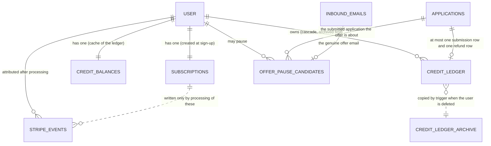
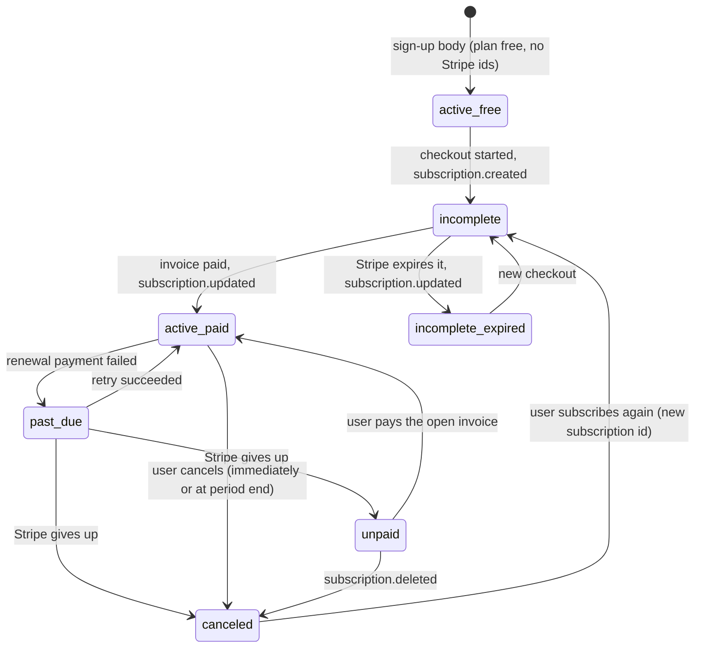
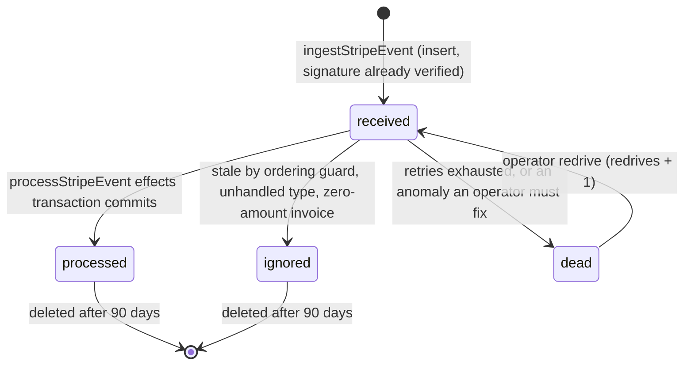
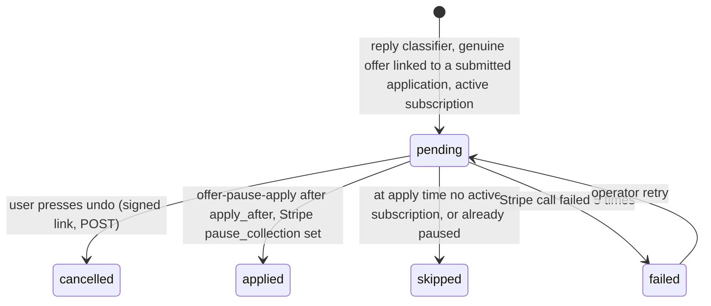

# Database design: domain `billing` (Credits and billing)

Status: design for implementation. Written 2026-10-23 against `01-architecture.md` revision 2 (ADR-001, postgres-durable on DBOS Transact, Anthropic agents), `server/src/db/schema/*.ts`, `server/drizzle/0000_init.sql`, `0001_resume_workspace.sql`, `docs/05-backend-schema.md` and `_research/requirements.md`.

Postgres 18 (`postgres-ssl:18`), database `kairos`, schema `public`. Application pools go through PgBouncer in transaction mode, so nothing here relies on session state (no session advisory locks, no `SET` outside `SET LOCAL`).

## 0. Scope, and what this document changes in the architecture

This document owns six tables: `subscriptions`, `credit_ledger`, `credit_balances`, `credit_ledger_archive`, `stripe_events`, `offer_pause_candidates`. Other domains are designed in parallel; every cross-domain name below is exactly the architect's inventory name (`"user"`, `applications`, `inbound_emails`, `profiles`, `action_tokens`, `notifications`, `email_sends`, `ops_audit`, `ops_flags`, `deletion_tasks`, `application_events`, `autopilot_settings`).

Invariants this domain must make true in the database, not only in code (INV-5, INV-12, INV-13, INV-18, INV-22 of `requirements.md`):

| Invariant | Mechanism (section) |
|---|---|
| One credit is charged per application, only when it reports `submitted` | Partial unique index `credit_ledger_application_reason_uq`; the `failed` branch never inserts (3.2, 4.2) |
| One grant and one expiry per Stripe invoice | Partial unique index `credit_ledger_invoice_reason_uq` (3.2) |
| One free grant per user | Partial unique index `credit_ledger_one_free_grant_uq` (3.2) |
| The ledger is never updated or deleted by a runtime path | `REVOKE UPDATE, DELETE` plus an immutability trigger (3.2, 5) |
| Balance and in-flight are O(1) reads and never drift silently | `credit_balances` maintained by two triggers; nightly single-statement reconciliation (3.3, 6) |
| A submission the employer received is always recordable | No `CHECK (balance >= 0)` and no `CHECK (in_flight >= 0)` (3.3) |
| A Stripe event is processed once and never lost | `stripe_events.id` primary key, store then process, `status` machine (3.5, 4.4) |
| Billing pauses only on a genuine offer, after a 48-hour undo window, at most one pending pause per user | `offer_pause_candidates` partial unique index, state machine (3.6, 4.5) |
| Plan limits and prices come only from `shared/src/plans.ts` | No plan numbers in any table; `plan` columns hold only the `plan_id` enum value |

### 0.1 Deviations from, and additions to, `01-architecture.md` (B.10.2, B.10.3, B.10.5)

The architect's DDL is the starting point. These are the points where this document differs, each with its reason, so the architect can reconcile the final text.

| # | Architect text | This document | Reason |
|---|---|---|---|
| D1 | Drop `credit_ledger_invoice_uq` "in the following release" | Create the new index and drop the old one in the same migration (M2) | Old code inserts only `plan_grant` rows with `onConflictDoNothing()` (no target), so the composite index protects exactly the same rows. Waiting a release only delays rollover for no safety gain. |
| D2 | `credit_ledger.id` default `gen_random_uuid()` | Default `uuidv7()` (native in Postgres 18) | Time-ordered keys keep the append-only table's primary-key index dense and let repair scripts page by `id`. Existing v4 rows stay as they are. |
| D3 | `credit_ledger_user_idx (user_id, created_at)` | Replaced by `credit_ledger_user_created_idx (user_id, created_at DESC) INCLUDE (delta)`, plus a BRIN index on `created_at` | The nightly recount and `GET /api/credits` become index-only or near index-only; time-range analytics need no btree. |
| D4 | Sign `CHECK` only | Adds `credit_ledger_shape_ck` (which reasons carry an invoice or an application) and `credit_ledger_note_ck` (note charset, 200 characters, no `@`) | Closes whole classes of bad rows; the note rule keeps personal data out of a table that is kept forever. |
| D5 | Append-only by `REVOKE` only | Adds trigger `credit_ledger_immutable` | Revoke does not stop the table owner or a migration script; the trigger does, and still permits the foreign-key actions that account deletion needs. |
| D6 | `credit_ledger_archive` has no key | Adds `ledger_id uuid PRIMARY KEY` and `ON CONFLICT DO NOTHING` in the trigger | Makes the archive idempotent and joinable to Stripe disputes. |
| D7 | `stripe_events` gets `status`, `payload`, `event_created`, `received_at`, `attempts`, `last_error` | Adds `outcome`, `object_id`, `stripe_customer_id`, `user_id`, `redrives`; `status` has four values (`received`, `processed`, `ignored`, `dead`); `payload` is a minimized extract, never the raw event | A DBOS workflow that exhausted its retries cannot be re-run under the same id, so a redrive needs a counter. The raw Stripe event carries customer name, email and address; the extract carries none. |
| D8 | `effectivePlan` grace "7 days from `current_period_end`" | Adds `subscriptions.past_due_since`; grace is 7 days from that timestamp. Adds SQL function `effective_plan(...)` mirroring the TypeScript function | When a renewal fails, Stripe has already advanced the period, so `current_period_end` would give the user about 37 days of grace. SQL surfaces (applier view, candidate eligibility) need the same answer as TypeScript. |
| D9 | `offer_pause_candidates` listed by column names only | Full DDL, five states, one-pending-per-user index | See 3.6. |
| D10 | Global lock order stated for approve, charge, resend | Rule L1 (section 2.2) also covers withdraw, `leaseSweeper`, return-to-draft and Autopilot-off | The in-flight trigger writes the balance row on any status change across the `approved`/`submitting` boundary; a path that locks the application first and the balance second can deadlock with `recordOutcome`. |
| D11 | `credit_balances` plain table | Same columns, plus `fillfactor` and per-table autovacuum settings | The row is updated about three times per submitted application. |
| D12 | `kairos_readonly` has no billing access | `SELECT` on `credit_ledger`, `credit_balances`, `credit_ledger_archive` and non-secret `subscriptions` columns | The cost-per-submission and revenue-per-application dashboards need them. |

## 1. Domain map



The write paths, in one place (single-writer rule: each table has exactly one TypeScript module that writes it, which is what makes the grant matrix in 2.3 meaningful):

| Table | Writer module (`server/src/modules/billing/`) | Called from |
|---|---|---|
| `credit_ledger` | `ledger.ts` only | `recordOutcome` (submission), `applyInvoiceGrant` (grant and expiry), sign-up body (free grant), operator CLI (`admin_adjustment`, `refund_failed_submit`) |
| `credit_balances` | Triggers only (no TypeScript writer) | Database |
| `credit_ledger_archive` | Trigger only | Database |
| `subscriptions` | `subscription-sync.ts` (webhook processing and daily reconcile), plus two narrow writes: the sign-up body inserts the `free` row, and `POST /api/billing/checkout` and `/portal` set `stripe_customer_id` once | Worker, api |
| `stripe_events` | `stripe-events.ts` | `ingestStripeEvent` (insert), `processStripeEvent` (status), failure handler, `retention` |
| `offer_pause_candidates` | `offer-pause.ts` | Reply classification (insert), `offer-pause-apply` (apply), `POST /api/billing/offer-pause/undo` (cancel) |

## 2. Cross-cutting rules for this domain

### 2.1 Conventions

- Primary keys: `uuid DEFAULT uuidv7()` for new surrogate keys; `text` for the Better Auth `"user".id` and for Stripe ids (`evt_`, `in_`, `cus_`, `sub_`).
- All timestamps are `timestamptz`. `now()` in triggers is the transaction start time, which is intended.
- Lifecycle values that are mirrors of an external system (Stripe subscription status) or that evolve (event status, pause state) are `text` with a named `CHECK`, so adding a value is a `NOT VALID` plus `VALIDATE` pair rather than an `ALTER TYPE`. Stable, widely shared sets keep their `pgEnum` (`credit_reason`, `plan_id`, `billing_interval`; unchanged, defined in `shared/` and mirrored in `server/src/db/schema/enums.ts`).
- Stripe's API version is pinned by the `stripe` SDK 23.0.0, so a new Stripe subscription status can only arrive with a deliberate SDK bump, at which point the `CHECK` is widened in the same pull request. That is why `subscriptions.status` can safely carry a `CHECK`.
- Money never appears in these tables. Prices live in `shared/src/plans.ts` and Stripe; the ledger counts credits only.
- Every constraint that guards existing data is added `NOT VALID` and then `VALIDATE`d inside the same migration after a `DO` block has asserted the data is clean (section 8).

### 2.2 Lock order rule L1 (extends B.6.4)

The trigger `applications_in_flight` (section 5) updates `credit_balances` whenever `applications.status` crosses the boundary of the set `{approved, submitting}`. That UPDATE takes the row lock on the user's `credit_balances` row. The architect's global order is: (1) the user's `credit_balances` row, (2) `applications` rows ordered by `id`, (3) `submission_attempts`.

Rule L1: **any transaction that can change `applications.status` into or out of `{approved, submitting}` must first run `SELECT ... FROM credit_balances WHERE user_id = $user FOR UPDATE` (after `ensure_credit_balance($user)`)** before it updates any `applications` row. Paths covered:

| Path | Crosses boundary | Notes |
|---|---|---|
| `approveCore` (user, resend, Autopilot) | `draft`/`failed` to `approved` | Already specified |
| `recordOutcome` | `approved`/`submitting` to `submitted`/`failed` | Already specified; reads `user_id` without a lock first |
| `POST /api/applications/:id/withdraw` | `approved` to `withdrawn` | Must lock the balance row first |
| `leaseSweeper` (expired explicit claims, stuck attempts settled as failed) | `submitting` to `failed` | One transaction per user, balance row first |
| Return to draft (extension approval older than 14 days) | `approved` to `draft` | Same |
| `PUT /api/autopilot` off, failure-spike pause, plan change | `approved` to `draft` | Same |
| `claim_cloud_attempt` | `approved` to `submitting` | Does not cross the boundary, so the trigger does not touch the balance row; no lock needed |

Helper: `lockCreditBalance(tx, userId)` in `server/src/modules/billing/ledger.ts` runs the two statements and returns `{ balance, inFlight }`. A concurrency test (T-1 in section 9) interleaves every path above with `recordOutcome` and asserts zero `40P01` errors; the DBOS step retry policy additionally retries once on `40P01`.

### 2.3 Privilege matrix (extends B.10.4)

Default privileges in the architecture grant `SELECT, INSERT, UPDATE, DELETE` on every new table to `kairos_api` and `kairos_worker`, so each billing migration must explicitly revoke. Final state, asserted by the grant test (T-12):

| Table | `kairos_api` | `kairos_worker` | `kairos_applier` | `kairos_readonly` |
|---|---|---|---|---|
| `credit_ledger` | `SELECT, INSERT` | `SELECT, INSERT` | none | `SELECT` |
| `credit_balances` | `SELECT`, `UPDATE (updated_at)` (needed for `FOR UPDATE`) | same | none | `SELECT` |
| `credit_ledger_archive` | none | `SELECT` | none | `SELECT` |
| `subscriptions` | `SELECT, INSERT, UPDATE` | `SELECT, INSERT, UPDATE` | none (reaches plan only through `applier_payload_v`) | `SELECT (user_id, plan, "interval", status, current_period_end, cancel_at_period_end, collection_paused, created_at)` |
| `stripe_events` | `SELECT, INSERT, UPDATE` | `SELECT, INSERT, UPDATE, DELETE` (retention) | none | none |
| `offer_pause_candidates` | `SELECT, INSERT, UPDATE` | `SELECT, INSERT, UPDATE` | none | `SELECT` |

`TRUNCATE` and `REFERENCES` are never granted to a runtime role. Account-deletion cascades run with the table owner's privileges, so revoking `DELETE` on the ledger does not block them.

## 3. Tables

### 3.1 `subscriptions`

**Purpose.** One row per user: the local mirror of the user's Stripe subscription and the source of the user's plan. Every user has a row from sign-up (`plan = 'free'`, no Stripe ids). The row is written only from Stripe state, so it can always be rebuilt by the daily reconcile.

**Columns** (final state; "new" marks additions to the current table):

| Column | Type | Null | Default | Notes |
|---|---|---|---|---|
| `user_id` | `text` | no | | Primary key; foreign key to `"user"(id)` |
| `plan` | `plan_id` | no | `'free'` | The plan the row is entitled to by Stripe status: the subscribed plan while `status` is `active`, `trialing` or `past_due`, `free` for every other status (this is what `subscriptionRow()` already does) |
| `interval` | `billing_interval` | yes | | Non-null exactly when `plan <> 'free'`. Always quote it in SQL |
| `status` | `text` | no | `'active'` | Stripe subscription status; Free rows are `'active'` |
| `stripe_customer_id` | `text` | yes | | Unique |
| `stripe_subscription_id` | `text` | yes | | Unique |
| `current_period_end` | `timestamptz` | yes | | From the first item |
| `cancel_at_period_end` | `boolean` | no | `false` | |
| `paused_until` | `timestamptz` | yes | | Stripe `pause_collection.resumes_at`; null for an indefinite pause |
| `collection_paused` | `boolean` | no | `false` | new. True when Stripe reports `pause_collection` (the old row could not represent an indefinite pause) |
| `pause_source` | `text` | yes | | new. `offer_email` when subscription metadata `pausedBy = 'offer-email'`, otherwise `customer` |
| `past_due_since` | `timestamptz` | yes | | new. Set on the transition into `past_due`, cleared on leaving it |
| `stripe_event_created` | `timestamptz` | yes | | new. `created` of the newest Stripe event applied (D-15 ordering guard) |
| `created_at` | `timestamptz` | no | `now()` | new. Backfilled from `"user".created_at` |
| `updated_at` | `timestamptz` | no | `now()` | |

**Primary key.** `user_id`.

**Foreign keys.** `user_id` references `"user"(id)` `ON DELETE CASCADE`. The Better Auth `beforeDelete` hook cancels the Stripe subscription before the cascade runs and reads `stripe_customer_id` from this row into `deletion_tasks`.

**Unique constraints.** `subscriptions_stripe_customer_id_unique (stripe_customer_id)` and `subscriptions_stripe_subscription_id_unique (stripe_subscription_id)`, both existing and both allowing many nulls. They make the webhook lookup "which user owns this customer or subscription" a single index probe and prevent two local users from claiming one Stripe object.

**Check constraints.**

```sql
ALTER TABLE subscriptions
  ADD CONSTRAINT subscriptions_status_ck CHECK (status IN
    ('active','trialing','past_due','unpaid','canceled','incomplete','incomplete_expired','paused')),
  ADD CONSTRAINT subscriptions_plan_interval_ck CHECK (
    (plan = 'free' AND "interval" IS NULL) OR (plan <> 'free' AND "interval" IS NOT NULL)),
  ADD CONSTRAINT subscriptions_paid_has_stripe_ck CHECK (
    plan = 'free' OR (stripe_customer_id IS NOT NULL AND stripe_subscription_id IS NOT NULL)),
  ADD CONSTRAINT subscriptions_past_due_ck CHECK ((status = 'past_due') = (past_due_since IS NOT NULL)),
  ADD CONSTRAINT subscriptions_pause_ck CHECK (collection_paused = (pause_source IS NOT NULL)),
  ADD CONSTRAINT subscriptions_pause_source_ck CHECK (pause_source IS NULL OR pause_source IN ('offer_email','customer'));
```

**Other indexes.** None beyond the two unique indexes, deliberately. Every read is by primary key (`GET /api/me`, `effectivePlan`, approvals) or by one of the two Stripe ids (webhook mapping). Set scans (candidate eligibility by plan, the daily reconcile of non-free rows) read at most 10,000 rows of about 200 bytes each (2 MB, one page run), where a partial index would cost more in maintenance than it saves.

**Partitioning and retention.** None; the row lives with the account. A `canceled` subscription keeps its Stripe ids so that a late event for an old subscription can be recognized and cannot downgrade a user who has since subscribed again (`saveSubscription`'s "tracks this subscription" guard stays).

**Row-count projection (10,000 users).** 10,000 rows (one per user), about 2 MB with indexes. Update rate about 8,000 per month (section 7).

**Drizzle sketch.** See section 10.1.

**SQL helper for plan questions asked in SQL.**

```sql
-- Mirrors effectivePlan() in server/src/modules/billing/effective-plan.ts. 7 days is the past_due grace (D-17).
CREATE FUNCTION effective_plan(p_plan plan_id, p_status text, p_past_due_since timestamptz)
RETURNS plan_id LANGUAGE sql STABLE PARALLEL SAFE AS $$
  SELECT CASE
           WHEN p_status IN ('active','trialing') THEN p_plan
           WHEN p_status = 'past_due' AND now() < p_past_due_since + interval '7 days' THEN p_plan
           ELSE 'free'::plan_id
         END
$$;
```

The TypeScript function and this one share a table of test vectors (T-9) so they cannot drift. The applier view and the per-plan cadence in candidate generation call the SQL one.

### 3.2 `credit_ledger`

**Purpose.** Append-only record of every credit in or out. The ledger is the truth; `credit_balances` is a cache derived from it by trigger. One debit per submitted application, one grant per paid invoice, one free grant per user.

**Columns.** Unchanged from the current table (the `GET /api/credits` response returns whole rows, so adding a column would change a frozen response; this design adds none).

| Column | Type | Null | Default | Notes |
|---|---|---|---|---|
| `id` | `uuid` | no | `uuidv7()` | Primary key (default changed, D2) |
| `user_id` | `text` | no | | Foreign key to `"user"(id)` |
| `delta` | `integer` | no | | Positive grants, `-1` per submission, negative expiry |
| `reason` | `credit_reason` | no | | `plan_grant`, `free_grant`, `submission`, `refund_failed_submit`, `admin_adjustment`, `expiry` (enum unchanged) |
| `application_id` | `uuid` | yes | | Foreign key to `applications(id)` |
| `stripe_invoice_id` | `text` | yes | | Set on `plan_grant` and its `expiry` row |
| `note` | `text` | yes | | Codes only, never personal data |
| `created_at` | `timestamptz` | no | `now()` | |

**Primary key.** `id`.

**Foreign keys.**

| Column | References | On delete | Why |
|---|---|---|---|
| `user_id` | `"user"(id)` | `CASCADE` | Account deletion removes the rows; the `BEFORE DELETE` trigger on `"user"` has already copied them to `credit_ledger_archive` under a hash |
| `application_id` | `applications(id)` | `SET NULL` | Existing behavior kept. In practice an application is deleted only by the same user cascade, but the rule must not block deletion of a job's applications either |

**What each reason means, who writes it, and its constraints.**

| `reason` | `delta` | `stripe_invoice_id` | `application_id` | Written by | Idempotency (`ON CONFLICT` target) |
|---|---|---|---|---|---|
| `free_grant` | `+getPlan('free').applicationsPerCycle` (25) | null | null | Sign-up body | `(user_id) WHERE reason = 'free_grant'` |
| `plan_grant` | `+creditsPerInvoice(plan, interval)` | required | null | `applyInvoiceGrant` on `invoice.paid` | `(stripe_invoice_id, reason) WHERE stripe_invoice_id IS NOT NULL` |
| `expiry` | `-(rollover excess)`, below zero | required (same invoice as the grant) | null | `applyInvoiceGrant`, same transaction | same target |
| `submission` | `-1` | null | the application (null only after it was deleted) | `recordOutcome` | `(application_id, reason) WHERE application_id IS NOT NULL` |
| `refund_failed_submit` | `+1` | null | the application | Operator CLI only (a charge made in error; the application stays `submitted`) | same target as `submission` |
| `admin_adjustment` | non-zero | null | optional | Operator CLI only, with an `ops_audit` row; `note` carries the ticket code | none; the CLI is idempotent through its `ops_audit` request id |

**Unique and partial unique indexes (the invariants).**

```sql
-- One charge, and at most one refund, per application (INV-5). Also serves the SET NULL foreign-key lookup by application_id.
CREATE UNIQUE INDEX credit_ledger_application_reason_uq
  ON credit_ledger (application_id, reason) WHERE application_id IS NOT NULL;           -- existing, kept

-- One grant and one expiry per Stripe invoice; widened from invoice alone so rollover can share the invoice id (FR-47, D-23).
CREATE UNIQUE INDEX credit_ledger_invoice_reason_uq
  ON credit_ledger (stripe_invoice_id, reason) WHERE stripe_invoice_id IS NOT NULL;     -- new; replaces credit_ledger_invoice_uq

-- One free grant per user (sign-up retried by the reconciler cannot double it).
CREATE UNIQUE INDEX credit_ledger_one_free_grant_uq
  ON credit_ledger (user_id) WHERE reason = 'free_grant';                               -- new
```

**Other indexes.**

| Index | Definition | Query it serves |
|---|---|---|
| `credit_ledger_user_created_idx` | `(user_id, created_at DESC) INCLUDE (delta)` | `GET /api/credits` (`WHERE user_id = $1 ORDER BY created_at DESC LIMIT 200`); the nightly per-user `SUM(delta)` as an index-only scan; the `user_archive_ledger` trigger and the user-delete cascade (both look rows up by `user_id`) |
| `credit_ledger_created_brin` | `USING brin (created_at)` | Time-range analytics over an append-only table: "credits charged in the last hour" for the hourly `charged vs submitted` check, revenue-per-application dashboards. About 100 KB at any size |

`INCLUDE` is not expressible in the Drizzle index builder, so the TypeScript schema declares `credit_ledger_user_created_idx` on the same two columns without it and the migration SQL creates it with `INCLUDE` under the same name (drizzle-kit compares snapshots, not the live database, so there is no diff).

**Check constraints.**

```sql
-- Sign rules (architect B.10.3, kept)
ALTER TABLE credit_ledger ADD CONSTRAINT credit_ledger_sign_ck CHECK (
  (reason IN ('plan_grant','free_grant','refund_failed_submit') AND delta > 0) OR
  (reason = 'submission' AND delta = -1) OR
  (reason = 'expiry' AND delta < 0) OR
  (reason = 'admin_adjustment' AND delta <> 0 AND note IS NOT NULL)) NOT VALID;

-- Shape rules (new, D4). application_id is NOT required on submission because ON DELETE SET NULL must stay legal.
ALTER TABLE credit_ledger ADD CONSTRAINT credit_ledger_shape_ck CHECK (
  (reason IN ('plan_grant','expiry') AND stripe_invoice_id IS NOT NULL AND application_id IS NULL) OR
  (reason = 'free_grant' AND stripe_invoice_id IS NULL AND application_id IS NULL) OR
  (reason IN ('submission','refund_failed_submit') AND stripe_invoice_id IS NULL) OR
  (reason = 'admin_adjustment' AND stripe_invoice_id IS NULL)) NOT VALID;

-- Codes only: letters, digits, space and _ : = . , / # - ; no '@', so an email address cannot be stored here (D4)
ALTER TABLE credit_ledger ADD CONSTRAINT credit_ledger_note_ck CHECK (
  note IS NULL OR note ~ '^[A-Za-z0-9 _:=.,/#-]{1,200}$') NOT VALID;
```

All three are validated in the same migration after the pre-checks (section 8).

**Immutability.** `REVOKE UPDATE, DELETE` from the runtime roles (section 2.3), plus the trigger in section 5 (`credit_ledger_immutable`) that rejects `UPDATE` and `DELETE` from any statement that is not itself running inside a foreign-key action.

**Partitioning and retention.** Not partitioned, and kept forever (audit). The reason is structural: the invariant indexes are unique on `(application_id, reason)`, `(stripe_invoice_id, reason)` and `(user_id)`, none of which contain `created_at`, and a partitioned table cannot enforce a unique index that omits the partition key. Partitioning would force the invariants out of the database. The table is small enough that this is not needed: about 2 GB per year at the cost-model volume, about 11 GB per year at the theoretical ceiling (section 7). Escape hatch if the table ever passes 100 million rows (about 5 years at the ceiling): move the one-charge guarantee into a small non-partitioned `credit_charges (application_id uuid PRIMARY KEY)` registry written in the same transaction, then partition `credit_ledger` by `RANGE (created_at)` quarterly. The measured trigger is the monthly size report: `pg_total_relation_size('credit_ledger') > 40 GB`.

**Row-count projection.** About 7.5 million rows in the first 12 months at 10,000 registered users (20,200 submissions a day, 3,500 invoice grants a month, up to 3,500 expiries a month, 10,000 free grants once), about 2.0 GB with indexes. Theoretical ceiling with every paid user spending the full allowance: about 40 million rows a year, 11 GB. Details in section 7.

**Drizzle sketch.** See section 10.2.

### 3.3 `credit_balances`

**Purpose.** The cached balance and in-flight count per user, so `GET /api/me`, `GET /api/credits` and the approval check are O(1) primary-key reads instead of `SUM` over the whole ledger (S-07). It is also the per-user serialization point: approve, charge, grant and every path in rule L1 lock this one row first.

**Columns.**

| Column | Type | Null | Default | Notes |
|---|---|---|---|---|
| `user_id` | `text` | no | | Primary key; foreign key to `"user"(id)` |
| `balance` | `integer` | no | | Equals `SUM(credit_ledger.delta)` for the user; changed only by trigger `credit_ledger_ai` |
| `in_flight` | `integer` | no | `0` | Equals the count of the user's applications in `approved` or `submitting`; changed only by trigger `applications_in_flight_aiud` |
| `updated_at` | `timestamptz` | no | `now()` | The only column runtime roles may update, which exists so `SELECT ... FOR UPDATE` is permitted |

Available credits are `balance - in_flight`. The application computes it; it is not stored, because it would change on every approval.

**Primary key.** `user_id`.

**Foreign keys.** `user_id` references `"user"(id)` `ON DELETE CASCADE`.

**Unique indexes.** The primary key is the only one. There is exactly one cache row per user.

**Other indexes.** None. All access is by primary key. Reconciliation scans the whole table by `user_id` range, which the primary key serves.

**Check constraints.** None, deliberately and permanently. A `CHECK (balance >= 0)` or `CHECK (in_flight >= 0)` would make the trigger fail inside `recordOutcome` the moment the cache were wrong, rolling back the recording of a submission the employer already received. Negatives are prevented upstream (the approval check under the row lock, the rollover formula's `in_flight` term) and detected downstream (hourly negative-balance check and nightly recount, section 6).

**Storage parameters.** The row is updated about three times per submitted application (approve adds one to `in_flight`, the outcome subtracts one, the ledger insert changes `balance`). Updates change no indexed column, so they are heap-only-tuple (HOT) updates provided each page keeps free space:

```sql
ALTER TABLE credit_balances SET (fillfactor = 80, autovacuum_vacuum_scale_factor = 0.02, autovacuum_analyze_scale_factor = 0.05);
```

**Partitioning and retention.** None. The row is deleted with the account by cascade.

**Row-count projection.** 10,000 rows, about 1 MB. Update rate at growth: about 60,600 per day (3 times 20,200), 0.7 per second on average, tens per second at the daily peak. A batch approval of 100 applications fires the in-flight trigger 100 times on one row inside one transaction, about 2 ms of extra work (measured in T-2).

**DDL.**

```sql
CREATE TABLE credit_balances (
  user_id    text        PRIMARY KEY REFERENCES "user"(id) ON DELETE CASCADE,
  balance    integer     NOT NULL,
  in_flight  integer     NOT NULL DEFAULT 0,
  updated_at timestamptz NOT NULL DEFAULT now()
);
```

Triggers and the `ensure_credit_balance` function are in section 5.

### 3.4 `credit_ledger_archive`

**Purpose.** The audit trail that survives account deletion (D-24). When a user is deleted, the ledger rows cascade away; before that, a `BEFORE DELETE` trigger on `"user"` copies them here under a hash of the user id, so revenue, charges and Stripe invoices remain reconcilable without keeping a user identity. Nothing reads it in a request path.

**Columns.**

| Column | Type | Null | Default | Notes |
|---|---|---|---|---|
| `ledger_id` | `uuid` | no | | Primary key; the original `credit_ledger.id` (D6) |
| `user_hash` | `text` | no | | `encode(sha256(convert_to(user_id, 'UTF8')), 'hex')`, the same expression `deletion_tasks.user_hash` and the R2 tombstone name use. Better Auth ids are random, so the hash is not reversible without the id |
| `delta` | `integer` | no | | |
| `reason` | `credit_reason` | no | | |
| `stripe_invoice_id` | `text` | yes | | Kept: it is the join to Stripe for refunds and disputes |
| `application_id` | `uuid` | yes | | Dangling by design (the application is deleted too) |
| `note` | `text` | yes | | Already restricted to codes by `credit_ledger_note_ck` |
| `created_at` | `timestamptz` | no | | The original timestamp |
| `archived_at` | `timestamptz` | no | `now()` | Deletion time |

**Primary key.** `ledger_id`. **Foreign keys.** None, by design: it must outlive the user and the application.

**Unique and partial unique indexes.** The primary key makes the trigger idempotent (`ON CONFLICT (ledger_id) DO NOTHING`).

**Other indexes.**

| Index | Definition | Query it serves |
|---|---|---|
| `credit_ledger_archive_user_hash_idx` | `(user_hash, created_at)` | Support: reconstruct a deleted account's charges when the id is known from a backup or a tombstone |
| `credit_ledger_archive_invoice_idx` | `(stripe_invoice_id) WHERE stripe_invoice_id IS NOT NULL` | A Stripe dispute or refund on an invoice of a deleted account |

**Check constraints.** None; rows are copies of rows that already passed the ledger checks.

**Partitioning and retention.** Not partitioned; kept indefinitely (small: about 100 bytes a row). Whether to purge after a statutory period is an owner question (section 11).

**Row-count projection.** Churned accounts times their ledger rows. At 20% yearly account deletion (2,000 users) with a mean of 60 rows each (Free users have at most 26), about 120,000 rows a year, about 12 MB a year.

**Cost of the trigger.** A heavy user has up to about 40,000 ledger rows a year; the trigger copies them in one statement in about 1 to 2 seconds. `kairos_api` has a 10-second statement timeout, so account deletion should run from a worker workflow (statement timeout 120 s), as `deletion_tasks` already implies. T-5 measures it.

**Drizzle sketch.** See section 10.3.

### 3.5 `stripe_events`

**Purpose.** The store half of "store then process" (D-14). Every Stripe event the signature check accepts is inserted once, then processed by `processStripeEvent` in one transaction that applies the effects and marks the row. It is also the idempotency record (a redelivered event id is a no-op), the work queue the reconciler scans, and the diagnostic trail for "why did this user not get credits".

**Columns** (final state; "new" marks additions):

| Column | Type | Null | Default | Notes |
|---|---|---|---|---|
| `id` | `text` | no | | Primary key; the Stripe event id (`evt_...`) |
| `type` | `text` | no | | Stripe event type |
| `status` | `text` | no | `'processed'` during the migration window, then `'received'` | new. See the state machine in 4.4 |
| `outcome` | `text` | yes | | new. What processing did; null while `received` |
| `object_id` | `text` | yes | | new. The invoice, subscription or charge id the event is about |
| `stripe_customer_id` | `text` | yes | | new. The workflow partition key for queue `stripe` |
| `user_id` | `text` | yes | | new. Resolved during processing; foreign key to `"user"(id)` |
| `event_created` | `timestamptz` | yes | | new. Stripe `created`; null only for rows written before the migration |
| `payload` | `jsonb` | yes | | new. The minimized extract (below), never the raw event |
| `received_at` | `timestamptz` | no | `now()` | new. Backfilled from `processed_at` for old rows |
| `processed_at` | `timestamptz` | yes | `now()` until M4 | Was `NOT NULL DEFAULT now()`; now null while `received` |
| `attempts` | `integer` | no | `0` | new. Processing attempts that failed |
| `redrives` | `smallint` | no | `0` | new. Operator re-drives; part of the DBOS workflow id |
| `last_error` | `text` | yes | | new. Error code only, at most 120 characters |

**The minimized payload.** The raw Stripe event contains the customer's name, email, billing address and card details, none of which processing needs. `ingestStripeEvent` builds `payload` from an allowlist per event type and discards the rest (the signature has already been verified on the raw body):

```ts
// server/src/modules/billing/stripe-events.ts
export type StripeEventPayload =
  | { kind: "subscription"; subscriptionId: string; customerId: string; status: string }
  | { kind: "invoice"; invoiceId: string; customerId: string; subscriptionId: string | null; userId: string | null;
      amountPaid: number; couponIds: string[]; lines: { priceId: string; lookupKey: string | null; proration: boolean }[] }
  | { kind: "payment_failed"; invoiceId: string; customerId: string; subscriptionId: string | null; attemptCount: number }
  | { kind: "money_movement"; chargeId: string; invoiceId: string | null; customerId: string; amount: number };
```

A `CHECK (payload IS NULL OR octet_length(payload::text) <= 4096)` caps the size.

**Event types subscribed** (the webhook endpoint is configured to send only these; anything else that arrives is stored and marked `ignored` with outcome `unhandled_type`): `customer.subscription.created`, `.updated`, `.deleted`, `.paused`, `.resumed`, `invoice.paid`, `invoice.payment_failed`, `charge.refunded`, `charge.dispute.created`. The last two are alert-only: they page the owner, because refunds and disputes need a human decision on credits (an operator posts an `admin_adjustment`); the design deliberately does not automate clawbacks in the beta.

**Primary key.** `id`.

**Foreign keys.** `user_id` references `"user"(id)` `ON DELETE CASCADE`: a deleted account's events are erased with it (the financial audit trail is the archived ledger and Stripe itself). Null until processing resolves the user, which is why the column is nullable.

**Unique indexes.** The primary key is the idempotency guard: `INSERT ... ON CONFLICT (id) DO NOTHING RETURNING id`; no row returned means a redelivery.

**Other indexes.**

| Index | Definition | Query it serves |
|---|---|---|
| `stripe_events_open_idx` | `(received_at) WHERE status IN ('received','dead')` | The 5-minute reconciler ("received more than 10 minutes ago", page after 30) and the `dead` alarm. Contains only unfinished work, so it stays near-empty |
| `stripe_events_object_idx` | `(object_id, type)` | Support and the hourly invoice check: all events about one invoice or subscription |
| `stripe_events_user_idx` | `(user_id) WHERE user_id IS NOT NULL` | The foreign-key cascade on account deletion and per-user support lookups |

**Check constraints.**

```sql
ALTER TABLE stripe_events
  ADD CONSTRAINT stripe_events_status_ck CHECK (status IN ('received','processed','ignored','dead')),
  ADD CONSTRAINT stripe_events_outcome_ck CHECK (outcome IS NULL OR outcome IN (
    'subscription_synced','subscription_stale','grant_applied','grant_duplicate','zero_amount',
    'alert_only','unhandled_type','anomaly_no_user','anomaly_unmapped_price')),
  ADD CONSTRAINT stripe_events_consistency_ck CHECK (
    (status = 'received'  AND processed_at IS NULL     AND outcome IS NULL) OR
    (status IN ('processed','ignored') AND processed_at IS NOT NULL AND outcome IS NOT NULL) OR
    (status = 'dead'      AND last_error IS NOT NULL)),
  ADD CONSTRAINT stripe_events_last_error_ck CHECK (last_error IS NULL OR char_length(last_error) <= 120),
  ADD CONSTRAINT stripe_events_payload_ck CHECK (payload IS NULL OR octet_length(payload::text) <= 4096);
```

During the migration window legacy rows are `processed` with `outcome` null; the consistency check is therefore added `NOT VALID` and validated after the backfill sets `outcome = 'subscription_synced'` or `'grant_applied'` for old rows by `type` (section 8, M1).

**Partitioning and retention.** Not partitioned (about 24,000 live rows). Retention (FR-58): the daily `retention` schedule deletes rows with `status IN ('processed','ignored') AND received_at < now() - interval '90 days'`, in batches of 10,000. Rows in `received` or `dead` are never deleted.

**Row-count projection.** About 8,000 events a month, about 270 a day; about 24,000 live rows in the 90-day window, about 30 MB including indexes (the raw events would be about 200 MB). Event throughput is nowhere near a constraint; the queue `stripe` partitions by customer with concurrency 1 per customer.

**Drizzle sketch.** See section 10.4.

### 3.6 `offer_pause_candidates`

**Purpose.** The 48-hour undo window between "a genuine offer email arrived" and "the user's subscription collection is paused" (FR-48, D-26). One row per qualifying inbound email. The model never creates one: a row is created only by the deterministic offer rule in the reply classifier, when the email is linked by sender domain to a `submitted` application and the user's subscription is active.

**Columns.**

| Column | Type | Null | Default | Notes |
|---|---|---|---|---|
| `id` | `uuid` | no | `uuidv7()` | Primary key; the value stored in `action_tokens.entity_id` (as text) for the undo link |
| `user_id` | `text` | no | | Foreign key to `"user"(id)` |
| `inbound_email_id` | `uuid` | no | | Foreign key to `inbound_emails(id)`; unique |
| `application_id` | `uuid` | yes | | The submitted application the offer is about |
| `state` | `text` | no | `'pending'` | `pending`, `applied`, `cancelled`, `skipped`, `failed` |
| `skip_reason` | `text` | yes | | Set when `state = 'skipped'` |
| `apply_after` | `timestamptz` | no | | `created_at` plus the undo window (48 hours, `OFFER_PAUSE_UNDO_HOURS` in `billing/constants.ts`) |
| `cancelled_at` | `timestamptz` | yes | | The user pressed undo |
| `applied_at` | `timestamptz` | yes | | Stripe `pause_collection` was set |
| `attempts` | `smallint` | no | `0` | Failed Stripe calls |
| `last_error` | `text` | yes | | Error code only |
| `created_at` | `timestamptz` | no | `now()` | |
| `updated_at` | `timestamptz` | no | `now()` | |

**Primary key.** `id`.

**Foreign keys.**

| Column | References | On delete | Why |
|---|---|---|---|
| `user_id` | `"user"(id)` | `CASCADE` | Deleted with the account |
| `inbound_email_id` | `inbound_emails(id)` | `CASCADE` | `inbound_emails` rows are deleted only with the account (bodies are blanked after 180 days, rows kept), so this never fires early |
| `application_id` | `applications(id)` | `SET NULL` | The pause stands even if the application row goes away |

**Unique and partial unique indexes.**

```sql
-- One candidate per email: a redelivered or re-classified email cannot create a second pause (idempotency of the classifier step)
ALTER TABLE offer_pause_candidates ADD CONSTRAINT offer_pause_candidates_email_uq UNIQUE (inbound_email_id);

-- At most one pending pause per user: a second offer email during the window is stored in application_events but creates no second candidate
CREATE UNIQUE INDEX offer_pause_one_pending_uq ON offer_pause_candidates (user_id) WHERE state = 'pending';
```

**Other indexes.**

| Index | Definition | Query it serves |
|---|---|---|
| `offer_pause_due_idx` | `(apply_after) WHERE state = 'pending'` | The 15-minute `offer-pause-apply` sweep: `WHERE state = 'pending' AND apply_after <= now() ORDER BY apply_after FOR UPDATE SKIP LOCKED LIMIT 50` |
| `offer_pause_user_idx` | `(user_id, created_at DESC)` | The foreign-key cascade and "show the user their pause history" |
| (unique on `inbound_email_id`) | | Serves the `inbound_emails` cascade lookup |

**Check constraints.**

```sql
ALTER TABLE offer_pause_candidates
  ADD CONSTRAINT offer_pause_state_ck CHECK (state IN ('pending','applied','cancelled','skipped','failed')),
  ADD CONSTRAINT offer_pause_skip_reason_ck CHECK (skip_reason IS NULL OR skip_reason IN
    ('no_active_subscription','already_paused')),
  ADD CONSTRAINT offer_pause_window_ck CHECK (apply_after > created_at),
  ADD CONSTRAINT offer_pause_consistency_ck CHECK (
    (state = 'pending'   AND applied_at IS NULL AND cancelled_at IS NULL AND skip_reason IS NULL) OR
    (state = 'applied'   AND applied_at IS NOT NULL AND cancelled_at IS NULL AND skip_reason IS NULL) OR
    (state = 'cancelled' AND cancelled_at IS NOT NULL AND applied_at IS NULL AND skip_reason IS NULL) OR
    (state = 'skipped'   AND skip_reason IS NOT NULL AND applied_at IS NULL AND cancelled_at IS NULL) OR
    (state = 'failed'    AND last_error IS NOT NULL AND applied_at IS NULL AND cancelled_at IS NULL)),
  ADD CONSTRAINT offer_pause_last_error_ck CHECK (last_error IS NULL OR char_length(last_error) <= 120);
```

**Partitioning and retention.** None; rows are tiny and kept with the account.

**Row-count projection.** At most about 1,000 rows a year (genuine offers among 2,500 paying users), at most a few hundred in the first year. Negligible storage.

**Drizzle sketch.** See section 10.5.

## 4. State machines

### 4.1 Subscription (`subscriptions.status` and `plan`)

The only writer of transitions is `subscription-sync.ts`, from `processStripeEvent` and the daily `billing-reconcile`. Subscription events always refetch the live subscription from the Stripe API, so each application sets the row to Stripe's current state; the ordering guard (`stripe_event_created`) drops an event whose `created` is not newer than the stored one, and an event for a subscription id other than the one the row tracks cannot move a tracked paid row to Free.



| Local `status` | `plan` stored | `effective_plan` | Credits granted? | Who causes entry |
|---|---|---|---|---|
| `active` (Free row) | `free` | `free` | Free grant once at sign-up | Sign-up body |
| `active`, `trialing` (no trials are sold; defensive) | the subscribed plan | the subscribed plan | On `invoice.paid` only | Stripe event |
| `past_due` | the subscribed plan | the subscribed plan until `past_due_since + 7 days`, then `free` | No | Stripe event; `past_due_since` set on entry |
| `unpaid`, `canceled`, `incomplete`, `incomplete_expired`, `paused` | `free` (interval null) | `free` | No | Stripe event |

Credits are never granted from a subscription status, only from a paid invoice (4.2). Collection pause is orthogonal: the status stays `active` and `collection_paused = true` with a `pause_source`.

Side effects applied in the same transaction as a subscription sync (cross-domain writes, documented so no domain forgets them):

| Condition detected | Effect | Domain |
|---|---|---|
| `collection_paused` went true to false and `pause_source` was `offer_email` | Set `profiles.applications_paused_at = NULL` (the user resumed from the billing portal; without this the user would stay paused forever, see question Q-3) | identity-profile |
| Effective plan's `autopilotDailySendCap` is 0 and Autopilot is enabled | Set `autopilot_settings.paused_at`, `paused_reason = 'plan_change'`; return not-yet-claimed Autopilot approvals to `draft` under rule L1 | identity-profile, applications |
| Plan changed | Enqueue `notify` (plan change email) with `email_sends (kind, entity_id)` idempotency | messaging |

### 4.2 Credits: reservation, charge and release

This is the lifecycle of one credit. It is not a column; it is the combination of `credit_balances.in_flight` (a reservation) and a `credit_ledger` row (the charge).

| Event on the application | `in_flight` | Ledger | Performed by |
|---|---|---|---|
| `draft`/`failed` to `approved` (user, resend, Autopilot) | +1 (trigger) | none | `approveCore`, after checking `balance - in_flight >= rows` under the balance lock |
| `approved` to `submitting` (cloud claim) | 0 | none | `claim_cloud_attempt` |
| `approved`/`submitting` to `submitted` | -1 (trigger) | **`submission`, delta -1**, `ON CONFLICT (application_id, reason) WHERE application_id IS NOT NULL DO NOTHING` | `recordOutcome` (extension report, cloud settlement, late confirmation) |
| `approved`/`submitting` to `failed` | -1 | none (**failed is never charged**) | `recordOutcome` |
| `approved` to `withdrawn` | -1 | none | withdraw route |
| `approved` to `draft` (14-day return, Autopilot off, spike pause) | -1 | none | sweeper, autopilot controller |
| `failed` to `submitted` (late confirmation) | +0 net (the row was not in flight) | `submission` -1 | `recordOutcome` |
| Invoice paid | 0 | `plan_grant` +n, then `expiry` -k if over the cap | `applyInvoiceGrant` |
| Operator correction | 0 | `admin_adjustment` or `refund_failed_submit` | operator CLI, with `ops_audit` |

Late confirmation on a `failed` row: `failed` to `submitted` does not cross into the in-flight set, so the trigger adds nothing; the ledger insert reduces `balance` by 1. Net effect is one credit charged, which is the intended behavior (a real submission is always recorded).

Rollover (FR-47, D-23), computed inside `applyInvoiceGrant` while holding the balance lock, after the grant row was actually inserted (a redelivered invoice inserts nothing and therefore expires nothing):

```ts
// server/src/modules/billing/rollover.ts  (pure, unit-tested)
export function rolloverExpiry(balanceAfterGrant: number, inFlight: number, grant: number): number {
  return Math.max(0, balanceAfterGrant - inFlight - 2 * grant);
}
// grant = creditsPerInvoice(plan, interval) from shared/src/plans.ts
```

Worked example: Starter monthly, grant 1,000. Balance before the invoice 2,500, in-flight 20. After the grant 3,500. Expiry `max(0, 3,500 - 20 - 2,000) = 1,480`, written as an `expiry` row with delta -1,480 and the same invoice id, note `rollover cap 2x grant=1000`. Balance after 2,020 equals `2 x grant + in_flight`, so the 20 reserved credits are untouched. The free grant is not special-cased; it is part of the balance and is only ever capped when the user is a paid subscriber.

### 4.3 Ledger rows

Immutable once inserted: there are no transitions. A mistake is corrected by a new row (`admin_adjustment`, or `refund_failed_submit` tied to the application), never an edit. This is the whole state machine.

### 4.4 Stripe event (`stripe_events.status`)



| From | To | Condition | Who | Notes |
|---|---|---|---|---|
| (none) | `received` | Signature valid, id not seen | `ingestStripeEvent` (api request workflow `stripe-in:<eventId>`) | Insert with `ON CONFLICT (id) DO NOTHING`; the route returns `{received: true}` or `{received: true, duplicate: true}` |
| `received` | `processed` | Effects applied | `processStripeEvent` (queue `stripe`, workflow id `stripe:<eventId>`, or `stripe:<eventId>:<redrives>` when `redrives > 0`) | `UPDATE ... SET status='processed', outcome=$o, processed_at=now(), user_id=$u WHERE id=$1 AND status='received'` in the same transaction as the effects |
| `received` | `ignored` | Nothing to do | same | Outcomes `subscription_stale` (ordering guard), `unhandled_type`, `zero_amount` (`amount_paid = 0` and no allowlisted beta coupon) |
| `received` | `dead` | 40 attempts over 72 hours exhausted, or outcome `anomaly_no_user` (paid invoice for a user that no longer exists) or `anomaly_unmapped_price` (paid invoice whose price maps to no plan) | failure handler, in its own transaction (the effects transaction rolled back) | Pages the owner. `attempts` and `last_error` are written here, not in the failed transaction |
| `dead` | `received` | Operator fixed the cause | Operator CLI, with `ops_audit` | Increments `redrives` so the new workflow id differs from the exhausted one (DBOS will not re-run a finished id) |

Outcomes: `subscription_synced`, `subscription_stale`, `grant_applied` (a `plan_grant` row was inserted, with its optional `expiry`), `grant_duplicate` (the grant already existed, for example from the daily reconcile), `zero_amount`, `alert_only` (refund or dispute; paged), `unhandled_type`, and the two anomalies above.

### 4.5 Offer pause (`offer_pause_candidates.state`)



| From | To | Who | Guard |
|---|---|---|---|
| (none) | `pending` | `offer-pause.ts` from the classification step (`classifyEmail`) | Deterministic offer rule only ("offer you an interview" and "extend an offer to interview" never match); linked by sender domain to a `submitted` application; `subscriptions.status = 'active'`, `plan <> 'free'`, `collection_paused = false`; insert `ON CONFLICT DO NOTHING` against both unique indexes; writes `notifications (offer_pause_notice)`, an `action_tokens` row (purpose `offer_pause_undo`, `entity_id` = this id) and the notice email |
| `pending` | `cancelled` | `POST /api/billing/offer-pause/undo` | `UPDATE ... SET state='cancelled', cancelled_at=now() WHERE id=$1 AND state='pending'` after consuming the token; zero rows means it was already applied |
| `pending` | `applied` | `offer-pause-apply` (every 15 minutes) | Selected `FOR UPDATE SKIP LOCKED` where `apply_after <= now()`; the row lock is held across the Stripe call (bounded by `INLINE_REQUEST`, 10 s, inside the 30 s idle-transaction limit), so an undo cannot slip between the call and the update; Stripe `subscriptions.update({ pause_collection: { behavior: 'void' }, metadata: { pausedBy: 'offer-email' } })` with idempotency key `pause:<userId>:<inboundEmailId>`; then sets `applied` and `profiles.applications_paused_at = now()` in one transaction |
| `pending` | `skipped` | `offer-pause-apply` | Re-reads the subscription: reason `no_active_subscription` or `already_paused` |
| `pending` | `failed` | `offer-pause-apply` | `attempts` reaches 5; pages |
| `failed` | `pending` | Operator CLI | Resets `attempts`, writes `ops_audit` |

After `applied` there is no undo route: the user resumes from the Stripe customer portal, and the resulting `customer.subscription.updated` event clears `collection_paused` (4.1 side effects). `subscriptions` itself is not written by the apply step: the webhook that Stripe sends in response is the only writer of `collection_paused`, which keeps `subscriptions` single-writer.

## 5. Functions and triggers

All in migration M2 unless noted. Functions that write `credit_balances` are `SECURITY DEFINER` owned by `kairos_migrator`, with `SET search_path = public`.

```sql
-- Creates the cache row if sign-up did not; callable by api and worker
CREATE FUNCTION ensure_credit_balance(p_user text) RETURNS void
LANGUAGE sql SECURITY DEFINER SET search_path = public AS $$
  INSERT INTO credit_balances (user_id, balance, in_flight) VALUES (p_user, 0, 0) ON CONFLICT (user_id) DO NOTHING;
$$;
REVOKE ALL ON FUNCTION ensure_credit_balance(text) FROM PUBLIC;
GRANT EXECUTE ON FUNCTION ensure_credit_balance(text) TO kairos_api, kairos_worker;

-- balance follows the ledger
CREATE FUNCTION credit_ledger_apply() RETURNS trigger
LANGUAGE plpgsql SECURITY DEFINER SET search_path = public AS $$
BEGIN
  INSERT INTO credit_balances (user_id, balance) VALUES (NEW.user_id, NEW.delta)
  ON CONFLICT (user_id) DO UPDATE SET balance = credit_balances.balance + EXCLUDED.balance, updated_at = now();
  RETURN NEW;
END $$;
CREATE TRIGGER credit_ledger_ai AFTER INSERT ON credit_ledger FOR EACH ROW EXECUTE FUNCTION credit_ledger_apply();

-- in_flight follows applications.status (the status guard trigger belongs to the applications domain)
CREATE FUNCTION applications_in_flight() RETURNS trigger
LANGUAGE plpgsql SECURITY DEFINER SET search_path = public AS $$
DECLARE d integer := 0; v_user text;
BEGIN
  v_user := CASE WHEN TG_OP = 'DELETE' THEN OLD.user_id ELSE NEW.user_id END;
  IF TG_OP IN ('UPDATE','DELETE') AND OLD.status IN ('approved','submitting') THEN d := d - 1; END IF;
  IF TG_OP IN ('UPDATE','INSERT') AND NEW.status IN ('approved','submitting') THEN d := d + 1; END IF;
  IF d <> 0 THEN
    UPDATE credit_balances SET in_flight = in_flight + d, updated_at = now() WHERE user_id = v_user;
  END IF;
  RETURN NULL;
END $$;
CREATE TRIGGER applications_in_flight_aiud AFTER INSERT OR DELETE OR UPDATE OF status ON applications
  FOR EACH ROW EXECUTE FUNCTION applications_in_flight();

-- the ledger is append-only for everyone, including the table owner; foreign-key actions are the only exception
CREATE FUNCTION credit_ledger_immutable() RETURNS trigger LANGUAGE plpgsql AS $$
BEGIN
  -- pg_trigger_depth() is 1 inside a trigger fired by a plain statement and 2 or more when fired from inside a
  -- referential action (user deletion cascade, application ON DELETE SET NULL). Verified by test T-4.
  IF pg_trigger_depth() >= 2 THEN
    IF TG_OP = 'DELETE' THEN RETURN OLD; END IF;
    IF NEW.application_id IS NULL
       AND (NEW.id, NEW.user_id, NEW.delta, NEW.reason, NEW.stripe_invoice_id, NEW.note, NEW.created_at)
           IS NOT DISTINCT FROM
           (OLD.id, OLD.user_id, OLD.delta, OLD.reason, OLD.stripe_invoice_id, OLD.note, OLD.created_at)
    THEN RETURN NEW; END IF;
  END IF;
  RAISE EXCEPTION 'credit_ledger is append-only (% blocked)', TG_OP USING ERRCODE = '42501';
END $$;
CREATE TRIGGER credit_ledger_immutable_bud BEFORE UPDATE OR DELETE ON credit_ledger
  FOR EACH ROW EXECUTE FUNCTION credit_ledger_immutable();

-- audit trail survives account deletion
CREATE FUNCTION user_archive_ledger() RETURNS trigger
LANGUAGE plpgsql SECURITY DEFINER SET search_path = public AS $$
BEGIN
  INSERT INTO credit_ledger_archive (ledger_id, user_hash, delta, reason, stripe_invoice_id, application_id, note, created_at)
  SELECT id, encode(sha256(convert_to(OLD.id, 'UTF8')), 'hex'), delta, reason, stripe_invoice_id, application_id, note, created_at
    FROM credit_ledger WHERE user_id = OLD.id
  ON CONFLICT (ledger_id) DO NOTHING;
  RETURN OLD;
END $$;
CREATE TRIGGER user_archive_ledger_bd BEFORE DELETE ON "user" FOR EACH ROW EXECUTE FUNCTION user_archive_ledger();
```

`effective_plan(...)` is in section 3.1. The repair path for a drift finding is an operator-only script run as `kairos_migrator` (which owns `credit_balances`; no trigger fires on that table):

```sql
-- scripts/ops/repair-credit-balance.sql, run with an ops_audit row; locks first (rule L1)
SELECT 1 FROM credit_balances WHERE user_id = :user FOR UPDATE;
UPDATE credit_balances b SET
  balance   = (SELECT COALESCE(SUM(delta), 0) FROM credit_ledger WHERE user_id = :user),
  in_flight = (SELECT count(*) FROM applications WHERE user_id = :user AND status IN ('approved','submitting')),
  updated_at = now()
WHERE b.user_id = :user;
```

## 6. Invariant and reconciliation queries

Each runs as a worker schedule (B.5.8), is a single statement so its snapshot is consistent with the triggers' same-transaction updates (no false positives from in-flight work), and is chunked by `user_id` range where it scans every user.

| Check | Schedule | Statement | Action |
|---|---|---|---|
| Ledger and in-flight drift | Nightly, 1,000 users per chunk | below | Page; set `ops_flags.approvals_frozen`; repair script |
| Missing balance row | 5 min (existing "sign-up without credit_balances") | `SELECT u.id FROM "user" u LEFT JOIN credit_balances b ON b.user_id = u.id WHERE b.user_id IS NULL AND u.created_at < now() - interval '5 minutes'` | Create through the idempotent sign-up body |
| Negative balance | Hourly | `SELECT user_id, balance FROM credit_balances WHERE balance < 0` | Page (approvals already skip that user) |
| Submitted but uncharged | Hourly | below | Page; `approvals_frozen` if more than 3 |
| Charged but not submitted | Hourly | below | Page; `approvals_frozen` |
| Paid invoice with no grant | Hourly | below | Page |
| Stripe event stuck | 5 min | `SELECT id FROM stripe_events WHERE status = 'received' AND received_at < now() - interval '10 minutes'` (uses `stripe_events_open_idx`) | Enqueue `processStripeEvent`; page after 30 minutes; page immediately on any `dead` |
| Pending offer pause overdue | 15 min | `SELECT id FROM offer_pause_candidates WHERE state = 'pending' AND apply_after < now() - interval '2 hours'` | Page |

```sql
-- Drift (one statement per 1,000-user chunk; $after is the last user_id of the previous chunk)
WITH chunk AS (SELECT user_id, balance, in_flight FROM credit_balances WHERE user_id > $after ORDER BY user_id LIMIT 1000)
SELECT c.user_id, c.balance, l.s AS ledger_sum, c.in_flight, a.n AS flying
  FROM chunk c
  CROSS JOIN LATERAL (SELECT COALESCE(SUM(delta), 0)::int AS s FROM credit_ledger WHERE user_id = c.user_id) l
  CROSS JOIN LATERAL (SELECT count(*)::int AS n FROM applications
                       WHERE user_id = c.user_id AND status IN ('approved','submitting')) a
 WHERE c.balance <> l.s OR c.in_flight <> a.n;

-- Submitted but uncharged (INV-5 in one direction)
SELECT a.id FROM applications a
 WHERE a.status = 'submitted' AND a.submitted_at BETWEEN now() - interval '2 days' AND now() - interval '10 minutes'
   AND NOT EXISTS (SELECT 1 FROM credit_ledger l WHERE l.application_id = a.id AND l.reason = 'submission');

-- Charged but not submitted (INV-5 in the other direction)
SELECT l.application_id FROM credit_ledger l
  JOIN applications a ON a.id = l.application_id
 WHERE l.reason = 'submission' AND l.created_at > now() - interval '2 days' AND a.status <> 'submitted';

-- Paid invoice with no grant (replaces the architect's event-based query with the explicit outcome)
SELECT e.object_id FROM stripe_events e
 WHERE e.type = 'invoice.paid' AND e.status = 'processed' AND e.outcome = 'grant_applied'
   AND e.received_at < now() - interval '1 hour'
   AND NOT EXISTS (SELECT 1 FROM credit_ledger l WHERE l.stripe_invoice_id = e.object_id AND l.reason = 'plan_grant');
```

The ledger term of the drift query is an index-only scan of `credit_ledger_user_created_idx` thanks to `INCLUDE (delta)`: about 7.5 million index entries a year, a full pass in roughly 10 to 20 seconds in total, spread over 10 chunks of about 1 to 2 seconds each (well under the worker's 120-second statement timeout; the ceiling case of 40 million rows is about 100 seconds in total, still chunked).

Metrics written by the `metrics` schedule from these tables: `credits_charged_1h` (BRIN range scan), `grants_1h`, `stripe_events_open`, `stripe_events_dead`, `offer_pause_pending`, `balance_negative_users`, and the join `charged_vs_submitted_24h` for the cost dashboard.

## 7. Capacity and row-count projections at 10,000 users

Inputs from `01-architecture.md` and `cost-model.md`: 10,000 registered users, mix Free 7,500, Starter 1,300, Pro 900, Max 300; 20,200 submitted applications a day at growth (17,600 at base); Free users get 25 credits once; paying users about 2,500.

Derived billing volumes:

- Invoices a month: Starter, Pro, Max users split about 70% monthly, 15% weekly (4.3 invoices a month), 15% quarterly (0.33 a month), so about 1.4 invoices a month per paying user, about 3,500 `invoice.paid` a month.
- Stripe events a month: 3,500 `invoice.paid`, about 3,500 `customer.subscription.updated` on renewals, about 750 for new checkouts, about 250 for cancellations, about 100 payment failures, a few refunds or disputes: about 8,000 a month, 270 a day.

| Table | Rows at 10,000 users after 12 months | Storage with indexes | Write rate at growth (average / daily peak) | Notes |
|---|---|---|---|---|
| `subscriptions` | 10,000 | about 2 MB | about 0.003 / 0.05 per second (8,000 updates a month) | One per user |
| `credit_balances` | 10,000 | about 1 MB at fillfactor 80 | 60,600 updates a day: 0.7 / about 7 per second | Hot, tiny |
| `credit_ledger` | about 7.5 million (7.37M submissions, 42,000 grants, up to 42,000 expiries, 10,000 free grants) | about 2.0 GB (about 270 bytes a row: heap 120, primary key 44, user index 64, application index 40, invoice and free-grant indexes negligible) | 20,200 inserts a day: 0.23 / about 2.5 per second | Grows about 2 GB a year |
| `credit_ledger` ceiling | about 40 million a year if every paying user spends the full allowance every month (1,300 x 1,000 + 900 x 1,200 + 300 x 3,000 = 3.28 million a month) plus 187,500 one-time Free credits | about 11 GB a year | about 108,000 inserts a day: 1.25 / about 12 per second | The cost model shows real utilization is 7% to 36%; this is the safety bound |
| `credit_ledger_archive` | about 120,000 a year (20% yearly deletion) | about 12 MB a year | negligible | Append at account deletion |
| `stripe_events` | about 24,000 live (90-day window) | about 30 MB | 270 inserts and 270 updates a day | Retention deletes about 270 a day |
| `offer_pause_candidates` | at most about 1,000 a year, a few hundred in year one | under 1 MB | negligible | |

Postgres capacity check: the largest billing write rate is the ceiling case, about 12 ledger inserts and 36 balance updates a second at peak, a small fraction of one 4-vCPU instance; DBOS checkpoint writes (about 35 a second at peak) dominate. The `credit_balances` row of one very active user (a Max user with Autopilot, 110 sends a day) sees about one lock acquisition per 13 minutes; contention between users is nil because the lock is per user.

Partitioning decision, in one line each: `credit_ledger` not partitioned (unique invariants cannot span partitions; escape hatch in 3.2); `stripe_events` not partitioned (24,000 live rows); everything else is too small to consider.

## 8. Migration from the current tables

Today's tables (from `0000_init.sql` and `server/src/db/schema/billing.ts`): `credit_ledger` with `credit_ledger_user_idx`, `credit_ledger_application_reason_uq`, `credit_ledger_invoice_uq`; `subscriptions` with `status text NOT NULL DEFAULT 'active'`; `stripe_events (id, type, processed_at)`. Balance is `SUM(delta)` computed on every read (`services/credits.ts`), in-flight is counted from `applications`, and approvals serialize on `pg_advisory_xact_lock(hashtext(userId))`.

Process (every step is additive and flag-guarded, matching the architecture's migration rule; the recorded contract suite stays green throughout):

1. Update the TypeScript schema (section 10).
2. `drizzle-kit generate` produces the structural SQL and the snapshot. Before it is applied anywhere, amend the generated file by hand with the parts drizzle-kit cannot express (`NOT VALID`, `DO` pre-checks, `INCLUDE`, triggers, functions, `fillfactor`, grants). Editing an unapplied migration is allowed; editing an applied one is not (INV-21). `drizzle-kit check` runs in CI.
3. The migration runs as `kairos_migrator` before deploy. Drizzle's migrator wraps the pending files in a transaction, so `CREATE INDEX CONCURRENTLY` is unavailable inside it. At beta size (well under 1 million ledger rows) plain `CREATE INDEX` is a sub-second lock. If the ledger has more than 1 million rows at migration time, run the three index creations by hand with `CONCURRENTLY` first (the migration uses `IF NOT EXISTS`, so it then does nothing).

### M1 `billing_01_subscriptions_events` (expand; no behavior change)

```sql
-- pre-checks: abort with a readable message instead of failing at VALIDATE
DO $$
BEGIN
  IF EXISTS (SELECT 1 FROM subscriptions WHERE status NOT IN
      ('active','trialing','past_due','unpaid','canceled','incomplete','incomplete_expired','paused')) THEN
    RAISE EXCEPTION 'billing M1: subscriptions.status has a value outside the Stripe set';
  END IF;
  IF EXISTS (SELECT 1 FROM subscriptions WHERE (plan = 'free') <> ("interval" IS NULL)) THEN
    RAISE EXCEPTION 'billing M1: a subscriptions row has plan and interval out of step';
  END IF;
  IF EXISTS (SELECT 1 FROM subscriptions WHERE plan <> 'free'
               AND (stripe_customer_id IS NULL OR stripe_subscription_id IS NULL)) THEN
    RAISE EXCEPTION 'billing M1: a paid subscriptions row has no Stripe ids';
  END IF;
END $$;

ALTER TABLE subscriptions
  ADD COLUMN collection_paused    boolean     NOT NULL DEFAULT false,
  ADD COLUMN pause_source         text,
  ADD COLUMN past_due_since       timestamptz,
  ADD COLUMN stripe_event_created timestamptz,
  ADD COLUMN created_at           timestamptz NOT NULL DEFAULT now();
UPDATE subscriptions s SET created_at = u.created_at FROM "user" u WHERE u.id = s.user_id;
UPDATE subscriptions SET past_due_since = now() WHERE status = 'past_due';   -- grace restarts at migration time
-- ... ADD CONSTRAINT ... NOT VALID for the six constraints of 3.1, then VALIDATE CONSTRAINT each

-- stripe_events: store-then-process columns. processed_at loses NOT NULL but keeps its default so
-- the old webhook code (which inserts without it) keeps working until the cut-over.
ALTER TABLE stripe_events
  ALTER COLUMN processed_at DROP NOT NULL,
  ADD COLUMN status             text        NOT NULL DEFAULT 'processed',
  ADD COLUMN outcome            text,
  ADD COLUMN object_id          text,
  ADD COLUMN stripe_customer_id text,
  ADD COLUMN user_id            text REFERENCES "user"(id) ON DELETE CASCADE,
  ADD COLUMN event_created      timestamptz,
  ADD COLUMN payload            jsonb,
  ADD COLUMN received_at        timestamptz NOT NULL DEFAULT now(),
  ADD COLUMN attempts           integer     NOT NULL DEFAULT 0,
  ADD COLUMN redrives           smallint    NOT NULL DEFAULT 0,
  ADD COLUMN last_error         text;
UPDATE stripe_events SET received_at = processed_at,
       outcome = CASE WHEN type = 'invoice.paid' THEN 'grant_applied' ELSE 'subscription_synced' END;
-- ... checks of 3.5 (consistency check NOT VALID, then VALIDATE after the UPDATE above) and the three indexes

CREATE FUNCTION effective_plan(...) ...;   -- section 3.1

-- grants of 2.3 for these two tables (default privileges gave DELETE; account-deletion cascades do not need it)
REVOKE DELETE ON subscriptions FROM kairos_api, kairos_worker;
REVOKE DELETE ON stripe_events FROM kairos_api;           -- the worker keeps DELETE for the retention schedule
GRANT SELECT (user_id, plan, "interval", status, current_period_end, cancel_at_period_end, collection_paused, created_at)
  ON subscriptions TO kairos_readonly;
```

Legacy `outcome` values are approximate by construction (old rows cannot say whether a grant was duplicate); they exist only so the consistency check validates and are deleted by retention within 90 days. The grant-without-ledger invariant query ignores rows older than the migration (it filters on `received_at`).

### M2 `billing_02_ledger_balances` (the credit change)

```sql
-- 0. Block writers for the duration of the backfill so no ledger or application change is missed or double counted.
--    Readers continue. Duration: well under a second at beta size.
LOCK TABLE credit_ledger, applications IN SHARE MODE;

-- 1. Pre-checks
DO $$
BEGIN
  IF EXISTS (SELECT 1 FROM credit_ledger WHERE reason = 'free_grant' GROUP BY user_id HAVING count(*) > 1) THEN
    RAISE EXCEPTION 'billing M2: a user has more than one free_grant';
  END IF;
  IF EXISTS (SELECT 1 FROM credit_ledger GROUP BY stripe_invoice_id, reason
              HAVING stripe_invoice_id IS NOT NULL AND count(*) > 1) THEN
    RAISE EXCEPTION 'billing M2: duplicate (stripe_invoice_id, reason)';
  END IF;
  IF EXISTS (SELECT 1 FROM credit_ledger WHERE NOT (
        (reason IN ('plan_grant','free_grant','refund_failed_submit') AND delta > 0) OR
        (reason = 'submission' AND delta = -1) OR
        (reason = 'expiry' AND delta < 0) OR
        (reason = 'admin_adjustment' AND delta <> 0 AND note IS NOT NULL))) THEN
    RAISE EXCEPTION 'billing M2: a ledger row violates the sign rules (fix with a documented admin note first)';
  END IF;
  IF EXISTS (SELECT 1 FROM credit_ledger WHERE note IS NOT NULL AND note !~ '^[A-Za-z0-9 _:=.,/#-]{1,200}$') THEN
    RAISE EXCEPTION 'billing M2: a ledger note holds characters outside the code charset';
  END IF;
END $$;

-- 2. Ledger constraints and indexes
CREATE UNIQUE INDEX IF NOT EXISTS credit_ledger_invoice_reason_uq ON credit_ledger (stripe_invoice_id, reason) WHERE stripe_invoice_id IS NOT NULL;
DROP INDEX IF EXISTS credit_ledger_invoice_uq;                                    -- D1: same migration
CREATE UNIQUE INDEX IF NOT EXISTS credit_ledger_one_free_grant_uq ON credit_ledger (user_id) WHERE reason = 'free_grant';
CREATE INDEX IF NOT EXISTS credit_ledger_user_created_idx ON credit_ledger (user_id, created_at DESC) INCLUDE (delta);
DROP INDEX IF EXISTS credit_ledger_user_idx;
CREATE INDEX IF NOT EXISTS credit_ledger_created_brin ON credit_ledger USING brin (created_at);
ALTER TABLE credit_ledger ALTER COLUMN id SET DEFAULT uuidv7();
-- credit_ledger_sign_ck, credit_ledger_shape_ck, credit_ledger_note_ck: ADD ... NOT VALID, then VALIDATE CONSTRAINT each

-- 3. credit_balances: table, backfill, then triggers (writers are blocked, so order is safe)
CREATE TABLE credit_balances (...);                                               -- section 3.3
ALTER TABLE credit_balances SET (fillfactor = 80, autovacuum_vacuum_scale_factor = 0.02, autovacuum_analyze_scale_factor = 0.05);
INSERT INTO credit_balances (user_id, balance, in_flight)
SELECT u.id,
       COALESCE((SELECT SUM(l.delta) FROM credit_ledger l WHERE l.user_id = u.id), 0),
       (SELECT count(*) FROM applications a WHERE a.user_id = u.id AND a.status IN ('approved','submitting'))
  FROM "user" u;
-- functions and triggers of section 5 (ensure_credit_balance, credit_ledger_apply, credit_ledger_ai,
-- applications_in_flight, applications_in_flight_aiud)

-- 4. Archive, archive trigger, immutability trigger (section 5)
CREATE TABLE credit_ledger_archive (...);                                         -- section 3.4

-- 5. Grants (section 2.3)
REVOKE UPDATE, DELETE ON credit_ledger, credit_ledger_archive FROM kairos_api, kairos_worker;
REVOKE INSERT, UPDATE, DELETE ON credit_balances FROM kairos_api, kairos_worker;
GRANT  UPDATE (updated_at) ON credit_balances TO kairos_api, kairos_worker;
REVOKE INSERT ON credit_ledger_archive FROM kairos_api, kairos_worker;
REVOKE SELECT ON credit_ledger_archive FROM kairos_api;
GRANT SELECT ON credit_ledger, credit_balances, credit_ledger_archive TO kairos_readonly;
```

Behavior with old code still running during the deploy window: old code inserts ledger rows (the `credit_ledger_ai` trigger keeps the cache correct, because it fires on every insert regardless of caller) and updates `applications.status` (the in-flight trigger keeps `in_flight` correct). Old reads still `SUM(delta)`. Nothing breaks, and that is exactly why the cache can be shadow-verified before it is trusted.

Cut-over steps after M2 (flag `billing_cache_reads`):

1. Shadow: for one week `GET /api/me` and `GET /api/credits` read the cache and also compute the old sum, log any difference (expected zero), and return the old value.
2. Flip the flag: reads come from `credit_balances`. The response shape is unchanged (`balance`, `inFlight`, `available`).
3. Replace `pg_advisory_xact_lock(hashtext(userId))` in the approval path with the balance row lock (`approveCore`, phase P2). Both locks may coexist during the deploy window; the advisory lock is removed in the next release.
4. Enable the nightly drift check and the hourly checks of section 6.

Rollback: M2 contains no destructive change to existing data. To roll back, redeploy the previous application version (it ignores `credit_balances`); the triggers are harmless. The only irreversible items are the dropped indexes, and the replacements cover the same rows.

### M3 `billing_03_offer_pause`

Creates `offer_pause_candidates` with the constraints and indexes of 3.6, and `REVOKE DELETE ON offer_pause_candidates FROM kairos_api, kairos_worker`. Grants `SELECT` to `kairos_readonly`. Ships in phase P2 with the offer-pause flow (`offer-pause-apply` schedule); until then nothing writes to it.

### M4 `billing_04_contract` (release after the webhook cut-over has been stable for 7 days)

```sql
ALTER TABLE stripe_events ALTER COLUMN status SET DEFAULT 'received';
ALTER TABLE stripe_events ALTER COLUMN processed_at DROP DEFAULT;
```

Safe only after the old inline webhook path is deleted, because the old path relied on those defaults.

### Webhook cut-over (flag `billing_store_then_process`)

The old route processes inline and inserts `stripe_events (id, type)` in the same transaction as its effects, relying on column defaults (`status = 'processed'`, `received_at = now()`). The new route inserts `status = 'received'` and processes in a workflow. Because both insert on the primary key, an event handled by one path is seen as a duplicate by the other, so flipping the flag mid-stream cannot process an event twice. After the flip, run `billing-reconcile --full` once: it syncs every non-free subscription from Stripe (this populates `collection_paused`, `pause_source`, `past_due_since`, `stripe_event_created` for existing paid rows) and applies any invoice grant from the last 7 days that is missing.

### Application code touched

`server/src/db/schema/billing.ts` (section 10), `services/credits.ts` (replace `getBalance` and `countInFlight` with one `credit_balances` read; keep `availableCredits`), `services/billing-events.ts` (event store, payload extract, `applyInvoiceGrant` with rollover), `routes/webhooks.ts` (`ingestStripeEvent`), `routes/me.ts` and `routes/credits.ts` (cache reads; the `subscription` object in `/api/me` keeps its existing keys and gains only the optional `collectionPaused`; serialize through an explicit pick-list, never `select()` of the whole row, so internal columns such as `stripe_event_created` are not exposed), `routes/billing.ts` (`customerIdFor` gets Stripe idempotency key `customer:<userId>` and a conditional update `WHERE stripe_customer_id IS NULL`, closing the race where two concurrent checkout clicks create two Stripe customers), `lib/auth.ts` (sign-up body: `ON CONFLICT DO NOTHING` for both inserts, free credit amount from `getPlan('free').applicationsPerCycle`).

## 9. Test plan

| Id | Test | Asserts |
|---|---|---|
| T-1 | Concurrency: interleave `recordOutcome` with withdraw, `leaseSweeper`, return-to-draft, Autopilot-off and approve for one user, 1,000 rounds (Testcontainers) | Zero `40P01`; final `credit_balances` equals recount |
| T-2 | Trigger cost: approve 100 applications in one statement | `in_flight` +100; extra time under 10 ms |
| T-3 | Duplicate charge: two concurrent `recordOutcome` for one application, plus a bug-injection test that inserts directly | One ledger row; the direct duplicate fails on `credit_ledger_application_reason_uq` |
| T-4 | Immutability: as `kairos_worker`, as `kairos_migrator` and as superuser, `UPDATE` and `DELETE` a ledger row; then delete a user (cascade) and delete an application (SET NULL) | Direct statements fail with `42501`; cascade and SET NULL succeed; confirms the `pg_trigger_depth()` assumption |
| T-5 | Account deletion with 40,000 ledger rows | Archive holds 40,000 rows with `ledger_id`; running the delete twice after a rollback does not duplicate; wall time under 3 s |
| T-6 | Stripe replay: same event twice; `subscription.updated` after `.deleted`; `invoice.paid` before `subscription.created`; zero-amount invoice; proration-only invoice; unmapped price | Single grant; stale event `ignored/subscription_stale`; zero amount `ignored/zero_amount`; unmapped price `dead/anomaly_unmapped_price` |
| T-7 | Failure and redrive: make the effects transaction throw 41 times | Row `dead` with `attempts` and `last_error`; redrive increments `redrives` and runs under the new workflow id; no duplicate grant |
| T-8 | Rollover boundaries: grant at 0 balance, exactly at the cap, one over, with in-flight 50, weekly and quarterly | `rolloverExpiry` table-driven; expiry shares the invoice id; replayed invoice writes nothing |
| T-9 | `effective_plan` SQL against `effectivePlan` TypeScript on a shared vector table (every status, past_due at day 6 and day 8) | Identical results |
| T-10 | Migration M2 on a production-shaped dump (1 million ledger rows, 10,000 users, mixed statuses) | Pre-checks pass; backfill matches recount; lock time recorded; old-code smoke test passes against the migrated schema |
| T-11 | Drift detection: corrupt one `balance` and one `in_flight` directly | Nightly query reports exactly those users; repair script restores equality |
| T-12 | Grant test | The matrix of 2.3 via `has_table_privilege` and `has_column_privilege` for every role |
| T-13 | Offer pause: "offer you an interview" creates no candidate; genuine offer creates one; second offer in the window creates none; undo after `apply_after` but before the sweep; crash between the Stripe call and the update; resume from the portal clears `applications_paused_at` | State machine and indexes behave as 4.5 |
| T-14 | Contract suite | `/api/me`, `/api/credits`, `/api/billing/*` and the webhook route return the recorded shapes |

## 10. Drizzle schema sketches

Final state of `server/src/db/schema/billing.ts` for the six tables (the file keeps `contactMessages`, which belongs to the messaging domain). Imports shown once. Triggers, functions, `NOT VALID`, `INCLUDE`, storage parameters and grants live in the migration SQL, not here; the sketches carry everything drizzle-kit can express so that `drizzle-kit generate` produces no spurious diff.

```ts
import { sql } from "drizzle-orm";
import {
  boolean, check, index, integer, jsonb, pgTable, smallint, text, timestamp, unique, uniqueIndex, uuid,
} from "drizzle-orm/pg-core";
import { user } from "./auth";
import { applications, inboundEmails } from "./applications";
import { billingInterval, creditReason, planId } from "./enums";

export const SUBSCRIPTION_STATUSES = ["active", "trialing", "past_due", "unpaid", "canceled", "incomplete", "incomplete_expired", "paused"] as const;
export const PAUSE_SOURCES = ["offer_email", "customer"] as const;
export const STRIPE_EVENT_STATUSES = ["received", "processed", "ignored", "dead"] as const;
export const STRIPE_EVENT_OUTCOMES = [
  "subscription_synced", "subscription_stale", "grant_applied", "grant_duplicate", "zero_amount",
  "alert_only", "unhandled_type", "anomaly_no_user", "anomaly_unmapped_price",
] as const;
export const OFFER_PAUSE_STATES = ["pending", "applied", "cancelled", "skipped", "failed"] as const;
export const OFFER_PAUSE_SKIP_REASONS = ["no_active_subscription", "already_paused"] as const;
export type StripeEventPayload = /* union in 3.5, defined in modules/billing/stripe-events.ts */ unknown;
```

### 10.1 `subscriptions`

```ts
export const subscriptions = pgTable(
  "subscriptions",
  {
    userId: text("user_id").primaryKey().references(() => user.id, { onDelete: "cascade" }),
    plan: planId("plan").notNull().default("free"),
    interval: billingInterval("interval"),
    status: text("status", { enum: SUBSCRIPTION_STATUSES }).notNull().default("active"),
    stripeCustomerId: text("stripe_customer_id").unique(),
    stripeSubscriptionId: text("stripe_subscription_id").unique(),
    currentPeriodEnd: timestamp("current_period_end", { withTimezone: true }),
    cancelAtPeriodEnd: boolean("cancel_at_period_end").notNull().default(false),
    pausedUntil: timestamp("paused_until", { withTimezone: true }),
    collectionPaused: boolean("collection_paused").notNull().default(false),
    pauseSource: text("pause_source", { enum: PAUSE_SOURCES }),
    pastDueSince: timestamp("past_due_since", { withTimezone: true }),
    stripeEventCreated: timestamp("stripe_event_created", { withTimezone: true }),
    createdAt: timestamp("created_at", { withTimezone: true }).notNull().defaultNow(),
    updatedAt: timestamp("updated_at", { withTimezone: true }).notNull().defaultNow(),
  },
  (t) => [
    check("subscriptions_status_ck", sql`${t.status} in ('active','trialing','past_due','unpaid','canceled','incomplete','incomplete_expired','paused')`),
    check("subscriptions_plan_interval_ck", sql`(${t.plan} = 'free' and ${t.interval} is null) or (${t.plan} <> 'free' and ${t.interval} is not null)`),
    check("subscriptions_paid_has_stripe_ck", sql`${t.plan} = 'free' or (${t.stripeCustomerId} is not null and ${t.stripeSubscriptionId} is not null)`),
    check("subscriptions_past_due_ck", sql`(${t.status} = 'past_due') = (${t.pastDueSince} is not null)`),
    check("subscriptions_pause_ck", sql`${t.collectionPaused} = (${t.pauseSource} is not null)`),
  ],
);
```

### 10.2 `credit_ledger`

```ts
export const creditLedger = pgTable(
  "credit_ledger",
  {
    id: uuid("id").primaryKey().default(sql`uuidv7()`),
    userId: text("user_id").notNull().references(() => user.id, { onDelete: "cascade" }),
    delta: integer("delta").notNull(),
    reason: creditReason("reason").notNull(),
    applicationId: uuid("application_id").references(() => applications.id, { onDelete: "set null" }),
    stripeInvoiceId: text("stripe_invoice_id"),
    note: text("note"),
    createdAt: timestamp("created_at", { withTimezone: true }).notNull().defaultNow(),
  },
  (t) => [
    // INCLUDE (delta) is added in the migration SQL; drizzle-kit cannot express it and does not need to.
    index("credit_ledger_user_created_idx").on(t.userId, t.createdAt.desc()),
    index("credit_ledger_created_brin").using("brin", t.createdAt),
    uniqueIndex("credit_ledger_application_reason_uq").on(t.applicationId, t.reason).where(sql`${t.applicationId} is not null`),
    uniqueIndex("credit_ledger_invoice_reason_uq").on(t.stripeInvoiceId, t.reason).where(sql`${t.stripeInvoiceId} is not null`),
    uniqueIndex("credit_ledger_one_free_grant_uq").on(t.userId).where(sql`${t.reason} = 'free_grant'`),
    check("credit_ledger_sign_ck", sql`
      (${t.reason} in ('plan_grant','free_grant','refund_failed_submit') and ${t.delta} > 0) or
      (${t.reason} = 'submission' and ${t.delta} = -1) or
      (${t.reason} = 'expiry' and ${t.delta} < 0) or
      (${t.reason} = 'admin_adjustment' and ${t.delta} <> 0 and ${t.note} is not null)`),
    check("credit_ledger_shape_ck", sql`
      (${t.reason} in ('plan_grant','expiry') and ${t.stripeInvoiceId} is not null and ${t.applicationId} is null) or
      (${t.reason} = 'free_grant' and ${t.stripeInvoiceId} is null and ${t.applicationId} is null) or
      (${t.reason} in ('submission','refund_failed_submit') and ${t.stripeInvoiceId} is null) or
      (${t.reason} = 'admin_adjustment' and ${t.stripeInvoiceId} is null)`),
    check("credit_ledger_note_ck", sql`${t.note} is null or ${t.note} ~ '^[A-Za-z0-9 _:=.,/#-]{1,200}$'`),
  ],
);
```

Insert helpers use explicit conflict targets so Postgres infers the partial indexes:

```ts
// the charge, inside recordOutcome, after lockCreditBalance(tx, userId)
await tx.insert(creditLedger)
  .values({ userId, delta: -1, reason: "submission", applicationId })
  .onConflictDoNothing({ target: [creditLedger.applicationId, creditLedger.reason], where: sql`application_id is not null` })
  .returning({ id: creditLedger.id });          // zero rows means a duplicate report: charged: false
// the grant, inside applyInvoiceGrant
await tx.insert(creditLedger)
  .values({ userId, delta: grant, reason: "plan_grant", stripeInvoiceId })
  .onConflictDoNothing({ target: [creditLedger.stripeInvoiceId, creditLedger.reason], where: sql`stripe_invoice_id is not null` })
  .returning({ id: creditLedger.id });
```

If the installed drizzle-orm version types the `where` of `onConflictDoNothing` differently, fall back to `tx.execute(sql\`INSERT ... ON CONFLICT (...) WHERE ... DO NOTHING RETURNING id\`)`; the compile test T-3 covers both.

### 10.3 `credit_balances` and `credit_ledger_archive`

```ts
export const creditBalances = pgTable("credit_balances", {
  userId: text("user_id").primaryKey().references(() => user.id, { onDelete: "cascade" }),
  balance: integer("balance").notNull(),               // no CHECK, by design (3.3)
  inFlight: integer("in_flight").notNull().default(0), // no CHECK, by design
  updatedAt: timestamp("updated_at", { withTimezone: true }).notNull().defaultNow(),
});
// Storage parameters (fillfactor, autovacuum) are set in the migration SQL.

export const creditLedgerArchive = pgTable(
  "credit_ledger_archive",
  {
    ledgerId: uuid("ledger_id").primaryKey(),
    userHash: text("user_hash").notNull(),
    delta: integer("delta").notNull(),
    reason: creditReason("reason").notNull(),
    stripeInvoiceId: text("stripe_invoice_id"),
    applicationId: uuid("application_id"),              // dangling by design: no foreign key
    note: text("note"),
    createdAt: timestamp("created_at", { withTimezone: true }).notNull(),
    archivedAt: timestamp("archived_at", { withTimezone: true }).notNull().defaultNow(),
  },
  (t) => [
    index("credit_ledger_archive_user_hash_idx").on(t.userHash, t.createdAt),
    index("credit_ledger_archive_invoice_idx").on(t.stripeInvoiceId).where(sql`${t.stripeInvoiceId} is not null`),
  ],
);
```

### 10.4 `stripe_events`

```ts
export const stripeEvents = pgTable(
  "stripe_events",
  {
    id: text("id").primaryKey(),
    type: text("type").notNull(),
    status: text("status", { enum: STRIPE_EVENT_STATUSES }).notNull().default("received"), // migration window default is 'processed' until M4
    outcome: text("outcome", { enum: STRIPE_EVENT_OUTCOMES }),
    objectId: text("object_id"),
    stripeCustomerId: text("stripe_customer_id"),
    userId: text("user_id").references(() => user.id, { onDelete: "cascade" }),
    eventCreated: timestamp("event_created", { withTimezone: true }),
    payload: jsonb("payload").$type<StripeEventPayload>(),
    receivedAt: timestamp("received_at", { withTimezone: true }).notNull().defaultNow(),
    processedAt: timestamp("processed_at", { withTimezone: true }),
    attempts: integer("attempts").notNull().default(0),
    redrives: smallint("redrives").notNull().default(0),
    lastError: text("last_error"),
  },
  (t) => [
    index("stripe_events_open_idx").on(t.receivedAt).where(sql`${t.status} in ('received','dead')`),
    index("stripe_events_object_idx").on(t.objectId, t.type),
    index("stripe_events_user_idx").on(t.userId).where(sql`${t.userId} is not null`),
    check("stripe_events_status_ck", sql`${t.status} in ('received','processed','ignored','dead')`),
    check("stripe_events_consistency_ck", sql`
      (${t.status} = 'received' and ${t.processedAt} is null and ${t.outcome} is null) or
      (${t.status} in ('processed','ignored') and ${t.processedAt} is not null and ${t.outcome} is not null) or
      (${t.status} = 'dead' and ${t.lastError} is not null)`),
    check("stripe_events_payload_ck", sql`${t.payload} is null or octet_length(${t.payload}::text) <= 4096`),
  ],
);
```

### 10.5 `offer_pause_candidates`

```ts
export const offerPauseCandidates = pgTable(
  "offer_pause_candidates",
  {
    id: uuid("id").primaryKey().default(sql`uuidv7()`),
    userId: text("user_id").notNull().references(() => user.id, { onDelete: "cascade" }),
    inboundEmailId: uuid("inbound_email_id").notNull().references(() => inboundEmails.id, { onDelete: "cascade" }),
    applicationId: uuid("application_id").references(() => applications.id, { onDelete: "set null" }),
    state: text("state", { enum: OFFER_PAUSE_STATES }).notNull().default("pending"),
    skipReason: text("skip_reason", { enum: OFFER_PAUSE_SKIP_REASONS }),
    applyAfter: timestamp("apply_after", { withTimezone: true }).notNull(),
    cancelledAt: timestamp("cancelled_at", { withTimezone: true }),
    appliedAt: timestamp("applied_at", { withTimezone: true }),
    attempts: smallint("attempts").notNull().default(0),
    lastError: text("last_error"),
    createdAt: timestamp("created_at", { withTimezone: true }).notNull().defaultNow(),
    updatedAt: timestamp("updated_at", { withTimezone: true }).notNull().defaultNow(),
  },
  (t) => [
    unique("offer_pause_candidates_email_uq").on(t.inboundEmailId),
    uniqueIndex("offer_pause_one_pending_uq").on(t.userId).where(sql`${t.state} = 'pending'`),
    index("offer_pause_due_idx").on(t.applyAfter).where(sql`${t.state} = 'pending'`),
    index("offer_pause_user_idx").on(t.userId, t.createdAt.desc()),
    check("offer_pause_state_ck", sql`${t.state} in ('pending','applied','cancelled','skipped','failed')`),
    check("offer_pause_window_ck", sql`${t.applyAfter} > ${t.createdAt}`),
    check("offer_pause_consistency_ck", sql`
      (${t.state} = 'pending'   and ${t.appliedAt} is null and ${t.cancelledAt} is null and ${t.skipReason} is null) or
      (${t.state} = 'applied'   and ${t.appliedAt} is not null and ${t.cancelledAt} is null and ${t.skipReason} is null) or
      (${t.state} = 'cancelled' and ${t.cancelledAt} is not null and ${t.appliedAt} is null and ${t.skipReason} is null) or
      (${t.state} = 'skipped'   and ${t.skipReason} is not null and ${t.appliedAt} is null and ${t.cancelledAt} is null) or
      (${t.state} = 'failed'    and ${t.lastError} is not null and ${t.appliedAt} is null and ${t.cancelledAt} is null)`),
  ],
);
```

Row types are exported as `typeof creditLedger.$inferSelect` and `$inferInsert` and so on; no hand-written interfaces.

## 11. Cross-domain requests and open questions

### 11.1 Requests to other domains (so the parallel designs line up)

1. **applications domain.** `applier_payload_v` (B.10.4) should gain two trailing columns so the cloud precheck matches the SQL helper: `s.past_due_since` and `effective_plan(s.plan, s.status, s.past_due_since) AS effective_plan` (`CREATE OR REPLACE VIEW` allows appending columns). The status guard trigger `applications_guard_status` stays theirs; the in-flight trigger on the same table is defined here (section 5) and is `AFTER`, so it sees the guarded result.
2. **applications domain.** Withdraw, `leaseSweeper`, return-to-draft and Autopilot-off must follow rule L1 (2.2).
3. **identity-profile domain.** `profiles.applications_paused_at` is set by the offer-pause apply step and cleared by the subscription sync (4.1, 4.5). `autopilot_settings.paused_reason = 'plan_change'` is set by the subscription sync.
4. **messaging domain.** `inbound_emails.id` is the foreign-key target for `offer_pause_candidates`. The reply classifier calls `offer-pause.ts` only from the deterministic rule. `notifications.kind = 'offer_pause_notice'` and `email_sends (kind, entity_id)` are written in the same transaction as the candidate.
5. **platform domain.** `action_tokens (purpose = 'offer_pause_undo').entity_id` stores `offer_pause_candidates.id::text`. `deletion_tasks.user_hash` and the R2 tombstone name must use the same `encode(sha256(convert_to(user_id,'UTF8')),'hex')` expression as `user_archive_ledger()`. `ops_audit` rows are required for `admin_adjustment`, `refund_failed_submit`, balance repair and dead-event redrive. `ops_flags.approvals_frozen` is set by the drift and charge-integrity checks (section 6).
6. **Account deletion.** Run the user delete from a worker workflow, not the api's 10-second statement budget (3.4).

### 11.2 Open questions for the owner

| Id | Question | Recommendation |
|---|---|---|
| Q-1 | Past-due grace anchor. The architecture says 7 days from `current_period_end`; Stripe advances the period when a renewal is attempted, which would give about 37 days. | Anchor on `past_due_since` (this document). Confirm 7 days. |
| Q-2 | Retention of `credit_ledger_archive`. Kept forever here (about 12 MB a year). Is a statutory purge period required (for example 7 years for financial records)? | Keep indefinitely in the beta; add a purge only if counsel asks. |
| Q-3 | After an offer pause is applied, should resuming billing from the portal also clear `profiles.applications_paused_at` and let the user apply again? | Yes (4.1). Without it a user who resumed a subscription would stay silently paused. |
| Q-4 | Refunds and disputes. The beta alerts and an operator posts an `admin_adjustment`; no automatic clawback. Acceptable until volume justifies new `credit_reason` values (additive in `shared/`)? | Acceptable for the paid beta. |
| Q-5 | Rollover applies to the whole balance including unspent Free credits when a Free user later subscribes. Should the 25 free credits be exempt? | Keep as specified (FR-47); the effect is at most 25 credits. |
| Q-6 | `past_due` users who are already past the 7-day grace today keep the paid plan under the current code (`PAID_STATUSES` includes `past_due` without a cutoff). The migration restarts the grace clock at migration time for existing `past_due` rows. | Acceptable; it is a beta with no such users expected. |
