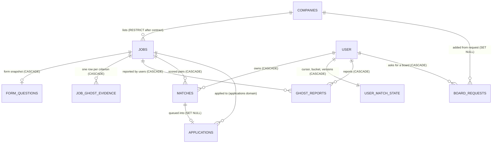

# Database design: domain `catalog-matching` (Job catalog and matching)

Status: design for implementation. Written 2026-10-23 against `01-architecture.md` revision 2 (ADR-001, postgres-durable on DBOS Transact, Anthropic agents), `04-matching.md` revision 1 (the matching pipeline that this schema serves), `server/src/db/schema/*.ts` (working tree), `server/drizzle/0000_init.sql`, `0001_resume_workspace.sql`, `docs/05-backend-schema.md`, `_research/requirements.md`, `_research/cost-model.md` and the two sibling database specifications `_db/billing.md` and `_db/messaging.md`.

Postgres 18 (`postgres-ssl:18`), database `kairos`, schema `public`. Application pools go through PgBouncer in transaction mode, so nothing here relies on session state: no session advisory locks, no `SET` outside `SET LOCAL`, no `LISTEN`.

Skills applied: `database-design` (think about the access path before the column; indexes follow queries), `postgres-best-practices` (partial indexes, foreign-key indexes, short transactions, bounded growth, least privilege) and `drizzle-orm-expert` (schema sketches in the Drizzle 0.45 array-constraint style the repository already uses). All three loaded; none of their intake questions applied because the database, ORM and workload are fixed by the architecture.

Evidence tags as in the architecture: **[V]** verified in a research file or vendor documentation; **[est]** an estimate to be replaced by beta measurements; **[verify]** a behavior that a named spike must prove.

---

## 0. Scope, and what this document changes in the architecture

This document owns eight tables: `companies`, `jobs`, `form_questions`, `job_ghost_evidence`, `ghost_reports`, `board_requests`, `matches`, `user_match_state`. Other domains are designed in parallel; every cross-domain name below is exactly the architect's inventory name (`"user"`, `applications`, `application_events`, `inbound_emails`, `profiles`, `facts`, `subscriptions`, `credit_balances`, `user_daily_usage`, `llm_calls`, `ops_flags`, `ops_audit`).

### 0.1 Invariants this domain makes true in the database

| Invariant | Mechanism (section) |
|---|---|
| One job per (company, external id); a poll can never duplicate a posting | `UNIQUE (company_id, external_id)` (5.5) |
| One match per (user, job) | `UNIQUE (user_id, job_id)` (8.4) |
| The fit gate never depends on model output (INV-1) | Deterministic hint columns on `jobs` are written only by `normalizePosting` (pure TypeScript); `jobs_hints_coherent_ck` stops a row from claiming a hint version without the derived columns (5.5) |
| Only the three supported boards are ever contacted, by the poller, the importer or the applier (INV-6, INV-8, SSRF) | `companies_hosts_ck` and `jobs_apply_url_host_ck` pin the API host, the apply host and the apply URL to a fixed allowlist, so a bad row cannot send a request anywhere else (4.5, 5.5) |
| A user's own decision is never overridden by the system | `matches_status_guard` trigger forbids system moves out of `queued` and `skipped` (8.6, 10.1) |
| A match that failed the gate is never shown in the feed | `matches_failed_gate_ck`: `passed_filters = false` is allowed only for imports and never together with status `new` (8.5) |
| An imported match is marked as one, and only imports carry that mark | `matches_source_selection_ck` (8.5) |
| One ghost report per user per job; ghost evidence has one row per criterion | Primary key `(job_id, user_id)`; `UNIQUE (job_id, kind)` (6.2, 6.3) |
| Structural evidence alone never makes a ghost verdict `likely` (F2) | View `job_ghost_verdict_v` is the single SQL definition of the verdict; the TypeScript function is tested against it (10.3) |
| Truth-lock and credits are not touched | No table here holds a fact id, a credit or a draft. `matches.reasons` holds scorer text and is deleted with the user |
| Hard-filter rejections are never stored per pair (C-1) | No table exists for them; per-reason counters live in `user_daily_usage.filtered` (platform domain) |
| Closed postings are never listed to users and never reopen by accident | `jobs.closed_by` plus the reopen rule of 5.7; the frozen feed query filters `closed_at IS NULL` |
| No personal data in shared catalog tables | `companies`, `jobs`, `form_questions` and `job_ghost_evidence` hold public posting data and counts only, so the account-deletion cascade needs no cleanup there; user-owned tables (`matches`, `ghost_reports`, `board_requests`, `user_match_state`) cascade from `"user"` |

### 0.2 Deviations from, and additions to, `01-architecture.md` and `04-matching.md`

The architect's DDL (B.10.2, B.10.5, B.7.3) and the matching specification (section 18) are the starting point. These are the places where this document differs, each with its reason, so the architect and the matching author can reconcile the final text. Numbers marked [est] come from the cost model and `04-matching.md`.

| # | Source text | This document | Reason |
|---|---|---|---|
| D1 | `jobs.last_seen_at` is "last poll that listed it"; `04-matching.md` 2.4 runs `UPDATE jobs SET last_seen_at = now()` for every unchanged listed posting on every poll; Autopilot guard 8 and `approveCore` read `j.last_seen_at` | `jobs.last_seen_at` is written only when a row is inserted, reopened, changed or imported. A new column `companies.last_success_at` records the last poll that returned a trustworthy full listing (200, or 304). "Seen open in the last 6 hours" is the expression `job_fresh_at(j, c)` (10.4): the later of `j.last_seen_at` and, for an open `board` job of an active company, `c.last_success_at` | A close step already closes any job a successful poll did not list, so an open job of a successfully polled company was listed by that poll. The per-poll heartbeat would write 150,000 open jobs x 48 polls = 7.2 million row versions a day at base and 29 million at growth (333 a second), each a wide-row update with its WAL, to learn what one `companies` update already says. The Autopilot guard keeps its exact meaning |
| D2 | B.10.2 creates `jobs_search_idx` (GIN on `search_tsv`) | Not created at beta. `search_tsv` stays as a ranking input only | The recall stage of `04-matching.md` 5.4 ranks the prefiltered set (about 3% of open jobs, at most about 18,000 rows) with `ts_rank_cd` and never filters with `@@`, so the planner would never choose the index. At growth it would cost about 1.5 GB and slow every upsert. Create it only if a future query filters by `@@` |
| D3 | `matches_below_bar_idx ON matches (created_at) WHERE status = 'below_bar'`; no creation index | New column `matches.status_changed_at`; the retention index is keyed on it; plain btree `matches_created_idx (created_at)` | A match that falls below a raised bar should live 30 days from that moment, not from its creation. BRIN was rejected for `created_at`: retention deletes the oldest pages and new rows reuse them, which destroys the physical correlation BRIN needs |
| D4 | `04-matching.md` 18: `matches_user_new_idx (user_id, created_at DESC) WHERE status = 'new'` | Same index with `INCLUDE (score, job_id)` | The frozen feed, the digest and the unacted count read only those columns, so the scan stays index-only on the small partial set |
| D5 | B.10.2 `companies.apply_host` plain text; no poll host; one applier view (B.10.4) | Adds `companies.api_host` and `api_region`; `companies_hosts_ck`, `jobs_apply_url_host_ck` pin hosts to the five apply hosts and four API hosts; adds a second applier view `scan_target_v` (10.5) | The `poll` queue partitions by API host and the applier partitions by apply host, so both must be stored; Lever has an EU API host. The CHECKs are a second line behind the applier's egress guard and the importer's strict parsers. The `scanForm` workflow gets a job id and needs the job's `apply_url`, which `applier_payload_v` (applications only) does not expose |
| D6 | `04-matching.md` 2.4 reopens any closed job the board lists again | Adds `jobs.closed_by` (`poll`, `posting_fetch`, `questions_404`, `apply_page`) and reopens only when the close came from a poll, or the content changed, or the close is older than 7 days (5.7) | A posting closed because its apply page or its questions endpoint said "closed" while the board API still lists it would otherwise flip open on every poll (D-19 fixed in the opposite direction) |
| D7 | `04-matching.md` 6.2 guards only the seniority and sponsorship predicates with `hints_version` | The role (`title_lc`) and location (`location_lc`) predicates get the same stale-row escape `OR j.hints_version <> :hv` (5.8) | A row written by pre-P4 code has `title_lc = ''` and `hints_version = 0`. Without the escape the prefilter would reject it, and the superset property (a gate pass is always kept) would fail during the transition |
| D8 | B.10.6: referenced closed jobs keep the row with `description_text` and `search_tsv` nulled | `jobs.description_text` becomes nullable and `jobs.description_purged_at` records the purge. `search_tsv` is cleared 14 days after close; `description_text`, `card` and `raw` after 180 days | Needed to make the retention rule implementable; the 14-day tsvector purge removes about 2.5 KB per closed row |
| D9 | B.8.6 step 4: an imported job's company is inactive; 04 2.8 closes imports "only by a 404 from `fetchPosting`" with no schedule | `jobs.next_check_at` plus `jobs_recheck_idx`: a scheduled `recheckImportedJobs` re-fetches each imported posting every 12 hours while a draft, an approval or a `new` or `queued` match references it | An unpolled board never tells us that a posting closed. Without a schedule an imported posting could stay queueable forever |
| D10 | B.6.2 and 04 12.1 do not define `expired` moving back | `matches_status_guard` allows `expired -> new` (system, when a preference change or a reopened job makes the pair valid again) and forbids every system move out of `queued` and `skipped` | Makes the state machine complete and enforceable; the trigger is a safety net behind conditional `UPDATE ... WHERE status IN (...)` statements |
| D11 | B.10.2 leaves `passed_filters` untouched; the skeleton's import writes a failed-gate match with status `skipped` | `passed_filters` stays (old code writes it). Failed-gate imports become `below_bar` (v2) and the migration converts the skeleton's `skipped` import rows that no application references | Keeps `skipped` meaning "the user skipped it", which the queue-rate metric needs |
| D12 | Random UUID defaults | New ids of `jobs`, `matches` and `board_requests` default to `uuidv7()` (native in Postgres 18); existing rows keep their version-4 ids | Time-ordered keys keep the primary-key index of the two big tables dense and make retention deletes touch contiguous pages. Both frozen clients treat ids as opaque strings and `z.uuid()` accepts version 7 |
| D13 | `form_questions (job_id, source, parser_version, questions, scanned_at)` | Adds `questions_hash` and `question_count` (set by a trigger, so the applier's `store_form_questions` stays unchanged), size and shape CHECKs, and a retention rule | `prepareApplication` compares the question plan by hash; unbounded JSON from a third-party form must be capped |
| D14 | `board_requests (id, user_id, host, path, created_at, status)` | Adds `detected_ats`, `times_seen`, `last_seen_at`, `company_id`, `resolved_at` and `UNIQUE (user_id, host, path)` | One pasted link must not create one row per click; the owner needs a ranked review queue; F8 needs to know which boards users ask for |
| D15 | B.7.3 creates `user_match_state` without saying who inserts the row | A row is created in the `PUT /api/profile/preferences` transaction (and by the migration and a reconciler for existing users); candidate generation locks the page's rows `FOR UPDATE` in `user_id` order (9.5) | A user without a row is never matched; two runs of one user (a tick and a backfill) must not both spend the same bucket tokens |
| D16 | Existing foreign keys `jobs.company_id` and `applications.job_id` are `ON DELETE CASCADE` | Contract release: `jobs.company_id` becomes `RESTRICT`; this document asks the applications domain to make `applications.job_id` `RESTRICT` | A deleted company would cascade to its jobs and then to every user's applications. Code never deletes companies (deactivation only) and retention deletes only unreferenced jobs, so `RESTRICT` costs nothing and removes a catastrophic failure mode |
| D17 | B.10.2 uses `CREATE INDEX CONCURRENTLY` inside migrations; `ALTER TYPE ... ADD VALUE 'below_bar'` shown inline | Drizzle's migrator runs migrations in one transaction, where neither `CONCURRENTLY` nor use of a new enum value in the same transaction is allowed. Enum additions go in their own migration; large concurrent index builds run from `server/scripts/catalog-indexes.sql` outside the migrator (section 12) | Matches how Postgres and `drizzle-kit migrate` actually behave |
| D18 | `jobs.raw` "trimmed to 1 KB from now on" | The TypeScript backfill sets `raw = NULL` for existing rows; new rows store at most 1 KB (`jobs_raw_size_ck`) | Nothing reads `raw` today (only the importer copies it). It is about 12 KB a row [est] |

### 0.3 What this domain asks of other domains

| # | To | Request |
|---|---|---|
| X1 | `applications` | `applications.job_id` becomes `ON DELETE RESTRICT` (D16). Keep `applications.match_id ON DELETE SET NULL` and the index `applications_match_idx` (retention of `matches` relies on it) |
| X2 | `applications` and `submission` | When settlement learns a posting is closed (failure code `posting_closed`), it sets `jobs.closed_at = now(), closed_by = 'apply_page'` through the catalog module function `closeJob(tx, jobId, 'apply_page')`, never directly. The applier never writes `jobs` |
| X3 | `identity-profile` | `PUT /api/profile/preferences` runs, in its transaction, `INSERT INTO user_match_state (user_id) VALUES ($1) ON CONFLICT DO NOTHING`, then `UPDATE user_match_state SET prefs_version = prefs_version + 1`. The single writer of `facts` calls `matching.bumpFactsVersion(tx, userIds)` once per transaction whenever a fact is confirmed, unconfirmed, edited or deleted |
| X4 | `billing` | Candidate eligibility uses `effective_plan(plan, status, past_due_since)` from `_db/billing.md` 3.1 to pick the cohort, not the stored `subscriptions.plan` |
| X5 | `platform` | `ops_flags` keys used by this domain: `pause_polling`, `pause_scoring`, `host_backoff:<apiHost>` and every `matching.*` and `catalog.*` key of `04-matching.md` section 23 |
| X6 | `architecture` (B.10.4) | Add `scan_target_v` and its `GRANT SELECT` to `kairos_applier` (10.5); replace `j.last_seen_at` in the `approveCore` query and Autopilot guard 8 with `job_fresh_at(j, c)` (D1) |

---

## 1. Domain map and ownership



Single-writer rule (B.2 boundary rules): each table is written by exactly one module; other modules call that module's exported functions.

| Table | Writing module | Written by (workflows and routes) | Read by |
|---|---|---|---|
| `companies` | `catalog` | `pollTick` (claim), `pollBatch` (results), `POST /api/jobs/import` (new company), `refresh-priority` schedule, `db:seed`, admin routes (activate, deactivate) | Poller, importer, `approveCore` (apply host), inbound email linking (domains, name), `candidatePage` (priority companies for the express lane) |
| `jobs` | `catalog` | `pollBatch` (upsert, close, hints, canary, family), `POST /api/jobs/import`, `ensureJobCards` (card columns), `ghost-signals` (verdict cache), `recheckImportedJobs`, `retention`, `refreshHints`, settlement through `closeJob` | Matching prefilter and gate, F1, the workspace fit and tailor routes, `GET /api/matches` and `GET /api/applications` (joins), the applier (through views) |
| `form_questions` | `catalog` | `prepareApplication` step `ensureFormQuestions` (Greenhouse API), applier function `store_form_questions` (browser scan) | `prepareApplication`, `PATCH /api/applications/:id` (missing required answers) |
| `job_ghost_evidence`, `ghost_reports` | `catalog` | `ghost-signals` schedule, `POST /api/jobs/:jobId/ghost-report` | `gate()`, Autopilot guard 6, match and fit responses (`ghost` field) |
| `board_requests` | `catalog` | `POST /api/jobs/import` (unsupported board), admin routes (resolve) | Owner review queue (`GET /api/admin/board-requests`) |
| `matches` | `matching` | `scoreUser` chunks, `batchScore`, import, `reconcileMatchesForPrefs`, `rescore`, skip and queue routes through `matching.skipMatch` and `matching.markQueued`, `retention` | `GET /api/matches`, `candidatePage` (exclusion), digests, quality metrics, `GET /api/jobs/:jobId/fit` (`matchId`) |
| `user_match_state` | `matching` | `candidateTick`, `candidatePage`, `scoreUser`, preference save, `bumpFactsVersion`, `rescoreTick`, `rebalanceTick` | `candidateTick`, `GET /api/usage/today` |

---

## 2. Conventions

| Topic | Rule |
|---|---|
| Keys | Text `"user".id` (Better Auth) for user references. New uuid keys of the two big tables use `uuidv7()` (D12); small tables keep `gen_random_uuid()`. Derived grouping keys (`jobs.family_id`, `matches.family_id`) have no foreign key by design: a family id is the id of its oldest member, and the oldest member may be deleted by retention while newer members remain |
| Time | `timestamptz` everywhere, UTC. Defaults use `now()` (transaction start); a transaction that must order two writes uses `clock_timestamp()` explicitly |
| Enumerations | Existing `ats_provider` and `match_status` stay Postgres enums (shared constants). Every new closed set is `text` with a named `CHECK`, as in the architecture: adding a value is a constraint swap, not an `ALTER TYPE` that cannot be used in the same transaction. Drizzle types them with `text(name, { enum: [...] })` |
| Constraint names | `<table>_<columns or meaning>_ck` for checks, `_uq` for unique indexes, `_idx` for other indexes, `_fk` for foreign keys |
| Adding checks to populated tables | `ADD CONSTRAINT ... NOT VALID` in the expand migration, `VALIDATE CONSTRAINT` after the backfill (it takes only a `SHARE UPDATE EXCLUSIVE` lock). The migration section lists each |
| JSON columns | Every `jsonb` column has a type check (`jsonb_typeof`), an element bound and a size bound, because the content comes from third parties (form questions, job cards) or from models (reasons) |
| Text bounds | Every free-text column that originates outside Kairos has a `char_length` bound |
| Locks | Short transactions; no transaction spans a network call (a model call, an ATS fetch). Claims use `FOR UPDATE SKIP LOCKED` or a conditional `UPDATE ... RETURNING` |
| Autovacuum | Per-table settings in each section. Update-heavy small tables get a low `fillfactor` so updates stay on the page |
| Roles | `kairos_api` and `kairos_worker`: `SELECT, INSERT, UPDATE, DELETE` on all eight tables (default privileges, B.10.4). `kairos_applier`: nothing on tables; `SELECT` on `scan_target_v` and `EXECUTE` on `store_form_questions`. `kairos_readonly`: `SELECT` on `companies`, `jobs`, `matches`, `user_match_state`, `board_requests` and `job_ghost_evidence` (10.5) |
| Pooling | Compatible with PgBouncer transaction mode: claims and cap checks are single statements or short transactions; the `FOR UPDATE` page lock of `user_match_state` lives inside one datasource transaction |

---

## 3. Enumerations and shared types

Only two Postgres enum types are touched; everything else is a text column with a `CHECK`.

| Name | Kind | Values | Change |
|---|---|---|---|
| `ats_provider` | Postgres enum (kept) | `greenhouse`, `lever`, `ashby` | None at beta. Phase 2 (F8) adds values with `ALTER TYPE ... ADD VALUE` in a standalone migration, then extends `companies_hosts_ck` and `jobs_apply_url_host_ck` in the next one |
| `match_status` | Postgres enum (extended) | `new`, `queued`, `skipped`, `expired`, **`below_bar`** | `below_bar` is added by the standalone migration `catalog_1_enum_below_bar`. It is **server-only**: `shared/src/types.ts` `MATCH_STATUSES` stays `["new","queued","skipped","expired"]` because the frozen clients never receive `below_bar` (`GET /api/matches` returns only `new`) |
| `matches.source` | text + CHECK | `pipeline`, `manual_url` | New |
| `matches.selection` | text + CHECK | `ranked`, `explore`, `express`, `backfill`, `rebalance`, `rescore`, `import` | New (`04-matching.md` 6.4) |
| `jobs.source` | text + CHECK | `board`, `manual_url` | CHECK added to the existing column |
| `jobs.closed_by` | text + CHECK | `poll`, `posting_fetch`, `questions_404`, `apply_page` | New |
| `jobs.seniority_hint` | text + CHECK | `intern`, `entry`, `mid`, `senior`, `staff_plus`, `manager`, `unknown` | New (B.10.2) |
| `jobs.sponsorship_hint` | text + CHECK | `no_sponsorship`, `sponsors` (or null) | New (B.10.2) |
| `jobs.ghost_verdict` | text + CHECK | `none`, `possible`, `likely` | New (B.10.2) |
| `job_ghost_evidence.kind` | text + CHECK | `repost_pattern`, `long_open`, `unlisted`, `silent_applications`, `user_reports` | New (B.10.5) |
| `ghost_reports.reason` | text + CHECK | `no_response`, `reposted`, `fake`, `other` | New (B.10.5) |
| `form_questions.source` | text + CHECK | `greenhouse_api`, `browser_scan`, `unknown` | New (B.10.5) |
| `companies.discovered_by` | text + CHECK | `seed`, `import` | New (B.10.2) |
| `companies.inactive_reason` | text + CHECK | `board_not_found`, `import_pending`, `owner` | New |
| `companies.api_region` | text + CHECK | `us`, `eu` | New |
| `board_requests.status` | text + CHECK | `open`, `added`, `rejected` | New (B.10.5) |

Server-side constants (new, in `server/src/db/schema/enums.ts`; the existing constants and the shared package are untouched):

```ts
import { MATCH_STATUSES } from "@auto-career/shared";

/** The database enum is a superset of the frozen shared one: below_bar never leaves the server. */
export const MATCH_STATUSES_DB = [...MATCH_STATUSES, "below_bar"] as const;
export type MatchStatusDb = (typeof MATCH_STATUSES_DB)[number];

export const MATCH_SOURCES = ["pipeline", "manual_url"] as const;
export const MATCH_SELECTIONS = ["ranked", "explore", "express", "backfill", "rebalance", "rescore", "import"] as const;
export const JOB_SOURCES = ["board", "manual_url"] as const;
export const JOB_CLOSED_BY = ["poll", "posting_fetch", "questions_404", "apply_page"] as const;
export const SENIORITY_HINTS = ["intern", "entry", "mid", "senior", "staff_plus", "manager", "unknown"] as const;
export const SPONSORSHIP_HINTS = ["no_sponsorship", "sponsors"] as const;
export const GHOST_VERDICTS = ["none", "possible", "likely"] as const;
export const GHOST_EVIDENCE_KINDS = ["repost_pattern", "long_open", "unlisted", "silent_applications", "user_reports"] as const;
export const GHOST_REPORT_REASONS = ["no_response", "reposted", "fake", "other"] as const;
export const FORM_QUESTION_SOURCES = ["greenhouse_api", "browser_scan", "unknown"] as const;
export const COMPANY_DISCOVERED_BY = ["seed", "import"] as const;
export const COMPANY_INACTIVE_REASONS = ["board_not_found", "import_pending", "owner"] as const;
export const COMPANY_API_REGIONS = ["us", "eu"] as const;
export const BOARD_REQUEST_STATUSES = ["open", "added", "rejected"] as const;
```

The existing `matchStatus` Drizzle enum in `enums.ts` changes to `pgEnum("match_status", MATCH_STATUSES_DB)`. No file under `shared/` changes.

---

## 4. Table `companies`

### 4.1 Purpose

The employers Kairos polls: one row per public job board (`ats`, `board_token`). It carries the polling schedule and health (ETag, next poll, error counters, last successful listing), the two host names that partition the `poll` and `cloud-apply` queues, the priority flag for 5-minute polling, the email domains used to link forwarded replies, and where the row came from (seed file or a user's pasted link).

### 4.2 Columns

Existing columns keep their names and types. "New" columns come from B.10.2 unless marked **added here**.

| Column | Type | Null | Default | Notes |
|---|---|---|---|---|
| `id` | `uuid` | no | `gen_random_uuid()` | Primary key (existing) |
| `name` | `text` | no | | Display name, 1 to 200 characters. The importer derives it from the board token until the poller learns the real name |
| `ats` | `ats_provider` | no | | Existing |
| `board_token` | `text` | no | | Slug of the public board. `^[A-Za-z0-9_.-]{1,100}$` |
| `careers_url` | `text` | yes | | Existing; display only, never fetched |
| `priority` | `boolean` | no | `false` | Existing. Set by `refresh-priority` (cap 300) |
| `active` | `boolean` | no | `true` | Existing. False = not polled |
| `inactive_reason` | `text` | yes | | **Added here.** Required exactly when `active` is false: `board_not_found` (the board returned 404), `import_pending` (created by a pasted link, waiting for owner review, open question 18 of the architecture), `owner` (switched off by hand) |
| `last_polled_at` | `timestamptz` | yes | | Existing. Last poll attempt of any outcome |
| `last_poll_error` | `text` | yes | | Existing. Short error code or message of the last failed attempt, never a response body |
| `last_success_at` | `timestamptz` | yes | | **Added here (D1).** Last poll that returned a trustworthy listing: HTTP 200 accepted by the empty-board guard, or HTTP 304 |
| `etag` | `text` | yes | | New. For `If-None-Match` |
| `next_poll_at` | `timestamptz` | no | `now()` | New. Written after every attempt with jitter |
| `empty_streak` | `smallint` | no | `0` | New. Consecutive polls that returned zero postings while open jobs exist (empty-board guard) |
| `consecutive_errors` | `smallint` | no | `0` | New. Drives the back-off `min(30 min x 2^errors, 6 h)` |
| `api_region` | `text` | no | `'us'` | **Added here (D5).** `us` or `eu` (Lever only) |
| `api_host` | `text` | yes | | **Added here (D5).** Partition key of the `poll` queue. Set by the catalog module from `ats` and `api_region`; not null after the backfill |
| `apply_host` | `text` | yes | | New. Partition key of the `cloud-apply` queue; not null after the backfill |
| `domains` | `text[]` | no | `'{}'` | New. Lower-case employer email domains for domain-first reply linking |
| `discovered_by` | `text` | no | `'seed'` | New. `seed` or `import` |
| `created_at` | `timestamptz` | no | `now()` | Existing |

### 4.3 Keys

Primary key `(id)`. Referenced by `jobs.company_id` (see 4.4) and `board_requests.company_id`.

### 4.4 Foreign keys

| Column | References | On delete | Why |
|---|---|---|---|
| `jobs.company_id` (owned by `jobs`) | `companies(id)` | `CASCADE` today, **`RESTRICT` after the contract release** (D16) | Companies are deactivated, never deleted |
| `board_requests.company_id` (owned by `board_requests`) | `companies(id)` | `SET NULL` | A request keeps its history if the owner deletes a test company |

### 4.5 Unique indexes, indexes and checks

```sql
-- Existing, kept: one row per public board. Conflict target of the seed loader and the importer.
-- CREATE UNIQUE INDEX companies_ats_board_uq ON companies (ats, board_token);

-- Checks (NOT VALID in the expand migration, validated after the backfill)
ALTER TABLE companies
  ADD CONSTRAINT companies_name_ck          CHECK (char_length(name) BETWEEN 1 AND 200),
  ADD CONSTRAINT companies_board_token_ck   CHECK (board_token ~ '^[A-Za-z0-9_.-]{1,100}$') NOT VALID,
  ADD CONSTRAINT companies_counters_ck      CHECK (empty_streak >= 0 AND consecutive_errors >= 0),
  ADD CONSTRAINT companies_discovered_by_ck CHECK (discovered_by IN ('seed','import')),
  ADD CONSTRAINT companies_active_reason_ck CHECK (
        (active     AND inactive_reason IS NULL)
     OR (NOT active AND inactive_reason IN ('board_not_found','import_pending','owner'))) NOT VALID,
  ADD CONSTRAINT companies_domains_lc_ck    CHECK (domains::text = lower(domains::text)),
  -- D5: the only hosts the system will ever poll or send a browser to
  ADD CONSTRAINT companies_hosts_ck CHECK (
        (ats = 'greenhouse' AND api_region = 'us' AND api_host = 'boards-api.greenhouse.io'
                            AND apply_host IN ('boards.greenhouse.io','job-boards.greenhouse.io'))
     OR (ats = 'lever'      AND api_region = 'us' AND api_host = 'api.lever.co'    AND apply_host = 'jobs.lever.co')
     OR (ats = 'lever'      AND api_region = 'eu' AND api_host = 'api.eu.lever.co' AND apply_host = 'jobs.eu.lever.co')
     OR (ats = 'ashby'      AND api_region = 'us' AND api_host = 'api.ashbyhq.com' AND apply_host = 'jobs.ashbyhq.com')) NOT VALID;
-- after the backfill (section 12): ALTER COLUMN api_host SET NOT NULL, apply_host SET NOT NULL
```

| Index | Definition | Query it serves |
|---|---|---|
| `companies_ats_board_uq` | `UNIQUE (ats, board_token)` (existing) | Seed upsert; import `INSERT ... ON CONFLICT (ats, board_token)`; board lookup by token |
| `companies_due_idx` | `(next_poll_at) WHERE active` | `pollTick` claim: `SELECT id, api_host FROM companies WHERE active AND next_poll_at <= now() ORDER BY priority DESC, next_poll_at LIMIT 2000 FOR UPDATE SKIP LOCKED`. The due set is a few hundred rows, so sorting it by `priority` costs nothing; a two-column index would add write cost on every poll |
| `companies_domains_gin_idx` | `GIN (domains)` | Inbound email domain-first linking: `WHERE domains @> ARRAY[$senderDomain]` (messaging domain) |
| `companies_name_lc_idx` | `(lower(name))` | Inbound email fallback linking by company name: `WHERE lower(name) = $name`. Case-insensitive equality, not a pattern |
| `companies_review_idx` | `(created_at) WHERE discovered_by = 'import' AND NOT active` | Owner review list of boards discovered through pasted links |

### 4.6 Concurrency and writes

- `pollTick` claims with `FOR UPDATE SKIP LOCKED` and, in the same statement, pushes `next_poll_at` forward by 10 minutes (a lease), so a slow poll is not claimed twice; `pollBatch` writes the real next time with jitter after the attempt.
- Every poll attempt updates one `companies` row (`last_polled_at`, `next_poll_at`, `etag`, counters), which is about 168,000 updates a day at base and 552,000 at growth. `next_poll_at` is indexed, so these updates are not HOT; the table is small (10,000 rows), and the storage parameters below keep it from bloating.

```sql
ALTER TABLE companies SET (fillfactor = 60, autovacuum_vacuum_scale_factor = 0.05, autovacuum_analyze_scale_factor = 0.05);
```

### 4.7 Partitioning and retention

Not partitioned: 2,000 to 10,500 rows. Rows are never deleted by a schedule. Deactivation is the removal path; deleting a company by hand is blocked by `RESTRICT` once jobs exist.

### 4.8 Row-count projection

| | Launch | 12 months, base (2,000 companies) | 12 months, growth (10,000 companies) |
|---|---|---|---|
| Rows | 2,000 seed boards | about 2,300 (300 imported) | about 10,500 (500 imported) |
| Size with indexes | 1.4 MB | 1.6 MB | 7 MB |
| Writes a day | 168,000 updates | 168,000 | 552,000 |

### 4.9 Drizzle sketch

```ts
// server/src/db/schema/jobs.ts (companies; file kept, export names unchanged)
import { sql } from "drizzle-orm";
import { boolean, check, index, integer, jsonb, pgTable, smallint, text, timestamp, uniqueIndex, uuid } from "drizzle-orm/pg-core";
import { atsProvider } from "./enums";
import { COMPANY_API_REGIONS, COMPANY_DISCOVERED_BY, COMPANY_INACTIVE_REASONS } from "./enums";

export const companies = pgTable(
  "companies",
  {
    id: uuid("id").primaryKey().defaultRandom(),
    name: text("name").notNull(),
    ats: atsProvider("ats").notNull(),
    boardToken: text("board_token").notNull(),
    careersUrl: text("careers_url"),
    priority: boolean("priority").notNull().default(false),
    active: boolean("active").notNull().default(true),
    inactiveReason: text("inactive_reason", { enum: COMPANY_INACTIVE_REASONS }),
    lastPolledAt: timestamp("last_polled_at", { withTimezone: true }),
    lastPollError: text("last_poll_error"),
    lastSuccessAt: timestamp("last_success_at", { withTimezone: true }),
    etag: text("etag"),
    nextPollAt: timestamp("next_poll_at", { withTimezone: true }).notNull().defaultNow(),
    emptyStreak: smallint("empty_streak").notNull().default(0),
    consecutiveErrors: smallint("consecutive_errors").notNull().default(0),
    apiRegion: text("api_region", { enum: COMPANY_API_REGIONS }).notNull().default("us"),
    apiHost: text("api_host"),          // not null after the backfill; Drizzle keeps it nullable until then
    applyHost: text("apply_host"),
    domains: text("domains").array().notNull().default(sql`'{}'::text[]`),
    discoveredBy: text("discovered_by", { enum: COMPANY_DISCOVERED_BY }).notNull().default("seed"),
    createdAt: timestamp("created_at", { withTimezone: true }).notNull().defaultNow(),
  },
  (t) => [
    uniqueIndex("companies_ats_board_uq").on(t.ats, t.boardToken),
    index("companies_due_idx").on(t.nextPollAt).where(sql`${t.active}`),
    index("companies_domains_gin_idx").using("gin", t.domains),
    index("companies_name_lc_idx").on(sql`lower(${t.name})`),
    index("companies_review_idx").on(t.createdAt).where(sql`${t.discoveredBy} = 'import' AND NOT ${t.active}`),
    check("companies_name_ck", sql`char_length(${t.name}) BETWEEN 1 AND 200`),
    check("companies_counters_ck", sql`${t.emptyStreak} >= 0 AND ${t.consecutiveErrors} >= 0`),
    // companies_board_token_ck, companies_active_reason_ck, companies_hosts_ck, companies_domains_lc_ck:
    // declared with check() as above; created NOT VALID by the custom migration, see section 12.
  ],
);
```

---

## 5. Table `jobs`

### 5.1 Purpose

The shared catalog of postings, polled from boards or imported from a pasted link. One row per (company, external id). Besides the posting itself it holds everything matching needs **precomputed and shared by every user**: deterministic hint columns that the SQL prefilter and the fit gate read, the repost family, the ghost verdict cache, the injection canary, the full-text vector used only for ranking, and the shared job card written once per job version by `jd-analyst`.

### 5.2 Columns

Existing columns keep their names and types unless the notes say otherwise. Sources: `E` existing skeleton column, `A` architecture B.10.2, `M` `04-matching.md` section 18, `H` added here.

| Column | Type | Null | Default | Src | Notes |
|---|---|---|---|---|---|
| `id` | `uuid` | no | `uuidv7()` | E, D12 | Primary key. Existing rows keep their version-4 ids |
| `company_id` | `uuid` | no | | E | FK `companies(id)` |
| `external_id` | `text` | no | | E | Board's posting id, 1 to 200 characters |
| `title` | `text` | no | | E | As published, whitespace collapsed, at most 500 characters |
| `location` | `text` | yes | | E | At most 500 characters |
| `remote` | `boolean` | no | `false` | E | |
| `department` | `text` | yes | | E | At most 200 characters |
| `description_text` | `text` | **yes** | | E, D8 | Plain text, at most 60,000 characters. Null only after the 180-day purge |
| `description_purged_at` | `timestamptz` | yes | | H, D8 | Set when `description_text` is purged |
| `apply_url` | `text` | no | | E | Normalized per ATS (FR-14). Must be on one of the five apply hosts (`jobs_apply_url_host_ck`) |
| `salary_min_usd`, `salary_max_usd` | `integer` | yes | | E | Yearly USD, adapter-parsed (FR-15). `salary_max_usd` already exists; the `ADD COLUMN` in B.10.2 is dropped |
| `posted_at` | `timestamptz` | yes | | E | Provider posting time when published |
| `first_seen_at` | `timestamptz` | no | `now()` | E | Never changes. Ordering key of the frozen feed |
| `closed_at` | `timestamptz` | yes | | E | Set when the posting is no longer open |
| `closed_by` | `text` | yes | | H, D6 | Who closed it: `poll`, `posting_fetch`, `questions_404`, `apply_page`. Null exactly when `closed_at` is null |
| `source` | `text` | no | `'board'` | E | `board` or `manual_url` (CHECK added) |
| `raw` | `jsonb` | yes | | E, D18 | At most 1 KB of the provider payload; null for rows before the migration |
| `content_hash` | `text` | yes | | A | sha256 hex of the normalized content (`04-matching.md` 2.2). Change detection |
| `updated_at` | `timestamptz` | no | `now()` | A | Set when content changes |
| `visible_at` | `timestamptz` | no | `now()` | A | Set on insert, reopen and content change. Matching windows read it |
| `last_seen_at` | `timestamptz` | no | `now()` | A, D1 | Set on insert, reopen, content change and import. **Not** a per-poll heartbeat; use `job_fresh_at` (10.4) |
| `next_check_at` | `timestamptz` | yes | | H, D9 | Only imported jobs of unpolled companies: when `recheckImportedJobs` fetches the posting again. Null for polled jobs |
| `unlisted` | `boolean` | no | `false` | A | Raw observation: the board itself says the posting is not publicly listed (Ashby `isListed: false`) |
| `injection_suspect` | `boolean` | no | `false` | A | Deterministic canary (B.11.5). Autopilot never auto-sends to a suspect job |
| `ghost_verdict` | `text` | no | `'none'` | A | Cache of `job_ghost_verdict_v` (10.3): `none`, `possible`, `likely` |
| `title_lc` | `text` | no | `''` | M | `title.toLowerCase()` in JavaScript. Empty only while `hints_version = 0` |
| `location_lc` | `text` | no | `''` | M | `(location ?? '').toLowerCase()` |
| `title_norm` | `text` | yes | | M | Dedup key part (`04-matching.md` 2.2) |
| `location_norm` | `text` | yes | | M | Dedup key part; empty string when nothing remains |
| `title_senior_flag`, `title_junior_flag` | `boolean` | no | `false` | M | `SENIOR_TITLE.test(title)` and `JUNIOR_TITLE.test(title)`, the regexes exported by `services/fit.ts` |
| `seniority_hint` | `text` | yes | | A | `seniorityOf(title)`; used by F1 and the card only, never by the gate |
| `sponsorship_hint` | `text` | yes | | A | `no_sponsorship` exactly when `NO_SPONSORSHIP.test(description_text)`; `sponsors` informational |
| `hints_version` | `smallint` | no | `0` | M | `HINTS_VERSION` of the code that wrote every derived column above. 0 = never computed |
| `description_hash` | `text` | yes | | M | sha256 hex of `normalizeForHash(description_text)` |
| `simhash` | `bigint` | no | `0` | M | 64-bit SimHash stored as signed bigint; 0 = too short to join a family by SimHash |
| `family_id` | `uuid` | yes | | M | Id of the oldest job of the repost family; `= id` when alone. No foreign key (section 2). Not null after the contract release |
| `card` | `jsonb` | yes | | A | `JobCard` (B.7.7) written by `jd-analyst`, at most 16 KB |
| `card_version` | `smallint` | yes | | A | The `jd-analyst` prompt version that wrote it |
| `card_content_hash` | `text` | yes | | A | `content_hash` the card was built from; the card is fresh only while equal to `content_hash` |
| `card_claimed_until` | `timestamptz` | yes | | A | Claim-or-wait lease (60 seconds) |
| `search_tsv` | `tsvector` | yes | | A | `setweight(to_tsvector('english', title), 'A') || setweight(to_tsvector('english', left(description_text, 20000)), 'C')`, plus card keywords with weight `B` after the card is written. Ranking input only (D2) |

### 5.3 Keys

Primary key `(id)`. Referenced by `matches.job_id` (CASCADE), `applications.job_id` (applications domain; `RESTRICT` requested, X1), `form_questions.job_id`, `job_ghost_evidence.job_id`, `ghost_reports.job_id` (all CASCADE).

### 5.4 Foreign keys

| Column | References | On delete | Why |
|---|---|---|---|
| `company_id` | `companies(id)` | `CASCADE` today; **`RESTRICT` in the contract release** (D16) | See D16. Add the replacement with `NOT VALID`, validate, then drop the old constraint |

### 5.5 Unique indexes and check constraints

```sql
-- Existing, kept: the poll and import conflict target and the idempotency key of ingestion
-- CREATE UNIQUE INDEX jobs_company_external_uq ON jobs (company_id, external_id);

ALTER TABLE jobs
  ADD CONSTRAINT jobs_source_ck          CHECK (source IN ('board','manual_url')) NOT VALID,
  ADD CONSTRAINT jobs_closed_by_ck       CHECK (closed_by IN ('poll','posting_fetch','questions_404','apply_page')),
  ADD CONSTRAINT jobs_closed_coherent_ck CHECK ((closed_at IS NULL) = (closed_by IS NULL)) NOT VALID,
  ADD CONSTRAINT jobs_seniority_hint_ck  CHECK (seniority_hint IN ('intern','entry','mid','senior','staff_plus','manager','unknown')),
  ADD CONSTRAINT jobs_sponsorship_hint_ck CHECK (sponsorship_hint IN ('no_sponsorship','sponsors')),
  ADD CONSTRAINT jobs_ghost_verdict_ck   CHECK (ghost_verdict IN ('none','possible','likely')),
  -- A row may claim a hints version only if every derived column was computed (superset property, 5.8)
  ADD CONSTRAINT jobs_hints_coherent_ck  CHECK (hints_version = 0 OR
        (title_lc <> '' AND title_norm IS NOT NULL AND location_norm IS NOT NULL AND seniority_hint IS NOT NULL
         AND description_hash IS NOT NULL AND family_id IS NOT NULL)),
  ADD CONSTRAINT jobs_description_ck     CHECK (description_text IS NOT NULL OR description_purged_at IS NOT NULL),
  ADD CONSTRAINT jobs_lengths_ck         CHECK (char_length(external_id) BETWEEN 1 AND 200
                                              AND char_length(title) BETWEEN 1 AND 500
                                              AND (location IS NULL OR char_length(location) <= 500)
                                              AND (department IS NULL OR char_length(department) <= 200)
                                              AND char_length(apply_url) <= 2000) NOT VALID,
  ADD CONSTRAINT jobs_salary_ck          CHECK ((salary_min_usd IS NULL OR salary_min_usd >= 0)
                                              AND (salary_max_usd IS NULL OR salary_max_usd >= 0)
                                              AND (salary_min_usd IS NULL OR salary_max_usd IS NULL OR salary_min_usd <= salary_max_usd)) NOT VALID,
  -- D5: the browser and the extension are only ever sent to these hosts, with no user-info part
  ADD CONSTRAINT jobs_apply_url_host_ck  CHECK (apply_url ~ '^https://(boards\.greenhouse\.io|job-boards\.greenhouse\.io|jobs\.lever\.co|jobs\.eu\.lever\.co|jobs\.ashbyhq\.com)/') NOT VALID,
  ADD CONSTRAINT jobs_card_ck            CHECK (card IS NULL OR
        (jsonb_typeof(card) = 'object' AND octet_length(card::text) <= 16384
         AND card_version IS NOT NULL AND card_content_hash IS NOT NULL)),
  -- contract release only, after the code that trims the values is the sole writer (section 12):
  ADD CONSTRAINT jobs_description_len_ck CHECK (description_text IS NULL OR char_length(description_text) <= 60000) NOT VALID,
  ADD CONSTRAINT jobs_raw_size_ck        CHECK (raw IS NULL OR octet_length(raw::text) <= 1024) NOT VALID;
```

`jobs_description_len_ck` and `jobs_raw_size_ck` are created in the contract migration, not in the expand migration, because the skeleton's poller and importer would violate them until the new writers ship.

### 5.6 Other indexes

| Index | Definition | Query it serves |
|---|---|---|
| `jobs_first_seen_idx` | `(first_seen_at)` (existing, kept) | The `ghost-signals` repost scan (`first_seen_at > now() - interval '120 days'`); append-only, so it costs almost nothing on write |
| `jobs_visible_open_idx` | `(visible_at) WHERE closed_at IS NULL` | Incremental and express prefilter: `WHERE closed_at IS NULL AND visible_at > :from AND visible_at <= :to`. About 190,000 runs a day, each reading a window of 10 to 500 rows |
| `jobs_title_lc_trgm_idx` | `GIN (title_lc gin_trgm_ops) WHERE closed_at IS NULL` | Backfill and rebalance recall: the role predicate `title_lc LIKE '%word%'` over all open jobs. Role words are longer than 2 characters, so every pattern has at least one trigram |
| `jobs_location_lc_trgm_idx` | `GIN (location_lc gin_trgm_ops) WHERE closed_at IS NULL` | Same queries: `location_lc LIKE ANY(:patterns)`. A pattern shorter than 3 characters (for example "ny") has no trigram, so such a query filters the already narrowed set instead; the plan is still bounded by the window or the recall limit |
| `jobs_company_open_idx` | `(company_id) WHERE closed_at IS NULL` | The close step of a poll (`WHERE company_id = $1 AND closed_at IS NULL AND NOT (external_id = ANY($listed))`) and the per-company open count |
| `jobs_family_idx` | `(family_id) INCLUDE (description_hash)` | Card reuse across a family (`WHERE family_id = $1 AND description_hash = $2 ...`), the repost evidence query and member lookups |
| `jobs_repost_lookup_idx` | `(company_id, title_norm, first_seen_at DESC)` | `assignFamily`: same company, same normalized title, earlier first seen. Scans a handful of rows per insert |
| `jobs_hints_stale_idx` | `(hints_version) WHERE closed_at IS NULL` | `refreshHints`: `WHERE closed_at IS NULL AND hints_version < :hv ORDER BY hints_version, id LIMIT 2000`. All open rows share one key after a refresh, so the index is about 15 MB at 600,000 rows |
| `jobs_closed_idx` | `(closed_at) WHERE closed_at IS NOT NULL` | Retention (14-day tsvector clear, 90-day match cleanup band, 180-day purge) and form-question retention |
| `jobs_recheck_idx` | `(next_check_at) WHERE next_check_at IS NOT NULL AND closed_at IS NULL` | `recheckImportedJobs`: `WHERE next_check_at <= now()`. Tiny (imported jobs only) |

Dropped from the architecture's list: `jobs_title_trgm_idx` (replaced by the `title_lc` index, as `04-matching.md` reconciliation 4 says) and `jobs_search_idx` (D2).

### 5.7 State and write rules

The poll upsert is `04-matching.md` 2.4 with two changes (D1, D6). Its `WHERE` clause becomes:

```sql
ON CONFLICT (company_id, external_id) DO UPDATE SET
  /* every content column and every derived column from EXCLUDED, as in 04-matching.md 2.4 */
  closed_at = NULL, closed_by = NULL,
  visible_at = now(), last_seen_at = now(), updated_at = now()
WHERE j.content_hash IS DISTINCT FROM EXCLUDED.content_hash
   OR (j.closed_at IS NOT NULL AND (j.closed_by = 'poll' OR j.closed_at < now() - interval '7 days'));
```

The per-poll heartbeat `UPDATE jobs SET last_seen_at = now() ...` of `04-matching.md` 2.4 is deleted (D1). Three more statements run in the same transaction as the upsert:

```sql
-- Close what the board no longer lists (only after a trustworthy, non-empty listing; empty-board guard of 04-matching.md 2.1)
UPDATE jobs SET closed_at = now(), closed_by = 'poll'
 WHERE company_id = $1 AND closed_at IS NULL AND source = 'board' AND NOT (external_id = ANY($listed));

-- A pasted posting that the poller now lists becomes a polled posting
UPDATE jobs SET source = 'board', next_check_at = NULL
 WHERE company_id = $1 AND source = 'manual_url' AND external_id = ANY($listed);

-- Poll bookkeeping on the company (D1)
UPDATE companies SET last_polled_at = now(), last_success_at = now(), last_poll_error = NULL, consecutive_errors = 0,
       etag = $etag, next_poll_at = $next WHERE id = $1;
```

Other writers:

- `closeJob(tx, jobId, closedBy)` sets `closed_at = now(), closed_by = $2 WHERE id = $1 AND closed_at IS NULL`. Called by `recheckImportedJobs` (`posting_fetch`), by the questions-endpoint 404 handling of `prepareApplication` (`questions_404`) and by settlement when an attempt reports `posting_closed` (`apply_page`).
- `ensureJobCards` writes `card`, `card_version`, `card_content_hash`, clears `card_claimed_until` and extends `search_tsv` with the card keywords (weight `B`), in one `UPDATE ... WHERE id = $1`.
- `ghost-signals` sets `ghost_verdict` through `refresh_ghost_verdicts` (10.3).
- `recheckImportedJobs` (schedule, every 30 minutes): selects up to 200 jobs `WHERE next_check_at <= now() ORDER BY next_check_at FOR UPDATE SKIP LOCKED`, calls the adapter's `fetchPosting` (fixed hosts only), then either `closeJob`, or refreshes content through the normal upsert path, and sets `next_check_at = now() + interval '12 hours'` while a draft, an approved application, or a `new` or `queued` match still references the job, else `NULL`.

### 5.8 Superset property and stale rows (D7)

The SQL prefilter must keep every row that `passesHardFilters` would pass. Rows with `hints_version <> :hv` have unreliable derived columns (defaults from before the backfill, or an older rule set), so **every predicate that reads a derived column is guarded**:

```sql
AND (j.hints_version <> :hv OR :anyRoleMatchesAll OR (j.title_lc LIKE :r1w1 AND j.title_lc LIKE :r1w2) OR (j.title_lc LIKE :r2w1))
AND (j.hints_version <> :hv OR :noLocations OR (:remoteOk AND j.remote) OR j.location_lc LIKE ANY(:locationPatterns))
AND NOT (:wantsJuniorOnly AND j.hints_version = :hv AND j.title_senior_flag)
AND NOT (:wantsSeniorOnly AND j.hints_version = :hv AND j.title_junior_flag)
AND (NOT :needsSponsorship OR j.hints_version <> :hv OR j.sponsorship_hint IS DISTINCT FROM 'no_sponsorship')
```

The first two lines amend `04-matching.md` 6.2, which guarded only the last three. `jobs_hints_coherent_ck` backs the guard from the other side: a row cannot carry the current version without having been fully computed.

### 5.9 Storage parameters

```sql
ALTER TABLE jobs SET (fillfactor = 85,
  autovacuum_vacuum_scale_factor = 0.02, autovacuum_vacuum_insert_scale_factor = 0.05,
  autovacuum_analyze_scale_factor = 0.02, toast.autovacuum_vacuum_scale_factor = 0.05);
```

Description, card and tsvector values live in TOAST (compressed). The hot row (identifiers, flags, hints, timestamps) is under 700 bytes, so the prefilter reads narrow heap tuples.

### 5.10 Partitioning and retention

No partitioning: the unique key `(company_id, external_id)` does not contain a time column, and 1.2 million (base) to 4.6 million (growth) rows after 12 months is ordinary for Postgres. Retention (daily `retention` schedule, all batched, all idempotent):

| Rule | Statement summary | Index used |
|---|---|---|
| Clear the vector 14 days after close | `UPDATE jobs SET search_tsv = NULL WHERE closed_at < now() - interval '14 days' AND search_tsv IS NOT NULL` in batches of 5,000 | `jobs_closed_idx` |
| Delete closed, unreferenced jobs after 180 days (FR-58) | `DELETE FROM jobs WHERE id IN (SELECT j.id FROM jobs j WHERE j.closed_at < now() - interval '180 days' AND NOT EXISTS (SELECT 1 FROM applications a WHERE a.job_id = j.id) AND NOT EXISTS (SELECT 1 FROM matches m WHERE m.job_id = j.id) ORDER BY j.closed_at LIMIT 2000 FOR UPDATE OF j SKIP LOCKED)`. Cascades to `form_questions`, `job_ghost_evidence`, `ghost_reports` | `jobs_closed_idx`, `applications_job_idx`, `matches_job_idx` |
| Purge referenced jobs after 180 days (D8) | `UPDATE jobs SET description_text = NULL, description_purged_at = now(), card = NULL, card_version = NULL, card_content_hash = NULL, raw = NULL WHERE closed_at < now() - interval '180 days' AND description_purged_at IS NULL` in batches of 2,000 | `jobs_closed_idx` |

A purged job still answers the frozen routes (they never return the description). The workspace fit route for a purged job returns 404 `not_found` because there is nothing to score.

### 5.11 Row-count projection

[est] from `cost-model.md` (3,000 new postings a day at base, 12,000 at growth) and `04-matching.md`. Open stock: 75 postings per company.

| | Launch | 90 days | 12 months, base | 12 months, growth |
|---|---|---|---|---|
| Open jobs | 150,000 / 600,000 | same | 150,000 | 600,000 |
| Total rows | 150,000 / 600,000 | 420,000 / 1.7 M | about 1.15 M | about 4.6 M |
| Bytes per row | open about 9 KB (description 2.5 KB compressed, card 2 KB, tsvector 2.5 KB, heap 0.7 KB, indexes 0.55 KB); closed within 180 days about 6.5 KB; purged about 1.1 KB | | | |
| Size | 1.4 GB / 5.4 GB | 3.1 GB / 11.4 GB | **about 5.4 GB** | **about 21.5 GB** |
| Row writes a day | 3,000 inserts, about 300 content changes, about 3,000 closes | | | 12,000 inserts, 1,200 changes, 12,000 closes |

Levers if size matters: clear `card` at 60 days after close (saves about 2 KB per closed row), shorten the tsvector source to 8,000 characters (saves about 1 KB per open row). Neither is needed to fit the 100 GB and 150 GB volumes of the architecture.

### 5.12 Drizzle sketch

```ts
// server/src/db/schema/jobs.ts (jobs)
import { bigint, boolean, check, customType, index, integer, jsonb, pgTable, smallint, text, timestamp, uniqueIndex, uuid } from "drizzle-orm/pg-core";
import { sql } from "drizzle-orm";
import { GHOST_VERDICTS, JOB_CLOSED_BY, JOB_SOURCES, SENIORITY_HINTS, SPONSORSHIP_HINTS } from "./enums";
import type { JobCard } from "../../modules/matching/f1";

const tsvector = customType<{ data: string }>({ dataType: () => "tsvector" });

export const jobs = pgTable(
  "jobs",
  {
    id: uuid("id").primaryKey().default(sql`uuidv7()`),
    companyId: uuid("company_id").notNull().references(() => companies.id, { onDelete: "cascade" }), // RESTRICT after contract
    externalId: text("external_id").notNull(),
    title: text("title").notNull(),
    location: text("location"),
    remote: boolean("remote").notNull().default(false),
    department: text("department"),
    descriptionText: text("description_text"),                               // nullable after the purge (D8)
    descriptionPurgedAt: timestamp("description_purged_at", { withTimezone: true }),
    applyUrl: text("apply_url").notNull(),
    salaryMinUsd: integer("salary_min_usd"),
    salaryMaxUsd: integer("salary_max_usd"),
    postedAt: timestamp("posted_at", { withTimezone: true }),
    firstSeenAt: timestamp("first_seen_at", { withTimezone: true }).notNull().defaultNow(),
    closedAt: timestamp("closed_at", { withTimezone: true }),
    closedBy: text("closed_by", { enum: JOB_CLOSED_BY }),
    source: text("source", { enum: JOB_SOURCES }).notNull().default("board"),
    raw: jsonb("raw"),
    contentHash: text("content_hash"),
    updatedAt: timestamp("updated_at", { withTimezone: true }).notNull().defaultNow(),
    visibleAt: timestamp("visible_at", { withTimezone: true }).notNull().defaultNow(),
    lastSeenAt: timestamp("last_seen_at", { withTimezone: true }).notNull().defaultNow(),
    nextCheckAt: timestamp("next_check_at", { withTimezone: true }),
    unlisted: boolean("unlisted").notNull().default(false),
    injectionSuspect: boolean("injection_suspect").notNull().default(false),
    ghostVerdict: text("ghost_verdict", { enum: GHOST_VERDICTS }).notNull().default("none"),
    titleLc: text("title_lc").notNull().default(""),
    locationLc: text("location_lc").notNull().default(""),
    titleNorm: text("title_norm"),
    locationNorm: text("location_norm"),
    titleSeniorFlag: boolean("title_senior_flag").notNull().default(false),
    titleJuniorFlag: boolean("title_junior_flag").notNull().default(false),
    seniorityHint: text("seniority_hint", { enum: SENIORITY_HINTS }),
    sponsorshipHint: text("sponsorship_hint", { enum: SPONSORSHIP_HINTS }),
    hintsVersion: smallint("hints_version").notNull().default(0),
    descriptionHash: text("description_hash"),
    simhash: bigint("simhash", { mode: "bigint" }).notNull().default(sql`0`),
    familyId: uuid("family_id"),                                             // no FK by design; NOT NULL after the contract release
    card: jsonb("card").$type<JobCard>(),
    cardVersion: smallint("card_version"),
    cardContentHash: text("card_content_hash"),
    cardClaimedUntil: timestamp("card_claimed_until", { withTimezone: true }),
    searchTsv: tsvector("search_tsv"),
  },
  (t) => [
    uniqueIndex("jobs_company_external_uq").on(t.companyId, t.externalId),
    index("jobs_first_seen_idx").on(t.firstSeenAt),
    index("jobs_visible_open_idx").on(t.visibleAt).where(sql`${t.closedAt} IS NULL`),
    index("jobs_title_lc_trgm_idx").using("gin", t.titleLc.op("gin_trgm_ops")).where(sql`${t.closedAt} IS NULL`),
    index("jobs_location_lc_trgm_idx").using("gin", t.locationLc.op("gin_trgm_ops")).where(sql`${t.closedAt} IS NULL`),
    index("jobs_company_open_idx").on(t.companyId).where(sql`${t.closedAt} IS NULL`),
    index("jobs_family_idx").on(t.familyId).include(t.descriptionHash),      // [verify drizzle-kit 0.31.11 emits INCLUDE; otherwise a custom migration]
    index("jobs_repost_lookup_idx").on(t.companyId, t.titleNorm, t.firstSeenAt.desc()),
    index("jobs_hints_stale_idx").on(t.hintsVersion).where(sql`${t.closedAt} IS NULL`),
    index("jobs_closed_idx").on(t.closedAt).where(sql`${t.closedAt} IS NOT NULL`),
    index("jobs_recheck_idx").on(t.nextCheckAt).where(sql`${t.nextCheckAt} IS NOT NULL AND ${t.closedAt} IS NULL`),
    check("jobs_closed_coherent_ck", sql`(${t.closedAt} IS NULL) = (${t.closedBy} IS NULL)`),
    check("jobs_hints_coherent_ck", sql`${t.hintsVersion} = 0 OR (${t.titleLc} <> '' AND ${t.titleNorm} IS NOT NULL AND ${t.locationNorm} IS NOT NULL AND ${t.seniorityHint} IS NOT NULL AND ${t.descriptionHash} IS NOT NULL AND ${t.familyId} IS NOT NULL)`),
    check("jobs_description_ck", sql`${t.descriptionText} IS NOT NULL OR ${t.descriptionPurgedAt} IS NOT NULL`),
    // The remaining checks (source, apply_url host, lengths, salary, card, description length, raw size) are declared the same way;
    // the custom migration creates the NOT VALID ones, because drizzle-kit cannot emit NOT VALID.
  ],
);
```

---

## 6. Tables `form_questions`, `job_ghost_evidence`, `ghost_reports`

### 6.1 `form_questions`

**Purpose.** One snapshot of the application form's questions per job (FR-27): Greenhouse from its public API, Lever and Ashby from a browser scan by the applier. `prepareApplication` classifies each question deterministically (profile, sensitive, saved answer, free text) and copies the result into `applications.questions`, so this table is a cache of public form structure, never of user answers.

| Column | Type | Null | Default | Notes |
|---|---|---|---|---|
| `job_id` | `uuid` | no | | Primary key and foreign key `jobs(id) ON DELETE CASCADE` |
| `source` | `text` | no | | `greenhouse_api`, `browser_scan`, `unknown` |
| `parser_version` | `smallint` | no | | Version of the scanner or the Greenhouse mapper; a bump forces a rescan |
| `questions` | `jsonb` | no | `'[]'` | Array of `FormQuestion` (below). At most 150 elements and 128 KB |
| `questions_hash` | `text` | no | set by trigger | sha256 hex of `questions::text`; `prepareApplication` compares the plan by this value |
| `question_count` | `smallint` | no | set by trigger | `jsonb_array_length(questions)` |
| `scanned_at` | `timestamptz` | no | `now()` | |

```ts
// shape of one element of form_questions.questions (validated by zod in the writer; public form data only)
export interface FormQuestion {
  fieldKey: string;                      // 1..200 chars; the board's field name or the scanner's stable key
  label: string;                         // 1..500 chars, as shown on the form
  type: "text" | "textarea" | "select" | "multiselect" | "boolean" | "file" | "date" | "number" | "url";
  required: boolean;
  options: { value: string; label: string }[];   // at most 100; empty unless select or multiselect
  section: "standard" | "compliance" | "demographic";   // Greenhouse compliance and demographic_questions blocks map to the last two
  sensitive: boolean;                    // classifySensitive() at store time; a hint only, prepareApplication classifies again
}
```

Constraints, trigger and indexes:

```sql
CREATE TABLE form_questions (
  job_id         uuid PRIMARY KEY REFERENCES jobs(id) ON DELETE CASCADE,
  source         text        NOT NULL,
  parser_version smallint    NOT NULL,
  questions      jsonb       NOT NULL DEFAULT '[]',
  questions_hash text        NOT NULL,
  question_count smallint    NOT NULL,
  scanned_at     timestamptz NOT NULL DEFAULT now(),
  CONSTRAINT form_questions_source_ck  CHECK (source IN ('greenhouse_api','browser_scan','unknown')),
  CONSTRAINT form_questions_shape_ck   CHECK (jsonb_typeof(questions) = 'array' AND jsonb_array_length(questions) <= 150
                                              AND octet_length(questions::text) <= 131072),
  CONSTRAINT form_questions_unknown_ck CHECK (source <> 'unknown' OR questions = '[]'::jsonb),
  CONSTRAINT form_questions_hash_ck    CHECK (questions_hash ~ '^[0-9a-f]{64}$')
);

CREATE FUNCTION form_questions_derive() RETURNS trigger LANGUAGE plpgsql AS $$
BEGIN
  NEW.questions_hash := encode(sha256(convert_to(NEW.questions::text, 'UTF8')), 'hex');
  NEW.question_count := jsonb_array_length(NEW.questions);
  RETURN NEW;
END $$;
CREATE TRIGGER form_questions_derive BEFORE INSERT OR UPDATE OF questions ON form_questions
  FOR EACH ROW EXECUTE FUNCTION form_questions_derive();
```

The `NOT NULL` columns are checked after the `BEFORE` trigger, so the applier's `store_form_questions(job_id, parser_version, questions)` (B.10.4) works unchanged: it never names the two derived columns.

| Index | Query it serves |
|---|---|
| Primary key `(job_id)` | `prepareApplication` `ensureFormQuestions`: point lookup by job; the `ON CONFLICT (job_id)` target of `store_form_questions` |

No secondary index: every access is by job id. Freshness is decided in code from `scanned_at`: a Greenhouse snapshot older than 24 hours is refetched at prepare time (one request), a Lever or Ashby snapshot older than 14 days or with an older `parser_version` is rescanned, an `unknown` row is retried after 6 hours.

**Retention.** Deleted with the job (cascade); additionally `DELETE FROM form_questions fq USING jobs j WHERE j.id = fq.job_id AND j.closed_at < now() - interval '30 days'` daily (applications keep their own `questions` snapshot). **Projection:** rows only for jobs that reach a draft: about 45,000 at base and 180,000 at growth, 3 KB each, so 135 MB and 540 MB; no partitioning.

```ts
// server/src/db/schema/catalog.ts
export const formQuestions = pgTable(
  "form_questions",
  {
    jobId: uuid("job_id").primaryKey().references(() => jobs.id, { onDelete: "cascade" }),
    source: text("source", { enum: FORM_QUESTION_SOURCES }).notNull(),
    parserVersion: smallint("parser_version").notNull(),
    questions: jsonb("questions").$type<FormQuestion[]>().notNull().default(sql`'[]'::jsonb`),
    questionsHash: text("questions_hash").notNull(),     // set by the form_questions_derive trigger; writers pass ''
    questionCount: smallint("question_count").notNull(), // same
    scannedAt: timestamp("scanned_at", { withTimezone: true }).notNull().defaultNow(),
  },
  (t) => [
    check("form_questions_shape_ck", sql`jsonb_typeof(${t.questions}) = 'array' AND jsonb_array_length(${t.questions}) <= 150 AND octet_length(${t.questions}::text) <= 131072`),
    check("form_questions_unknown_ck", sql`${t.source} <> 'unknown' OR ${t.questions} = '[]'::jsonb`),
  ],
);
```

### 6.2 `job_ghost_evidence`

**Purpose (F2).** The stored criteria behind a job's ghost verdict. One row per (job, criterion) that currently holds, with counts and dates only, so the UI can show reasons ("Posted 4 times in 120 days") rather than a bare flag. The verdict itself is derived (10.3) and cached in `jobs.ghost_verdict`.

| Column | Type | Null | Default | Notes |
|---|---|---|---|---|
| `id` | `bigint` | no | `GENERATED ALWAYS AS IDENTITY` | Primary key |
| `job_id` | `uuid` | no | | FK `jobs(id) ON DELETE CASCADE` |
| `kind` | `text` | no | | `repost_pattern`, `long_open`, `unlisted`, `silent_applications`, `user_reports` |
| `evidence_class` | `text` | no | generated | `'outcome'` for `silent_applications` and `user_reports`, else `'structural'` (stored generated column; the verdict view reads it) |
| `detail` | `jsonb` | no | `'{}'` | Counts and dates only, at most 1 KB (shapes below) |
| `created_at` | `timestamptz` | no | `now()` | |
| `updated_at` | `timestamptz` | no | `now()` | Last time the criterion was recomputed as holding |

```ts
export type GhostEvidenceDetail =
  | { kind: "repost_pattern";      familyMembers: number; windowDays: 120; closesBetween: number; lastOpenedAt: string }
  | { kind: "long_open";           openDays: number }
  | { kind: "unlisted";            observedAt: string; via: "ashby_is_listed" }
  | { kind: "silent_applications"; submissions: number; olderThanDays: 30; replies: 0 }
  | { kind: "user_reports";        reporters: number; byReason: Partial<Record<"no_response" | "reposted" | "fake" | "other", number>> };
```

```sql
CREATE TABLE job_ghost_evidence (
  id             bigint GENERATED ALWAYS AS IDENTITY PRIMARY KEY,
  job_id         uuid        NOT NULL REFERENCES jobs(id) ON DELETE CASCADE,
  kind           text        NOT NULL,
  evidence_class text        GENERATED ALWAYS AS (CASE WHEN kind IN ('silent_applications','user_reports') THEN 'outcome' ELSE 'structural' END) STORED,
  detail         jsonb       NOT NULL DEFAULT '{}',
  created_at     timestamptz NOT NULL DEFAULT now(),
  updated_at     timestamptz NOT NULL DEFAULT now(),
  CONSTRAINT job_ghost_evidence_kind_ck   CHECK (kind IN ('repost_pattern','long_open','unlisted','silent_applications','user_reports')),
  CONSTRAINT job_ghost_evidence_detail_ck CHECK (jsonb_typeof(detail) = 'object' AND octet_length(detail::text) <= 1024),
  CONSTRAINT job_ghost_evidence_job_kind_uq UNIQUE (job_id, kind)
);
```

| Index | Definition | Query it serves |
|---|---|---|
| `job_ghost_evidence_job_kind_uq` | `UNIQUE (job_id, kind)` | The `ghost-signals` upsert (`ON CONFLICT (job_id, kind) DO UPDATE`); `GET /api/matches` and the fit route load evidence for up to 100 job ids (`WHERE job_id = ANY($ids)`); the verdict view's lateral count |

The primary key is only the row identity. Writes per criterion run in the daily `ghost-signals` schedule: `INSERT ... ON CONFLICT (job_id, kind) DO UPDATE SET detail = EXCLUDED.detail, updated_at = now()` for every job where the criterion holds, then `DELETE FROM job_ghost_evidence WHERE kind = $k AND updated_at < $runStart` to drop criteria that no longer hold. Retention: with the job (cascade). **Projection** [est]: `long_open` about 25% of open jobs, `repost_pattern` about 3%, `unlisted` under 1%, outcome kinds under 1%: about 40,000 rows at base and 160,000 at growth, about 200 bytes each (8 MB and 32 MB). No partitioning.

### 6.3 `ghost_reports`

**Purpose (F2).** A user's report that a posting looks fake or never answers. One row per (job, user): the primary key is the abuse and privacy gate (a person counts once; the criterion needs at least 2 distinct people). The row names a user, so it is personal data and is deleted with the account.

| Column | Type | Null | Default | Notes |
|---|---|---|---|---|
| `job_id` | `uuid` | no | | FK `jobs(id) ON DELETE CASCADE` |
| `user_id` | `text` | no | | FK `"user"(id) ON DELETE CASCADE` |
| `reason` | `text` | yes | | `no_response`, `reposted`, `fake`, `other` |
| `created_at` | `timestamptz` | no | `now()` | |

```sql
CREATE TABLE ghost_reports (
  job_id     uuid        NOT NULL REFERENCES jobs(id)   ON DELETE CASCADE,
  user_id    text        NOT NULL REFERENCES "user"(id) ON DELETE CASCADE,
  reason     text,
  created_at timestamptz NOT NULL DEFAULT now(),
  PRIMARY KEY (job_id, user_id),
  CONSTRAINT ghost_reports_reason_ck CHECK (reason IN ('no_response','reposted','fake','other'))
);
CREATE INDEX ghost_reports_user_idx ON ghost_reports (user_id);
```

| Index | Query it serves |
|---|---|
| Primary key `(job_id, user_id)` | `POST /api/jobs/:jobId/ghost-report` (`INSERT ... ON CONFLICT DO NOTHING`, so a repeat is a no-op); the daily count `SELECT job_id, count(*) ... GROUP BY job_id HAVING count(*) >= 2` |
| `ghost_reports_user_idx (user_id)` | The foreign key's referencing side: account deletion cascades through it without a sequential scan |

Rules enforced in code, not in the database: the reporter must have a match, an import or an application for the job (the same enumeration rule as `GET /api/jobs/:jobId/fit`), and the route limit is 20 a day per user (05-api `ghost_report`). After each insert the route calls `refresh_ghost_verdicts(ARRAY[$jobId])`. **Retention:** with the job or the user. **Projection** [est]: under 150 a day (the alert level is 2% of submissions, about 350 a day), so about 55,000 rows after 12 months at base and 70,000 at growth; 80 bytes each. No partitioning.

```ts
export const jobGhostEvidence = pgTable(
  "job_ghost_evidence",
  {
    id: bigint("id", { mode: "number" }).primaryKey().generatedAlwaysAsIdentity(),
    jobId: uuid("job_id").notNull().references(() => jobs.id, { onDelete: "cascade" }),
    kind: text("kind", { enum: GHOST_EVIDENCE_KINDS }).notNull(),
    evidenceClass: text("evidence_class").generatedAlwaysAs(
      sql`CASE WHEN kind IN ('silent_applications','user_reports') THEN 'outcome' ELSE 'structural' END`),
    detail: jsonb("detail").$type<GhostEvidenceDetail>().notNull().default(sql`'{}'::jsonb`),
    createdAt: timestamp("created_at", { withTimezone: true }).notNull().defaultNow(),
    updatedAt: timestamp("updated_at", { withTimezone: true }).notNull().defaultNow(),
  },
  (t) => [
    uniqueIndex("job_ghost_evidence_job_kind_uq").on(t.jobId, t.kind),
    check("job_ghost_evidence_detail_ck", sql`jsonb_typeof(${t.detail}) = 'object' AND octet_length(${t.detail}::text) <= 1024`),
  ],
);

export const ghostReports = pgTable(
  "ghost_reports",
  {
    jobId: uuid("job_id").notNull().references(() => jobs.id, { onDelete: "cascade" }),
    userId: text("user_id").notNull().references(() => user.id, { onDelete: "cascade" }),
    reason: text("reason", { enum: GHOST_REPORT_REASONS }),
    createdAt: timestamp("created_at", { withTimezone: true }).notNull().defaultNow(),
  },
  (t) => [primaryKey({ columns: [t.jobId, t.userId] }), index("ghost_reports_user_idx").on(t.userId)],
);
```

### 6.4 The ghost-signals queries (daily schedule `ghost-signals`)

These are the SQL forms of the criteria in B.7.8; the TypeScript `ghostVerdict(evidence)` function and the view in 10.3 implement the verdict rule.

```sql
-- repost_pattern: at least 3 members of one family and location in 120 days, with a close before the next opening
WITH m AS (
  SELECT id, family_id, location_norm, first_seen_at, closed_at,
         lead(first_seen_at) OVER (PARTITION BY family_id, location_norm ORDER BY first_seen_at) AS next_first_seen
    FROM jobs
   WHERE first_seen_at > now() - interval '120 days' AND family_id IS NOT NULL
), f AS (
  SELECT family_id, location_norm, count(*) AS members,
         count(*) FILTER (WHERE closed_at IS NOT NULL AND next_first_seen IS NOT NULL AND closed_at <= next_first_seen) AS closes_between,
         max(first_seen_at) AS last_opened_at
    FROM m GROUP BY family_id, location_norm
  HAVING count(*) >= 3 AND count(*) FILTER (WHERE closed_at IS NOT NULL AND next_first_seen IS NOT NULL AND closed_at <= next_first_seen) >= 1
)
INSERT INTO job_ghost_evidence (job_id, kind, detail)
SELECT j.id, 'repost_pattern',
       jsonb_build_object('kind','repost_pattern','familyMembers',f.members,'windowDays',120,'closesBetween',f.closes_between,'lastOpenedAt',f.last_opened_at)
  FROM f JOIN jobs j ON j.family_id = f.family_id AND j.location_norm = f.location_norm AND j.closed_at IS NULL
ON CONFLICT (job_id, kind) DO UPDATE SET detail = EXCLUDED.detail, updated_at = now();

-- long_open
INSERT INTO job_ghost_evidence (job_id, kind, detail)
SELECT id, 'long_open', jsonb_build_object('kind','long_open','openDays', floor(extract(epoch FROM now() - coalesce(posted_at, first_seen_at)) / 86400)::int)
  FROM jobs WHERE closed_at IS NULL AND coalesce(posted_at, first_seen_at) < now() - interval '60 days'
ON CONFLICT (job_id, kind) DO UPDATE SET detail = EXCLUDED.detail, updated_at = now();

-- unlisted (raw observation from the adapter)
INSERT INTO job_ghost_evidence (job_id, kind, detail)
SELECT id, 'unlisted', jsonb_build_object('kind','unlisted','observedAt', now(),'via','ashby_is_listed')
  FROM jobs WHERE closed_at IS NULL AND unlisted
ON CONFLICT (job_id, kind) DO UPDATE SET detail = EXCLUDED.detail, updated_at = now();

-- silent_applications: at least 5 submissions older than 30 days, none with any reply (counts only)
INSERT INTO job_ghost_evidence (job_id, kind, detail)
SELECT s.job_id, 'silent_applications', jsonb_build_object('kind','silent_applications','submissions',s.n,'olderThanDays',30,'replies',0)
  FROM (
    SELECT a.job_id, count(*) AS n,
           count(*) FILTER (WHERE EXISTS (SELECT 1 FROM application_events e WHERE e.application_id = a.id AND e.kind LIKE 'reply\_%')) AS replied
      FROM applications a JOIN jobs j ON j.id = a.job_id AND j.closed_at IS NULL
     WHERE a.status = 'submitted' AND a.submitted_at < now() - interval '30 days'
     GROUP BY a.job_id
  ) s
 WHERE s.n >= 5 AND s.replied = 0
ON CONFLICT (job_id, kind) DO UPDATE SET detail = EXCLUDED.detail, updated_at = now();

-- user_reports: at least 2 distinct users (the primary key already makes users distinct)
INSERT INTO job_ghost_evidence (job_id, kind, detail)
SELECT r.job_id, 'user_reports',
       jsonb_build_object('kind','user_reports','reporters',count(*),
         'byReason', jsonb_strip_nulls(jsonb_build_object(
            'no_response', nullif(count(*) FILTER (WHERE r.reason = 'no_response'), 0),
            'reposted',    nullif(count(*) FILTER (WHERE r.reason = 'reposted'), 0),
            'fake',        nullif(count(*) FILTER (WHERE r.reason = 'fake'), 0),
            'other',       nullif(count(*) FILTER (WHERE r.reason = 'other'), 0))))
  FROM ghost_reports r GROUP BY r.job_id HAVING count(*) >= 2
ON CONFLICT (job_id, kind) DO UPDATE SET detail = EXCLUDED.detail, updated_at = now();
```

After the five inserts the schedule deletes stale rows per kind (`DELETE ... WHERE kind = $k AND updated_at < $runStart`) and calls `refresh_ghost_verdicts(NULL)`. The silent-applications query reads `applications` and `application_events` for open jobs only; the scan is about 1 million rows at base.

---

## 7. Table `board_requests`

### 7.1 Purpose

The review queue for pasted links on boards Kairos cannot read (F7). When `POST /api/jobs/import` receives a URL that is not a Greenhouse, Lever or Ashby posting link, it answers 422 `unsupported_board` and records the **host and path without the query string** here, so the owner can see which boards users want (and, in phase 2, which adapters to port first). The URL itself is never fetched.

### 7.2 Columns

| Column | Type | Null | Default | Notes |
|---|---|---|---|---|
| `id` | `uuid` | no | `uuidv7()` | Primary key |
| `user_id` | `text` | no | | FK `"user"(id) ON DELETE CASCADE` |
| `host` | `text` | no | | Lower-case host name, no port, no user-info |
| `path` | `text` | no | | Path only, starts with `/`, query string and fragment removed, at most 200 characters |
| `detected_ats` | `text` | yes | | Deterministic host classification for ranking, for example `workday`, `smartrecruiters`, `icims`, `bamboohr`; null when unknown. A short lower-case label, never a URL |
| `times_seen` | `integer` | no | `1` | How many times this user pasted this link |
| `status` | `text` | no | `'open'` | `open`, `added`, `rejected` |
| `company_id` | `uuid` | yes | | FK `companies(id) ON DELETE SET NULL`; set when `status = 'added'` |
| `created_at` | `timestamptz` | no | `now()` | |
| `last_seen_at` | `timestamptz` | no | `now()` | |
| `resolved_at` | `timestamptz` | yes | | Set when the owner resolves it |

### 7.3 Keys, indexes and checks

```sql
CREATE TABLE board_requests (
  id           uuid PRIMARY KEY DEFAULT uuidv7(),
  user_id      text        NOT NULL REFERENCES "user"(id) ON DELETE CASCADE,
  host         text        NOT NULL,
  path         text        NOT NULL,
  detected_ats text,
  times_seen   integer     NOT NULL DEFAULT 1,
  status       text        NOT NULL DEFAULT 'open',
  company_id   uuid        REFERENCES companies(id) ON DELETE SET NULL,
  created_at   timestamptz NOT NULL DEFAULT now(),
  last_seen_at timestamptz NOT NULL DEFAULT now(),
  resolved_at  timestamptz,
  CONSTRAINT board_requests_user_target_uq UNIQUE (user_id, host, path),
  CONSTRAINT board_requests_host_ck   CHECK (host ~ '^[a-z0-9]([a-z0-9.-]{0,251}[a-z0-9])?$' AND host !~ '^[0-9.]+$'),
  CONSTRAINT board_requests_path_ck   CHECK (path ~ '^/[A-Za-z0-9._~%/+=@:,-]{0,199}$'),
  CONSTRAINT board_requests_ats_ck    CHECK (detected_ats IS NULL OR detected_ats ~ '^[a-z0-9_-]{1,40}$'),
  CONSTRAINT board_requests_status_ck CHECK (status IN ('open','added','rejected')),
  CONSTRAINT board_requests_resolved_ck CHECK ((status = 'open') = (resolved_at IS NULL)),
  CONSTRAINT board_requests_company_ck  CHECK (status = 'added' OR company_id IS NULL),
  CONSTRAINT board_requests_times_ck    CHECK (times_seen >= 1)
);
CREATE INDEX board_requests_open_idx ON board_requests (host, path) WHERE status = 'open';
CREATE INDEX board_requests_company_idx ON board_requests (company_id) WHERE company_id IS NOT NULL;
```

| Index | Query it serves |
|---|---|
| `board_requests_user_target_uq (user_id, host, path)` | The write: `INSERT ... ON CONFLICT (user_id, host, path) DO UPDATE SET times_seen = board_requests.times_seen + 1, last_seen_at = now() WHERE board_requests.status = 'open'`, so a repeat paste is one row; also the foreign-key index for account deletion (leading column `user_id`) |
| `board_requests_open_idx (host, path) WHERE status = 'open'` | The owner's queue: `SELECT host, path, detected_ats, count(*) AS users, sum(times_seen) AS pastes FROM board_requests WHERE status = 'open' GROUP BY host, path, detected_ats ORDER BY users DESC, pastes DESC LIMIT 100` (`GET /api/admin/board-requests`) |
| `board_requests_company_idx` | The `SET NULL` action when a company is deleted by hand |

Code enforces at most 200 rows per user (the oldest `open` row is deleted when the 201st would be inserted), so one account cannot fill the table; the import route's rate limit (10 a minute) and allowance apply first.

### 7.4 Partitioning, retention and projection

Not partitioned. Retention (daily): resolved rows (`added`, `rejected`) 180 days after `resolved_at`; `open` rows 365 days after `last_seen_at`; all rows with the user. [est] under 100 distinct new rows a day (unsupported links are a small share of pastes): about 36,000 rows after 12 months at both base and growth, 150 bytes each, so 5 MB.

### 7.5 Drizzle sketch

```ts
// server/src/db/schema/catalog.ts
export const boardRequests = pgTable(
  "board_requests",
  {
    id: uuid("id").primaryKey().default(sql`uuidv7()`),
    userId: text("user_id").notNull().references(() => user.id, { onDelete: "cascade" }),
    host: text("host").notNull(),
    path: text("path").notNull(),
    detectedAts: text("detected_ats"),
    timesSeen: integer("times_seen").notNull().default(1),
    status: text("status", { enum: BOARD_REQUEST_STATUSES }).notNull().default("open"),
    companyId: uuid("company_id").references(() => companies.id, { onDelete: "set null" }),
    createdAt: timestamp("created_at", { withTimezone: true }).notNull().defaultNow(),
    lastSeenAt: timestamp("last_seen_at", { withTimezone: true }).notNull().defaultNow(),
    resolvedAt: timestamp("resolved_at", { withTimezone: true }),
  },
  (t) => [
    uniqueIndex("board_requests_user_target_uq").on(t.userId, t.host, t.path),
    index("board_requests_open_idx").on(t.host, t.path).where(sql`${t.status} = 'open'`),
    index("board_requests_company_idx").on(t.companyId).where(sql`${t.companyId} IS NOT NULL`),
    check("board_requests_resolved_ck", sql`(${t.status} = 'open') = (${t.resolvedAt} IS NULL)`),
    check("board_requests_company_ck", sql`${t.status} = 'added' OR ${t.companyId} IS NULL`),
    check("board_requests_times_ck", sql`${t.timesSeen} >= 1`),
    // host, path and detected_ats format checks are declared the same way; see the SQL above.
  ],
);
```

<!-- END -->
