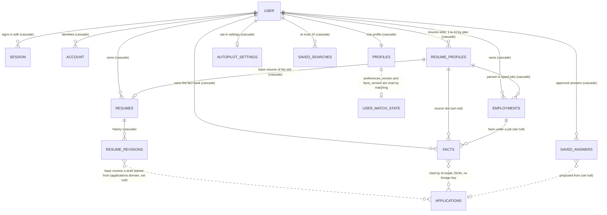
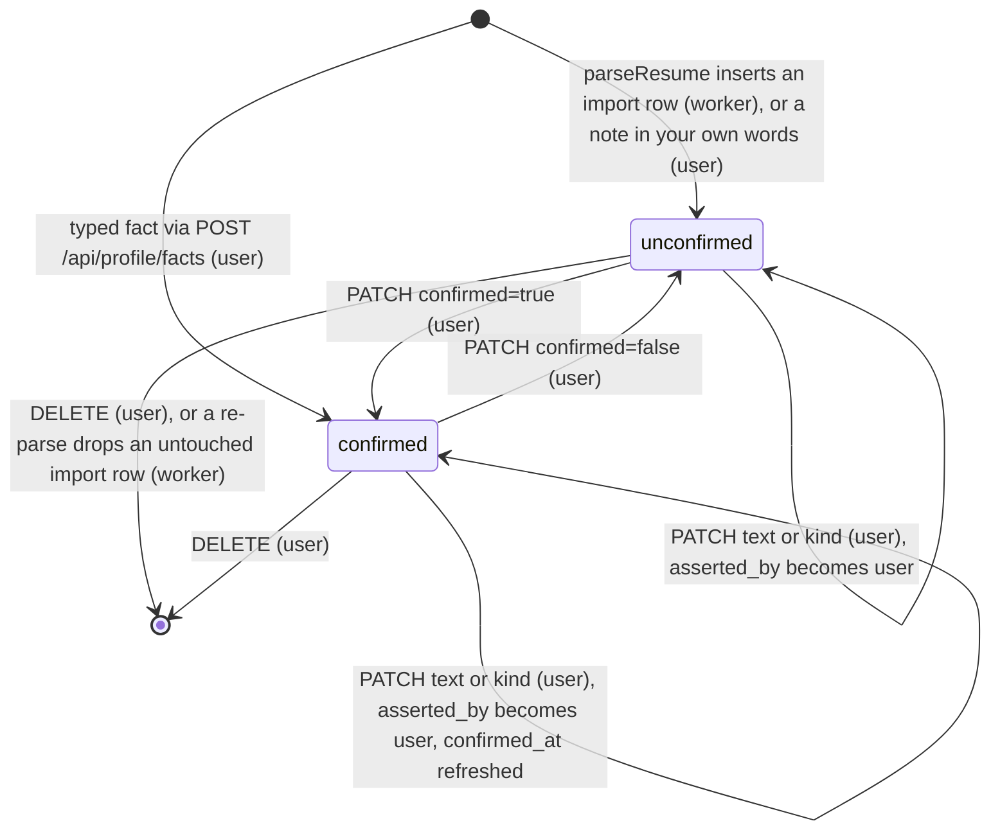
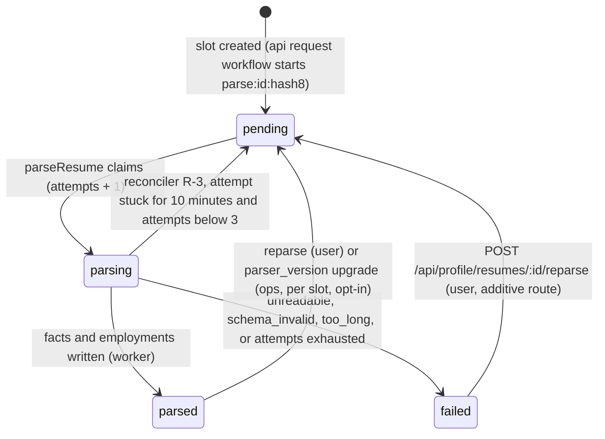
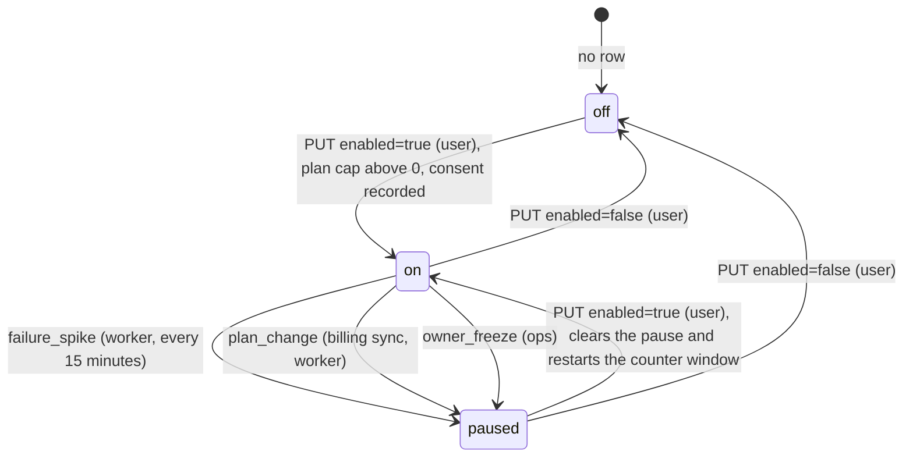

# Database design: domain `identity-profile` (Identity, profile and resume)

Status: design for implementation. Written 2026-10-23 against `01-architecture.md` revision 2 (ADR-001, postgres-durable on DBOS Transact, Anthropic agents), `server/src/db/schema/*.ts`, `server/drizzle/0000_init.sql`, `0001_resume_workspace.sql`, `docs/05-backend-schema.md`, `_research/requirements.md`, `_research/huntr-tsenta-teardown.md` (section 5, F1 to F11), `docs/superpowers/specs/2026-10-23-resume-workspace/README.md` (sections 3, 6, 7 and 8) and the zod schemas at the end of `shared/src/schemas.ts`. The sibling domain files `_db/billing.md` and `_db/messaging.md` were read so that cross-domain names, privileges and lock rules line up.

Postgres 18 (`postgres-ssl:18`), database `kairos`, schema `public`. Application pools go through PgBouncer in transaction mode, so nothing here relies on session state: no session advisory locks, no `SET` outside `SET LOCAL` (the provenance actor in 2.3 uses `set_config(..., true)`, which is transaction-local). Postgres features used and where they come from: `uuidv7()` (new in 18) [verify in spike S-P1 on the Railway image], `UNIQUE NULLS NOT DISTINCT` (15), `ON DELETE SET NULL`, statement triggers with transition tables (10), stored generated columns (12). Virtual generated columns (18) are not used because they cannot be indexed.

Skills applied: `database-design` (relationships, indexing, migrations; its "ask about the database" rule is answered by ADR-001, which fixes Postgres 18), `postgres-best-practices` (partial indexes, foreign-key indexes, constraint-first design, short lock windows, connection discipline) and `drizzle-orm-expert` (schema per domain file, `InferSelectModel` types, generated migrations plus custom SQL for triggers). All three loaded. No web research was needed.

Evidence tags used below: **[V]** verified against the repository files named above; **[est]** an estimate to be replaced by beta measurements; **[verify]** a behavior that a named spike must prove before the phase that depends on it (S-B1 is the Better Auth spike, S-P1 the Postgres 18 and PITR spike).

## 0. Scope, and what this document changes in the architecture

This document owns thirteen tables: the four Better Auth tables `user`, `session`, `account`, `verification`, and `profiles`, `resume_profiles`, `employments`, `facts`, `saved_answers`, `resumes`, `resume_revisions`, `autopilot_settings`, `saved_searches`. Other domains are designed in parallel; every cross-domain name is exactly the architect's inventory name (`applications`, `credit_balances`, `credit_ledger`, `subscriptions`, `user_match_state`, `jobs`, `matches`, `inbound_emails`, `email_sends`, `notifications`, `action_tokens`, `deletion_tasks`, `ops_flags`, `ai_usage`, `user_daily_usage`, `rate_limits`, `application_events`).

Invariants this domain must make true in the database, not only in code:

| Invariant | Mechanism (section) |
|---|---|
| Truth lock layer 1: a citable fact exists, belongs to the user and is `confirmed` (INV-2, D-03) | `facts.confirmed` and `facts.confirmed_at` kept equal by a `CHECK` and a trigger; a fact owned by another user cannot be linked to an employment or resume slot (3.8, 5.2 to 5.4) |
| A fact becomes confirmed only through a user action, never as a side effect of an edit, a parse or a worker (D-05, D-06; B.8.2 "a `model` fact can become confirmed only through a user action") | Trigger `facts_guard` plus the transaction-local actor `kairos.actor` (2.3, 5.3). Imported and model facts cannot be inserted confirmed. Editing an unconfirmed fact never confirms it |
| Provenance (F3): every fact and employment records who asserted its current text | `asserted_by` `CHECK` (`user`, `import`, `model`); a text edit forces `user` (3.7, 3.8, 5.3) |
| A re-parse never destroys user work and never duplicates facts (D-06) | Unique `(resume_profile_id, source_span_hash)` on `facts` and `(resume_profile_id, import_key)` on `employments`; re-parse is `INSERT ... ON CONFLICT DO NOTHING` plus a delete limited to unconfirmed imported rows (3.7, 3.8, 4.3) |
| Revisioned base-resume edits and a snapshot before any AI run (F4) | `snapshot_resume()` and `ensure_resume_revision()`; `document_hash` generated column; pruning that never deletes a revision a live application started from (3.11, 5.6) |
| One base resume per (user, resume slot); one default resume profile per user | `resumes_user_slot_uq` (`NULLS NOT DISTINCT`) and `resume_profiles_one_default_uq` (3.6, 3.10) |
| Plan limit on resume profiles (1, 1, 3, 10) cannot be beaten by two concurrent uploads | Per-user serialization on the `profiles` row (2.2); the limit value comes only from `shared/src/plans.ts` |
| Saved answers never hold answers to sensitive questions, so a model never sees one (INV-9, INV-15) | `CHECK` calling `is_sensitive_question_text()` on `question_key` and `label` (3.9) |
| Autopilot is opt-in per user, records the consent it was enabled under, and pauses are explained (decision of 2026-10-23) | `CHECK` constraints on `autopilot_settings` and a state machine (3.12, 4.5) |
| Forwarding address is the only inbound mail key, lower case, never changed silently (INV-6) | `CHECK` plus immutability guard in `profiles_guard` (3.5, 5.4) |
| Preferences the fit gate reads are well formed (INV-1: threshold 50 to 95, cap 1 to 5, sponsorship enum) | `preferences_valid()` in a `CHECK`; version counters bumped by trigger so matching sees every change (3.5, 5.4) |
| Case-variant duplicate accounts and duplicate external identities cannot exist | Unique `lower(email)`; unique `(provider_id, account_id)`; one credential account per user (3.1, 3.3) |
| Account erasure reaches every row here (DPDP, GDPR; FR-6) | Every table has `ON DELETE CASCADE` from `"user"` directly or through its parent, and an index that starts with the foreign-key column so a cascade is an index scan (section 3, test T-14) |
| No employer passwords, no mailbox credentials (INV-6) | No such column exists anywhere in this domain; `account.password` is the user's own Kairos password hash and `account` holds no mailbox token because no mail scope is ever requested (3.3) |

### 0.1 Deviations from, and additions to, `01-architecture.md` (B.8.2, B.10.2, B.10.5)

The architect's DDL is the starting point. These are the points where this document differs, each with its reason, so the architect can reconcile the final text.

| # | Architect text | This document | Reason |
|---|---|---|---|
| D1 | `facts.resume_profile_id` keeps its `ON DELETE CASCADE` (B.10.2 changes no foreign key) | `ON DELETE SET NULL`. A new resume-slot delete routine removes the slot's `resumes` row, `employments` and unconfirmed imported facts, and leaves confirmed facts in the user's fact bank | A confirmed fact can be cited by a submitted application's lines and by other slots' documents. Cascading it away silently breaks citations (the nightly citation check would page) and destroys the user's attested statements. No route deletes a resume profile today, so nothing changes for the frozen clients |
| D2 | B.6.13: "an owner edit of `text` confirms that text" | Editing the text of an **unconfirmed** fact leaves it unconfirmed; editing a **confirmed** fact keeps it confirmed with a fresh `confirmed_at` and sets `asserted_by = 'user'`. `confirmed` changes only when the body says so | D-05 is exactly "an edit silently confirms". The frozen web (`updateFact`) sends `{text}` and `{confirmed}` separately. A confirmed fact that is edited is re-attested by the user who typed it, and the new `confirmed_at` makes every cited draft's `facts_snapshot_hash` change, so drafts re-verify |
| D3 | `employments` columns as listed | Adds `updated_at`, `import_key` (re-parse identity), a stricter `YYYY-MM` check, `CHECK` rules for dates and `is_current`, a same-owner trigger and a trigger-enforced provenance guard like `facts` | Re-parse idempotence (D-06) needs a natural key; month `13` must not pass `\d{2}` |
| D4 | `resume_revisions.reason` in (`save`, `pre_ai`, `pre_autopilot`, `restore`, `import`) | Adds `fact_change`; adds generated `document_hash`; defines revision semantics (a revision is the document as it was **before** a change, see 3.11) and two SQL functions that implement the 10-minute rule and pruning | The skeleton's `PUT /api/resume` stores the **new** document as a revision; the architecture's rule ("a revision of the previous document") is the one implemented here, and 8.3 migrates the meaning. `fact_change` records the system edit that strips citations when a fact is unconfirmed or deleted |
| D5 | `profiles` gains five columns | Adds `preferences_version`, `facts_version`, `notify_weekly_report`, `notify_autopilot_summary`, `notify_reminders`. `user_match_state.prefs_version` and `.facts_version` (B.7.3) become "the version matching last processed"; the authoritative counters live on `profiles` and are bumped by triggers | A counter bumped in application code is forgotten on the third write path. The opt-out columns answer messaging's open question 3 (non-transactional mail needs a preference) |
| D6 | `autopilot_settings` as drawn | Adds `enabled_at`, `consent_version`, `counter_reset_at`, `created_at` and six `CHECK` rules | Opt-in must be provable (when, under which disclosure); B.6.3 says the failure-counter window restarts when a paused user turns Autopilot back on, which needs a stored timestamp |
| D7 | `saved_searches` as drawn | Adds `next_digest_at`, `updated_at`, a per-user limit of 10 enforced by a trigger, a case-insensitive unique name, `filters` validation and `next_digest_at()` | The hourly digest scheduler becomes an indexed range scan instead of a time-zone computation per row; the limit of 10 cannot be beaten by a race |
| D8 | `resume_profiles` gains `source_text_enc`, `source_hash` | Also `source_kind`, `parse_status`, `parse_attempts`, `parse_error`, `parser_version`, `parsed_at`, `updated_at`; `source_text` becomes nullable; at most one default per user | A state machine for parsing is needed by the `parseResume` workflow, the stuck-parse reconciler and the onboarding screen |
| D9 | Better Auth tables unchanged | Adds a case-insensitive unique email index, a unique `(provider_id, account_id)`, one credential account per user, a session index that serves the eligibility query, and sweepers for expired sessions and verifications | Better Auth enforces none of these in the database; two of them are the standard account-takeover and duplicate-identity guards |
| D10 | `gen_random_uuid()` everywhere | `uuidv7()` as the default for `facts`, `employments`, `resume_revisions`, `saved_searches` (same choice as `_db/billing.md` D2) | Time-ordered keys keep write-heavy indexes dense; existing v4 rows stay |
| D11 | `UNIQUE (user_id, resume_profile_id)` "when multiple slots ship" | Added now as `UNIQUE NULLS NOT DISTINCT`; `resumes_user_uq` stays until slots ship; `resumes.resume_profile_id` becomes `ON DELETE CASCADE` | The composite is implied by the old index, so adding it early is free and lets code switch ahead of the contract release |
| D12 | `saved_answers` unchanged | Adds `proposed_by`, `approved_at`, `source_application_id`, `updated_at`, length checks and the sensitive-question backstop | Answer memory proposes answers "after a submit, for the user to approve" (`plans.ts` `answerMemory`); the table needs to say who proposed and when it was approved |
| D13 | Not specified | The transaction-local actor `kairos.actor` and the provenance guard | Makes "a model fact becomes confirmed only through a user action" a database rule |
| D14 | `facts_snapshot_hash` described as "sha256 of sorted (id, text, confirmed_at)" | One SQL function, `facts_snapshot_hash(user_id, fact_ids)`, defined here with a precise, time-zone-independent serialization; TypeScript calls the function instead of re-implementing it | Two implementations of a hash drift. The approval-time `facts_changed` check depends on it |

## 1. Domain map



The write paths, in one place (single-writer rule: each table has exactly one TypeScript module that writes it, which is what makes the privilege matrix in 2.5 and the lint rule of B.2 meaningful; owning modules are `identity`, `profile` and `resume` per B.10.1):

| Table | Writer module (`server/src/modules/`) | Called from |
|---|---|---|
| `user`, `session`, `account`, `verification` | Better Auth through `identity/auth.ts` (the Drizzle adapter), plus `identity/sweepers.ts` for expiry and unverified-account purge | api (auth routes), worker (`housekeeping`) |
| `profiles` | `profile/profiles.ts`. Narrow writes by others go through its exports: `setApplicationsPaused()` (billing), `setForwardingState()` (messaging) | api routes, sign-up body, worker |
| `resume_profiles` | `profile/resume-profiles.ts` | `POST /api/profile/resumes`, upload route, `parseResume`, slot delete routine |
| `employments`, `facts` | `profile/facts.ts` and `profile/employments.ts`; `parseResume` writes through them | `/api/profile/facts*`, `POST /api/resume/suggestions` (note fact), `parseResume`, slot delete |
| `saved_answers` | `profile/saved-answers.ts` | `/api/profile/answers*`, answer-memory proposal after a submit (worker) |
| `resumes`, `resume_revisions` | `resume/resumes.ts` only | `GET` and `PUT /api/resume`, revision routes, suggestions and tailor (snapshots), prepare (`ensure_resume_revision`), fact-change routine |
| `autopilot_settings` | `profile/autopilot-settings.ts`; the applications module calls its exports (`setAutopilot`, `pauseAutopilot`) | `PUT /api/autopilot`, `submission-health` schedule, billing sync (`plan_change`) |
| `saved_searches` | `profile/saved-searches.ts`; the matching module's `digests` schedule calls `claimDueDigests()` | `/api/saved-searches*`, onboarding, `digests` schedule |

## 2. Cross-cutting rules for this domain

### 2.1 Conventions

- Primary keys: Better Auth tables keep their `text` ids (generated by Better Auth). `profiles` and `autopilot_settings` use `user_id text` as the key (one row per user). Every other table uses `uuid`; new defaults are `uuidv7()`, existing defaults stay `gen_random_uuid()` except where D10 changes them.
- All timestamps are `timestamptz`. `now()` inside triggers is the transaction start time, which is intended.
- New lifecycle columns are `text` with a named `CHECK` (the same choice as `_db/billing.md` and `_db/messaging.md`): adding a value is a `NOT VALID` plus `VALIDATE` pair, never an `ALTER TYPE`. The one Postgres enum used here is the existing, shared `fact_kind` (`role`, `project`, `skill`, `metric`, `education`, `certification`), which the frozen web app reads and which does not change.
- Validation duplicated from `shared/` (preferences shape, saved-search filters) lives in small `IMMUTABLE` SQL functions (5.1). A contract test feeds 200 generated fixtures to both the zod schema and the function and asserts they agree; a change to the zod schema ships with a `CREATE OR REPLACE FUNCTION` in the same pull request.
- Every constraint that guards existing data is added `NOT VALID` and then `VALIDATE`d (M5) after the preflight of 8.3 has asserted that the data is clean. The `ALTER TABLE ... ADD CONSTRAINT` blocks in section 3 show the constraint bodies; the migration appends `NOT VALID` to each of them (8.4). Tables here are small before the paid beta (under 100,000 rows each), so plain `CREATE INDEX` inside the migration is acceptable; any index added once `facts` or `resume_revisions` exceeds 1 million rows must use `CREATE INDEX CONCURRENTLY` in its own migration file applied by `migrate.ts` outside a transaction, as B.10 already requires for `jobs`.
- Row-level security is not used. Queries filter by the session user id (INV-11); the database adds defense in depth through foreign keys with same-owner triggers (2.2) rather than RLS, because RLS needs a per-request `SET LOCAL` on pooled connections and every worker query crosses users by design.

### 2.2 Per-user serialization and lock order

The architect's global lock order (B.6.4) is: (1) `credit_balances` row, (2) `applications` rows ordered by `id`, (3) `submission_attempts`. `_db/billing.md` extends it as rule L1: any transaction that can move an application into or out of `{approved, submitting}` takes the balance lock first. This domain adds two rules.

Rule I1, identity-local order. A transaction that touches more than one table of this domain locks in this order: `profiles` row, `resume_profiles` rows, `resumes` row, `resume_revisions`, `employments`, `facts`, `saved_answers`, `saved_searches`, `autopilot_settings`. `profiles` is the per-user serialization point for: creating a resume slot (count against the plan limit, then insert), creating a saved search (the 10-search limit, enforced inside the insert trigger), changing the time zone, and the slot delete routine. The lock is `SELECT 1 FROM profiles WHERE user_id = $1 FOR NO KEY UPDATE`; no table has a foreign key to `profiles`, so this never blocks a foreign-key check.

Rule I2 (5.3): every transaction that writes `facts` or `employments` takes the same `profiles` lock first, because the statement triggers that bump `profiles.facts_version` would otherwise take it last and deadlock with a slot routine. Rule I3 (3.10): `PUT /api/resume` takes the `profiles` lock first as well, because its contact write-back updates `profiles`.

Rule A1, Autopilot writers. Any transaction that sets `autopilot_settings.enabled = false` or sets `paused_at` first locks `credit_balances` (billing rule L1), then updates `autopilot_settings`, then returns the user's not-yet-claimed Autopilot approvals to `draft`. Because `approveCore` holds the balance lock while it reads the settings row (B.6.3, "approveCore checks `enabled` under the balance lock"), an approval either committed before the off switch (and the off switch then returns it to `draft`) or sees the new value. Turning Autopilot **on** does not need the balance lock. The order is therefore: `credit_balances`, `autopilot_settings`, `applications`. It does not conflict with rule I1 because no transaction takes `profiles` before `credit_balances` and then the reverse: the Autopilot writers never lock `profiles`.

Same-owner references. Four foreign keys cross a tenant boundary if a bug passes the wrong id: `facts.resume_profile_id`, `facts.employment_id`, `employments.resume_profile_id`, `resumes.resume_profile_id`. A composite foreign key `(id, user_id)` would be the textbook fix, but `ON DELETE SET NULL` on a composite key would null the `NOT NULL` `user_id` as well (a column list for `SET NULL` exists since Postgres 15, but Drizzle cannot express it). The domain uses plain foreign keys plus one generic trigger function, `assert_same_owner()` (5.2), which fires only when the reference or the owner column changes.

### 2.3 The provenance actor `kairos.actor`

The rule "a fact becomes confirmed only through a user action" is enforced in the database with a transaction-local setting:

```sql
SELECT set_config('kairos.actor', 'user', true);   -- true = local to this transaction; safe with PgBouncer transaction mode
```

Values: `user` (a request made by the signed-in owner), `ops` (an operator repair, always accompanied by an `ops_audit` row), and unset or anything else (workers, parsers, agents, sweepers). `facts_guard` (5.3) refuses, unless the actor is `user` or `ops`: confirming an unconfirmed fact, unconfirming a confirmed one, and changing the `text` or `kind` of any fact. The TypeScript helper `asActor(tx, "user")` in `server/src/modules/profile/actor.ts` is called by every user-facing write path before its first statement. Forgetting it fails closed with a `check_violation` that a test catches (T-3), never silently confirms. Account deletion and the foreign-key cascades are not updates, so they are unaffected.

Rollout order matters (section 8, M2): first ship code that sets the actor on every user path (harmless without the trigger), then migrate the trigger.

### 2.4 Encryption envelope

Columns holding raw personal content that other code never searches are encrypted at the application layer with the envelope of B.11.5, stored as `bytea` exactly as `_db/messaging.md` section 3 defines it: `keyVersion (1 byte) || nonce (12 bytes) || ciphertext || tag (16 bytes)`, AES-256-GCM, key list `DATA_KEKS` held only by api and worker. The additional authenticated data is `<table>:<row key>:<column>`: `resume_profiles:<id>:source_text` and `profiles:<user_id>:sensitive_answers`. A ciphertext copied to another row fails to decrypt. `lib/crypto.ts` owns the format; this domain stores the bytes and checks only `octet_length(col) >= 29` (version, nonce, tag, at least no plaintext).

What is **not** encrypted at the application layer, and why: `facts.text`, `facts.source_span` and `resumes.document` are read on every drafting, scoring and render call and are sent (in minimized form) to the model gateway; `profiles.preferences` (which contains the work-authorization value and the salary floor) is read by the fit gate and the SQL prefilter 288 times a day per active cohort. Railway volumes are encrypted at rest, backups follow the 28-day window of B.11.5, and `kairos_readonly` has no access to these tables (2.5). Open question Q-2 asks whether `resumes.document` should be encrypted anyway.

### 2.5 Privilege matrix (extends B.10.4)

Default privileges in the architecture grant `SELECT, INSERT, UPDATE, DELETE` on every new table to `kairos_api` and `kairos_worker`, so each migration of this domain explicitly revokes. Final state, asserted by the grant test (T-12):

| Table | `kairos_api` | `kairos_worker` | `kairos_applier` | `kairos_readonly` |
|---|---|---|---|---|
| `user` | `SELECT, INSERT, UPDATE, DELETE` (Better Auth) | `SELECT, DELETE` (erasure workflow, unverified purge) | none | none |
| `session` | `SELECT, INSERT, UPDATE, DELETE` | `SELECT, DELETE` (sweeper) | none | none |
| `account` | `SELECT, INSERT, UPDATE, DELETE` | `SELECT` | none | none |
| `verification` | `SELECT, INSERT, UPDATE, DELETE` | `SELECT, DELETE` (sweeper) | none | none |
| `profiles` | `SELECT, INSERT, UPDATE` | `SELECT, INSERT, UPDATE` | none | `SELECT (user_id, onboarding_step, timezone, applications_paused_at, forwarding_state, created_at)` |
| `resume_profiles` | `SELECT, INSERT, UPDATE, DELETE` | `SELECT, UPDATE` (`parseResume`) | none | `SELECT (id, user_id, name, is_default, source_kind, parse_status, created_at)` |
| `employments`, `facts` | `SELECT, INSERT, UPDATE, DELETE` | `SELECT, INSERT, UPDATE, DELETE` (parse re-run, slot delete) | none | none |
| `saved_answers` | `SELECT, INSERT, UPDATE, DELETE` | `SELECT, INSERT, UPDATE` (answer memory) | none | none |
| `resumes`, `resume_revisions` | `SELECT, INSERT, UPDATE, DELETE` | `SELECT, INSERT, UPDATE` (prepare anchors, default document) | none | none |
| `autopilot_settings` | `SELECT, INSERT, UPDATE` | `SELECT, UPDATE` (spike pause, `plan_change`) | none | `SELECT` |
| `saved_searches` | `SELECT, INSERT, UPDATE, DELETE` | `SELECT, UPDATE` (digest claim) | none | none |

The applier reaches nothing here directly; it receives the already-prepared answers, lines and PDF key through `applier_payload_v` (B.10.4). `TRUNCATE` and `REFERENCES` are never granted to a runtime role. Account-deletion cascades run with the table owner's privileges, so the narrowed `DELETE` rights do not block them. The functions of section 5 are `SECURITY INVOKER` (they run with the caller's table rights). The routines (`create_resume_slot`, `delete_resume_slot`, `snapshot_resume`, `ensure_resume_revision`, `prune_resume_revisions`, `resume_remove_facts`, `resume_dangling_citations`, `facts_snapshot_hash`) have `EXECUTE` revoked from `PUBLIC` and granted to `kairos_api` and `kairos_worker`. The pure validators of 5.1 stay executable by `PUBLIC`, because a `CHECK` that calls them must work for every role that writes the table.

### 2.6 Frozen-route compatibility

The routes below keep method, path, request shape, status codes and error codes. Response bodies may gain optional fields; they never lose or rename one.

| Route | What changes |
|---|---|
| `GET /api/profile`, `PUT /api/profile/contact`, `PUT /api/profile/preferences` | The handler selects an **explicit column list** (`publicProfile()`); today it returns the whole row, which would now include `sensitive_answers_enc`, `normalized_email_hash` and the version counters. The response keeps every field the web type `Profile` reads (`phone`, `city`, `country`, `linkedinUrl`, `githubUrl`, `portfolioUrl`, `preferences`, `onboardingStep`, `forwardingAddress`) and may add `timezone` and the three `notify*` flags. `PUT /preferences` still sets `onboardingStep` to `done`, but never moves it backwards (4.4) |
| `GET /api/profile/facts`, `POST /api/profile/facts`, `PATCH /api/profile/facts/:id`, `DELETE /api/profile/facts/:id` | Response facts gain optional `assertedBy`, `employmentId`, `confirmedAt`, `updatedAt`; `sourceSpanHash` is never returned. `PATCH` changes `confirmed` only when the raw body contains it (already true in the working copy: `factPatchSchema`); D2 defines what an edit does. `DELETE` also strips the fact's citations from the user's base resume (4.1) |
| `POST /api/profile/resumes` | Same 202 response; the source text is encrypted; the plan limit is checked under the `profiles` lock (2.2) so two concurrent uploads cannot both pass |
| `GET /api/profile/answers`, `PATCH /api/profile/answers/:id` | Responses gain `approvedAt`, `proposedBy`. The sensitive backstop in 3.9 cannot reject anything that exists today: nothing writes `saved_answers` yet (D-29) |
| `GET /api/me` | Unchanged shape; `onboardingStep` and `forwardingAddress` are read from `profiles` by primary key |
| Better Auth routes under `/api/auth/*` | Unchanged. The new indexes and checks only reject inputs that were already invalid or duplicate (3.1, 3.3) |

New routes this domain's tables need (all additive; contracts belong to `05-api.md`, listed here so the storage is complete): `DELETE /api/profile/resumes/:id` (calls `delete_resume_slot`, 5.8), `POST /api/profile/resumes/:id/reparse` (4.3), `GET` and `PUT /api/autopilot` (3.12, 4.5), `GET`, `POST`, `PATCH` and `DELETE /api/saved-searches[/:id]` (3.13), `GET /api/resume/revisions`, `POST /api/resume/revisions/:revisionId/restore` and `PATCH /api/resume/revisions/:revisionId` (name a revision), and `PATCH /api/profile/notifications` for the three `notify_*` flags (3.5). None of them is called by the frozen web or extension code.

## 3. Tables

Each table section lists: purpose; columns (`null` and `default` as in the final state); primary key; foreign keys with `ON DELETE`; unique and partial unique indexes that enforce invariants; other indexes with the query each serves; check constraints; partitioning and retention; the row-count projection at 10,000 users (the plan mix of `cost-model.md`: Free 7,500, Starter 1,300, Pro 900, Max 300; about 90% of users finish the resume step; resume slots 1, 1, 3, 10); and the writer. The Drizzle sketches are in section 10. "Final-state DDL" shows only what this migration set adds to an existing table; the complete `CREATE TABLE` is given for new tables.

### 3.1 `user` (Better Auth)

Purpose: one row per person with an account. Owned and written by Better Auth. The application never writes it directly except through Better Auth's API and the erasure workflow.

| Column | Type | Null | Default | Notes |
|---|---|---|---|---|
| `id` | `text` | no | | Primary key, generated by Better Auth. Referenced by every user-owned table in the system |
| `name` | `text` | no | | Display name |
| `email` | `text` | no | | Unique. Better Auth lower-cases it before insert [verify in S-B1 for the Google path] |
| `email_verified` | `boolean` | no | `false` | Set by the email OTP flow. Protected routes return 403 `email_unverified` while false (FR-3) |
| `image` | `text` | yes | | Avatar URL from Google sign-in. Never read by the backend and never printed on a resume |
| `created_at`, `updated_at` | `timestamptz` | no | `now()` | |

Primary key: `id`. Foreign keys: none (this is the root). Unique: `user_email_unique (email)` (kept); **new** `user_email_lower_uq` on `lower(email)`, so an address that differs only by case can never become a second account even if one code path forgets to lower-case.

Other indexes:

| Index | Query it serves |
|---|---|
| `user_unverified_created_idx (created_at) WHERE NOT email_verified` | The daily purge of abandoned sign-ups (below) and the reconciler "user rows older than 5 minutes with no `profiles` row" (B.5.8), which both start from the small set of recent or unverified users |

Checks: `user_email_len_ck CHECK (char_length(email) BETWEEN 3 AND 254)`; `user_name_len_ck CHECK (char_length(name) <= 200)`.

```sql
CREATE UNIQUE INDEX user_email_lower_uq ON "user" (lower(email));
CREATE INDEX user_unverified_created_idx ON "user" (created_at) WHERE NOT email_verified;
ALTER TABLE "user"
  ADD CONSTRAINT user_email_len_ck CHECK (char_length(email) BETWEEN 3 AND 254) NOT VALID,
  ADD CONSTRAINT user_name_len_ck  CHECK (char_length(name) <= 200) NOT VALID;
ALTER TABLE "user" VALIDATE CONSTRAINT user_email_len_ck;
ALTER TABLE "user" VALIDATE CONSTRAINT user_name_len_ck;
```

Partitioning: none (12,500 rows). Retention: the account lives until the owner deletes it. **Abandoned sign-ups** (proposal, open question Q-3): a worker schedule `unverified-purge` deletes users with `email_verified = false` and `created_at < now() - interval '14 days'` in batches of 500. Such users have no session (verification is required before a session is granted, FR-3), no upload and no subscription, so the cascade is cheap and no R2 prefix or Stripe customer needs cleanup. Without the purge, sign-up abuse leaves a profile, a subscription and a +25 free-grant ledger row per throwaway address (D-25).

```sql
DELETE FROM "user" WHERE id IN (
  SELECT id FROM "user" WHERE NOT email_verified AND created_at < now() - interval '14 days'
   ORDER BY created_at LIMIT 500);                   -- repeat until zero rows; runs as kairos_worker
```

Row-count projection: 10,000 verified users plus about 2,500 unverified rows before the purge, about 11,000 steady state; about 250 bytes a row, 3 MB with indexes. Writes: one insert per sign-up (about 100 a day in steady beta), one update per sign-in method change. Reads: every authenticated request that misses Better Auth's cookie cache (B.3) reads one `user` row by primary key.

### 3.2 `session` (Better Auth)

Purpose: one row per signed-in browser or extension (the extension holds a bearer session obtained from a one-time token, FR-5). The session id is also the extension visibility-lease key (B.6.6).

| Column | Type | Null | Default | Notes |
|---|---|---|---|---|
| `id` | `text` | no | | Primary key |
| `expires_at` | `timestamptz` | no | | 30 days from the last refresh |
| `token` | `text` | no | | Unique. The cookie and bearer secret; never logged, never returned by any route, never granted to a read-only role |
| `created_at`, `updated_at` | `timestamptz` | no | `now()` | `updated_at` moves at most once a day (`session.updateAge` = 1 day), which is what the matching eligibility rule "session seen in the last 7 days" reads |
| `ip_address`, `user_agent` | `text` | yes | | Personal data collected by Better Auth; kept only as long as the session |
| `user_id` | `text` | no | | Foreign key to `"user"(id)` `ON DELETE CASCADE` |

Primary key `id`; unique `session_token_unique (token)` (kept, serves the lookup on every request that misses the cookie cache).

Other indexes:

| Index | Query it serves |
|---|---|
| **New** `session_user_updated_idx (user_id, updated_at DESC)` | (a) Better Auth `listSessions` and revoke-all-sessions: `WHERE user_id = $1` uses the leading column. (b) `candidateTick` eligibility (B.7.1): `EXISTS (SELECT 1 FROM session s WHERE s.user_id = p.user_id AND s.updated_at > now() - interval '7 days')`, which reads one index entry per user. (c) The cascade on account deletion. It replaces `session_user_id_idx`, which is dropped in the contract step (a strict prefix of the new index) |

Checks: `session_expiry_ck CHECK (expires_at > created_at)` (added `NOT VALID`, validated).

Partitioning: none. Retention: Better Auth deletes a session it finds expired; the worker schedule `session-sweep` (in `housekeeping`, daily) removes the rest: `DELETE FROM session WHERE expires_at < now() - interval '7 days'` (a sequential scan of about 25,000 rows, so no index on `expires_at`, which would also make every daily refresh a non-HOT update).

Row-count projection: about 2.5 live sessions per active user (a browser or two plus the extension) gives about 25,000 rows, about 420 bytes each, 10 MB plus 4 MB of indexes. Writes: about 25,000 `updated_at` refreshes a day (0.3 a second) plus sign-ins.

### 3.3 `account` (Better Auth)

Purpose: one row per sign-in method of a user: the email-and-password credential (`provider_id = 'credential'`, `account_id` = the user id, `password` = the scrypt hash) or Google (`provider_id = 'google'`).

| Column | Type | Null | Default | Notes |
|---|---|---|---|---|
| `id` | `text` | no | | Primary key |
| `account_id` | `text` | no | | Provider's id for the person |
| `provider_id` | `text` | no | | `credential` or `google` |
| `user_id` | `text` | no | | Foreign key to `"user"(id)` `ON DELETE CASCADE` |
| `access_token`, `refresh_token`, `id_token` | `text` | yes | | Google OAuth tokens (see below) |
| `access_token_expires_at`, `refresh_token_expires_at` | `timestamptz` | yes | | |
| `scope` | `text` | yes | | Only `openid email profile`; no mail or contacts scope is ever requested (INV-6) |
| `password` | `text` | yes | | Better Auth's password hash. Never selected by any Kairos query |
| `created_at`, `updated_at` | `timestamptz` | no | `now()` | |

Primary key `id`. Foreign key `account_user_id_user_id_fk` to `"user"(id)` `ON DELETE CASCADE` (kept).

Unique and partial unique indexes (all **new**; Better Auth enforces none of them in the database):

| Index | Invariant |
|---|---|
| `account_provider_account_uq UNIQUE (provider_id, account_id)` | One external identity maps to exactly one Kairos user; a second sign-up with the same Google subject cannot create a second user or be linked to two |
| `account_one_credential_uq UNIQUE (user_id) WHERE provider_id = 'credential'` | At most one password per user, so a password reset has exactly one row to change |

Other indexes: `account_user_id_idx (user_id)` (kept: `getAccounts(userId)` and the deletion cascade).

Checks: `account_credential_password_ck CHECK (provider_id <> 'credential' OR password IS NOT NULL)`: a credential account without a hash would be an account that can never sign in or, worse, one that a faulty reset path could set without verification.

```sql
CREATE UNIQUE INDEX account_provider_account_uq ON account (provider_id, account_id);
CREATE UNIQUE INDEX account_one_credential_uq  ON account (user_id) WHERE provider_id = 'credential';
ALTER TABLE account ADD CONSTRAINT account_credential_password_ck
  CHECK (provider_id <> 'credential' OR password IS NOT NULL) NOT VALID;
ALTER TABLE account VALIDATE CONSTRAINT account_credential_password_ck;
```

Token handling (minimization, INV-15, B.11.5): Kairos never calls a Google API after sign-in, so the Google tokens have no later use. The preferred design is that Better Auth's `databaseHooks.account.create.before` and `.update.before` null `accessToken`, `refreshToken` and `idToken` before they are written [verify in S-B1 that the hooks can alter the data]. If S-B1 shows they cannot, the architecture's fallback applies: Better Auth's token-encryption option, or a Drizzle column wrapper that stores the B.11.5 envelope as text. Either way no DDL changes.

Partitioning: none. Retention: with the user. Row-count projection: about 10,000 credential accounts plus about 3,000 Google accounts, about 330 bytes a row without tokens (about 8 MB if Google tokens were kept). Writes: one insert per sign-up, one update per password reset or Google re-login.

### 3.4 `verification` (Better Auth)

Purpose: short-lived secrets: the 6-digit email OTPs for sign-in, email verification, password reset and email change (`storeOTP: "hashed"`), and the one-time tokens the web app mints for the extension (5 minutes).

| Column | Type | Null | Default | Notes |
|---|---|---|---|---|
| `id` | `text` | no | | Primary key |
| `identifier` | `text` | no | | For example the OTP type plus the email address, or the one-time-token key |
| `value` | `text` | no | | The hashed OTP and its attempt counter, or the token's payload |
| `expires_at` | `timestamptz` | no | | |
| `created_at`, `updated_at` | `timestamptz` | no | `now()` | |

Primary key `id`. Other indexes: `verification_identifier_idx (identifier)` (kept: every OTP check and every one-time-token verify is `WHERE identifier = $1`). No unique index on `identifier`: Better Auth plugins reuse the table with different identifier conventions, and the emailOTP plugin already deletes the previous row for an identifier before inserting a new one.

Hardening that needs no DDL but belongs to this table's contract [verify in S-B1]: configure the one-time-token plugin with hashed token storage (`storeToken: "hashed"`). By default the plugin stores a session token in `verification.value` for the 5-minute window; a database read during that window would be a session hijack. With hashing, a leak of this table yields nothing usable.

Checks: none beyond the keys (the content belongs to Better Auth).

Partitioning: none. Retention: the worker schedule `verification-sweep` (daily) deletes rows with `expires_at < now() - interval '1 day'` (the table stays under about 6,000 rows, so a sequential scan; no index on `expires_at`).

Row-count projection: at most about 6,000 live rows; about 200 bytes each, 1.2 MB. Writes: about 3 per new user plus one per sign-in OTP and extension connect, a few hundred a day.

### 3.5 `profiles`

Purpose: one row per user: contact details for application forms, the fit preferences the gate enforces before any model call, the onboarding step, the forwarding address that is the only inbound-mail key, the billing pause flag, the time zone for digests, opt-outs for non-transactional email, the encrypted sensitive-answer table and two version counters that tell matching when to recompute.

| Column | Type | Null | Default | Notes |
|---|---|---|---|---|
| `user_id` | `text` | no | | Primary key and foreign key to `"user"(id)` `ON DELETE CASCADE` |
| `phone` | `text` | yes | | At most 40 characters |
| `city`, `country` | `text` | yes | | At most 120 characters each. `country` is unused by any reader today (D-29) and is kept because the resume contact write-back composes `location` from them |
| `linkedin_url`, `github_url`, `portfolio_url` | `text` | yes | | `http` or `https` only, no whitespace, at most 300 characters. LinkedIn is printed as text; it is never visited by any Kairos code (INV-6) |
| `preferences` | `jsonb` | yes | | `Preferences` of `shared/` (roles, seniority, locations, remoteOk, workAuthorization, salaryFloorUsd, excluded lists, fitThreshold, per-company cap). Null until onboarding step 3. Validated by `preferences_valid()` |
| `onboarding_step` | `text` | no | `'resume'` | `resume`, `confirm-facts`, `done`. Forward-only (4.4) |
| `forwarding_address` | `text` | no | | Unique, lower case, `u-<id8>-<hex8>@replies.kairos.app`. Lookup key of the Postmark webhook |
| `forwarding_state` | `text` | no | `'not_started'` | State machine owned by `_db/messaging.md` section 6.1 (`not_started`, `awaiting_verification`, `verified_pending_first_mail`, `active`, `stale`); the column and its `CHECK` are created here |
| `applications_paused_at` | `timestamptz` | yes | | Set by the offer-pause executor, cleared by the subscription sync (`_db/billing.md` 4.1, 4.5). `approveCore` skips with `paused` while set |
| `normalized_email_hash` | `text` | yes | | HMAC-SHA256 (key `LINK_SIGNING_KEY`) of the normalized address (lower case, `+tag` removed, Gmail dots removed), 64 lower-case hex characters. Used only to find other accounts of the same person for the Free-grant abuse rule (D-25) |
| `sensitive_answers_enc` | `bytea` | yes | | B.11.5 envelope (2.4) over a versioned JSON document of the profile-only answers (EEO, disability, veteran, visa, salary) that fill sensitive form fields. Never sent to a model. Decrypted only inside the prepare step that fills the fixed table (FR-24) |
| `timezone` | `text` | no | `'UTC'` | IANA name, validated by `profiles_guard` (5.4). Drives the 08:00 digest (3.13) |
| `preferences_version` | `integer` | no | `0` | Bumped by `profiles_guard` whenever `preferences` changes. Matching compares it with `user_match_state.prefs_version` (what it last processed) and runs backfill when they differ |
| `facts_version` | `integer` | no | `0` | Bumped by the statement triggers on `facts` (5.3) whenever the set or content of **confirmed** facts changes |
| `notify_weekly_report` | `boolean` | no | `true` | Weekly outcome report email (FR-52). Transactional mail (receipts, resend offers, billing, security) is never suppressible |
| `notify_autopilot_summary` | `boolean` | no | `true` | The hourly Autopilot summary email; the in-app notification row is always written |
| `notify_reminders` | `boolean` | no | `true` | F5 no-reply and ageing-saved-job nudges inside the digest |
| `created_at`, `updated_at` | `timestamptz` | no | `now()` | `updated_at` is set by the application on user-visible edits; trigger-driven version bumps do not touch it |

Primary key `user_id`. Foreign key: `profiles_user_id_user_id_fk` to `"user"(id)` `ON DELETE CASCADE` (kept).

Unique and partial unique indexes: `profiles_forwarding_address_unique (forwarding_address)` (kept; serves the webhook lookup, about 8,000 a day at growth, and enforces that two users never share a mailbox key).

Other indexes:

| Index | Query it serves |
|---|---|
| `profiles_normalized_email_idx (normalized_email_hash) WHERE normalized_email_hash IS NOT NULL` | Free-plan approval check (B.6.4 `free_grant_used`): "is there another user with this hash who has a submitted Free application", one equality probe per Free approval, then a join to `applications` by `user_id` |

No index on `onboarding_step`, `applications_paused_at` or `preferences`: every reader reaches the row by primary key or scans the whole 12,500-row table at most once per candidate tick, which the planner does faster than an index would.

Checks (all added `NOT VALID`, then validated):

```sql
ALTER TABLE profiles
  ADD CONSTRAINT profiles_onboarding_step_ck   CHECK (onboarding_step IN ('resume','confirm-facts','done')),
  ADD CONSTRAINT profiles_forwarding_address_ck CHECK (forwarding_address = lower(forwarding_address)
                                                  AND forwarding_address ~ '^[a-z0-9._+-]+@[a-z0-9.-]+\.[a-z]{2,}$'),
  ADD CONSTRAINT profiles_forwarding_state_ck  CHECK (forwarding_state IN
                    ('not_started','awaiting_verification','verified_pending_first_mail','active','stale')),
  ADD CONSTRAINT profiles_lengths_ck           CHECK (char_length(phone) <= 40 AND char_length(city) <= 120 AND char_length(country) <= 120),
  ADD CONSTRAINT profiles_urls_ck              CHECK (
        linkedin_url  ~* '^https?://[^[:space:]]+$' AND char_length(linkedin_url)  <= 300
    AND github_url    ~* '^https?://[^[:space:]]+$' AND char_length(github_url)    <= 300
    AND portfolio_url ~* '^https?://[^[:space:]]+$' AND char_length(portfolio_url) <= 300),
  ADD CONSTRAINT profiles_email_hash_ck        CHECK (normalized_email_hash ~ '^[0-9a-f]{64}$'),
  ADD CONSTRAINT profiles_sensitive_enc_ck     CHECK (octet_length(sensitive_answers_enc) >= 29),
  ADD CONSTRAINT profiles_preferences_ck       CHECK (preferences IS NULL OR preferences_valid(preferences)),
  ADD CONSTRAINT profiles_versions_ck          CHECK (preferences_version >= 0 AND facts_version >= 0);
-- A CHECK passes when its expression is NULL, so each nullable column above needs no IS NULL guard.
```

The URL check is a security backstop, not a style rule: zod's `z.url()` accepts any scheme, including `javascript:`, and these three values are printed into the user's PDF and shown as links in the web app. The resume document's own `contact.links` may hold scheme-less text (the web contract allows any string up to 300 characters); the write-back to these columns normalizes a bare host such as `linkedin.com/in/x` to `https://linkedin.com/in/x` and ignores anything that is not http or https. The PDF renderer prints links as plain text and creates a hyperlink only for an `https` URL.

Triggers (section 5.4): `profiles_guard` (BEFORE UPDATE: forward-only onboarding, time-zone validation, version bump, immutable forwarding address); `profiles_timezone_digest` (AFTER UPDATE OF `timezone`: recompute `saved_searches.next_digest_at`).

Sign-up body (Better Auth `databaseHooks.user.create.after`, one transaction with the subscription and the free grant of the billing domain; idempotent so the "sign-up without profile" reconciler and a lazy `ensureProfile()` in `requireAuth` can call the same code):

```sql
INSERT INTO profiles (user_id, forwarding_address, normalized_email_hash)
VALUES ($1, $2, $3)
ON CONFLICT (user_id) DO NOTHING;
-- A 23505 on profiles_forwarding_address_unique means the random suffix collided: retry with a new suffix, at most 5 times.
```

Partitioning: none. Retention: with the account. `sensitive_answers_enc` is blanked with the account only; the copies of sensitive values inside `applications.answers` are blanked 7 days after a terminal state by the applications domain (B.10.6).

Row-count projection: about 12,500 rows (one per user, including unverified until the purge), about 1.2 KB a row because `preferences` is about 600 bytes of JSON, about 15 MB plus 3 MB of indexes. Writes: `facts_version` bumps (about 5,000 a day), preferences saves (about 300 a day), onboarding steps, contact edits, pause flags. Reads: every `GET /api/me`, every candidate tick for eligible users (about 2,850 a day on average, in pages of 100), every inbound-email webhook.

### 3.6 `resume_profiles`

Purpose: one row per **resume slot** (plans allow 1, 1, 3 and 10). A slot holds the user's source resume (pasted text, or the text extracted from an uploaded PDF, DOCX or LinkedIn profile PDF), the parse state of that source, and is the parent of the slot's employments, facts and base resume.

| Column | Type | Null | Default | Notes |
|---|---|---|---|---|
| `id` | `uuid` | no | `gen_random_uuid()` | Primary key |
| `user_id` | `text` | no | | Foreign key to `"user"(id)` `ON DELETE CASCADE` |
| `name` | `text` | no | | 1 to 80 characters after trimming |
| `is_default` | `boolean` | no | `false` | The slot `GET /api/resume` serves; the first slot is the default |
| `source_text` | `text` | **yes** (was no) | | Legacy plaintext of the source. Dual-written during the encryption rollout, set to null in the contract release M6, dropped one release later (section 8) |
| `source_text_enc` | `bytea` | yes | | B.11.5 envelope (2.4) of the source text; AAD `resume_profiles:<id>:source_text`. `STORAGE EXTERNAL` because ciphertext does not compress |
| `source_hash` | `text` | yes | | sha256 (hex) of the normalized source text. Gives the `parseResume` workflow its id `parse:<id>:<first 8 characters>` and lets the UI say "same resume as before" |
| `source_kind` | `text` | no | `'paste'` | `paste`, `upload_pdf`, `upload_docx`, `linkedin_pdf` |
| `file_key` | `text` | yes | | R2 key of the encrypted upload, `uploads/<user_id>/<id>.<ext>`. Written by the upload route (FR-8). The prefix is enforced by a check so a key can never point into another user's prefix |
| `parse_status` | `text` | no | `'pending'` | State machine in 4.3 |
| `parse_attempts` | `smallint` | no | `0` | Claims of the parse step; the workflow gives up (`failed`) after 3 |
| `parse_error` | `text` | yes | | A short code such as `unreadable`, `schema_invalid`, `too_long`; never a message or any resume text (B.5.6) |
| `parser_version` | `smallint` | yes | | Version of the `resume-parser` prompt that produced the current facts |
| `parsed_at` | `timestamptz` | yes | | Time of the last successful parse |
| `created_at`, `updated_at` | `timestamptz` | no | `now()` | |

Primary key `id`. Foreign key `resume_profiles_user_id_user_id_fk` to `"user"(id)` `ON DELETE CASCADE` (kept).

Unique and partial unique indexes:

| Index | Invariant |
|---|---|
| **New** `resume_profiles_one_default_uq UNIQUE (user_id) WHERE is_default` | At most one default slot per user. The skeleton relies on the application setting `is_default` only for the first slot; two racing first uploads could both be default |

Other indexes:

| Index | Query it serves |
|---|---|
| `resume_profiles_user_idx (user_id)` (kept) | Plan-limit count and slot list: `WHERE user_id = $1` (at most 10 rows); the cascade on account deletion |
| **New** `resume_profiles_parse_pending_idx (updated_at) WHERE parse_status IN ('pending','parsing')` | The stuck-parse reconciler (section 6, R-3): rows older than 10 minutes in a non-terminal parse state. The index holds a row only while a parse is in flight, so it stays at a few entries |

Checks:

```sql
ALTER TABLE resume_profiles
  ADD CONSTRAINT resume_profiles_name_ck        CHECK (char_length(btrim(name)) BETWEEN 1 AND 80),
  ADD CONSTRAINT resume_profiles_source_ck      CHECK (source_text IS NOT NULL OR source_text_enc IS NOT NULL),
  ADD CONSTRAINT resume_profiles_source_len_ck  CHECK (char_length(source_text) <= 60000),
  ADD CONSTRAINT resume_profiles_enc_ck         CHECK (octet_length(source_text_enc) >= 29),
  ADD CONSTRAINT resume_profiles_hash_ck        CHECK (source_hash ~ '^[0-9a-f]{64}$'),
  ADD CONSTRAINT resume_profiles_kind_ck        CHECK (source_kind IN ('paste','upload_pdf','upload_docx','linkedin_pdf')),
  ADD CONSTRAINT resume_profiles_file_key_ck    CHECK (starts_with(file_key, 'uploads/' || user_id || '/')),
  ADD CONSTRAINT resume_profiles_parse_status_ck CHECK (parse_status IN ('pending','parsing','parsed','failed')),
  ADD CONSTRAINT resume_profiles_parse_error_ck CHECK (parse_error ~ '^[a-z0-9_]{1,40}$'),
  ADD CONSTRAINT resume_profiles_parse_shape_ck CHECK ((parse_status <> 'failed' OR parse_error IS NOT NULL)
                                                  AND (parse_status <> 'parsed' OR parsed_at IS NOT NULL));
ALTER TABLE resume_profiles ALTER COLUMN source_text DROP NOT NULL;
ALTER TABLE resume_profiles ALTER COLUMN source_text_enc SET STORAGE EXTERNAL;
```

The 60,000-character cap is the paste limit of FR-7. Uploads are capped at 40,000 characters of extracted text by the parser (B.11.5), which is below it.

Write rules the database cannot express: the plan limit (`getPlan(plan).resumeProfiles`) is checked in `profile/resume-profiles.ts` inside the transaction that holds the `profiles` row lock (rule I1), so two concurrent `POST /api/profile/resumes` serialize and the second sees the first's row. The insert is followed in the same request workflow by the deterministic `parseResume` start (B.5.4). Deleting a slot is a routine, not a bare `DELETE` (D1): it runs under the `profiles` lock, deletes the slot's `resumes` row (revisions cascade), its employments and its **unconfirmed imported** facts, leaves confirmed facts in the fact bank with `resume_profile_id` set to null by the foreign key, promotes the oldest remaining slot to default when the default was deleted, and deletes the R2 object under `file_key`.

Partitioning: none. Retention: with the account or until the owner deletes the slot; R2 uploads under `uploads/<user_id>/` are deleted by the erasure workflow (NFR-24).

Row-count projection: about 10,100 rows (7,920 single-slot users, 810 Pro users at about 1.7 slots, 270 Max users at about 3 slots). The source averages about 5 KB (maximum 60 KB), so about 54 MB of TOASTed ciphertext, double while plaintext and ciphertext coexist (to M6). Writes: one insert per upload, three updates per parse (claim, result, onboarding), so a few hundred a day. Reads: the parse step, and the slot list on the Profile screen.

### 3.7 `employments`

Purpose (F3): one row per job (or project role) in a resume slot. The builder's Experience entries are employments with the facts linked to them; entry headings come from here. An employment records who asserted it and whether the user has confirmed it, the same way a fact does. An employment is **not** citable by a resume line (lines cite facts); confirming an employment does not confirm its facts.

```sql
CREATE TABLE employments (
  id                uuid        PRIMARY KEY DEFAULT uuidv7(),
  user_id           text        NOT NULL REFERENCES "user"(id) ON DELETE CASCADE,
  resume_profile_id uuid        REFERENCES resume_profiles(id) ON DELETE CASCADE,
  title             text        NOT NULL,
  company           text        NOT NULL,
  location          text,
  start_month       text,                                  -- 'YYYY-MM'
  end_month         text,                                  -- null while current
  is_current        boolean     NOT NULL DEFAULT false,
  asserted_by       text        NOT NULL DEFAULT 'import',
  confirmed         boolean     NOT NULL DEFAULT false,
  confirmed_at      timestamptz,
  import_key        text,                                  -- sha256 of normalized title|company|start_month, set by the parse step
  created_at        timestamptz NOT NULL DEFAULT now(),
  updated_at        timestamptz NOT NULL DEFAULT now(),
  CONSTRAINT employments_title_ck        CHECK (char_length(btrim(title))   BETWEEN 1 AND 200),
  CONSTRAINT employments_company_ck      CHECK (char_length(btrim(company)) BETWEEN 1 AND 200),
  CONSTRAINT employments_location_ck     CHECK (char_length(location) <= 120),
  CONSTRAINT employments_start_month_ck  CHECK (start_month ~ '^\d{4}-(0[1-9]|1[0-2])$'),
  CONSTRAINT employments_end_month_ck    CHECK (end_month   ~ '^\d{4}-(0[1-9]|1[0-2])$'),
  CONSTRAINT employments_dates_ck        CHECK (start_month IS NULL OR end_month IS NULL OR start_month <= end_month),
  CONSTRAINT employments_current_ck      CHECK (NOT is_current OR end_month IS NULL),
  CONSTRAINT employments_asserted_by_ck  CHECK (asserted_by IN ('user','import','model')),
  CONSTRAINT employments_confirmed_at_ck CHECK (confirmed = (confirmed_at IS NOT NULL)),
  CONSTRAINT employments_import_key_ck   CHECK (import_key ~ '^[0-9a-f]{64}$')
);
CREATE UNIQUE INDEX employments_import_uq ON employments (resume_profile_id, import_key);
CREATE INDEX        employments_user_idx  ON employments (user_id);
```

Foreign keys: `user_id` to `"user"(id)` `ON DELETE CASCADE`; `resume_profile_id` to `resume_profiles(id)` `ON DELETE CASCADE` (facts under it survive with `employment_id` set to null, see 3.8). The column is nullable as in B.10.5 so a typed employment that belongs to no slot is possible, but every builder and parser path sets it.

Unique indexes: `employments_import_uq (resume_profile_id, import_key)`. Rows without an `import_key` (typed by the user) never conflict because nulls are distinct. A re-parse inserts `ON CONFLICT (resume_profile_id, import_key) DO NOTHING` and looks the ids up again, so a second parse never duplicates a job and never touches an employment the user edited.

Other indexes: `employments_user_idx (user_id)`: the cascade on account deletion and the account-wide listing. The slot's employments are read through the unique index (its leading column is `resume_profile_id`) and sorted in memory; there are about 4 per slot, so an ordering index would cost more than it saves.

Triggers: `employments_guard` (BEFORE INSERT OR UPDATE: provenance rules like `facts_guard`, 5.3); `employments_owner_profile` (`assert_same_owner('resume_profiles', 'resume_profile_id')`, 5.2).

Partitioning: none. Retention: with the slot or account. Row-count projection: about 42,400 rows, about 200 bytes each, 8.5 MB plus 6 MB of indexes. Writes: a parse inserts about 4 rows; builder edits touch a few rows a day per active user.

### 3.8 `facts`

Purpose: the user's **fact bank**: atomic statements about the user that every resume line, answer and cover-letter paragraph must cite (the truth lock). A fact is citable only when it exists, belongs to the user and has `confirmed = true`. Provenance (F3) records who asserted the current text: `user` (typed by the user, including the "say it in your own words" note, which is stored unconfirmed), `import` (extracted by `resume-parser` from the user's own resume or LinkedIn profile PDF) or `model` (proposed by an agent; reserved, no current writer).

| Column | Type | Null | Default | Notes |
|---|---|---|---|---|
| `id` | `uuid` | no | `uuidv7()` (D10) | Primary key; the id printed in `ResumeLine.factIds` |
| `user_id` | `text` | no | | Foreign key to `"user"(id)` `ON DELETE CASCADE` |
| `resume_profile_id` | `uuid` | yes | | Foreign key to `resume_profiles(id)` `ON DELETE SET NULL` (D1). The slot the fact was extracted from; null for typed facts and for confirmed facts that outlived their slot |
| `employment_id` | `uuid` | yes | | Foreign key to `employments(id)` `ON DELETE SET NULL` (F3). The job the fact belongs to |
| `kind` | `fact_kind` | no | | `role`, `project`, `skill`, `metric`, `education`, `certification` (unchanged enum) |
| `text` | `text` | no | | 3 to 400 characters. The claim a line may restate |
| `source_span` | `text` | yes | | The quoted resume words, for the review UI. At most 1,000 characters |
| `source_span_hash` | `text` | yes | | Import identity: sha256 of `kind`, the employment's `import_key` (or empty) and the normalized text **as first parsed**. Never changes when the user edits `text`. Never returned by any route |
| `asserted_by` | `text` | no | `'import'` | `user`, `import`, `model` |
| `confirmed` | `boolean` | no | `false` | The only gate for citation |
| `confirmed_at` | `timestamptz` | yes | | Non-null exactly when `confirmed`; refreshed when a confirmed fact's text or kind is edited. Part of `facts_snapshot_hash` |
| `created_at` | `timestamptz` | no | `now()` | |
| `updated_at` | `timestamptz` | no | `now()` | Set by `facts_guard` on every update |

Primary key `id`. Foreign keys: `facts_user_id_user_id_fk` (`"user"(id)`, `CASCADE`); `facts_resume_profile_id_resume_profiles_id_fk` (**changed** from `CASCADE` to `SET NULL`, D1); `facts_employment_id_employments_id_fk` (`SET NULL`).

Unique and partial unique indexes:

| Index | Invariant |
|---|---|
| **New** `facts_import_identity_uq UNIQUE (resume_profile_id, source_span_hash)` | A re-parse of a slot can never create a second copy of a fact it already extracted (D-06). Rows with a null hash (typed facts) or a null slot never conflict. It is deliberately not partial: its leading column also serves the `ON DELETE SET NULL` action when a slot is deleted |

Other indexes:

| Index | Query it serves |
|---|---|
| `facts_user_created_idx (user_id, created_at)` (**replaces** `facts_user_idx`, dropped in the contract step) | `GET /api/profile/facts`: `WHERE user_id = $1 ORDER BY created_at`, served in order without a sort; the account-deletion cascade |
| **New** `facts_user_confirmed_idx (user_id) WHERE confirmed` | Every pipeline read of citable facts: the scorer's profile block (top 25 by kind and recency), drafting (up to 60), the verifier's cited-fact load, `computeF1`, the default resume document. Partial, so unconfirmed review noise is not in it |
| **New** `facts_employment_idx (employment_id) WHERE employment_id IS NOT NULL` | The `SET NULL` action when an employment is deleted, and "facts of this entry" in the builder (`WHERE employment_id = $1`) |

Checks:

```sql
ALTER TABLE facts
  ADD CONSTRAINT facts_text_ck          CHECK (char_length(btrim(text)) BETWEEN 3 AND 400),
  ADD CONSTRAINT facts_source_span_ck   CHECK (char_length(source_span) <= 1000),
  ADD CONSTRAINT facts_span_hash_ck     CHECK (source_span_hash ~ '^[0-9a-f]{64}$'),
  ADD CONSTRAINT facts_asserted_by_ck   CHECK (asserted_by IN ('user','import','model')),
  ADD CONSTRAINT facts_confirmed_at_ck  CHECK (confirmed = (confirmed_at IS NOT NULL));
```

Triggers (5.2, 5.3): `facts_guard` (provenance, actor, timestamps), `facts_owner_profile` and `facts_owner_employment` (same-owner), and three statement-level triggers that bump `profiles.facts_version` when confirmed facts change.

Parse write contract (D-06, executed by `parseResume` in one transaction; the worker runs with no `kairos.actor`, so it can only insert unconfirmed rows):

1. Claim the slot: `UPDATE resume_profiles SET parse_status = 'parsing', parse_attempts = parse_attempts + 1, updated_at = now() WHERE id = $1 AND (parse_status IN ('pending','failed') OR (parse_status = 'parsing' AND updated_at < now() - interval '10 minutes')) RETURNING ...`. Zero rows means another run owns it or it is done.
2. `INSERT INTO employments ... ON CONFLICT (resume_profile_id, import_key) DO NOTHING`, then read back the ids by `import_key`.
3. `INSERT INTO facts (..., asserted_by, confirmed, source_span_hash) VALUES (..., 'import', false, ...) ON CONFLICT (resume_profile_id, source_span_hash) DO NOTHING`.
4. Remove what the new parse no longer contains, and only what no human has touched or cited: `DELETE FROM facts WHERE resume_profile_id = $1 AND asserted_by = 'import' AND NOT confirmed AND source_span_hash <> ALL ($new_hashes)`. Confirmed facts, user-typed facts and edited facts (an edit sets `asserted_by = 'user'`) are never deleted by a parse. The same rule removes imported, unconfirmed employments that no fact references any more.
5. `UPDATE resume_profiles SET parse_status = 'parsed', parsed_at = now(), parser_version = $v, parse_error = NULL`, and `UPDATE profiles SET onboarding_step = 'confirm-facts' WHERE user_id = $u AND onboarding_step = 'resume'` (the skeleton set `confirm-facts` unconditionally, which moved a finished user back; the trigger now also forbids that, 4.4).

Application rule outside the database: at most 1,000 facts per user (`limit_reached` as a 409 on `POST /api/profile/facts`), so one account cannot grow the table without bound; the parser itself returns at most 200 per resume.

Partitioning: none needed. 490,000 rows at 10,000 users grows linearly (about 2.5 million at 50,000), which one table handles; the hot working set is the confirmed facts of the active users. Retention: with the account; deleted individually by the owner; unconfirmed imported rows go with their slot (D1); no automatic expiry. A deleted or unconfirmed fact leaves citations behind in JSON (`resumes.document`, `applications.resume_lines`); the repair rules are in 4.1 and the nightly check in section 6.

Row-count projection: about 490,000 rows (10,100 slots times about 45 imported facts, plus about 30,000 typed or note facts); about 440 bytes a row, 215 MB of heap plus about 105 MB of indexes (primary key 20 MB, `(user_id, created_at)` 25 MB, confirmed partial 12 MB, import identity 40 MB, employment 8 MB). Writes: about 4,500 inserts and 4,500 confirm updates a day in steady beta (a new user confirms about 45 facts), peaks of about 50,000 on a launch day. Reads: the dominant read of the domain, about 8 index scans per prepared application.

### 3.9 `saved_answers`

Purpose: answers to recurring non-sensitive questions that the user approved, reused across applications ("Why do you want to work here?", "Link to your portfolio"). Plans with `answerMemory` propose answers after a submit for the user to approve (`proposed_by = 'system'`); the user can also type them. Approved answers are the voice examples fed to `answer-drafter` and the source of `answers[].source = 'saved_answer'`.

| Column | Type | Null | Default | Notes |
|---|---|---|---|---|
| `id` | `uuid` | no | `gen_random_uuid()` | Primary key |
| `user_id` | `text` | no | | Foreign key to `"user"(id)` `ON DELETE CASCADE` |
| `question_key` | `text` | no | | Normalized label (lower case, single spaces), at most 200 characters. The matching key |
| `label` | `text` | no | | The question as the employer's form phrased it, 1 to 500 characters |
| `answer` | `text` | no | | At most 5,000 characters |
| `approved` | `boolean` | no | `false` | Only approved answers are used by any agent or fill |
| `approved_at` | `timestamptz` | yes | | Non-null exactly when `approved` |
| `proposed_by` | `text` | no | `'user'` | `user` or `system` |
| `source_application_id` | `uuid` | yes | | Foreign key to `applications(id)` `ON DELETE SET NULL`: the submission the proposal came from |
| `last_used_at` | `timestamptz` | yes | | Updated when an answer fills a draft |
| `created_at`, `updated_at` | `timestamptz` | no | `now()` | |

Primary key `id`. Foreign keys: `user_id` (`CASCADE`); `source_application_id` to `applications(id)` (`SET NULL`).

Unique indexes: `saved_answers_user_question_uq (user_id, question_key)` (kept: one answer per question per user; its leading column serves `WHERE user_id = $1` and the cascade).

Other indexes: **new** `saved_answers_source_app_idx (source_application_id) WHERE source_application_id IS NOT NULL`. Without it, deleting a user deletes every `applications` row, and each deletion would run the `SET NULL` action as a sequential scan of this table. The partial index holds only system proposals.

Checks:

```sql
ALTER TABLE saved_answers
  ADD CONSTRAINT saved_answers_key_ck      CHECK (question_key = lower(btrim(question_key)) AND char_length(question_key) BETWEEN 1 AND 200),
  ADD CONSTRAINT saved_answers_label_ck    CHECK (char_length(btrim(label)) BETWEEN 1 AND 500),
  ADD CONSTRAINT saved_answers_answer_ck   CHECK (char_length(answer) <= 5000 AND (NOT approved OR char_length(btrim(answer)) > 0)),
  ADD CONSTRAINT saved_answers_approved_ck CHECK (approved = (approved_at IS NOT NULL)),
  ADD CONSTRAINT saved_answers_proposed_ck CHECK (proposed_by IN ('user','system')),
  ADD CONSTRAINT saved_answers_not_sensitive_ck CHECK (NOT is_sensitive_question_text(question_key)
                                                  AND NOT is_sensitive_question_text(label));
```

The last check is a backstop for INV-9 and INV-15. EEO, disability, veteran, gender, race, sexual orientation, salary and visa or work-authorization answers come only from the profile's fixed table (FR-24) and `profiles.sensitive_answers_enc`; they must never become a saved answer, because approved saved answers are placed in model prompts as voice examples. `is_sensitive_question_text()` (5.1) is a deliberately broad word-boundary match, a **superset** of the TypeScript `classifySensitive()` of FR-25; a false positive returns a validation error and the user types that answer into the application by hand. A drift test (T-9) runs the 60 sensitive and 60 non-sensitive fixtures of the FR-25 test table through both functions and fails if the SQL function misses any the TypeScript one flags.

Partitioning: none. Retention: with the account. The answer-memory writer keeps at most 200 rows per user (application rule). Row-count projection: about 55,000 rows (about 2,500 answer-memory users times about 20), about 350 bytes each, 19 MB plus 5 MB of indexes. Writes: a few hundred a day (proposals after submits, approvals).

### 3.10 `resumes`

Purpose: the **base resume** of one resume slot: the structured document the Resume workspace edits (`GET` and `PUT /api/resume`), validated by `resumeInputSchema` in the api before it is stored. Tailored edits do not live here: they live in the application draft (`applications.resume_lines`, written by the existing `PATCH /api/applications/:id`), anchored to a revision of this document by `applications.resume_base_revision_id` (decision D of 2026-10-23). A slot has exactly one `resumes` row. A user who has no slot yet (a new account that opens the workspace before pasting a resume) has one row with `resume_profile_id IS NULL`; the slot-creation routine adopts that row into the new slot (below), so the row, its revisions and its id survive.

| Column | Type | Null | Default | Notes |
|---|---|---|---|---|
| `id` | `uuid` | no | `gen_random_uuid()` | Primary key. Returned as `Resume.id` |
| `user_id` | `text` | no | | Foreign key to `"user"(id)` `ON DELETE CASCADE` |
| `resume_profile_id` | `uuid` | yes | | Foreign key to `resume_profiles(id)`, **changed from `ON DELETE SET NULL` to `ON DELETE CASCADE`** (D11): a resume whose slot was deleted would become an orphan that the unique rule below counts as the user's "no-slot" resume |
| `document` | `jsonb` | no | | `ResumeInput` (name, density, contact, sections). Citations are fact ids inside `sections[].entries[].lines[].factIds` and `entries[].headingFactId`; they are strings in JSON, so there is no foreign key (the repair rules are 4.1 and 5.5) |
| `template` | `text` | no | `'kairos-single-v1'` | Which Typst template renders the PDF (README section 8). More templates later need no DDL: the check below only constrains the shape, and the code validates the name against its template registry |
| `version` | `integer` | no | `1` | Incremented by `resumes_guard` whenever `document` changes. Used in `tailor_cache` input hashes and echoed in the revision list |
| `document_hash` | `text` | no | generated, stored | `md5(document::text)`. Change detection only, not a security control: `jsonb` text output is canonical, so equal documents give equal hashes. Lets `snapshot_resume()` skip a revision identical to the latest one and lets `ensure_resume_revision()` find the anchor with one comparison [verify in S-P1 that Postgres 18 accepts the expression in a generated column; the fallback is a `BEFORE` trigger that sets the column] |
| `created_at`, `updated_at` | `timestamptz` | no | `now()` | `updated_at` is set by `resumes_guard` whenever `document` or `template` changes |

Primary key `id`. Foreign keys: `resumes_user_id_user_id_fk` (`CASCADE`, kept); `resumes_resume_profile_id_resume_profiles_id_fk` (**changed**: drop and re-add as `ON DELETE CASCADE NOT VALID`, then `VALIDATE`).

Unique and partial unique indexes:

| Index | Invariant |
|---|---|
| **New** `resumes_user_slot_uq UNIQUE NULLS NOT DISTINCT (user_id, resume_profile_id)` | One base resume per (user, slot), and at most one no-slot resume per user. It is implied by the old index, so adding it early is free (D11) |
| `resumes_user_uq UNIQUE (user_id)` (kept until the contract release M6, then dropped) | The skeleton's one-row-per-user rule, which the frozen `GET /api/resume` relies on while only one slot exists. It must be dropped before the first Pro user creates a second slot. The code that creates a second slot is behind the flag `resume_slots_multi`, and the release that turns the flag on contains the drop |

Other indexes:

| Index | Query it serves |
|---|---|
| **New** `resumes_profile_idx (resume_profile_id) WHERE resume_profile_id IS NOT NULL` | The cascade when a slot is deleted and the cascade when an account is erased (the user cascade reaches `resume_profiles`, whose rows cascade here). Without it each deleted slot scans the table. `GET /api/resume?profileId=` uses the unique index above |

Checks:

```sql
ALTER TABLE resumes
  ADD CONSTRAINT resumes_document_shape_ck CHECK (jsonb_typeof(document) = 'object'
                                              AND jsonb_typeof(document->'sections') = 'array'
                                              AND octet_length(document::text) <= 400000),
  ADD CONSTRAINT resumes_template_ck       CHECK (template ~ '^[a-z0-9][a-z0-9-]{0,39}$'),
  ADD CONSTRAINT resumes_version_ck        CHECK (version >= 1);
```

The 400,000-byte cap is a backstop. `resumeInputSchema` allows up to 12 sections of 30 entries of 40 lines of 400 characters, which is theoretically about 5.7 MB; a realistic resume is 8 to 15 KB and the largest imported one in the skeleton's test data is about 60 KB. The api checks the serialized size before the truth lock and answers with the validation error the route already returns for a schema failure (`PUT /api/resume` gains no status code or error code), so the database check is never the first line of defense.

Trigger `resumes_guard` (5.6), `BEFORE UPDATE`: when `document` changed, it sets `version := OLD.version + 1` and `updated_at := now()`. It refuses a change of `user_id`, and a change of `resume_profile_id` unless the old value was null (slot adoption) or the actor is `ops`. Trigger `resumes_owner_profile`: `assert_same_owner('resume_profiles', 'resume_profile_id')` (5.2).

Slot adoption (run by the slot-creation routine under the `profiles` lock, rule I1): `UPDATE resumes SET resume_profile_id = $slot WHERE user_id = $user AND resume_profile_id IS NULL`.

Write rules: the writer module `resume/resumes.ts` runs every document change in one transaction in this order. (1) `SELECT 1 FROM profiles WHERE user_id = $1 FOR NO KEY UPDATE`, because the contact write-back in step 5 updates `profiles` and rules I1 and I3 put `profiles` first. (2) Lock the `resumes` row (`FOR UPDATE`). (3) Run the deterministic truth lock and `checkClaims` on changed lines (B.8.3). (4) Call `snapshot_resume()` (5.6). (5) Update `document`, then write the contact block back to `profiles`. Default-document creation on the first `GET` is `INSERT ... ON CONFLICT (user_id, resume_profile_id) DO NOTHING`, so two racing first loads produce one row.

Partitioning: none. Autovacuum: `ALTER TABLE resumes SET (autovacuum_vacuum_scale_factor = 0.05, autovacuum_analyze_scale_factor = 0.05)`, because each save rewrites a TOASTed value and a 5% threshold on a 10,600-row table means vacuum runs after about 500 saves. Retention: with the slot or account.

Row-count projection: about 10,600 rows (10,100 slots plus about 500 no-slot rows of users who opened the workspace before uploading). The document averages 12 KB as text and about 4 KB compressed in TOAST [est: 6 sections, 25 lines], so about 130 MB of text, 45 MB stored. Writes: about 15,000 `PUT /api/resume` a day at public beta [est: 25% of users edit in a week, about 8 saves each after client-side coalescing]; each save rewrites the TOAST value but not the indexed columns, so the row update is HOT. Reads: about 40,000 a day (workspace loads, one read per prepare, every PDF download).

### 3.11 `resume_revisions`

Purpose (F4): the history of a base resume. A revision is the document **as it was before a change** (D4), so restoring revision R returns the user to the state the change replaced. Revisions are written by one SQL function family (5.6), so the 10-minute coalescing rule, the "same as latest" skip and pruning cannot be bypassed by a second code path. Revisions are immutable except for `name`.

| Column | Type | Null | Default | Notes |
|---|---|---|---|---|
| `id` | `uuid` | no | `uuidv7()` (D10) | Primary key. Also the value of `applications.resume_base_revision_id` |
| `resume_id` | `uuid` | no | | Foreign key to `resumes(id)` `ON DELETE CASCADE` |
| `document` | `jsonb` | no | | The snapshot, a full `ResumeInput`. No deltas: a restore is a copy, and a delta chain would turn pruning into a rewrite |
| `document_hash` | `text` | no | generated, stored | `md5(document::text)`, the same expression as on `resumes` |
| `resume_version` | `integer` | no | | `resumes.version` of the snapshot. Gives a stable human ordering ("version 14") that survives pruning |
| `reason` | `text` | no | `'save'` | `save`, `pre_ai`, `pre_autopilot`, `restore`, `import`, `fact_change` (D4 adds `fact_change`) |
| `name` | `text` | yes | | A user-given label, 1 to 80 characters. A named revision is never pruned |
| `created_by` | `text` | no | `'user'` | `user` or `system` |
| `created_at` | `timestamptz` | no | `now()` | |

Primary key `id`. Foreign key `resume_revisions_resume_id_resumes_id_fk` (`CASCADE`, kept).

Unique and partial unique indexes: **new** `resume_revisions_name_uq UNIQUE (resume_id, lower(name)) WHERE name IS NOT NULL`. Two named versions of one resume cannot share a name.

Other indexes:

| Index | Query it serves |
|---|---|
| `resume_revisions_resume_created_idx (resume_id, created_at DESC, id DESC)` (**replaces** `resume_revisions_resume_idx (resume_id, created_at)`, dropped in M6) | `GET /api/resume/revisions` (newest 100 first, no sort), the latest-revision lookup inside `snapshot_resume()`, and the pruning `OFFSET 100` subquery. The `id` tie-breaker makes the order total when two revisions share a timestamp (one transaction can write two) |

Checks and trigger:

```sql
ALTER TABLE resume_revisions
  ADD CONSTRAINT resume_revisions_reason_ck     CHECK (reason IN ('save','pre_ai','pre_autopilot','restore','import','fact_change')),
  ADD CONSTRAINT resume_revisions_created_by_ck CHECK (created_by IN ('user','system')),
  ADD CONSTRAINT resume_revisions_name_ck       CHECK (char_length(btrim(name)) BETWEEN 1 AND 80),
  ADD CONSTRAINT resume_revisions_doc_ck        CHECK (jsonb_typeof(document) = 'object' AND octet_length(document::text) <= 400000),
  ADD CONSTRAINT resume_revisions_version_ck    CHECK (resume_version >= 1);
-- trigger resume_revisions_immutable (5.6): BEFORE UPDATE, raises if anything except name changed
```

Which code may write which `reason` (checked in the writer module and asserted by T-6): `save` by `PUT /api/resume`; `pre_ai` by `POST /api/resume/suggestions`, `POST /api/jobs/:jobId/tailor` and `prepareApplication` (as the anchor, below); `restore` by `POST /api/resume/revisions/:revisionId/restore`; `import` by the first-parse default-document build and any future LinkedIn re-import; `fact_change` by the fact-change routine of 4.1 (`created_by = 'system'`); `pre_autopilot` is reserved (B.8.2).

Anchors. `prepareApplication` calls `ensure_resume_revision(resume_id)` (5.6). It never coalesces and always returns a revision whose document equals the current base document, creating one only when the latest revision differs. That id is stored in `applications.resume_base_revision_id`. Pruning keeps every revision any application references.

Pruning (B.10.6, "100 newest per resume plus named ones"): inside `snapshot_resume()`, after each insert, delete unnamed revisions beyond the newest 100 that no application references. At the plan maximum of 10 slots that is at most 1,000 revisions per user. The pruning query needs `applications (resume_base_revision_id) WHERE resume_base_revision_id IS NOT NULL` to be indexed; this domain asks the applications domain for that index (request X-1 in section 7).

Partitioning: none. Retention: as above, plus the account. Row-count projection: a typical user has 5 to 30 revisions per slot (the 10-minute rule collapses autosave bursts) and heavy editors reach the cap. At 10,600 resumes and an average of 25 that is about 265,000 rows at about 12 KB as text and 4 KB stored each, so about 1.1 GB of text and 0.4 GB stored. Worst case (every resume at the cap): about 1.06 million rows and 4.3 GB stored, which still fits the 100 GB volume of the base sizing; Q-7 records the measured trigger for adding an age rule. Writes: about 9,000 inserts a day (one per qualifying save) and about 9,000 deletes by pruning in steady state. Reads: the list, on demand only.

### 3.12 `autopilot_settings`

Purpose: the per-user opt-in record for Autopilot (hands-off sending, decision of 2026-10-23). **No row means off**: a row is created the first time the user calls `PUT /api/autopilot`. The row records the user's choices, the consent they were enabled under and why a pause happened. It holds no counters: sent-today and the spike windows are computed from `applications` and `submission_attempts` (B.6.3), and `counter_reset_at` only moves the start of the spike window.

| Column | Type | Null | Default | Notes |
|---|---|---|---|---|
| `user_id` | `text` | no | | Primary key and foreign key to `"user"(id)` `ON DELETE CASCADE` |
| `enabled` | `boolean` | no | `false` | The opt-in. Changed only by `PUT /api/autopilot` (a user action) |
| `threshold` | `smallint` | no | `85` | Autopilot's own fit threshold, 80 to 95. The effective threshold is `max(threshold, preferences.fitThreshold)`, computed at read time, so raising the preference later never needs a write here |
| `daily_send_cap` | `smallint` | no | | The user's chosen cap, at most the plan's `autopilotDailySendCap`. Checked in code against `shared/src/plans.ts`, never in SQL: the database only holds a sanity ceiling |
| `enabled_at` | `timestamptz` | yes | | When Autopilot was last switched on (set by `autopilot_settings_guard`) |
| `consent_version` | `smallint` | yes | | Version of the disclosure text the user accepted when switching on: the constant `AUTOPILOT_CONSENT_VERSION` in `profile/autopilot-settings.ts`. The web sends no value; the api writes the current constant. `GET /api/autopilot` may return it as an optional field |
| `paused_at` | `timestamptz` | yes | | Set when something other than the user stops it |
| `paused_reason` | `text` | yes | | `failure_spike`, `owner_freeze`, `plan_change` |
| `counter_reset_at` | `timestamptz` | yes | | Start of the failure-spike window: the rule counts attempts after `max(now() - 24 hours, counter_reset_at)`. Set when Autopilot is switched on or resumed from a pause (B.6.3: "the counter window restarts") |
| `created_at`, `updated_at` | `timestamptz` | no | `now()` | |

Primary key `user_id`. Foreign key: `autopilot_settings_user_id_user_id_fk` to `"user"(id)` `ON DELETE CASCADE`.

Complete DDL (the checks listed below are part of the statement in the migration; they are shown separately for reading):

```sql
CREATE TABLE autopilot_settings (
  user_id          text        PRIMARY KEY REFERENCES "user"(id) ON DELETE CASCADE,
  enabled          boolean     NOT NULL DEFAULT false,
  threshold        smallint    NOT NULL DEFAULT 85,
  daily_send_cap   smallint    NOT NULL,
  enabled_at       timestamptz,
  consent_version  smallint,
  paused_at        timestamptz,
  paused_reason    text,
  counter_reset_at timestamptz,
  created_at       timestamptz NOT NULL DEFAULT now(),
  updated_at       timestamptz NOT NULL DEFAULT now()
);
CREATE INDEX autopilot_settings_on_idx ON autopilot_settings (user_id) WHERE enabled;
```

Unique indexes: the primary key only. Other indexes:

| Index | Query it serves |
|---|---|
| `autopilot_settings_on_idx (user_id) WHERE enabled` | Billing sync (`plan_change`): "Autopilot enabled and the effective plan's `autopilotDailySendCap` is 0" scans the enabled rows (about 900) joined to `subscriptions`, not the whole table. The global-freeze fan-out and the hourly Autopilot summary schedule read the same set |

Checks:

```sql
ALTER TABLE autopilot_settings
  ADD CONSTRAINT autopilot_threshold_ck      CHECK (threshold BETWEEN 80 AND 95),
  ADD CONSTRAINT autopilot_cap_ck            CHECK (daily_send_cap BETWEEN 0 AND 1000),          -- sanity ceiling, not a plan limit
  ADD CONSTRAINT autopilot_reason_ck         CHECK (paused_reason IN ('failure_spike','owner_freeze','plan_change')),
  ADD CONSTRAINT autopilot_pause_pair_ck     CHECK ((paused_at IS NULL) = (paused_reason IS NULL)),
  ADD CONSTRAINT autopilot_pause_enabled_ck  CHECK (enabled OR paused_at IS NULL),               -- off wins over paused
  ADD CONSTRAINT autopilot_consent_ck        CHECK (NOT enabled OR (enabled_at IS NOT NULL AND consent_version IS NOT NULL AND consent_version >= 1));
```

The last rule makes opt-in provable: no row can say `enabled` without a time and a consent version. The explicit `IS NOT NULL` terms matter, because a `CHECK` accepts a null result and `NULL >= 1` alone would let a missing consent through. The `daily_send_cap` check is deliberately not the plan table (limits come only from `shared/src/plans.ts`); 1000 only stops a corrupted write.

Trigger `autopilot_settings_guard` (5.7): sets `updated_at`; on a transition to enabled it sets `enabled_at` and `counter_reset_at` to `now()` and clears `paused_at` and `paused_reason`; on a transition to disabled it clears the pause; when `paused_at` goes from set to null while enabled (the user resumed) it sets `counter_reset_at` to `now()`.

Write rules (rule A1, 2.2): setting `enabled = false` or `paused_at` locks `credit_balances` first, then updates this row, then returns the user's not-yet-claimed Autopilot approvals to `draft` in the same transaction. Turning on locks nothing else.

Partitioning: none. Retention: with the account. Row-count projection: about 900 rows at 10,000 users (Free users cannot enable it; about 35% of the 2,500 paid users do [est]), about 100 bytes each. Writes: tens a day plus pauses. Reads: one primary-key probe per `approveCore` Autopilot call and per `scoreUser` write of a qualifying match, a few thousand a day.

### 3.13 `saved_searches`

Purpose (F6): named filters over the user's own matches plus a digest frequency. A saved search adds no scoring and no model call (B.7.10). The hourly `digests` schedule sends, for each search due at 08:00 in the user's time zone, the top 10 new matches since the last digest plus reminder nudges, by email only. Onboarding creates one default search named "My matches" at `daily`.

| Column | Type | Null | Default | Notes |
|---|---|---|---|---|
| `id` | `uuid` | no | `uuidv7()` | Primary key |
| `user_id` | `text` | no | | Foreign key to `"user"(id)` `ON DELETE CASCADE` |
| `name` | `text` | no | | 1 to 60 characters after trimming. Unique per user ignoring case |
| `filters` | `jsonb` | no | `'{}'` | `{ minScore?: number (0..100), roles?: string[] (at most 10, each 2 to 80 characters), companies?: string[] (at most 20, each 1 to 120), remoteOnly?: boolean }`; no other keys. Validated by `saved_search_filters_valid()` (5.1) |
| `frequency` | `text` | no | `'daily'` | `off`, `daily`, `weekly` (weekly means Monday 08:00 local time) |
| `last_digest_at` | `timestamptz` | yes | | Watermark: matches created after this time are "new" for the next digest. Null means "since the search was created" |
| `next_digest_at` | `timestamptz` | yes | | The next due instant, computed by `next_digest_at(frequency, timezone, after)` (5.1) in a trigger. Null exactly when `frequency = 'off'` |
| `created_at`, `updated_at` | `timestamptz` | no | `now()` | |

Primary key `id`. Foreign key `saved_searches_user_id_user_id_fk` to `"user"(id)` `ON DELETE CASCADE`.

Complete DDL (checks follow below):

```sql
CREATE TABLE saved_searches (
  id             uuid        PRIMARY KEY DEFAULT uuidv7(),
  user_id        text        NOT NULL REFERENCES "user"(id) ON DELETE CASCADE,
  name           text        NOT NULL,
  filters        jsonb       NOT NULL DEFAULT '{}',
  frequency      text        NOT NULL DEFAULT 'daily',
  last_digest_at timestamptz,
  next_digest_at timestamptz,
  created_at     timestamptz NOT NULL DEFAULT now(),
  updated_at     timestamptz NOT NULL DEFAULT now()
);
CREATE UNIQUE INDEX saved_searches_user_name_uq ON saved_searches (user_id, lower(name));
CREATE INDEX saved_searches_due_idx ON saved_searches (next_digest_at) WHERE frequency <> 'off';
```

Unique and partial unique indexes: `saved_searches_user_name_uq UNIQUE (user_id, lower(name))`. Its leading column serves the list query (`WHERE user_id = $1`, at most 10 rows) and the cascade.

Other indexes:

| Index | Query it serves |
|---|---|
| `saved_searches_due_idx (next_digest_at) WHERE frequency <> 'off'` | The claim query of the hourly `digests` schedule (below). An hourly run claims about 400 rows at 10,000 users (about 9,000 daily searches spread over the 24 hours of local 08:00) |

Checks:

```sql
ALTER TABLE saved_searches
  ADD CONSTRAINT saved_searches_name_ck      CHECK (char_length(btrim(name)) BETWEEN 1 AND 60),
  ADD CONSTRAINT saved_searches_filters_ck   CHECK (saved_search_filters_valid(filters)),
  ADD CONSTRAINT saved_searches_frequency_ck CHECK (frequency IN ('off','daily','weekly')),
  ADD CONSTRAINT saved_searches_next_ck      CHECK ((frequency = 'off') = (next_digest_at IS NULL));
```

Trigger `saved_searches_guard` (5.7): on insert it takes the `profiles` row lock (rule I1) and refuses the 11th row for a user with `check_violation` and constraint name `saved_searches_limit_ck` (the api maps it to 409 `limit_reached`); on insert and on `UPDATE OF frequency` it recomputes `next_digest_at` from `profiles.timezone`; it sets `updated_at`. `profiles_timezone_digest` (5.4) recomputes all of a user's due times when the time zone changes.

Claim contract (one statement, run as the first step of the hourly workflow `digestBatch:<UTC hour>` in the `digests` schedule; spike S-D1 changed the granularity, see below):

```sql
WITH due AS (
  SELECT s.id, s.user_id, s.last_digest_at AS since
    FROM saved_searches s
   WHERE s.frequency <> 'off' AND s.next_digest_at <= now()
   ORDER BY s.next_digest_at
   LIMIT 500
     FOR UPDATE OF s SKIP LOCKED)
UPDATE saved_searches s
   SET last_digest_at = now(),
       next_digest_at = next_digest_at(s.frequency, p.timezone, now())
  FROM due
  JOIN profiles p ON p.user_id = due.user_id
 WHERE s.id = due.id
RETURNING s.id, s.user_id, due.since, s.last_digest_at AS claimed_at;
```

The returned rows (ids and timestamps only, no personal data) are the checkpointed output of that first step, so a crash and replay uses the same windows without claiming again. The workflow then fans the rows out to the `notify` queue in groups of 25, and `email_sends (kind = 'digest', entity_id = <searchId>:<local date>)` written before each send makes the email itself idempotent. One workflow per hour, not one per search: at 9,000 digests a day a per-search workflow would spend about 54,000 checkpoint writes a day (5% of the 1.1 million budget of S-D1) against about 430 for the batch design (about 18 writes an hour: one claim step plus about 16 groups). A scheduler outage of three days produces one digest (the window since the last one), not three, because the claim moves `next_digest_at` to the next 08:00 after `now()`. The schedule skips users with no session in the last 30 days (application rule, a join to `session_user_updated_idx`), so dormant accounts are not mailed forever.

Partitioning: none. Retention: with the account. Row-count projection: about 12,000 rows (9,000 default searches plus about 3,000 extra), about 300 bytes each, 4 MB. Writes: about 9,000 claims a day, plus a few edits. Reads: the list (`GET /api/saved-searches`) and the hourly claim.

## 4. State machines this domain owns

Each machine lists the stored representation, the allowed transitions with the actor that performs each one, and what the database refuses. "User" means a request authenticated as the owner, which sets `kairos.actor = 'user'` (2.3). "Worker" means a DBOS workflow or schedule on the worker service, which sets no actor. "Ops" is an operator repair with an `ops_audit` row.

### 4.1 Fact lifecycle, confirmation and citation repair (truth lock layer 1)

Stored as `facts.confirmed` (with `confirmed_at`) and `facts.asserted_by`. A fact is **citable** when it exists, belongs to the user and `confirmed = true`. Nothing else makes a fact citable.



| # | Transition | Actor | What the database enforces | Side effects, all in the same transaction |
|---|---|---|---|---|
| F-1 | none to unconfirmed, `asserted_by = import` | Worker (`parseResume`) | `facts_guard`: a non-user actor can only insert `import` or `model` rows with `confirmed = false` | Statement trigger bumps nothing (unconfirmed rows are not citable) |
| F-2 | none to unconfirmed, `asserted_by = user` (the "say it in your own words" note) | User | `facts_guard`: the user actor inserts only `asserted_by = 'user'` | The suggestions route returns it as `factCreated`; the writer module checks the 1,000-fact limit |
| F-3 | none to confirmed, `asserted_by = user` (typed fact) | User | Same; `confirmed_at` is set by the trigger | `profiles.facts_version` bumped by the statement trigger |
| F-4 | unconfirmed to confirmed | User only | `facts_guard` refuses any other actor: `check_violation`, constraint `facts_actor_required` | `confirmed_at := now()`; `facts_version` bumped; drafts that cite or could cite it re-verify through `facts_snapshot_hash` |
| F-5 | confirmed to unconfirmed | User only | Same | Citation repair (below); `facts_version` bumped |
| F-6 | edit `text` or `kind` of an unconfirmed fact | User only | Same; trigger sets `asserted_by := 'user'`; `confirmed` stays false (D2) | None |
| F-7 | edit `text` or `kind` of a confirmed fact | User only | Same; trigger sets `asserted_by := 'user'` and `confirmed_at := now()` | `facts_version` bumped; the new `confirmed_at` changes `facts_snapshot_hash`, so every draft that cites the fact fails the approval-time `facts_changed` check and re-verifies |
| F-8 | delete | User; worker for unconfirmed imported rows (re-parse, slot delete); cascade on account erasure | No guard on delete | Citation repair (below) when the fact was confirmed; `facts_version` bumped |

**Citation repair.** A confirmed fact can be cited by id inside JSON that has no foreign key: `resumes.document` (and its revisions, which are history and are never rewritten) and, in the applications domain, `applications.resume_lines` and `applications.answers`. When F-5 or F-8 removes a fact from the citable set, in the same transaction as the fact change the writer module:

1. Selects the user's resumes whose document cites the id (`jsonb_path_exists(document, '$.sections[*].entries[*].lines[*].factIds[*] ? (@ == $id)', jsonb_build_object('id', $1::text)) OR jsonb_path_exists(document, '$.sections[*].entries[*].headingFactId ? (@ == $id)', jsonb_build_object('id', $1::text))`; there is no index on citations, and a user has at most 10 documents, so the scan is bounded by the user's own rows).
2. For each, calls `snapshot_resume(resume_id, 'fact_change', 'system')` (5.6), then `UPDATE resumes SET document = resume_remove_facts(document, ARRAY[<ids>])` (5.5). The function removes the id from every line's `factIds`, **removes a line that is left with no citation** (a line with no citation violates `resumeLineSchema` and would 422 on the user's next save) and nulls a `headingFactId` that pointed at the fact. Entries and sections are never removed, so a user who unconfirms a fact sees the headings stay and lines go. The `fact_change` revision holds the previous document, so one click on restore brings the lines back once the fact is confirmed again.
3. Returns `affected: { resumeLines: n }` as an optional response field of `PATCH` and `DELETE /api/profile/facts/:id`. The frozen web ignores it; the Resume workspace shows "2 lines were removed from your resume because they cited a fact you unconfirmed".

The application side (drafts that cite the fact) is handled without rewriting them: the approval-time check compares `facts_snapshot_hash` (5.5), the draft goes back to `draft_state = 'stale'` and `reverifyDraft` runs. The nightly check of section 6 (R-6) finds any citation this routine missed (for example a write path that bypassed the writer module) and repairs it with the same function.

### 4.2 Provenance (`asserted_by`) transitions, `facts` and `employments`

| From | To | Event | Actor | Rule |
|---|---|---|---|---|
| (insert) | `import` | `resume-parser` output | Worker | Only with `confirmed = false` |
| (insert) | `model` | An agent proposes a fact (reserved; no writer exists in this release) | Worker | Only with `confirmed = false` |
| (insert) | `user` | Typed fact, note, typed employment | User | Confirmed or not, as the route says |
| `import` or `model` | `user` | The owner edits the text, kind, title, company, dates or location | User | Automatic (trigger): the current words are the user's, so the provenance says so (F3) |
| `user` | `import` or `model` | never | | `facts_guard` refuses a transition away from `user` for any actor except `ops` |
| any | any | `UPDATE asserted_by` with no text change | Not the user or worker | Refused unless `ops` |

`confirmed` and `asserted_by` are independent: `model` or `import` facts can be confirmed by the user without changing provenance (confirming is attestation, not authorship), and a user-typed fact can be unconfirmed (the note). Provenance never makes a fact citable.

### 4.3 Resume-slot parse (`resume_profiles.parse_status`)



| Transition | Actor | Guard in the `UPDATE` |
|---|---|---|
| to `pending` on create | Api (inside the request transaction that inserts the slot) | `parse_attempts = 0` |
| `pending` or `failed` or stale `parsing` to `parsing` | Worker (`parseResume` step 1, 3.8) | `WHERE parse_status IN ('pending','failed') OR (parse_status = 'parsing' AND updated_at < now() - interval '10 minutes')`; zero rows returned means someone else owns it |
| `parsing` to `parsed` | Worker | `parse_status = 'parsing'`; sets `parsed_at`, `parser_version`, clears `parse_error` |
| `parsing` to `failed` | Worker; reconciler R-3 when `parse_attempts >= 3` | Sets `parse_error` to a short code; the `parse_shape_ck` check refuses `failed` without one |
| `failed` or `parsed` to `pending` | User (additive route) | Sets `parse_attempts = 0`; never touches confirmed facts (3.8, step 4) |

The state machine is deliberately small: the durable workflow (`parse:<slotId>:<hash8>`) owns retries inside one attempt; `parse_status` is the user-visible summary and the reconciler's handle. `parse_error` codes: `unreadable`, `schema_invalid`, `too_long`, `attempts_exceeded`, `provider_unavailable`.

### 4.4 Onboarding (`profiles.onboarding_step`)

Order: `resume` (0), `confirm-facts` (1), `done` (2). **Forward only**: `profiles_guard` keeps the old value when an update would lower the rank, and it does so silently rather than raising, because the frozen skeleton code sets `confirm-facts` unconditionally after a parse (which today moves a finished user backwards).

| Transition | Actor | Trigger |
|---|---|---|
| `resume` to `confirm-facts` | Worker (`parseResume` step 5) or user (skips the parse screen) | First successful parse |
| `confirm-facts` to `done` | User (`PUT /api/profile/preferences`, as the skeleton does) | Preferences saved; the same transaction creates the default saved search "My matches" at `daily` (`ON CONFLICT (user_id, lower(name)) DO NOTHING`) and enqueues the first backfill by the deterministic id `backfill:<userId>:<preferencesVersion>` |
| `resume` to `done` | User | A user who already has preferences (a re-onboarding after account recovery) |

### 4.5 Autopilot (`autopilot_settings`)

State is derived from three columns; there is no state column to drift.

| State | Condition |
|---|---|
| `off` | No row, or `enabled = false` |
| `on` | `enabled AND paused_at IS NULL` |
| `paused` | `enabled AND paused_at IS NOT NULL`; `paused_reason` says why |



| Transition | Actor | Writes | Lock order | Notes |
|---|---|---|---|---|
| off to on | User | `enabled = true`, `threshold`, `daily_send_cap`, `consent_version`; trigger sets `enabled_at`, `counter_reset_at` | none beyond the row | 403 `forbidden` when the plan's `autopilotDailySendCap` is 0 (checked in code from `plans.ts`); `threshold` at least `max(80, preferences.fitThreshold)` is enforced by the api at write time |
| paused to on | User | `paused_at = NULL, paused_reason = NULL` (and `enabled` already true) | none | Trigger sets `counter_reset_at = now()`. **Every pause needs a user action to resume, including `plan_change`**: an upgrade does not silently restart hands-off sending (Q-5) |
| on or paused to off | User | `enabled = false`; trigger clears the pause | `credit_balances`, `autopilot_settings`, `applications` (rule A1) | The same transaction returns every `approved_by = 'autopilot'` application not yet `submitting` to `draft` and releases its credit reservation |
| on to paused (`failure_spike`) | Worker | `paused_at = now(), paused_reason = 'failure_spike'` | same as above | Rule: at least 3 failed Autopilot attempts and at least 40% failures in the window; notifies the user with the reasons |
| on to paused (`plan_change`) | Worker (billing sync) | `paused_reason = 'plan_change'` | same | When the effective plan's cap is 0 |
| on to paused (`owner_freeze`) | Ops | `paused_reason = 'owner_freeze'` | same | Per user, with an `ops_audit` row. The global freeze is `ops_flags.autopilot_frozen` and does not touch these rows |

What the database refuses: `enabled` without `enabled_at` and `consent_version`; a pause on an `off` row; a pause with no reason or a reason with no time; a threshold outside 80 to 95.

### 4.6 Account (`user.email_verified`, existence)

| State | Condition | Transition |
|---|---|---|
| `unverified` | `email_verified = false`; no session exists (FR-3) | Verified by the email OTP (Better Auth); or purged by R-1 after 14 days |
| `verified` | `email_verified = true` | Deleted by the owner (`DELETE /api/me`, which starts the `erasure` workflow) |
| `erased` | No `user` row | The cascade removes every row of this domain; R2 uploads, the Stripe customer and `kairos_dbos` rows are handled by the erasure workflow with `deletion_tasks` (B.11) |

### 4.7 Digest cycle (`saved_searches`)

`frequency = off` has `next_digest_at IS NULL` (check). `daily` and `weekly` rows move `next_digest_at` forward only through (a) the claim statement of 3.13, which sets it to the first 08:00 local after `now()`, (b) an edit of `frequency`, and (c) a time-zone change. A user changes the schedule with `PATCH /api/saved-searches/:id`; there is no "paused" state.

## 5. Functions, triggers and routines

All DDL in this section goes into custom Drizzle migrations (`drizzle-kit generate --custom`), one file per sub-section, in the order below, because later objects call earlier ones. Every object is created with `CREATE FUNCTION` (a new name) or `CREATE OR REPLACE FUNCTION` (a later change); triggers are `CREATE TRIGGER` guarded by a `DROP TRIGGER IF EXISTS` in the same migration so that a re-run is safe. Every statement in 3.1 to 3.13, 5.1 to 5.8 and the M1 script of 8.4 was executed against a scratch `postgres:18` container while this document was written: the validators, the actor and provenance guards, the version bumps, the same-owner trigger, revisions with coalescing, anchors and pruning, the slot routines, the digest claim and due times, the Autopilot bookkeeping, the erasure cascade, and M1 on seeded skeleton data. The complete suite T-1 to T-19 (9.1) is still to be written, and the behavior must be proved again in S-P1 on the Railway `postgres-ssl:18` image, in particular `uuidv7()` and the generated column in 3.10.

The pure validators of 5.1 stay executable by `PUBLIC` (they read no table, and a `CHECK` that calls them must work for every role that writes the table). Every other function is `SECURITY INVOKER`, has `EXECUTE` revoked from `PUBLIC`, and granted to `kairos_api` and `kairos_worker` (2.5). The applier role gets none.

### 5.1 Pure validators and helpers

```sql
CREATE FUNCTION kairos_actor() RETURNS text
LANGUAGE sql STABLE PARALLEL SAFE AS $$ SELECT coalesce(current_setting('kairos.actor', true), '') $$;

-- Array of strings: count in [min_n, max_n], every element a string whose trimmed length is in [min_len, max_len].
CREATE FUNCTION jsonb_text_array_ok(a jsonb, min_n int, max_n int, min_len int, max_len int) RETURNS boolean
LANGUAGE sql IMMUTABLE PARALLEL SAFE AS $$
SELECT CASE WHEN jsonb_typeof(a) = 'array'
  THEN jsonb_array_length(a) BETWEEN min_n AND max_n
       AND NOT EXISTS (SELECT 1 FROM jsonb_array_elements(a) e
                        WHERE jsonb_typeof(e) <> 'string'
                           OR char_length(btrim(e #>> '{}')) NOT BETWEEN min_len AND max_len)
  ELSE false END
$$;

-- A JSON number that is a whole number inside [lo, hi]. CASE guarantees the cast only runs on digit strings.
CREATE FUNCTION jsonb_int_between(v jsonb, lo int, hi int) RETURNS boolean
LANGUAGE sql IMMUTABLE PARALLEL SAFE AS $$
SELECT CASE WHEN jsonb_typeof(v) = 'number' AND (v #>> '{}') ~ '^[0-9]{1,9}$'
            THEN (v #>> '{}')::int BETWEEN lo AND hi ELSE false END
$$;

-- Mirror of preferencesSchema in shared/src/schemas.ts. Unknown extra keys are tolerated (zod strips them before the write).
CREATE FUNCTION preferences_valid(p jsonb) RETURNS boolean
LANGUAGE plpgsql IMMUTABLE PARALLEL SAFE AS $$
BEGIN
  IF p IS NULL OR jsonb_typeof(p) IS DISTINCT FROM 'object' THEN RETURN false; END IF;
  IF NOT jsonb_text_array_ok(p -> 'roles', 1, 10, 2, 80) THEN RETURN false; END IF;
  IF NOT jsonb_text_array_ok(p -> 'locations', 0, 20, 2, 80) THEN RETURN false; END IF;
  IF NOT jsonb_text_array_ok(p -> 'excludedCompanies', 0, 200, 1, 120) THEN RETURN false; END IF;
  IF NOT jsonb_text_array_ok(p -> 'excludedKeywords', 0, 100, 1, 60) THEN RETURN false; END IF;
  IF NOT jsonb_text_array_ok(p -> 'seniority', 1, 5, 1, 20) THEN RETURN false; END IF;
  IF EXISTS (SELECT 1 FROM jsonb_array_elements_text(p -> 'seniority') s
              WHERE s NOT IN ('intern','entry','mid','senior','lead')) THEN RETURN false; END IF;
  IF jsonb_typeof(p -> 'remoteOk') IS DISTINCT FROM 'boolean' THEN RETURN false; END IF;
  IF coalesce(p ->> 'workAuthorization', '') NOT IN
       ('citizen_or_pr','needs_sponsorship_now','needs_sponsorship_later','opt_stem_opt') THEN RETURN false; END IF;
  IF NOT (jsonb_typeof(p -> 'salaryFloorUsd') = 'null' OR jsonb_int_between(p -> 'salaryFloorUsd', 0, 1000000)) THEN RETURN false; END IF;
  IF NOT jsonb_int_between(p -> 'fitThreshold', 50, 95) THEN RETURN false; END IF;
  IF NOT jsonb_int_between(p -> 'maxApplicationsPerCompanyPer30Days', 1, 5) THEN RETURN false; END IF;
  RETURN true;
END $$;

-- Mirror of the saved-search filter shape of B.7.10.
CREATE FUNCTION saved_search_filters_valid(f jsonb) RETURNS boolean
LANGUAGE plpgsql IMMUTABLE PARALLEL SAFE AS $$
BEGIN
  IF f IS NULL OR jsonb_typeof(f) IS DISTINCT FROM 'object' THEN RETURN false; END IF;
  IF EXISTS (SELECT 1 FROM jsonb_object_keys(f) k
              WHERE k NOT IN ('minScore','roles','companies','remoteOnly')) THEN RETURN false; END IF;
  IF f ? 'minScore'   AND NOT jsonb_int_between(f -> 'minScore', 0, 100) THEN RETURN false; END IF;
  IF f ? 'roles'      AND NOT jsonb_text_array_ok(f -> 'roles', 0, 10, 2, 80) THEN RETURN false; END IF;
  IF f ? 'companies'  AND NOT jsonb_text_array_ok(f -> 'companies', 0, 20, 1, 120) THEN RETURN false; END IF;
  IF f ? 'remoteOnly' AND jsonb_typeof(f -> 'remoteOnly') IS DISTINCT FROM 'boolean' THEN RETURN false; END IF;
  RETURN true;
END $$;

-- A deliberately broad superset of classifySensitive() in the api (FR-25): eeo, work authorization, sponsorship, salary and
-- the other protected topics. A false positive only means the user types that answer by hand; a miss would let a model see it.
CREATE FUNCTION is_sensitive_question_text(t text) RETURNS boolean
LANGUAGE sql IMMUTABLE PARALLEL SAFE AS $$
SELECT coalesce(t ~* ('\y(eeo|equal opportunity|race|racial|ethnic[a-z]*|hispanic|latino|latina|gender|sex|sexual|orientation|'
  || 'lgbt[a-z]*|transgender|pronouns?|disabilit[a-z]*|disabled|veterans?|military|protected|religio[a-z]*|national origin|'
  || 'date of birth|birth ?date|age|marital|pregnan[a-z]*|criminal|convictions?|felony|citizen[a-z]*|visas?|sponsor[a-z]*|'
  || 'work authori[sz][a-z]*|authori[sz]ed to work|legally authori[sz]ed|right to work|work permit|immigration|green card|'
  || 'h-?1b|f-?1|stem opt|cpt|ead|salary|salaries|compensation|pay|wages?|remuneration|ctc)\y'), false)
$$;

-- Next 08:00 local time strictly after p_after: every day for 'daily', Mondays for 'weekly', null for 'off'.
-- STABLE, not IMMUTABLE: it reads the time-zone database. Used only from triggers and the claim statement, never in an index.
CREATE FUNCTION next_digest_at(p_frequency text, p_tz text, p_after timestamptz) RETURNS timestamptz
LANGUAGE plpgsql STABLE PARALLEL SAFE AS $$
DECLARE local_after timestamp; cand timestamp;
BEGIN
  IF p_frequency = 'daily' THEN
    local_after := p_after AT TIME ZONE p_tz;
    cand := date_trunc('day', local_after) + interval '8 hours';
    IF cand <= local_after THEN cand := cand + interval '1 day'; END IF;
  ELSIF p_frequency = 'weekly' THEN
    local_after := p_after AT TIME ZONE p_tz;
    cand := date_trunc('week', local_after) + interval '8 hours';     -- date_trunc('week') is a Monday
    IF cand <= local_after THEN cand := cand + interval '7 days'; END IF;
  ELSE
    RETURN NULL;
  END IF;
  RETURN cand AT TIME ZONE p_tz;
END $$;

CREATE FUNCTION onboarding_rank(s text) RETURNS int
LANGUAGE sql IMMUTABLE PARALLEL SAFE AS $$
SELECT CASE s WHEN 'resume' THEN 0 WHEN 'confirm-facts' THEN 1 WHEN 'done' THEN 2 END
$$;
```

Contract tests (T-9, T-10, T-11) keep these mirrors honest: 200 generated preference fixtures go through the zod schema and `preferences_valid` and must agree; the 60 sensitive and 60 non-sensitive labels of the FR-25 table go through `classifySensitive` and `is_sensitive_question_text`, which must flag every label the TypeScript function flags; `next_digest_at` is tested around daylight-saving changes in `America/New_York`, in `Asia/Kolkata` (no daylight saving, offset +05:30) and `Pacific/Auckland`.

### 5.2 `assert_same_owner()`

A generic row trigger for the four references that cross a tenant boundary if a bug passes the wrong id (2.2). It runs only when the reference or the owner changed, so the `ON DELETE SET NULL` actions and ordinary edits cost nothing.

```sql
CREATE FUNCTION assert_same_owner() RETURNS trigger
LANGUAGE plpgsql AS $$
DECLARE ref uuid; owner text; unchanged boolean;
BEGIN
  EXECUTE format('SELECT ($1).%I', TG_ARGV[1]) INTO ref USING NEW;
  IF ref IS NULL THEN RETURN NEW; END IF;
  IF TG_OP = 'UPDATE' THEN
    EXECUTE format('SELECT ($1).%1$I IS NOT DISTINCT FROM ($2).%1$I AND ($1).user_id = ($2).user_id', TG_ARGV[1])
      INTO unchanged USING NEW, OLD;
    IF unchanged THEN RETURN NEW; END IF;
  END IF;
  EXECUTE format('SELECT user_id FROM %I WHERE id = $1', TG_ARGV[0]) INTO owner USING ref;
  IF owner IS DISTINCT FROM NEW.user_id THEN
    RAISE EXCEPTION 'cross-tenant reference: %.% points at a row owned by another user', TG_TABLE_NAME, TG_ARGV[1]
      USING ERRCODE = '23514', CONSTRAINT = TG_NAME;
  END IF;
  RETURN NEW;
END $$;

CREATE TRIGGER employments_owner_profile BEFORE INSERT OR UPDATE OF user_id, resume_profile_id ON employments
  FOR EACH ROW EXECUTE FUNCTION assert_same_owner('resume_profiles', 'resume_profile_id');
CREATE TRIGGER facts_owner_profile BEFORE INSERT OR UPDATE OF user_id, resume_profile_id ON facts
  FOR EACH ROW EXECUTE FUNCTION assert_same_owner('resume_profiles', 'resume_profile_id');
CREATE TRIGGER facts_owner_employment BEFORE INSERT OR UPDATE OF user_id, employment_id ON facts
  FOR EACH ROW EXECUTE FUNCTION assert_same_owner('employments', 'employment_id');
CREATE TRIGGER resumes_owner_profile BEFORE INSERT OR UPDATE OF user_id, resume_profile_id ON resumes
  FOR EACH ROW EXECUTE FUNCTION assert_same_owner('resume_profiles', 'resume_profile_id');
```

A referenced parent row is never re-owned (`user_id` is immutable on every parent table, 5.3 and 5.6), so a check at write time stays true for the life of the child. Violations surface as `check_violation` with the trigger name as the constraint, which the api maps to 500 and an alert (a cross-tenant id can only come from a bug, never from a valid request).

### 5.3 Provenance, actor and version triggers on `facts` and `employments`

Rule I2 (lock order, complements I1): **every transaction that writes `facts` or `employments` first runs `SELECT 1 FROM profiles WHERE user_id = $1 FOR NO KEY UPDATE`**. The statement triggers below update `profiles` after the fact rows are locked; without the early lock, a slot-creation transaction (holding `profiles`, wanting a fact row) and a fact edit (holding the fact row, wanting `profiles`) would deadlock. The writer modules `profile/facts.ts` and `profile/employments.ts` expose one `lockProfile(tx, userId)` that every write function calls first; a lint rule and test T-17 assert it.

```sql
CREATE FUNCTION facts_guard() RETURNS trigger
LANGUAGE plpgsql AS $$
DECLARE
  actor   text    := kairos_actor();
  human   boolean := kairos_actor() IN ('user', 'ops');
  edited  boolean;
BEGIN
  IF TG_OP = 'INSERT' THEN
    IF actor = 'user' AND NEW.asserted_by <> 'user' THEN
      RAISE EXCEPTION 'a user action can only create facts asserted by the user' USING ERRCODE = '23514', CONSTRAINT = 'facts_actor_required';
    ELSIF actor NOT IN ('user', 'ops') AND (NEW.asserted_by = 'user' OR NEW.confirmed) THEN
      RAISE EXCEPTION 'only a user action can create a confirmed or user-asserted fact' USING ERRCODE = '23514', CONSTRAINT = 'facts_actor_required';
    END IF;
    NEW.confirmed_at := CASE WHEN NEW.confirmed THEN coalesce(NEW.confirmed_at, now()) ELSE NULL END;
    NEW.updated_at := now();
    RETURN NEW;
  END IF;

  IF NEW.user_id <> OLD.user_id THEN
    RAISE EXCEPTION 'facts.user_id is immutable' USING ERRCODE = '23514', CONSTRAINT = 'facts_user_immutable';
  END IF;
  IF NEW.source_span_hash IS DISTINCT FROM OLD.source_span_hash AND actor <> 'ops' THEN
    RAISE EXCEPTION 'facts.source_span_hash is immutable' USING ERRCODE = '23514', CONSTRAINT = 'facts_actor_required';
  END IF;
  IF NEW.asserted_by IS DISTINCT FROM OLD.asserted_by AND actor <> 'ops' THEN
    RAISE EXCEPTION 'asserted_by changes only through an edit by the owner' USING ERRCODE = '23514', CONSTRAINT = 'facts_actor_required';
  END IF;

  edited := NEW.text IS DISTINCT FROM OLD.text OR NEW.kind IS DISTINCT FROM OLD.kind;
  IF edited THEN
    IF NOT human THEN
      RAISE EXCEPTION 'only a user action can edit a fact' USING ERRCODE = '23514', CONSTRAINT = 'facts_actor_required';
    END IF;
    IF actor = 'user' THEN NEW.asserted_by := 'user'; END IF;                       -- F3: the current words are the user's
    IF OLD.confirmed AND NEW.confirmed THEN NEW.confirmed_at := now(); END IF;     -- re-attested; changes facts_snapshot_hash
  END IF;
  IF NEW.confirmed IS DISTINCT FROM OLD.confirmed THEN
    IF NOT human THEN
      RAISE EXCEPTION 'only a user action can confirm or unconfirm a fact' USING ERRCODE = '23514', CONSTRAINT = 'facts_actor_required';
    END IF;
    NEW.confirmed_at := CASE WHEN NEW.confirmed THEN now() ELSE NULL END;
  END IF;
  NEW.updated_at := now();
  RETURN NEW;
END $$;

CREATE TRIGGER facts_guard_biu BEFORE INSERT OR UPDATE ON facts
  FOR EACH ROW EXECUTE FUNCTION facts_guard();

-- facts_version: bumped once per statement, only when the citable (confirmed) set or its content changed.
CREATE FUNCTION facts_bump_version_ins() RETURNS trigger LANGUAGE plpgsql AS $$
BEGIN
  UPDATE profiles p SET facts_version = p.facts_version + 1
   WHERE p.user_id IN (SELECT DISTINCT user_id FROM new_rows WHERE confirmed);
  RETURN NULL;
END $$;
CREATE FUNCTION facts_bump_version_upd() RETURNS trigger LANGUAGE plpgsql AS $$
BEGIN
  UPDATE profiles p SET facts_version = p.facts_version + 1
   WHERE p.user_id IN (
     SELECT DISTINCT n.user_id
       FROM new_rows n JOIN old_rows o ON o.id = n.id
      WHERE (o.confirmed OR n.confirmed)
        AND (o.confirmed IS DISTINCT FROM n.confirmed OR o.text IS DISTINCT FROM n.text
             OR o.kind IS DISTINCT FROM n.kind OR o.confirmed_at IS DISTINCT FROM n.confirmed_at));
  RETURN NULL;
END $$;
CREATE FUNCTION facts_bump_version_del() RETURNS trigger LANGUAGE plpgsql AS $$
BEGIN
  UPDATE profiles p SET facts_version = p.facts_version + 1
   WHERE p.user_id IN (SELECT DISTINCT user_id FROM old_rows WHERE confirmed);
  RETURN NULL;
END $$;

CREATE TRIGGER facts_bump_ins AFTER INSERT ON facts REFERENCING NEW TABLE AS new_rows
  FOR EACH STATEMENT EXECUTE FUNCTION facts_bump_version_ins();
CREATE TRIGGER facts_bump_upd AFTER UPDATE ON facts REFERENCING OLD TABLE AS old_rows NEW TABLE AS new_rows
  FOR EACH STATEMENT EXECUTE FUNCTION facts_bump_version_upd();
CREATE TRIGGER facts_bump_del AFTER DELETE ON facts REFERENCING OLD TABLE AS old_rows
  FOR EACH STATEMENT EXECUTE FUNCTION facts_bump_version_del();

CREATE FUNCTION employments_guard() RETURNS trigger
LANGUAGE plpgsql AS $$
DECLARE
  actor  text    := kairos_actor();
  human  boolean := kairos_actor() IN ('user', 'ops');
  edited boolean;
BEGIN
  IF TG_OP = 'INSERT' THEN
    IF actor = 'user' AND NEW.asserted_by <> 'user' THEN
      RAISE EXCEPTION 'a user action can only create employments asserted by the user' USING ERRCODE = '23514', CONSTRAINT = 'employments_actor_required';
    ELSIF actor NOT IN ('user', 'ops') AND (NEW.asserted_by = 'user' OR NEW.confirmed) THEN
      RAISE EXCEPTION 'only a user action can create a confirmed or user-asserted employment' USING ERRCODE = '23514', CONSTRAINT = 'employments_actor_required';
    END IF;
    NEW.confirmed_at := CASE WHEN NEW.confirmed THEN coalesce(NEW.confirmed_at, now()) ELSE NULL END;
    RETURN NEW;
  END IF;
  IF NEW.user_id <> OLD.user_id THEN
    RAISE EXCEPTION 'employments.user_id is immutable' USING ERRCODE = '23514', CONSTRAINT = 'employments_user_immutable';
  END IF;
  IF (NEW.import_key IS DISTINCT FROM OLD.import_key OR NEW.asserted_by IS DISTINCT FROM OLD.asserted_by) AND actor <> 'ops' THEN
    RAISE EXCEPTION 'import_key and asserted_by change only through an edit by the owner' USING ERRCODE = '23514', CONSTRAINT = 'employments_actor_required';
  END IF;
  edited := (NEW.title, NEW.company, NEW.location, NEW.start_month, NEW.end_month, NEW.is_current)
            IS DISTINCT FROM (OLD.title, OLD.company, OLD.location, OLD.start_month, OLD.end_month, OLD.is_current);
  IF edited THEN
    IF NOT human THEN
      RAISE EXCEPTION 'only a user action can edit an employment' USING ERRCODE = '23514', CONSTRAINT = 'employments_actor_required';
    END IF;
    IF actor = 'user' THEN NEW.asserted_by := 'user'; END IF;
    IF OLD.confirmed AND NEW.confirmed THEN NEW.confirmed_at := now(); END IF;
  END IF;
  IF NEW.confirmed IS DISTINCT FROM OLD.confirmed THEN
    IF NOT human THEN
      RAISE EXCEPTION 'only a user action can confirm or unconfirm an employment' USING ERRCODE = '23514', CONSTRAINT = 'employments_actor_required';
    END IF;
    NEW.confirmed_at := CASE WHEN NEW.confirmed THEN now() ELSE NULL END;
  END IF;
  NEW.updated_at := now();
  RETURN NEW;
END $$;

CREATE TRIGGER employments_guard_biu BEFORE INSERT OR UPDATE ON employments
  FOR EACH ROW EXECUTE FUNCTION employments_guard();
```

Notes for implementers. (1) The application never sets `confirmed_at` or `updated_at`; the triggers own them. (2) `ON DELETE SET NULL` actions update `facts.resume_profile_id` and `facts.employment_id` with no actor set and no change to text, kind or `confirmed`, so the guard lets them through, and the update trigger sees no change in the citable set, so no version bump. (3) A deleted employment leaves its facts in place with `employment_id` null; the builder shows them under "Other facts". (4) The user cascade deletes rows from both tables without firing the guards (no `BEFORE DELETE` trigger exists).

### 5.4 `profiles` triggers

```sql
CREATE FUNCTION profiles_guard() RETURNS trigger
LANGUAGE plpgsql AS $$
BEGIN
  IF NEW.user_id <> OLD.user_id THEN
    RAISE EXCEPTION 'profiles.user_id is immutable' USING ERRCODE = '23514', CONSTRAINT = 'profiles_user_immutable';
  END IF;
  -- The forwarding address is the only inbound-mail key (INV-6); changing it silently would orphan every forwarded reply.
  IF NEW.forwarding_address IS DISTINCT FROM OLD.forwarding_address AND kairos_actor() <> 'ops' THEN
    RAISE EXCEPTION 'forwarding_address is immutable' USING ERRCODE = '23514', CONSTRAINT = 'profiles_forwarding_address_immutable';
  END IF;
  -- Forward-only onboarding. Silent on purpose: the frozen skeleton code sets 'confirm-facts' after every parse.
  IF onboarding_rank(NEW.onboarding_step) < onboarding_rank(OLD.onboarding_step) THEN
    NEW.onboarding_step := OLD.onboarding_step;
  END IF;
  IF NEW.timezone IS DISTINCT FROM OLD.timezone
     AND NOT EXISTS (SELECT 1 FROM pg_timezone_names z WHERE z.name = NEW.timezone) THEN
    RAISE EXCEPTION 'unknown time zone %', NEW.timezone USING ERRCODE = '22023';
  END IF;
  -- Version counters: preferences_version is owned by this trigger; facts_version is only ever incremented (by the facts triggers).
  IF NEW.preferences IS DISTINCT FROM OLD.preferences THEN
    NEW.preferences_version := OLD.preferences_version + 1;
  ELSE
    NEW.preferences_version := OLD.preferences_version;
  END IF;
  IF NEW.facts_version < OLD.facts_version AND kairos_actor() <> 'ops' THEN
    NEW.facts_version := OLD.facts_version;
  END IF;
  RETURN NEW;
END $$;

CREATE TRIGGER profiles_guard_bu BEFORE UPDATE ON profiles
  FOR EACH ROW EXECUTE FUNCTION profiles_guard();

CREATE FUNCTION profiles_timezone_digest() RETURNS trigger
LANGUAGE plpgsql AS $$
BEGIN
  UPDATE saved_searches
     SET next_digest_at = next_digest_at(frequency, NEW.timezone, now())
   WHERE user_id = NEW.user_id AND frequency <> 'off';
  RETURN NULL;
END $$;

CREATE TRIGGER profiles_timezone_digest_au AFTER UPDATE OF timezone ON profiles
  FOR EACH ROW WHEN (OLD.timezone IS DISTINCT FROM NEW.timezone)
  EXECUTE FUNCTION profiles_timezone_digest();
```

`pg_timezone_names` is a slow view (about 1 ms), which is fine because the check runs only when the value changes. The profile of a user who changes time zone updates at most their 10 saved searches. A `preferences_version` bump is what makes matching run the backfill (`backfill:<userId>:<preferencesVersion>`); a preferences write that changes nothing (the web saves the whole form) does not bump it, because the comparison is on the jsonb value.

### 5.5 `facts_snapshot_hash`, citation repair and the nightly citation query

```sql
-- D14: the one definition of the hash that approveCore compares (B.6.4 facts_changed). Time-zone independent: epoch microseconds.
CREATE FUNCTION facts_snapshot_hash(p_user_id text, p_fact_ids uuid[]) RETURNS text
LANGUAGE sql STABLE PARALLEL SAFE AS $$
SELECT encode(sha256(convert_to(coalesce(string_agg(
         f.id::text || chr(31) || f.kind::text || chr(31) || f.confirmed::text || chr(31) || f.text || chr(31) ||
         coalesce(floor(extract(epoch FROM f.confirmed_at) * 1000000)::bigint::text, ''),
         chr(30) ORDER BY f.id), ''), 'UTF8')), 'hex')
  FROM facts f
 WHERE f.user_id = p_user_id AND f.id = ANY (p_fact_ids)
$$;

-- Removes fact ids from every line of a resume document. A line left with no citation is removed (it would violate
-- resumeLineSchema); a headingFactId that points at a removed fact becomes null. Entries and sections are never removed.
CREATE FUNCTION resume_remove_facts(p_doc jsonb, p_fact_ids text[]) RETURNS jsonb
LANGUAGE sql IMMUTABLE PARALLEL SAFE AS $$
SELECT jsonb_set(p_doc, '{sections}', coalesce((
  SELECT jsonb_agg(jsonb_set(s.v, '{entries}', coalesce((
    SELECT jsonb_agg(
             jsonb_set(
               CASE WHEN (e.v ->> 'headingFactId') = ANY (p_fact_ids)
                    THEN jsonb_set(e.v, '{headingFactId}', 'null'::jsonb) ELSE e.v END,
               '{lines}',
               coalesce((
                 SELECT jsonb_agg(jsonb_set(l.v, '{factIds}', k.ids) ORDER BY l.n)
                   FROM jsonb_array_elements(e.v -> 'lines') WITH ORDINALITY AS l(v, n)
                  CROSS JOIN LATERAL (
                    SELECT coalesce(jsonb_agg(f.v ORDER BY f.n)
                                    FILTER (WHERE NOT ((f.v #>> '{}') = ANY (p_fact_ids))), '[]'::jsonb) AS ids
                      FROM jsonb_array_elements(l.v -> 'factIds') WITH ORDINALITY AS f(v, n)) k
                  WHERE jsonb_array_length(k.ids) > 0), '[]'::jsonb))
             ORDER BY e.n)
      FROM jsonb_array_elements(s.v -> 'entries') WITH ORDINALITY AS e(v, n)), '[]'::jsonb))
    ORDER BY s.n)
  FROM jsonb_array_elements(p_doc -> 'sections') WITH ORDINALITY AS s(v, n)), '[]'::jsonb))
$$;

-- Every citation in a base resume that points at no fact, at another user's fact or at an unconfirmed fact.
-- p_user_id null scans every user (the nightly R-6 check); a user's own call is a bounded read of at most 10 documents.
CREATE FUNCTION resume_dangling_citations(p_user_id text DEFAULT NULL)
RETURNS TABLE (resume_id uuid, owner_id text, item_id text, fact_id text, reason text)
LANGUAGE sql STABLE AS $$
SELECT r.id, r.user_id, l.v ->> 'id', c.fid,
       CASE WHEN f.id IS NULL THEN 'unknown_fact' ELSE 'unconfirmed_fact' END
  FROM resumes r
 CROSS JOIN LATERAL jsonb_path_query(r.document, '$.sections[*].entries[*].lines[*]') AS l(v)
 CROSS JOIN LATERAL jsonb_array_elements_text(l.v -> 'factIds') AS c(fid)
  LEFT JOIN facts f ON f.user_id = r.user_id
                   AND f.id = CASE WHEN c.fid ~* '^[0-9a-f]{8}-[0-9a-f]{4}-[0-9a-f]{4}-[0-9a-f]{4}-[0-9a-f]{12}$' THEN c.fid::uuid END
 WHERE (p_user_id IS NULL OR r.user_id = p_user_id) AND (f.id IS NULL OR NOT f.confirmed)
UNION ALL
SELECT r.id, r.user_id, 'heading:' || (e.v ->> 'id'), e.v ->> 'headingFactId',
       CASE WHEN f.id IS NULL THEN 'unknown_fact' ELSE 'unconfirmed_fact' END
  FROM resumes r
 CROSS JOIN LATERAL jsonb_path_query(r.document, '$.sections[*].entries[*]') AS e(v)
  LEFT JOIN facts f ON f.user_id = r.user_id
                   AND f.id = CASE WHEN (e.v ->> 'headingFactId') ~* '^[0-9a-f]{8}-[0-9a-f]{4}-[0-9a-f]{4}-[0-9a-f]{4}-[0-9a-f]{12}$'
                                   THEN (e.v ->> 'headingFactId')::uuid END
 WHERE (p_user_id IS NULL OR r.user_id = p_user_id)
   AND (e.v ->> 'headingFactId') IS NOT NULL AND (f.id IS NULL OR NOT f.confirmed)
$$;
```

`facts_snapshot_hash` includes `kind`, `confirmed`, `text` and the confirmation instant of every cited fact, ordered by id; a fact that disappears changes the aggregate (one row fewer), and a fact that is unconfirmed changes `confirmed`. The TypeScript side never re-implements it: `approveCore` runs `SELECT facts_snapshot_hash($1, $2)` with the application's `fact_ids` and compares the result with `applications.facts_snapshot_hash`.

### 5.6 `resumes` guard, revision functions and pruning

```sql
CREATE FUNCTION resumes_guard() RETURNS trigger
LANGUAGE plpgsql AS $$
BEGIN
  IF NEW.user_id <> OLD.user_id THEN
    RAISE EXCEPTION 'resumes.user_id is immutable' USING ERRCODE = '23514', CONSTRAINT = 'resumes_user_immutable';
  END IF;
  IF NEW.resume_profile_id IS DISTINCT FROM OLD.resume_profile_id
     AND OLD.resume_profile_id IS NOT NULL AND kairos_actor() <> 'ops' THEN
    RAISE EXCEPTION 'a base resume stays with its slot' USING ERRCODE = '23514', CONSTRAINT = 'resumes_slot_immutable';
  END IF;
  IF NEW.document IS DISTINCT FROM OLD.document THEN
    NEW.version := OLD.version + 1;
    NEW.updated_at := now();
  ELSIF NEW.template IS DISTINCT FROM OLD.template THEN
    NEW.updated_at := now();
  END IF;
  RETURN NEW;
END $$;
CREATE TRIGGER resumes_guard_bu BEFORE UPDATE ON resumes FOR EACH ROW EXECUTE FUNCTION resumes_guard();

CREATE FUNCTION resume_revisions_immutable() RETURNS trigger
LANGUAGE plpgsql AS $$
BEGIN
  IF (NEW.resume_id, NEW.document, NEW.resume_version, NEW.reason, NEW.created_by, NEW.created_at)
     IS DISTINCT FROM (OLD.resume_id, OLD.document, OLD.resume_version, OLD.reason, OLD.created_by, OLD.created_at) THEN
    RAISE EXCEPTION 'a resume revision is immutable except for its name' USING ERRCODE = '23514', CONSTRAINT = 'resume_revisions_immutable';
  END IF;
  RETURN NEW;
END $$;
CREATE TRIGGER resume_revisions_immutable_bu BEFORE UPDATE ON resume_revisions
  FOR EACH ROW EXECUTE FUNCTION resume_revisions_immutable();

-- 100 newest per resume plus every named revision plus every revision an application started from.
CREATE FUNCTION prune_resume_revisions(p_resume_id uuid) RETURNS integer
LANGUAGE plpgsql AS $$
DECLARE n integer;
BEGIN
  WITH keep AS (
    SELECT id FROM resume_revisions WHERE resume_id = p_resume_id
     ORDER BY created_at DESC, id DESC LIMIT 100)
  DELETE FROM resume_revisions r
   WHERE r.resume_id = p_resume_id AND r.name IS NULL
     AND NOT EXISTS (SELECT 1 FROM keep k WHERE k.id = r.id)
     AND NOT EXISTS (SELECT 1 FROM applications a WHERE a.resume_base_revision_id = r.id);
  GET DIAGNOSTICS n = ROW_COUNT;
  RETURN n;
END $$;

-- Snapshot the CURRENT document of a resume, before the caller changes it. Returns the revision that now represents it.
--   unchanged since the latest revision      -> no new row (the latest revision already is this document)
--   same reason as latest, inside the window -> no new row (autosave burst: the burst's first snapshot stays the undo point)
--   otherwise                                -> insert, then prune
-- Takes the resumes row lock itself, so a caller that already holds it just re-locks its own row.
CREATE FUNCTION snapshot_resume(p_resume_id uuid, p_reason text, p_created_by text DEFAULT 'user',
                                p_coalesce_minutes integer DEFAULT 10)
RETURNS uuid
LANGUAGE plpgsql AS $$
DECLARE r resumes%ROWTYPE; latest resume_revisions%ROWTYPE; new_id uuid;
BEGIN
  SELECT * INTO r FROM resumes WHERE id = p_resume_id FOR UPDATE;
  IF NOT FOUND THEN
    RAISE EXCEPTION 'resume % not found', p_resume_id USING ERRCODE = 'P0002';
  END IF;
  SELECT * INTO latest FROM resume_revisions WHERE resume_id = p_resume_id ORDER BY created_at DESC, id DESC LIMIT 1;
  IF FOUND THEN
    IF latest.document_hash = r.document_hash THEN RETURN latest.id; END IF;
    IF p_coalesce_minutes > 0 AND latest.reason = p_reason
       AND latest.created_at > now() - make_interval(mins => p_coalesce_minutes) THEN
      RETURN latest.id;
    END IF;
  END IF;
  INSERT INTO resume_revisions (resume_id, document, resume_version, reason, created_by)
  VALUES (r.id, r.document, r.version, p_reason, p_created_by)
  RETURNING id INTO new_id;
  PERFORM prune_resume_revisions(p_resume_id);
  RETURN new_id;
END $$;

-- The anchor for a tailored draft: never coalesces, so the returned revision's document equals the current base document.
CREATE FUNCTION ensure_resume_revision(p_resume_id uuid) RETURNS uuid
LANGUAGE sql AS $$ SELECT snapshot_resume(p_resume_id, 'pre_ai', 'system', 0) $$;
```

Why `ensure_resume_revision` must not coalesce: a `pre_ai` snapshot taken at 10:00 holds the document of 10:00; the user edits at 10:03; a second AI run at 10:05 inside the window would otherwise get the 10:00 revision as its anchor, and the line diff of the application would compare against a document the user no longer has. The "unchanged since the latest revision" rule still prevents duplicates when nothing was edited.

Restore (`POST /api/resume/revisions/:revisionId/restore`), in one transaction under the locks of 3.10 steps 1 and 2: `snapshot_resume(resume_id, 'restore', 'user')`; `UPDATE resumes SET document = <revision.document>`; then the same repair as 4.1: `SELECT ... FROM resume_dangling_citations($user)` for this resume, and if any rows come back, `UPDATE resumes SET document = resume_remove_facts(document, <ids>)`. A restored revision may cite facts that were deleted or unconfirmed since it was taken, and the stored base resume must never hold an uncitable line. The response carries the optional `affected.resumeLines`.

### 5.7 `autopilot_settings` and `saved_searches` triggers

```sql
CREATE FUNCTION autopilot_settings_guard() RETURNS trigger
LANGUAGE plpgsql AS $$
BEGIN
  IF TG_OP = 'INSERT' THEN
    IF NEW.enabled THEN
      NEW.enabled_at := now(); NEW.counter_reset_at := now(); NEW.paused_at := NULL; NEW.paused_reason := NULL;
    END IF;
  ELSIF NEW.enabled AND NOT OLD.enabled THEN
    NEW.enabled_at := now(); NEW.counter_reset_at := now(); NEW.paused_at := NULL; NEW.paused_reason := NULL;
  ELSIF NOT NEW.enabled THEN
    NEW.paused_at := NULL; NEW.paused_reason := NULL;
  ELSIF OLD.paused_at IS NOT NULL AND NEW.paused_at IS NULL THEN
    NEW.counter_reset_at := now();                    -- resumed from a pause: the failure window restarts
  END IF;
  NEW.updated_at := now();
  RETURN NEW;
END $$;
CREATE TRIGGER autopilot_settings_guard_biu BEFORE INSERT OR UPDATE ON autopilot_settings
  FOR EACH ROW EXECUTE FUNCTION autopilot_settings_guard();

CREATE FUNCTION saved_searches_guard() RETURNS trigger
LANGUAGE plpgsql AS $$
DECLARE tz text;
BEGIN
  IF TG_OP = 'INSERT' THEN
    PERFORM 1 FROM profiles WHERE user_id = NEW.user_id FOR NO KEY UPDATE;       -- rule I1: serialize the count below
    IF (SELECT count(*) FROM saved_searches WHERE user_id = NEW.user_id) >= 10 THEN
      RAISE EXCEPTION 'a user can have at most 10 saved searches' USING ERRCODE = '23514', CONSTRAINT = 'saved_searches_limit_ck';
    END IF;
  END IF;
  IF TG_OP = 'INSERT' OR NEW.frequency IS DISTINCT FROM OLD.frequency THEN
    SELECT timezone INTO tz FROM profiles WHERE user_id = NEW.user_id;
    NEW.next_digest_at := next_digest_at(NEW.frequency, coalesce(tz, 'UTC'), now());
  END IF;
  IF TG_OP = 'INSERT' OR (NEW.name, NEW.filters, NEW.frequency) IS DISTINCT FROM (OLD.name, OLD.filters, OLD.frequency) THEN
    NEW.updated_at := now();
  END IF;
  RETURN NEW;
END $$;
CREATE TRIGGER saved_searches_guard_biu BEFORE INSERT OR UPDATE ON saved_searches
  FOR EACH ROW EXECUTE FUNCTION saved_searches_guard();
```

The limit of 10 is B.7.10's fixed value, not a plan value; the TypeScript constant `MAX_SAVED_SEARCHES` and this literal are checked against each other by T-11.

### 5.8 Slot routines

Creating and deleting a slot are routines, not bare statements, because each touches several tables under rule I1 and one of them enforces a plan limit that must not be beatable by two concurrent requests. The plan limit is a **parameter** (the api reads it from `shared/src/plans.ts`), so no plan number lives in SQL.

```sql
CREATE FUNCTION create_resume_slot(p_id uuid, p_user_id text, p_name text, p_plan_limit integer, p_source_kind text,
                                   p_source_text_enc bytea, p_source_hash text, p_file_key text DEFAULT NULL,
                                   p_source_text text DEFAULT NULL)   -- p_source_text only while M4 dual-writes
RETURNS uuid
LANGUAGE plpgsql AS $$
DECLARE n integer;
BEGIN
  PERFORM 1 FROM profiles WHERE user_id = p_user_id FOR NO KEY UPDATE;
  IF NOT FOUND THEN
    RAISE EXCEPTION 'no profile for user %', p_user_id USING ERRCODE = 'P0002';
  END IF;
  SELECT count(*) INTO n FROM resume_profiles WHERE user_id = p_user_id;
  IF n >= p_plan_limit THEN
    RAISE EXCEPTION 'resume profile limit reached' USING ERRCODE = '23514', CONSTRAINT = 'resume_profiles_plan_limit';
  END IF;
  INSERT INTO resume_profiles (id, user_id, name, is_default, source_kind, source_text_enc, source_hash, file_key, source_text)
  VALUES (p_id, p_user_id, p_name, n = 0, p_source_kind, p_source_text_enc, p_source_hash, p_file_key, p_source_text);
  UPDATE resumes SET resume_profile_id = p_id WHERE user_id = p_user_id AND resume_profile_id IS NULL;   -- adopt the no-slot resume
  RETURN p_id;
END $$;

-- Returns the R2 key of the uploaded file so the caller deletes it after commit (never inside the transaction).
CREATE FUNCTION delete_resume_slot(p_user_id text, p_slot_id uuid) RETURNS text
LANGUAGE plpgsql AS $$
DECLARE v_key text; v_default boolean;
BEGIN
  PERFORM 1 FROM profiles WHERE user_id = p_user_id FOR NO KEY UPDATE;
  PERFORM 1 FROM resume_profiles WHERE id = p_slot_id AND user_id = p_user_id FOR UPDATE;
  IF NOT FOUND THEN
    RAISE EXCEPTION 'resume profile not found' USING ERRCODE = 'P0002';
  END IF;
  DELETE FROM resumes     WHERE resume_profile_id = p_slot_id AND user_id = p_user_id;      -- revisions cascade
  DELETE FROM facts       WHERE resume_profile_id = p_slot_id AND user_id = p_user_id
                            AND asserted_by = 'import' AND NOT confirmed;                   -- confirmed facts stay (D1)
  DELETE FROM employments WHERE resume_profile_id = p_slot_id AND user_id = p_user_id;      -- their facts get employment_id NULL
  DELETE FROM resume_profiles WHERE id = p_slot_id RETURNING file_key, is_default INTO v_key, v_default;
  IF v_default THEN
    UPDATE resume_profiles SET is_default = true
     WHERE id = (SELECT id FROM resume_profiles WHERE user_id = p_user_id ORDER BY created_at, id LIMIT 1);
  END IF;
  RETURN v_key;
END $$;
```

The api maps SQLSTATE `23514` with constraint `resume_profiles_plan_limit` to the existing 409 `limit_reached` response of `POST /api/profile/resumes` (the skeleton already refuses at the plan limit; the status and body are unchanged), and `P0002` to 404 `not_found`. Both routines are called through the Drizzle `sql` template, `SELECT create_resume_slot(...)`.

### 5.9 Trigger inventory

| Table | Trigger | Timing | Function | What it enforces |
|---|---|---|---|---|
| `profiles` | `profiles_guard_bu` | BEFORE UPDATE, row | `profiles_guard` | Immutable key and forwarding address, forward-only onboarding, time-zone validity, `preferences_version` bump |
| `profiles` | `profiles_timezone_digest_au` | AFTER UPDATE OF `timezone`, row | `profiles_timezone_digest` | Recompute due times of the user's saved searches |
| `employments` | `employments_guard_biu`, `employments_owner_profile` | BEFORE INSERT OR UPDATE, row | `employments_guard`, `assert_same_owner` | Provenance and actor rules, same-owner slot |
| `facts` | `facts_guard_biu`, `facts_owner_profile`, `facts_owner_employment` | BEFORE INSERT OR UPDATE, row | `facts_guard`, `assert_same_owner` | Provenance, actor, `confirmed_at`, same-owner references |
| `facts` | `facts_bump_ins`, `facts_bump_upd`, `facts_bump_del` | AFTER, statement, transition tables | `facts_bump_version_*` | `profiles.facts_version` bump |
| `resumes` | `resumes_guard_bu`, `resumes_owner_profile` | BEFORE UPDATE (and INSERT for the second), row | `resumes_guard`, `assert_same_owner` | Version, `updated_at`, immutability, same-owner slot |
| `resume_revisions` | `resume_revisions_immutable_bu` | BEFORE UPDATE, row | `resume_revisions_immutable` | History cannot be rewritten |
| `autopilot_settings` | `autopilot_settings_guard_biu` | BEFORE INSERT OR UPDATE, row | `autopilot_settings_guard` | Enable and pause bookkeeping |
| `saved_searches` | `saved_searches_guard_biu` | BEFORE INSERT OR UPDATE, row | `saved_searches_guard` | Limit of 10, due time, `updated_at` |

No trigger writes outside this domain except `profiles` and `saved_searches` (both owned here), and none calls the network, a queue or another domain's table. The only cross-domain read is `applications.resume_base_revision_id` in `prune_resume_revisions`.

## 6. Sweepers, reconcilers and invariant checks

The items run as steps of five scheduled workflows on the worker, grouped to keep the DBOS checkpoint budget small (9.3): `identity-tick:<minute>` every 5 minutes (R-3, R-4, R-8), `identity-hourly:<hour>` (R-5, R-9), `identity-nightly:<date>` (R-1, R-2, R-6, R-7, R-10), `identity-weekly:<week>` (R-11) and the erasure step R-12. `housekeeping` owns repairs and retention, `ops-monitors` owns gauges and pages. The deterministic id contains the period, so a slow run is never doubled. Every repair is idempotent. Items marked **pages** open a PagerDuty incident when the query returns rows after the repair ran; all others only increment a gauge in `metrics_minute`. All queries run as `kairos_worker` (2.5).

| ID | Name and schedule | Detection query (abridged where long) | Repair |
|---|---|---|---|
| R-1 | `unverified-purge`, daily | `DELETE FROM "user" WHERE id IN (SELECT id FROM "user" WHERE NOT email_verified AND created_at < now() - interval '14 days' ORDER BY created_at LIMIT 500)` (3.1) | The delete is the repair. Repeats until zero rows |
| R-2 | `session-sweep` and `verification-sweep`, daily | `DELETE FROM session WHERE expires_at < now() - interval '7 days'`; `DELETE FROM verification WHERE expires_at < now() - interval '1 day'` | The delete is the repair |
| R-3 | `stuck-parse`, every 5 minutes | `parse_status IN ('pending','parsing') AND updated_at < now() - interval '10 minutes'`, served by `resume_profiles_parse_pending_idx` | One statement: `UPDATE resume_profiles SET parse_status = CASE WHEN parse_attempts >= 3 THEN 'failed' ELSE 'pending' END, parse_error = CASE WHEN parse_attempts >= 3 THEN 'attempts_exceeded' END, updated_at = now() WHERE <detection> RETURNING id, user_id, parse_status, parse_attempts, left(source_hash, 8) AS h8`. For each row returned as `pending`, enqueue `parse:<id>:<h8>:r<parse_attempts>` on the `parse` queue (the first run of a slot uses `parse:<id>:<h8>` with no suffix; every retry appends `:r<n>`, so a completed earlier id never swallows the retry). Rows returned as `failed` create an in-app notification "We could not read your resume" |
| R-4 | `signup-without-profile`, every 5 minutes | `SELECT u.id FROM "user" u LEFT JOIN profiles p ON p.user_id = u.id WHERE p.user_id IS NULL AND u.created_at < now() - interval '5 minutes' AND u.created_at > now() - interval '2 days' LIMIT 200` (a sequential scan of about 12,500 rows, about 2 ms) | Run the idempotent sign-up body of 3.5 (`ensureProfile`) and the billing domain's subscription and grant insert. Pages when it repairs more than 5 users in an hour |
| R-5 | `default-slot-invariant`, hourly | `SELECT user_id FROM resume_profiles GROUP BY user_id HAVING count(*) FILTER (WHERE is_default) <> 1` | Zero defaults: promote the oldest slot. More than one is impossible (unique index); the query still checks it |
| R-6 | `dangling-citations`, nightly 03:00 UTC | `SELECT * FROM resume_dangling_citations(NULL)` (5.5) | Group by `resume_id`; for each: `snapshot_resume(id, 'fact_change', 'system')`, then `UPDATE resumes SET document = resume_remove_facts(document, <fact ids>)`. Gauge `identity_dangling_citations` (rows found); **pages** when the same resume is found two nights in a row (a write path bypasses the writer module) |
| R-7 | `cross-tenant-scan`, nightly 03:20 UTC | `SELECT 'facts.resume_profile_id', f.id FROM facts f JOIN resume_profiles p ON p.id = f.resume_profile_id WHERE p.user_id <> f.user_id UNION ALL` the same shape for `facts.employment_id` to `employments`, `employments.resume_profile_id` and `resumes.resume_profile_id` | None automatic. Expected zero; **pages** on any row (the trigger of 5.2 makes this impossible, so a row means the trigger was dropped or disabled) |
| R-8 | `digest-lag`, every 5 minutes | `SELECT count(*) FROM saved_searches WHERE frequency <> 'off' AND next_digest_at < now() - interval '2 hours'`, served by `saved_searches_due_idx` | Gauge `digest_overdue`; **pages** above 50 |
| R-9 | `autopilot-plan-consistency`, hourly | `SELECT a.user_id, s.plan, s.status, s.past_due_since FROM autopilot_settings a JOIN subscriptions s ON s.user_id = a.user_id WHERE a.enabled AND a.paused_at IS NULL`, served by `autopilot_settings_on_idx`; the worker computes `effective_plan(...)` and compares `getPlan(plan).autopilotDailySendCap` with 0 | For each user whose effective cap is 0, call `pauseAutopilot(tx, userId, 'plan_change')` (rule A1). Backstop for a missed billing sync |
| R-10 | `revision-overflow`, daily | `SELECT resume_id FROM resume_revisions WHERE name IS NULL GROUP BY resume_id HAVING count(*) > 150` | `SELECT prune_resume_revisions(<resume_id>)` for each |
| R-11 | `orphan-uploads`, weekly | List R2 keys under `uploads/` older than 24 hours that are in no `resume_profiles.file_key` (compared in memory, in pages of 1,000 keys against `SELECT file_key FROM resume_profiles WHERE file_key = ANY($1)`) | Delete the object (a failed slot creation or a delete whose R2 call failed) |
| R-12 | `identity-erasure-verify`, step of the `erasure` workflow | For the erased user id: `SELECT count(*) FROM session WHERE user_id = $1` and the same for `account`, `profiles`, `resume_profiles`, `employments`, `facts`, `saved_answers`, `resumes` (through `resume_profiles` and `user_id`), `autopilot_settings`, `saved_searches`; `resume_revisions` through the deleted `resumes` ids (checked by the cascade test T-14, not at runtime) | Expected zero everywhere. A non-zero count fails the step, which retries with a delete of the user row and then pages |

Notes. (1) R-3's id rule and the claim statement in 3.8 make `parseResume` replay-safe from step 0 (rule D1 of S-D1): a forked or replayed run re-evaluates the claim, which returns zero rows for a slot that is already `parsed`, and ends as a no-op. (2) Workflows here carry ids and counts only in their checkpoints (never resume text, fact text or email addresses), and the seeded-PII scan of `kairos_dbos` (A.8) includes the parse and digest workflows. (3) R-1 to R-3 are cheap enough to run on the existing worker replicas; none of the queries needs a replica or a reporting database.

## 7. Interfaces with other domains, hot queries and capacity

### 7.1 What this domain provides

| Consumer | Object | Contract |
|---|---|---|
| applications (`approveCore`, prepare) | `facts_snapshot_hash(user_id, fact_ids)`; `ensure_resume_revision(resume_id)`; `autopilot_settings` row; `profiles.applications_paused_at`; `kairos_actor()` | `approveCore` calls the hash function with `applications.fact_ids` and compares it with `applications.facts_snapshot_hash`. Prepare stores the revision id in `applications.resume_base_revision_id`. Autopilot guard 1 reads `enabled` and `paused_at` under the balance lock (rule A1) |
| matching | `profiles.preferences`, `preferences_version`, `facts_version`, `timezone`; confirmed facts via `facts_user_confirmed_idx`; `saved_searches` and `next_digest_at()` | Matching treats the two counters as "current version"; `user_match_state.prefs_version` and `.facts_version` mean "last processed" (Q-1). `claimDueDigests()` (3.13) is called by the `digests` schedule |
| billing | `profiles.applications_paused_at`; `pauseAutopilot(tx, userId, reason)` and `setAutopilotEnabled(tx, userId, false)` exports of `profile/autopilot-settings.ts` | The billing sync clears `applications_paused_at` and pauses Autopilot with `plan_change`, locking `credit_balances` first (rule A1) |
| messaging | `profiles.forwarding_address`, `forwarding_state`, `notify_weekly_report`, `notify_autopilot_summary`, `notify_reminders`; `setForwardingState()` | `forwarding_state` transitions are owned by messaging (6.1 of its document); the column and check live here |
| platform | `"user"(id)` as the target of every `user_id` foreign key listed in its document; erasure cascade | Erasure deletes the `user` row and R-12 verifies |
| api (frozen routes) | Section 2.6 | Backward-compatible shapes |

### 7.2 What this domain asks of other domains

| # | To | Request |
|---|---|---|
| X-1 | applications | Index `applications_base_revision_idx ON applications (resume_base_revision_id) WHERE resume_base_revision_id IS NOT NULL`, and keep `resume_base_revision_id` free of a hard foreign key that would block pruning (plain `uuid`, or `ON DELETE SET NULL`). Deleting a slot cascades its revisions, so a draft whose anchor vanished shows its tailored lines without a base diff |
| X-2 | applications | `approveCore` must call `facts_snapshot_hash()` rather than hash in TypeScript (D14) |
| X-3 | catalog-matching | Reconcile its request X3 (matching code bumps `user_match_state.facts_version` and `prefs_version`) with the trigger-driven counters on `profiles` (Q-1). Until the architect decides, identity-profile makes **both** true: the triggers keep the `profiles` counters exact, and the writer module's exports `bumpPrefsVersion` and `bumpFactsVersion` are no-ops that matching may call |
| X-4 | billing | Call `pauseAutopilot` and `setAutopilotEnabled` from `profile/autopilot-settings.ts` rather than updating the table; the exports implement rule A1 |
| X-5 | messaging | Honour `notify_*` before every non-transactional email; mint `action_tokens` with purpose `unsubscribe` that set the matching flag to false |
| X-6 | platform | `rate_limits`, `ai_usage` and `user_daily_usage` reference `"user"(id)` with `ON DELETE CASCADE` (already in its document); no change here |

### 7.3 Hot-query catalogue

The ten queries that carry this domain's load, the index each uses, and the plan to expect in `EXPLAIN` (T-1 asserts them on a seeded dataset of 10,000 users).

| # | Query | Frequency | Index and plan |
|---|---|---|---|
| H-1 | Session lookup: `SELECT ... FROM session WHERE token = $1` | Every request missing the cookie cache, about 200,000 a day | `session_token_unique`, index scan, 1 row |
| H-2 | `GET /api/me`: `profiles` by `user_id` (plus `"user"` by id) | About 150,000 a day | Primary keys |
| H-3 | Candidate page: `profiles p WHERE p.onboarding_step = 'done' AND p.preferences IS NOT NULL AND p.applications_paused_at IS NULL AND p.user_id > $cursor AND EXISTS (SELECT 1 FROM session s WHERE s.user_id = p.user_id AND s.updated_at > now() - interval '7 days') ORDER BY p.user_id LIMIT 100` | About 2,850 user visits a day in pages of 100 | Primary-key order scan of `profiles`, probing `session_user_updated_idx` once per user (one index entry read) |
| H-4 | Citable facts: `SELECT id, kind, text FROM facts WHERE user_id = $1 AND confirmed ORDER BY kind, created_at DESC LIMIT 60` | About 8 a prepared application; about 100,000 a day | `facts_user_confirmed_idx`, then an in-memory sort of at most about 60 rows |
| H-5 | Fact list: `WHERE user_id = $1 ORDER BY created_at` | About 20,000 a day | `facts_user_created_idx`, ordered, no sort |
| H-6 | Slot list and plan limit: `resume_profiles WHERE user_id = $1` | About 25,000 a day | `resume_profiles_user_idx` |
| H-7 | Base resume of the default slot: `SELECT r.* FROM resumes r JOIN resume_profiles p ON p.id = r.resume_profile_id AND p.is_default WHERE r.user_id = $1` | About 40,000 a day | `resume_profiles_one_default_uq` then `resumes_user_slot_uq` |
| H-8 | Revision list: `WHERE resume_id = $1 ORDER BY created_at DESC, id DESC LIMIT 100` | About 3,000 a day | `resume_revisions_resume_created_idx`, no sort |
| H-9 | Inbound mail: `profiles WHERE forwarding_address = $1` | About 8,000 a day at growth | `profiles_forwarding_address_unique` |
| H-10 | Digest claim and Autopilot guard | Hourly, and a few thousand a day | `saved_searches_due_idx`; `autopilot_settings` primary key |

### 7.4 Capacity at 10,000 users

Typical beta mix (plans of `cost-model.md`); the "worst" column assumes every resume at its revision cap and every user at the plan maximum of slots.

| Table | Rows | Heap + TOAST | Indexes | Writes a day | Notes |
|---|---|---|---|---|---|
| `user` | 11,000 | 3 MB | 2 MB | about 100 | |
| `session` | 25,000 | 10 MB | 4 MB | about 25,000 | `updated_at` moves once a day per session |
| `account` | 13,000 | 4 MB | 4 MB | about 100 | |
| `verification` | 6,000 | 1.2 MB | 1 MB | a few hundred | |
| `profiles` | 12,500 | 15 MB | 3 MB | about 6,000 | Mostly `facts_version` bumps (HOT) |
| `resume_profiles` | 10,100 | 54 MB (ciphertext), 108 MB until M6 | 2 MB | a few hundred | |
| `employments` | 42,400 | 8.5 MB | 6 MB | about 1,000 | |
| `facts` | 490,000 | 215 MB | 105 MB | about 9,000 | The largest hot table |
| `saved_answers` | 55,000 | 19 MB | 5 MB | a few hundred | |
| `resumes` | 10,600 | 45 MB stored | 3 MB | about 15,000 | |
| `resume_revisions` | 265,000 (worst 1.06 million) | 0.4 GB stored (worst 4.3 GB) | 30 MB (worst 120 MB) | about 9,000 inserts, about 9,000 deletes | The only table that can grow past a GB |
| `autopilot_settings` | 900 | 0.1 MB | 0.1 MB | tens | |
| `saved_searches` | 12,000 | 4 MB | 2 MB | about 9,000 | |
| **Domain total** | | about 0.8 GB (worst about 5 GB) | about 0.2 GB | about 75,000 row writes | Under 1% of the 100 GB base volume; write rate about 1 a second on average |

WAL: the revision and resume writes dominate (about 12 KB a row, 33,000 rows a day, about 400 MB a day before compression); well inside the PITR archive budget of the base sizing.

## 8. Migration from the current tables

The skeleton has these tables of this domain today (`server/drizzle/0000_init.sql` and `0001_resume_workspace.sql`): `user`, `session`, `account`, `verification`, `profiles`, `resume_profiles`, `facts`, `saved_answers`, `resumes`, `resume_revisions`. New: `employments`, `autopilot_settings`, `saved_searches`. Pre-launch data volume is small (the paid beta has not opened), so every step below is cheap; the steps are still written as if the tables were large, because the same files will run again on the production restore drill (P8) and must be safe on any size.

Principles. Every step is an additive migration plus flag-guarded code; every statement that scans a table is preceded by a preflight that proves the data satisfies the new rule; every constraint is added `NOT VALID` and validated in a later step; nothing renames or drops a column the frozen web or extension reads; and the recorded contract suite (P0) runs against a restored dump after every step (T-19).

### 8.1 Mapping, current to final

| Current | Final | Change kind |
|---|---|---|
| `user`, `session`, `account`, `verification` | Same tables | Indexes and checks added; `session_user_id_idx` replaced by `session_user_updated_idx` (contract step) |
| `profiles` | Same table | 10 columns added, 9 checks, 1 index, 2 triggers; no column dropped |
| `resume_profiles` | Same table | 9 columns added, `source_text` becomes nullable, 2 indexes, 10 checks |
| `facts` | Same table | 5 columns added, FK `resume_profile_id` changes from `CASCADE` to `SET NULL`, 3 indexes (one replaces `facts_user_idx`), 5 checks, 6 triggers |
| (none) | `employments` | New table |
| `saved_answers` | Same table | 5 columns added, 1 index, 6 checks |
| `resumes` | Same table | 3 columns added (one generated), FK `resume_profile_id` changes from `SET NULL` to `CASCADE`, unique and partial indexes, 3 checks, 2 triggers |
| `resume_revisions` | Same table | 5 columns added (one generated), 1 index replaced, 1 partial unique index, 5 checks, 1 trigger |
| (none) | `autopilot_settings`, `saved_searches` | New tables |

### 8.2 Steps

| Step | Phase (architecture B.14) | Kind | What it does | Gate before the next step |
|---|---|---|---|---|
| M0 | P0 | Preflight (read-only) | The preflight block of 8.3: every rule the later steps add is checked against the data | Zero violations, or each violation fixed by its listed action |
| M1 | P1 | Expand | Functions of 5.1; new columns, new tables, new indexes, constraints `NOT VALID`; backfills of 8.4 | Contract suite green; `EXPLAIN` of H-1 to H-10 as expected |
| M2a | P2 | Code only | Every user-facing write path of `facts` and `employments` sets `kairos.actor = 'user'` through `asActor`; workers set nothing; `lockProfile` added (rule I2) | T-3 and T-17 green with the triggers installed in the test database; staging runs the full suite with the triggers on |
| M2b | P3 start | Expand | Triggers and routines of 5.2 to 5.8 | Chaos run of P2 repeated; zero `facts_actor_required` errors in staging logs for 3 days |
| M3 | P3 | Expand | Resume workspace tables: `resumes` and `resume_revisions` extensions, revision semantics, anchors; flag `resume_workspace_backend` turns the new routes on | Typst parity and truth-lock evals pass |
| M4 | P6 start | Expand | Encryption: dual write of `source_text_enc`; backfill job `encrypt-sources`; reads prefer the ciphertext | Zero rows with `source_text IS NOT NULL AND source_text_enc IS NULL` |
| M5 | P3 end, after the backfills | Validate | `VALIDATE CONSTRAINT` for every `NOT VALID` constraint | All validations succeed |
| M6 | After P7 (Redis removed) and one stable release | Contract | Drops and the nulling of plaintext (8.6) | Seven days without a read of a dropped object (checked in `pg_stat_user_indexes` for indexes and by the contract suite for columns) |

### 8.3 M0 preflight

The block raises on the first violation so the deploy stops; the second column is the action an engineer takes before re-running.

| Rule about to be added | Preflight query | Action when it returns rows |
|---|---|---|
| `user_email_lower_uq` | `SELECT lower(email) FROM "user" GROUP BY 1 HAVING count(*) > 1` | Merge the accounts by hand (keep the one with a subscription or a submitted application); write an `ops_audit` row for each |
| `account_provider_account_uq` | `SELECT provider_id, account_id FROM account GROUP BY 1, 2 HAVING count(*) > 1` | Delete the duplicate row with the older `updated_at` (same external identity) |
| `account_one_credential_uq`, `account_credential_password_ck` | `SELECT user_id FROM account WHERE provider_id = 'credential' GROUP BY 1 HAVING count(*) > 1`; `SELECT id FROM account WHERE provider_id = 'credential' AND password IS NULL` | Keep the newest credential row; a credential row with no hash is deleted (the user resets the password by email) |
| `profiles_*` checks | `SELECT user_id FROM profiles WHERE forwarding_address <> lower(forwarding_address) OR forwarding_address !~ '^[a-z0-9._+-]+@[a-z0-9.-]+\.[a-z]{2,}$'`; URL, length and `preferences_valid` violations | Lower-case the address only if no inbound mail exists for it (otherwise the old mixed-case address stays valid through a one-off exception list and messaging is told); null a bad URL (`UPDATE profiles SET linkedin_url = NULL WHERE linkedin_url !~* '^https?://[^[:space:]]+$'`); a preferences value that fails `preferences_valid` is fixed by re-running the zod parse over the row in `server/scripts/fix-preferences.ts` |
| `resume_profiles_one_default_uq` | `SELECT user_id FROM resume_profiles WHERE is_default GROUP BY 1 HAVING count(*) > 1` | Keep the oldest default; set the others to `false` |
| `resume_profiles_name_ck`, `resume_profiles_source_len_ck` | `SELECT id FROM resume_profiles WHERE char_length(btrim(name)) NOT BETWEEN 1 AND 80 OR char_length(source_text) > 60000` | Truncate or rename; a source over 60,000 characters is truncated to 60,000 and the slot re-parsed |
| `facts_*` checks | `SELECT id FROM facts WHERE char_length(btrim(text)) NOT BETWEEN 3 AND 400 OR char_length(source_span) > 1000` | Truncate `source_span` to 1,000; a fact text outside 3 to 400 is shown to the owner for editing (set `confirmed = false`, which also removes it from citations by the 4.1 routine) |
| `facts_import_identity_uq` | Run after the hash backfill: `SELECT resume_profile_id, source_span_hash FROM facts WHERE source_span_hash IS NOT NULL GROUP BY 1, 2 HAVING count(*) > 1` | The backfill assigns the hash to the oldest duplicate only, so this returns zero by construction |
| `resumes_user_slot_uq`, `resumes_document_shape_ck` | `SELECT user_id FROM resumes GROUP BY user_id HAVING count(*) > 1`; `SELECT id FROM resumes WHERE jsonb_typeof(document -> 'sections') IS DISTINCT FROM 'array' OR octet_length(document::text) > 400000` | The first cannot occur (`resumes_user_uq` exists). A malformed document is rebuilt from the user's confirmed facts by the default-document builder, after copying the old one into a `resume_revisions` row with reason `import` |
| `saved_answers_*` checks | `SELECT id FROM saved_answers WHERE question_key <> lower(btrim(question_key)) OR is_sensitive_question_text(question_key) OR is_sensitive_question_text(label)` (needs M1.7 first, so this query runs inside M1 after the functions exist) | Nothing writes `saved_answers` yet (D-29), so the expected result is zero rows; any row that matches is deleted and logged to `ops_audit` |
| `saved_searches`, `autopilot_settings` | (new tables) | None |

### 8.4 M1 expand, in order

```sql
-- M1.1 Better Auth tables: indexes and checks only (no column changes)
CREATE UNIQUE INDEX user_email_lower_uq       ON "user" (lower(email));
CREATE INDEX        user_unverified_created_idx ON "user" (created_at) WHERE NOT email_verified;
CREATE UNIQUE INDEX account_provider_account_uq ON account (provider_id, account_id);
CREATE UNIQUE INDEX account_one_credential_uq   ON account (user_id) WHERE provider_id = 'credential';
CREATE INDEX        session_user_updated_idx    ON session (user_id, updated_at DESC);
ALTER TABLE "user"  ADD CONSTRAINT user_email_len_ck CHECK (char_length(email) BETWEEN 3 AND 254) NOT VALID,
                    ADD CONSTRAINT user_name_len_ck  CHECK (char_length(name) <= 200) NOT VALID;
ALTER TABLE session ADD CONSTRAINT session_expiry_ck CHECK (expires_at > created_at) NOT VALID;
ALTER TABLE account ADD CONSTRAINT account_credential_password_ck CHECK (provider_id <> 'credential' OR password IS NOT NULL) NOT VALID;

-- M1.2 functions of 5.1 (CREATE FUNCTION ... as written there)

-- M1.3 profiles: the five columns of B.10.2 plus the five of D5 (all with constant defaults: metadata-only, no rewrite)
ALTER TABLE profiles
  ADD COLUMN applications_paused_at timestamptz,
  ADD COLUMN forwarding_state       text    NOT NULL DEFAULT 'not_started',
  ADD COLUMN normalized_email_hash  text,
  ADD COLUMN sensitive_answers_enc  bytea,
  ADD COLUMN timezone               text    NOT NULL DEFAULT 'UTC',
  ADD COLUMN preferences_version    integer NOT NULL DEFAULT 0,
  ADD COLUMN facts_version          integer NOT NULL DEFAULT 0,
  ADD COLUMN notify_weekly_report   boolean NOT NULL DEFAULT true,
  ADD COLUMN notify_autopilot_summary boolean NOT NULL DEFAULT true,
  ADD COLUMN notify_reminders       boolean NOT NULL DEFAULT true;
CREATE INDEX profiles_normalized_email_idx ON profiles (normalized_email_hash) WHERE normalized_email_hash IS NOT NULL;
UPDATE profiles SET preferences_version = 1 WHERE preferences IS NOT NULL;   -- matching sees "version 1" and backfills once
-- NOT VALID checks of 3.5 (onboarding_step, forwarding_address, forwarding_state, lengths, urls, email hash, sensitive_enc, preferences, versions)

-- M1.4 resume_profiles
ALTER TABLE resume_profiles
  ADD COLUMN source_text_enc bytea,
  ADD COLUMN source_hash     text,
  ADD COLUMN source_kind     text     NOT NULL DEFAULT 'paste',
  ADD COLUMN parse_status    text     NOT NULL DEFAULT 'pending',
  ADD COLUMN parse_attempts  smallint NOT NULL DEFAULT 0,
  ADD COLUMN parse_error     text,
  ADD COLUMN parser_version  smallint,
  ADD COLUMN parsed_at       timestamptz,
  ADD COLUMN updated_at      timestamptz NOT NULL DEFAULT now();
ALTER TABLE resume_profiles ALTER COLUMN source_text DROP NOT NULL;
ALTER TABLE resume_profiles ALTER COLUMN source_text_enc SET STORAGE EXTERNAL;
CREATE UNIQUE INDEX resume_profiles_one_default_uq ON resume_profiles (user_id) WHERE is_default;
CREATE INDEX resume_profiles_parse_pending_idx ON resume_profiles (updated_at) WHERE parse_status IN ('pending','parsing');
UPDATE resume_profiles rp SET parse_status = 'parsed', parsed_at = rp.created_at
 WHERE EXISTS (SELECT 1 FROM facts f WHERE f.resume_profile_id = rp.id);
UPDATE resume_profiles SET parse_status = 'failed', parse_error = 'unreadable'
 WHERE parse_status = 'pending' AND created_at < now() - interval '1 day';
UPDATE resume_profiles SET source_kind = CASE WHEN lower(file_key) LIKE '%.docx' THEN 'upload_docx' ELSE 'upload_pdf' END
 WHERE file_key IS NOT NULL;
-- NOT VALID checks of 3.6; source_hash is filled by server/scripts/backfill-resume-sources.ts (it needs the TypeScript normalizer)

-- M1.5 employments: the CREATE TABLE of 3.7, then facts
ALTER TABLE facts
  ADD COLUMN employment_id    uuid REFERENCES employments(id) ON DELETE SET NULL,
  ADD COLUMN source_span_hash text,
  ADD COLUMN asserted_by      text NOT NULL DEFAULT 'import',
  ADD COLUMN confirmed_at     timestamptz,
  ADD COLUMN updated_at       timestamptz NOT NULL DEFAULT now();
UPDATE facts SET confirmed_at = created_at WHERE confirmed;
UPDATE facts SET asserted_by = 'user' WHERE source_span IS NULL AND resume_profile_id IS NULL;   -- typed in the web app
WITH h AS (
  SELECT id,
         encode(sha256(convert_to(kind::text || chr(31) || '' || chr(31) ||
                lower(regexp_replace(btrim(text), '\s+', ' ', 'g')), 'UTF8')), 'hex') AS hh,
         row_number() OVER (PARTITION BY resume_profile_id, kind, lower(regexp_replace(btrim(text), '\s+', ' ', 'g'))
                            ORDER BY created_at, id) AS rn
    FROM facts WHERE resume_profile_id IS NOT NULL AND asserted_by = 'import')
UPDATE facts f SET source_span_hash = h.hh FROM h WHERE f.id = h.id AND h.rn = 1;
ALTER TABLE facts DROP CONSTRAINT facts_resume_profile_id_resume_profiles_id_fk;
ALTER TABLE facts ADD CONSTRAINT facts_resume_profile_id_resume_profiles_id_fk
  FOREIGN KEY (resume_profile_id) REFERENCES resume_profiles(id) ON DELETE SET NULL NOT VALID;
ALTER TABLE facts VALIDATE CONSTRAINT facts_resume_profile_id_resume_profiles_id_fk;
CREATE UNIQUE INDEX facts_import_identity_uq ON facts (resume_profile_id, source_span_hash);
CREATE INDEX facts_user_created_idx   ON facts (user_id, created_at);
CREATE INDEX facts_user_confirmed_idx ON facts (user_id) WHERE confirmed;
CREATE INDEX facts_employment_idx     ON facts (employment_id) WHERE employment_id IS NOT NULL;
ALTER TABLE facts ALTER COLUMN id SET DEFAULT uuidv7();
-- NOT VALID checks of 3.8

-- M1.6 saved_answers
ALTER TABLE saved_answers
  ADD COLUMN approved_at timestamptz, ADD COLUMN proposed_by text NOT NULL DEFAULT 'user',
  ADD COLUMN source_application_id uuid REFERENCES applications(id) ON DELETE SET NULL,
  ADD COLUMN updated_at timestamptz NOT NULL DEFAULT now();
UPDATE saved_answers SET approved_at = created_at WHERE approved;
CREATE INDEX saved_answers_source_app_idx ON saved_answers (source_application_id) WHERE source_application_id IS NOT NULL;
-- NOT VALID checks of 3.9

-- M1.7 resumes and revisions (run before the paid beta: the generated columns rewrite the tables)
ALTER TABLE resumes
  ADD COLUMN template text    NOT NULL DEFAULT 'kairos-single-v1',
  ADD COLUMN version  integer NOT NULL DEFAULT 1,
  ADD COLUMN document_hash text GENERATED ALWAYS AS (md5(document::text)) STORED;
UPDATE resumes r SET resume_profile_id = p.id
  FROM resume_profiles p WHERE r.resume_profile_id IS NULL AND p.user_id = r.user_id AND p.is_default;
ALTER TABLE resumes DROP CONSTRAINT resumes_resume_profile_id_resume_profiles_id_fk;
ALTER TABLE resumes ADD CONSTRAINT resumes_resume_profile_id_resume_profiles_id_fk
  FOREIGN KEY (resume_profile_id) REFERENCES resume_profiles(id) ON DELETE CASCADE NOT VALID;
ALTER TABLE resumes VALIDATE CONSTRAINT resumes_resume_profile_id_resume_profiles_id_fk;
ALTER TABLE resumes ADD CONSTRAINT resumes_user_slot_uq UNIQUE NULLS NOT DISTINCT (user_id, resume_profile_id);
CREATE INDEX resumes_profile_idx ON resumes (resume_profile_id) WHERE resume_profile_id IS NOT NULL;
ALTER TABLE resume_revisions
  ADD COLUMN reason text NOT NULL DEFAULT 'save',
  ADD COLUMN name text,
  ADD COLUMN created_by text NOT NULL DEFAULT 'user',
  ADD COLUMN resume_version integer,
  ADD COLUMN document_hash text GENERATED ALWAYS AS (md5(document::text)) STORED;
UPDATE resume_revisions r SET resume_version = n.rn
  FROM (SELECT id, row_number() OVER (PARTITION BY resume_id ORDER BY created_at, id) AS rn FROM resume_revisions) n
 WHERE r.id = n.id;
ALTER TABLE resume_revisions ALTER COLUMN resume_version SET NOT NULL;
CREATE UNIQUE INDEX resume_revisions_name_uq ON resume_revisions (resume_id, lower(name)) WHERE name IS NOT NULL;
CREATE INDEX resume_revisions_resume_created_idx ON resume_revisions (resume_id, created_at DESC, id DESC);
ALTER TABLE resume_revisions ALTER COLUMN id SET DEFAULT uuidv7();
-- NOT VALID checks of 3.10 and 3.11

-- M1.8 new tables: the CREATE TABLE statements of 3.12 and 3.13 with their indexes and checks, then the default saved
-- search for every user whose onboarding_step is 'done'. The trigger of 5.7 is installed later (M2b), so the backfill
-- sets next_digest_at itself; run it after M1.3 has added profiles.timezone.
INSERT INTO saved_searches (user_id, name, frequency, next_digest_at)
SELECT user_id, 'My matches', 'daily', next_digest_at('daily', timezone, now()) FROM profiles WHERE onboarding_step = 'done'
ON CONFLICT (user_id, lower(name)) DO NOTHING;
```

Two points about M1.7. First, the generated columns make Postgres rewrite both tables under `ACCESS EXCLUSIVE`; with beta-sized tables (a few hundred rows) that takes milliseconds, and with the projected 265,000 revisions it would take minutes and read about 1 GB of TOAST. **This migration must therefore ship before the paid beta (P3, before P5).** If it ever has to run later, use the fallback of 3.10: a plain `text` column plus a `BEFORE` trigger, backfilled in batches. Second, existing `resume_revisions` rows hold the document **after** each save (the skeleton's meaning); new rows hold the document **before** each change. No data conversion is needed: the newest old revision equals the current document, so `snapshot_resume()` returns it instead of duplicating it, and restoring any old revision returns a document that was once the live one. The revision routes are new in this release, so no frozen client depends on the old meaning.

Existing facts and the parser. The backfill gives every existing imported fact a legacy hash with an **empty** employment component. When an existing slot is re-parsed by the v2 parser (user-triggered, 4.3), `parseResume` first matches each extracted fact against the slot's existing facts by that legacy hash (`kind`, a separator, the normalized text); on a match it attaches the new `employment_id` to the existing row (a foreign-key-only change, which `facts_guard` allows) and does not insert; only unmatched facts are inserted. This prevents duplicates of facts the user already confirmed. Existing slots are **not** re-parsed automatically: a re-parse changes nothing the user confirmed, but the surprise of new unconfirmed rows is avoided. `server/src/profile/fact-hash.ts` is the single TypeScript implementation (`trim`, collapse whitespace to one space, `toLowerCase`, join with `\u001f`); Postgres `lower()` and JavaScript `toLowerCase()` agree on ASCII and differ for a few non-ASCII letters, in which case the worst outcome is one duplicate unconfirmed fact on re-parse (T-4 includes a non-ASCII fixture).

### 8.5 M2 to M5 in brief

- **M2b** applies 5.2 to 5.8 in a transaction per sub-section. Rollback is `DROP TRIGGER <name> ON <table>` for the guard triggers (the functions are harmless without them); the data is untouched.
- **M3** needs no DDL beyond M1.7; it is the release in which the routes that use the new tables are enabled behind `resume_workspace_backend` (a `feature_flags` row, percent rollout, 10-second cache). Turning the flag off returns the routes to 404, not to old behavior, because the frozen web has no such routes.
- **M4** has no new DDL (the columns exist since M1.4). The code dual-writes: `create_resume_slot(..., p_source_text, p_source_text_enc)` stores both. The backfill job `encrypt-sources` runs in batches of 200: `SELECT id, source_text FROM resume_profiles WHERE source_text IS NOT NULL AND source_text_enc IS NULL LIMIT 200`, encrypt in the worker, `UPDATE resume_profiles SET source_text_enc = $enc WHERE id = $id AND source_text_enc IS NULL`. Reads use `source_text_enc` when present.
- **M5** runs `ALTER TABLE ... VALIDATE CONSTRAINT` for every constraint added `NOT VALID` in M1 (about 60 statements, each takes `SHARE UPDATE EXCLUSIVE`, which does not block writes).

### 8.6 M6 contract

```sql
DROP INDEX session_user_id_idx;                 -- prefix of session_user_updated_idx
DROP INDEX facts_user_idx;                      -- replaced by facts_user_created_idx
DROP INDEX resume_revisions_resume_idx;         -- replaced by resume_revisions_resume_created_idx
UPDATE resume_profiles SET source_text = NULL WHERE source_text IS NOT NULL AND source_text_enc IS NOT NULL;  -- batched
-- one release later:
ALTER TABLE resume_profiles DROP COLUMN source_text;
-- the release that turns on resume_slots_multi:
ALTER TABLE resumes DROP CONSTRAINT IF EXISTS resumes_user_uq;   -- the unique index created by 0001
DROP INDEX IF EXISTS resumes_user_uq;
```

`resume_profiles_source_ck` (`source_text IS NOT NULL OR source_text_enc IS NOT NULL`) keeps holding throughout, because the plaintext is nulled only on rows that have ciphertext.

### 8.7 Rollback

| Step | Rollback |
|---|---|
| M1 | Additive. Redeploy the previous code; the new columns have defaults, so old code keeps working. Drop objects only if a defect requires it (`DROP INDEX`, `ALTER TABLE ... DROP COLUMN` for the added columns); the restored FK semantics (`facts` `CASCADE`, `resumes` `SET NULL`) are two `ALTER` pairs kept in the migration's `down` file |
| M2b | `DROP TRIGGER` of the guard triggers; the truth lock remains enforced in code |
| M3 | Turn off `resume_workspace_backend`; no data change |
| M4 | Stop the backfill; plaintext is still present until M6 |
| M5 | `ALTER TABLE ... DROP CONSTRAINT` (validated constraints reject bad future writes, so there is rarely a reason) |
| M6 | Not reversible for dropped columns. This is why M6 waits seven days and a stable release; PITR (28 days) is the safety net |

Development databases must run `postgres:18`: `uuidv7()` and `UNIQUE NULLS NOT DISTINCT` combined with it exist only there, so M1 fails on an older image at the first `DEFAULT uuidv7()` (T-19 runs on 18).

## 9. Verification, open questions and spike changes

### 9.1 Tests this design needs

These are written in Vitest with Testcontainers (`postgres:18`), as in the architecture's test stack. T-1 to T-19 are referred to throughout the document.

| ID | What it proves | How | Pass criterion |
|---|---|---|---|
| T-1 | The hot queries H-1 to H-10 use the intended indexes | Seed 10,000 users (1 slot, 45 facts, 25 revisions each), `EXPLAIN (FORMAT JSON)` each query | The index named in 7.3 appears; no `Seq Scan` on `facts`, `resume_revisions`, `session`, `profiles` for H-1 to H-9 |
| T-2 | Truth lock layer 1 | `PUT /api/resume` citing an unconfirmed, a deleted and another user's fact; direct SQL insert of a confirmed fact without the actor | Three 422 `truth_lock` responses with `details.lineIds`, no `resumes` or `resume_revisions` change; the insert fails with `facts_actor_required` |
| T-3 | The actor fails closed | For each user-facing write path of `facts` and `employments` (create, confirm, unconfirm, edit text, delete): run with and without `asActor` | With the actor: success. Without it: `check_violation`, constraint `facts_actor_required` or `employments_actor_required`. A worker insert of a confirmed or `user`-asserted row also fails |
| T-4 | Re-parse is idempotent and never destroys user work | Run `parseResume` twice on the same text, then on edited text; include a user-edited fact, a confirmed fact, a non-ASCII fact and a legacy-hash fact (8.4) | Same row ids and counts after the second run; edited and confirmed facts survive; removed unconfirmed imports are deleted; the legacy fact gets its `employment_id` and no duplicate is inserted |
| T-5 | Citation repair | 30 golden documents (heading ids, empty `factIds`, non-UUID ids, several sections) through `resume_remove_facts` and `resume_dangling_citations` | Output equals the golden files; a document that passes through repair has zero dangling rows; no line without a citation remains |
| T-6 | Revision semantics | Coalescing at 9 min 59 s and 10 min 01 s (rows inserted with back-dated `created_at`), reason change, hash skip, `ensure_resume_revision` anchor, pruning at 101 and 130 rows with named and application-referenced revisions, immutability, restore followed by dangling repair | Counts and ids as specified in 3.11 and 5.6; an update to anything but `name` raises `resume_revisions_immutable` |
| T-7 | Plan limit cannot be beaten | Two and then five concurrent `create_resume_slot` calls for a user with limit 1 and limit 3 | Exactly `limit` rows; the rest fail with `resume_profiles_plan_limit` |
| T-8 | One default slot | Two concurrent first uploads; delete of the default | One default row; the oldest remaining slot is promoted |
| T-9 | Sensitive-question backstop does not drift | The 60 sensitive and 60 non-sensitive labels of FR-25 through `classifySensitive` and `is_sensitive_question_text` | The SQL function flags every label the TypeScript function flags; non-sensitive labels pass both |
| T-10 | SQL validators match zod | 200 generated preference objects plus boundary cases (74.9, 50, 95, 96, 0 locations, 201 excluded companies, key missing) and 100 generated saved-search filters | `preferences_valid` and `saved_search_filters_valid` agree with the zod parse on every fixture |
| T-11 | Saved searches | 20 concurrent inserts for one user; `next_digest_at` around daylight saving in `America/New_York` (2026-03-08, 2026-11-01), `Asia/Kolkata`, `Pacific/Auckland`, `Australia/Lord_Howe`; two concurrent claimers; a 3-day outage; a time-zone change | Exactly 10 rows; due times are 08:00 local on the right day; the claimers return disjoint sets; the outage yields one claim per search; the change recomputes all of a user's due times |
| T-12 | Privilege matrix of 2.5 | `has_table_privilege` and `has_column_privilege` for each role, table and verb; `has_function_privilege` for each routine | Matches the matrix exactly; no runtime role holds `TRUNCATE` or `REFERENCES`; the applier role holds nothing here |
| T-13 | Autopilot constraints and the off switch | All six `CHECK` rules refuse a bad row; guard bookkeeping; two transactions (disable, `approveCore` for Autopilot) interleaved both ways with advisory barriers | Zero deadlocks; an approval either committed before the off switch and is returned to `draft`, or is skipped with `autopilot_off` |
| T-14 | Erasure | Seed one user with 1,000 facts, 10 slots, 100 revisions each, 10 searches, 5 sessions; delete the `user` row; run the R-12 counts; compare `pg_stat_user_tables.seq_scan` before and after | Zero rows in all thirteen tables; no sequential scan on a table above 1,000 rows (every cascade used an index) |
| T-15 | Same-owner triggers | Insert and update each of the four cross-tenant references with another user's id; run the `SET NULL` actions; run slot adoption | Cross-tenant writes fail with the trigger name as the constraint; the other three succeed |
| T-16 | Encryption envelope | Decrypt `source_text_enc` with the right and a wrong additional-authenticated-data string; dual write; after M4 count rows with plaintext only | Wrong AAD fails; zero plaintext-only rows |
| T-17 | No deadlocks, lock order | 1,000 random interleavings of slot create, fact edit, fact confirm, preferences save and saved-search insert for the same user with `deadlock_timeout = 200ms`; a static test that every exported write function of `profile/facts.ts` and `profile/employments.ts` calls `lockProfile` first | Zero deadlock errors; the static test passes |
| T-18 | Counters and guards | `facts_version` rises for confirm, unconfirm, confirmed edit and confirmed delete, and does not for an unconfirmed edit, a `SET NULL` action or a no-op update; `preferences_version` rises only when the jsonb value changes; onboarding never moves backwards and does not raise; the forwarding address cannot change; an unknown time zone is rejected | As listed |
| T-19 | The migration | Restore the skeleton seed (and later the production dump) onto `postgres:18`, run M0 to M5, then M6 on a copy; run the recorded contract suite after each step | Contract suite green after every step; checksums of untouched columns equal; M1 completes in under 60 seconds at 10,000 users |

### 9.2 Open questions

| ID | Question | Proposal and what it blocks |
|---|---|---|
| Q-1 | Who owns the matching version counters? B.7.3 and the catalog-matching request X3 have code bump `user_match_state.prefs_version` and `facts_version`; this document keeps the authoritative counters on `profiles`, bumped by triggers | Keep `profiles` as the source and let `user_match_state` hold the last processed version (matching compares the two). Until the architect decides, 7.2 X-3 makes both behaviors true. Blocks nothing in this domain |
| Q-2 | Should `resumes.document` and `facts.text` be encrypted at the application layer? Not done here (2.4): they are read on every draft and sent in minimized form to the gateway | Defer to after the paid beta behind a flag; the cost is mostly SQL-side searchability (none is used today) and key-rotation work. The owner should decide with DPDP advice in hand |
| Q-3 | Delete unverified accounts after 14 days (R-1)? | Yes: such rows have no data beyond an email address, a profile shell and a free-grant ledger row |
| Q-4 | When a fact is unconfirmed or deleted, lines left with no citation are removed from the base resume (4.1), with a restorable `fact_change` revision. The alternative is to keep them and mark them stale | Remove: a stored line without a citation breaks `resumeLineSchema` and would block the user's next save. Needs product agreement on the web copy ("2 lines were removed") |
| Q-5 | Should a `plan_change` pause end automatically when the user upgrades? | No: every pause needs a user action to resume (4.5), because hands-off sending should never restart without the user choosing it |
| Q-6 | `document_hash` uses `md5` (change detection only). Some compliance scanners flag any md5 | If the owner objects, use `sha256(jsonb_send(document))` encoded as hex, after S-P1 confirms the generated column accepts it |
| Q-7 | `resume_revisions` can reach about 4.3 GB at the cap of 100 per resume | Measured trigger: when `pg_total_relation_size('resume_revisions')` exceeds 3 GB or `snapshot_resume()` p95 exceeds 25 ms, add an age rule (unnamed, unreferenced revisions older than 180 days beyond the newest 20 are deleted by R-10) |

### 9.3 Changes made because of spike S-D1

No table, column, index or constraint changed because of the spike. These places changed, all in how this domain's workflows are named and counted:

1. **3.13, saved-search digests.** The claim moved from "one workflow per search" to one workflow per UTC hour (`digestBatch:<UTC hour>`) with the claim as its first step and fan-out to the `notify` queue in groups of 25. Reason: the checkpoint budget of about 6 fixed writes per workflow (about 1.1 million a day in total) would be spent 5% on digests otherwise.
2. **Section 6, R-3 and the parse claim (3.8, 4.3).** `parseResume` must be replay-safe from step 0 (rule D1, because `forkWorkflow` replays from step 0): the claim statement returns zero rows for a slot that is already `parsed`, so a fork ends as a no-op. Retries use new workflow ids with a `:r<n>` suffix, because `cancel` plus `resume` keeps the old id and an id that completed would swallow the retry.
3. **Queues.** `parse` and `notify` are database-backed queues registered after launch with `await DBOS.registerQueue(name, opts)` (not `new WorkflowQueue`) and limited with `globalConcurrency`. Neither is partitioned (there is no `partitionQueue`, and any `partition*` limit partitions the queue). Per-user serialization in this domain comes from the `profiles` row lock (rules I1 and I2), so two simultaneous uploads by one user wait on the lock instead of relying on a partitioned queue.
4. **Retention.** Erasure leaves `kairos_dbos` rows to `dbos-retention` through `deleteWorkflows` (there is no garbage-collection call); R-12 only verifies the `kairos` tables.
5. **Checkpoint content.** Every workflow here checkpoints ids, counts and timestamps only (a seeded-PII scan of `kairos_dbos` covers `parseResume` and `digestBatch`).
6. **Budget.** This domain's share of the checkpoint budget: `parseResume` about 5 writes at about 300 a day (1,500), `digestBatch` about 430, `identity-tick` (R-3, R-4, R-8 as steps of one 5-minute workflow, 288 runs at about 8 writes, 2,300), `identity-hourly` (R-5, R-9, 24 runs, about 200) and the nightly and weekly schedules (about 60): about 4,500 writes a day, 0.4% of the 1.1 million.

## 10. Drizzle schema sketches

The sketches below are the target state of `server/src/db/schema/auth.ts` and `profile.ts` (and a new `relations.ts`, exported from `index.ts`). They were type-checked against `drizzle-orm` 0.45.4 with `tsc` in strict mode; `Buffer` resolves in the repository because `@types/node` is installed there. Conventions: `casing: "snake_case"` is already set on the client, and every column here still names its database column explicitly so that a casing change cannot rename one; checks and partial indexes are expressed with `check()`, `.where()` and `sql`; `unique(...).nullsNotDistinct()` expresses `UNIQUE NULLS NOT DISTINCT`; the generated `document_hash` columns use `generatedAlwaysAs`; `$type<...>()` narrows the text columns that carry a state machine so the compiler knows the allowed values (the `CHECK` constraints remain the authority).

What Drizzle does **not** model, and therefore lives in hand-written migrations created with `drizzle-kit generate --custom` (section 5 and 8): functions, triggers, the `uuidv7()` default on pre-existing tables, `STORAGE EXTERNAL`, autovacuum settings, the `NOT VALID` then `VALIDATE` pairs, and every `REVOKE` and `GRANT`. `drizzle-kit generate` is run after the custom migrations so that its snapshot matches the database; the CI step `drizzle-kit check` fails if a custom migration drifts the snapshot.

### 10.1 `auth.ts`

```ts
import { sql } from "drizzle-orm";
import { boolean, check, index, pgTable, text, timestamp, uniqueIndex } from "drizzle-orm/pg-core";

/** Tables Better Auth reads and writes (core schema: user, session, account, verification). Column definitions are unchanged. */

export const user = pgTable(
  "user",
  {
    id: text("id").primaryKey(),
    name: text("name").notNull(),
    email: text("email").notNull().unique(),
    emailVerified: boolean("email_verified").notNull().default(false),
    image: text("image"),
    createdAt: timestamp("created_at", { withTimezone: true }).notNull().defaultNow(),
    updatedAt: timestamp("updated_at", { withTimezone: true }).notNull().defaultNow(),
  },
  (t) => [
    uniqueIndex("user_email_lower_uq").on(sql`lower(${t.email})`),
    index("user_unverified_created_idx").on(t.createdAt).where(sql`NOT ${t.emailVerified}`),
    check("user_email_len_ck", sql`char_length(${t.email}) BETWEEN 3 AND 254`),
    check("user_name_len_ck", sql`char_length(${t.name}) <= 200`),
  ],
);

export const session = pgTable(
  "session",
  {
    id: text("id").primaryKey(),
    expiresAt: timestamp("expires_at", { withTimezone: true }).notNull(),
    token: text("token").notNull().unique(),
    createdAt: timestamp("created_at", { withTimezone: true }).notNull().defaultNow(),
    updatedAt: timestamp("updated_at", { withTimezone: true }).notNull().defaultNow(),
    ipAddress: text("ip_address"),
    userAgent: text("user_agent"),
    userId: text("user_id").notNull().references(() => user.id, { onDelete: "cascade" }),
  },
  (t) => [
    index("session_user_updated_idx").on(t.userId, t.updatedAt.desc()),
    check("session_expiry_ck", sql`${t.expiresAt} > ${t.createdAt}`),
  ],
);

export const account = pgTable(
  "account",
  {
    id: text("id").primaryKey(),
    accountId: text("account_id").notNull(),
    providerId: text("provider_id").notNull(),
    userId: text("user_id").notNull().references(() => user.id, { onDelete: "cascade" }),
    accessToken: text("access_token"),
    refreshToken: text("refresh_token"),
    idToken: text("id_token"),
    accessTokenExpiresAt: timestamp("access_token_expires_at", { withTimezone: true }),
    refreshTokenExpiresAt: timestamp("refresh_token_expires_at", { withTimezone: true }),
    scope: text("scope"),
    password: text("password"),
    createdAt: timestamp("created_at", { withTimezone: true }).notNull().defaultNow(),
    updatedAt: timestamp("updated_at", { withTimezone: true }).notNull().defaultNow(),
  },
  (t) => [
    index("account_user_id_idx").on(t.userId),
    uniqueIndex("account_provider_account_uq").on(t.providerId, t.accountId),
    uniqueIndex("account_one_credential_uq").on(t.userId).where(sql`${t.providerId} = 'credential'`),
    check("account_credential_password_ck", sql`${t.providerId} <> 'credential' OR ${t.password} IS NOT NULL`),
  ],
);

export const verification = pgTable(
  "verification",
  {
    id: text("id").primaryKey(),
    identifier: text("identifier").notNull(),
    value: text("value").notNull(),
    expiresAt: timestamp("expires_at", { withTimezone: true }).notNull(),
    createdAt: timestamp("created_at", { withTimezone: true }).notNull().defaultNow(),
    updatedAt: timestamp("updated_at", { withTimezone: true }).notNull().defaultNow(),
  },
  (t) => [index("verification_identifier_idx").on(t.identifier)],
);
```

### 10.2 `profile.ts`

```ts
import { sql, type InferInsertModel, type InferSelectModel } from "drizzle-orm";
import {
  boolean,
  check,
  customType,
  index,
  integer,
  jsonb,
  pgTable,
  smallint,
  text,
  timestamp,
  unique,
  uniqueIndex,
  uuid,
} from "drizzle-orm/pg-core";
import type { Preferences, ResumeInput } from "@auto-career/shared";
import { applications } from "./applications";
import { user } from "./auth";
import { factKind } from "./enums";

/** AES-256-GCM envelope of B.11.5: keyVersion (1) || nonce (12) || ciphertext || tag (16). lib/crypto.ts owns the format. */
export const bytea = customType<{ data: Buffer; driverData: Buffer }>({ dataType: () => "bytea" });

const now = () => timestamp({ withTimezone: true }).notNull().defaultNow();
const uuidv7 = sql`uuidv7()`;

/** One row per user. Triggers: profiles_guard_bu, profiles_timezone_digest_au (5.4). */
export const profiles = pgTable(
  "profiles",
  {
    userId: text("user_id").primaryKey().references(() => user.id, { onDelete: "cascade" }),
    phone: text("phone"),
    city: text("city"),
    country: text("country"),
    linkedinUrl: text("linkedin_url"),
    githubUrl: text("github_url"),
    portfolioUrl: text("portfolio_url"),
    preferences: jsonb("preferences").$type<Preferences>(),
    onboardingStep: text("onboarding_step").$type<"resume" | "confirm-facts" | "done">().notNull().default("resume"),
    forwardingAddress: text("forwarding_address").notNull().unique(),
    forwardingState: text("forwarding_state")
      .$type<"not_started" | "awaiting_verification" | "verified_pending_first_mail" | "active" | "stale">()
      .notNull()
      .default("not_started"),
    applicationsPausedAt: timestamp("applications_paused_at", { withTimezone: true }),
    normalizedEmailHash: text("normalized_email_hash"),
    sensitiveAnswersEnc: bytea("sensitive_answers_enc"),
    timezone: text("timezone").notNull().default("UTC"),
    preferencesVersion: integer("preferences_version").notNull().default(0),
    factsVersion: integer("facts_version").notNull().default(0),
    notifyWeeklyReport: boolean("notify_weekly_report").notNull().default(true),
    notifyAutopilotSummary: boolean("notify_autopilot_summary").notNull().default(true),
    notifyReminders: boolean("notify_reminders").notNull().default(true),
    createdAt: now(),
    updatedAt: now(),
  },
  (t) => [
    index("profiles_normalized_email_idx").on(t.normalizedEmailHash).where(sql`${t.normalizedEmailHash} IS NOT NULL`),
    check("profiles_onboarding_step_ck", sql`${t.onboardingStep} IN ('resume','confirm-facts','done')`),
    check(
      "profiles_forwarding_address_ck",
      sql`${t.forwardingAddress} = lower(${t.forwardingAddress}) AND ${t.forwardingAddress} ~ '^[a-z0-9._+-]+@[a-z0-9.-]+\.[a-z]{2,}$'`,
    ),
    check(
      "profiles_forwarding_state_ck",
      sql`${t.forwardingState} IN ('not_started','awaiting_verification','verified_pending_first_mail','active','stale')`,
    ),
    check("profiles_preferences_ck", sql`${t.preferences} IS NULL OR preferences_valid(${t.preferences})`),
    check("profiles_versions_ck", sql`${t.preferencesVersion} >= 0 AND ${t.factsVersion} >= 0`),
    // The remaining checks of 3.5 (lengths, urls, email hash, sensitive_enc size) are written the same way.
  ],
);

/** A resume slot (plans allow 1, 1, 3, 10). Rows are created and deleted only by create_resume_slot() and delete_resume_slot() (5.8). */
export const resumeProfiles = pgTable(
  "resume_profiles",
  {
    id: uuid("id").primaryKey().defaultRandom(),
    userId: text("user_id").notNull().references(() => user.id, { onDelete: "cascade" }),
    name: text("name").notNull(),
    isDefault: boolean("is_default").notNull().default(false),
    sourceText: text("source_text"), // legacy plaintext, nulled in M6, dropped one release later
    sourceTextEnc: bytea("source_text_enc"),
    sourceHash: text("source_hash"),
    sourceKind: text("source_kind").$type<"paste" | "upload_pdf" | "upload_docx" | "linkedin_pdf">().notNull().default("paste"),
    fileKey: text("file_key"),
    parseStatus: text("parse_status").$type<"pending" | "parsing" | "parsed" | "failed">().notNull().default("pending"),
    parseAttempts: smallint("parse_attempts").notNull().default(0),
    parseError: text("parse_error"),
    parserVersion: smallint("parser_version"),
    parsedAt: timestamp("parsed_at", { withTimezone: true }),
    createdAt: now(),
    updatedAt: now(),
  },
  (t) => [
    index("resume_profiles_user_idx").on(t.userId),
    uniqueIndex("resume_profiles_one_default_uq").on(t.userId).where(sql`${t.isDefault}`),
    index("resume_profiles_parse_pending_idx").on(t.updatedAt).where(sql`${t.parseStatus} IN ('pending','parsing')`),
    check("resume_profiles_name_ck", sql`char_length(btrim(${t.name})) BETWEEN 1 AND 80`),
    check("resume_profiles_source_ck", sql`${t.sourceText} IS NOT NULL OR ${t.sourceTextEnc} IS NOT NULL`),
    check("resume_profiles_file_key_ck", sql`starts_with(${t.fileKey}, 'uploads/' || ${t.userId} || '/')`),
    check("resume_profiles_parse_status_ck", sql`${t.parseStatus} IN ('pending','parsing','parsed','failed')`),
  ],
);

/** F3: one job in a slot. Provenance and confirmation like facts; not citable itself. Triggers: employments_guard_biu, employments_owner_profile. */
export const employments = pgTable(
  "employments",
  {
    id: uuid("id").primaryKey().default(uuidv7),
    userId: text("user_id").notNull().references(() => user.id, { onDelete: "cascade" }),
    resumeProfileId: uuid("resume_profile_id").references(() => resumeProfiles.id, { onDelete: "cascade" }),
    title: text("title").notNull(),
    company: text("company").notNull(),
    location: text("location"),
    startMonth: text("start_month"),
    endMonth: text("end_month"),
    isCurrent: boolean("is_current").notNull().default(false),
    assertedBy: text("asserted_by").$type<"user" | "import" | "model">().notNull().default("import"),
    confirmed: boolean("confirmed").notNull().default(false),
    confirmedAt: timestamp("confirmed_at", { withTimezone: true }),
    importKey: text("import_key"),
    createdAt: now(),
    updatedAt: now(),
  },
  (t) => [
    uniqueIndex("employments_import_uq").on(t.resumeProfileId, t.importKey),
    index("employments_user_idx").on(t.userId),
    check("employments_start_month_ck", sql`${t.startMonth} ~ '^\d{4}-(0[1-9]|1[0-2])$'`),
    check("employments_end_month_ck", sql`${t.endMonth} ~ '^\d{4}-(0[1-9]|1[0-2])$'`),
    check("employments_current_ck", sql`NOT ${t.isCurrent} OR ${t.endMonth} IS NULL`),
    check("employments_confirmed_at_ck", sql`${t.confirmed} = (${t.confirmedAt} IS NOT NULL)`),
  ],
);

/** The fact bank. Citable only when confirmed. confirmed, confirmed_at, asserted_by and updated_at are owned by facts_guard (5.3). */
export const facts = pgTable(
  "facts",
  {
    id: uuid("id").primaryKey().default(uuidv7),
    userId: text("user_id").notNull().references(() => user.id, { onDelete: "cascade" }),
    resumeProfileId: uuid("resume_profile_id").references(() => resumeProfiles.id, { onDelete: "set null" }),
    employmentId: uuid("employment_id").references(() => employments.id, { onDelete: "set null" }),
    kind: factKind("kind").notNull(),
    text: text("text").notNull(),
    sourceSpan: text("source_span"),
    sourceSpanHash: text("source_span_hash"),
    assertedBy: text("asserted_by").$type<"user" | "import" | "model">().notNull().default("import"),
    confirmed: boolean("confirmed").notNull().default(false),
    confirmedAt: timestamp("confirmed_at", { withTimezone: true }),
    createdAt: now(),
    updatedAt: now(),
  },
  (t) => [
    uniqueIndex("facts_import_identity_uq").on(t.resumeProfileId, t.sourceSpanHash),
    index("facts_user_created_idx").on(t.userId, t.createdAt),
    index("facts_user_confirmed_idx").on(t.userId).where(sql`${t.confirmed}`),
    index("facts_employment_idx").on(t.employmentId).where(sql`${t.employmentId} IS NOT NULL`),
    check("facts_text_ck", sql`char_length(btrim(${t.text})) BETWEEN 3 AND 400`),
    check("facts_asserted_by_ck", sql`${t.assertedBy} IN ('user','import','model')`),
    check("facts_confirmed_at_ck", sql`${t.confirmed} = (${t.confirmedAt} IS NOT NULL)`),
  ],
);

/** Approved answers to recurring non-sensitive questions. */
export const savedAnswers = pgTable(
  "saved_answers",
  {
    id: uuid("id").primaryKey().defaultRandom(),
    userId: text("user_id").notNull().references(() => user.id, { onDelete: "cascade" }),
    questionKey: text("question_key").notNull(),
    label: text("label").notNull(),
    answer: text("answer").notNull(),
    approved: boolean("approved").notNull().default(false),
    approvedAt: timestamp("approved_at", { withTimezone: true }),
    proposedBy: text("proposed_by").$type<"user" | "system">().notNull().default("user"),
    sourceApplicationId: uuid("source_application_id").references(() => applications.id, { onDelete: "set null" }),
    lastUsedAt: timestamp("last_used_at", { withTimezone: true }),
    createdAt: now(),
    updatedAt: now(),
  },
  (t) => [
    uniqueIndex("saved_answers_user_question_uq").on(t.userId, t.questionKey),
    index("saved_answers_source_app_idx").on(t.sourceApplicationId).where(sql`${t.sourceApplicationId} IS NOT NULL`),
    check("saved_answers_approved_ck", sql`${t.approved} = (${t.approvedAt} IS NOT NULL)`),
    check(
      "saved_answers_not_sensitive_ck",
      sql`NOT is_sensitive_question_text(${t.questionKey}) AND NOT is_sensitive_question_text(${t.label})`,
    ),
  ],
);

/** The base resume of one slot (the row with resume_profile_id NULL is the no-slot resume). Triggers: resumes_guard_bu, resumes_owner_profile. */
export const resumes = pgTable(
  "resumes",
  {
    id: uuid("id").primaryKey().defaultRandom(),
    userId: text("user_id").notNull().references(() => user.id, { onDelete: "cascade" }),
    resumeProfileId: uuid("resume_profile_id").references(() => resumeProfiles.id, { onDelete: "cascade" }),
    document: jsonb("document").$type<ResumeInput>().notNull(),
    template: text("template").notNull().default("kairos-single-v1"),
    version: integer("version").notNull().default(1),
    documentHash: text("document_hash").generatedAlwaysAs(sql`md5(document::text)`),
    createdAt: now(),
    updatedAt: now(),
  },
  (t) => [
    uniqueIndex("resumes_user_uq").on(t.userId), // dropped in M6 when resume_slots_multi ships
    unique("resumes_user_slot_uq").on(t.userId, t.resumeProfileId).nullsNotDistinct(),
    index("resumes_profile_idx").on(t.resumeProfileId).where(sql`${t.resumeProfileId} IS NOT NULL`),
    check("resumes_document_shape_ck", sql`jsonb_typeof(${t.document}) = 'object' AND jsonb_typeof(${t.document}->'sections') = 'array' AND octet_length(${t.document}::text) <= 400000`),
    check("resumes_template_ck", sql`${t.template} ~ '^[a-z0-9][a-z0-9-]{0,39}$'`),
  ],
);

/** History of a base resume: the document as it was before a change (3.11). Written only by snapshot_resume() (5.6). */
export const resumeRevisions = pgTable(
  "resume_revisions",
  {
    id: uuid("id").primaryKey().default(uuidv7),
    resumeId: uuid("resume_id").notNull().references(() => resumes.id, { onDelete: "cascade" }),
    document: jsonb("document").$type<ResumeInput>().notNull(),
    documentHash: text("document_hash").generatedAlwaysAs(sql`md5(document::text)`),
    resumeVersion: integer("resume_version").notNull(),
    reason: text("reason").$type<"save" | "pre_ai" | "pre_autopilot" | "restore" | "import" | "fact_change">().notNull().default("save"),
    name: text("name"),
    createdBy: text("created_by").$type<"user" | "system">().notNull().default("user"),
    createdAt: now(),
  },
  (t) => [
    index("resume_revisions_resume_created_idx").on(t.resumeId, t.createdAt.desc(), t.id.desc()),
    uniqueIndex("resume_revisions_name_uq").on(t.resumeId, sql`lower(${t.name})`).where(sql`${t.name} IS NOT NULL`),
    check("resume_revisions_reason_ck", sql`${t.reason} IN ('save','pre_ai','pre_autopilot','restore','import','fact_change')`),
    check("resume_revisions_created_by_ck", sql`${t.createdBy} IN ('user','system')`),
  ],
);

/** Opt-in record for Autopilot. No row means off. Trigger: autopilot_settings_guard_biu (5.7). */
export const autopilotSettings = pgTable(
  "autopilot_settings",
  {
    userId: text("user_id").primaryKey().references(() => user.id, { onDelete: "cascade" }),
    enabled: boolean("enabled").notNull().default(false),
    threshold: smallint("threshold").notNull().default(85),
    dailySendCap: smallint("daily_send_cap").notNull(),
    enabledAt: timestamp("enabled_at", { withTimezone: true }),
    consentVersion: smallint("consent_version"),
    pausedAt: timestamp("paused_at", { withTimezone: true }),
    pausedReason: text("paused_reason").$type<"failure_spike" | "owner_freeze" | "plan_change">(),
    counterResetAt: timestamp("counter_reset_at", { withTimezone: true }),
    createdAt: now(),
    updatedAt: now(),
  },
  (t) => [
    index("autopilot_settings_on_idx").on(t.userId).where(sql`${t.enabled}`),
    check("autopilot_threshold_ck", sql`${t.threshold} BETWEEN 80 AND 95`),
    check("autopilot_pause_pair_ck", sql`(${t.pausedAt} IS NULL) = (${t.pausedReason} IS NULL)`),
    check("autopilot_pause_enabled_ck", sql`${t.enabled} OR ${t.pausedAt} IS NULL`),
    check(
      "autopilot_consent_ck",
      sql`NOT ${t.enabled} OR (${t.enabledAt} IS NOT NULL AND ${t.consentVersion} IS NOT NULL AND ${t.consentVersion} >= 1)`,
    ),
  ],
);

/** F6 saved searches. Trigger: saved_searches_guard_biu (5.7) sets next_digest_at and enforces the limit of 10. */
export const savedSearches = pgTable(
  "saved_searches",
  {
    id: uuid("id").primaryKey().default(uuidv7),
    userId: text("user_id").notNull().references(() => user.id, { onDelete: "cascade" }),
    name: text("name").notNull(),
    filters: jsonb("filters")
      .$type<{ minScore?: number; roles?: string[]; companies?: string[]; remoteOnly?: boolean }>()
      .notNull()
      .default({}),
    frequency: text("frequency").$type<"off" | "daily" | "weekly">().notNull().default("daily"),
    lastDigestAt: timestamp("last_digest_at", { withTimezone: true }),
    nextDigestAt: timestamp("next_digest_at", { withTimezone: true }),
    createdAt: now(),
    updatedAt: now(),
  },
  (t) => [
    uniqueIndex("saved_searches_user_name_uq").on(t.userId, sql`lower(${t.name})`),
    index("saved_searches_due_idx").on(t.nextDigestAt).where(sql`${t.frequency} <> 'off'`),
    check("saved_searches_filters_ck", sql`saved_search_filters_valid(${t.filters})`),
    check("saved_searches_frequency_ck", sql`${t.frequency} IN ('off','daily','weekly')`),
    check("saved_searches_next_ck", sql`(${t.frequency} = 'off') = (${t.nextDigestAt} IS NULL)`),
  ],
);

export type Profile = InferSelectModel<typeof profiles>;
export type ResumeProfile = InferSelectModel<typeof resumeProfiles>;
export type Employment = InferSelectModel<typeof employments>;
export type Fact = InferSelectModel<typeof facts>;
export type NewFact = InferInsertModel<typeof facts>;
export type SavedAnswer = InferSelectModel<typeof savedAnswers>;
export type ResumeRow = InferSelectModel<typeof resumes>;
export type ResumeRevision = InferSelectModel<typeof resumeRevisions>;
export type AutopilotSettings = InferSelectModel<typeof autopilotSettings>;
export type SavedSearch = InferSelectModel<typeof savedSearches>;
```

### 10.3 `relations.ts`

```ts
import { relations } from "drizzle-orm";
import { user } from "./auth";
import { autopilotSettings, employments, facts, profiles, resumeProfiles, resumeRevisions, resumes, savedSearches } from "./profile";

export const userRelations = relations(user, ({ one, many }) => ({
  profile: one(profiles, { fields: [user.id], references: [profiles.userId] }),
  autopilot: one(autopilotSettings, { fields: [user.id], references: [autopilotSettings.userId] }),
  resumeProfiles: many(resumeProfiles),
  facts: many(facts),
  savedSearches: many(savedSearches),
}));

export const resumeProfilesRelations = relations(resumeProfiles, ({ one, many }) => ({
  user: one(user, { fields: [resumeProfiles.userId], references: [user.id] }),
  employments: many(employments),
  facts: many(facts),
  resume: one(resumes, { fields: [resumeProfiles.id], references: [resumes.resumeProfileId] }),
}));

export const employmentsRelations = relations(employments, ({ one, many }) => ({
  resumeProfile: one(resumeProfiles, { fields: [employments.resumeProfileId], references: [resumeProfiles.id] }),
  facts: many(facts),
}));

export const factsRelations = relations(facts, ({ one }) => ({
  employment: one(employments, { fields: [facts.employmentId], references: [employments.id] }),
  resumeProfile: one(resumeProfiles, { fields: [facts.resumeProfileId], references: [resumeProfiles.id] }),
}));

export const resumesRelations = relations(resumes, ({ many }) => ({
  revisions: many(resumeRevisions),
}));

export const resumeRevisionsRelations = relations(resumeRevisions, ({ one }) => ({
  resume: one(resumes, { fields: [resumeRevisions.resumeId], references: [resumes.id] }),
}));
```

### 10.4 Enumerations and constants

| Name | Kind | Values | Where it is enforced |
|---|---|---|---|
| `fact_kind` | Postgres enum (existing, unchanged) | `role`, `project`, `skill`, `metric`, `education`, `certification` | Enum type, `FACT_KINDS` in `shared/` |
| `profiles.onboarding_step` | text with `CHECK` | `resume`, `confirm-facts`, `done` (forward only) | `profiles_onboarding_step_ck`, `profiles_guard` |
| `profiles.forwarding_state` | text with `CHECK` | `not_started`, `awaiting_verification`, `verified_pending_first_mail`, `active`, `stale` | `profiles_forwarding_state_ck` (transitions owned by messaging) |
| `resume_profiles.source_kind` | text with `CHECK` | `paste`, `upload_pdf`, `upload_docx`, `linkedin_pdf` | `resume_profiles_kind_ck` |
| `resume_profiles.parse_status` | text with `CHECK` | `pending`, `parsing`, `parsed`, `failed` | `resume_profiles_parse_status_ck`, `resume_profiles_parse_shape_ck`, 4.3 |
| `facts.asserted_by`, `employments.asserted_by` | text with `CHECK` | `user`, `import`, `model` | `*_asserted_by_ck`, `facts_guard`, `employments_guard`, 4.2 |
| `resume_revisions.reason` | text with `CHECK` | `save`, `pre_ai`, `pre_autopilot`, `restore`, `import`, `fact_change` | `resume_revisions_reason_ck` |
| `resume_revisions.created_by` | text with `CHECK` | `user`, `system` | `resume_revisions_created_by_ck` |
| `saved_answers.proposed_by` | text with `CHECK` | `user`, `system` | `saved_answers_proposed_ck` |
| `autopilot_settings.paused_reason` | text with `CHECK` | `failure_spike`, `owner_freeze`, `plan_change` | `autopilot_reason_ck`, 4.5 |
| `saved_searches.frequency` | text with `CHECK` | `off`, `daily`, `weekly` | `saved_searches_frequency_ck` |
| `kairos.actor` | transaction-local setting | `user`, `ops`, unset | `kairos_actor()`, 2.3 |
| `resumes.template` | text with shape `CHECK` | `kairos-single-v1` now; more later without DDL | `resumes_template_ck` plus the template registry in code |

Text columns with a `CHECK` were chosen over Postgres enums for every lifecycle value added by this design so that adding a value is a `NOT VALID` constraint swap, never `ALTER TYPE ... ADD VALUE`, which cannot run inside the migrator's transaction (the same decision as `_db/billing.md` and `_db/messaging.md`).


