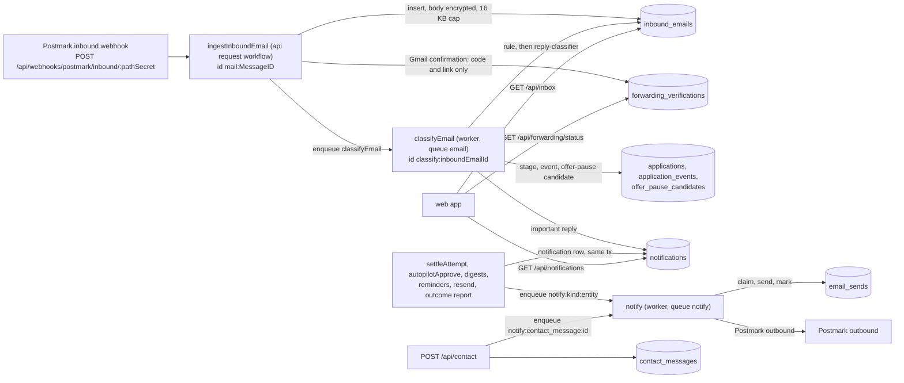
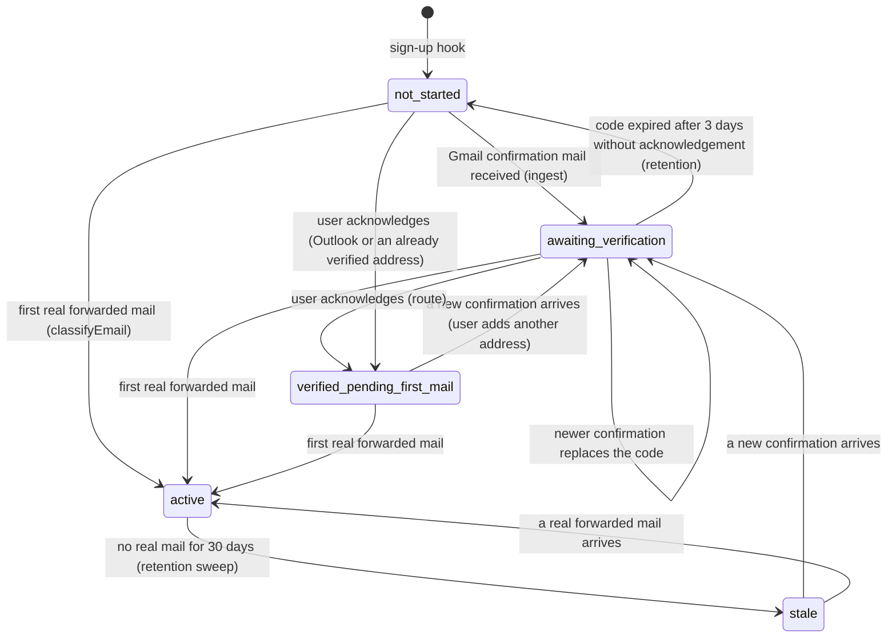
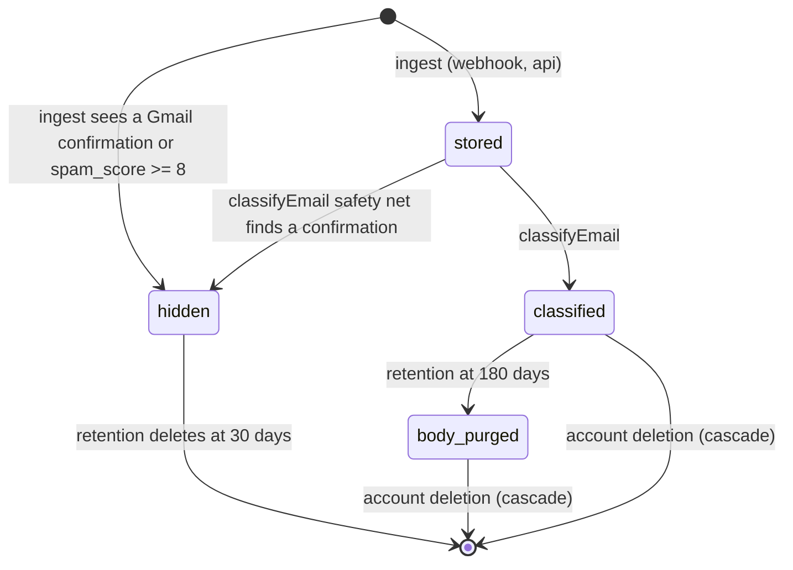
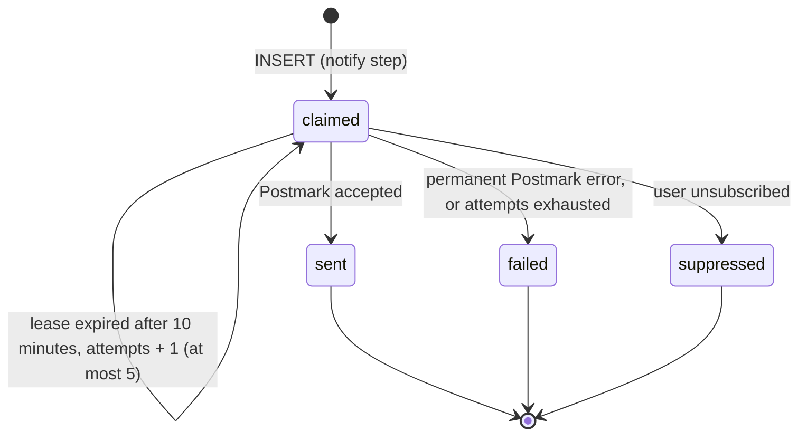

# Database design: the `messaging` domain

Revision 1, 2026-10-23. Part of the Kairos backend design (`../01-architecture.md`, revision 2, decision ADR-001 postgres-durable). This file is the complete table design for the domain `messaging` (modules `inbox` and `reports`): forwarded employer replies, Gmail forwarding verification, notification email idempotency, in-app notifications and the public contact form.

Tables in this domain, named exactly as in the architect's inventory (C.1): `inbound_emails`, `forwarding_verifications`, `email_sends`, `notifications`, `contact_messages`.

Skills applied: `database-design` (think about the access path before the column), `postgres-best-practices` (partial indexes, foreign key indexes, short transactions, no unbounded growth, least privilege) and `drizzle-orm-expert` (schema sketches in the Drizzle 0.45 array-constraint style the repository already uses). All three loaded.

Inputs read: `01-architecture.md` in full (especially B.5 to B.6.12, B.10, B.11.5, C.1 and C.2), `server/drizzle/0000_init.sql`, `0001_resume_workspace.sql`, `server/src/db/schema/*.ts` (working tree), `docs/05-backend-schema.md`, the routes `server/src/routes/inbox.ts`, `contact.ts`, `webhooks.ts`, `server/src/services/email-classifier.ts`, `server/src/lib/mailer.ts`, and the research files `requirements.md`, `integrations.md` (sections 6 and 7) and `as-built.md` (defects D-26, S-12, P-03, P-05, P-06).

Evidence tags as in the architecture: **[est]** an estimate to be replaced by beta measurements; **[verify]** a behavior that a named spike must confirm.

---

## 1. Summary

| Table | Purpose | Written by | Read by | Rows at 10,000 users [est] | Retention |
|---|---|---|---|---|---|
| `inbound_emails` | One row per forwarded employer reply (and per hidden system or spam mail). Encrypted body, rule and model classification, link to an application | api `ingestInboundEmail` (insert), worker `classifyEmail` (update), `retention` and `erasure` schedules (update, delete) | `GET /api/inbox`, application timeline, outcome report, ghost signals, reminders | 8,500 a day; about 1.5 million with a body, 3.1 million in total after one year | Body and preview: 180 days. Metadata: with the account. Hidden rows: 30 days |
| `forwarding_verifications` | The short-lived Gmail forwarding confirmation code and link that Kairos received on the user's behalf | api `ingestInboundEmail`, worker `classifyEmail`, user acknowledgement route | `GET /api/forwarding/status`, the `notify` worker | At most one per user and provider; 50 to 500 live rows | 3 days, deleted at first real mail |
| `email_sends` | Idempotency and delivery state of every outbound notification email that Kairos itself sends | worker `notify` queue steps (and the contact route's workflow) | `notify` steps (claim check), reconciler, hourly Autopilot email rate check | About 9,000 a day; about 1.1 million live | 120 days |
| `notifications` | The in-app notification list (the bell) | worker steps in the same transaction as the event they announce | `GET /api/notifications`, `POST /api/notifications/read` | About 9,000 a day; about 0.8 million live | 90 days |
| `contact_messages` | Record of the public contact form | api `POST /api/contact` | The founder (SQL or admin route), `erasure` | About 500 a month | 12 months; spam 30 days |

Principles that shaped every choice here:

1. **A reply is untrusted, personal content.** The body is encrypted, capped at 16 KB, never sent to a model unredacted, never used alone to change billing, and deleted from the database after 180 days. Metadata stays because the application timeline and the outcome report need it.
2. **The database enforces the rules that protect money and sending.** A reply can be tagged `offer` (which can lead to a billing pause) only if the deterministic offer rule agreed. A hidden mail never holds a body. A classification result cannot exist without `classified_at`.
3. **Every effect is idempotent by a key the database owns.** One inbound row per provider message id, one notification row per `(user, kind, entity)`, one email row per `(kind, entity)`, one contact row per message hash and UTC day.
4. **No partitioning here, on purpose** (section 9): the uniqueness rules above must hold globally, and the largest table grows by about 3 million rows a year.
5. **Foreign keys have indexes.** Account deletion cascades through these tables; an unindexed foreign key would turn one deletion into one sequential scan per application.

---

## 2. Cross-domain references

Names are exactly those of the architect's inventory (C.1).

| This table.column | References | On delete | Domain of the target |
|---|---|---|---|
| `inbound_emails.user_id` | `"user"(id)` | CASCADE | identity-profile |
| `inbound_emails.application_id` | `applications(id)` | SET NULL (the reply stays in the user's inbox) | applications |
| `forwarding_verifications.user_id` | `"user"(id)` | CASCADE | identity-profile |
| `email_sends.user_id` (nullable) | `"user"(id)` | CASCADE | identity-profile |
| `notifications.user_id` | `"user"(id)` | CASCADE | identity-profile |
| `contact_messages` | none (public form, no sign-in) | n/a | n/a |

References into this domain (their owners create the foreign keys):

| Referencing column | Table that owns it | Contract this domain keeps |
|---|---|---|
| `offer_pause_candidates.inbound_email_id` (unique) | billing | An `inbound_emails` row is never deleted while the account exists, except hidden rows, which never become candidates. Purging the body keeps the row and its id |
| `application_events.detail.inboundEmailId` (id inside JSON, no foreign key) | applications | Same stability of the id |
| `profiles.forwarding_address` (lookup key of the webhook), `profiles.forwarding_state` | identity-profile | `forwarding_state` is added by B.10.2 (`not_started`, `awaiting_verification`, `verified_pending_first_mail`, `active`, `stale`). This domain defines its state machine (section 6.1); the column belongs to the `profiles` migration. The address must be stored lower case (the webhook lower-cases the recipient before the lookup) |
| `applications.stage` | applications | Written by the `classifyEmail` transaction of this domain, forward only (section 6.2) |

Cross-domain data flow:



---

## 3. Conventions used in this file

- Timestamps are `timestamptz`. Identifiers are `uuid` with `gen_random_uuid()` (the repository's existing style), except where a natural key is the primary key.
- "Enum" columns that are new are `text` with a named `CHECK`. This is deliberate: adding a value to a `CHECK` is a one-statement, transaction-safe migration, while `ALTER TYPE ... ADD VALUE` cannot be used in the same transaction as its first use and can never be removed. The one real Postgres enum in this domain is the existing, shared `email_kind` (`confirmation`, `rejection`, `interview`, `offer`, `assessment`, `other`), which the frozen web app reads and which is not changed.
- Encrypted columns hold the AES-256-GCM envelope of architecture B.11.5 (versioned key list `DATA_KEKS`, held only by api and worker). The envelope is stored as binary `bytea` as `keyVersion (1 byte) || nonce (12 bytes) || ciphertext || tag (16 bytes)`; this is the logical layout `k<version>.<nonce>.<ciphertext>.<tag>` without the text encoding, which would add a third to every body. The additional authenticated data is the string `<table>:<row id>:<column>` (for example `inbound_emails:7c1e...:body`), so a ciphertext copied to another row or column fails to decrypt. `lib/crypto.ts` owns the format; this domain only stores the bytes.
- Lock order (architecture B.6.4) is unaffected: no transaction in this domain locks `credit_balances` or `applications` rows except the single conditional `UPDATE applications SET stage` in `classifyEmail`, which locks one application row only and takes no balance lock.
- Migrations follow expand, backfill, switch, contract (NFR-10). Tables are small at P2 and P6 (under 100,000 rows), so plain `CREATE INDEX` inside the migration is acceptable; any index added once a table exceeds 1 million rows must use `CREATE INDEX CONCURRENTLY` in its own migration file (Drizzle's migrator runs a file in a transaction, so such a file is applied by `migrate.ts` outside it, as the architecture already requires for `jobs`).

---

## 4. Table `inbound_emails`

### 4.1 Purpose

A forwarded reply to a job application, as received by the Postmark inbound webhook at the user's private forwarding address. It carries enough to show the inbox (sender, subject, kind, preview), to link the reply to an application, to drive the reply-driven stage and the event ledger, and to feed the offer-pause rule. It also holds two kinds of hidden rows that must not appear in the inbox: the Gmail forwarding confirmation (which keeps only a code elsewhere) and mail that Postmark scored as almost certainly spam.

Why this shape:

- The body is the only sensitive large field; it is encrypted and capped. The list route needs a 280-character preview for up to 100 rows, so a separate encrypted `preview_enc` (about 300 bytes, stored inline) lets `GET /api/inbox` avoid fetching and decrypting 100 TOASTed bodies (this is the S-12 defect: the skeleton selects the whole body to return 280 characters).
- `kind` is the resolved tag that the frozen route returns. `rule_kind` and `model_kind` record who proposed it, so the model can be audited and so the database can forbid a model-only `offer`.
- `classified_at` is both the idempotency marker of `classifyEmail` and the reconciler's "unclassified mail" predicate (B.5.8).

### 4.2 Columns

Target state after the contract release. The skeleton columns are marked "kept"; the rest are additive (B.10.2 already lists `text_body_enc`, `attachments`, `rule_kind`, `model_kind`, `linked_by`, `classified_at`; this file adds `preview_enc`, `spam_score` and `hidden_reason`).

| Column | Postgres type | Null | Default | Notes |
|---|---|---|---|---|
| `id` | `uuid` | no | `gen_random_uuid()` | Primary key (kept). Also the AAD component for encryption |
| `user_id` | `text` | no | | Owner (kept). Resolved from `profiles.forwarding_address` by the webhook, never from the payload |
| `application_id` | `uuid` | yes | | Linked application (kept). Null until linked, and after the application is deleted |
| `provider_message_id` | `text` | no | | Postmark `MessageID` (kept, globally unique). Idempotency key of the webhook and of the workflow id `mail:<MessageID>` |
| `sender` | `text` | no | | The `From` header as received (kept), truncated to 320 characters at ingest. The frozen inbox route returns it as `sender` |
| `subject` | `text` | no | | Kept, truncated to 500 characters at ingest. Stored in clear text because the rules, the list and the linking tokens read it |
| `text_body` | `text` | yes | | Legacy plaintext body (kept in the expand phase, made nullable, written as null from the switch release, dropped in the contract release). Not part of the target state |
| `text_body_enc` | `bytea` | yes | | Encrypted plain-text body, at most 16,384 bytes of plaintext. Null for hidden rows and after the 180-day purge |
| `preview_enc` | `bytea` | yes | | Encrypted first 280 characters of the body (whitespace collapsed). Null exactly when `text_body_enc` is null |
| `attachments` | `jsonb` | no | `'[]'` | `[{ "name": string, "type": string, "size": integer }]`, at most 50 entries. Attachment content is dropped before storage (integrations.md section 6) |
| `spam_score` | `real` | yes | | Postmark's `X-Spam-Score` header when present. Used only to restrict automation and to hide extreme spam (section 4.7) |
| `hidden_reason` | `text` | yes | | `forwarding_confirmation` or `spam`. A hidden row never appears in the inbox and never holds a body |
| `kind` | `email_kind` | yes | | The resolved tag. Null until classified. `offer` only if `rule_kind = 'offer'` |
| `rule_kind` | `email_kind` | yes | | Tag proposed by the deterministic rules (`classifyByRules`) |
| `model_kind` | `email_kind` | yes | | Tag proposed by `reply-classifier`, only for mail the rules could not tag. Never both with `rule_kind` |
| `linked_by` | `text` | yes | | `domain`, `company_name` or `none`: how `application_id` was found |
| `classified_at` | `timestamptz` | yes | | Set once, in the transaction that writes the classification (or at ingest for hidden rows) |
| `received_at` | `timestamptz` | no | `now()` | Server time of receipt (kept). Postmark's `Date` header is never trusted |

Row size: about 450 bytes of heap for the metadata columns, plus the encrypted preview (about 330 bytes) when present, plus the body (average 3.2 KB, maximum 16.4 KB; values above about 2 KB are moved to TOAST automatically and are not read by the list query).

### 4.3 Keys

- **Primary key:** `id`.
- **Unique:** `inbound_emails_provider_message_id_unique` on `provider_message_id` (kept, same name as in `0000_init.sql`). It is global, not per user: a Postmark `MessageID` identifies one delivered inbound message. If one employer mail were addressed to two Kairos addresses, Postmark delivers two messages with two ids. The same global key is the DBOS workflow id, so engine and table agree.
- **Foreign keys:** `user_id` to `"user"(id)` `ON DELETE CASCADE` (kept); `application_id` to `applications(id)` `ON DELETE SET NULL` (kept).

### 4.4 Check constraints

| Name | Expression | Invariant it protects |
|---|---|---|
| `inbound_emails_hidden_reason_ck` | `hidden_reason IS NULL OR hidden_reason IN ('forwarding_confirmation','spam')` | Closed set |
| `inbound_emails_linked_by_ck` | `linked_by IS NULL OR linked_by IN ('domain','company_name','none')` | Closed set |
| `inbound_emails_hidden_no_body_ck` | `hidden_reason IS NULL OR (text_body IS NULL AND text_body_enc IS NULL AND preview_enc IS NULL)` | A confirmation mail keeps only its code (integrations.md section 7); spam keeps no content |
| `inbound_emails_body_preview_pair_ck` | `(text_body_enc IS NULL) = (preview_enc IS NULL)` | The preview never outlives or precedes the body |
| `inbound_emails_classified_ck` | `(kind IS NULL AND rule_kind IS NULL AND model_kind IS NULL AND linked_by IS NULL) OR classified_at IS NOT NULL` | A classification result cannot exist without the marker that makes `classifyEmail` idempotent |
| `inbound_emails_one_classifier_ck` | `rule_kind IS NULL OR model_kind IS NULL` | The model only sees mail the rules could not tag |
| `inbound_emails_offer_needs_rule_ck` | `(kind IS DISTINCT FROM 'offer') OR (rule_kind IS NOT DISTINCT FROM 'offer')` | **The model alone can never produce an `offer`**, so it can never lead to a billing pause (FR-48, D-26, P-06). `IS NOT DISTINCT FROM` is used because a plain `rule_kind = 'offer'` evaluates to NULL for a null `rule_kind`, and a CHECK treats NULL as passing |
| `inbound_emails_link_reason_ck` | `application_id IS NULL OR linked_by IN ('domain','company_name')` | A link always records how it was made |
| `inbound_emails_sender_len_ck` | `char_length(sender) <= 320` | Bounded size (a 2 MB request cannot put a megabyte in a header column) |
| `inbound_emails_subject_len_ck` | `char_length(subject) <= 500` | Same |
| `inbound_emails_body_size_ck` | `octet_length(text_body_enc) <= 16448` | 16,384 bytes of plaintext plus 29 bytes of envelope, rounded up |
| `inbound_emails_preview_size_ck` | `octet_length(preview_enc) <= 1200` | 280 characters at 4 bytes plus envelope |
| `inbound_emails_attachments_ck` | `jsonb_typeof(attachments) = 'array' AND jsonb_array_length(attachments) <= 50` | Bounded size and shape |

In the migration sequence (section 10), the sender and subject length checks are added `NOT VALID` and validated after the backfill, and `inbound_emails_link_reason_ck`, `inbound_emails_classified_ck` and `inbound_emails_offer_needs_rule_ck` are added only after the legacy `classify-email` queue is drained, because that worker sets `kind` and `application_id` without the new columns.

### 4.5 Indexes

| Index | Definition | Query it serves |
|---|---|---|
| `inbound_emails_pkey` | `(id)` | Classification by id; the `offer_pause_candidates` foreign key |
| `inbound_emails_provider_message_id_unique` | `(provider_message_id)` | `INSERT ... ON CONFLICT (provider_message_id) DO NOTHING` in the webhook |
| `inbound_emails_user_idx` (kept) | `(user_id, received_at)` | `GET /api/inbox`: `WHERE user_id = $1 AND hidden_reason IS NULL ORDER BY received_at DESC LIMIT 100` (backward index scan; hidden rows are a tiny share, so the filter is cheap). Also the per-user flood check `count(*) WHERE user_id = $1 AND received_at > now() - interval '24 hours'`, the last-mail lookup for `forwarding_state`, the stale sweep, and the `user_id` foreign key |
| `inbound_emails_application_idx` | `(application_id, received_at) WHERE application_id IS NOT NULL` | Application timeline and `GET /api/applications/:id`; outcome report (replies linked to applications submitted in the last 28 days); `ghost-signals` (applications with no reply); reminders (`no_reply`); **the `ON DELETE SET NULL` foreign key check** when an application row is deleted. Partial because most rows are linked only after classification, and a query `application_id = $1` implies the predicate |
| `inbound_emails_unclassified_idx` | `(received_at) WHERE classified_at IS NULL` | Reconciler (B.5.8): `classified_at IS NULL AND received_at < now() - interval '10 minutes'`. The index holds only the few rows in flight |
| `inbound_emails_body_purge_idx` | `(received_at) WHERE text_body_enc IS NOT NULL` | Retention: `received_at < now() - interval '180 days' AND text_body_enc IS NOT NULL`. Holds only rows that still have a body (about 1.5 million entries, about 50 MB) and shrinks as bodies are purged |
| `inbound_emails_hidden_idx` | `(received_at) WHERE hidden_reason IS NOT NULL` | Retention of hidden rows (30 days). Tiny |

Deliberately not indexed: `kind` (the inbox is read per user, and a per-user list of at most 100 rows is filtered in memory); `sender` (linking compares the sender domain with the user's own applications' companies, which is driven from the `applications` side); `spam_score` (read with the row).

### 4.6 Partitioning and retention

- **No partitioning** at 10,000 users (rationale in section 9). Conversion trigger: more than 25 million rows or 40 GB, at which point the table becomes monthly range partitions on `received_at` and the global uniqueness of `provider_message_id` moves to a small side table `inbound_message_ids (provider_message_id text primary key, received_at timestamptz)` pruned after 35 days (Postmark stops retrying after about 11 hours, so a 35-day window is more than enough).
- **Body and preview: 180 days** (B.10.6). The `retention` schedule (daily) runs in batches of 5,000:

  ```sql
  UPDATE inbound_emails SET text_body_enc = NULL, preview_enc = NULL
   WHERE ctid IN (SELECT ctid FROM inbound_emails
                   WHERE received_at < now() - interval '180 days' AND text_body_enc IS NOT NULL
                   LIMIT 5000);
  ```

  Rows past 180 days keep `sender`, `subject`, `kind`, `application_id`, `received_at`. The frozen inbox route then returns `preview: ""` for them.
- **Hidden rows: 30 days.** `DELETE FROM inbound_emails WHERE ctid IN (SELECT ctid FROM inbound_emails WHERE hidden_reason IS NOT NULL AND received_at < now() - interval '30 days' LIMIT 5000)`. Safe because a hidden row can be neither linked nor an offer-pause candidate.
- **Account deletion:** cascade. The `erasure` schedule needs no extra step for this table. After a restore from backup, the tombstone replay (B.11.5) removes the user and the cascade removes the rows.
- **Metadata** is kept with the account (B.10.6).

### 4.7 Ingest, flood and spam rules (what the table design assumes)

1. The webhook resolves the recipient from `OriginalRecipient` (falling back to `To`), lower-cases it and looks up `profiles.forwarding_address`. No profile means 200 and nothing stored.
2. **Per-user flood cap:** at most 400 stored rows per user in any 24 hours (about 3 times the busiest legitimate case: a Max user with Autopilot at 110 sends a day receives about 165 mails). Mail over the cap is dropped with 200 and counted in `metrics_minute`. This bounds what anyone who learns an address can store (D-26, P-06).
3. **Spam handling, two thresholds** from configuration (defaults chosen for SpamAssassin scores as Postmark reports them; relayed ATS mail commonly scores 2 to 4 [est, verify on the beta sample]):
   - `spam_score >= 5`: automation is restricted. The row is stored and shown, but `classifyEmail` skips `reply-classifier`, links only by sender domain (never by company name), and never creates an offer-pause candidate or an important-reply notification. The mail can still be tagged by the rules.
   - `spam_score >= 8`: the row is stored as `hidden_reason = 'spam'` with no body, `kind` null, `classified_at = now()`, and is deleted after 30 days.
   A false positive at 5 costs one model call and a notification; a false positive at 8 would hide a real invitation, which is why the hiding threshold is high and the row stays readable by support for 30 days.
4. **Gmail forwarding confirmation** (sender `forwarding-noreply@google.com`, subject starting "Gmail Forwarding Confirmation"; exact strings pinned by spike S-G1): detected by the pure function `parseGmailForwardingConfirmation(from, subject, body)` inside the ingest transaction, before any storage. The row is inserted with `hidden_reason = 'forwarding_confirmation'`, no body, `classified_at = now()`; the code and link go to `forwarding_verifications`. The body therefore never reaches the database. `classifyEmail` runs the same function as a safety net on any row it finds without `hidden_reason` (a variant added later); in that case one `UPDATE` sets `hidden_reason`, nulls `text_body_enc` and `preview_enc` and sets `classified_at`, so the `hidden_no_body` check holds at every committed state.
5. **Body handling:** the plain-text body only (HTML is ignored), truncated at a character boundary to 16,384 bytes, encrypted with AAD `inbound_emails:<id>:body`. An empty body is stored as an encrypted empty string so the pair check holds.

### 4.8 Row-count projection at 10,000 users

Derived from the architecture's `reply-classifier` volume (2,120 calls a day at growth, which are 25% of all mail, B.12.1): about **8,500 stored rows a day** at growth (7,400 at base).

| Horizon | Rows (metadata) | Rows with a body | Metadata size incl. indexes | Body and preview size |
|---|---|---|---|---|
| Steady state of bodies (180 days) | 1.5 million | 1.5 million | 1.2 GB | about 5 GB |
| 1 year | 3.1 million | 1.5 million | about 2.5 GB | about 5 GB |
| 50,000 users, 1 year | about 15.5 million | 7.7 million | about 12 GB | about 25 GB |

Index overhead included in the metadata figure: seven indexes, of which four are partial and small. The 25-million-row partition trigger is reached at about 80,000 users.

### 4.9 DDL (target state; the expand migration is in section 10)

```sql
CREATE TABLE inbound_emails (
  id                  uuid        PRIMARY KEY DEFAULT gen_random_uuid(),
  user_id             text        NOT NULL REFERENCES "user"(id) ON DELETE CASCADE,
  application_id      uuid        REFERENCES applications(id) ON DELETE SET NULL,
  provider_message_id text        NOT NULL,
  sender              text        NOT NULL,
  subject             text        NOT NULL,
  text_body_enc       bytea,
  preview_enc         bytea,
  attachments         jsonb       NOT NULL DEFAULT '[]',
  spam_score          real,
  hidden_reason       text,
  kind                email_kind,
  rule_kind           email_kind,
  model_kind          email_kind,
  linked_by           text,
  classified_at       timestamptz,
  received_at         timestamptz NOT NULL DEFAULT now(),
  CONSTRAINT inbound_emails_provider_message_id_unique UNIQUE (provider_message_id),
  CONSTRAINT inbound_emails_hidden_reason_ck CHECK (hidden_reason IS NULL OR hidden_reason IN ('forwarding_confirmation','spam')),
  CONSTRAINT inbound_emails_linked_by_ck CHECK (linked_by IS NULL OR linked_by IN ('domain','company_name','none')),
  CONSTRAINT inbound_emails_hidden_no_body_ck CHECK (hidden_reason IS NULL OR (text_body_enc IS NULL AND preview_enc IS NULL)),
  CONSTRAINT inbound_emails_body_preview_pair_ck CHECK ((text_body_enc IS NULL) = (preview_enc IS NULL)),
  CONSTRAINT inbound_emails_classified_ck CHECK (
    (kind IS NULL AND rule_kind IS NULL AND model_kind IS NULL AND linked_by IS NULL) OR classified_at IS NOT NULL),
  CONSTRAINT inbound_emails_one_classifier_ck CHECK (rule_kind IS NULL OR model_kind IS NULL),
  CONSTRAINT inbound_emails_offer_needs_rule_ck CHECK (
    (kind IS DISTINCT FROM 'offer') OR (rule_kind IS NOT DISTINCT FROM 'offer')),
  CONSTRAINT inbound_emails_link_reason_ck CHECK (application_id IS NULL OR linked_by IN ('domain','company_name')),
  CONSTRAINT inbound_emails_sender_len_ck CHECK (char_length(sender) <= 320),
  CONSTRAINT inbound_emails_subject_len_ck CHECK (char_length(subject) <= 500),
  CONSTRAINT inbound_emails_body_size_ck CHECK (octet_length(text_body_enc) <= 16448),
  CONSTRAINT inbound_emails_preview_size_ck CHECK (octet_length(preview_enc) <= 1200),
  CONSTRAINT inbound_emails_attachments_ck CHECK (jsonb_typeof(attachments) = 'array' AND jsonb_array_length(attachments) <= 50)
);
CREATE INDEX inbound_emails_user_idx              ON inbound_emails (user_id, received_at);
CREATE INDEX inbound_emails_application_idx       ON inbound_emails (application_id, received_at) WHERE application_id IS NOT NULL;
CREATE INDEX inbound_emails_unclassified_idx      ON inbound_emails (received_at) WHERE classified_at IS NULL;
CREATE INDEX inbound_emails_body_purge_idx        ON inbound_emails (received_at) WHERE text_body_enc IS NOT NULL;
CREATE INDEX inbound_emails_hidden_idx            ON inbound_emails (received_at) WHERE hidden_reason IS NOT NULL;
```

### 4.10 Statements the application issues

Ingest (one datasource transaction inside `ingestInboundEmail`; the application row-count check precedes it):

```sql
SELECT user_id FROM profiles WHERE forwarding_address = $recipient;                     -- no row: 200, store nothing
SELECT count(*) FROM inbound_emails WHERE user_id = $u AND received_at > now() - interval '24 hours';   -- >= 400: drop
INSERT INTO inbound_emails (user_id, provider_message_id, sender, subject, text_body_enc, preview_enc,
                            attachments, spam_score, hidden_reason, classified_at)
VALUES ($u, $messageId, $sender, $subject, $bodyEnc, $previewEnc, $attachments, $spam, $hidden, $classifiedAt)
ON CONFLICT (provider_message_id) DO NOTHING
RETURNING id;                                                                            -- no row: duplicate delivery, end
-- encryption needs the row id as AAD, so the application generates the uuid first and passes it as $id
```

Classification (inside `classifyEmail`, idempotent by `classified_at IS NULL`):

```sql
UPDATE inbound_emails
   SET kind = $kind, rule_kind = $ruleKind, model_kind = $modelKind,
       application_id = $applicationId, linked_by = $linkedBy, classified_at = now()
 WHERE id = $id AND classified_at IS NULL
RETURNING user_id;
-- zero rows: already classified, the workflow ends as a no-op (rule D1). One row: continue in the same transaction with
--   application_events (reply_*), applications.stage (forward only), offer_pause_candidates (rule-tagged, linked, spam_score < 5),
--   notifications (reply_important), profiles.forwarding_state = 'active' and DELETE FROM forwarding_verifications WHERE user_id = $u.
```

Inbox list (frozen route, same response shape):

```sql
SELECT id, sender, subject, kind, application_id, received_at, preview_enc
  FROM inbound_emails
 WHERE user_id = $1 AND hidden_reason IS NULL
 ORDER BY received_at DESC
 LIMIT 100;
-- the route decrypts preview_enc (AAD inbound_emails:<id>:preview) and returns "" when it is null
```

### 4.11 Drizzle sketch

See section 11 (one file, `server/src/db/schema/messaging.ts`, holds all five tables).

---

## 5. The other four tables

### 5.1 Table `forwarding_verifications`

**Purpose.** Gmail will not forward to a new address until the account owner confirms it with a code or link that Gmail sends to that address. Kairos receives that mail on the user's behalf, extracts the code and the link, shows them to the user in the app and emails them to the user's account address, then forgets them. One live row per user and provider; a newer confirmation replaces the older one. Outlook sends no confirmation (integrations.md section 7), so only `gmail` exists today.

**Columns.**

| Column | Type | Null | Default | Notes |
|---|---|---|---|---|
| `user_id` | `text` | no | | Part of the primary key |
| `provider` | `text` | no | | Part of the primary key. Only `gmail` today |
| `code` | `text` | yes | | The numeric confirmation code (9 digits expected; the check allows 6 to 12 until S-G1 pins the sample) |
| `confirm_url` | `text` | yes | | The confirmation link. Never fetched by the server; shown to the user only. The host is checked against an allowlist in `inbox/forwarding.ts` (the S-G1 sample fixes the host; a database check on the host would need a migration for every change, so the database only enforces `https`) |
| `received_at` | `timestamptz` | no | `now()` | When the confirmation mail arrived |
| `expires_at` | `timestamptz` | no | | `received_at + 3 days` (set by the application) |
| `acknowledged_at` | `timestamptz` | yes | | Set when the user says they confirmed it in Gmail (section 6.1) |

**Keys.** Primary key `(user_id, provider)`. Foreign key `user_id` to `"user"(id)` `ON DELETE CASCADE`; it is the leading column of the primary key, so it needs no further index. The upsert `INSERT ... ON CONFLICT (user_id, provider) DO UPDATE SET code = EXCLUDED.code, confirm_url = EXCLUDED.confirm_url, received_at = EXCLUDED.received_at, expires_at = EXCLUDED.expires_at, acknowledged_at = NULL` is idempotent for a Postmark retry (same values) and replaces an older code for a new one.

**Checks.**

| Name | Expression |
|---|---|
| `forwarding_verifications_provider_ck` | `provider IN ('gmail')` |
| `forwarding_verifications_payload_ck` | `code IS NOT NULL OR confirm_url IS NOT NULL` |
| `forwarding_verifications_code_ck` | `code IS NULL OR code ~ '^[0-9]{6,12}$'` |
| `forwarding_verifications_url_ck` | `confirm_url IS NULL OR (confirm_url ~ '^https://' AND char_length(confirm_url) <= 2048)` |
| `forwarding_verifications_expiry_ck` | `expires_at > received_at` |

**Indexes.** None beyond the primary key. Every access is by `user_id` (status route, activation delete, upsert). The expiry sweep reads the whole table, which holds 50 to 500 live rows [est], so a sequential scan is the right plan; an index on `expires_at` would cost more than it saves.

**Partitioning and retention.** None needed. Rows are deleted (a) in the `classifyEmail` transaction that sees the first real forwarded mail, and (b) by the `retention` schedule, which deletes `WHERE expires_at < now()` and, in the same statement, moves the owners from `awaiting_verification` back to `not_started` (section 6.1). The code is a short-lived, low-sensitivity secret (it confirms a forwarding rule in an account only the user controls, and the row lives for at most 3 days), so it is stored in clear text and not encrypted.

**Row-count projection.** Live rows: at most one per Gmail-forwarding user in the last 3 days. At launch ramp (about 300 new users a day, 60% Gmail, 70% of them reaching the step) about 130 rows are created a day; steady state about 50 to 500 live rows. Lifetime churn: about 4,200 rows over the first 10,000 users, all short-lived.

**DDL.**

```sql
CREATE TABLE forwarding_verifications (
  user_id         text        NOT NULL REFERENCES "user"(id) ON DELETE CASCADE,
  provider        text        NOT NULL,
  code            text,
  confirm_url     text,
  received_at     timestamptz NOT NULL DEFAULT now(),
  expires_at      timestamptz NOT NULL,
  acknowledged_at timestamptz,
  PRIMARY KEY (user_id, provider),
  CONSTRAINT forwarding_verifications_provider_ck CHECK (provider IN ('gmail')),
  CONSTRAINT forwarding_verifications_payload_ck  CHECK (code IS NOT NULL OR confirm_url IS NOT NULL),
  CONSTRAINT forwarding_verifications_code_ck     CHECK (code IS NULL OR code ~ '^[0-9]{6,12}$'),
  CONSTRAINT forwarding_verifications_url_ck      CHECK (confirm_url IS NULL OR (confirm_url ~ '^https://' AND char_length(confirm_url) <= 2048)),
  CONSTRAINT forwarding_verifications_expiry_ck   CHECK (expires_at > received_at)
);
```

**Status route query** (`GET /api/forwarding/status`, new, additive):

```sql
SELECT p.forwarding_address, p.forwarding_state,
       (SELECT max(e.received_at) FROM inbound_emails e WHERE e.user_id = p.user_id AND e.hidden_reason IS NULL) AS last_mail_at,
       v.provider, v.code, v.confirm_url, v.expires_at, v.acknowledged_at
  FROM profiles p
  LEFT JOIN forwarding_verifications v ON v.user_id = p.user_id AND v.expires_at > now()
 WHERE p.user_id = $1;
```

Response: `{ state, address, lastMailAt, verification: { provider, code, confirmUrl, expiresAt } | null }`.

---

### 5.2 Table `email_sends`

**Purpose.** Idempotency and delivery state for every email that Kairos sends about a state change: digests, Autopilot summaries, resend links, offer-pause notices, forwarding codes, the weekly outcome report, return-to-draft notices and the contact-form alert. The architecture requires the row to exist before the send call so that a retried `notify` workflow cannot send twice (B.11.1). Better Auth's OTP and verification emails are sent by Better Auth directly and are out of scope.

A two-state "written before sending" row has two failure modes: if it is the only record, a crash after the write and before the send loses the email forever; if it is retried blindly, a crash after the send duplicates it. The design resolves this with a claim with a lease and an attempt counter: the row is claimed first, the send is retried after a lease of 10 minutes only if the row never reached `sent`, and the duplicate window shrinks to the few milliseconds between Postmark answering 200 and the `UPDATE` that records it.

**Columns.**

| Column | Type | Null | Default | Notes |
|---|---|---|---|---|
| `kind` | `text` | no | | Part of the primary key. Closed set, see below |
| `entity_id` | `text` | no | | Part of the primary key. The deterministic key of the thing being announced, formats below. At most 200 characters |
| `user_id` | `text` | yes | | Recipient account. Null for mail that is not about a user (the contact alert to the founder) |
| `status` | `text` | no | `'claimed'` | `claimed`, `sent`, `failed`, `suppressed` (state machine in section 6.3) |
| `attempts` | `smallint` | no | `1` | Incremented on each re-claim; 5 at most |
| `claimed_at` | `timestamptz` | no | `now()` | Start of the current claim; the lease runs 10 minutes from here |
| `sent_at` | `timestamptz` | yes | | Set when Postmark accepted the message |
| `provider_message_id` | `text` | yes | | Postmark outbound `MessageID`, kept for bounce correlation |
| `error_code` | `text` | yes | | Short code (`postmark_406`, `postmark_422`, `lease_exhausted`, `unsubscribed`); never a provider message |

`kind` values and the `entity_id` each uses:

| `kind` | `entity_id` | Started by |
|---|---|---|
| `digest` | `<savedSearchId>:<YYYY-MM-DD>` (user's local date) | `digests` schedule (B.7.10) |
| `autopilot_hourly` | `<userId>:<epochHour>` | Autopilot summary step (at most one per user per hour, B.6.3) |
| `autopilot_paused` | `<userId>:<pausedAtEpochSeconds>` | `submission-health` spike rule |
| `resend_available` | `<applicationId>:<attemptNo>` | `settleAttempt` after a resendable failure (B.6.10) |
| `offer_pause_notice` | `<inboundEmailId>` | `classifyEmail` when a candidate is created (B.6.11) |
| `offer_pause_applied` | `<inboundEmailId>` | `offer-pause-apply` |
| `forwarding_code` | `<userId>:gmail:<receivedAtEpochSeconds>` | `ingestInboundEmail` |
| `outcome_report` | `<userId>:<weekStartDate>` | `outcome-tick` (FR-52) |
| `return_to_draft` | `<applicationId>:<attemptNo>` | `return-to-draft` schedule (B.6.10) |
| `contact_message` | `<contactMessageId>` | `POST /api/contact` workflow |

**Keys.** Primary key `(kind, entity_id)`. Foreign key `user_id` to `"user"(id)` `ON DELETE CASCADE`.

**Checks.**

| Name | Expression |
|---|---|
| `email_sends_kind_ck` | `kind IN ('digest','autopilot_hourly','autopilot_paused','resend_available','offer_pause_notice','offer_pause_applied','forwarding_code','outcome_report','return_to_draft','contact_message')` |
| `email_sends_status_ck` | `status IN ('claimed','sent','failed','suppressed')` |
| `email_sends_sent_at_ck` | `(status = 'sent') = (sent_at IS NOT NULL)` |
| `email_sends_error_ck` | `status NOT IN ('failed','suppressed') OR error_code IS NOT NULL` |
| `email_sends_attempts_ck` | `attempts BETWEEN 1 AND 5` |
| `email_sends_entity_len_ck` | `char_length(entity_id) BETWEEN 1 AND 200` |
| `email_sends_user_ck` | `user_id IS NOT NULL OR kind = 'contact_message'` |

**Indexes.**

| Index | Definition | Query it serves |
|---|---|---|
| `email_sends_pkey` | `(kind, entity_id)` | The claim statement (below) |
| `email_sends_user_idx` | `(user_id, kind, claimed_at DESC) WHERE user_id IS NOT NULL` | "Was an `autopilot_hourly` email already claimed for this user in the last hour" (`WHERE user_id = $1 AND kind = 'autopilot_hourly' AND claimed_at > now() - interval '1 hour'`); and the `user_id` foreign key for account deletion |
| `email_sends_stale_idx` | `(claimed_at) WHERE status = 'claimed'` | Reconciler for stuck notifications: `status = 'claimed' AND claimed_at < now() - interval '30 minutes'` (a new check for the B.5.8 list: repair by re-enqueueing `notify:<kind>:<entityId>`; email the owner if it repeats). Holds only rows in flight |
| `email_sends_age_idx` | `(claimed_at)` | Retention delete: `claimed_at < now() - interval '120 days'` |

**Claim, send, mark** (the `notify` step; Drizzle `onConflictDoUpdate` with `setWhere` expresses the first statement):

```sql
INSERT INTO email_sends (kind, entity_id, user_id) VALUES ($kind, $entity, $user)
ON CONFLICT (kind, entity_id) DO UPDATE
   SET attempts = email_sends.attempts + 1, claimed_at = now()
 WHERE email_sends.status = 'claimed' AND email_sends.claimed_at < now() - interval '10 minutes'
   AND email_sends.attempts < 5
RETURNING attempts;
-- no row: the email is already sent, failed, suppressed or being sent by a live claim: skip the send.
-- a row: send through Postmark, then
UPDATE email_sends SET status = 'sent', sent_at = now(), provider_message_id = $mid
 WHERE kind = $kind AND entity_id = $entity AND status = 'claimed';
-- permanent Postmark errors (inactive recipient 406, invalid 422) set status = 'failed', error_code = 'postmark_406' instead.
-- a user who unsubscribed (a digest or report opt-out) is recorded as status = 'suppressed', error_code = 'unsubscribed', without sending.
```

**Partitioning and retention.** No partitioning (section 9). Retention 120 days: far longer than any replay window (DBOS workflows are kept 2 to 14 days, signed links 7 days), short enough to bound growth. Deleted in batches of 5,000 by the `retention` schedule; deleted with the account by cascade. The `contact_message` rows (no user) are deleted by the same age rule.

**Row-count projection** (growth, [est]): about **9,000 a day**: digests 2,500; Autopilot summaries 3,500; resend links 2,500; weekly reports 140 (a Monday peak of 1,000); forwarding codes 120; return-to-draft 100; the remaining kinds under 100 a day together. 120-day steady state: about 1.1 million rows, about 350 MB with the four indexes. At 50,000 users: about 5.5 million rows, 1.7 GB.

**DDL.**

```sql
CREATE TABLE email_sends (
  kind                text        NOT NULL,
  entity_id           text        NOT NULL,
  user_id             text        REFERENCES "user"(id) ON DELETE CASCADE,
  status              text        NOT NULL DEFAULT 'claimed',
  attempts            smallint    NOT NULL DEFAULT 1,
  claimed_at          timestamptz NOT NULL DEFAULT now(),
  sent_at             timestamptz,
  provider_message_id text,
  error_code          text,
  PRIMARY KEY (kind, entity_id),
  CONSTRAINT email_sends_kind_ck CHECK (kind IN ('digest','autopilot_hourly','autopilot_paused','resend_available','offer_pause_notice',
                                                 'offer_pause_applied','forwarding_code','outcome_report','return_to_draft','contact_message')),
  CONSTRAINT email_sends_status_ck CHECK (status IN ('claimed','sent','failed','suppressed')),
  CONSTRAINT email_sends_sent_at_ck CHECK ((status = 'sent') = (sent_at IS NOT NULL)),
  CONSTRAINT email_sends_error_ck CHECK (status NOT IN ('failed','suppressed') OR error_code IS NOT NULL),
  CONSTRAINT email_sends_attempts_ck CHECK (attempts BETWEEN 1 AND 5),
  CONSTRAINT email_sends_entity_len_ck CHECK (char_length(entity_id) BETWEEN 1 AND 200),
  CONSTRAINT email_sends_user_ck CHECK (user_id IS NOT NULL OR kind = 'contact_message')
);
CREATE INDEX email_sends_user_idx  ON email_sends (user_id, kind, claimed_at DESC) WHERE user_id IS NOT NULL;
CREATE INDEX email_sends_stale_idx ON email_sends (claimed_at) WHERE status = 'claimed';
CREATE INDEX email_sends_age_idx   ON email_sends (claimed_at);
```

---

### 5.3 Table `notifications`

**Purpose.** The in-app notification list. Autopilot announces every auto-sent application here (B.6.3), and the same list carries the other events a user must not miss: a pause, a resend offer, an offer-pause notice, an important reply and a forwarding code. Rows are inserted in the same transaction as the event they announce (for example `settleAttempt`'s notify step), so a notification can never exist without the event or the event without it, and a replayed step cannot duplicate it.

Design choices:

- **Render at read time.** A row stores kinds and ids only. The title of the job or the company name is joined from `applications`, `jobs` and `companies` when the list is read, so there is no copy of personal or job text to scrub, to go stale or to survive an erasure.
- **No foreign key to the entity.** `entity_id` is a text key (formats below), not a column per kind. Applications are never deleted except by account deletion, which cascades to this table through `user_id`, so there are no orphans to guard against.

**Columns.**

| Column | Type | Null | Default | Notes |
|---|---|---|---|---|
| `id` | `uuid` | no | `gen_random_uuid()` | Primary key; the keyset tie-breaker |
| `user_id` | `text` | no | | Owner. Every query filters by it |
| `kind` | `text` | no | | Closed set below |
| `entity_id` | `text` | no | | Key of the thing announced, formats below. At most 200 characters |
| `detail` | `jsonb` | no | `'{}'` | Ids and codes only (for example `{"replyKind":"interview"}`, `{"failureCode":"challenge"}`, `{"skipped":3}`). At most 1,024 bytes. Never free text, names or email content |
| `created_at` | `timestamptz` | no | `now()` | |
| `read_at` | `timestamptz` | yes | | Null means unread |

`kind` values and their `entity_id`:

| `kind` | `entity_id` | Created by | Meaning |
|---|---|---|---|
| `autopilot_sent` | `<applicationId>` | `settleAttempt` notify step (and the extension report path for Starter Autopilot) | An application was sent without review. One per application |
| `autopilot_paused` | `<pausedAtEpochSeconds>` | `submission-health` | Autopilot paused itself (`detail.reason` = `failure_spike`) |
| `resend_available` | `<applicationId>:<attemptNo>` | `settleAttempt` | A failed send can be resent (`detail.failureCode`) |
| `offer_pause_notice` | `<inboundEmailId>` | `classifyEmail` | A genuine offer was detected; billing pauses in 48 hours unless undone |
| `reply_important` | `<inboundEmailId>` | `classifyEmail` | A linked reply tagged `interview`, `assessment` or `offer` (`detail.replyKind`). Not created for mail with `spam_score >= 5` |
| `forwarding_code` | `<receivedAtEpochSeconds>` | `ingestInboundEmail` | The Gmail forwarding code arrived |

`autopilot_sent`, `autopilot_paused`, `resend_available` and `offer_pause_notice` are the kinds listed in B.10.5. `reply_important` and `forwarding_code` are added here, additively: they make the "interviews first" requirement (FR-51) and the code surfacing (integrations.md section 7) work without changing the frozen web app, and the set is a `CHECK`, so adding a kind is a one-line migration.

**Keys.** Primary key `id`. Unique `(user_id, kind, entity_id)` (the idempotency rule). Foreign key `user_id` to `"user"(id)` `ON DELETE CASCADE`.

**Checks.**

| Name | Expression |
|---|---|
| `notifications_kind_ck` | `kind IN ('autopilot_sent','autopilot_paused','resend_available','offer_pause_notice','reply_important','forwarding_code')` |
| `notifications_entity_len_ck` | `char_length(entity_id) BETWEEN 1 AND 200` |
| `notifications_detail_ck` | `jsonb_typeof(detail) = 'object' AND pg_column_size(detail) <= 1024` |
| `notifications_read_after_create_ck` | `read_at IS NULL OR read_at >= created_at` |

**Indexes.**

| Index | Definition | Query it serves |
|---|---|---|
| `notifications_pkey` | `(id)` | Mark one notification read |
| `notifications_dedupe_uq` | unique `(user_id, kind, entity_id)` | `INSERT ... ON CONFLICT (user_id, kind, entity_id) DO NOTHING` in every producer; also the `user_id` foreign key for account deletion |
| `notifications_user_created_idx` | `(user_id, created_at DESC, id DESC)` | `GET /api/notifications`: newest 50 with keyset paging `(created_at, id) < ($c, $i)` |
| `notifications_unread_idx` | `(user_id) WHERE read_at IS NULL` | The badge count `count(*) ... WHERE user_id = $1 AND read_at IS NULL`; `POST /api/notifications/read` with `all: true`. Holds only unread rows |
| `notifications_age_idx` | `(created_at)` | Retention delete `created_at < now() - interval '90 days'` |

**Partitioning and retention.** No partitioning (section 9). Retention 90 days from creation, read or not, in batches of 5,000 by the `retention` schedule; deleted with the account by cascade. A notification that is older than 90 days is no longer actionable (a resend link lasts 7 days, an offer-pause undo 48 hours).

**Row-count projection** (growth, [est]): about **9,000 a day**: `autopilot_sent` 5,500; `resend_available` 2,500; `reply_important` 850; `forwarding_code` 120; the other kinds under 50 together. Steady state at 90 days: about 0.8 million rows, about 320 MB with five indexes. At 50,000 users: 4 million rows, 1.6 GB.

**DDL.**

```sql
CREATE TABLE notifications (
  id         uuid        PRIMARY KEY DEFAULT gen_random_uuid(),
  user_id    text        NOT NULL REFERENCES "user"(id) ON DELETE CASCADE,
  kind       text        NOT NULL,
  entity_id  text        NOT NULL,
  detail     jsonb       NOT NULL DEFAULT '{}',
  created_at timestamptz NOT NULL DEFAULT now(),
  read_at    timestamptz,
  CONSTRAINT notifications_kind_ck CHECK (kind IN ('autopilot_sent','autopilot_paused','resend_available','offer_pause_notice','reply_important','forwarding_code')),
  CONSTRAINT notifications_entity_len_ck CHECK (char_length(entity_id) BETWEEN 1 AND 200),
  CONSTRAINT notifications_detail_ck CHECK (jsonb_typeof(detail) = 'object' AND pg_column_size(detail) <= 1024),
  CONSTRAINT notifications_read_after_create_ck CHECK (read_at IS NULL OR read_at >= created_at)
);
CREATE UNIQUE INDEX notifications_dedupe_uq        ON notifications (user_id, kind, entity_id);
CREATE INDEX        notifications_user_created_idx ON notifications (user_id, created_at DESC, id DESC);
CREATE INDEX        notifications_unread_idx       ON notifications (user_id) WHERE read_at IS NULL;
CREATE INDEX        notifications_age_idx          ON notifications (created_at);
```

**Statements.**

```sql
-- list (GET /api/notifications?cursor=...), 50 rows, then the route joins applications/jobs/companies by entity kind
SELECT id, kind, entity_id, detail, created_at, read_at
  FROM notifications
 WHERE user_id = $1 AND ($cursor_created IS NULL OR (created_at, id) < ($cursor_created, $cursor_id))
 ORDER BY created_at DESC, id DESC
 LIMIT 51;
-- unread badge
SELECT count(*) FROM notifications WHERE user_id = $1 AND read_at IS NULL;
-- mark read (POST /api/notifications/read, body { ids: uuid[] } or { all: true })
UPDATE notifications SET read_at = now() WHERE user_id = $1 AND read_at IS NULL AND (id = ANY($2) OR $all);
```

---

### 5.4 Table `contact_messages`

**Purpose.** The record of the public contact form (`POST /api/contact`, unauthenticated, 5 per hour per IP). It is the only table in the system whose rows belong to no account. The route stores the message, then starts the `notify` workflow `notify:contact_message:<id>`, which emails the founder through `email_sends` (the skeleton sends inline, so a Postmark error after the insert is a 500 that the browser retries into a second row and a second email).

**Columns.**

| Column | Type | Null | Default | Notes |
|---|---|---|---|---|
| `id` | `uuid` | no | `gen_random_uuid()` | Primary key (kept) |
| `name` | `text` | no | | Kept; at most 120 characters, as `contactMessageSchema` |
| `email` | `text` | no | | Kept; at most 254 characters. Personal data: indexed by `lower(email)` for erasure |
| `topic` | `text` | no | | Kept; `support`, `billing`, `partnership`, `press`, `other` (the shared schema's values) |
| `message` | `text` | no | | Kept; 10 to 4,000 characters |
| `created_at` | `timestamptz` | no | `now()` | Kept |
| `status` | `text` | no | `'new'` | `new`, `handled`, `spam` (section 6.4) |
| `handled_at` | `timestamptz` | yes | | Set with `handled` or `spam` |
| `received_on` | `date` | no | `(now() AT TIME ZONE 'UTC')::date` | UTC day of receipt, part of the dedupe key |
| `message_hash` | `bytea` | yes | | `sha256(lower(email) || E'\n' || topic || E'\n' || message)`; null only on rows that existed before this change and were duplicates |

**Keys.** Primary key `id`. Unique `contact_messages_dedupe_uq` on `(message_hash, received_on)`: an identical submission in the same UTC day (a double click, a browser retry) stores once, the route still answers 202, and only one founder email is sent. Null hashes never conflict. No foreign keys.

**Checks.**

| Name | Expression |
|---|---|
| `contact_messages_topic_ck` | `topic IN ('support','billing','partnership','press','other')` |
| `contact_messages_status_ck` | `status IN ('new','handled','spam')` |
| `contact_messages_handled_ck` | `(status = 'new') = (handled_at IS NULL)` |
| `contact_messages_len_ck` | `char_length(name) BETWEEN 2 AND 120 AND char_length(email) <= 254 AND char_length(message) BETWEEN 10 AND 4000` |

**Indexes.**

| Index | Definition | Query it serves |
|---|---|---|
| `contact_messages_pkey` | `(id)` | The `notify` step loads the row by id |
| `contact_messages_dedupe_uq` | unique `(message_hash, received_on)` | `INSERT ... ON CONFLICT (message_hash, received_on) DO NOTHING RETURNING id` |
| `contact_messages_email_idx` | `(lower(email))` | Erasure of a person's messages: `DELETE ... WHERE lower(email) = lower($accountEmail)` by the `erasure` schedule; support lookups |

No index on `status` or `created_at`: the table holds a few thousand rows, and every scan over it is cheaper than maintaining another index.

**Partitioning and retention.** None. Retention: 12 months from `created_at` for `new` and `handled` rows, 30 days for `spam`, deleted by the `retention` schedule; plus erasure by email on an account-deletion request (the `deletion_tasks` row for the user lists this store as `contact_done_at`; the page after 24 hours then covers it). The privacy notice states the 12 months. The table is not readable by `kairos_readonly`.

**Row-count projection.** About 500 a month at 10,000 users [est: 3% of users contact support in a month, plus visitors]; 6,000 rows a year; under 5 MB. At 50,000 users: 30,000 a year.

**DDL (target).**

```sql
CREATE TABLE contact_messages (
  id           uuid        PRIMARY KEY DEFAULT gen_random_uuid(),
  name         text        NOT NULL,
  email        text        NOT NULL,
  topic        text        NOT NULL,
  message      text        NOT NULL,
  created_at   timestamptz NOT NULL DEFAULT now(),
  status       text        NOT NULL DEFAULT 'new',
  handled_at   timestamptz,
  received_on  date        NOT NULL DEFAULT ((now() AT TIME ZONE 'UTC')::date),
  message_hash bytea,
  CONSTRAINT contact_messages_topic_ck   CHECK (topic IN ('support','billing','partnership','press','other')),
  CONSTRAINT contact_messages_status_ck  CHECK (status IN ('new','handled','spam')),
  CONSTRAINT contact_messages_handled_ck CHECK ((status = 'new') = (handled_at IS NULL)),
  CONSTRAINT contact_messages_len_ck     CHECK (char_length(name) BETWEEN 2 AND 120 AND char_length(email) <= 254 AND char_length(message) BETWEEN 10 AND 4000)
);
CREATE UNIQUE INDEX contact_messages_dedupe_uq ON contact_messages (message_hash, received_on);
CREATE INDEX        contact_messages_email_idx ON contact_messages (lower(email));
```

---

## 6. State machines owned by this domain

Five state machines: the forwarding connection (6.1), inbound mail processing (6.2), outbound email delivery (6.3), the contact-message triage (6.4) and the notification lifecycle (6.5). Every transition is a conditional `UPDATE ... WHERE <expected state>`; zero rows means another actor won, and the actor ends as a no-op (rule D1 of the architecture).

### 6.1 Forwarding connection: `profiles.forwarding_state`

Values: `not_started`, `awaiting_verification`, `verified_pending_first_mail`, `active`, `stale` (the check constraint is created by the `profiles` migration of B.10.2; this section defines who may change it). Informational only: no gate in the product depends on it, except that the UI shows the next step.



| Transition | Actor | Where and how |
|---|---|---|
| `not_started`, `verified_pending_first_mail`, `stale` to `awaiting_verification`; `awaiting_verification` to itself | System: api `ingestInboundEmail` | In the ingest transaction, after upserting `forwarding_verifications`: `UPDATE profiles SET forwarding_state = 'awaiting_verification' WHERE user_id = $u AND forwarding_state IN ('not_started','awaiting_verification','verified_pending_first_mail','stale')`. A user who is already `active` stays `active`: the code is still stored and emailed |
| `not_started`, `awaiting_verification` to `verified_pending_first_mail` | User: new route `POST /api/forwarding/confirm` (body `{ provider: 'gmail' \| 'outlook' \| 'other' }`) | One transaction: the conditional `UPDATE profiles`, and for Gmail `UPDATE forwarding_verifications SET acknowledged_at = now()`. Needed because Google does not tell Kairos that the user clicked the link, and Outlook sends nothing; "I have set it up" is the only available signal |
| `awaiting_verification` to `not_started` | System: `retention` schedule | `WITH gone AS (DELETE FROM forwarding_verifications WHERE expires_at < now() RETURNING user_id) UPDATE profiles p SET forwarding_state = 'not_started' FROM gone WHERE p.user_id = gone.user_id AND p.forwarding_state = 'awaiting_verification'` |
| any of `not_started`, `awaiting_verification`, `verified_pending_first_mail`, `stale` to `active` | System: worker `classifyEmail` | In the classification transaction of the first mail with `hidden_reason IS NULL`: `UPDATE profiles SET forwarding_state = 'active' WHERE user_id = $u AND forwarding_state <> 'active'`, then `DELETE FROM forwarding_verifications WHERE user_id = $u` |
| `active` to `stale` | System: `retention` schedule (daily) | `UPDATE profiles p SET forwarding_state = 'stale' WHERE p.forwarding_state = 'active' AND NOT EXISTS (SELECT 1 FROM inbound_emails e WHERE e.user_id = p.user_id AND e.hidden_reason IS NULL AND e.received_at > now() - interval '30 days')`. Quiet periods are normal, so this changes only what the UI says |

### 6.2 Inbound mail processing (derived from columns, no status column)

The state is read from the columns, so there is no second source of truth to drift. Each predicate is the SQL the reconciler or the route uses.

| State | Predicate | Meaning |
|---|---|---|
| `stored` | `classified_at IS NULL` | Received, waiting for `classifyEmail` |
| `classified` | `classified_at IS NOT NULL AND hidden_reason IS NULL` | Tagged (`kind`), linked or not; shown in the inbox |
| `hidden` | `hidden_reason IS NOT NULL` | Gmail confirmation or extreme spam; not shown; no body |
| `body_purged` | `classified AND text_body_enc IS NULL` | Past 180 days; metadata only |



| Transition | Actor | Rule |
|---|---|---|
| (none) to `stored` or `hidden` | api, workflow `mail:<MessageID>` | `INSERT ... ON CONFLICT (provider_message_id) DO NOTHING`; a duplicate delivery returns 200 |
| `stored` to `classified` | worker, workflow `classify:<inboundEmailId>` | Steps: (1) deterministic rules (`classifyByRules`, the tested offer guard); (2) if no rule matched and `spam_score` is null or below 5, `reply-classifier` on the redacted subject and 550-token excerpt (output validated, fenced as untrusted); (3) one transaction: set `kind` (the rule's tag; else the model's tag unless it is `offer`, which becomes `other` with `model_kind = 'offer'` kept as evidence), `rule_kind` or `model_kind`, link, `classified_at`. The link is domain-first (sender domain against `companies.domains` and the ATS domains); company name only with word boundaries and only for names of at least 6 characters or when the domain also matches; `spam_score >= 5` restricts linking to the domain. Then in the same transaction: `application_events` (`reply_*`), forward-only `applications.stage`, an offer-pause candidate only if `kind = 'offer'` (so `rule_kind = 'offer'`), the mail is linked by domain to a submitted application, `spam_score` is null or below 5 and the subscription is active, a `reply_important` notification for linked `interview`, `assessment` and `offer` tags, and the forwarding activation of 6.1 |
| `classified` to `body_purged` | `retention` schedule | 180 days |
| `hidden` to deleted | `retention` schedule | 30 days |

Stage rank used by the forward-only update (`applications.stage`): `applied` 1, `in_review` 2, `assessment` 3, `interviewing` 4, `offer` 5, with `rejected` allowed from any state and final. Reply kinds map as `confirmation` to `in_review`, `assessment` to `assessment`, `interview` to `interviewing`, `offer` to `offer`, `rejection` to `rejected`, `other` to no change. The statement is `UPDATE applications SET stage = $s WHERE id = $a AND (stage IS NULL OR rank(stage) < rank($s) OR $s = 'rejected') AND stage IS DISTINCT FROM 'rejected'`.

### 6.3 Outbound email delivery: `email_sends.status`



| Transition | Actor | Rule |
|---|---|---|
| (none) to `claimed` | worker `notify` step | The insert half of the claim statement in 5.2 |
| `claimed` to `claimed` | worker `notify` retry | Same statement, only if `claimed_at` is older than 10 minutes and `attempts < 5` |
| `claimed` to `sent` | worker | After Postmark's 200: `UPDATE ... WHERE status = 'claimed'`, setting `sent_at` and `provider_message_id` |
| `claimed` to `failed` | worker | Postmark 406 (inactive recipient) or 422 (invalid): `error_code = 'postmark_<code>'`; or the reconciler finds `attempts = 5` and a lease older than 10 minutes: `error_code = 'lease_exhausted'` and an owner email |
| `claimed` to `suppressed` | worker | A recipient who opted out of digests or reports (for kinds `digest` and `outcome_report`); `error_code = 'unsubscribed'`. Transactional kinds are never suppressed by preference |
| terminal states | none | Never updated again; deleted at 120 days |

### 6.4 Contact message: `contact_messages.status`

| Transition | Actor | Rule |
|---|---|---|
| (none) to `new` | api `POST /api/contact` | `INSERT ... ON CONFLICT (message_hash, received_on) DO NOTHING RETURNING id`. A conflict still answers 202 and starts no second email |
| `new` to `handled` | Founder, by SQL under an `ops_audit` row, or a later admin route | Sets `handled_at` |
| `new` to `spam` | Founder | Sets `handled_at`; deleted after 30 days |

Alert (email, from the hourly invariants schedule): a `new` row older than 3 days.

### 6.5 Notification: `notifications.read_at`

| State | Predicate | Transition and actor |
|---|---|---|
| `unread` | `read_at IS NULL` | Created by the producing worker transaction (`INSERT ... ON CONFLICT DO NOTHING`) |
| `read` | `read_at IS NOT NULL` | `POST /api/notifications/read` by the owner; never reverts |
| deleted | row absent | `retention` at 90 days (read or unread), or account cascade |

---

## 7. Database roles and privileges for this domain

Builds on B.10.4 (default privileges give `kairos_api` and `kairos_worker` DML on every table; the applier gets one view and five functions and nothing in this domain).

```sql
-- The internet-facing role can write new mail but cannot rewrite or delete evidence that feeds billing pauses.
REVOKE UPDATE, DELETE ON inbound_emails FROM kairos_api;
-- The api inserts contact rows and reads send state; only the worker (retention, erasure) deletes.
REVOKE DELETE ON email_sends, contact_messages, notifications FROM kairos_api;
-- Personal content is not visible to the read-only support role.
REVOKE ALL ON inbound_emails, forwarding_verifications, contact_messages FROM kairos_readonly;
-- Applier: nothing in this domain.
REVOKE ALL ON inbound_emails, forwarding_verifications, email_sends, notifications, contact_messages FROM kairos_applier;
```

Consequences to implement accordingly: `POST /api/notifications/read` is an `UPDATE` of `read_at` (allowed for the api); the api's `ingestInboundEmail` only inserts into `inbound_emails` and writes `forwarding_verifications` and `profiles` (allowed); `classifyEmail`, the purge, the hidden-row delete and the backfill run as `kairos_worker`. Foreign-key cascades on account deletion run with the table owner's privileges, so the revocations do not block erasure (tested in P2, as for the ledger). Support reads inbound mail only through an `ops_audit`-recorded SQL session as a migration-class role, never through `kairos_readonly`.

---

## 8. Retention and housekeeping summary

All jobs are idempotent batches of 5,000 rows run by the `housekeeping` workflow `retention` (daily) unless marked; each commits per batch and stops after 60 seconds, resuming the next day (a backlog of one day is under 10,000 rows per table, so one run clears it).

| Data | Rule | Statement summary | Index used |
|---|---|---|---|
| `inbound_emails` body and preview | Null after 180 days | `UPDATE ... SET text_body_enc = NULL, preview_enc = NULL WHERE received_at < now() - '180 days' AND text_body_enc IS NOT NULL` | `inbound_emails_body_purge_idx` |
| `inbound_emails` hidden rows | Delete after 30 days | `DELETE ... WHERE hidden_reason IS NOT NULL AND received_at < now() - '30 days'` | `inbound_emails_hidden_idx` |
| `inbound_emails` metadata | Kept with the account | none | n/a |
| `forwarding_verifications` | Delete when `expires_at` passes; reset state | The CTE of 6.1 | none (tiny table) |
| `forwarding_state` stale sweep | Daily | The `UPDATE` of 6.1 | `inbound_emails_user_idx` |
| `email_sends` | Delete after 120 days | `DELETE ... WHERE claimed_at < now() - '120 days'` | `email_sends_age_idx` |
| `notifications` | Delete after 90 days | `DELETE ... WHERE created_at < now() - '90 days'` | `notifications_age_idx` |
| `contact_messages` | Delete after 12 months; spam after 30 days | `DELETE ... WHERE (status <> 'spam' AND created_at < now() - '12 months') OR (status = 'spam' AND handled_at < now() - '30 days')` | none (sequential scan of a few thousand rows) |
| Erasure of a person's contact messages | On account deletion | `DELETE ... WHERE lower(email) = lower($accountEmail)` | `contact_messages_email_idx` |
| Unclassified mail reconciler | Every 5 minutes | Select `classified_at IS NULL AND received_at < now() - '10 minutes'`, enqueue `classifyEmail` (B.5.8) | `inbound_emails_unclassified_idx` |
| Stuck notification reconciler (new row for B.5.8) | Every 5 minutes | Select `status = 'claimed' AND claimed_at < now() - '30 minutes'`, enqueue `notify:<kind>:<entityId>`; email the owner when `attempts = 5` | `email_sends_stale_idx` |

Autovacuum: defaults are adequate (daily deletes touch under 10,000 rows per table); `notifications` and `email_sends` get `autovacuum_vacuum_scale_factor = 0.05` so dead tuples from the daily delete are reclaimed promptly (`ALTER TABLE ... SET (autovacuum_vacuum_scale_factor = 0.05)` in the creation migration).

---

## 9. Partitioning decision and capacity

| Table | Partition? | Reason |
|---|---|---|
| `inbound_emails` | No (trigger defined in 4.6) | The global unique `provider_message_id` is the webhook's idempotency key. Declarative partitioning requires the partition key in every unique index, which would reduce it to per-month uniqueness and let a late Postmark retry across a month boundary insert a duplicate. At 3 million rows a year, with the body in TOAST, one table is well within a single Postgres |
| `email_sends` | No | The primary key `(kind, entity_id)` is the idempotency guarantee and cannot include a time column without weakening it. 1.1 million live rows |
| `notifications` | No | The unique `(user_id, kind, entity_id)` has the same problem; 0.8 million live rows; daily batch deletes by an `(created_at)` index are cheap |
| `forwarding_verifications`, `contact_messages` | No | Hundreds and thousands of rows |

Domain totals at 10,000 users after one year of operation: about 3.4 million rows in `inbound_emails` plus the live rows above, about 9 GB including bodies (the body figure is bounded by the 180-day purge). This is about 8% of the 75 GB twelve-month storage estimate (B.12.4), and about 25 write statements a minute on average (under 200 a minute at the daily peak), a small share of the 8.7 average checkpoint writes per second the architecture already budgets.

| Item | 10,000 users | 50,000 users | Action when exceeded |
|---|---|---|---|
| `inbound_emails` rows | 3.1 million a year | 15.5 million a year | At 25 million rows or 40 GB: monthly partitions plus the `inbound_message_ids` side table (4.6) |
| Writes into the domain | about 35,000 rows a day | about 175,000 | None needed |
| Longest query | Inbox list: index range scan, 100 rows, no TOAST access | same | Read replica trigger of A.7 covers GET routes |

---

## 10. Migration from the current tables

Current tables (from `0000_init.sql` and the working-tree schema): `inbound_emails` (`id`, `user_id`, `application_id`, `provider_message_id` unique, `sender`, `subject`, `text_body` NOT NULL, `kind`, `received_at`; indexes `inbound_emails_user_idx`, the unique constraint), `contact_messages` (`id`, `name`, `email`, `topic`, `message`, `created_at`; no index; defined in `billing.ts`). `forwarding_verifications`, `email_sends` and `notifications` do not exist.

Every step is additive and the previous release keeps running on the new schema (NFR-10). The numbering below is logical; each step is one or more `drizzle-kit generate` migrations (raw SQL steps with `--custom`), applied by the api's pre-deploy command.

### 10.1 Migration M1 (phase P2): expand

```sql
-- inbound_emails: new columns, legacy column relaxed
ALTER TABLE inbound_emails
  ALTER COLUMN text_body DROP NOT NULL,
  ADD COLUMN text_body_enc bytea,
  ADD COLUMN preview_enc   bytea,
  ADD COLUMN attachments   jsonb NOT NULL DEFAULT '[]',
  ADD COLUMN spam_score    real,
  ADD COLUMN hidden_reason text,
  ADD COLUMN rule_kind     email_kind,
  ADD COLUMN model_kind    email_kind,
  ADD COLUMN linked_by     text,
  ADD COLUMN classified_at timestamptz;

-- constraints that existing rows and the legacy classify-email worker already satisfy.
-- link_reason_ck, classified_ck and offer_needs_rule_ck are added in step 10.3 (after the legacy worker is drained):
-- until then that worker sets kind and application_id without rule_kind, linked_by or classified_at.
ALTER TABLE inbound_emails
  ADD CONSTRAINT inbound_emails_hidden_reason_ck     CHECK (hidden_reason IS NULL OR hidden_reason IN ('forwarding_confirmation','spam')),
  ADD CONSTRAINT inbound_emails_linked_by_ck         CHECK (linked_by IS NULL OR linked_by IN ('domain','company_name','none')),
  ADD CONSTRAINT inbound_emails_one_classifier_ck    CHECK (rule_kind IS NULL OR model_kind IS NULL),
  ADD CONSTRAINT inbound_emails_attachments_ck       CHECK (jsonb_typeof(attachments) = 'array' AND jsonb_array_length(attachments) <= 50),
  ADD CONSTRAINT inbound_emails_body_preview_pair_ck CHECK ((text_body_enc IS NULL) = (preview_enc IS NULL)),
  ADD CONSTRAINT inbound_emails_body_size_ck         CHECK (octet_length(text_body_enc) <= 16448),
  ADD CONSTRAINT inbound_emails_preview_size_ck      CHECK (octet_length(preview_enc) <= 1200),
  ADD CONSTRAINT inbound_emails_hidden_no_body_ck    CHECK (hidden_reason IS NULL OR (text_body IS NULL AND text_body_enc IS NULL AND preview_enc IS NULL)),
  ADD CONSTRAINT inbound_emails_sender_len_ck        CHECK (char_length(sender) <= 320) NOT VALID,
  ADD CONSTRAINT inbound_emails_subject_len_ck       CHECK (char_length(subject) <= 500) NOT VALID;

CREATE INDEX inbound_emails_application_idx  ON inbound_emails (application_id, received_at) WHERE application_id IS NOT NULL;
CREATE INDEX inbound_emails_unclassified_idx ON inbound_emails (received_at) WHERE classified_at IS NULL;
CREATE INDEX inbound_emails_body_purge_idx   ON inbound_emails (received_at) WHERE text_body_enc IS NOT NULL;
CREATE INDEX inbound_emails_hidden_idx       ON inbound_emails (received_at) WHERE hidden_reason IS NOT NULL;

-- contact_messages: triage, dedupe, erasure lookup
ALTER TABLE contact_messages
  ADD COLUMN status       text NOT NULL DEFAULT 'new',
  ADD COLUMN handled_at   timestamptz,
  ADD COLUMN received_on  date NOT NULL DEFAULT ((now() AT TIME ZONE 'UTC')::date),
  ADD COLUMN message_hash bytea;
UPDATE contact_messages
   SET received_on = (created_at AT TIME ZONE 'UTC')::date,
       message_hash = sha256(convert_to(lower(email) || E'\n' || topic || E'\n' || message, 'UTF8'));
UPDATE contact_messages c SET message_hash = NULL                  -- earlier duplicates of the same day keep only the first hash
 WHERE EXISTS (SELECT 1 FROM contact_messages o
                WHERE o.message_hash = c.message_hash AND o.received_on = c.received_on
                  AND (o.created_at, o.id) < (c.created_at, c.id));
ALTER TABLE contact_messages
  ADD CONSTRAINT contact_messages_topic_ck   CHECK (topic IN ('support','billing','partnership','press','other')) NOT VALID,
  ADD CONSTRAINT contact_messages_status_ck  CHECK (status IN ('new','handled','spam')),
  ADD CONSTRAINT contact_messages_handled_ck CHECK ((status = 'new') = (handled_at IS NULL)),
  ADD CONSTRAINT contact_messages_len_ck     CHECK (char_length(name) BETWEEN 2 AND 120 AND char_length(email) <= 254 AND char_length(message) BETWEEN 10 AND 4000) NOT VALID;
ALTER TABLE contact_messages VALIDATE CONSTRAINT contact_messages_topic_ck;
ALTER TABLE contact_messages VALIDATE CONSTRAINT contact_messages_len_ck;
CREATE UNIQUE INDEX contact_messages_dedupe_uq ON contact_messages (message_hash, received_on);
CREATE INDEX        contact_messages_email_idx ON contact_messages (lower(email));

-- the three new tables: DDL of sections 5.1, 5.2 and 5.3, created in this migration
-- (forwarding_verifications is unused until P6; creating it now costs nothing and keeps one messaging migration)
ALTER TABLE email_sends   SET (autovacuum_vacuum_scale_factor = 0.05);
ALTER TABLE notifications SET (autovacuum_vacuum_scale_factor = 0.05);
```

The skeleton's `contact_messages` rows are test data only (pre-launch), so the topic and length checks validate immediately; if a production row violated them, the migration fails safely and the row is fixed by hand before retrying.

### 10.2 Code release R1 (phase P2): switch the writers, keep the readers compatible

- `POST /api/webhooks/postmark/inbound/:pathSecret` runs `ingestInboundEmail` and writes the new columns. The old `?token=` route (`/api/webhooks/inbound-email`) is kept for one week and writes through the same function, so both feed one table.
- `GET /api/inbox` reads `preview_enc` when present and falls back to `left(text_body, 280)` for legacy rows; the response shape (`id`, `sender`, `subject`, `kind`, `applicationId`, `receivedAt`, `preview`) does not change, and it adds `AND hidden_reason IS NULL`.
- `classify-email` (BullMQ) keeps running for legacy rows until the P2 drain; new rows are classified by `classifyEmail`. Both are state-conditional on `classified_at IS NULL`, so an entity is never processed twice. The existing regex rules and their offer guard move unchanged into `classifyByRules` (the test `email-classifier.test.ts` stays).
- `POST /api/contact` stores with `ON CONFLICT (message_hash, received_on) DO NOTHING` and starts the `notify` workflow; the inline `sendEmail` is removed.

**Encryption timing (decision for the architect).** B.14 places raw-source and sensitive-answer encryption in P6. For the inbox it is cheaper and safer to start encrypted in P2: the crypto helper is about 60 lines (AES-256-GCM, key list, AAD), the paid beta opens after P5, and without this the beta would store reply bodies in clear text for several weeks. Recommended: move `lib/crypto.ts` and `DATA_KEKS` to P1 or P2, write only encrypted columns from release R1, and backfill the few legacy rows then. Fallback if the helper stays in P6: R1 writes `text_body` truncated to 16,384 bytes (and no encrypted columns), and section 10.4 runs in P6 with a dual-write release first.

### 10.3 Backfill (phase P2 with the recommended timing, otherwise P6)

One-off script `server/scripts/backfill-inbound.ts`, run as `kairos_worker` with an `ops_audit` row, in batches of 500, idempotent (it selects only rows that still need work):

```sql
-- 1. classification markers for rows the skeleton already classified
UPDATE inbound_emails
   SET rule_kind = kind,                                   -- the skeleton classified by regex only
       classified_at = received_at,
       linked_by = CASE WHEN application_id IS NULL THEN 'none' ELSE 'company_name' END   -- the skeleton linked by company-name substring
 WHERE kind IS NOT NULL AND classified_at IS NULL;
-- rows with kind IS NULL stay unclassified; the unclassified reconciler classifies them (domain-first linking)

-- 2. bound legacy sizes before validating the length checks
UPDATE inbound_emails SET sender = left(sender, 320), subject = left(subject, 500)
 WHERE char_length(sender) > 320 OR char_length(subject) > 500;
```

3. In TypeScript, per batch: read `text_body`, truncate to 16,384 bytes at a character boundary, encrypt with AAD `inbound_emails:<id>:body`, encrypt the first 280 characters with AAD `inbound_emails:<id>:preview`, then `UPDATE inbound_emails SET text_body_enc = $1, preview_enc = $2, text_body = NULL WHERE id = $3 AND text_body IS NOT NULL` in one statement (so each row flips atomically). The script reports remaining rows and exits when none are left.
4. After the legacy `classify-email` queue is drained (P2 exit) and steps 1 and 2 are done, add the constraints that the legacy worker would have violated, and validate the length checks (the tables hold under 100,000 rows at this point, so adding them valid takes milliseconds):

```sql
ALTER TABLE inbound_emails
  ADD CONSTRAINT inbound_emails_link_reason_ck      CHECK (application_id IS NULL OR linked_by IN ('domain','company_name')),
  ADD CONSTRAINT inbound_emails_classified_ck       CHECK ((kind IS NULL AND rule_kind IS NULL AND model_kind IS NULL AND linked_by IS NULL) OR classified_at IS NOT NULL),
  ADD CONSTRAINT inbound_emails_offer_needs_rule_ck CHECK ((kind IS DISTINCT FROM 'offer') OR (rule_kind IS NOT DISTINCT FROM 'offer'));
ALTER TABLE inbound_emails VALIDATE CONSTRAINT inbound_emails_sender_len_ck;
ALTER TABLE inbound_emails VALIDATE CONSTRAINT inbound_emails_subject_len_ck;
```

   If `inbound_emails_offer_needs_rule_ck` fails, a legacy row has `kind = 'offer'` that step 1 did not mark; the cause would be a row classified before the offer guard existed. Inspect it, set `kind = 'other'` if it is not a genuine offer, and retry. It cannot fail on rows tagged after the D-26 fix because step 1 copies `rule_kind = kind`.

### 10.4 Contract release R2 (one release after the backfill is complete)

```sql
-- precondition, checked by the migration itself: SELECT count(*) FROM inbound_emails WHERE text_body IS NOT NULL must be 0
-- DROP COLUMN silently drops every constraint that mentions the column, so the hidden-row check is recreated first in its target form
ALTER TABLE inbound_emails DROP CONSTRAINT inbound_emails_hidden_no_body_ck;
ALTER TABLE inbound_emails ADD CONSTRAINT inbound_emails_hidden_no_body_ck
  CHECK (hidden_reason IS NULL OR (text_body_enc IS NULL AND preview_enc IS NULL));
ALTER TABLE inbound_emails DROP COLUMN text_body;
```

The reader's fallback to `text_body` is removed in the same release (it is dead code by then). Dropping the column is safe for the previous release only if that release no longer reads it, which is why this step ships one release after R1's fallback was already unreachable. There is no schema rollback anywhere in the plan; a rollback is a redeploy of the previous image, which still runs on the expanded schema.

### 10.5 Fallback sequence if encryption stays in P6

1. R1 (P2): expand as 10.1; writers store `text_body` only (truncated to 16 KB); readers use `left(text_body, 280)`.
2. P6 release A: dual write (`text_body` and the encrypted columns); readers prefer the encrypted columns.
3. P6 backfill: section 10.3 step 3 for old rows, leaving `text_body` set until step 5.
4. P6 release B: writers stop writing `text_body`; readers use the encrypted columns only. A rollback to release A is safe because A reads the encrypted columns first.
5. After 7 days: `UPDATE inbound_emails SET text_body = NULL WHERE text_body IS NOT NULL` in batches; then R2 drops the column.

### 10.6 Schema files (Drizzle)

`inboundEmails` moves from `applications.ts` and `contactMessages` from `billing.ts` into a new `server/src/db/schema/messaging.ts` together with the three new tables. The exported names stay the same, so no code outside the schema folder changes imports (the folder's `index.ts` re-exports the new file). The move itself generates no SQL.

---

## 11. Drizzle schema sketch (`server/src/db/schema/messaging.ts`)

Drizzle 0.45 array-constraint style as used by the repository. `bytea` is a custom type because `drizzle-orm/pg-core` has no built-in; with `pg` (the architecture's driver) a `bytea` value is a `Buffer`.

```ts
import { sql } from "drizzle-orm";
import {
  check, customType, date, index, jsonb, pgTable, primaryKey, real, smallint, text, timestamp, uniqueIndex, uuid,
} from "drizzle-orm/pg-core";
import { user } from "./auth";
import { applications } from "./applications";
import { emailKind } from "./enums";

const bytea = customType<{ data: Buffer; driverData: Buffer }>({ dataType: () => "bytea" });

export const INBOUND_HIDDEN_REASONS = ["forwarding_confirmation", "spam"] as const;
export const INBOUND_LINKED_BY = ["domain", "company_name", "none"] as const;
export const EMAIL_SEND_KINDS = [
  "digest", "autopilot_hourly", "autopilot_paused", "resend_available", "offer_pause_notice",
  "offer_pause_applied", "forwarding_code", "outcome_report", "return_to_draft", "contact_message",
] as const;
export const EMAIL_SEND_STATUSES = ["claimed", "sent", "failed", "suppressed"] as const;
export const NOTIFICATION_KINDS = [
  "autopilot_sent", "autopilot_paused", "resend_available", "offer_pause_notice", "reply_important", "forwarding_code",
] as const;
export const CONTACT_TOPICS = ["support", "billing", "partnership", "press", "other"] as const;
export const CONTACT_STATUSES = ["new", "handled", "spam"] as const;
export type NotificationDetail = Record<string, string | number | boolean | null>;
export type InboundAttachment = { name: string; type: string; size: number };

const inList = (col: unknown, values: readonly string[]) =>
  sql`${col} IN (${sql.raw(values.map((v) => `'${v}'`).join(", "))})`;

/** Replies forwarded to the user's address. Body encrypted and capped; metadata kept with the account. */
export const inboundEmails = pgTable(
  "inbound_emails",
  {
    id: uuid("id").primaryKey().defaultRandom(),
    userId: text("user_id").notNull().references(() => user.id, { onDelete: "cascade" }),
    applicationId: uuid("application_id").references(() => applications.id, { onDelete: "set null" }),
    providerMessageId: text("provider_message_id").notNull().unique(),
    sender: text("sender").notNull(),
    subject: text("subject").notNull(),
    textBodyEnc: bytea("text_body_enc"),
    previewEnc: bytea("preview_enc"),
    attachments: jsonb("attachments").$type<InboundAttachment[]>().notNull().default([]),
    spamScore: real("spam_score"),
    hiddenReason: text("hidden_reason").$type<(typeof INBOUND_HIDDEN_REASONS)[number]>(),
    kind: emailKind("kind"),
    ruleKind: emailKind("rule_kind"),
    modelKind: emailKind("model_kind"),
    linkedBy: text("linked_by").$type<(typeof INBOUND_LINKED_BY)[number]>(),
    classifiedAt: timestamp("classified_at", { withTimezone: true }),
    receivedAt: timestamp("received_at", { withTimezone: true }).notNull().defaultNow(),
  },
  (t) => [
    index("inbound_emails_user_idx").on(t.userId, t.receivedAt),
    index("inbound_emails_application_idx").on(t.applicationId, t.receivedAt).where(sql`${t.applicationId} IS NOT NULL`),
    index("inbound_emails_unclassified_idx").on(t.receivedAt).where(sql`${t.classifiedAt} IS NULL`),
    index("inbound_emails_body_purge_idx").on(t.receivedAt).where(sql`${t.textBodyEnc} IS NOT NULL`),
    index("inbound_emails_hidden_idx").on(t.receivedAt).where(sql`${t.hiddenReason} IS NOT NULL`),
    check("inbound_emails_hidden_reason_ck", sql`${t.hiddenReason} IS NULL OR ${inList(t.hiddenReason, INBOUND_HIDDEN_REASONS)}`),
    check("inbound_emails_linked_by_ck", sql`${t.linkedBy} IS NULL OR ${inList(t.linkedBy, INBOUND_LINKED_BY)}`),
    check("inbound_emails_hidden_no_body_ck", sql`${t.hiddenReason} IS NULL OR (${t.textBodyEnc} IS NULL AND ${t.previewEnc} IS NULL)`),
    check("inbound_emails_body_preview_pair_ck", sql`(${t.textBodyEnc} IS NULL) = (${t.previewEnc} IS NULL)`),
    check(
      "inbound_emails_classified_ck",
      sql`(${t.kind} IS NULL AND ${t.ruleKind} IS NULL AND ${t.modelKind} IS NULL AND ${t.linkedBy} IS NULL) OR ${t.classifiedAt} IS NOT NULL`,
    ),
    check("inbound_emails_one_classifier_ck", sql`${t.ruleKind} IS NULL OR ${t.modelKind} IS NULL`),
    check(
      "inbound_emails_offer_needs_rule_ck",
      sql`(${t.kind} IS DISTINCT FROM 'offer') OR (${t.ruleKind} IS NOT DISTINCT FROM 'offer')`,
    ),
    check("inbound_emails_link_reason_ck", sql`${t.applicationId} IS NULL OR ${t.linkedBy} IN ('domain', 'company_name')`),
    check("inbound_emails_sender_len_ck", sql`char_length(${t.sender}) <= 320`),
    check("inbound_emails_subject_len_ck", sql`char_length(${t.subject}) <= 500`),
    check("inbound_emails_body_size_ck", sql`octet_length(${t.textBodyEnc}) <= 16448`),
    check("inbound_emails_preview_size_ck", sql`octet_length(${t.previewEnc}) <= 1200`),
    check("inbound_emails_attachments_ck", sql`jsonb_typeof(${t.attachments}) = 'array' AND jsonb_array_length(${t.attachments}) <= 50`),
  ],
);

/** The Gmail forwarding confirmation code, for at most 3 days. */
export const forwardingVerifications = pgTable(
  "forwarding_verifications",
  {
    userId: text("user_id").notNull().references(() => user.id, { onDelete: "cascade" }),
    provider: text("provider").$type<"gmail">().notNull(),
    code: text("code"),
    confirmUrl: text("confirm_url"),
    receivedAt: timestamp("received_at", { withTimezone: true }).notNull().defaultNow(),
    expiresAt: timestamp("expires_at", { withTimezone: true }).notNull(),
    acknowledgedAt: timestamp("acknowledged_at", { withTimezone: true }),
  },
  (t) => [
    primaryKey({ columns: [t.userId, t.provider] }),
    check("forwarding_verifications_provider_ck", sql`${t.provider} IN ('gmail')`),
    check("forwarding_verifications_payload_ck", sql`${t.code} IS NOT NULL OR ${t.confirmUrl} IS NOT NULL`),
    check("forwarding_verifications_code_ck", sql`${t.code} IS NULL OR ${t.code} ~ '^[0-9]{6,12}$'`),
    check(
      "forwarding_verifications_url_ck",
      sql`${t.confirmUrl} IS NULL OR (${t.confirmUrl} ~ '^https://' AND char_length(${t.confirmUrl}) <= 2048)`,
    ),
    check("forwarding_verifications_expiry_ck", sql`${t.expiresAt} > ${t.receivedAt}`),
  ],
);

/** One row per outbound notification email, claimed before the send (see claim statement in messaging.md 5.2). */
export const emailSends = pgTable(
  "email_sends",
  {
    kind: text("kind").$type<(typeof EMAIL_SEND_KINDS)[number]>().notNull(),
    entityId: text("entity_id").notNull(),
    userId: text("user_id").references(() => user.id, { onDelete: "cascade" }),
    status: text("status").$type<(typeof EMAIL_SEND_STATUSES)[number]>().notNull().default("claimed"),
    attempts: smallint("attempts").notNull().default(1),
    claimedAt: timestamp("claimed_at", { withTimezone: true }).notNull().defaultNow(),
    sentAt: timestamp("sent_at", { withTimezone: true }),
    providerMessageId: text("provider_message_id"),
    errorCode: text("error_code"),
  },
  (t) => [
    primaryKey({ columns: [t.kind, t.entityId] }),
    index("email_sends_user_idx").on(t.userId, t.kind, t.claimedAt.desc()).where(sql`${t.userId} IS NOT NULL`),
    index("email_sends_stale_idx").on(t.claimedAt).where(sql`${t.status} = 'claimed'`),
    index("email_sends_age_idx").on(t.claimedAt),
    check("email_sends_kind_ck", inList(t.kind, EMAIL_SEND_KINDS)),
    check("email_sends_status_ck", inList(t.status, EMAIL_SEND_STATUSES)),
    check("email_sends_sent_at_ck", sql`(${t.status} = 'sent') = (${t.sentAt} IS NOT NULL)`),
    check("email_sends_error_ck", sql`${t.status} NOT IN ('failed', 'suppressed') OR ${t.errorCode} IS NOT NULL`),
    check("email_sends_attempts_ck", sql`${t.attempts} BETWEEN 1 AND 5`),
    check("email_sends_entity_len_ck", sql`char_length(${t.entityId}) BETWEEN 1 AND 200`),
    check("email_sends_user_ck", sql`${t.userId} IS NOT NULL OR ${t.kind} = 'contact_message'`),
  ],
);

/** The in-app notification list. Ids and codes only; titles are joined at read time. */
export const notifications = pgTable(
  "notifications",
  {
    id: uuid("id").primaryKey().defaultRandom(),
    userId: text("user_id").notNull().references(() => user.id, { onDelete: "cascade" }),
    kind: text("kind").$type<(typeof NOTIFICATION_KINDS)[number]>().notNull(),
    entityId: text("entity_id").notNull(),
    detail: jsonb("detail").$type<NotificationDetail>().notNull().default({}),
    createdAt: timestamp("created_at", { withTimezone: true }).notNull().defaultNow(),
    readAt: timestamp("read_at", { withTimezone: true }),
  },
  (t) => [
    uniqueIndex("notifications_dedupe_uq").on(t.userId, t.kind, t.entityId),
    index("notifications_user_created_idx").on(t.userId, t.createdAt.desc(), t.id.desc()),
    index("notifications_unread_idx").on(t.userId).where(sql`${t.readAt} IS NULL`),
    index("notifications_age_idx").on(t.createdAt),
    check("notifications_kind_ck", inList(t.kind, NOTIFICATION_KINDS)),
    check("notifications_entity_len_ck", sql`char_length(${t.entityId}) BETWEEN 1 AND 200`),
    check("notifications_detail_ck", sql`jsonb_typeof(${t.detail}) = 'object' AND pg_column_size(${t.detail}) <= 1024`),
    check("notifications_read_after_create_ck", sql`${t.readAt} IS NULL OR ${t.readAt} >= ${t.createdAt}`),
  ],
);

/** Public contact form submissions. Belongs to no account. */
export const contactMessages = pgTable(
  "contact_messages",
  {
    id: uuid("id").primaryKey().defaultRandom(),
    name: text("name").notNull(),
    email: text("email").notNull(),
    topic: text("topic").$type<(typeof CONTACT_TOPICS)[number]>().notNull(),
    message: text("message").notNull(),
    createdAt: timestamp("created_at", { withTimezone: true }).notNull().defaultNow(),
    status: text("status").$type<(typeof CONTACT_STATUSES)[number]>().notNull().default("new"),
    handledAt: timestamp("handled_at", { withTimezone: true }),
    receivedOn: date("received_on").notNull().default(sql`((now() AT TIME ZONE 'UTC')::date)`),
    messageHash: bytea("message_hash"),
  },
  (t) => [
    uniqueIndex("contact_messages_dedupe_uq").on(t.messageHash, t.receivedOn),
    index("contact_messages_email_idx").on(sql`lower(${t.email})`),
    check("contact_messages_topic_ck", inList(t.topic, CONTACT_TOPICS)),
    check("contact_messages_status_ck", inList(t.status, CONTACT_STATUSES)),
    check("contact_messages_handled_ck", sql`(${t.status} = 'new') = (${t.handledAt} IS NULL)`),
    check(
      "contact_messages_len_ck",
      sql`char_length(${t.name}) BETWEEN 2 AND 120 AND char_length(${t.email}) <= 254 AND char_length(${t.message}) BETWEEN 10 AND 4000`,
    ),
  ],
);
```

Claim statement in Drizzle (the `notify` step):

```ts
const claimed = await tx
  .insert(emailSends)
  .values({ kind, entityId, userId })
  .onConflictDoUpdate({
    target: [emailSends.kind, emailSends.entityId],
    set: { attempts: sql`${emailSends.attempts} + 1`, claimedAt: sql`now()` },
    setWhere: sql`${emailSends.status} = 'claimed' AND ${emailSends.claimedAt} < now() - interval '10 minutes' AND ${emailSends.attempts} < 5`,
  })
  .returning({ attempts: emailSends.attempts });
if (claimed.length === 0) return;   // already sent, failed, suppressed, or a live claim exists
```

Additive shared types (the web needs these in API responses): `NOTIFICATION_KINDS` and `FORWARDING_STATES` are exported from `shared/src/types.ts` as new constants and the server `CHECK` literals above are generated from the same lists in tests (a unit test compares the `CHECK` text with the constant). `EmailKind` and `EMAIL_KINDS` are unchanged.

---

## 12. Invariants and the mechanism that enforces each

| Invariant | Mechanism in this domain | Test |
|---|---|---|
| Never read a user's mailbox; forwarding address only (INV-6) | No OAuth columns, no credentials in any table; the only inbound path is the webhook keyed by `profiles.forwarding_address`; the Gmail link is stored, never fetched | Schema check; webhook test that a payload with an unknown recipient stores nothing |
| Only a genuine offer pauses billing; "offer you an interview" never does (INV-5, D-26) | `inbound_emails_offer_needs_rule_ck` (an `offer` tag requires the deterministic rule); candidates only for linked mail with `spam_score < 5`; the 48-hour undo is in billing | Check-constraint test (insert `kind='offer'` with `rule_kind` null fails); the classifier fixtures including 40 "offer you an interview" cases |
| A reply is stored once | Unique `provider_message_id` plus workflow id `mail:<MessageID>` | Redelivery test (two identical webhooks, one row) |
| A reply is classified once | `UPDATE ... WHERE classified_at IS NULL`; `inbound_emails_classified_ck` | Concurrency test (two `classifyEmail` runs, one set of events) |
| Reply bodies are minimal, encrypted and bounded (INV-15, S-12, P-06) | 16 KB cap check, encrypted columns with row-bound AAD, preview column, 180-day purge, per-user flood cap, spam thresholds, `kairos_api` cannot update or delete mail | Size and role tests; round-trip decrypt test; purge test |
| The forwarding confirmation body never persists | `hidden_reason` with `inbound_emails_hidden_no_body_ck`; ingest-time detection | Fixture test with a captured Gmail confirmation (S-G1) |
| A notification email is sent at most once per event | Primary key `(kind, entity_id)`, claim with lease and attempt cap, sent state set after Postmark's answer | Test that kills the process between the claim and the send, and after the send |
| An in-app notification is created once per event and with its event | Unique `(user_id, kind, entity_id)`, insert in the producer's transaction | Replay test of `settleAttempt` (one row) |
| Notifications never carry personal text | `detail` is ids and codes only (1,024-byte check); titles joined at read time | Review gate; the PII checkpoint scan covers `kairos_dbos`, which these ids reach |
| Contact messages are deduplicated and erasable | Unique `(message_hash, received_on)`, `lower(email)` index, 12-month retention, erasure by email | Double-submit test; erasure drill (P6) |
| Account deletion removes this domain's data | `ON DELETE CASCADE` on every `user_id` foreign key, each backed by an index; contact messages by email in `erasure`; backups expire in about 28 days with tombstone replay | Erasure drill that counts rows in all five tables |

---

## 13. Decisions, deviations and open questions

Decisions made in this file (additive to the architecture; each is a column, a check or an index, so each is reversible by a migration):

1. `inbound_emails` gains `preview_enc`, `spam_score` and `hidden_reason` beyond the columns listed in B.10.2, to make the frozen inbox route cheap and safe and to keep the Gmail confirmation and spam out of the inbox without storing their bodies.
2. The Gmail forwarding confirmation is detected at ingest, not only in `classifyEmail`, so its body is never persisted. `classifyEmail` runs the same function as a safety net. This changes one sentence of B.5.4 (the ingest transaction stores a row "with the body encrypted"; for this one mail kind it stores no body).
3. `email_sends` carries `status`, `attempts`, `claimed_at`, `user_id`, `provider_message_id` and `error_code` beyond `(kind, entity_id, sent_at)`, to avoid both lost and duplicated emails and to make erasure by cascade possible. A "stuck notification" reconciler row is added to the B.5.8 list.
4. `notifications` gains two kinds (`reply_important`, `forwarding_code`) and a `detail` column.
5. `contact_messages` gains `status`, `handled_at`, `received_on` and `message_hash` for triage and double-submit protection.
6. New routes this domain needs, all additive and owned by the API specification: `POST /api/forwarding/confirm`, `POST /api/notifications/read`, and the `hidden_reason IS NULL` filter inside the existing `GET /api/inbox`.

Open questions for the owner and the architect:

1. **Move the crypto helper to P1 or P2?** Recommended (section 10.2): inbound reply bodies are stored in clear text for the first weeks of the paid beta otherwise. The cost is about one day.
2. **Spam thresholds (5 and 8).** They are guesses based on SpamAssassin defaults; they must be tuned on 14 days of beta mail (spike S-G1 can capture the first samples). Confirm that hiding at 8 is acceptable.
3. **Digest and report opt-out.** `saved_searches.frequency = 'off'` covers digests, but the weekly outcome report and the Autopilot summary have no setting and no unsubscribe link in the design. A `suppressed` state exists for them in `email_sends`; the identity-profile domain needs a column for the preference, and the platform's `action_tokens` a purpose `unsubscribe`. Without it, CAN-SPAM and GDPR expectations for non-transactional mail are not met.
4. **Retention periods.** 180 days for bodies, 120 days for `email_sends`, 90 days for notifications, 12 months for contact messages are proposals; counsel should confirm the privacy-notice wording.
5. **Duplicate forwards.** A user who forwards the same mail through two rules (for example a Gmail filter and a manual forward) creates two rows with different Postmark ids, which double-counts replies in the outcome report. A best-effort dedupe on the original RFC `Message-ID` header was considered and not designed, because Outlook rewrites headers; revisit if beta data shows it.
6. **Mail volume per application (0.4 stored rows per submitted application at growth).** This follows the architecture's classifier volume; real reply volume is unknown until beta, and the 25-million-row partition trigger (4.6) covers the case where it is several times higher.
