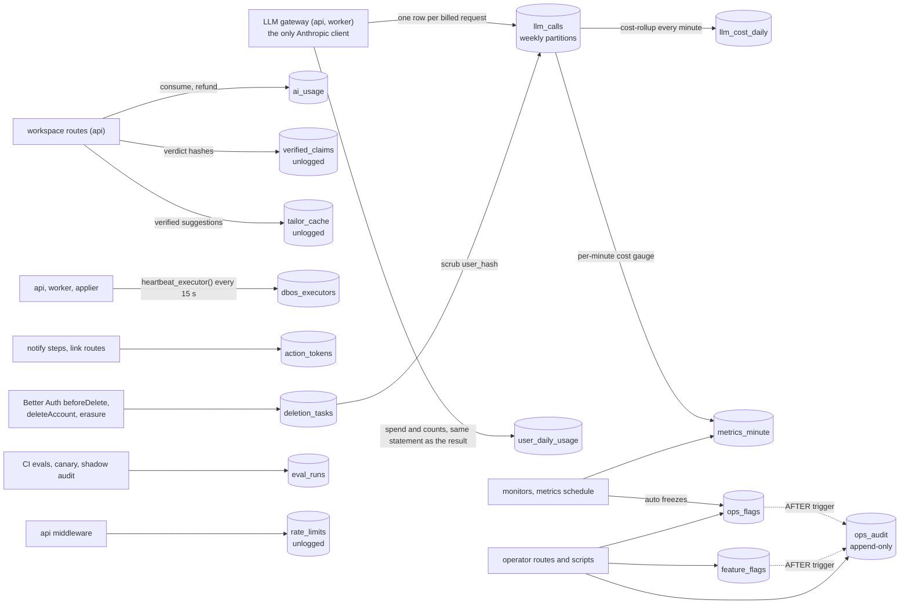
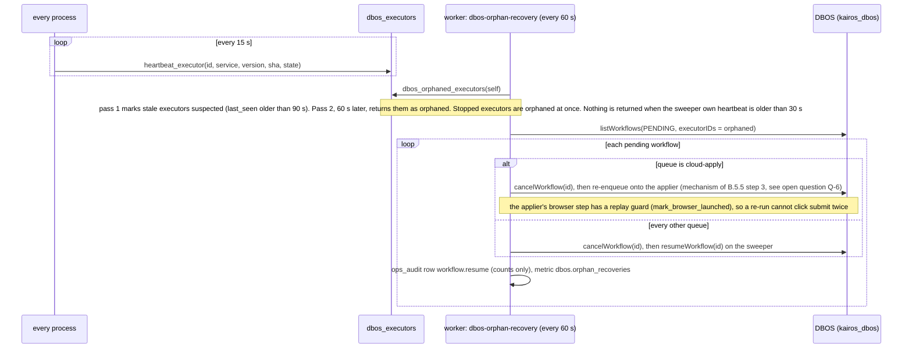
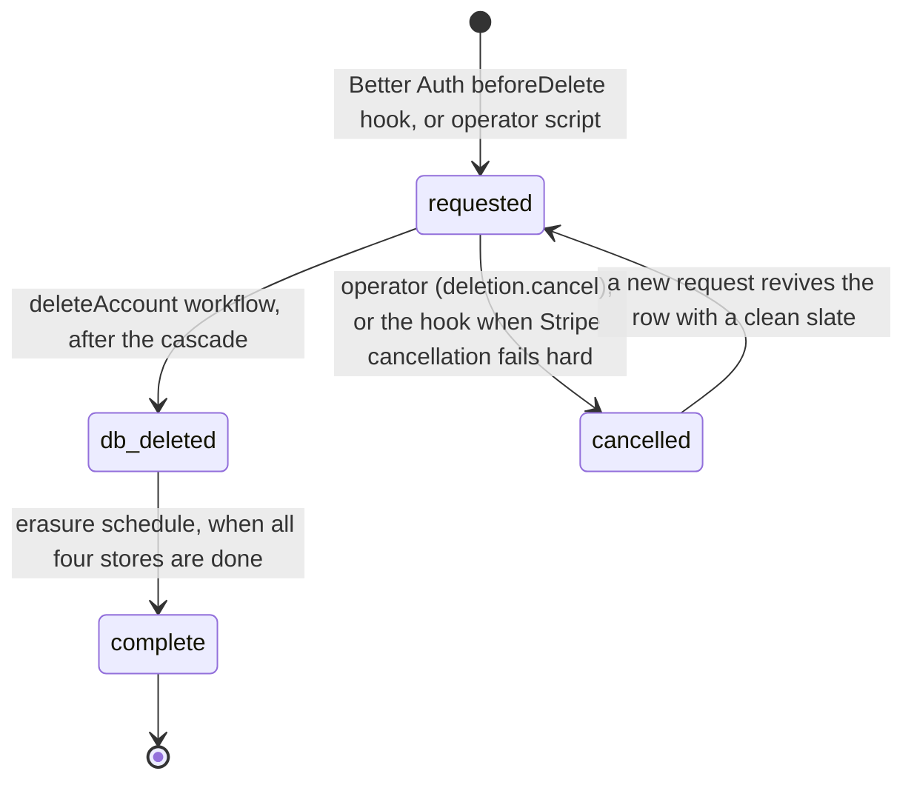
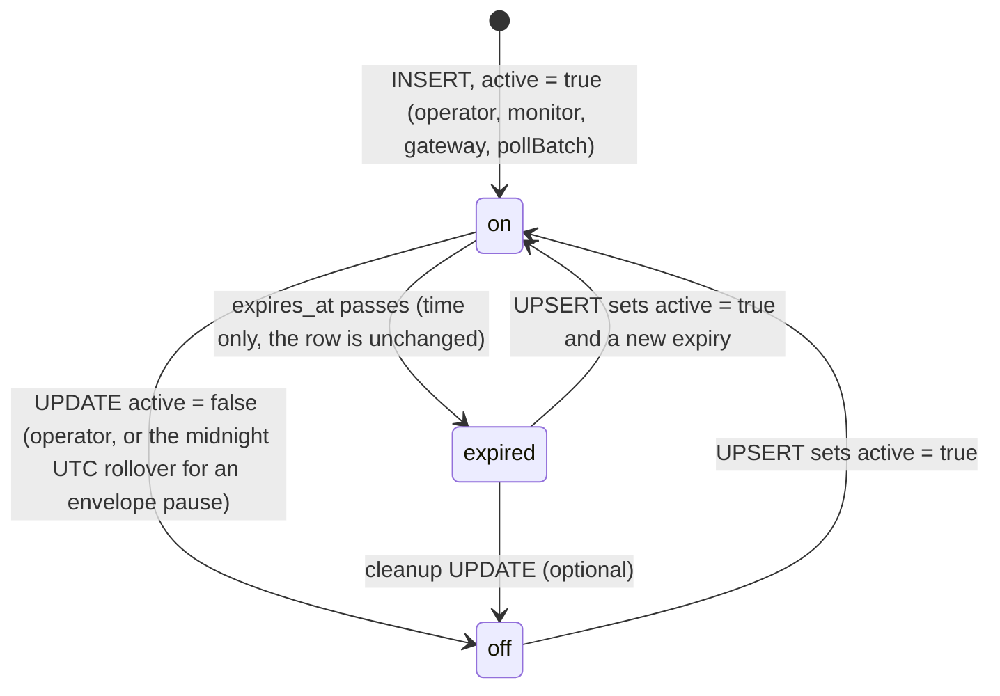
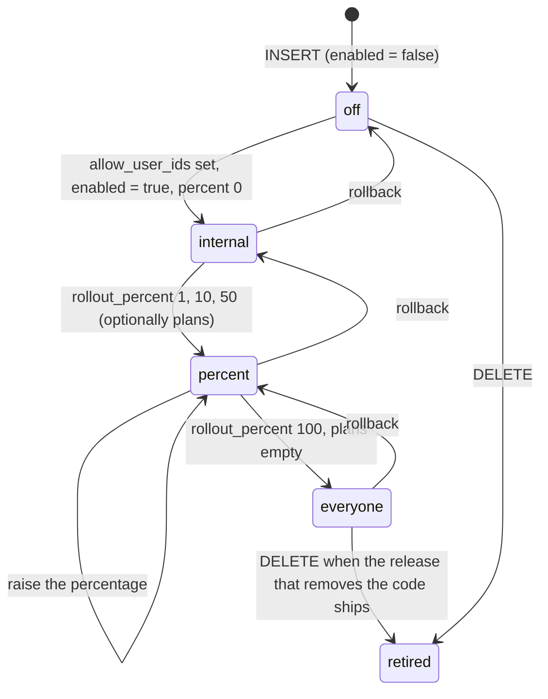
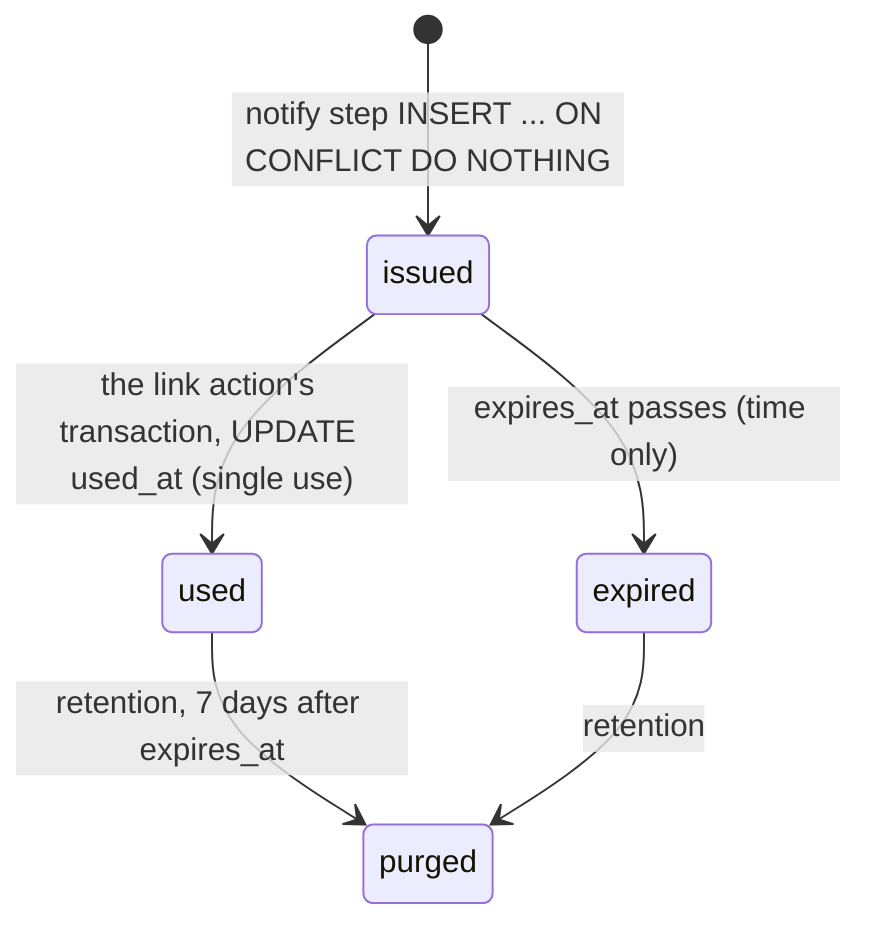
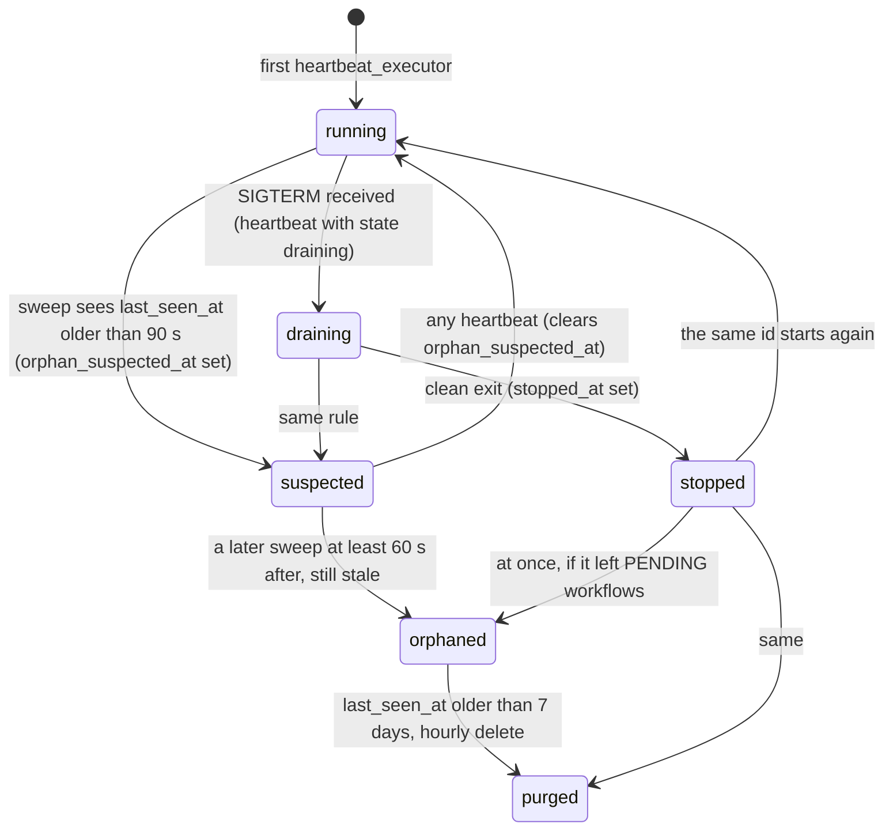
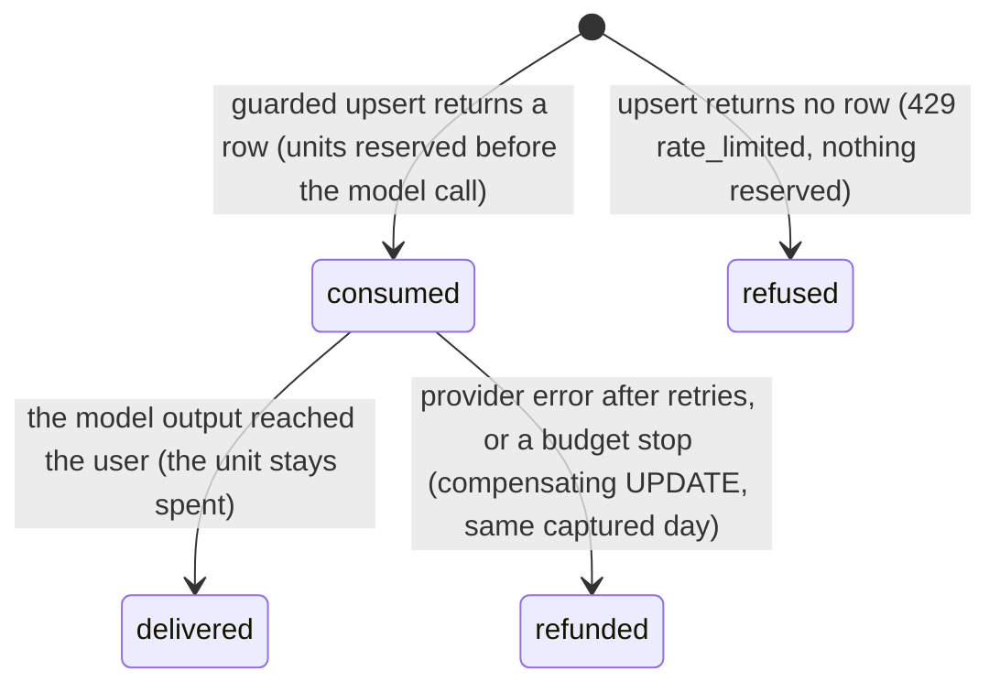

# Database design: domain `platform` (Platform)

Status: design for implementation. Written 2026-10-23 against `01-architecture.md` revision 2 (ADR-001, postgres-durable on DBOS Transact, Anthropic agents), `server/src/db/schema/*.ts`, `server/drizzle/0000_init.sql`, `0001_resume_workspace.sql`, `docs/05-backend-schema.md`, `_research/cost-model.md`, and the sibling domain designs `_db/billing.md` and `_db/messaging.md`.

Postgres 18 (`postgres-ssl:18`), database `kairos`, schema `public`, plus the DBOS-owned system database `kairos_dbos` on the same server. Application pools go through PgBouncer in transaction mode, so nothing here relies on session state (no session advisory locks, no `SET` outside `SET LOCAL`). Skills applied: `database-design` (design the access path before the column), `postgres-best-practices` (partial indexes, indexed foreign keys, short transactions, bounded growth, least privilege) and `drizzle-orm-expert` (sketches in the Drizzle 0.45 array-constraint style the repository already uses). All three loaded.

Evidence tags as in the architecture: **[est]** an estimate to be replaced by beta measurements; **[verify]** a behavior that a named spike (S-D1, S-B1, S-A1, S-P1) must confirm before the phase that needs it.

## 0. Scope, principles, and what this document changes in the architecture

This document owns fifteen tables of the `platform` domain, named exactly as in the architect's inventory (C.1): `llm_calls`, `llm_cost_daily`, `user_daily_usage`, `ai_usage`, `verified_claims`, `tailor_cache`, `eval_runs`, `ops_flags`, `feature_flags`, `action_tokens`, `deletion_tasks`, `ops_audit`, `dbos_executors`, `metrics_minute`, `rate_limits`. It also owns the design of the DBOS system database `kairos_dbos` and of the `dbos.transaction_completion` table that the DBOS Drizzle datasource keeps in `kairos` (section 5). No table of this domain exists in the current 17-table skeleton; every one is new and the whole domain is expand-only (section 9).

Principles that shaped every choice:

1. **This domain holds control data and telemetry, never content.** No prompt, completion, resume text, email body or answer text is stored in `llm_calls`, `ops_audit`, `metrics_minute`, the flags or the executor table. The two tables that do hold user-visible content (`tailor_cache`, and `deletion_tasks.contact_email_enc` transiently) are unlogged or encrypted and expire (sections 4.6, 4.11).
2. **The database enforces what protects money, spend and erasure.** Production can never record a model other than Haiku 5.5 or Sonnet 5.5; an allowance can never be overspent by a race; an operator action can never be edited out of the audit trail; a deletion task cannot reach `complete` with personal data still attached.
3. **Caches that can be recomputed are unlogged.** `verified_claims`, `tailor_cache` and `rate_limits` lose nothing that matters in a crash, skip write-ahead logging, and stay out of backups, which shortens the erasure tail for the one cache that holds personal content.
4. **Exactly one table is partitioned.** `llm_calls` (about 260,000 rows a day at growth) is partitioned weekly so that expiry is a `DROP`, not a 24-million-row `DELETE`. Everything else stays under 1 million rows except `metrics_minute` (4.3 million narrow rows, deleted by day with a BRIN index).
5. **Hot counters are single-row upserts with a guard in the statement.** Allowances and daily usage use `INSERT ... ON CONFLICT DO UPDATE ... WHERE`, so a limit is enforced by the one statement that spends it.
6. **Foreign keys have indexes** (or are the prefix of the primary key). Account deletion cascades through this domain.

### 0.1 Deviations from, and additions to, `01-architecture.md` (B.5.5, B.8.10, B.9.4, B.9.8, B.10.4, B.10.5, B.11.3)

The architect's DDL is the starting point. These are the points where this document differs, each with its reason, so the architect can reconcile the final text.

| # | Architect text | This document | Reason |
|---|---|---|---|
| P1 | `llm_calls` index `(agent_id, created_at)`; hashes and `user_hash` as `text`; no request id | Replaced by a BRIN index on `created_at` plus a partial btree `(agent_id, created_at) WHERE status <> 'ok'`; hashes are `bytea`; adds `provider_request_id`; id comes from a plain sequence | A full btree over 24 million rows costs about 0.8 GB and serves no named query; the investigations that need an index are failures. `bytea` halves hash storage (about 1.7 GB saved). The provider request id is the join key for the nightly reconciliation with Anthropic's usage report. Identity columns on partitioned tables are avoided so the DDL is portable. |
| P2 | "One `llm_calls` row per attempt" (B.9.4) next to an `attempts` column | One row per billed request outcome: a schema re-ask and a tier-up are separate rows; transport retries that returned no usage are folded into `attempts` | Failed transport attempts cost nothing and carry no usage; billed requests each carry tokens and cost. |
| P3 | `llm_cost_daily` key `(day, agent_id, plan, model)` | Key `(day, agent_id, workspace, plan, model, is_batch)`; adds per-status counts and `latency_ms_sum`; `plan` is `text` with the sentinel `none` | The envelopes are per workspace, batch is half price, and the alarms (tier-up, refusals, schema failures, cache share) need counts. A primary key cannot hold NULL. |
| P4 | Allowance refund "in the same transaction" (B.8.10) | Consume in its own short transaction before the model call; refund by a compensating `UPDATE` when no model output reached the user | A database transaction cannot stay open across a 6 to 30 second model call. The compensating update keeps the same guarantee (a failed request does not cost the user an allowance unit). |
| P5 | `verified_claims`, `tailor_cache` plain tables | Both `UNLOGGED`; `verified_claims` caches only `supported`, `unsupported`, `contradicted` and is written by the interactive routes, not by the batch prepare pipeline | A crash only costs a recomputation; unlogged skips WAL and keeps hashes and suggestion text out of PITR backups. `uncertain` is a transient, so caching it would block a retry. |
| P6 | `tailor_cache` kept 7 days, hit "within 24 hours" | Two columns: `expires_at` (serve window, 24 hours) and a 7-day purge on `created_at` | Both numbers are kept as specified; the table makes the difference explicit. Open question Q-3 asks whether 48 hours is enough. |
| P7 | `eval_runs` written by CI | CI produces a JSON artifact; the pre-deploy step (role `kairos_migrator`) inserts ship-gate rows; the worker inserts canary and shadow-audit rows; CI never holds production credentials | Least privilege; `REVOKE INSERT ... FROM kairos_api` from B.10.4 is kept. |
| P8 | `ops_flags`: key, value, `updated_at`, `updated_by` | Adds `active`, `reason`, `detail`, `expires_at`; the key is constrained to a closed catalogue; an `AFTER` trigger writes `ops_audit` | Auto-expiring flags (`host_backoff:<host>`, 15 minutes) and typo-proof kill switches. A trigger audits every change, including manual SQL. |
| P9 | `feature_flags`: key, percent | Adds `enabled`, plan cohorts, allow and deny lists, and the SQL function `feature_enabled()` with a deterministic bucket | The migration rollout plan (B.14) needs cohorts by plan, internal accounts first, and a percentage that only ever adds users. |
| P10 | `action_tokens.entity_id` typed implicitly | `entity_id text`; third purpose `unsubscribe`; per-purpose maximum lifetime | Billing stores `offer_pause_candidates.id::text`; messaging requests an unsubscribe purpose (CAN-SPAM, GDPR). |
| P11 | `deletion_tasks`: key, ids, stage, three timestamps | Full column set, a four-value stage machine, five per-store timestamps (adds `contact_done_at` and `llm_scrubbed_at`, requested by messaging and needed for `llm_calls`), an encrypted contact email, check constraints that forbid `complete` with personal data left | Erasure must be provable per store. `contact_messages` are erased by email address, which no longer exists after the cascade, so it is carried encrypted until that store is done. |
| P12 | `ops_audit`: operator, action, entity, reason, detail | Adds `request_id` (idempotency of operator scripts, used by billing's `admin_adjustment` CLI), format checks, and an append-only trigger | Billing and the architecture both need audited, idempotent operator writes. |
| P13 | `dbos_executors`: id, service, `last_seen_at`; "every process upserts" | Adds `app_version`, `git_sha`, `state`, `stopped_at`, `orphan_suspected_at`; one `SECURITY DEFINER` function `heartbeat_executor` that the applier may execute (a **sixth** applier function, B.10.4 says five); a two-pass orphan rule | The applier role may not write tables, so it cannot heartbeat otherwise, and orphan recovery of `cloud-apply` workflows needs to see applier replicas. The two-pass rule stops a database outage from making live executors look dead. |
| P14 | `metrics_minute (minute, name)` primary key | Primary key `(name, labels, minute)` plus a BRIN index on `minute`; `kairos_readonly` gains `SELECT` on it | Dashboards ask for one series over time; labels keep per-queue and per-ATS gauges in one name. |
| P15 | `rate_limits` "unlogged table used by `RateLimiterPostgres`" | Pre-created by migration as the library's three-column table, `UNLOGGED`, with tuned autovacuum | The library's own `CREATE TABLE IF NOT EXISTS` would create a logged table with default settings. Better Auth's separate `rateLimit` table belongs to identity-profile. |
| P16 | `dbos.transaction_completion` mentioned, no retention | Safety-net sweep of rows older than 21 days (14 days of workflow retention plus 7 days of margin); the table is otherwise near empty | Spike S-D1 read the 5.3.0 source: the datasource deletes a workflow's completion rows when the workflow finishes, so the table does not grow by the roughly 120,000 rows a day that was feared. Rows survive only for cancelled or forked originals (orphan recovery, version migration) and for workflows deleted before they finished, and the sweep removes those (section 5.3). |
| P17 | Secrets list (B.4.1) | Adds `USER_HASH_KEY` (api and worker only) for the `llm_calls.user_hash` HMAC | The architecture says "HMAC of the user id" without naming the key. |
| P18 | Deletion tasks and erasure in phase P6 | Recommend pulling the hook, the table and the `erasure` schedule into P2 | From P1 the gateway writes pseudonymous `user_hash` values into `llm_calls`, and the paid beta opens after P5, before P6. If P6 stays, the privacy notice must say model-call metadata is kept up to 97 days. See section 9. |
| P19 | `llm_calls` partitions detached with `DETACH PARTITION ... CONCURRENTLY` as a worker statement | Detach and drop run inside the `SECURITY DEFINER` function `llm_calls_drop_old_partitions()` (owner `kairos_migrator`) with plain `DETACH PARTITION` under `lock_timeout = '2s'`, at 03:00 UTC | `CONCURRENTLY` cannot run inside a function or transaction block, and `kairos_worker` does not own the table, so it could not run it at all. A plain detach holds `ACCESS EXCLUSIVE` on the parent for milliseconds; if it cannot get the lock in 2 seconds it gives up and retries the next day, and the gateway buffers rows in memory in the meantime (4.1, writer behavior). |
| P20 | `deletion_tasks.storage_id` doubles as the key for the `llm_calls` scrub | New column `llm_user_hash bytea` (the 16-byte HMAC, computed by the hook while the user id is still known) | `storage_id` is nulled when R2 is done, which can be before the scrub runs, and the HMAC cannot be recomputed without the user id. Each identifier column is now cleared exactly when its own store is done (4.11 checks). |
| P21 | B.5.7 checkpoint budget: about three status rows per workflow, 751,000 writes a day, 37 per submitted application, target 40, alert 60 | About 6 fixed writes per workflow, about 1.1 million a day, about 55 per submitted application, target 60, alert at 80 (spike S-D1); `dbos.*` series in `metrics_minute` | Measured against the 5.3.0 source and a real two-transaction workflow (11 writes direct, 12 queued). Section 5.4. |

## 1. Summary

| Table | Purpose | Written by | Read by | Rows at 10,000 users [est] | Retention |
|---|---|---|---|---|---|
| `llm_calls` | Metadata-only ledger of every billed model request | Gateway (api and worker), `erasure` (user_hash scrub) | Cost roll-up, quality samples, support | 260,000 a day; 23.4 to 25.2 million live | Weekly partitions dropped after 90 days (live 90 to 97 days) |
| `llm_cost_daily` | Daily roll-up of `llm_calls` by agent, workspace, plan, model | `cost-rollup` schedule | Envelopes, alarms, dashboards, cost per submission | About 60 a day; 22,000 a year | Forever |
| `user_daily_usage` | Per-user per-UTC-day counters: scored pairs, filter counts, spend, drafts, actions, Autopilot sends | Matching, prepare, Autopilot, gateway | Caps, demand budget, `GET /api/usage/today`, abuse review | 3,500 a day; 315,000 live | 90 days |
| `ai_usage` | F11 per-feature daily allowance counters | Workspace routes (api) | Same routes, `GET /api/usage/today` | 2,600 a day; 234,000 live | 90 days |
| `verified_claims` | Hash cache of verifier verdicts (24 hours) | Interactive routes | Same routes, `PATCH` | About 45,000 live (worst case 520,000) | 24 hours, unlogged |
| `tailor_cache` | Verified tailor suggestions per (user, job, input) | `POST /api/jobs/:jobId/tailor` | Same route | About 10,000 live | Served 24 hours, kept 7 days, unlogged |
| `eval_runs` | Agent eval results, canaries and shadow audits | Pre-deploy step, worker | Deploy gate, Autopilot gate, weekly review | About 1,100 a year | Forever |
| `ops_flags` | Kill switches with reason and optional expiry | Operator routes, monitors, gateway, applier reads | Every process (10-second cache) | At most 30 | Kept; cleared by `active = false` |
| `feature_flags` | Per-user rollout flags for the migration phases | Operator | Every process | At most 15 | Removed when a flag is retired |
| `action_tokens` | Single-use signed-link registry (resend, offer-pause undo, unsubscribe) | `notify` steps, link routes | Link routes | About 110,000 live | 7 days after expiry |
| `deletion_tasks` | Per-store account erasure tracking, no foreign key | Better Auth hook, `deleteAccount`, `erasure` | `erasure`, alerts | About 30 a month | 24 months after completion |
| `ops_audit` | Append-only log of operator and automatic privileged writes | Admin routes, scripts, flag triggers | Operators | About 15,000 a year | Forever |
| `dbos_executors` | Executor heartbeats for orphan recovery | Every process through `heartbeat_executor` | `dbos-orphan-recovery`, admin page | About 15 live, 330 incl. churn | 7 days after last seen |
| `metrics_minute` | One-minute gauges written from SQL | `metrics`, `cost-rollup` schedules | Dashboards, alert rules | 4.3 million | 30 days |
| `rate_limits` | Counters of `RateLimiterPostgres` | api | api | About 20,000 live | Expired rows removed continuously; unlogged |

Hash and identifier conventions used by this domain (two hashes of a user id exist on purpose):

| Name | Definition | Used by |
|---|---|---|
| `user_hash` in `deletion_tasks` and R2 tombstone names | `encode(sha256(convert_to(user_id, 'UTF8')), 'hex')`, 64 hex characters. The same expression as `credit_ledger_archive.user_hash` (billing) | Erasure tracking, tombstone replay after a restore |
| `user_hash` in `llm_calls` | First 16 bytes of HMAC-SHA256(`USER_HASH_KEY`, user id), as `bytea` | Pseudonymous per-user spend queries; scrubbed on erasure |
| Raw hashes (`claim_hash`, `input_hash`, `token_hash`, `prompt_sha256`) | SHA-256, 32 bytes, `bytea` | Caches, call dedupe, token lookup |

## 2. Cross-domain references and the data flow

Names are exactly those of the architect's inventory (C.1).

| This table.column | References | On delete | Domain of the target |
|---|---|---|---|
| `user_daily_usage.user_id` | `"user"(id)` | CASCADE | identity-profile |
| `ai_usage.user_id` | `"user"(id)` | CASCADE | identity-profile |
| `tailor_cache.user_id` | `"user"(id)` | CASCADE | identity-profile |
| `tailor_cache.job_id` | `jobs(id)` | CASCADE | catalog-matching |
| `action_tokens.user_id` | `"user"(id)` | CASCADE | identity-profile |
| `llm_calls.application_id`, `llm_calls.job_id` | none (logical references, ids only) | n/a | applications, catalog-matching |
| `deletion_tasks`, `ops_audit`, `ops_flags`, `feature_flags`, `eval_runs`, `llm_cost_daily`, `metrics_minute`, `dbos_executors`, `rate_limits`, `verified_claims` | none by design | n/a | n/a |

`llm_calls` has no foreign keys on purpose: it is partitioned (its primary key is `(id, created_at)`, so nothing can reference one row), it is written on the hot path, and a 90-day-old row must survive the deletion of the job or application it names. Other domains store the call id as a plain `bigint` with no constraint (`matches.llm_call_id`, `verification_results.llm_call_id`, `rehearsal_turns.llm_call_id`); after the partition is dropped such a reference dangles, which is intended.

References into this domain (their owners write the code; this domain defines the contract):

| Referencing column or rule | Owner | Contract this domain keeps |
|---|---|---|
| `action_tokens.entity_id` = `offer_pause_candidates.id::text` for purpose `offer_pause_undo` | billing | Column is `text` |
| `deletion_tasks.user_hash` and the tombstone name use billing's sha256 expression | billing | Section 1 table |
| `ops_audit` rows for `admin_adjustment`, `refund_failed_submit`, balance repair, dead-event redrive, with `request_id` as the CLI's idempotency key | billing | `ops_audit_request_uq` (4.12) |
| `ops_flags.approvals_frozen` set by drift and dual-submission checks | billing, applications | Catalogue in 4.8 |
| `deletion_tasks.contact_done_at`, `action_tokens.purpose = 'unsubscribe'` | messaging | Both included (4.10, 4.11) |
| `matches.llm_call_id`, `verification_results.llm_call_id`, `rehearsal_turns.llm_call_id` | catalog-matching, applications | Plain `bigint`, no foreign key |



## 3. Privilege matrix (extends B.10.4)

Default privileges in the architecture grant `SELECT, INSERT, UPDATE, DELETE` on every new table to `kairos_api` and `kairos_worker`, so the migration must revoke explicitly. Final state, asserted by grant test T-1 (section 10):

| Table | `kairos_api` | `kairos_worker` | `kairos_applier` | `kairos_readonly` |
|---|---|---|---|---|
| `llm_calls` | `INSERT` | `SELECT, INSERT`, `UPDATE (user_hash)` | none | none |
| `llm_cost_daily` | `SELECT` | `SELECT, INSERT, UPDATE` | none | `SELECT` |
| `user_daily_usage` | `SELECT, INSERT, UPDATE` | `SELECT, INSERT, UPDATE, DELETE` | none | `SELECT` |
| `ai_usage` | `SELECT, INSERT, UPDATE` | `SELECT, DELETE` | none | none |
| `verified_claims` | `SELECT, INSERT, UPDATE` | `SELECT, INSERT, UPDATE, DELETE` | none | none |
| `tailor_cache` | `SELECT, INSERT, UPDATE` | `SELECT, DELETE` | none | none |
| `eval_runs` | `SELECT` | `SELECT, INSERT` | none | none |
| `ops_flags` | `SELECT, INSERT, UPDATE` | `SELECT, INSERT, UPDATE` | `SELECT` (B.10.4) | none |
| `feature_flags` | `SELECT, INSERT, UPDATE` | `SELECT` | none | none |
| `action_tokens` | `SELECT, INSERT, UPDATE` | `SELECT, INSERT, UPDATE, DELETE` | none | none |
| `deletion_tasks` | `SELECT, INSERT, UPDATE` | `SELECT, INSERT, UPDATE, DELETE` | none | none |
| `ops_audit` | `SELECT, INSERT` | `SELECT, INSERT` | none | none |
| `dbos_executors` | `SELECT`, `EXECUTE heartbeat_executor` | `SELECT, DELETE`, `EXECUTE heartbeat_executor` | `EXECUTE heartbeat_executor` only | none |
| `metrics_minute` | `SELECT` | `SELECT, INSERT, UPDATE, DELETE` | none | `SELECT` |
| `rate_limits` | `SELECT, INSERT, UPDATE, DELETE` | `EXECUTE rate_limits_purge()` only | none | none |

```sql
REVOKE ALL ON llm_calls, llm_cost_daily, user_daily_usage, ai_usage, verified_claims, tailor_cache, eval_runs, ops_flags,
              feature_flags, action_tokens, deletion_tasks, ops_audit, dbos_executors, metrics_minute, rate_limits
  FROM kairos_api, kairos_worker, kairos_applier, kairos_readonly;
-- then the GRANT statements of the matrix, one per cell; each table's grants ship in the migration that creates it (`platform_00` to `platform_04`, section 9.2)
GRANT USAGE ON SEQUENCE llm_calls_id_seq TO kairos_api, kairos_worker;
```

`kairos_api` holds `UPDATE` on `deletion_tasks` because the Better Auth hook runs in the api and needs the `ON CONFLICT DO UPDATE` branch (revival) and the writes of `tombstone_written_at` and `stripe_done_at`; the guard trigger of 7.5 limits what any role can do with it. `UPDATE` and `DELETE` on `ops_audit` are never granted, and a trigger blocks them for the owner too (4.12). `TRUNCATE` and `REFERENCES` are never granted to a runtime role. Function grants are listed in 7.1 (the partition and roll-up functions and `dbos_orphaned_executors` to the worker, the heartbeat to all three process roles). The weekly logical dump runs with `pg_dump --no-unlogged-table-data` so the three unlogged tables never reach R2.

## 4. Tables

### 4.1 `llm_calls`

**Purpose.** The model-call ledger: one metadata-only row per billed Anthropic request outcome, written by the gateway (`server/src/llm/gateway.ts`, the only importer of `@anthropic-ai/sdk`). It makes every cost control measurable (cost per submission, envelopes, cache share, tier-up and escalation rates) and lets a weekly quality sample be rebuilt from Postgres using the stored ids. No prompt or completion body is stored anywhere (SP-6).

**What one row is.** A billed request: the first call, a schema re-ask (`status` of the failed row `schema_invalid`, then a new row for the re-ask), a tier-up to Sonnet (`tiered_up = true`), a refusal (`blocked`), a call stopped by `max_tokens`, or a call refused before sending by a budget (`budget_stopped`, zero tokens). SDK transport retries that returned no usage are counted in `attempts` on the row that is finally written (an `error` row when every attempt failed). `created_at` is the completion time of the request; for a Message Batches result it is the time the result is applied, and `is_batch` is true.

**Columns.**

| Column | Type | Null | Default | Notes |
|---|---|---|---|---|
| `id` | `bigint` | no | `nextval('llm_calls_id_seq')` | Part of the primary key; returned to callers as `llmCallId` |
| `created_at` | `timestamptz` | no | `now()` | Partition key |
| `agent_id` | `text` | no | | One of the 12 agent ids; format check only, membership is the gateway's registry |
| `prompt_version` | `smallint` | no | | `prompts/v<N>.md` |
| `prompt_sha256` | `bytea` | no | | SHA-256 of the rendered static prefix |
| `model` | `text` | no | | Model actually used; check allows only Haiku and Sonnet 5.5 (and dated snapshots of them) |
| `workspace` | `text` | no | | `batch` or `interactive` (the Anthropic workspace and key used) |
| `is_batch` | `boolean` | no | `false` | Message Batches (50% price) |
| `plan` | `plan_id` | yes | | Null for system calls such as shared `jd-analyst` |
| `user_hash` | `bytea` | yes | | 16-byte HMAC (section 1); null for system calls; nulled on erasure |
| `application_id` | `uuid` | yes | | Logical reference |
| `job_id` | `uuid` | yes | | Logical reference |
| `input_refs` | `jsonb` | yes | | Ids only, at most 2,048 bytes, enough to rebuild a sample |
| `input_hash` | `bytea` | no | | SHA-256 of the assembled input; dedupe and sample lookup |
| `input_tokens` | `integer` | no | `0` | The provider's uncached `input_tokens` |
| `cache_read_tokens` | `integer` | no | `0` | |
| `cache_write_tokens` | `integer` | no | `0` | |
| `output_tokens` | `integer` | no | `0` | |
| `cost_usd` | `numeric(12,8)` | no | `0` | Computed by the gateway from `llm/prices.ts` (batch at 50%) |
| `latency_ms` | `integer` | yes | | Null for `budget_stopped` |
| `stop_reason` | `text` | yes | | `end_turn`, `max_tokens`, `refusal` |
| `status` | `text` | no | | `ok`, `schema_invalid`, `max_tokens`, `blocked`, `error`, `budget_stopped` |
| `attempts` | `smallint` | no | `1` | HTTP attempts for this request |
| `tiered_up` | `boolean` | no | `false` | One tier up (Sonnet) |
| `error_code` | `text` | yes | | Short code; null exactly when `status = 'ok'` |
| `provider_request_id` | `text` | yes | | Anthropic `request-id` header, or the batch id for a batch result |

**Primary key.** `(id, created_at)` (a primary key on a partitioned table must contain the partition key).

**Foreign keys.** None (section 2).

**Unique and partial unique indexes.** None possible beyond the primary key (unique indexes on a partitioned table must contain `created_at`). Idempotency of the write is the gateway's: it inserts once per response, after the response is validated; a replayed DBOS step repeats the model call and therefore writes a second row for a second billed request, which is the correct accounting.

**Other indexes.**

| Index | Definition | Query it serves |
|---|---|---|
| `llm_calls_created_brin` | `USING brin (created_at) WITH (pages_per_range = 32)` | `cost-rollup` (`WHERE created_at >= $dayStart AND created_at < $dayEnd`), the per-minute cost gauge (`created_at` in the last minute), and every "last hour" operational query. Rows arrive in time order, so BRIN is accurate and about 100 KB per partition |
| `llm_calls_failures_idx` | `(agent_id, created_at) WHERE status <> 'ok'` | "Recent failures of agent X" (schema failures, refusals, budget stops) and the refusal-rate alarm. Failures are 1% to 3% of rows, so the index is under 20 MB |

Deliberately not indexed: `user_hash` (support queries filter to the last days, which prunes to one or two partitions; the nightly scrub is a single scan), `application_id` (the application's creation time bounds the partitions to scan).

**Check constraints.**

```sql
CONSTRAINT llm_calls_agent_ck      CHECK (agent_id ~ '^[a-z][a-z0-9-]{2,40}$'),
-- INV: Opus 5.5 and Fable 5.1 never run in production (anthropic-models.md); a dated snapshot of an allowed model stays allowed
CONSTRAINT llm_calls_model_ck      CHECK (model ~ '^claude-(haiku|sonnet)-5-5(-[0-9]{8})?$'),
CONSTRAINT llm_calls_workspace_ck  CHECK (workspace IN ('batch','interactive')),
CONSTRAINT llm_calls_status_ck     CHECK (status IN ('ok','schema_invalid','max_tokens','blocked','error','budget_stopped')),
CONSTRAINT llm_calls_error_code_ck CHECK ((status = 'ok') = (error_code IS NULL)
                                          AND (error_code IS NULL OR error_code ~ '^[a-z0-9_]{1,64}$')),
CONSTRAINT llm_calls_hash_len_ck   CHECK (octet_length(prompt_sha256) = 32 AND octet_length(input_hash) = 32
                                          AND (user_hash IS NULL OR octet_length(user_hash) = 16)),
CONSTRAINT llm_calls_counts_ck     CHECK (input_tokens >= 0 AND cache_read_tokens >= 0 AND cache_write_tokens >= 0
                                          AND output_tokens >= 0 AND cost_usd >= 0 AND attempts >= 1),
CONSTRAINT llm_calls_refs_ck       CHECK (input_refs IS NULL OR (jsonb_typeof(input_refs) = 'object'
                                          AND octet_length(input_refs::text) <= 2048)),
CONSTRAINT llm_calls_batch_ck      CHECK (NOT is_batch OR workspace = 'batch'),
CONSTRAINT llm_calls_tier_ck       CHECK (NOT tiered_up OR model LIKE 'claude-sonnet-%')
```

**DDL (the migration replaces the `CREATE TABLE` that drizzle-kit generates, before the file is first applied; see 9.1).**

```sql
CREATE SEQUENCE llm_calls_id_seq AS bigint;

CREATE TABLE llm_calls (
  id                  bigint        NOT NULL DEFAULT nextval('llm_calls_id_seq'),
  created_at          timestamptz   NOT NULL DEFAULT now(),
  agent_id            text          NOT NULL,
  prompt_version      smallint      NOT NULL,
  prompt_sha256       bytea         NOT NULL,
  model               text          NOT NULL,
  workspace           text          NOT NULL,
  is_batch            boolean       NOT NULL DEFAULT false,
  plan                plan_id,
  user_hash           bytea,
  application_id      uuid,
  job_id              uuid,
  input_refs          jsonb,
  input_hash          bytea         NOT NULL,
  input_tokens        integer       NOT NULL DEFAULT 0,
  cache_read_tokens   integer       NOT NULL DEFAULT 0,
  cache_write_tokens  integer       NOT NULL DEFAULT 0,
  output_tokens       integer       NOT NULL DEFAULT 0,
  cost_usd            numeric(12,8) NOT NULL DEFAULT 0,
  latency_ms          integer,
  stop_reason         text,
  status              text          NOT NULL,
  attempts            smallint      NOT NULL DEFAULT 1,
  tiered_up           boolean       NOT NULL DEFAULT false,
  error_code          text,
  provider_request_id text,
  CONSTRAINT llm_calls_pk PRIMARY KEY (id, created_at)
  -- the nine CHECK constraints above, in the same statement
) PARTITION BY RANGE (created_at);
ALTER SEQUENCE llm_calls_id_seq OWNED BY llm_calls.id;

CREATE TABLE llm_calls_default PARTITION OF llm_calls DEFAULT;      -- safety net; an alert fires if it ever holds a row
CREATE INDEX llm_calls_created_brin ON llm_calls USING brin (created_at) WITH (pages_per_range = 32);
CREATE INDEX llm_calls_failures_idx ON llm_calls (agent_id, created_at) WHERE status <> 'ok';
SELECT llm_calls_ensure_partitions(6);                               -- function in section 7
```

**Partitioning and retention.** Weekly `RANGE (created_at)` partitions from Monday 00:00 UTC, named `llm_calls_<ISO year>w<ISO week>` (for example `llm_calls_2026w43`). Created six weeks ahead by the daily `partitions` schedule (`llm_calls_ensure_partitions`, section 7); an alert fires when fewer than three future partitions exist or `llm_calls_default` holds any row. A partition is detached and dropped when its upper bound is older than 90 days **and** `llm_calls_partition_rolled_up(partition)` returns true (for every UTC day in it, `llm_cost_daily.calls` summed over the day equals the number of rows in the partition for that day), so rows live 90 to 97 days. Detach and drop are done by `llm_calls_drop_old_partitions()` (section 7.2, deviation P19): plain `DETACH PARTITION` under `lock_timeout = '2s'`, retried on the next run when the lock is not free. Erasure: the nightly step of the `erasure` schedule runs `UPDATE llm_calls SET user_hash = NULL WHERE user_hash = ANY($hashes) AND created_at >= now() - interval '98 days'` for every task whose `llm_scrubbed_at` is null (one scan of at most 25 million narrow rows, a few seconds to tens of seconds, only on nights that have a task).

**Row-count projection (10,000 users).** Growth case 260,000 rows a day (the cost model's 247,200 calls plus about 5% re-asks, tier-ups and failed requests), base case 223,000. Live at 90 to 97 days: 23.4 to 25.2 million rows at growth, 20.1 to 21.6 million at base. About 340 bytes a row: **8.0 to 8.6 GB** at growth, 6.8 to 7.4 GB at base, plus under 0.1 GB of indexes. Insert rate 3 a second on average, about 25 a second at peak. Write volume to WAL about 90 MB a day. The cost model projected 7.9 GB for the OpenRouter case; the extra is the larger row (request id, bytea hashes) and the larger call count.

**Writer behavior.** An insert failure never fails a user request. The gateway buffers up to 1,000 rows in memory, retries every 5 seconds, increments a counter, and the `metrics` schedule pages when any process reports a buffer above 100 rows (a lost row means lost cost accounting, so it is treated as an incident, not noise).

### 4.2 `llm_cost_daily`

**Purpose.** The daily roll-up of `llm_calls`. It is the cost history that outlives the 90-day partitions, the source of per-agent daily envelopes (alert at 80%, batch pause at 100%), of cost per submitted application, and of every quality alarm (tier-up rate, refusal rate, schema failures, cache share). It is recomputed from `llm_calls`, never incremented, so it cannot drift.

**Columns.**

| Column | Type | Null | Default | Notes |
|---|---|---|---|---|
| `day` | `date` | no | | UTC day of `llm_calls.created_at` |
| `agent_id` | `text` | no | | |
| `workspace` | `text` | no | | `batch` or `interactive` |
| `plan` | `text` | no | | `free`, `starter`, `pro`, `max` or `none` (system calls) |
| `model` | `text` | no | | Model actually used (a tier-up is its own row) |
| `is_batch` | `boolean` | no | | |
| `calls` | `integer` | no | | Equals the sum of the six status counts (check) |
| `calls_ok`, `calls_schema_invalid`, `calls_max_tokens`, `calls_blocked`, `calls_error`, `calls_budget_stopped` | `integer` | no | `0` | One per `status` value |
| `calls_tiered_up` | `integer` | no | `0` | |
| `input_tokens`, `cache_read_tokens`, `cache_write_tokens`, `output_tokens` | `bigint` | no | `0` | Sums |
| `cost_usd` | `numeric(14,8)` | no | | Sum |
| `latency_ms_sum` | `bigint` | no | `0` | Average latency is `latency_ms_sum / calls` |
| `updated_at` | `timestamptz` | no | `now()` | |

Cache share is defined as `cache_read_tokens / (input_tokens + cache_read_tokens + cache_write_tokens)`, because `input_tokens` is the provider's uncached count. The alarm "scorer cache share below 55% for an hour" reads the same expression from the per-minute gauges (section 4.14).

**Primary key.** `(day, agent_id, workspace, plan, model, is_batch)`. Day-first order serves the common reads (today, yesterday, a month) as range scans.

**Foreign keys.** None.

**Unique and partial unique indexes.** The primary key is the upsert target of `llm_cost_rollup_day`.

**Other indexes.** None. Per-agent trends read about 60 rows a day times 30 days.

**Check constraints.**

```sql
CHECK (plan IN ('free','starter','pro','max','none')),
CHECK (workspace IN ('batch','interactive')),
CHECK (calls = calls_ok + calls_schema_invalid + calls_max_tokens + calls_blocked + calls_error + calls_budget_stopped),
CHECK (calls_tiered_up <= calls AND cost_usd >= 0)
```

**Partitioning and retention.** None; kept forever (about 22,000 rows and 8 MB a year). The `cost-rollup` schedule (every minute) calls `llm_cost_rollup_day(today)`, and also `llm_cost_rollup_day(yesterday)` until 00:30 UTC (late batch results and in-flight writes), and a final pass for yesterday at 01:00 UTC. The partition drop uses `llm_calls_partition_rolled_up` as its precondition.

**Row-count projection.** About 60 rows a day (12 agents x up to 5 plans x up to 2 models x up to 2 batch modes, of which about 60 occur), 22,000 a year.

**Daily envelope check (gateway).** The gateway reads `SELECT sum(cost_usd) FROM llm_cost_daily WHERE day = current_utc_day AND agent_id = $1` at most once every 10 seconds per process and adds its own in-process spend since the last read; the table lags real spend by under a minute, which is why the 80% alert and the 100% pause thresholds sit below the hard Anthropic workspace limits.

### 4.3 `user_daily_usage`

**Purpose.** Per-user, per-UTC-day counters that drive the pacing and spend caps of B.7.3 and B.7.4 (`dailyScoringCap`, `dailyModelSpendCapUsd`, the demand budget, `autopilotDailySendCap`) and the response of `GET /api/usage/today`. A new day is a new row, so there is no reset job.

**Columns.**

| Column | Type | Null | Default | Written by |
|---|---|---|---|---|
| `user_id` | `text` | no | | |
| `day` | `date` | no | | UTC day: `(now() AT TIME ZONE 'UTC')::date` |
| `scored` | `integer` | no | `0` | `scoreUser` chunk step (same transaction as the `matches` rows) and the import route |
| `filtered` | `jsonb` | no | `'{}'` | `candidatePage` prefilter step: hard-filter rejections by reason, counters only, merged with `kairos_jsonb_add` |
| `pipeline_usd` | `numeric(10,6)` | no | `0` | Gateway, for pipeline agents (`fit-scorer`, and `resume-tailor`, `answer-drafter`, `cover-letter-writer`, `claim-verifier`, `claim-verifier-escalation` inside the prepare pipeline) |
| `interactive_usd` | `numeric(10,6)` | no | `0` | Gateway, for workspace agents (`resume-writer`, tailor and drafts routes, `interview-coach`) |
| `drafts` | `integer` | no | `0` | `prepareApplication` at the end of `generateAndVerify` (stored or not) |
| `match_actions` | `integer` | no | `0` | `queueMatch` (user or Autopilot) and the skip route; feeds the demand budget |
| `autopilot_sends` | `integer` | no | `0` | `approveCore` for the Autopilot actor, under the balance lock |
| `updated_at` | `timestamptz` | no | `now()` | |

Shared `jd-analyst` calls carry no user and are not counted here; they are bounded by their own envelope (B.12.1).

**Primary key.** `(user_id, day)`.

**Foreign keys.** `user_id` references `"user"(id)` `ON DELETE CASCADE` (served by the primary key prefix).

**Unique and partial unique indexes.** The primary key is the upsert target of every writer:

```sql
INSERT INTO user_daily_usage AS u (user_id, day, scored, filtered)
VALUES ($1, (now() AT TIME ZONE 'UTC')::date, $2, $3::jsonb)
ON CONFLICT (user_id, day) DO UPDATE
   SET scored = u.scored + EXCLUDED.scored,
       filtered = kairos_jsonb_add(u.filtered, EXCLUDED.filtered),
       updated_at = now();
```

**Other indexes.** None. The demand budget reads `WHERE user_id = $1 AND day >= current_date - 3` (primary key range). Set scans over one day (the "more than 5% of active users at a cap" alarm, abuse review) read at most 4,000 rows, which costs less than maintaining a `day` index on a table that is updated all day; the daily retention delete is a sequential scan of about 315,000 narrow rows.

**Check constraints.**

```sql
CHECK (scored >= 0 AND drafts >= 0 AND match_actions >= 0 AND autopilot_sends >= 0
       AND pipeline_usd >= 0 AND interactive_usd >= 0),
CHECK (jsonb_typeof(filtered) = 'object' AND octet_length(filtered::text) <= 1024)
```

**Partitioning and retention.** None. Rows older than 90 days are deleted daily by `retention` in batches of 5,000 (`DELETE ... WHERE ctid IN (SELECT ctid FROM user_daily_usage WHERE day < current_date - 90 LIMIT 5000)`). `fillfactor = 80` keeps the many updates of one row heap-only.

**Row-count projection.** About 3,500 rows a day (users with a scoring run, a draft or an action), **315,000 live**, about 200 bytes a row: 63 MB plus 20 MB of primary key.

### 4.4 `ai_usage`

**Purpose.** F11, the per-feature daily AI allowance: one counter per (user, UTC day, feature). Limits come only from `shared/src/plans.ts` (`aiDailyAllowance`); this table holds only usage. A spent allowance is refused with 429 `rate_limited`, never served by a cheaper model.

**Columns.**

| Column | Type | Null | Default | Notes |
|---|---|---|---|---|
| `user_id` | `text` | no | | |
| `day` | `date` | no | | UTC day |
| `feature` | `text` | no | | `resumeSuggestions`, `jobTailor`, `applicationDrafts`, `jobImports`, `rehearsalTurns` (the keys of `AiDailyAllowance`) |
| `used` | `integer` | no | `0` | Units consumed; scope `resume` of suggestions costs 4 units |
| `updated_at` | `timestamptz` | no | `now()` | |

**Primary key.** `(user_id, day, feature)`.

**Foreign keys.** `user_id` references `"user"(id)` `ON DELETE CASCADE` (primary key prefix).

**Unique and partial unique indexes.** The primary key. The guarded consume statement (the limit is a parameter read from `plans.ts`; the same statement enforces it on the first request of the day and on every later one, so two parallel requests can never both take the last unit):

```sql
INSERT INTO ai_usage AS u (user_id, day, feature, used)
SELECT $1, (now() AT TIME ZONE 'UTC')::date, $2, $3
 WHERE $3 <= $4                                   -- units <= limit (a limit of 0 refuses the first request)
ON CONFLICT (user_id, day, feature) DO UPDATE
   SET used = u.used + EXCLUDED.used, updated_at = now()
 WHERE u.used + EXCLUDED.used <= $4
RETURNING used;                                    -- no row returned = refused (429 rate_limited)
```

Refund after a failure that produced no model output reaching the user (provider error after retries, budget stop): `UPDATE ai_usage SET used = GREATEST(used - $units, 0), updated_at = now() WHERE user_id = $1 AND day = $capturedDay AND feature = $2`. The route captures `day` when it consumes, so a request that straddles 00:00 UTC refunds the day it charged. Cache hits and validation failures are decided before consuming, so they never need a refund.

**Other indexes.** None. `GET /api/usage/today` reads the at most five rows of `(user_id, day)` by primary key prefix; the retention delete (daily, `WHERE day < current_date - 90`) scans about 234,000 narrow rows.

**Check constraints.**

```sql
CHECK (feature IN ('resumeSuggestions','jobTailor','applicationDrafts','jobImports','rehearsalTurns')),
CHECK (used >= 0)
```

**Partitioning and retention.** None. 90 days, deleted daily by `retention` in batches of 5,000. `fillfactor = 80`.

**Row-count projection.** About 2,600 rows a day (about 525 builder users, 700 tailor users, 600 drafts users, 500 import users, 250 rehearsal users), **234,000 live**, about 70 bytes a row: 16 MB with the key.

### 4.5 `verified_claims`

**Purpose.** A 24-hour cache of verifier verdicts, keyed by a hash, so that accepting a verified suggestion or re-sending an unchanged item through `PATCH /api/applications/:id` does not cost a second verifier call (B.9.8). It stores hashes and verdicts only: no claim text, no fact text, no user id.

**Key derivation (gateway, `llm/claims.ts`).** `claim_hash = sha256(itemText || 0x00 || sorted factIds joined by ',' || 0x00 || sha256 of each cited fact's text, in id order || 0x00 || verifier prompt version)`. Changing any cited fact, the item, or the verifier prompt version yields a new hash, so a stale verdict can never be served. Because no user id is part of the key, an identical item over identical fact texts reuses the verdict across users; ownership and confirmation are deterministic layers that run before the cache and are never cached.

**Columns.**

| Column | Type | Null | Default | Notes |
|---|---|---|---|---|
| `claim_hash` | `bytea` | no | | Primary key, 32 bytes |
| `verdict` | `text` | no | | `supported`, `unsupported`, `contradicted`. `uncertain` is never cached (a transient: it must be re-asked or escalated) |
| `check_source` | `text` | no | | `verifier` or `escalation` (the stronger judge) |
| `created_at` | `timestamptz` | no | `now()` | |
| `expires_at` | `timestamptz` | no | | At most `created_at + 24 hours` |

**Primary key.** `claim_hash`.

**Foreign keys.** None.

**Unique and partial unique indexes.** The primary key is the upsert target (`ON CONFLICT (claim_hash) DO UPDATE SET verdict, check_source, created_at, expires_at`), so concurrent identical writes are harmless.

**Other indexes.** `verified_claims_expires_idx (expires_at)`: the purge `DELETE FROM verified_claims WHERE expires_at < now()` every 10 minutes.

**Check constraints.**

```sql
CHECK (octet_length(claim_hash) = 32),
CHECK (verdict IN ('supported','unsupported','contradicted')),
CHECK (check_source IN ('verifier','escalation')),
CHECK (expires_at > created_at AND expires_at <= created_at + interval '24 hours')
```

**Unlogged.** `CREATE UNLOGGED TABLE`. After a crash the table is empty and every lookup misses, which costs a few cents of verifier calls and nothing else. A future read replica cannot serve queries on it; all lookups happen on the primary.

**Partitioning and retention.** None. 24 hours, purged every 10 minutes (the lookup also filters `expires_at > now()`, so a late purge never serves an expired verdict).

**Row-count projection.** Writers are the interactive routes only (suggestions, tailor, drafts and `PATCH`; about 3,000 + 11,000 + 5,000 + 14,000 claims a day), so about 33,000 inserts a day and about 45,000 live rows including the purge lag; the batch prepare pipeline does not write here (its verified items are stored on the draft). If it did, volume would be about 520,000 rows a day and 75 MB live, still small, so the policy is a cost choice, not a necessity. About 140 bytes a row with the index.

### 4.6 `tailor_cache`

**Purpose.** The cache of verified tailor suggestions for `POST /api/jobs/:jobId/tailor` (B.8.5): the same (user, job, document, card version, confirmed facts, prompt version) returns the stored suggestions without a model call or an allowance unit. Rows are verified content shown to the user, so the table is unlogged (never in backups) and cascades with the account.

**Columns.**

| Column | Type | Null | Default | Notes |
|---|---|---|---|---|
| `user_id` | `text` | no | | |
| `job_id` | `uuid` | no | | |
| `input_hash` | `bytea` | no | | `sha256(document, card_version, confirmed facts hash, prompt version)`, 32 bytes |
| `prompt_version` | `smallint` | no | | Informational; part of the hash |
| `suggestions` | `jsonb` | no | | Verified `ResumeSuggestion[]`, at most 20 |
| `fit` | `jsonb` | no | | `JobFit` computed by F1 |
| `created_at` | `timestamptz` | no | `now()` | |
| `expires_at` | `timestamptz` | no | | Serve window, `created_at + 24 hours` |

**Primary key.** `(user_id, job_id, input_hash)`.

**Foreign keys.**

| Column | References | On delete | Why |
|---|---|---|---|
| `user_id` | `"user"(id)` | `CASCADE` | Account deletion; served by the primary key prefix |
| `job_id` | `jobs(id)` | `CASCADE` | The daily `retention` deletes closed, unreferenced jobs in bulk; a cache row must not block that |

(A permanent table may not reference an unlogged one, but an unlogged table may reference permanent tables, which is the direction used here.)

**Unique and partial unique indexes.** The primary key is the upsert target: a re-run after the serve window expires replaces the row.

**Other indexes.** `tailor_cache_job_idx (job_id)`: the foreign-key lookup when `retention` deletes jobs (about 12,000 a day at growth, each of which would otherwise scan the table). The serving query `WHERE user_id = $1 AND job_id = $2 AND input_hash = $3 AND expires_at > now()` uses the primary key.

**Check constraints.**

```sql
CHECK (octet_length(input_hash) = 32),
CHECK (jsonb_typeof(suggestions) = 'array' AND jsonb_array_length(suggestions) <= 20),
CHECK (jsonb_typeof(fit) = 'object'),
CHECK (expires_at > created_at AND expires_at <= created_at + interval '24 hours')
```

**Partitioning and retention.** None. Rows are served for 24 hours (`expires_at`) and deleted 7 days after `created_at` by `retention` (daily). The 7 days are kept as the architecture states; only the first 24 hours are ever served (open question Q-3).

**Row-count projection.** 1,400 billed runs a day (a further 600 are cache hits that write nothing), **about 10,000 live rows** (7 days), about 12 KB each after TOAST compression: **about 120 MB**. Unlogged: not in PITR or in the weekly dump.

### 4.7 `eval_runs`

**Purpose.** The record of agent evaluation: ship gates for a prompt version or model change (B.9.10), the weekly production canary (50 cases per agent), and the weekly verifier shadow audit (2% of `supported` claims re-judged by Sonnet 5.5). A failing shadow audit or canary pages the owner; a shadow-audit rate above 1% sets `ops_flags.autopilot_frozen`. Autopilot opens only when a recent `shadow_audit` row passes.

**Columns.**

| Column | Type | Null | Default | Notes |
|---|---|---|---|---|
| `id` | `uuid` | no | `uuidv7()` | Primary key |
| `run_at` | `timestamptz` | no | `now()` | |
| `kind` | `text` | no | | `ship_gate`, `weekly_canary`, `shadow_audit`, `model_change` |
| `agent_id` | `text` | no | | For `shadow_audit`: the audited verifier, `claim-verifier` |
| `prompt_version` | `smallint` | no | | |
| `model` | `text` | no | | |
| `workspace` | `text` | no | `'kairos-evals'` | `kairos-evals` for CI, the production workspaces for canary and audit |
| `eval_set_hash` | `text` | no | | SHA-256 hex of `server/evals/<agent>/cases.jsonl`, so results are comparable only on the same set |
| `cases` | `integer` | no | | |
| `failed_cases` | `integer` | no | | |
| `failed_case_ids` | `text[]` | no | `'{}'` | Synthetic case ids, at most 50 |
| `metrics` | `jsonb` | no | | Observed values by metric name (for example `{"falseAccept": 0.004, "falseReject": 0.06}`; shadow audit: `{"sampled": 410, "flipped": 2, "estimatedFalseAcceptRate": 0.0049}`) |
| `gates` | `jsonb` | no | | The pass bars of B.9.10 used for this run, so the row is self-contained |
| `passed` | `boolean` | no | | Every gate met |
| `cost_usd` | `numeric(10,6)` | no | `0` | |
| `git_sha` | `text` | no | | 40 hex characters |

**Primary key.** `id`.

**Foreign keys.** None.

**Unique and partial unique indexes.** None. Rows are append-only facts; a re-run is a new row.

**Other indexes.** `eval_runs_gate_idx (agent_id, prompt_version, kind, run_at DESC)`: the deploy check "is there a passing `ship_gate` row for this agent, prompt version and model" and the Autopilot check "latest `shadow_audit` for `claim-verifier`".

**Check constraints.**

```sql
CHECK (kind IN ('ship_gate','weekly_canary','shadow_audit','model_change')),
CHECK (workspace IN ('kairos-evals','kairos-prod-interactive','kairos-prod-batch')),
CHECK (cases > 0 AND failed_cases BETWEEN 0 AND cases AND cardinality(failed_case_ids) <= 50),
CHECK (git_sha ~ '^[0-9a-f]{40}$' AND eval_set_hash ~ '^[0-9a-f]{64}$'),
CHECK (jsonb_typeof(metrics) = 'object' AND jsonb_typeof(gates) = 'object')
```

**Partitioning and retention.** None; kept forever. **Writers (P7):** CI runs the evals in the `kairos-evals` workspace and uploads one JSON artifact per agent; the pre-deploy step, running as `kairos_migrator`, inserts the `ship_gate` and `model_change` rows; the worker (`ops-monitors`) inserts `weekly_canary` and `shadow_audit` rows. `kairos_api` has no write privilege.

**Row-count projection.** About 12 agents x 1 gate a change (about 40 a month) + 12 canaries + 1 audit a week: about 1,100 rows a year, under 2 MB. Opus 5.5 appears only inside these runs as an offline grader and is never recorded in `llm_calls` (CI does not write the production database).

### 4.8 `ops_flags`

**Purpose.** Kill switches and automatic freezes (B.11.3). Every process reads the active set with a 10-second in-process cache. A flag is set by an operator (admin route or SQL) or by a monitor, and every change is written to `ops_audit` by a trigger.

**Columns.**

| Column | Type | Null | Default | Notes |
|---|---|---|---|---|
| `key` | `text` | no | | Primary key; closed catalogue below |
| `active` | `boolean` | no | `true` | Cleared by `active = false`, not by deleting the row, so the key keeps its last reason |
| `reason` | `text` | no | | A code, for example `failure_spike`, `ledger_drift`, `anthropic_401`, `operator_request` |
| `detail` | `jsonb` | no | `'{}'` | Counts and ids, never personal data |
| `set_by` | `text` | no | | `operator:<userId>`, `system:<rule>`, `cli:<name>` |
| `set_at` | `timestamptz` | no | `now()` | |
| `expires_at` | `timestamptz` | yes | | Null for a flag that stays until cleared; `host_backoff:*` sets now + 15 minutes |
| `updated_at` | `timestamptz` | no | `now()` | |

A flag is **on** when `active AND (expires_at IS NULL OR expires_at > now())` (SQL function `ops_flag_on(key)`, section 7).

**Catalogue of keys** (the `key` check is closed, so a typo cannot silently create a switch nobody reads):

| Key | Meaning | Set by | Read by | Cleared by |
|---|---|---|---|---|
| `pause_polling` | Stop `pollTick` from claiming companies | Operator | `pollTick` | Operator |
| `pause_scoring` | Stop starting `scoreUser` | Operator, spend shedding | `candidatePage` | Operator |
| `pause_drafting` | Stop starting `prepareApplication` | Operator | `queueMatch`, `prepare` | Operator |
| `pause_cloud_apply` | Stop `applyCloud` from claiming | Operator | applier (`claim`), approval | Operator |
| `llm_batch_paused` | Pause batch-workspace agents | Gateway (spend-limit error, 100% envelope), `cost-rollup` | Gateway | Operator, or the 00:00 UTC rollover for an envelope pause |
| `llm_paused` | Pause every model queue | Gateway (Anthropic 401 or 403) | Gateway | Operator |
| `approvals_frozen` | Approve, resend and Autopilot skip with `paused` | Billing invariant checks (ledger drift, dual submission) | `approveCore` | Operator with an `ops_audit` repair record |
| `autopilot_frozen` | Autopilot skips with `autopilot_off` | `submission-health` global spike rule, shadow-audit failure | `approveCore` | Operator |
| `extension_only:<ats>` | New cloud approvals for that ATS are skipped with `cloud_unavailable_for_ats` | `submission-health` (challenge rate above 30%) | `approveCore`, applier `precheck` | Operator |
| `host_backoff:<host>` | The `poll` partition for that ATS host pauses | `pollBatch` on 403 or 429 | `pollTick` | Expires after 15 minutes |

**Primary key.** `key`.

**Foreign keys.** None.

**Unique and partial unique indexes.** The primary key (flags are upserted: `INSERT ... ON CONFLICT (key) DO UPDATE SET active = true, reason = ..., set_by = ..., set_at = now(), expires_at = ...`).

**Other indexes.** None. The table never exceeds about 30 rows; every read is a full read of the active set.

**Check constraints.**

```sql
CHECK (key ~ '^(pause_polling|pause_scoring|pause_drafting|pause_cloud_apply|llm_batch_paused|llm_paused|approvals_frozen|autopilot_frozen)$'
    OR key ~ '^(extension_only|host_backoff):[a-z0-9_.-]{1,100}$'),
CHECK (reason ~ '^[a-z0-9_]{3,64}$'),
CHECK (set_by ~ '^(operator|system|cli|migration):[A-Za-z0-9_.:-]{1,100}$'),
CHECK (jsonb_typeof(detail) = 'object' AND octet_length(detail::text) <= 2048),
CHECK (expires_at IS NULL OR expires_at > set_at)
```

**Trigger.** `ops_flags_audit_aiu` (`AFTER INSERT OR UPDATE`, section 7) writes an `ops_audit` row (`flag.set` or `flag.clear`) whenever `active` or `expires_at` changes, using `set_by` as the operator and `reason` as the reason. Application code never writes the audit row for a flag change itself.

**Partitioning and retention.** None; rows are kept. **Row-count projection.** At most 30 rows (10 fixed keys, up to 3 `extension_only:*`, up to about 15 `host_backoff:*`).

### 4.9 `feature_flags`

**Purpose.** Per-user rollout flags for the migration phases (B.14): `LIFECYCLE_V2` (1%, 10%, 50%, 100%), `PREPARE_V2`, `WORKSPACE_API`, `MATCHING_V2` (by plan cohort, Max then Pro then Starter then Free), `CLOUD_APPLY_V2`, `AUTOPILOT` (internal accounts, then 10% of Pro and Max, then all paid plans), and later per-feature flags. Not for kill switches (those are `ops_flags`).

**Columns.**

| Column | Type | Null | Default | Notes |
|---|---|---|---|---|
| `key` | `text` | no | | Primary key; `^[A-Z][A-Z0-9_]{2,63}$` |
| `enabled` | `boolean` | no | `false` | Master switch. False means off for everyone, whatever else is set |
| `rollout_percent` | `smallint` | no | `0` | 0 to 100 |
| `plans` | `plan_id[]` | no | `'{}'` | Cohort filter; empty means every plan |
| `allow_user_ids` | `text[]` | no | `'{}'` | Always on (internal accounts), when `enabled` |
| `deny_user_ids` | `text[]` | no | `'{}'` | Always off; wins over everything |
| `note` | `text` | no | `''` | Used as the audit reason |
| `updated_by` | `text` | no | | Same format as `ops_flags.set_by` |
| `updated_at` | `timestamptz` | no | `now()` | |

**Evaluation order** (SQL function `feature_enabled(key, user_id, plan)` and the TypeScript twin share test vectors, T-5): not found or not `enabled` is off; user in `deny_user_ids` is off; user in `allow_user_ids` is on; `plans` non-empty and the user's plan not in it is off; otherwise on when `bucket(key, user_id) < rollout_percent`, where `bucket` is the first four bytes of `sha256(key || ':' || user_id)` read as an unsigned integer modulo 100. The bucket is stable per (key, user) and independent between keys, and raising the percentage only ever adds users, so a rollout never flaps.

**Primary key.** `key`. **Foreign keys.** None (the id arrays cannot carry them; a stale id is harmless).

**Unique and partial unique indexes.** The primary key. **Other indexes.** None (at most 15 rows).

**Check constraints.**

```sql
CHECK (key ~ '^[A-Z][A-Z0-9_]{2,63}$'),
CHECK (rollout_percent BETWEEN 0 AND 100),
CHECK (cardinality(allow_user_ids) <= 200 AND cardinality(deny_user_ids) <= 200),
CHECK (char_length(note) <= 500 AND note !~ '@'),
CHECK (updated_by ~ '^(operator|system|cli|migration):[A-Za-z0-9_.:-]{1,100}$')
```

**Trigger.** `feature_flags_audit_aiu` writes `ops_audit` (`flag.rollout`) on every insert or update, with the new `enabled`, `rollout_percent` and `plans` in `detail` and `note` as the reason.

**Partitioning and retention.** None. A retired flag's row is deleted by a migration in the release that removes its code (no runtime role may `DELETE` here, section 3); the trigger audits it as `flag.retire`, taking the actor from `SET LOCAL kairos.actor = 'migration:<name>'`. **Row-count projection.** At most 15 rows.

**Stage meaning** (one row per flag moves through these by `UPDATE`):

| Stage | `enabled` | `rollout_percent` | `plans` | `allow_user_ids` |
|---|---|---|---|---|
| Off | false | 0 | `{}` | `{}` |
| Internal | true | 0 | `{}` | internal accounts |
| Cohort or percent | true | 1, 10, 50 | optional plan list | internal accounts |
| Everyone | true | 100 | `{}` | `{}` |

### 4.10 `action_tokens`

**Purpose.** The registry that makes signed email links single-use and revocable. The link carries `base64url(payload) "." base64url(HMAC-SHA256(LINK_SIGNING_KEY, payload))`; only the SHA-256 of the whole token is stored. The HMAC is verified first (no database read for a forged token); the row then enforces single use. Purposes: `resend` (payload `{purpose, applicationId, attemptNo, userHash, exp}`, valid 7 days), `offer_pause_undo` (candidate id, valid until the 48-hour window plus margin, at most 7 days), `unsubscribe` (the mail kind, valid 90 days).

**Columns.**

| Column | Type | Null | Default | Notes |
|---|---|---|---|---|
| `token_hash` | `bytea` | no | | Primary key; SHA-256 of the full token |
| `purpose` | `text` | no | | `resend`, `offer_pause_undo`, `unsubscribe` |
| `entity_id` | `text` | no | | Application id, `offer_pause_candidates.id::text`, or the mail kind (`digest`, `outcome_report`, `autopilot_summary`) |
| `user_id` | `text` | no | | |
| `created_at` | `timestamptz` | no | `now()` | |
| `expires_at` | `timestamptz` | no | | Derived from the triggering event time, not from `now()`, so a retried `notify` step mints the same token and the insert is a no-op |
| `used_at` | `timestamptz` | yes | | Set by the consuming transaction |

**Primary key.** `token_hash`.

**Foreign keys.** `user_id` references `"user"(id)` `ON DELETE CASCADE`.

**Unique and partial unique indexes.** The primary key is both the lookup and the idempotency key of issuance (`INSERT ... ON CONFLICT (token_hash) DO NOTHING`). Consumption is one conditional update inside the action's transaction:

```sql
UPDATE action_tokens SET used_at = now()
 WHERE token_hash = $1 AND used_at IS NULL AND expires_at > now()
RETURNING purpose, entity_id, user_id;      -- no row: already used, expired, or unknown
```

The route then compares `purpose`, `entity_id` and `user_id` with the verified payload. `unsubscribe` is idempotent for the user: a second click finds the token used and shows "already unsubscribed" without changing state. Unsubscribe tokens are deterministic per (user, mail kind, calendar month), so the table holds at most about three tokens per emailed user per month.

**Other indexes.** `action_tokens_user_idx (user_id)`: the foreign key for account deletion (a cascade would otherwise scan the table once per deleted user). The retention delete scans a table of about 110,000 narrow rows daily and needs no index.

**Check constraints.**

```sql
CHECK (octet_length(token_hash) = 32),
CHECK (purpose IN ('resend','offer_pause_undo','unsubscribe')),
CHECK (char_length(entity_id) BETWEEN 1 AND 64),
CHECK (expires_at > created_at),
CHECK ((purpose = 'unsubscribe' AND expires_at <= created_at + interval '90 days')
    OR (purpose <> 'unsubscribe' AND expires_at <= created_at + interval '7 days')),
CHECK (used_at IS NULL OR used_at >= created_at)
```

**Partitioning and retention.** None. Deleted 7 days after `expires_at` by `retention` (daily): resend links 14 days after issue, unsubscribe links 97 days.

**Row-count projection.** Resend: about 1,800 a day (resendable failures) x 14 = 25,000; offer undo: about 300; unsubscribe: about 84,000 (7,000 emailed users x 3 kinds x 4 months). **About 110,000 live rows**, 130 bytes each: **15 MB**.

### 4.11 `deletion_tasks`

**Purpose.** Per-store tracking of account erasure (DPDP Act 2023, GDPR), with no foreign key so the row survives the cascade it tracks. One row per deleted account. It proves, store by store, that erasure happened, pages if it does not complete in 24 hours, and carries the minimum identifiers the stores need after the `"user"` row is gone. Backups expire in about 28 days; the R2 tombstone `tombstones/<user_hash>.json` (written before the cascade, kept 60 days) is replayed after any restore so a restore never resurrects the user.

**Columns.**

| Column | Type | Null | Default | Notes |
|---|---|---|---|---|
| `user_hash` | `text` | no | | Primary key; `encode(sha256(convert_to(user_id,'UTF8')),'hex')` |
| `stage` | `text` | no | `'requested'` | `requested`, `db_deleted`, `complete`, `cancelled` (6.1) |
| `requested_by` | `text` | no | | `user` or `operator` |
| `requested_at` | `timestamptz` | no | `now()` | |
| `storage_id` | `text` | yes | | The R2 prefix id (the user id today) until `r2_done_at`; nulled at completion |
| `stripe_customer_id` | `text` | yes | | Until `stripe_done_at`; nulled at completion |
| `contact_email_enc` | `bytea` | yes | | The account email, AES-256-GCM under `DATA_KEKS` with `user_hash` as additional authenticated data, so `contact_messages` can be erased by address after the cascade; nulled at `contact_done_at` |
| `llm_user_hash` | `bytea` | yes | | The 16-byte `llm_calls.user_hash` HMAC of this user, computed by the hook while the id is known (deviation P20); nulled at `llm_scrubbed_at` |
| `tombstone_written_at` | `timestamptz` | yes | | Set by the hook before the cascade |
| `stripe_done_at` | `timestamptz` | yes | | Subscription cancelled (set at once when there is no Stripe customer) |
| `db_deleted_at` | `timestamptz` | yes | | The `"user"` row and its cascade are gone |
| `r2_done_at` | `timestamptz` | yes | | Prefixes `uploads/`, `resumes/`, `renders/`, `applier-failures/` deleted |
| `contact_done_at` | `timestamptz` | yes | | `contact_messages` rows of that address deleted |
| `llm_scrubbed_at` | `timestamptz` | yes | | `llm_calls.user_hash` nulled |
| `dbos_retention_due_at` | `timestamptz` | no | `now() + interval '14 days'` | `requested_at + 14 days`: when the ids-only checkpoints of this user are guaranteed gone (informational; not part of completion) |
| `attempts` | `integer` | no | `0` | |
| `next_attempt_at` | `timestamptz` | no | `now()` | Backoff |
| `last_error_code` | `text` | yes | | Code only |
| `paged_at` | `timestamptz` | yes | | Set when the 24-hour page is sent |
| `completed_at` | `timestamptz` | yes | | |
| `updated_at` | `timestamptz` | no | `now()` | |

**Primary key.** `user_hash`.

**Foreign keys.** None by design.

**Unique and partial unique indexes.** The primary key. The hook inserts with the statement below, so a repeated request is a no-op while a task is open or complete, and a cancelled one is revived with a clean slate (every identifier re-supplied, every per-store timestamp cleared, the Stripe cancellation retried under its own idempotency key):

```sql
INSERT INTO deletion_tasks AS t (user_hash, requested_by, storage_id, stripe_customer_id, contact_email_enc, llm_user_hash)
VALUES ($1, $2, $3, $4, $5, $6)
ON CONFLICT (user_hash) DO UPDATE
   SET stage = 'requested', requested_by = EXCLUDED.requested_by, requested_at = now(),
       storage_id = EXCLUDED.storage_id, stripe_customer_id = EXCLUDED.stripe_customer_id,
       contact_email_enc = EXCLUDED.contact_email_enc, llm_user_hash = EXCLUDED.llm_user_hash,
       tombstone_written_at = NULL, stripe_done_at = NULL, db_deleted_at = NULL, r2_done_at = NULL,
       contact_done_at = NULL, llm_scrubbed_at = NULL, completed_at = NULL, paged_at = NULL,
       dbos_retention_due_at = now() + interval '14 days', attempts = 0, next_attempt_at = now(),
       last_error_code = NULL, updated_at = now()
 WHERE t.stage = 'cancelled';
```

**Other indexes.** `deletion_tasks_open_idx (next_attempt_at) WHERE stage IN ('requested','db_deleted')`: the `erasure` schedule (every 5 minutes) claims due tasks with `FOR UPDATE SKIP LOCKED`, and the 24-hour page check reads the same few rows.

**Check constraints.** They forbid an inconsistent state, including a task that is `complete` with personal data still attached.

```sql
CHECK (user_hash ~ '^[0-9a-f]{64}$'),
CHECK (stage IN ('requested','db_deleted','complete','cancelled')),
CHECK (requested_by IN ('user','operator')),
-- the cascade may only run after the tombstone exists (replay after a restore depends on it)
CHECK (stage NOT IN ('db_deleted','complete') OR (db_deleted_at IS NOT NULL AND tombstone_written_at IS NOT NULL)),
CHECK (stage <> 'requested' OR db_deleted_at IS NULL),
-- complete means every store is done (and therefore, by the next four checks, no identifier is left in this row)
CHECK (stage <> 'complete' OR (stripe_done_at IS NOT NULL AND r2_done_at IS NOT NULL
        AND contact_done_at IS NOT NULL AND llm_scrubbed_at IS NOT NULL)),
-- an identifier is cleared exactly when its own store is done, in the same statement
CHECK (r2_done_at IS NULL      OR storage_id IS NULL),
CHECK (stripe_done_at IS NULL  OR stripe_customer_id IS NULL),
CHECK (contact_done_at IS NULL OR contact_email_enc IS NULL),
CHECK (llm_scrubbed_at IS NULL OR llm_user_hash IS NULL),
-- a cancelled task keeps no identifier at all
CHECK (stage <> 'cancelled' OR (storage_id IS NULL AND stripe_customer_id IS NULL
        AND contact_email_enc IS NULL AND llm_user_hash IS NULL)),
CHECK ((stage IN ('complete','cancelled')) = (completed_at IS NOT NULL)),
CHECK (octet_length(llm_user_hash) = 16),
CHECK (last_error_code IS NULL OR last_error_code ~ '^[a-z0-9_]{1,64}$')
```

**Partitioning and retention.** None. A task is kept 24 months after `completed_at` as evidence of handling (it holds only a hash and timestamps by then), then deleted by `retention`.

**Row-count projection.** About 30 a month (0.3% of 10,000 users), 720 live at 24 months. Negligible.

### 4.12 `ops_audit`

**Purpose.** The append-only trail of every privileged write: operator and admin-route actions, operator scripts, and automatic freezes and flag changes. It answers "who changed this, when and why", and its `request_id` makes operator scripts idempotent (billing's `admin_adjustment` and `refund_failed_submit` CLI, balance repair, dead-event redrive).

**Columns.**

| Column | Type | Null | Default | Notes |
|---|---|---|---|---|
| `id` | `bigint` | no | `GENERATED ALWAYS AS IDENTITY` | Primary key |
| `at` | `timestamptz` | no | `now()` | |
| `operator` | `text` | no | | `operator:<userId>`, `system:<rule>`, `cli:<name>`, `migration:<name>` |
| `action` | `text` | no | | Dotted code: `flag.set`, `flag.clear`, `flag.rollout`, `ledger.adjust`, `ledger.refund`, `ledger.repair`, `stripe_event.redrive`, `flag.retire`, `deletion.retry`, `deletion.cancel`, `workflow.resume`, `workflow.cancel`, `prompt.rollback`, `user.erase` |
| `entity` | `text` | no | | `<table>:<key>`, for example `ops_flags:approvals_frozen`, `credit_ledger:<uuid>`, at most 200 characters |
| `reason` | `text` | no | | Plain words, 3 to 500 characters; by convention never personal data, enforced against email addresses |
| `detail` | `jsonb` | no | `'{}'` | Ids and codes only |
| `request_id` | `text` | yes | | Idempotency key of the script or route call |

**Primary key.** `id`.

**Foreign keys.** None (the operator may be a service, and the trail must outlive any row it names).

**Unique and partial unique indexes.** `ops_audit_request_uq UNIQUE (operator, request_id) WHERE request_id IS NOT NULL`: a re-run of an operator script with the same request id inserts nothing, and the script stops before repeating its effect (`INSERT ... ON CONFLICT DO NOTHING RETURNING id`; no row means already done).

**Other indexes.**

| Index | Definition | Query it serves |
|---|---|---|
| `ops_audit_at_idx` | `(at DESC)` | "Last 100 privileged actions" (admin page, incident review) |
| `ops_audit_entity_idx` | `(entity, at DESC)` | "Everything that touched `ops_flags:approvals_frozen` or `credit_ledger:<id>`" |

**Check constraints.**

```sql
CHECK (operator ~ '^(operator|system|cli|migration):[A-Za-z0-9_.:-]{1,100}$'),
CHECK (action ~ '^[a-z][a-z_]{1,30}(\.[a-z][a-z_]{1,30})?$'),
CHECK (char_length(entity) BETWEEN 3 AND 200),
CHECK (char_length(reason) BETWEEN 3 AND 500 AND reason !~ '@'),
CHECK (jsonb_typeof(detail) = 'object' AND octet_length(detail::text) <= 4096)
```

**Append-only.** `UPDATE` and `DELETE` are not granted to any runtime role, and triggers `ops_audit_immutable_bud` (`BEFORE UPDATE OR DELETE`, row level) and `ops_audit_no_truncate` (`BEFORE TRUNCATE`) raise an exception for everyone including the owner.

**Partitioning and retention.** None; kept forever. **Row-count projection.** About 15,000 a year (about 10 a day plus flag churn: a `host_backoff` set and clear is two rows), 5 MB a year.

### 4.13 `dbos_executors`

**Purpose.** The heartbeat registry for DBOS orphan recovery (B.5.5). Railway replica ids change on every deploy, so a workflow left `PENDING` by a replica that no longer exists is recovered by the worker's `dbos-orphan-recovery` schedule, which needs to know which executors are alive. Every process (api, worker, applier) heartbeats every 15 seconds through `heartbeat_executor()` (section 7); the applier has no table privileges, so the function is its only path.

**Columns.**

| Column | Type | Null | Default | Notes |
|---|---|---|---|---|
| `executor_id` | `text` | no | | Primary key; `<service>:<replicaId>`, the DBOS `executorID` |
| `service` | `text` | no | | `api`, `worker`, `applier` |
| `app_version` | `text` | no | | `WORKFLOW_SET_VERSION` the process runs |
| `git_sha` | `text` | yes | | Release |
| `state` | `text` | no | `'running'` | `running`, `draining` (SIGTERM received), `stopped` (clean exit) |
| `started_at` | `timestamptz` | no | `now()` | |
| `last_seen_at` | `timestamptz` | no | `now()` | |
| `stopped_at` | `timestamptz` | yes | | Non-null exactly when `state = 'stopped'` |
| `orphan_suspected_at` | `timestamptz` | yes | | First sweep that saw it stale; cleared by any heartbeat |

**Primary key.** `executor_id`. **Foreign keys.** None.

**Unique and partial unique indexes.** The primary key (upsert target).

**Other indexes.** None: at most a few hundred rows; the sweeper scans the table every minute. `fillfactor = 50` and per-table autovacuum thresholds (`autovacuum_vacuum_scale_factor = 0`, `autovacuum_vacuum_threshold = 50`) keep the one-update-per-second churn on heap-only updates.

**Check constraints.**

```sql
CHECK (executor_id ~ '^[A-Za-z0-9_.-]{1,80}:[A-Za-z0-9_.-]{1,80}$'),
CHECK (service IN ('api','worker','applier')),
CHECK (state IN ('running','draining','stopped')),
CHECK ((state = 'stopped') = (stopped_at IS NOT NULL))
```

**Two-pass orphan rule** (`dbos_orphaned_executors(self)`, section 7): an executor is **suspected** after its first sweep with `last_seen_at` older than 90 seconds, and **orphaned** only on a later sweep at least 60 seconds after that with `last_seen_at` still old, or immediately when `state = 'stopped'`. The sweeper does not judge anyone when its own heartbeat is older than 30 seconds. A database outage therefore cannot make live executors look dead: every heartbeat lapses together, the first heartbeat after recovery clears the suspicion, and the sweeper itself refuses to act until it has heartbeated.

**Partitioning and retention.** None. Rows whose `last_seen_at` is older than 7 days are deleted hourly by `dbos-retention` (about 45 new ids a day at 3 deploys of 15 replicas). **Row-count projection.** About 15 live and about 330 including 7 days of churn.

### 4.14 `metrics_minute`

**Purpose.** One-minute gauges computed from SQL by the `metrics` and `cost-rollup` schedules: queue waiting and oldest age per queue, per-agent spend and cache share per minute, submission counts, checkpoint writes per submitted application, ledger and in-flight drift, Autopilot sends and skips by reason, connection counts. It feeds the saved-query dashboards and the "above X for N minutes" alerts, and is pushed to Sentry. The rolling 24-hour cost per submitted application is the sum of the `llm_cost_usd` series over 1,440 minutes divided by the `submissions` series.

**Columns.**

| Column | Type | Null | Default | Notes |
|---|---|---|---|---|
| `name` | `text` | no | | Series name, `^[a-z][a-z0-9_.]{2,63}$`, for example `queue.waiting`, `llm.cost_usd`, `llm.cache_read_tokens` |
| `labels` | `text` | no | `''` | `key=value` pairs separated by commas, at most 100 characters, for example `queue=score`, `agent=fit-scorer,workspace=batch`, `ats=lever,channel=cloud` |
| `minute` | `timestamptz` | no | | Start of the minute (seconds and microseconds zero) |
| `value` | `double precision` | no | | |

**Primary key.** `(name, labels, minute)`: one series is contiguous, so a dashboard reading one series over 24 hours is a single range scan. Writers append in time order across about 100 hot series, which stay cached.

**Foreign keys.** None. **Unique and partial unique indexes.** The primary key is the upsert target (`ON CONFLICT (name, labels, minute) DO UPDATE SET value = EXCLUDED.value`), so a re-run of a minute is idempotent.

**Other indexes.** `metrics_minute_minute_brin USING brin (minute) WITH (pages_per_range = 16)`: "all series at minute m" and the daily retention delete (`WHERE minute < now() - interval '30 days'`). Rows arrive in time order, so BRIN is selective.

**Check constraints.**

```sql
CHECK (name ~ '^[a-z][a-z0-9_.]{2,63}$'),
CHECK (char_length(labels) <= 100),
CHECK (date_part('epoch', minute)::numeric % 60 = 0)
```

**Partitioning and retention.** None. Deleted by day after 30 days (about 144,000 rows a day, a quick BRIN-assisted delete). The metrics job asserts at most 150 distinct (name, labels) per minute and logs an error above that, which bounds the table.

**Row-count projection.** 100 series x 1,440 minutes x 30 days = **4.3 million rows**, about 136 bytes each with the key: **590 MB**. Insert rate under 2 a second.

### 4.15 `rate_limits`

**Purpose.** Shared counters for the API limiter (`rate-limiter-flexible` `RateLimiterPostgres` 11.2.2), replacing the per-process `express-rate-limit` memory store (S-09) without Redis. It limits per IP and per user across all api replicas. It is lost on a crash by design: counters restart at zero, which only makes the limiter more permissive for a minute.

**Columns (the library's own schema [verify exact DDL against 11.2.2 in spike S-B1]).**

| Column | Type | Null | Default | Notes |
|---|---|---|---|---|
| `key` | `varchar(255)` | no | | `<limiter>:<subject>` |
| `points` | `integer` | no | `0` | Consumed points in the window |
| `expire` | `bigint` | yes | | Window end as epoch milliseconds; null means no expiry |

Key catalogue and limits (B.11.5; values live in the limiter configuration, not in this table):

| Key prefix | Subject | Limit |
|---|---|---|
| `api:ip:` | Client IP | 120 requests per minute |
| `api:user:` | Session user id | 600 requests per minute |
| `contact:ip:` | Client IP | 5 per hour (FR-55) |
| `signup:ip:` | Client IP | 3 per day |
| `import:user:` | Session user id | 10 per minute (`POST /api/jobs/import`; the skeleton's `importLimiter`) |
| `writer:user:` | Session user id | 10 per minute (resume workspace AI routes; the skeleton's `writerLimiter`). Separate from the F11 daily allowance in `ai_usage`, which is a quota, not a rate |

**Primary key.** `key`. **Foreign keys.** None. **Unique and partial unique indexes.** The primary key (the limiter's upsert target). **Other indexes.** None (the library deletes expired rows itself every 5 minutes; the `housekeeping` schedule repeats `DELETE FROM rate_limits WHERE expire < (extract(epoch FROM now()) * 1000)::bigint` as a safety net).

**Check constraints.** None beyond the library's contract (`points >= 0` would be harmless but the library's DDL does not declare it).

**Unlogged and tuning.**

```sql
CREATE UNLOGGED TABLE rate_limits (
  key    varchar(255) PRIMARY KEY,
  points integer NOT NULL DEFAULT 0,
  expire bigint
) WITH (fillfactor = 60, autovacuum_vacuum_scale_factor = 0.02, autovacuum_vacuum_threshold = 500);
```

The limiter is constructed with `tableCreated: true` (the migration creates the table), `storeType: 'pool'` on the PgBouncer-backed application pool, and `inMemoryBlockOnConsumed` so a blocked key stops hitting the database. Each consume is one statement, which is compatible with transaction pooling [verify in S-B1]. Auth routes fail closed (Better Auth has its own `rateLimit` table, owned by identity-profile; the names differ and the two do not interact).

**Partitioning and retention.** None. **Row-count projection.** Live keys: about 3,000 IPs and 3,500 users in the current window plus up to 10,000 daily sign-up keys: **at most 20,000 rows**, 3 MB. Write rate up to 300 upserts a second at the 150 requests a second peak (two limiters per request), all heap-only updates.

## 5. The DBOS system database `kairos_dbos` and `dbos.transaction_completion`

This section follows the corrections of spike S-D1 (local half, `_research/spike-s-d1-local.md`) wherever they differ from `01-architecture.md` B.5; section 11 lists every place this document changed because of it. DBOS Transact **5.3.0** (`@dbos-inc/dbos-sdk`, `@dbos-inc/drizzle-datasource`), `pg@8`. Table and column names of DBOS-owned objects are given as read from the 5.3.0 package and are tagged **[verify]**: the P1 install step runs `durable/schema-drift.test.ts`, which compares them with the live system database and fails the build on any difference, so a rename in a later SDK version is caught before deploy.

### 5.1 What lives where

| Object | Database and schema | Owner | Written by | Policy |
|---|---|---|---|---|
| DBOS system tables (`workflow_status`, `operation_outputs`, workflow input and output, notifications, events, streams, queue and schedule registry, application versions) [verify] | `kairos_dbos`, schema `dbos` | `dbos_migrator` | The DBOS SDK inside every process | Never written by our code. Never altered: no custom column, index or trigger, because an SDK upgrade may migrate them. Rows leave only through `DBOS.deleteWorkflows` (5.5) |
| `transaction_completion` | `kairos`, schema `dbos` | `kairos_migrator` | `@dbos-inc/drizzle-datasource`, inside each business transaction, on the same client | Near empty by design (5.3). Created by our migration `platform_00`, not by the package |
| Operations views | `kairos_dbos`, schema `kairos_ops` | `dbos_migrator` | Created once by the DBOS pre-deploy step | Read-only SQL for the `metrics` schedule and the admin route (5.7) |
| `dbos_executors`, the other fourteen tables | `kairos`, schema `public` | `kairos_migrator` | Sections 3 and 4 | Business-side bookkeeping; no foreign key can cross databases |

Rules that follow, each enforced by a test in section 10:

1. **No cross-database references.** Business tables do not store workflow ids; the id is derived from business keys (`apply:<application>:<attempt>`, `prepare:<application>:<revision>`, B.5.4). Nothing in `kairos` joins to `kairos_dbos`; operations queries run on one connection each.
2. **Ids only in checkpoints (B.5.6).** `durable/pii-scan.test.ts` scans every text and JSON column of `kairos_dbos` **and** `kairos.dbos.transaction_completion` (its `output` column also carries step output) for seeded markers. Platform adds the second table to the architecture's scan.
3. **No runtime DDL.** Runtime roles have DML only (5.2). The DBOS schema is migrated by the pre-deploy step and by nothing else (open question Q-5 covers the case where `DBOS.launch()` insists on creating tables).
4. **Direct connections.** The system database never goes through PgBouncer (B.5.2): DBOS holds a `LISTEN` connection per process and runs its own transactions. Only the datasource pool for `kairos` goes through PgBouncer, in transaction mode [verify in the Railway half of S-D1].

### 5.2 Roles, credentials and connections

```sql
-- run once on the server by the provisioning script, not by drizzle (CREATE DATABASE cannot run in a transaction)
CREATE ROLE dbos_migrator LOGIN;
CREATE DATABASE kairos_dbos OWNER dbos_migrator;
CREATE ROLE dbos_api    LOGIN;
CREATE ROLE dbos_worker LOGIN;
CREATE ROLE dbos_applier LOGIN;
REVOKE CONNECT ON DATABASE kairos_dbos FROM PUBLIC;
GRANT  CONNECT ON DATABASE kairos_dbos TO dbos_api, dbos_worker, dbos_applier, dbos_migrator;
REVOKE CONNECT ON DATABASE kairos FROM dbos_api, dbos_worker, dbos_applier;   -- the checkpoint roles never see business data

-- inside kairos_dbos, after the DBOS pre-deploy migration has created schema dbos:
GRANT USAGE ON SCHEMA dbos TO dbos_api, dbos_worker, dbos_applier;
GRANT SELECT, INSERT, UPDATE, DELETE ON ALL TABLES    IN SCHEMA dbos TO dbos_api, dbos_worker, dbos_applier;
GRANT USAGE, SELECT                  ON ALL SEQUENCES IN SCHEMA dbos TO dbos_api, dbos_worker, dbos_applier;
ALTER DEFAULT PRIVILEGES FOR ROLE dbos_migrator IN SCHEMA dbos
  GRANT SELECT, INSERT, UPDATE, DELETE ON TABLES TO dbos_api, dbos_worker, dbos_applier;
ALTER DEFAULT PRIVILEGES FOR ROLE dbos_migrator IN SCHEMA dbos
  GRANT USAGE, SELECT ON SEQUENCES TO dbos_api, dbos_worker, dbos_applier;
ALTER ROLE dbos_api     SET statement_timeout = '10s';
ALTER ROLE dbos_worker  SET statement_timeout = '30s';      -- retention deletes are batched to stay far below this
ALTER ROLE dbos_applier SET statement_timeout = '10s';
ALTER ROLE dbos_api     SET idle_in_transaction_session_timeout = '30s';
ALTER ROLE dbos_worker  SET idle_in_transaction_session_timeout = '30s';
ALTER ROLE dbos_applier SET idle_in_transaction_session_timeout = '30s';
```

The three runtime roles are per process type so that a leaked applier credential cannot read business data (it has no access to `kairos` through this role) and can be revoked on its own. The business-side `dbos` schema in `kairos` is reachable by `kairos_api` and `kairos_worker` only (B.10.4); the applier runs no datasource transactions (its writes are the five `SECURITY DEFINER` functions plus `heartbeat_executor`), so `kairos_applier` has no access to it.

Connection budget (unchanged from B.4.3, repeated because this domain owns it): api 3 replicas x (pool 3 + 1 listener) = 12, worker 4 x (5 + 1) = 24, applier 8 x (2 + 1) = 24, so **60 direct connections** to `kairos_dbos` at growth; the `kairos` side is the PgBouncer budget in the architecture (108 of 200 server connections).

### 5.3 `dbos.transaction_completion` in `kairos`

**Purpose.** The exactly-once record of the DBOS Drizzle datasource. Inside every `DrizzleDataSource.runTransaction` the datasource inserts one row `(workflow_id, function_num, output, error, created_at)` in the **same transaction and on the same client** as the business writes, so the business effect and its completion record commit or roll back together. On replay the step finds its row and returns the stored output without running the body again. That closes the window between the business commit and the checkpoint write in the system database. When the workflow finishes, the datasource deletes that workflow's completion rows (`deleteCompletedDataSourceCheckpoints` in 5.3.0), because the system database's step checkpoint then covers them. Spike S-D1 measured this: 20 workflows killed inside a step on 20 executors, one survivor recovered all, every transaction ran exactly once.

**DDL (migration `platform_00`; the CI test `durable/schema-drift.test.ts` compares it with the DDL the package ships and fails on any difference) [verify column set against `@dbos-inc/drizzle-datasource@5.3.0`].**

```sql
CREATE SCHEMA IF NOT EXISTS dbos AUTHORIZATION kairos_migrator;
CREATE TABLE IF NOT EXISTS dbos.transaction_completion (
  workflow_id  text    NOT NULL,
  function_num integer NOT NULL,
  output       text,
  error        text,
  created_at   bigint  NOT NULL DEFAULT (extract(epoch FROM clock_timestamp()) * 1000)::bigint,   -- epoch milliseconds
  PRIMARY KEY (workflow_id, function_num)
);
GRANT USAGE ON SCHEMA dbos TO kairos_api, kairos_worker;
GRANT SELECT, INSERT, UPDATE, DELETE ON dbos.transaction_completion TO kairos_api, kairos_worker;
ALTER TABLE dbos.transaction_completion SET (fillfactor = 70, autovacuum_vacuum_scale_factor = 0.0,
                                             autovacuum_vacuum_threshold = 1000, autovacuum_vacuum_cost_delay = 2);
```

**Why it stays near empty, and the one case where it does not.** A row exists only between the transaction's commit and the end of its workflow, which is seconds to minutes for every workflow in the catalogue (the longest is `batchScore` at 27 hours, which runs no datasource transaction until its apply step). Rows are **not** deleted when a workflow is cancelled, so every cancelled or forked original leaves its rows behind: orphan recovery (cancel then resume, 5.6) leaves none (the resumed run finishes and deletes them), but `dbos-version-migrate` (fork, then cancel the original) and a manual `workflow.cancel` do. A workflow removed by `deleteWorkflows` before it finished does the same.

**Sweep.** The `dbos-retention` schedule (daily) deletes rows older than 21 days (14 days of workflow retention plus 7 days of margin, deviation P16), in batches:

```sql
DELETE FROM dbos.transaction_completion
 WHERE ctid IN (SELECT ctid FROM dbos.transaction_completion
                 WHERE created_at < (extract(epoch FROM now() - interval '21 days') * 1000)::bigint
                 LIMIT 5000);
```

**Row-count projection.** Steady state: about 500 rows (transactions of in-flight workflows, at about 2 per second for a few seconds each) plus the left-behind rows of cancelled originals, at most a few thousand during a version migration, none after 21 days. The metrics schedule reports `dbos.tx_completion_rows` every 5 minutes and alerts above 50,000.

### 5.4 Checkpoint write budget (replaces B.5.7)

Spike S-D1 measured a workflow of two datasource transactions and one plain step at **11 writes direct and 12 queued**. In 5.3.0 a workflow costs about **6 fixed writes** (status insert and updates, input row, output row), **plus 1 for the queue row when it is enqueued, 1 per plain step, 2 per datasource transaction** (the completion insert and its delete) and 1 for each child workflow it starts. The planning figure is the architecture's: **about 1.1 million writes a day at growth, about 55 per submitted application** (20,200 submitted a day), **target 60, alert at 80**. That is 12.7 writes a second on average and about 50 a second at peak [est] against the 400 a second sustained that triggers the move to a second Postgres (A.7).

Per-workflow cost model, for locating the cost when the metric moves (a bottom-up count by this domain, using the formula above and the architecture's runs per day):

| Workflow | Runs a day | Writes per run | Writes a day |
|---|---|---|---|
| `pollBatch` | 22,080 | 8 (7 queued, 1 step) | 176,640 |
| Schedules and ticks | 4,000 | 9 | 36,000 |
| `candidatePage` | 1,880 | 10, plus 1 per `scoreUser` it starts (19,000) | 37,800 |
| `scoreUser` | 19,000 | 11 (7, two chunk transactions) | 209,000 |
| `prepareApplication` | 27,700 | 14 (7, `loadAndPlan` 2, three steps, `markReady` 2), plus 6,700 child starts | 394,500 |
| `approveApplications`, `resendApplication` | 4,900 | 9 | 44,100 |
| `autopilotApprove` | 6,700 | 10 | 67,000 |
| `applyCloud` | 8,580 | 12 | 102,960 |
| `settleAttempt` | 8,580 | 10 | 85,800 |
| `scanForm` | 2,000 | 8 | 16,000 |
| Email, Stripe, parse, notify | 14,000 | 9 | 126,000 |
| **Bottom-up total** | | | **about 1.30 million, 64 per submitted application** |

The bottom-up count is 18% above the planning figure. Both are far under capacity, so this is not a risk to the database; it matters only for the unit-metric target. The alert at 80 holds either way, the target of 60 holds only if the planning figure is right, and open question Q-4 records the cheapest lever (merging `loadAndPlan` with `ensureFormQuestions` and `renderPdf` with `generateAndVerify`, about 5 writes per prepare, 138,000 a day, which brings the bottom-up count to about 57 per submitted application).

**Measurement (`metrics` schedule, hourly).** Row counts of DBOS tables are not needed; the statistics views count writes directly. The worker samples, on its `dbos_worker` connection to `kairos_dbos` and on its pooled connection to `kairos`:

```sql
-- in kairos_dbos
SELECT sum(n_tup_ins + n_tup_upd + n_tup_del)::bigint AS writes FROM pg_stat_user_tables WHERE schemaname = 'dbos';
-- in kairos
SELECT coalesce(sum(n_tup_ins + n_tup_upd + n_tup_del), 0)::bigint FROM pg_stat_user_tables
 WHERE schemaname = 'dbos' AND relname = 'transaction_completion';
```

The schedule stores the two counters in memory, takes the difference between consecutive samples, drops the sample when a counter went backwards (a crash or stats reset), and writes `dbos.writes` (labels `db=system`, `db=app`) and `dbos.writes_per_submission` (the hourly writes divided by the hourly count of `application_events` rows of kind `submitted`) to `metrics_minute` at the minute of the sample. The alert reads 24 hourly samples. Size of the system database (`pg_database_size('kairos_dbos')`) is written as `dbos.size_bytes`; alert above 5 GB (B.11.4).

**Size at growth [est].** Workflows kept 2 days (`poll`, `candidates`, `score`, `notify`, `batch-llm`, schedules) account for about 39% of writes, the 14-day class for 61%. About 60% of writes create a row (the rest update one): 0.43 million x 2 x 0.6 + 0.67 million x 14 x 0.6 = about 6.1 million live rows at roughly 350 bytes (ids, hashes and small JSON) is 2.1 GB, plus 0.7 GB of indexes: **about 2.8 GB**, inside the architecture's "under 3 GB".

### 5.5 Retention of checkpoints

There is no garbage-collection call in 5.3.0 (spike S-D1): retention is `DBOS.listWorkflows` with a `completedBefore` filter and a status filter, followed by `DBOS.deleteWorkflows(ids, true)` (the second argument deletes child workflows), which removes the `workflow_status`, `operation_outputs` and input rows [verified by the spike]. The `dbos-retention` schedule (daily, 03:30 UTC, worker) does, per class:

| Class | Selection (terminal statuses `SUCCESS`, `ERROR`, `CANCELLED`, `MAX_RECOVERY_ATTEMPTS_EXCEEDED`) | Window |
|---|---|---|
| Short | `queueName` in `poll`, `candidates`, `score`, `notify`, `batch-llm`, and workflows started by schedules | 2 days after completion |
| Long | Every other queue and every request workflow | 14 days after completion |

Batches of 500 ids per `deleteWorkflows` call (a delete of 500 workflows with about 7 rows each is well under the `dbos_worker` statement timeout of 30 seconds), at most 100 batches a night, and the step logs counts only. A workflow that is not terminal is never deleted. The run also performs the `transaction_completion` sweep of 5.3 and, hourly, the `dbos_executors` purge of 4.13.

Privacy consequence (unchanged): checkpoints hold ids, enums, counts and hashes only, so after an account is deleted they resolve to nothing; the longest an id of a deleted user survives in `kairos_dbos` is 14 days after the workflow completed, recorded as `deletion_tasks.dbos_retention_due_at`. The same ids live in PITR backups for up to 28 days (the backup window in the privacy notice, SP-4).

### 5.6 Executor identity, heartbeats and orphan recovery

`executorID` is `<RAILWAY_SERVICE_NAME>:<RAILWAY_REPLICA_ID>` [verify env names in the Railway half of S-D1]; it is the primary key of `dbos_executors` and the `executor_id` DBOS stores on every `PENDING` workflow. Spike S-D1 confirmed the procedure of B.5.5: a workflow left `PENDING` by a dead executor is found with `listWorkflows({ status: 'PENDING' })` (its `executorId` field names the dead replica), `cancelWorkflow` then `resumeWorkflow` on the surviving worker completes it from its last completed step, and the datasource transactions are not repeated. There is **no public recovery call for other executors** (`recoverPendingWorkflows` exists only on the internal executor), so cancel plus resume is the procedure, not a fallback.



Three details this table's design supports: (1) the sweeper never recovers its own pending workflows (DBOS does that at launch); (2) a restarted replica that keeps its id sends a `running` heartbeat, which clears `orphan_suspected_at` and `stopped_at`, so it is no longer an orphan and the benign race with DBOS's own launch-time recovery resolves itself (workflow ids are deterministic and every workflow is state-conditional, rule D1); (3) `dbos_executors` is business-side bookkeeping only, so the sweeper's decision can be wrong in the safe direction: a falsely orphaned executor's workflow is cancelled and resumed, which re-runs only plain steps (transactions are exactly-once).

**Version migration** (`dbos-version-migrate`, on deploy) is the other writer of orphan-like work: it calls `DBOS.forkWorkflow(id, 0, { applicationVersion })` for every non-terminal workflow of the old `WORKFLOW_SET_VERSION`. In 5.3.0 a fork **replays from step 0** and re-runs business effects (spike: counter went 1 to 2), so rule D1 (every workflow is state-conditional and idempotent from its first step) is mandatory, not a precaution. The original is then cancelled; its `transaction_completion` rows are left for the 21-day sweep.

### 5.7 Operations views (`kairos_ops` in `kairos_dbos`)

Read-only SQL the `metrics` schedule and `GET /api/admin/workflows` use, so dashboards never hand-write queries against DBOS tables. The column names are those of 5.3.0 [verify]; `durable/schema-drift.test.ts` creates the views against the real schema in CI, so a rename fails the build instead of the dashboard.

```sql
CREATE SCHEMA kairos_ops AUTHORIZATION dbos_migrator;

-- pending and enqueued counts and the age of the oldest enqueued workflow, per queue and partition
CREATE VIEW kairos_ops.queue_depth_v AS
SELECT queue_name,
       coalesce(queue_partition_key, '') AS partition_key,
       count(*) FILTER (WHERE status = 'ENQUEUED') AS enqueued,
       count(*) FILTER (WHERE status = 'PENDING')  AS pending,
       coalesce(extract(epoch FROM now()) - min(created_at) FILTER (WHERE status = 'ENQUEUED') / 1000.0, 0)::int AS oldest_enqueued_s
  FROM dbos.workflow_status
 WHERE status IN ('ENQUEUED', 'PENDING') AND queue_name IS NOT NULL
 GROUP BY queue_name, queue_partition_key;

-- which code versions still have live work (drain-or-compat rule, B.5.5)
CREATE VIEW kairos_ops.version_mix_v AS
SELECT application_version,
       count(*) FILTER (WHERE status = 'ENQUEUED') AS enqueued,
       count(*) FILTER (WHERE status = 'PENDING')  AS pending
  FROM dbos.workflow_status WHERE status IN ('ENQUEUED', 'PENDING') GROUP BY application_version;

-- running for more than 15 minutes without an update: input to the stuck-workflow alert
CREATE VIEW kairos_ops.stuck_workflows_v AS
SELECT workflow_uuid AS workflow_id, name, queue_name, executor_id, application_version, recovery_attempts,
       (extract(epoch FROM now()) - updated_at / 1000.0)::int AS idle_s
  FROM dbos.workflow_status
 WHERE status = 'PENDING' AND updated_at < (extract(epoch FROM now() - interval '15 minutes') * 1000)::bigint;

GRANT USAGE ON SCHEMA kairos_ops TO dbos_api, dbos_worker;
GRANT SELECT ON ALL TABLES IN SCHEMA kairos_ops TO dbos_api, dbos_worker;
```

The `metrics` schedule writes `queue.waiting{queue,partition}` (partition label only for `poll` and `cloud-apply`, where the key is the ATS host and the cardinality is bounded by the 150 series cap of 4.14), `queue.oldest_age_s{queue}` and `workflows.stuck`.

### 5.8 Pins, imports and upgrades

| Rule | Reason (spike S-D1) |
|---|---|
| `@dbos-inc/dbos-sdk` and `@dbos-inc/drizzle-datasource` both at exactly 5.3.0; upgraded together, never one alone | Same release line; the datasource writes the completion rows the SDK reads |
| `pg@8`, not 9 | DBOS logs a deprecation for `client.query()` on a busy client that `pg@9` removes |
| `import dbosSdk from "@dbos-inc/dbos-sdk"; const { DBOS } = dbosSdk;`, or the esbuild bundle that `server/build.mjs` already makes | The packages are CommonJS; named ESM imports fail at runtime under tsx |
| Queues are registered **after** launch: `await DBOS.registerQueue(name, options)` in `durable/queues.ts`, default `onConflict: update_if_latest_version` | Queues are database-backed in 5.3.0; there is no constructor, `WorkflowQueue` is a type. Queue options can change at runtime and a rolling deploy cannot downgrade them |
| `globalConcurrency` (not `concurrency`); no `partitionQueue` option, any `partition*` limit partitions the queue and then every enqueue must pass a partition key | Spike corrections to B.5.3 |
| An SDK upgrade is a release of its own: the pre-deploy step migrates the DBOS schema first (as `dbos_migrator`), then the new processes roll out, then `kairos_ops` views are re-verified | A schema change under old processes is the one DBOS operation this design cannot recover automatically |

### 5.9 Backups and restore

`kairos_dbos` is in the same Postgres cluster as `kairos`, so pgBackRest PITR covers both at the same instant: after a restore the checkpoints and the business tables agree. After a restore the `erasure` runbook replays the R2 tombstones (SP-4), `dbos_executors` is stale (every row older than 90 seconds is suspect), so the first start of the worker waits for one full heartbeat round before the sweeper acts (the self-heartbeat rule of 4.13 already enforces this), and every `transaction_completion` row older than the restore point is already consistent with its transaction because both were written in one commit. Checkpoint data is ids only (B.5.6), so a restored `kairos_dbos` contains no personal text that deletion should have removed.

## 6. State machines owned by this domain

Nine small machines. The persistent ones have a stored state column; the derived ones are rules over timestamps (stored state would only drift).

### 6.1 `deletion_tasks.stage`



| Transition | Who | Precondition (enforced by the checks of 4.11 and the trigger of 7.5) | Effects in the same statement |
|---|---|---|---|
| none to `requested` | Hook `beforeDelete` (user), operator script (operator) | The row does not exist | Identifiers set (`storage_id`, `stripe_customer_id` or null, `contact_email_enc`, `llm_user_hash`); `stripe_done_at` set at once when there is no Stripe customer; the R2 tombstone is written next and then `tombstone_written_at` is set |
| `requested` to `db_deleted` | `deleteAccount` workflow (worker) | `tombstone_written_at` is set; `"user"` deleted and the cascade done | `db_deleted_at = now()` |
| `requested` to `cancelled` | Operator (audited `deletion.cancel`) or the hook | `db_deleted_at IS NULL` (nothing has been deleted yet) | `completed_at = now()`; all four identifiers nulled; the R2 tombstone is removed by the same operator step |
| `cancelled` to `requested` | The hook, on a new deletion request for the same user | Row is `cancelled` | Everything reset (the upsert of 4.11) |
| `db_deleted` to `complete` | `erasure` schedule (worker) | `stripe_done_at`, `r2_done_at`, `contact_done_at`, `llm_scrubbed_at` all set | `completed_at = now()` |

Per-store progress inside `requested` and `db_deleted` is not a state machine: the four done timestamps are independent, each set once by the step that finished that store, each clearing its identifier in the same statement (4.11). Order is free except that `db_deleted` needs the tombstone first. `stripe_done_at` is normally set before the cascade; `r2_done_at`, `contact_done_at` and `llm_scrubbed_at` after it. A task that does not reach `complete` within 24 hours of `requested_at` sets `paged_at` and pages once; `complete` and `cancelled` are terminal (a new request after `complete` is a different user hash, because a new account has a new id).

### 6.2 Model-call outcome (`llm_calls.status`, immutable rows)

A row never changes after its insert (apart from the erasure scrub of `user_hash`), so this is a map from what happened to the row the gateway writes and what the caller does next, not a lifecycle.

| `status` | Meaning | Tokens and cost | `tiered_up` | What follows (gateway and caller) |
|---|---|---|---|---|
| `ok` | The output parsed and validated against the agent's schema | Real | Per call | The caller proceeds |
| `schema_invalid` | The model answered but the output failed validation | Real (it was billed) | Per call | Exactly one re-ask (a new row), then one tier-up if still invalid, then the agent's failure path (draft not stored, claim `uncertain`) |
| `max_tokens` | Stopped by the output cap | Real | Per call | Treated like `schema_invalid` |
| `blocked` | The provider refused (`stop_reason = 'refusal'`) | Real | Per call | No retry; the item is unverified or the draft is dropped; the refusal-rate alarm reads this |
| `error` | Every transport attempt failed (`attempts` counts them) | Zero | Per call | The step fails with a code; DBOS retries the step with backoff (bounded) |
| `budget_stopped` | Refused before sending: per-call, per-user, per-agent or envelope budget | Zero | `false` | No model call; for the 100% envelope the batch workspace is paused (`ops_flags.llm_batch_paused`) |

### 6.3 `ops_flags` (one row per key)



A flag is **on** exactly when `active AND (expires_at IS NULL OR expires_at > now())` (`ops_flag_on`, 7.4). Every row change that changes `active`, `expires_at` or `reason` writes `ops_audit` through the trigger (7.5); expiry by time writes nothing (it is not a write). Who sets and clears each key is the catalogue in 4.8. Rule: **every write to `ops_flags` sets `set_by` to the acting identity**, including a clear, so `set_by` is always the last actor and the audit row names the right operator.

### 6.4 `feature_flags` (one row per flag, rolled forward by `UPDATE`)



Raising `rollout_percent` only adds users (the bucket is stable, 4.9), so a roll-forward never flaps; a rollback removes the users above the new percentage and nobody else. Every change, including `DELETE` (`flag.retire`), is audited by trigger. Who: operator by admin route or script; `system:` identities never write this table.

### 6.5 `action_tokens`



`used` and `expired` are both terminal for the link; the route cannot tell them apart from "never existed" and answers all three with the same page (no oracle). `unsubscribe` is the one purpose where a second click is shown as "already unsubscribed" (it is idempotent for the user), but the state of the row does not change.

### 6.6 `dbos_executors`



`running`, `draining` and `stopped` are stored (`state`). `suspected` is `orphan_suspected_at IS NOT NULL`. `orphaned` is derived by `dbos_orphaned_executors` and recorded nowhere except the `workflow.resume` audit rows and the `dbos.orphan_recoveries` metric. Written only by `heartbeat_executor` (every state change except suspicion) and by `dbos_orphaned_executors` (suspicion); the table has no other writer.

### 6.7 Allowance units (`ai_usage.used`)



Cache hits and validation failures are decided before consuming, so they never reach `consumed`. The counter is the only stored state; `delivered` and `refunded` are not recorded per request.

### 6.8 `llm_calls` partitions

`future` (created up to six weeks ahead by `llm_calls_ensure_partitions`) to `current` (the week of `now()`) to `closed` (upper bound passed) to `rolled_up` (`llm_calls_partition_rolled_up` is true) to `detached` and `dropped` (both inside `llm_calls_drop_old_partitions()`, once the upper bound is more than 90 days old). The default partition is a trap, not a state: any row in it fires an alert and is moved by hand into a created partition.

### 6.9 Caches and the eval gate

| Machine | States | Rule |
|---|---|---|
| `verified_claims` row | absent, fresh (`expires_at > now()`), expired, purged | Lookup filters `expires_at > now()`; purge every 10 minutes |
| `tailor_cache` row | absent, fresh (24 hours), stale (24 hours to 7 days, kept, never served), purged | Serve window by `expires_at`; purge on `created_at` at 7 days |
| Autopilot eval gate (derived from `eval_runs`) | `closed` (no passing `shadow_audit` in the last 8 days) or `open` | Autopilot opens only after 14 days of enforced verification and a `shadow_audit` row with `passed` for `claim-verifier` in the last 8 days; a failing audit or a rate above 1% also sets `ops_flags.autopilot_frozen` |

## 7. Functions, triggers and maintenance statements

Each object below ships in the migration that creates the table it serves (section 9.2). Conventions, the same as in `_db/billing.md`: a function that must write something its caller cannot is `SECURITY DEFINER`, owned by `kairos_migrator`, with `SET search_path = public, pg_temp`, `REVOKE ALL ... FROM PUBLIC` and an explicit `GRANT EXECUTE`; every other function is `SECURITY INVOKER`. Nothing uses session state (PgBouncer transaction mode): locks are `pg_advisory_xact_lock`, settings are `set_config(..., true)` or `SET LOCAL`.

### 7.1 Summary

| Function or trigger | Kind | Used by | Executable by |
|---|---|---|---|
| `llm_calls_ensure_partitions(int)` | definer | `partitions` schedule, migration | `kairos_worker` |
| `llm_calls_partition_rolled_up(text)` | definer, stable | `llm_calls_drop_old_partitions`, ops | `kairos_worker` |
| `llm_calls_drop_old_partitions(int)` | definer | `partitions` schedule (03:00 UTC) | `kairos_worker` |
| `llm_cost_rollup_day(date)` | invoker | `cost-rollup` schedule | `kairos_worker` |
| `kairos_jsonb_add(jsonb, jsonb)` | invoker, immutable | `candidatePage` prefilter step | `kairos_api`, `kairos_worker` |
| `ops_flag_on(text)` | invoker, stable | every process (read through the 10 s cache), `approveCore`, applier `precheck` | `kairos_api`, `kairos_worker`, `kairos_applier` |
| `feature_bucket(text, text)`, `feature_enabled(text, text, plan_id)` | invoker | request-time checks, SQL filters in cohort ticks | `kairos_api`, `kairos_worker` |
| `heartbeat_executor(...)` | definer | every process every 15 seconds | `kairos_api`, `kairos_worker`, `kairos_applier` |
| `dbos_orphaned_executors(text)` | definer | `dbos-orphan-recovery` | `kairos_worker` |
| `platform_touch_updated_at()` trigger | invoker | `ops_flags`, `feature_flags`, `deletion_tasks` | n/a |
| `ops_flags_audit_aiu`, `feature_flags_audit_aiud` | definer triggers | every flag change | n/a |
| `ops_audit_immutable_bud`, `ops_audit_no_truncate` | triggers | append-only | n/a |
| `deletion_tasks_guard_bu` | trigger | transition and write-once rules | n/a |

### 7.2 `llm_calls` partitions and the cost roll-up

```sql
CREATE FUNCTION llm_calls_ensure_partitions(p_weeks_ahead int DEFAULT 6) RETURNS int
LANGUAGE plpgsql SECURITY DEFINER SET search_path = public, pg_temp AS $$
DECLARE
  v_monday date := date_trunc('week', now() AT TIME ZONE 'UTC')::date;   -- ISO week starts on Monday
  v_lo date; v_hi date; v_name text; v_created int := 0;
BEGIN
  IF p_weeks_ahead NOT BETWEEN 1 AND 12 THEN RAISE EXCEPTION 'weeks_ahead out of range: %', p_weeks_ahead; END IF;
  PERFORM pg_advisory_xact_lock(hashtext('llm_calls_partitions'));
  FOR i IN 0 .. p_weeks_ahead LOOP
    v_lo := v_monday + 7 * i;
    v_hi := v_lo + 7;
    v_name := 'llm_calls_' || to_char(v_lo, 'IYYY') || 'w' || to_char(v_lo, 'IW');
    IF to_regclass(format('public.%I', v_name)) IS NULL THEN
      EXECUTE format('CREATE TABLE public.%I PARTITION OF public.llm_calls FOR VALUES FROM (%L) TO (%L)',
                     v_name, v_lo::text || ' 00:00:00+00', v_hi::text || ' 00:00:00+00');
      v_created := v_created + 1;
    END IF;
  END LOOP;
  RETURN v_created;     -- fails loudly (and the alert fires) if llm_calls_default holds a row in a range being created
END $$;

CREATE FUNCTION llm_calls_partition_rolled_up(p_partition text) RETURNS boolean
LANGUAGE plpgsql STABLE SECURITY DEFINER SET search_path = public, pg_temp AS $$
DECLARE v_lo date; v_hi date; v_ok boolean;
BEGIN
  IF p_partition !~ '^llm_calls_[0-9]{4}w[0-9]{2}$' THEN RAISE EXCEPTION 'not a weekly partition name: %', p_partition; END IF;
  v_lo := to_date(substr(p_partition, 11, 4) || '-' || substr(p_partition, 16, 2), 'IYYY-IW');   -- the Monday of that ISO week
  v_hi := v_lo + 7;
  SELECT NOT EXISTS (                                      -- every day has a roll-up whose call count equals the rows it covers
    SELECT 1
      FROM (SELECT (created_at AT TIME ZONE 'UTC')::date AS day, count(*) AS n
              FROM llm_calls
             WHERE created_at >= v_lo::timestamp AT TIME ZONE 'UTC' AND created_at < v_hi::timestamp AT TIME ZONE 'UTC'
             GROUP BY 1) p
      LEFT JOIN (SELECT day, sum(calls) AS n FROM llm_cost_daily WHERE day >= v_lo AND day < v_hi GROUP BY day) d USING (day)
     WHERE d.n IS DISTINCT FROM p.n) INTO v_ok;
  RETURN v_ok;
END $$;

CREATE FUNCTION llm_calls_drop_old_partitions(p_retention_days int DEFAULT 90) RETURNS text[]
LANGUAGE plpgsql SECURITY DEFINER SET search_path = public, pg_temp AS $$
DECLARE r record; v_hi date; v_dropped text[] := '{}';
BEGIN
  IF p_retention_days < 90 THEN RAISE EXCEPTION 'retention below 90 days is not allowed'; END IF;
  PERFORM pg_advisory_xact_lock(hashtext('llm_calls_partitions'));
  PERFORM set_config('lock_timeout', '2s', true);
  FOR r IN SELECT c.relname FROM pg_inherits i JOIN pg_class c ON c.oid = i.inhrelid
            WHERE i.inhparent = 'public.llm_calls'::regclass AND c.relname ~ '^llm_calls_[0-9]{4}w[0-9]{2}$'
            ORDER BY c.relname
  LOOP
    v_hi := to_date(substr(r.relname, 11, 4) || '-' || substr(r.relname, 16, 2), 'IYYY-IW') + 7;
    CONTINUE WHEN v_hi > (now() AT TIME ZONE 'UTC')::date - p_retention_days;        -- every row is older than the retention window
    CONTINUE WHEN NOT llm_calls_partition_rolled_up(r.relname);                       -- and fully rolled up
    BEGIN
      EXECUTE format('ALTER TABLE public.llm_calls DETACH PARTITION public.%I', r.relname);
      EXECUTE format('DROP TABLE public.%I', r.relname);
      v_dropped := v_dropped || r.relname;
    EXCEPTION WHEN lock_not_available THEN
      NULL;                                                                           -- retried on the next run; the sub-transaction rolled the detach back
    END;
  END LOOP;
  RETURN v_dropped;
END $$;

CREATE FUNCTION llm_cost_rollup_day(p_day date) RETURNS integer
LANGUAGE plpgsql AS $$
DECLARE v_rows integer;
BEGIN
  PERFORM pg_advisory_xact_lock(hashtext('llm_cost_rollup'));                         -- a slow older run can never overwrite a newer one
  WITH up AS (
    INSERT INTO llm_cost_daily AS d (day, agent_id, workspace, plan, model, is_batch, calls,
           calls_ok, calls_schema_invalid, calls_max_tokens, calls_blocked, calls_error, calls_budget_stopped, calls_tiered_up,
           input_tokens, cache_read_tokens, cache_write_tokens, output_tokens, cost_usd, latency_ms_sum, updated_at)
    SELECT p_day, agent_id, workspace, coalesce(plan::text, 'none'), model, is_batch, count(*),
           count(*) FILTER (WHERE status = 'ok'),            count(*) FILTER (WHERE status = 'schema_invalid'),
           count(*) FILTER (WHERE status = 'max_tokens'),    count(*) FILTER (WHERE status = 'blocked'),
           count(*) FILTER (WHERE status = 'error'),         count(*) FILTER (WHERE status = 'budget_stopped'),
           count(*) FILTER (WHERE tiered_up),
           sum(input_tokens), sum(cache_read_tokens), sum(cache_write_tokens), sum(output_tokens),
           sum(cost_usd), coalesce(sum(latency_ms), 0), now()
      FROM llm_calls
     WHERE created_at >= p_day::timestamp AT TIME ZONE 'UTC' AND created_at < (p_day + 1)::timestamp AT TIME ZONE 'UTC'
     GROUP BY agent_id, workspace, coalesce(plan::text, 'none'), model, is_batch
    ON CONFLICT (day, agent_id, workspace, plan, model, is_batch) DO UPDATE
       SET calls = EXCLUDED.calls, calls_ok = EXCLUDED.calls_ok, calls_schema_invalid = EXCLUDED.calls_schema_invalid,
           calls_max_tokens = EXCLUDED.calls_max_tokens, calls_blocked = EXCLUDED.calls_blocked, calls_error = EXCLUDED.calls_error,
           calls_budget_stopped = EXCLUDED.calls_budget_stopped, calls_tiered_up = EXCLUDED.calls_tiered_up,
           input_tokens = EXCLUDED.input_tokens, cache_read_tokens = EXCLUDED.cache_read_tokens,
           cache_write_tokens = EXCLUDED.cache_write_tokens, output_tokens = EXCLUDED.output_tokens,
           cost_usd = EXCLUDED.cost_usd, latency_ms_sum = EXCLUDED.latency_ms_sum, updated_at = now()
    RETURNING 1)
  SELECT count(*) INTO v_rows FROM up;
  RETURN v_rows;
END $$;
```

```sql
REVOKE ALL ON FUNCTION llm_calls_ensure_partitions(int), llm_calls_partition_rolled_up(text), llm_calls_drop_old_partitions(int),
                       llm_cost_rollup_day(date) FROM PUBLIC;
GRANT EXECUTE ON FUNCTION llm_calls_ensure_partitions(int), llm_calls_partition_rolled_up(text), llm_calls_drop_old_partitions(int),
                          llm_cost_rollup_day(date) TO kairos_worker;
```

The roll-up recomputes a day from scratch on every call, so it cannot drift and a repeated or overlapping call is harmless (the advisory lock only orders them). `llm_calls_partition_rolled_up` compares counts rather than checking for the existence of a row, so a late batch result that lands after the final 01:00 UTC pass blocks the drop until the next `cost-rollup` pass has absorbed it. The test of the `to_date(..., 'IYYY-IW')` expression is part of T-3.

### 7.3 `kairos_jsonb_add`

```sql
-- adds the numeric values of two flat JSON objects key by key (counters only; a non-numeric value raises)
CREATE FUNCTION kairos_jsonb_add(a jsonb, b jsonb) RETURNS jsonb
LANGUAGE sql IMMUTABLE PARALLEL SAFE AS $$
  SELECT coalesce(jsonb_object_agg(k, to_jsonb(v)), '{}'::jsonb)
    FROM (SELECT k, sum(v::numeric) AS v
            FROM (SELECT key AS k, value AS v FROM jsonb_each_text(coalesce(a, '{}'::jsonb))
                  UNION ALL
                  SELECT key, value FROM jsonb_each_text(coalesce(b, '{}'::jsonb))) t
           GROUP BY k) s
$$;
```

### 7.4 Flag functions

```sql
CREATE FUNCTION ops_flag_on(p_key text) RETURNS boolean LANGUAGE sql STABLE AS $$
  SELECT EXISTS (SELECT 1 FROM ops_flags WHERE key = p_key AND active AND (expires_at IS NULL OR expires_at > now()))
$$;

-- bucket 0..99, stable per (flag, user), independent between flags
CREATE FUNCTION feature_bucket(p_key text, p_user_id text) RETURNS integer
LANGUAGE sql IMMUTABLE PARALLEL SAFE AS $$
  SELECT ((('x' || encode(substring(sha256(convert_to(p_key || ':' || p_user_id, 'UTF8')) FROM 1 FOR 4), 'hex'))::bit(32)::bigint) % 100)::integer
$$;

CREATE FUNCTION feature_enabled(p_key text, p_user_id text, p_plan plan_id) RETURNS boolean
LANGUAGE sql STABLE AS $$
  SELECT coalesce((SELECT CASE
           WHEN NOT f.enabled                                                       THEN false
           WHEN p_user_id = ANY (f.deny_user_ids)                                   THEN false
           WHEN p_user_id = ANY (f.allow_user_ids)                                  THEN true
           WHEN cardinality(f.plans) > 0 AND (p_plan IS NULL OR NOT (p_plan = ANY (f.plans))) THEN false
           ELSE feature_bucket(p_key, p_user_id) < f.rollout_percent
         END
         FROM feature_flags f WHERE f.key = p_key), false)
$$;
```

The TypeScript twin in `server/src/lib/flags.ts` computes `createHash('sha256').update(`${key}:${userId}`, 'utf8').digest().readUInt32BE(0) % 100`; the test vectors of T-5 pin both (the bit-string cast is treated as unsigned because it goes through `bigint`).

### 7.5 Triggers

```sql
CREATE FUNCTION platform_touch_updated_at() RETURNS trigger LANGUAGE plpgsql AS $$
BEGIN NEW.updated_at := now(); RETURN NEW; END $$;
CREATE TRIGGER ops_flags_touch_bu       BEFORE UPDATE ON ops_flags       FOR EACH ROW EXECUTE FUNCTION platform_touch_updated_at();
CREATE TRIGGER feature_flags_touch_bu   BEFORE UPDATE ON feature_flags   FOR EACH ROW EXECUTE FUNCTION platform_touch_updated_at();
CREATE TRIGGER deletion_tasks_touch_bu  BEFORE UPDATE ON deletion_tasks  FOR EACH ROW EXECUTE FUNCTION platform_touch_updated_at();

-- every change of a kill switch is audited, whoever makes it (route, monitor, gateway or manual SQL); a failure to audit fails the change
CREATE FUNCTION ops_flags_audit() RETURNS trigger LANGUAGE plpgsql SECURITY DEFINER SET search_path = public, pg_temp AS $$
BEGIN
  IF TG_OP = 'INSERT' OR OLD.active IS DISTINCT FROM NEW.active
     OR OLD.expires_at IS DISTINCT FROM NEW.expires_at OR OLD.reason IS DISTINCT FROM NEW.reason THEN
    INSERT INTO ops_audit (operator, action, entity, reason, detail)
    VALUES (NEW.set_by, CASE WHEN NEW.active THEN 'flag.set' ELSE 'flag.clear' END, 'ops_flags:' || NEW.key, NEW.reason,
            jsonb_build_object('active', NEW.active, 'expires_at', NEW.expires_at, 'detail', NEW.detail));
  END IF;
  RETURN NULL;
END $$;
CREATE TRIGGER ops_flags_audit_aiu AFTER INSERT OR UPDATE ON ops_flags FOR EACH ROW EXECUTE FUNCTION ops_flags_audit();

-- rollout changes, including the DELETE of a retired flag (a migration; the actor comes from SET LOCAL kairos.actor)
CREATE FUNCTION feature_flags_audit() RETURNS trigger LANGUAGE plpgsql SECURITY DEFINER SET search_path = public, pg_temp AS $$
DECLARE v_actor text := coalesce(nullif(current_setting('kairos.actor', true), ''), CASE WHEN TG_OP = 'DELETE' THEN OLD.updated_by ELSE NEW.updated_by END);
BEGIN
  IF TG_OP = 'DELETE' THEN
    INSERT INTO ops_audit (operator, action, entity, reason, detail)
    VALUES (v_actor, 'flag.retire', 'feature_flags:' || OLD.key, 'flag_retired', jsonb_build_object('last_percent', OLD.rollout_percent));
    RETURN NULL;
  END IF;
  INSERT INTO ops_audit (operator, action, entity, reason, detail)
  VALUES (v_actor, 'flag.rollout', 'feature_flags:' || NEW.key, coalesce(nullif(NEW.note, ''), 'rollout_change'),
          jsonb_build_object('enabled', NEW.enabled, 'rollout_percent', NEW.rollout_percent, 'plans', NEW.plans));
  RETURN NULL;
END $$;
CREATE TRIGGER feature_flags_audit_aiud AFTER INSERT OR UPDATE OR DELETE ON feature_flags FOR EACH ROW EXECUTE FUNCTION feature_flags_audit();

-- append-only: raised for every role including the owner (a superuser can still bypass triggers with session_replication_role)
CREATE FUNCTION ops_audit_immutable() RETURNS trigger LANGUAGE plpgsql AS $$
BEGIN RAISE EXCEPTION 'ops_audit is append-only' USING ERRCODE = 'restrict_violation'; END $$;
CREATE TRIGGER ops_audit_immutable_bud BEFORE UPDATE OR DELETE ON ops_audit FOR EACH ROW       EXECUTE FUNCTION ops_audit_immutable();
CREATE TRIGGER ops_audit_no_truncate   BEFORE TRUNCATE         ON ops_audit FOR EACH STATEMENT EXECUTE FUNCTION ops_audit_immutable();

-- deletion_tasks: legal transitions only, and each per-store timestamp is write-once (a revival from cancelled resets all of them)
CREATE FUNCTION deletion_tasks_guard() RETURNS trigger LANGUAGE plpgsql AS $$
DECLARE v_revival boolean := (OLD.stage = 'cancelled' AND NEW.stage = 'requested');
BEGIN
  IF NEW.user_hash <> OLD.user_hash THEN RAISE EXCEPTION 'deletion_tasks.user_hash is immutable'; END IF;
  IF OLD.stage = 'complete' THEN RAISE EXCEPTION 'deletion task is complete and cannot change'; END IF;
  IF OLD.stage = 'cancelled' AND NOT v_revival THEN RAISE EXCEPTION 'a cancelled deletion task can only be revived to requested'; END IF;
  IF NEW.stage <> OLD.stage AND (OLD.stage, NEW.stage) NOT IN
       (('requested','db_deleted'), ('requested','cancelled'), ('cancelled','requested'), ('db_deleted','complete')) THEN
    RAISE EXCEPTION 'illegal deletion task transition % to %', OLD.stage, NEW.stage;
  END IF;
  IF NOT v_revival AND (
       (OLD.requested_at          IS NOT NULL AND NEW.requested_at          IS DISTINCT FROM OLD.requested_at)
    OR (OLD.tombstone_written_at  IS NOT NULL AND NEW.tombstone_written_at  IS DISTINCT FROM OLD.tombstone_written_at)
    OR (OLD.stripe_done_at        IS NOT NULL AND NEW.stripe_done_at        IS DISTINCT FROM OLD.stripe_done_at)
    OR (OLD.db_deleted_at         IS NOT NULL AND NEW.db_deleted_at         IS DISTINCT FROM OLD.db_deleted_at)
    OR (OLD.r2_done_at            IS NOT NULL AND NEW.r2_done_at            IS DISTINCT FROM OLD.r2_done_at)
    OR (OLD.contact_done_at       IS NOT NULL AND NEW.contact_done_at       IS DISTINCT FROM OLD.contact_done_at)
    OR (OLD.llm_scrubbed_at       IS NOT NULL AND NEW.llm_scrubbed_at       IS DISTINCT FROM OLD.llm_scrubbed_at)) THEN
    RAISE EXCEPTION 'deletion task timestamps are write-once';
  END IF;
  RETURN NEW;
END $$;
CREATE TRIGGER deletion_tasks_guard_bu BEFORE UPDATE ON deletion_tasks FOR EACH ROW EXECUTE FUNCTION deletion_tasks_guard();
```

`deletion_tasks_guard_bu` fires before `deletion_tasks_touch_bu` (triggers of one event fire in name order; `deletion_tasks_guard_bu` sorts before `deletion_tasks_touch_bu`), so a refused update never touches `updated_at`.

### 7.6 Executor heartbeat and the two-pass orphan rule

```sql
CREATE FUNCTION heartbeat_executor(p_executor_id text, p_service text, p_app_version text,
                                   p_git_sha text DEFAULT NULL, p_state text DEFAULT 'running') RETURNS void
LANGUAGE plpgsql SECURITY DEFINER SET search_path = public, pg_temp AS $$
DECLARE v_expected text := CASE session_user WHEN 'kairos_api' THEN 'api' WHEN 'kairos_worker' THEN 'worker' WHEN 'kairos_applier' THEN 'applier' END;
BEGIN
  IF v_expected IS NOT NULL AND p_service <> v_expected THEN                 -- a role may only heartbeat its own process type
    RAISE EXCEPTION 'role % may not heartbeat service %', session_user, p_service USING ERRCODE = 'insufficient_privilege';
  END IF;
  INSERT INTO dbos_executors AS e (executor_id, service, app_version, git_sha, state, started_at, last_seen_at, stopped_at)
  VALUES (p_executor_id, p_service, p_app_version, p_git_sha, p_state, now(), now(), CASE WHEN p_state = 'stopped' THEN now() END)
  ON CONFLICT (executor_id) DO UPDATE
     SET app_version = EXCLUDED.app_version, git_sha = EXCLUDED.git_sha, state = EXCLUDED.state, last_seen_at = now(),
         started_at  = CASE WHEN e.state = 'stopped' AND EXCLUDED.state <> 'stopped' THEN now() ELSE e.started_at END,
         stopped_at  = CASE WHEN EXCLUDED.state = 'stopped' THEN coalesce(e.stopped_at, now()) END,
         orphan_suspected_at = CASE WHEN EXCLUDED.state = 'stopped' THEN e.orphan_suspected_at ELSE NULL END
   WHERE e.service = EXCLUDED.service;                                        -- an id never changes service
END $$;

CREATE FUNCTION dbos_orphaned_executors(p_self text) RETURNS TABLE (executor_id text, service text, reason text)
LANGUAGE plpgsql SECURITY DEFINER SET search_path = public, pg_temp AS $$
#variable_conflict use_column
BEGIN
  IF NOT EXISTS (SELECT 1 FROM dbos_executors s
                  WHERE s.executor_id = p_self AND s.state = 'running' AND s.last_seen_at > now() - interval '30 seconds') THEN
    RETURN;                                        -- the sweeper judges nobody before it has heartbeated itself (database outage rule)
  END IF;
  UPDATE dbos_executors e SET orphan_suspected_at = now()                    -- pass 1: suspect
   WHERE e.executor_id <> p_self AND e.state IN ('running', 'draining')
     AND e.last_seen_at < now() - interval '90 seconds' AND e.orphan_suspected_at IS NULL;
  RETURN QUERY                                                               -- pass 2: orphaned
  SELECT e.executor_id, e.service, CASE WHEN e.state = 'stopped' THEN 'stopped' ELSE 'stale' END
    FROM dbos_executors e
   WHERE e.executor_id <> p_self AND e.last_seen_at > now() - interval '24 hours'
     AND (e.state = 'stopped'
          OR (e.orphan_suspected_at <= now() - interval '60 seconds' AND e.last_seen_at < now() - interval '90 seconds'));
END $$;

REVOKE ALL ON FUNCTION heartbeat_executor(text, text, text, text, text), dbos_orphaned_executors(text) FROM PUBLIC;
GRANT EXECUTE ON FUNCTION heartbeat_executor(text, text, text, text, text) TO kairos_api, kairos_worker, kairos_applier;
GRANT EXECUTE ON FUNCTION dbos_orphaned_executors(text) TO kairos_worker;
```

### 7.7 Maintenance statements (schedules `retention`, `partitions`, `housekeeping`, `dbos-retention`, `cost-rollup`)

Each deletes in batches of 5,000 with `ctid` (`DELETE FROM t WHERE ctid IN (SELECT ctid FROM t WHERE <predicate> LIMIT 5000)`), loops until fewer rows than the batch were deleted, and stops after 50 batches so a backlog never holds the schedule open. All run as `kairos_worker` (a 120-second statement timeout) except where noted. Each reports its row counts as a metric `maintenance.deleted{table}`.

| Schedule | Statement or call | Frequency |
|---|---|---|
| `cost-rollup` | `llm_cost_rollup_day(today)`; also `(yesterday)` until 00:30 UTC; a final `(yesterday)` at 01:00 UTC; `INSERT` of the per-minute gauges into `metrics_minute` | Every minute |
| `partitions` | `llm_calls_ensure_partitions(6)`; at 03:00 UTC `llm_calls_drop_old_partitions(90)` | Daily |
| `housekeeping` | `DELETE FROM verified_claims WHERE expires_at < now()` | Every 10 minutes |
| `housekeeping` | `SELECT rate_limits_purge()` (safety net behind the library's own cleanup, below) | Every 5 minutes |
| `retention` | `tailor_cache WHERE created_at < now() - interval '7 days'` | Daily |
| `retention` | `user_daily_usage WHERE day < (now() AT TIME ZONE 'UTC')::date - 90`; `ai_usage` the same | Daily |
| `retention` | `action_tokens WHERE expires_at < now() - interval '7 days'` | Daily |
| `retention` | `deletion_tasks WHERE stage IN ('complete','cancelled') AND completed_at < now() - interval '24 months'` | Daily |
| `housekeeping` | `ops_flags`: `UPDATE ops_flags SET active = false, set_by = 'system:expiry', reason = 'expired' WHERE active AND expires_at < now() - interval '1 day'` (tidies an expired `host_backoff`; audited by the trigger) | Daily |
| `dbos-retention` | `dbos_executors WHERE last_seen_at < now() - interval '7 days'` | Hourly |
| `dbos-retention` | `DBOS.deleteWorkflows` by class, and the `transaction_completion` sweep (5.3, 5.5) | Daily |
| `metrics` | `DELETE FROM metrics_minute WHERE minute < now() - interval '30 days'` | Daily |
| `erasure` | `UPDATE llm_calls SET user_hash = NULL WHERE user_hash = ANY ($llmUserHashes) AND created_at >= now() - interval '98 days'` | Every 5 minutes, only when a task has `llm_scrubbed_at IS NULL` and `db_deleted_at IS NOT NULL` |

`kairos_worker` has no privilege on `rate_limits` (the matrix of section 3), so the purge is a definer helper rather than a grant, which keeps the limiter's table writable by the api alone:

```sql
CREATE FUNCTION rate_limits_purge() RETURNS integer LANGUAGE sql SECURITY DEFINER SET search_path = public, pg_temp AS $$
  WITH d AS (DELETE FROM rate_limits WHERE expire IS NOT NULL AND expire < (extract(epoch FROM now()) * 1000)::bigint RETURNING 1)
  SELECT count(*)::int FROM d
$$;
REVOKE ALL ON FUNCTION rate_limits_purge() FROM PUBLIC;
GRANT EXECUTE ON FUNCTION rate_limits_purge() TO kairos_worker;
```

### 7.8 Storage parameters

```sql
ALTER TABLE user_daily_usage SET (fillfactor = 80);
ALTER TABLE ai_usage         SET (fillfactor = 80);
ALTER TABLE dbos_executors   SET (fillfactor = 50, autovacuum_vacuum_scale_factor = 0, autovacuum_vacuum_threshold = 50);
ALTER TABLE ops_flags        SET (fillfactor = 70);
ALTER TABLE metrics_minute   SET (autovacuum_vacuum_scale_factor = 0.02, autovacuum_analyze_scale_factor = 0.05);
ALTER TABLE verified_claims  SET (autovacuum_vacuum_scale_factor = 0.02, autovacuum_vacuum_threshold = 500);
ALTER TABLE tailor_cache     SET (autovacuum_vacuum_scale_factor = 0.05);   -- rows are large; TOAST is vacuumed with the parent
```

`rate_limits` and the DBOS table keep the settings given in 4.15 and 5.3. The `llm_calls` partitions keep Postgres defaults: they are insert-only, and autovacuum's insert-triggered runs set the visibility map and freeze their pages once a week has closed. (Storage parameters set on a partitioned parent are not inherited by its partitions, so none are set there.)

## 8. Drizzle schema sketches

Target file: `server/src/db/schema/platform.ts`, exported from `schema/index.ts`. Drizzle 0.45 array-constraint style, as in the existing schema files. The sketches carry everything drizzle-kit can express (columns, keys, foreign keys, plain and partial indexes, check constraints, `bytea`, arrays, `uuidv7()` defaults) so that `drizzle-kit generate` records a complete snapshot and later diffs are real changes only. What it cannot express lives in the migration SQL (section 9.1): `PARTITION BY`, `UNLOGGED`, `fillfactor` and other storage parameters, triggers, functions, grants, and the BRIN operator class tuning.

```ts
import { sql } from "drizzle-orm";
import {
  bigint, boolean, check, customType, date, doublePrecision, index, integer, jsonb, numeric,
  pgTable, primaryKey, smallint, text, timestamp, uniqueIndex, uuid, varchar,
} from "drizzle-orm/pg-core";
import { planId } from "./enums";
import { user } from "./auth";
import { jobs } from "./jobs";
import type { AiFeature } from "@auto-career/shared";

const bytea = customType<{ data: Buffer; driverData: Buffer }>({ dataType: () => "bytea" });
const tstz = (name: string) => timestamp(name, { withTimezone: true });
const day = (name: string) => date(name, { mode: "string" });             // 'YYYY-MM-DD', UTC day
```

### 8.1 `llm_calls`, `llm_cost_daily`

```ts
// PARTITION BY RANGE (created_at) and the weekly partitions are added by hand in the migration (9.1); the table is declared
// here so the snapshot, the inferred types and the check constraints exist.
export const llmCalls = pgTable(
  "llm_calls",
  {
    id: bigint("id", { mode: "number" }).notNull().default(sql`nextval('llm_calls_id_seq')`),
    createdAt: tstz("created_at").notNull().defaultNow(),
    agentId: text("agent_id").notNull(),
    promptVersion: smallint("prompt_version").notNull(),
    promptSha256: bytea("prompt_sha256").notNull(),
    model: text("model").notNull(),
    workspace: text("workspace").notNull(),
    isBatch: boolean("is_batch").notNull().default(false),
    plan: planId("plan"),
    userHash: bytea("user_hash"),
    applicationId: uuid("application_id"),                                   // logical references: no foreign keys (section 2)
    jobId: uuid("job_id"),
    inputRefs: jsonb("input_refs").$type<Record<string, string | number>>(),
    inputHash: bytea("input_hash").notNull(),
    inputTokens: integer("input_tokens").notNull().default(0),
    cacheReadTokens: integer("cache_read_tokens").notNull().default(0),
    cacheWriteTokens: integer("cache_write_tokens").notNull().default(0),
    outputTokens: integer("output_tokens").notNull().default(0),
    costUsd: numeric("cost_usd", { precision: 12, scale: 8 }).notNull().default("0"),
    latencyMs: integer("latency_ms"),
    stopReason: text("stop_reason"),
    status: text("status").notNull(),
    attempts: smallint("attempts").notNull().default(1),
    tieredUp: boolean("tiered_up").notNull().default(false),
    errorCode: text("error_code"),
    providerRequestId: text("provider_request_id"),
  },
  (t) => [
    primaryKey({ name: "llm_calls_pk", columns: [t.id, t.createdAt] }),
    index("llm_calls_created_brin").using("brin", t.createdAt).with({ pages_per_range: 32 }),
    index("llm_calls_failures_idx").on(t.agentId, t.createdAt).where(sql`${t.status} <> 'ok'`),
    check("llm_calls_agent_ck", sql`${t.agentId} ~ '^[a-z][a-z0-9-]{2,40}$'`),
    check("llm_calls_model_ck", sql`${t.model} ~ '^claude-(haiku|sonnet)-5-5(-[0-9]{8})?$'`),
    check("llm_calls_workspace_ck", sql`${t.workspace} IN ('batch','interactive')`),
    check("llm_calls_status_ck", sql`${t.status} IN ('ok','schema_invalid','max_tokens','blocked','error','budget_stopped')`),
    check("llm_calls_error_code_ck", sql`(${t.status} = 'ok') = (${t.errorCode} IS NULL) AND (${t.errorCode} IS NULL OR ${t.errorCode} ~ '^[a-z0-9_]{1,64}$')`),
    check("llm_calls_hash_len_ck", sql`octet_length(${t.promptSha256}) = 32 AND octet_length(${t.inputHash}) = 32 AND (${t.userHash} IS NULL OR octet_length(${t.userHash}) = 16)`),
    check("llm_calls_counts_ck", sql`${t.inputTokens} >= 0 AND ${t.cacheReadTokens} >= 0 AND ${t.cacheWriteTokens} >= 0 AND ${t.outputTokens} >= 0 AND ${t.costUsd} >= 0 AND ${t.attempts} >= 1`),
    check("llm_calls_refs_ck", sql`${t.inputRefs} IS NULL OR (jsonb_typeof(${t.inputRefs}) = 'object' AND octet_length(${t.inputRefs}::text) <= 2048)`),
    check("llm_calls_batch_ck", sql`NOT ${t.isBatch} OR ${t.workspace} = 'batch'`),
    check("llm_calls_tier_ck", sql`NOT ${t.tieredUp} OR ${t.model} LIKE 'claude-sonnet-%'`),
  ],
);

export const llmCostDaily = pgTable(
  "llm_cost_daily",
  {
    day: day("day").notNull(),
    agentId: text("agent_id").notNull(),
    workspace: text("workspace").notNull(),
    plan: text("plan").notNull(),                                            // free | starter | pro | max | none
    model: text("model").notNull(),
    isBatch: boolean("is_batch").notNull(),
    calls: integer("calls").notNull(),
    callsOk: integer("calls_ok").notNull().default(0),
    callsSchemaInvalid: integer("calls_schema_invalid").notNull().default(0),
    callsMaxTokens: integer("calls_max_tokens").notNull().default(0),
    callsBlocked: integer("calls_blocked").notNull().default(0),
    callsError: integer("calls_error").notNull().default(0),
    callsBudgetStopped: integer("calls_budget_stopped").notNull().default(0),
    callsTieredUp: integer("calls_tiered_up").notNull().default(0),
    inputTokens: bigint("input_tokens", { mode: "number" }).notNull().default(0),
    cacheReadTokens: bigint("cache_read_tokens", { mode: "number" }).notNull().default(0),
    cacheWriteTokens: bigint("cache_write_tokens", { mode: "number" }).notNull().default(0),
    outputTokens: bigint("output_tokens", { mode: "number" }).notNull().default(0),
    costUsd: numeric("cost_usd", { precision: 14, scale: 8 }).notNull(),
    latencyMsSum: bigint("latency_ms_sum", { mode: "number" }).notNull().default(0),
    updatedAt: tstz("updated_at").notNull().defaultNow(),
  },
  (t) => [
    primaryKey({ name: "llm_cost_daily_pk", columns: [t.day, t.agentId, t.workspace, t.plan, t.model, t.isBatch] }),
    check("llm_cost_daily_plan_ck", sql`${t.plan} IN ('free','starter','pro','max','none')`),
    check("llm_cost_daily_workspace_ck", sql`${t.workspace} IN ('batch','interactive')`),
    check("llm_cost_daily_calls_ck", sql`${t.calls} = ${t.callsOk} + ${t.callsSchemaInvalid} + ${t.callsMaxTokens} + ${t.callsBlocked} + ${t.callsError} + ${t.callsBudgetStopped}`),
    check("llm_cost_daily_sane_ck", sql`${t.callsTieredUp} <= ${t.calls} AND ${t.costUsd} >= 0`),
  ],
);
```

`numeric` columns are strings in TypeScript; the gateway keeps cost in integer micro-dollars internally and formats the string once at the insert, so no floating-point rounding enters the ledger.

### 8.2 `user_daily_usage`, `ai_usage`

```ts
export const userDailyUsage = pgTable(
  "user_daily_usage",
  {
    userId: text("user_id").notNull().references(() => user.id, { onDelete: "cascade" }),
    day: day("day").notNull(),
    scored: integer("scored").notNull().default(0),
    filtered: jsonb("filtered").$type<Record<string, number>>().notNull().default(sql`'{}'::jsonb`),
    pipelineUsd: numeric("pipeline_usd", { precision: 10, scale: 6 }).notNull().default("0"),
    interactiveUsd: numeric("interactive_usd", { precision: 10, scale: 6 }).notNull().default("0"),
    drafts: integer("drafts").notNull().default(0),
    matchActions: integer("match_actions").notNull().default(0),
    autopilotSends: integer("autopilot_sends").notNull().default(0),
    updatedAt: tstz("updated_at").notNull().defaultNow(),
  },
  (t) => [
    primaryKey({ name: "user_daily_usage_pk", columns: [t.userId, t.day] }),
    check("user_daily_usage_counts_ck", sql`${t.scored} >= 0 AND ${t.drafts} >= 0 AND ${t.matchActions} >= 0 AND ${t.autopilotSends} >= 0 AND ${t.pipelineUsd} >= 0 AND ${t.interactiveUsd} >= 0`),
    check("user_daily_usage_filtered_ck", sql`jsonb_typeof(${t.filtered}) = 'object' AND octet_length(${t.filtered}::text) <= 1024`),
  ],
);

export const aiUsage = pgTable(
  "ai_usage",
  {
    userId: text("user_id").notNull().references(() => user.id, { onDelete: "cascade" }),
    day: day("day").notNull(),
    feature: text("feature").notNull(),
    used: integer("used").notNull().default(0),
    updatedAt: tstz("updated_at").notNull().defaultNow(),
  },
  (t) => [
    primaryKey({ name: "ai_usage_pk", columns: [t.userId, t.day, t.feature] }),
    check("ai_usage_feature_ck", sql`${t.feature} IN ('resumeSuggestions','jobTailor','applicationDrafts','jobImports','rehearsalTurns')`),
    check("ai_usage_used_ck", sql`${t.used} >= 0`),
  ],
);
```

### 8.3 `verified_claims`, `tailor_cache`, `eval_runs`

```ts
// UNLOGGED is added by hand in the migration (9.1)
export const verifiedClaims = pgTable(
  "verified_claims",
  {
    claimHash: bytea("claim_hash").primaryKey(),
    verdict: text("verdict").notNull(),
    checkSource: text("check_source").notNull(),
    createdAt: tstz("created_at").notNull().defaultNow(),
    expiresAt: tstz("expires_at").notNull(),
  },
  (t) => [
    index("verified_claims_expires_idx").on(t.expiresAt),
    check("verified_claims_hash_ck", sql`octet_length(${t.claimHash}) = 32`),
    check("verified_claims_verdict_ck", sql`${t.verdict} IN ('supported','unsupported','contradicted')`),
    check("verified_claims_source_ck", sql`${t.checkSource} IN ('verifier','escalation')`),
    check("verified_claims_expiry_ck", sql`${t.expiresAt} > ${t.createdAt} AND ${t.expiresAt} <= ${t.createdAt} + interval '24 hours'`),
  ],
);

// UNLOGGED, as above
export const tailorCache = pgTable(
  "tailor_cache",
  {
    userId: text("user_id").notNull().references(() => user.id, { onDelete: "cascade" }),
    jobId: uuid("job_id").notNull().references(() => jobs.id, { onDelete: "cascade" }),
    inputHash: bytea("input_hash").notNull(),
    promptVersion: smallint("prompt_version").notNull(),
    suggestions: jsonb("suggestions").notNull(),                             // ResumeSuggestion[] (shared/src/schemas.ts)
    fit: jsonb("fit").notNull(),                                             // JobFit
    createdAt: tstz("created_at").notNull().defaultNow(),
    expiresAt: tstz("expires_at").notNull(),
  },
  (t) => [
    primaryKey({ name: "tailor_cache_pk", columns: [t.userId, t.jobId, t.inputHash] }),
    index("tailor_cache_job_idx").on(t.jobId),
    check("tailor_cache_hash_ck", sql`octet_length(${t.inputHash}) = 32`),
    check("tailor_cache_suggestions_ck", sql`jsonb_typeof(${t.suggestions}) = 'array' AND jsonb_array_length(${t.suggestions}) <= 20`),
    check("tailor_cache_fit_ck", sql`jsonb_typeof(${t.fit}) = 'object'`),
    check("tailor_cache_expiry_ck", sql`${t.expiresAt} > ${t.createdAt} AND ${t.expiresAt} <= ${t.createdAt} + interval '24 hours'`),
  ],
);

export const evalRuns = pgTable(
  "eval_runs",
  {
    id: uuid("id").primaryKey().default(sql`uuidv7()`),
    runAt: tstz("run_at").notNull().defaultNow(),
    kind: text("kind").notNull(),
    agentId: text("agent_id").notNull(),
    promptVersion: smallint("prompt_version").notNull(),
    model: text("model").notNull(),
    workspace: text("workspace").notNull().default("kairos-evals"),
    evalSetHash: text("eval_set_hash").notNull(),
    cases: integer("cases").notNull(),
    failedCases: integer("failed_cases").notNull(),
    failedCaseIds: text("failed_case_ids").array().notNull().default(sql`'{}'::text[]`),
    metrics: jsonb("metrics").$type<Record<string, number>>().notNull(),
    gates: jsonb("gates").$type<Record<string, number>>().notNull(),
    passed: boolean("passed").notNull(),
    costUsd: numeric("cost_usd", { precision: 10, scale: 6 }).notNull().default("0"),
    gitSha: text("git_sha").notNull(),
  },
  (t) => [
    index("eval_runs_gate_idx").on(t.agentId, t.promptVersion, t.kind, t.runAt.desc()),
    check("eval_runs_kind_ck", sql`${t.kind} IN ('ship_gate','weekly_canary','shadow_audit','model_change')`),
    check("eval_runs_workspace_ck", sql`${t.workspace} IN ('kairos-evals','kairos-prod-interactive','kairos-prod-batch')`),
    check("eval_runs_cases_ck", sql`${t.cases} > 0 AND ${t.failedCases} BETWEEN 0 AND ${t.cases} AND cardinality(${t.failedCaseIds}) <= 50`),
    check("eval_runs_hash_ck", sql`${t.gitSha} ~ '^[0-9a-f]{40}$' AND ${t.evalSetHash} ~ '^[0-9a-f]{64}$'`),
    check("eval_runs_json_ck", sql`jsonb_typeof(${t.metrics}) = 'object' AND jsonb_typeof(${t.gates}) = 'object'`),
  ],
);
```

### 8.4 `ops_flags`, `feature_flags`, `action_tokens`

```ts
// raw SQL literal: a bound parameter is not allowed inside a DDL check constraint
const ACTOR = sql.raw("'^(operator|system|cli|migration):[A-Za-z0-9_.:-]{1,100}$'");

export const opsFlags = pgTable(
  "ops_flags",
  {
    key: text("key").primaryKey(),
    active: boolean("active").notNull().default(true),
    reason: text("reason").notNull(),
    detail: jsonb("detail").$type<Record<string, unknown>>().notNull().default(sql`'{}'::jsonb`),
    setBy: text("set_by").notNull(),                                         // always the last actor, including on a clear
    setAt: tstz("set_at").notNull().defaultNow(),
    expiresAt: tstz("expires_at"),
    updatedAt: tstz("updated_at").notNull().defaultNow(),
  },
  (t) => [
    check("ops_flags_key_ck", sql`${t.key} ~ '^(pause_polling|pause_scoring|pause_drafting|pause_cloud_apply|llm_batch_paused|llm_paused|approvals_frozen|autopilot_frozen)$' OR ${t.key} ~ '^(extension_only|host_backoff):[a-z0-9_.-]{1,100}$'`),
    check("ops_flags_reason_ck", sql`${t.reason} ~ '^[a-z0-9_]{3,64}$'`),
    check("ops_flags_set_by_ck", sql`${t.setBy} ~ ${ACTOR}`),
    check("ops_flags_detail_ck", sql`jsonb_typeof(${t.detail}) = 'object' AND octet_length(${t.detail}::text) <= 2048`),
    check("ops_flags_expiry_ck", sql`${t.expiresAt} IS NULL OR ${t.expiresAt} > ${t.setAt}`),
  ],
);

export const featureFlags = pgTable(
  "feature_flags",
  {
    key: text("key").primaryKey(),
    enabled: boolean("enabled").notNull().default(false),
    rolloutPercent: smallint("rollout_percent").notNull().default(0),
    plans: planId("plans").array().notNull().default(sql`'{}'::plan_id[]`),
    allowUserIds: text("allow_user_ids").array().notNull().default(sql`'{}'::text[]`),
    denyUserIds: text("deny_user_ids").array().notNull().default(sql`'{}'::text[]`),
    note: text("note").notNull().default(""),
    updatedBy: text("updated_by").notNull(),
    updatedAt: tstz("updated_at").notNull().defaultNow(),
  },
  (t) => [
    check("feature_flags_key_ck", sql`${t.key} ~ '^[A-Z][A-Z0-9_]{2,63}$'`),
    check("feature_flags_percent_ck", sql`${t.rolloutPercent} BETWEEN 0 AND 100`),
    check("feature_flags_lists_ck", sql`cardinality(${t.allowUserIds}) <= 200 AND cardinality(${t.denyUserIds}) <= 200`),
    check("feature_flags_note_ck", sql`char_length(${t.note}) <= 500 AND ${t.note} !~ '@'`),
    check("feature_flags_updated_by_ck", sql`${t.updatedBy} ~ ${ACTOR}`),
  ],
);

export const actionTokens = pgTable(
  "action_tokens",
  {
    tokenHash: bytea("token_hash").primaryKey(),
    purpose: text("purpose").notNull(),
    entityId: text("entity_id").notNull(),
    userId: text("user_id").notNull().references(() => user.id, { onDelete: "cascade" }),
    createdAt: tstz("created_at").notNull().defaultNow(),
    expiresAt: tstz("expires_at").notNull(),
    usedAt: tstz("used_at"),
  },
  (t) => [
    index("action_tokens_user_idx").on(t.userId),
    check("action_tokens_hash_ck", sql`octet_length(${t.tokenHash}) = 32`),
    check("action_tokens_purpose_ck", sql`${t.purpose} IN ('resend','offer_pause_undo','unsubscribe')`),
    check("action_tokens_entity_ck", sql`char_length(${t.entityId}) BETWEEN 1 AND 64`),
    check("action_tokens_expiry_ck", sql`${t.expiresAt} > ${t.createdAt}`),
    check("action_tokens_lifetime_ck", sql`(${t.purpose} = 'unsubscribe' AND ${t.expiresAt} <= ${t.createdAt} + interval '90 days') OR (${t.purpose} <> 'unsubscribe' AND ${t.expiresAt} <= ${t.createdAt} + interval '7 days')`),
    check("action_tokens_used_ck", sql`${t.usedAt} IS NULL OR ${t.usedAt} >= ${t.createdAt}`),
  ],
);
```

### 8.5 `deletion_tasks`, `ops_audit`, `dbos_executors`, `metrics_minute`, `rate_limits`

```ts
export const deletionTasks = pgTable(
  "deletion_tasks",
  {
    userHash: text("user_hash").primaryKey(),
    stage: text("stage").notNull().default("requested"),
    requestedBy: text("requested_by").notNull(),
    requestedAt: tstz("requested_at").notNull().defaultNow(),
    storageId: text("storage_id"),
    stripeCustomerId: text("stripe_customer_id"),
    contactEmailEnc: bytea("contact_email_enc"),
    llmUserHash: bytea("llm_user_hash"),
    tombstoneWrittenAt: tstz("tombstone_written_at"),
    stripeDoneAt: tstz("stripe_done_at"),
    dbDeletedAt: tstz("db_deleted_at"),
    r2DoneAt: tstz("r2_done_at"),
    contactDoneAt: tstz("contact_done_at"),
    llmScrubbedAt: tstz("llm_scrubbed_at"),
    dbosRetentionDueAt: tstz("dbos_retention_due_at").notNull().default(sql`now() + interval '14 days'`),
    attempts: integer("attempts").notNull().default(0),
    nextAttemptAt: tstz("next_attempt_at").notNull().defaultNow(),
    lastErrorCode: text("last_error_code"),
    pagedAt: tstz("paged_at"),
    completedAt: tstz("completed_at"),
    updatedAt: tstz("updated_at").notNull().defaultNow(),
  },
  (t) => [
    index("deletion_tasks_open_idx").on(t.nextAttemptAt).where(sql`${t.stage} IN ('requested','db_deleted')`),
    check("deletion_tasks_hash_ck", sql`${t.userHash} ~ '^[0-9a-f]{64}$'`),
    check("deletion_tasks_stage_ck", sql`${t.stage} IN ('requested','db_deleted','complete','cancelled')`),
    check("deletion_tasks_requested_by_ck", sql`${t.requestedBy} IN ('user','operator')`),
    check("deletion_tasks_tombstone_ck", sql`${t.stage} NOT IN ('db_deleted','complete') OR (${t.dbDeletedAt} IS NOT NULL AND ${t.tombstoneWrittenAt} IS NOT NULL)`),
    check("deletion_tasks_requested_ck", sql`${t.stage} <> 'requested' OR ${t.dbDeletedAt} IS NULL`),
    check("deletion_tasks_complete_ck", sql`${t.stage} <> 'complete' OR (${t.stripeDoneAt} IS NOT NULL AND ${t.r2DoneAt} IS NOT NULL AND ${t.contactDoneAt} IS NOT NULL AND ${t.llmScrubbedAt} IS NOT NULL)`),
    check("deletion_tasks_r2_ck", sql`${t.r2DoneAt} IS NULL OR ${t.storageId} IS NULL`),
    check("deletion_tasks_stripe_ck", sql`${t.stripeDoneAt} IS NULL OR ${t.stripeCustomerId} IS NULL`),
    check("deletion_tasks_contact_ck", sql`${t.contactDoneAt} IS NULL OR ${t.contactEmailEnc} IS NULL`),
    check("deletion_tasks_llm_ck", sql`${t.llmScrubbedAt} IS NULL OR ${t.llmUserHash} IS NULL`),
    check("deletion_tasks_cancelled_ck", sql`${t.stage} <> 'cancelled' OR (${t.storageId} IS NULL AND ${t.stripeCustomerId} IS NULL AND ${t.contactEmailEnc} IS NULL AND ${t.llmUserHash} IS NULL)`),
    check("deletion_tasks_completed_at_ck", sql`(${t.stage} IN ('complete','cancelled')) = (${t.completedAt} IS NOT NULL)`),
    check("deletion_tasks_llm_hash_len_ck", sql`octet_length(${t.llmUserHash}) = 16`),
    check("deletion_tasks_error_ck", sql`${t.lastErrorCode} IS NULL OR ${t.lastErrorCode} ~ '^[a-z0-9_]{1,64}$'`),
  ],
);

export const opsAudit = pgTable(
  "ops_audit",
  {
    id: bigint("id", { mode: "number" }).primaryKey().generatedAlwaysAsIdentity(),
    at: tstz("at").notNull().defaultNow(),
    operator: text("operator").notNull(),
    action: text("action").notNull(),
    entity: text("entity").notNull(),
    reason: text("reason").notNull(),
    detail: jsonb("detail").$type<Record<string, unknown>>().notNull().default(sql`'{}'::jsonb`),
    requestId: text("request_id"),
  },
  (t) => [
    uniqueIndex("ops_audit_request_uq").on(t.operator, t.requestId).where(sql`${t.requestId} IS NOT NULL`),
    index("ops_audit_at_idx").on(t.at.desc()),
    index("ops_audit_entity_idx").on(t.entity, t.at.desc()),
    check("ops_audit_operator_ck", sql`${t.operator} ~ ${ACTOR}`),
    check("ops_audit_action_ck", sql`${t.action} ~ '^[a-z][a-z_]{1,30}(\\.[a-z][a-z_]{1,30})?$'`),
    check("ops_audit_entity_ck", sql`char_length(${t.entity}) BETWEEN 3 AND 200`),
    check("ops_audit_reason_ck", sql`char_length(${t.reason}) BETWEEN 3 AND 500 AND ${t.reason} !~ '@'`),
    check("ops_audit_detail_ck", sql`jsonb_typeof(${t.detail}) = 'object' AND octet_length(${t.detail}::text) <= 4096`),
  ],
);

export const dbosExecutors = pgTable(
  "dbos_executors",
  {
    executorId: text("executor_id").primaryKey(),
    service: text("service").notNull(),
    appVersion: text("app_version").notNull(),
    gitSha: text("git_sha"),
    state: text("state").notNull().default("running"),
    startedAt: tstz("started_at").notNull().defaultNow(),
    lastSeenAt: tstz("last_seen_at").notNull().defaultNow(),
    stoppedAt: tstz("stopped_at"),
    orphanSuspectedAt: tstz("orphan_suspected_at"),
  },
  (t) => [
    check("dbos_executors_id_ck", sql`${t.executorId} ~ '^[A-Za-z0-9_.-]{1,80}:[A-Za-z0-9_.-]{1,80}$'`),
    check("dbos_executors_service_ck", sql`${t.service} IN ('api','worker','applier')`),
    check("dbos_executors_state_ck", sql`${t.state} IN ('running','draining','stopped')`),
    check("dbos_executors_stopped_ck", sql`(${t.state} = 'stopped') = (${t.stoppedAt} IS NOT NULL)`),
  ],
);

export const metricsMinute = pgTable(
  "metrics_minute",
  {
    name: text("name").notNull(),
    labels: text("labels").notNull().default(""),
    minute: tstz("minute").notNull(),
    value: doublePrecision("value").notNull(),
  },
  (t) => [
    primaryKey({ name: "metrics_minute_pk", columns: [t.name, t.labels, t.minute] }),
    index("metrics_minute_minute_brin").using("brin", t.minute).with({ pages_per_range: 16 }),
    check("metrics_minute_name_ck", sql`${t.name} ~ '^[a-z][a-z0-9_.]{2,63}$'`),
    check("metrics_minute_labels_ck", sql`char_length(${t.labels}) <= 100`),
    check("metrics_minute_minute_ck", sql`date_part('epoch', ${t.minute})::numeric % 60 = 0`),
  ],
);

// UNLOGGED in the migration. This is the three-column table RateLimiterPostgres expects; the limiter never goes through Drizzle.
export const rateLimits = pgTable("rate_limits", {
  key: varchar("key", { length: 255 }).primaryKey(),
  points: integer("points").notNull().default(0),
  expire: bigint("expire", { mode: "number" }),
});

export type LlmCallInsert = typeof llmCalls.$inferInsert;
export type OpsFlag = typeof opsFlags.$inferSelect;
```

### 8.6 Access patterns in code (the statements the application runs)

Hot statements are written once in `server/src/db/platform-sql.ts` and used by the gateway and routes; none is built from request text. With the `pg` driver `db.execute` returns `{ rows }`.

```ts
import { sql } from "drizzle-orm";
import type { NodePgDatabase } from "drizzle-orm/node-postgres";

/** F11: consumes `units` of a feature for today (UTC), or returns null when that would pass `limit` (the route answers 429 rate_limited). */
export async function consumeAllowance(
  db: NodePgDatabase, userId: string, feature: AiFeature, units: number, limit: number,
): Promise<{ used: number; day: string } | null> {
  const r = await db.execute<{ used: number; day: string }>(sql`
    INSERT INTO ai_usage AS u (user_id, day, feature, used)
    SELECT ${userId}, (now() AT TIME ZONE 'UTC')::date, ${feature}, ${units}::int
     WHERE ${units}::int <= ${limit}::int
    ON CONFLICT (user_id, day, feature) DO UPDATE
       SET used = u.used + EXCLUDED.used, updated_at = now()
     WHERE u.used + EXCLUDED.used <= ${limit}::int
    RETURNING used, day::text AS day`);
  return r.rows[0] ?? null;                      // keep `day` and pass it to refundAllowance
}

export async function refundAllowance(db: NodePgDatabase, userId: string, feature: AiFeature, units: number, day: string): Promise<void> {
  await db.execute(sql`UPDATE ai_usage SET used = GREATEST(used - ${units}::int, 0), updated_at = now()
                        WHERE user_id = ${userId} AND day = ${day}::date AND feature = ${feature}`);
}

/** The gateway's spend counter: same statement family as the pacing counters, one row per (user, UTC day). */
export async function addSpend(db: NodePgDatabase, userId: string, kind: "pipeline" | "interactive", usd: string): Promise<void> {
  const col = kind === "pipeline" ? sql.raw("pipeline_usd") : sql.raw("interactive_usd");   // literal choice, never request text
  await db.execute(sql`
    INSERT INTO user_daily_usage AS u (user_id, day, ${col})
    VALUES (${userId}, (now() AT TIME ZONE 'UTC')::date, ${usd}::numeric)
    ON CONFLICT (user_id, day) DO UPDATE SET ${col} = u.${col} + EXCLUDED.${col}, updated_at = now()`);
}
```

Spend caps are a read-then-spend, not a guard in the statement: the gateway reads `pipeline_usd + interactive_usd` for the day before a call (a single primary-key lookup) and refuses with `budget_stopped` when the next call's maximum cost (the agent's gateway max) would pass `dailyModelSpendCapUsd`. Two parallel calls can therefore overshoot a cap by one call's maximum (at most $0.05 for `resume-writer`), which is accepted: the cap exists to bound abuse, not to be exact, and the per-feature allowance (the guarded statement above) is what bounds interactive calls exactly.

## 9. Migration from the current tables

### 9.1 Process (the same rules as `_db/billing.md` section 8)

1. Edit `server/src/db/schema/platform.ts` (section 8).
2. `drizzle-kit generate` writes the structural SQL and the snapshot. **Before the file is applied anywhere, amend it by hand** with what drizzle-kit cannot express: `PARTITION BY RANGE (created_at)` on `llm_calls` (the generated `CREATE TABLE` is replaced by the DDL of 4.1, with `CREATE SEQUENCE`, the default partition and the first six partitions); `CREATE UNLOGGED TABLE` for `verified_claims`, `tailor_cache` and `rate_limits`; storage parameters (`fillfactor`, autovacuum); triggers and functions (section 7); `REVOKE` and `GRANT` (section 3). Editing an unapplied migration is allowed; editing an applied one is not (INV-21). `drizzle-kit check` runs in CI.
3. `drizzle.config.ts` gains `tablesFilter: ["*", "!llm_calls_20*", "!llm_calls_default"]` so introspection and Studio ignore the partitions; `drizzle-kit push` is never run against a shared database (it would try to drop them).
4. The migration runs as `kairos_migrator` before deploy, inside Drizzle's transaction. `CREATE INDEX CONCURRENTLY` is unavailable there; every table in this domain is new and empty when its indexes are created, so a plain `CREATE INDEX` costs nothing.
5. The system database `kairos_dbos` and its roles are not drizzle's: `ops/provision-dbos.sql` (5.2) runs once per environment, and the DBOS schema is migrated by the pre-deploy DBOS step (5.8).

### 9.2 Migrations, in order

Every migration is expand-only. Names follow the billing domain (`<domain>_<nn>_<what>`).

| Migration | Phase | Creates | Notes |
|---|---|---|---|
| `platform_00_dbos_datasource` | P1 | Schema `dbos`, `dbos.transaction_completion`, grants (5.3) | Needed before the first datasource transaction |
| `platform_01_control_plane` | P1 | `ops_flags`, `feature_flags`, `ops_audit` and their triggers, `ops_flag_on`, `feature_bucket`, `feature_enabled`, `dbos_executors`, `heartbeat_executor`, `dbos_orphaned_executors`, `rate_limits` (unlogged), `rate_limits_purge`, `metrics_minute`, grants; **seeds** `feature_flags` (below) | P1 installs DBOS with heartbeats and orphan recovery (no traffic), moves the limiter to Postgres, and B.10.4 grants the applier `SELECT` on `ops_flags` |
| `platform_02_llm_ledger` | P1 | Sequence and partitioned `llm_calls` with six partitions, `llm_cost_daily`, `user_daily_usage`, `ai_usage`, `kairos_jsonb_add`, the partition and roll-up functions, `platform_touch_updated_at`, grants | The gateway writes `llm_calls` from the first day it replaces `chatJson`; interim caps on the old scoring loop read `user_daily_usage` |
| `platform_03_links_erasure` | P2 (recommended, deviation P18) | `action_tokens`, `deletion_tasks`, `deletion_tasks_guard`, grants | `action_tokens` is needed by resend links and the offer-pause undo in P2; `deletion_tasks` is pulled forward from P6 so that erasure covers `llm_calls.user_hash` from the first paid user |
| `platform_04_verifier_caches` | P3 | `verified_claims` (unlogged), `tailor_cache` (unlogged), `eval_runs`, grants | Verifier shadow run and the workspace routes need them |

There is no contract step: nothing in this domain replaces or drops an existing object.

**Seed rows (in `platform_01_control_plane`).** All flags start off; `updated_by` is `migration:platform_01`, and the audit trigger records each insert.

```sql
INSERT INTO feature_flags (key, enabled, rollout_percent, updated_by, note) VALUES
  ('LIFECYCLE_V2',  false, 0, 'migration:platform_01', 'P2 approval and sending on DBOS'),
  ('PREPARE_V2',    false, 0, 'migration:platform_01', 'P3 verifier and prepare v2'),
  ('WORKSPACE_API', false, 0, 'migration:platform_01', 'P3 resume workspace routes instead of the QA mock'),
  ('MATCHING_V2',   false, 0, 'migration:platform_01', 'P4 matching v2 by plan cohort'),
  ('CLOUD_APPLY_V2',false, 0, 'migration:platform_01', 'P5 hardened applier'),
  ('AUTOPILOT',     false, 0, 'migration:platform_01', 'P5 Autopilot, internal accounts first')
ON CONFLICT (key) DO NOTHING;
```

`ops_flags` is seeded empty: a missing row means off.

### 9.3 From the current tables and code

The skeleton has **no table in this domain** (17 tables, none of them platform) and no model-call, usage or flag record. What exists is code, and each piece has a defined replacement:

| Today (skeleton) | Replaced by | Cut-over | Backfill |
|---|---|---|---|
| `server/src/middleware/rate-limit.ts` (`apiLimiter` 120 per minute, `publicFormLimiter` 5 per hour), `importLimiter` (10 per minute, `routes/jobs.ts`), `writerLimiter` (10 per minute, `routes/resume.ts`), all `express-rate-limit` in-memory per replica | `rate_limits` through `RateLimiterPostgres` with the key catalogue of 4.15; the in-memory limiters stay in place for one release as a second guard (so the only change in behavior is the shared count), then `express-rate-limit` is removed in P7 | P1, env switch `RATE_LIMIT_STORE=postgres|memory`, default `postgres` after S-B1 passes | None (counters are ephemeral) |
| Better Auth `rateLimit: { enabled: true, window: 60, max: 30 }` (memory) | Better Auth's own `rateLimit` table with `storage: "database"`, owned by identity-profile | P1 | None |
| `chatJson` in `services/llm.ts` (no cost record) | The gateway `llm/gateway.ts` writing `llm_calls`; the three existing prompts become version 1 | P1, flag `LLM_GATEWAY=anthropic` (env, fallback to the old client until P3) | None: there is no history to import |
| Per-user scoring loop with no cap | Interim cap check against `user_daily_usage.scored` on the old loop (P1), then `candidatePage` pacing (P4) | P1 | None |
| Nothing (`approvalsFrozen`, kill switches, rollout) | `ops_flags`, `feature_flags` | P1 | Seed rows (above) |
| Nothing (BullMQ's own Redis keys) | DBOS checkpoints in `kairos_dbos`; heartbeats in `dbos_executors` | P1 install, P2 onward traffic | None |
| `web/lib/api.ts` 429 handling | Unchanged: `HttpError(429, "rate_limited", ...)` is the existing contract, now also returned for spent allowances with `details.reason = 'daily_allowance'` (additive field) | P3 | None |

### 9.4 Phase exits for this domain

| Phase | Exit check specific to this domain |
|---|---|
| P1 | T-1 grants pass; heartbeat from all three process types visible in `dbos_executors`; a killed worker is detected within 150 seconds and its workflows are resumed (T-8); every model call has a `llm_calls` row (spy test); `llm_calls` partitions created six weeks ahead and `llm_calls_default` empty; limiter shared across two api replicas (T-14); `dbos_executors` and `kairos_ops` views pass `schema-drift.test.ts` |
| P2 | `action_tokens` single use under 20 parallel clicks (T-9); the deletion drill (T-7) completes within 24 hours; `ops_audit` receives every flag change |
| P3 | Allowance race test (T-4) and the verifier cache hit test; `tailor_cache` and `verified_claims` absent from a `pg_dump --no-unlogged-table-data` (T-12); evals recorded and the deploy gate reads them |
| P5 | Autopilot gate reads `eval_runs` (14 days of enforcement, a passing `shadow_audit` within 8 days) |
| P6 | Erasure drill including restore with tombstone replay, if `deletion_tasks` was not pulled forward |
| P8 | Roll-up reproduces the Anthropic usage report within 2% (nightly reconciliation), checkpoint writes per submission measured against 60 and 80 |

### 9.5 Rollback

Every step is additive, so rollback never loses business data. Flags: set the feature flag to `enabled = false` (instant, audited). `RATE_LIMIT_STORE=memory` returns the limiter to process memory. `LLM_GATEWAY` returns to the old client while it still exists (until P3). Dropping a migration's tables (`DROP TABLE ... CASCADE` in reverse order) loses only telemetry and caches; `deletion_tasks` and `ops_audit` are the two tables that must not be dropped once they hold rows (they are evidence), so their migrations have no down script. `kairos_dbos` can be dropped and recreated while no workflow other than the heartbeat schedule has run (P1); after P2 it holds live approvals and is restored from PITR, never recreated.

## 10. Test plan

Run on Testcontainers Postgres 18 (`postgres-ssl:18` image), roles created exactly as in B.10.4 and 5.2.

| # | Test | Asserts |
|---|---|---|
| T-1 | Grant matrix: for every table and role of section 3, try each of `SELECT`, `INSERT`, `UPDATE`, `DELETE`, `TRUNCATE` and the `EXECUTE` of each function | Exactly the privileges of the matrix; `kairos_applier` can execute only its six functions and `SELECT` on `ops_flags` and `applier_payload_v`; `kairos_readonly` cannot read `llm_calls`, `ai_usage`, `deletion_tasks` |
| T-2 | `llm_calls` constraints | A row with `model = 'claude-opus-5-5'` or `'fable-5-1'` is rejected; `error_code` set with `status = 'ok'` is rejected; `is_batch` with `workspace = 'interactive'` is rejected; hash lengths; `input_refs` over 2,048 bytes; `tiered_up` with a Haiku model |
| T-3 | Partition lifecycle | `llm_calls_ensure_partitions(6)` creates seven partitions and is idempotent; a row dated in a week with no partition lands in `llm_calls_default` and the next `ensure` fails loudly; `to_date('2026-43', 'IYYY-IW')` is Monday 2026-10-19; `llm_calls_partition_rolled_up` is false until `llm_cost_rollup_day` has run for every day of the week and false again after a late row; `llm_calls_drop_old_partitions` drops nothing younger than 90 days or not rolled up, drops the rest, and gives up cleanly when another session holds a lock on the parent |
| T-4 | Allowance race | 50 parallel `consumeAllowance` of 1 unit against a limit of 20 return exactly 20 rows and 30 nulls; a limit of 0 refuses the first request; scope `resume` (4 units) refuses when 17 are used; refund restores the day it captured across a simulated midnight |
| T-5 | Flags | `feature_enabled` follows the evaluation order, including `plans` with a null plan; vectors shared with the TypeScript twin: `AUTOPILOT` + `user_a1` is 31, `AUTOPILOT` + `user_b2` is 14, `PREPARE_V2` + `user_a1` is 97, `PREPARE_V2` + `user_b2` is 59, `MATCHING_V2` + `user_c3` is 77, `LIFECYCLE_V2` + `user_a1` is 14, `LIFECYCLE_V2` + `user_c3` is 69; raising 10 to 50 percent only adds users; every `ops_flags` and `feature_flags` change writes one `ops_audit` row with the right actor; an unknown `ops_flags` key is rejected |
| T-6 | `ops_audit` immutability | `UPDATE`, `DELETE` and `TRUNCATE` fail for the owner and for `kairos_migrator`; `(operator, request_id)` uniqueness makes a repeated script insert nothing |
| T-7 | `deletion_tasks` | Each illegal transition and each rewrite of a write-once timestamp raises; a task cannot reach `complete` with an identifier left or a store undone; revival resets everything; the erasure drill with a seeded user: tombstone, cascade, per-store steps, `llm_calls.user_hash` nulled, `contact_messages` by address deleted, `complete` within the 24-hour page threshold; no row of `kairos` still names the user (a full-schema scan for the user id and email) |
| T-8 | Orphan rule | Executors that miss heartbeats are suspected after 90 seconds and orphaned 60 seconds later; a heartbeat in between clears the suspicion; stopping all heartbeats (simulated outage) and restarting returns no orphans; the sweeper returns nothing while its own heartbeat is stale; a `stopped` executor is orphaned at once; with a real DBOS process killed inside a step, the workflow completes exactly once (spike S-D1 case 2) |
| T-9 | `action_tokens` | 20 parallel consumes of one token succeed once; an expired token and an unknown token are indistinguishable to the route; issuance is idempotent (`ON CONFLICT DO NOTHING`); per-purpose lifetime checks |
| T-10 | Roll-up | `llm_cost_rollup_day` reproduces `sum(cost_usd)`, token sums and status counts exactly from 100,000 generated rows; repeated and concurrent calls give the same table; the sum of `calls` equals the row count |
| T-11 | Privacy scan | After every pipeline test, no seeded marker appears in `kairos_dbos`, `kairos.dbos.transaction_completion`, `llm_calls`, `ops_audit`, `ops_flags`, `metrics_minute` or `dbos_executors` (this domain's extension of the architecture's `pii-scan.test.ts`) |
| T-12 | Unlogged tables | `relpersistence = 'u'` for the three; `pg_dump --no-unlogged-table-data` output contains no rows of them; after `pg_ctl stop -m immediate` they are empty and usable; a cache lookup after the crash misses and recomputes |
| T-13 | Migrations | `drizzle-kit check` clean; each migration applies on a fresh database and on a database holding the skeleton's data; old-code smoke test (the 41 existing tests and the contract suite) passes against the migrated schema; the system database provisioning script is idempotent |
| T-14 | Rate limiter | Two api replicas share one count through PgBouncer in transaction mode (S-B1); the limiter survives `pg_terminate_backend` of its connection; auth routes fail closed when the table is unreachable; expired rows are purged by `rate_limits_purge` |
| T-15 | Checkpoint metric | A scripted 1,000-approval run produces `dbos.writes_per_submission` within 10% of the model of 5.4 and the alert logic fires at 80 on injected writes; a counter reset drops the sample |
| T-16 | Schema drift | `durable/schema-drift.test.ts`: the live DBOS system schema has the tables, columns and the three `kairos_ops` views of 5.7; `transaction_completion` matches the package's own DDL |

## 11. What changed in this document because of spike S-D1

Spike S-D1 (local half, 2026-10-23) ran against DBOS 5.3.0 and its correction table overrides `01-architecture.md`. Everything in this file that the spike touched:

| Where | What it was (architecture draft or the earlier draft of this file) | What it is now | Spike result it rests on |
|---|---|---|---|
| 0.1 P16 and 5.3 | `transaction_completion` "grows by about 120,000 rows a day forever", retention 21 days | Near-empty table; the 21-day sweep is a safety net for cancelled or forked originals and for workflows deleted before they finished | Exactly-once source reading: completion rows are deleted when the workflow finishes |
| 0.1 P21 and 5.4 | B.5.7: about three status rows per workflow, 751,000 writes a day, 37 per submitted application, target 40, alert 60 | About 6 fixed writes per workflow, about 1.1 million a day, about 55 per submitted application, target 60, alert at 80; hourly measurement from `pg_stat_user_tables`; bottom-up cross-check of 64 recorded as Q-4 | Check 8 (11 writes direct, 12 queued) and the correction row for B.5.7 |
| 5.5 | B.5.5 retention "SDK garbage-collection function if S-D1 confirms it" | `listWorkflows` with `completedBefore` and a status filter, then `deleteWorkflows(ids, true)` in batches of 500; no garbage-collection call exists | Check 6 and the correction row |
| 5.6 | B.5.5 step 4 "a supported recovery call for other executors, if S-D1 shows one" | None exists (`recoverPendingWorkflows` is internal); cancel then resume is the procedure and is proven; cloud-apply routing is open question Q-6 | Check 2 and the correction row |
| 5.6 | Version migration by forking assumed to resume where it left off | A fork replays from step 0 and re-runs business effects, so rule D1 is mandatory | Check 5 |
| 5.1 and 5.8 | Imports and queue declaration implied (`new WorkflowQueue`, `partitionQueue`, `concurrency`, named ESM import) | `await DBOS.registerQueue(name, opts)` after launch; no `partitionQueue` (any `partition*` limit partitions the queue and enqueues must pass a key); `globalConcurrency`; default import with destructuring; `pg@8` pinned | Correction rows for B.5.3, queue declaration, imports and dependencies |
| 5.2 | Not specified | Per-process system-database roles, direct connections, 60 connections at growth, no runtime DDL (with Q-5 for the case the SDK insists) | Check 4 (listen queues) and the "still open" list (the datasource through PgBouncer is verified in the Railway half) |
| 4.13 and 6.6 | Executor heartbeat and a two-pass orphan rule | Unchanged in behavior; documented as the support for the proven cancel-and-resume procedure; stopped executors are orphaned at once and only the last 24 hours are returned | Check 2 |
| 5.7 | Dashboards by hand-written SQL over DBOS tables | Three views in `kairos_ops`, verified by a schema-drift test | Names read from 5.3.0 [verify] |

Nothing in sections 3, 4.1 to 4.12, 4.14 and 4.15 depended on the spike.

## 12. Capacity roll-up at 10,000 users (growth case) [est]

| Store | Rows live | Size with indexes | Write rate |
|---|---|---|---|
| `llm_calls` | 23.4 to 25.2 million | 8.0 to 8.6 GB | 3 inserts a second average, 25 at peak; about 90 MB of WAL a day |
| `llm_cost_daily`, `eval_runs`, `ops_flags`, `feature_flags`, `deletion_tasks`, `ops_audit`, `dbos_executors` | under 30,000 together after a year | under 20 MB | Negligible; `dbos_executors` about 1 update a second |
| `user_daily_usage`, `ai_usage` | 315,000 and 234,000 | 83 MB and 16 MB | Up to about 50 upserts a second at peak |
| `verified_claims`, `tailor_cache`, `rate_limits` (unlogged) | 45,000; 10,000; 20,000 | 6 MB; 120 MB; 3 MB | Cache writes, no WAL; limiter up to 300 upserts a second at peak |
| `action_tokens` | 110,000 | 15 MB | Under 1 a second |
| `metrics_minute` | 4.3 million | 590 MB | Under 2 a second |
| **Platform tables in `kairos`** | | **about 9.5 GB** (of which 8.0 to 8.6 GB is `llm_calls`) | |
| `kairos_dbos` (checkpoints) | about 6.1 million | about 2.8 GB (alert above 5 GB) | About 13 writes a second average, 50 at peak (5.4) |
| **Platform total** | | **about 12.3 GB** of the 100 GB at base (150 GB at growth) | Well inside one primary; the A.7 trigger (400 checkpoint writes a second sustained, 60% CPU for 7 days, or 25,000 users) moves `kairos_dbos`, `llm_calls`, `llm_cost_daily` and `metrics_minute` to a second Postgres, and nothing in this design prevents it (no foreign keys from other domains point at these tables except the three cascades from `"user"` and `jobs`, which are on the tables that stay) |

## 13. Open questions and cross-domain requests

Open questions for the owner or the architect (none blocks implementation; each has a default that this document already implements):

| # | Question | Default used here |
|---|---|---|
| Q-1 | Pull `deletion_tasks`, the Better Auth `beforeDelete` hook and the `erasure` schedule from P6 into P2 (deviation P18)? The paid beta opens after P5 and the gateway has written pseudonymous `llm_calls.user_hash` since P1 | Yes: migration `platform_03_links_erasure` in P2. If P6 stays, the privacy notice must say model-call metadata is kept for up to 97 days and not erased on request |
| Q-2 | `USER_HASH_KEY` rotation. The `llm_calls.user_hash` HMAC cannot be recomputed for old rows under a new key, so a rotation would orphan the scrub | One key, never rotated routinely; if it is ever exposed, null `llm_calls.user_hash` for every row and issue a new key. The key lives in api and worker only |
| Q-3 | `tailor_cache` serves 24 hours and is kept 7 days as B.9.8 states. Is a 48-hour serve window acceptable (one more Sonnet-free hit for users who return after a weekend)? | 24 hours; changing it is a one-line change of the `expires_at` check (`interval '48 hours'`) and of the route |
| Q-4 | The bottom-up checkpoint count (5.4) is about 64 writes per submitted application against the planning figure of 55 and the target of 60 | Keep target 60 and alert 80. If the Railway half of S-D1 measures above 60, merge `loadAndPlan` with `ensureFormQuestions` and `renderPdf` with `generateAndVerify` (about 5 writes per prepare, bringing the count to about 57) before raising the target |
| Q-5 | Does `DBOS.launch()` in 5.3.0 require DDL rights on the system database, so that the runtime roles of 5.2 cannot start? | Assume not (pre-deploy migration as `dbos_migrator`). If it does, grant `CREATE` on schema `dbos` to `dbos_worker` only and make the worker the first process in a rolling deploy |
| Q-6 | Orphan recovery of `cloud-apply` workflows: in 5.3.0 a resumed workflow goes through DBOS's internal queue, which any process may dequeue, including the worker, which has no Chromium. B.5.5 step 3 wants the applier to run it | The sweeper cancels and, for `cloud-apply`, relies on the state reconciler of B.5.8 ("cloud approval with no live apply workflow") to start a fresh attempt on the applier queue under the attempt protocol. Spike follow-up: test `resumeWorkflow` or `forkWorkflow` with an explicit queue in the Railway half |
| Q-7 | `llm_calls` retention of 90 days costs about 8 GB. 45 days would halve it | Keep 90 days: the quality sample, the cost reconciliation (monthly Anthropic invoices) and the shadow-audit lookback need it. Retention is a parameter of `llm_calls_drop_old_partitions` (minimum 90 in the function; lowering it is a migration) |

Requests to other domains (so the parallel designs line up):

1. **identity-profile:** the Better Auth `beforeDelete` hook computes `user_hash` (sha256 of the user id, hex), the 16-byte `llm_user_hash` (HMAC with `USER_HASH_KEY`), the encrypted contact email and the storage id, and upserts `deletion_tasks` with the statement of 4.11; Better Auth's `rateLimit` option moves to `storage: "database"` with its own table.
2. **billing:** `ops_audit.request_id` is unique per `(operator, request_id)`; scripts must use `INSERT ... ON CONFLICT DO NOTHING RETURNING id` and stop when no row returns. `ops_flags.approvals_frozen` is set with `set_by = 'system:ledger_drift'` and cleared only by an operator with a `ledger.repair` audit row.
3. **messaging:** `action_tokens` purpose `unsubscribe` exists with a 90-day lifetime; `deletion_tasks.contact_done_at` is set by the step that deletes `contact_messages` by the decrypted address, in the same statement that nulls `contact_email_enc`.
4. **catalog-matching and applications:** `user_daily_usage.filtered` keys are reason codes owned by the matching domain; `kairos_jsonb_add` raises on a non-numeric value, so only counters may be written there. `matches.llm_call_id`, `verification_results.llm_call_id` and `rehearsal_turns.llm_call_id` are plain `bigint` with no foreign key.
5. **architect (`01-architecture.md`):** reconcile section 0.1 (P1 to P21) into B.5.5, B.5.7, B.8.10, B.9.4, B.9.8, B.10.4, B.10.5 and B.11.3; the applier now has six functions (`heartbeat_executor` added); B.5.7 takes the figures of 5.4; B.5.3 takes the spike corrections already listed by the spike file.

