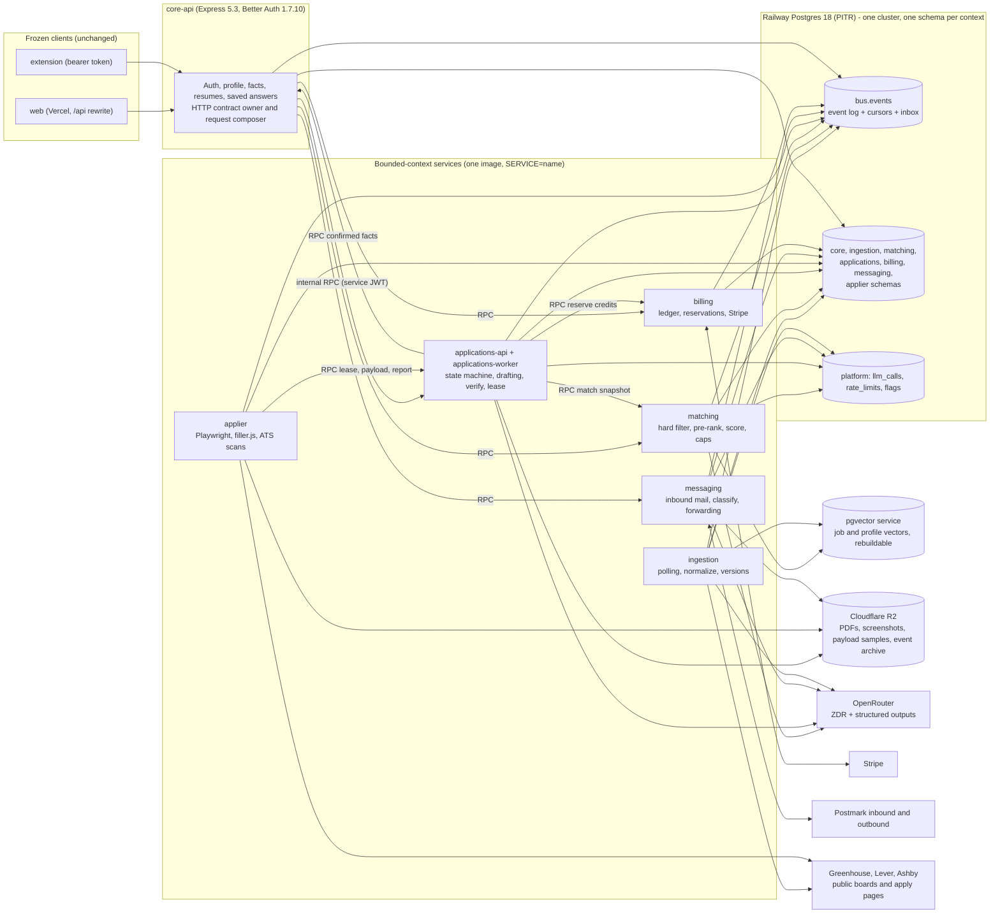
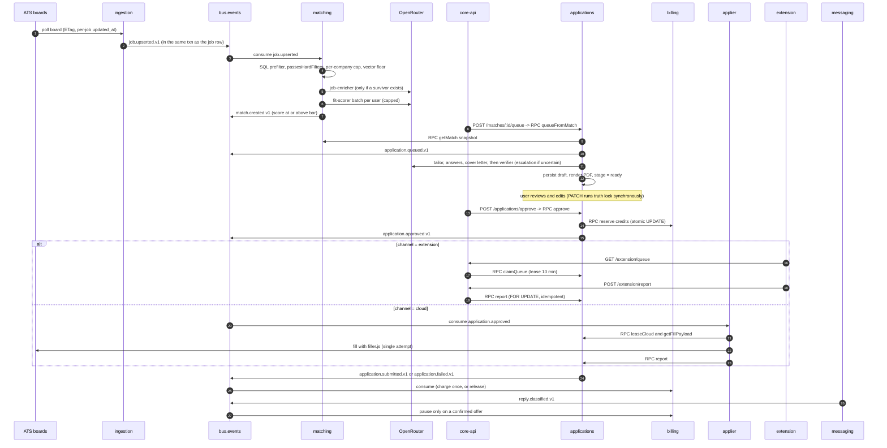
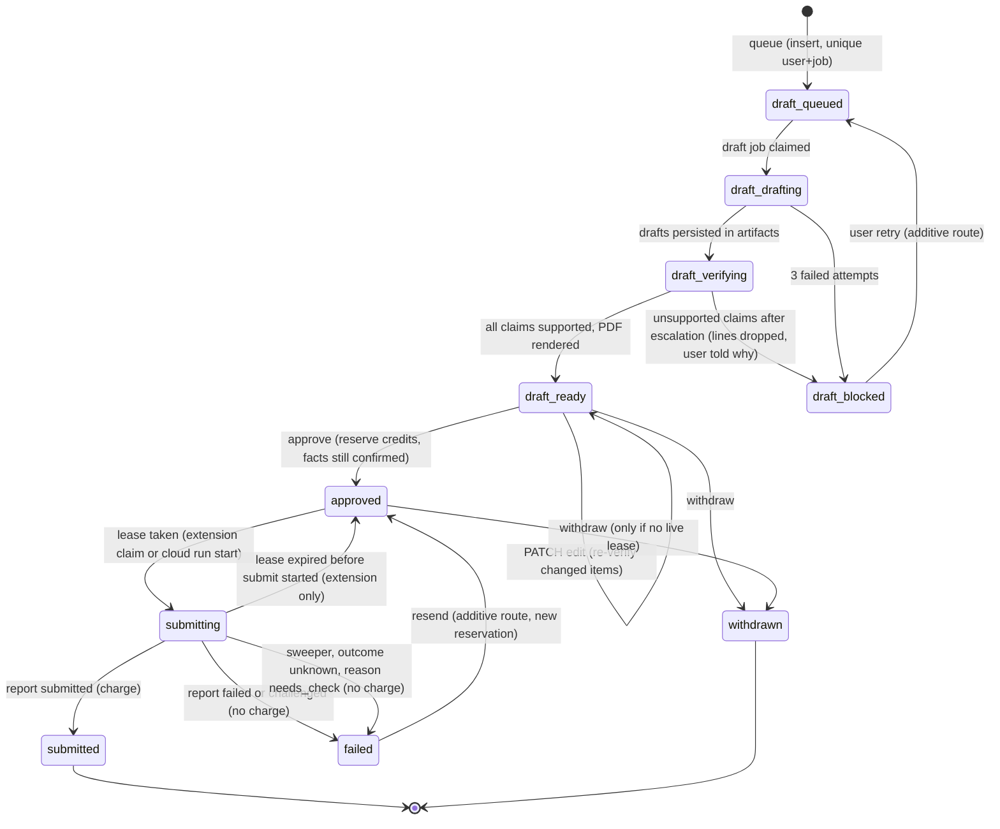

# Kairos backend architecture, option "event-services": bounded-context services on an event log

Date: 2026-10-16. Status: candidate architecture for comparison. Scope: backend only (`server/`, additive types in `shared/`, Railway and vendor configuration). Nothing under `web/` or `extension/` is created, edited or deleted by this option. `extension/dist/filler.js` stays the cloud applier's filler, unchanged.

Inputs read in full: `_research/as-built.md`, `_research/cost-model.md`, `_research/openrouter.md`, `_research/stack-options.md`; digests of `requirements.md` and `integrations.md`. Skills loaded and applied as guidance: `microservices-patterns`, `event-sourcing-architect`, `engineering:system-design`. Evidence tags follow the research files: **[cm]** cost-model.md, **[or]** openrouter.md, **[so]** stack-options.md, **[ab]** as-built.md, **[int]** integrations.md, **[est]** my arithmetic from stated assumptions, **[unverified]** must be proven in a spike (Section 12 lists them). Defect ids (D-xx, S-xx, P-xx) are the ones in as-built.md. Requirement ids (FR, INV, NFR) are the ones in requirements.md.

---

## 0. Verdict

### 0.1 What this option is

Split the backend into six bounded contexts (ingestion, matching, applications, applier, messaging, billing) plus a core context that owns identity, profile and facts and also serves the frozen HTTP API. Each context owns its own Postgres schema, its own queues and its own deployable. Contexts react to each other through a durable event log and call each other synchronously only where the caller needs an answer before it can respond (credit reservation, fact lookup, match snapshot). Python is allowed where it earns its keep. The honest finding is that it does not earn its keep at 10,000 users (Section 2.3), so the first version is TypeScript only.

### 0.2 The honest assessment, first

This is the strongest version of a service-oriented design, and it is also the option with the highest operating cost for one developer. Numbers that decide it:

| Question | Answer | Basis |
|---|---|---|
| Does any bounded context need to scale independently at 10,000 users? | Only two: the applier (browser memory) and the scoring workers (model-call concurrency). Every other context fits in one or two 0.25 vCPU replicas. | Section 10.3 |
| What does the split buy at this size? | Blast-radius isolation (a poll or scoring burst cannot starve approvals), enforced data ownership, independent deploys, a clean seam for later extraction. | Section 1.4 |
| What does it cost? | Eight application deployables instead of three, a bus and consumer framework to write and keep correct, internal RPC with service tokens, contract tests between services, PgBouncer from day one, and about 20 engineer-weeks of migration versus roughly 12 for a modular monolith [est]. | Sections 9, 11 |
| Does it meet the cost target? | Yes. All-in cost per submitted application is $0.0035 (Free), $0.0037 (Starter), $0.0040 (Pro and Max) against the $0.01 target and the $0.005 internal target. The service split adds about $0.0002 over the cost model's single-codebase figure. | Section 10 |
| Is it correct on the invariants? | Yes, and in two places (credit reservation, submission lease) it is stronger than a monolith because the owning service is the only writer. The price is one more failure mode per cross-service step, each with a named compensation. | Section 7 |

**Recommendation of this document.** Adopt the boundaries, the event log, the schema-per-context ownership and the agent runtime now. Ship them as one codebase and one image started with `SERVICE=<name>`, and run the contexts as separate deployables only when a measured trigger fires (Section 9.5, Phase 5). In other words, treat "event-services" as a modular monolith with service-grade seams that can be cut apart in a day, not as eight services on day one. If the owner wants eight services at launch anyway, this document specifies exactly how, and the migration path in Section 11 reaches that state with every verified flow still working at each phase boundary.

### 0.3 Where this option beats and loses to the alternatives

| Topic | Event-services | Compared with a durable-execution engine (DBOS or Temporal) or a single modular monolith |
|---|---|---|
| Failure isolation | Best: a crash loop in matching does not touch approvals or billing | Wins |
| Cross-context consistency | Eventual by design; reads inside one context stay immediately consistent; cross-context effects (charge after submit) lag by seconds | Loses to a single transaction |
| Operating load | 8 deployables, 1 bus, internal auth, per-service alerts | Loses clearly for a solo developer |
| Step memoization of model calls | Hand-built step table per pipeline (about 150 lines), not an engine feature | Loses to DBOS or Temporal on convenience, equal on outcome |
| Data boundary and privacy | Nothing leaves the product's Postgres, Railway and R2 boundary; no third-party execution vendor | Wins against hosted engines |
| Cost | Highest infrastructure of the three Postgres-based options (about +$115 per month) but no per-step vendor fee | Mixed |
| Growth path | Easiest to extract a context into its own database or language later | Wins |

---

## 1. Diagram and component list

### 1.1 Topology



### 1.2 Components

| # | Component | Deployable | Owns (schema) | Entry points and queues | Replicas at beta [est] | Depends on |
|---|---|---|---|---|---|---|
| 1 | **core-api** | `SERVICE=core` | `core`: Better Auth tables, `profiles`, `resume_profiles`, `facts`, `saved_answers`, `forwarding_addresses` | All frozen routes (Express 5.3). Queue `parse-resume` (pg-boss, low concurrency). Composes responses from other services. | 2 | all contexts via RPC; bus |
| 2 | **ingestion** | `SERVICE=ingestion` | `ingestion`: `companies`, `jobs`, `job_versions`, `poll_state` | Cron `schedule-polls` (every 60 s), queue `poll-board`, queue `enrich-job` | 2 | ATS public APIs; OpenRouter (enricher); bus |
| 3 | **matching** | `SERVICE=matching` | `matching`: `eligible_users`, `match_candidates`, `matches`, `scoring_counters`, `company_caps`; vector store (separate service) | Bus consumers `job.*`, `profile.*`, `billing.*`; queues `prefilter-job`, `score-batch`, `backfill-user` | 2 | OpenRouter; pgvector; bus |
| 4 | **applications-api** | `SERVICE=applications` | `applications`: `applications`, `application_steps`, `draft_artifacts`, `verification_results`, `submission_attempts`, `resume_documents` | Internal RPC; extension queue claim and report; approve; PATCH with synchronous truth lock | 2 | billing (reserve), core (facts), matching (snapshot), OpenRouter (verifier) |
| 5 | **applications-worker** | `SERVICE=applications-worker` (same schema) | same | Queues `draft-application`, `render-resume`, `expire-leases`, `reconcile` | 2 | OpenRouter; R2 |
| 6 | **applier** | `SERVICE=applier` | `applier`: `runs`, `form_scans`, `ats_health` | Bus consumer `application.approved` (cloud) feeding per-ATS queues `cloud-apply-greenhouse`, `-lever`, `-ashby`; queue `scan-form` | 4 (3 contexts each) | applications (RPC), R2, ATS hosts |
| 7 | **messaging** | `SERVICE=messaging` | `messaging`: `inbound_emails`, `forwarding_verifications`, `reply_links` | Inbound webhook (Postmark), queue `classify-reply`; outbound mail | 1 to 2 | OpenRouter (classifier); bus |
| 8 | **billing** | `SERVICE=billing` | `billing`: `credit_accounts`, `credit_ledger`, `credit_reservations`, `subscriptions`, `stripe_events` | Stripe webhook; RPC reserve, release, balance, checkout, portal; bus consumers `application.*`, `reply.classified`; cron `rollover`, `reconcile-stripe` | 2 | Stripe; bus |
| 9 | **platform kernel** (library, not a service) | `packages/platform` | `bus`, `platform` schemas | Outbox writer, consumer loop, inbox dedupe, pg-boss wrapper, service-JWT RPC client, `runAgent`, OTel bootstrap, feature flags | n/a | |
| 10 | **agents package** (library) | `packages/agents` | none | Agent specs, prompt files, schemas, eval sets, gateway | n/a | |
| 11 | **pgvector store** | Railway Postgres service | `vectors` | Used by matching and ingestion only; rebuildable from jobs and facts | 1 | |
| 12 | **ops jobs** | any worker | `platform` | Cron `llm-cost-rollup`, `catalog-drift`, `partition-maintenance`, `cleanup`, `bus-archive`, `openrouter-reconcile` | n/a | |

Repository layout (npm workspaces, matching today's monorepo; `web/` and `extension/` untouched):

```
packages/contracts   zod schemas for events and internal RPC; golden fixtures
packages/platform    bus, outbox, inbox, jobs, rpc, otel, flags, db helpers
packages/agents      specs, prompts/<agent>/v<N>.md, schemas, evals/<agent>/cases.jsonl, gateway
server/              today's code, shrinks as contexts are extracted
services/<context>/  src/, drizzle/ (migrations for that schema only), main.ts
shared/              existing; additive types only (plans.ts gains dailyScoringCap, dailyModelSpendCapUsd)
```

### 1.3 Context map (who may know what)

| Upstream | Downstream | Relationship | Contract |
|---|---|---|---|
| ingestion | matching | Published language: `job.upserted.v1`, `job.closed.v1` | Event with ids and content hash only; matching reads job text through ingestion's read RPC or its own replicated `job_cards` projection |
| core | matching | Published language: `profile.preferences_changed.v1`, `profile.facts_changed.v1`, `profile.activated.v1`, `user.active_seen.v1` | Events; matching keeps an `eligible_users` projection (preferences, vector id, plan, credit availability flag) |
| billing | matching | `credits.availability_changed.v1` | Event; projection flag only |
| matching | applications | Customer-supplier: `matching.getMatch(matchId, userId)` RPC returns an immutable snapshot (job card, score, reasons) | RPC, versioned; applications stores the snapshot in `applications.job_snapshot` so it never reads matching or ingestion tables |
| core | applications | Conformist: `core.getConfirmedFacts(userId, ids)` RPC | RPC; the response includes `confirmedAt` and a content hash that applications stores with each draft |
| applications | billing | Customer-supplier: `billing.reserve`, `billing.release` RPC; events `application.submitted.v1`, `application.failed.v1`, `application.withdrawn.v1` | RPC plus events |
| applications | applier | `application.approved.v1` (cloud) event; RPC `applications.leaseCloud`, `applications.report` | Event plus RPC |
| messaging | billing | `reply.classified.v1` | Event; billing alone decides to pause |
| messaging | applications | `reply.classified.v1` for status display only (applications keeps `last_reply_kind` projection) | Event |
| everyone | core | `user.deleted.v1` erasure saga (Section 8.5) | Event |

No context reads another context's tables. This is enforced by Postgres roles (Section 8.2), not by convention.

### 1.4 Why these seams

The seams follow three tests from the microservices-patterns skill: different rate of change, different scaling profile, different data lifecycle.

| Context | Rate of change | Scaling profile | Data lifecycle |
|---|---|---|---|
| ingestion | ATS adapters change when vendors change | Network-bound, bursty at new-company onboarding | Jobs live 50 days |
| matching | Prompts, rubric and models change weekly | Model-call concurrency | Candidates 30 to 90 days |
| applications | State machine changes rarely and must stay safe | Model calls plus transactions | Account lifetime |
| applier | Changes with ATS page structure | Memory-bound (browser) | Run records 14 days |
| messaging | Mail provider quirks | Spiky, small | Bodies 180 days |
| billing | Changes with pricing and Stripe | Tiny but must never be wrong | Forever (audit) |

---

## 2. Stack per layer

### 2.1 Table

All versions are the ones verified in `stack-options.md` on 2026-10-16 unless marked.

| Layer | Choice | Version | Why | Rejected alternative |
|---|---|---|---|---|
| Runtime | Node.js | 22.18 or later; move to 24 LTS in Q1 2027 (Node 22 EOL 2027-04-30 [so]) | pg-boss 12.38 needs 22.12; one runtime for all services | Bun (less proven with Playwright and pg) |
| Language | TypeScript, ESM | latest compatible with `tsx` 4.23.15 and `vitest` 5.0.5; do not adopt TS 7 until `drizzle-kit` and `tsx` are confirmed [so] | One language, shared contracts package | Polyglot (Section 2.3) |
| HTTP framework | Express | 5.3.0, in every service | Keeps the frozen contract in core-api; one framework means one set of middleware, tests and tracing for all eight deployables. Internal RPC is about 25 small endpoints, so a second framework buys nothing | Fastify 5.12 (schema validation is nice, not needed) |
| Validation and contracts | zod | 4.6.7 | Events, RPC and agent outputs share one schema language | |
| ORM and driver | Drizzle ORM 0.45.4 with `pg` 8.23.1 | | Existing schema and migrations; `pg` is the driver pg-boss and Better Auth adapters use [so]; replaces postgres.js 3.4.9 | Kysely, Prisma |
| Database | Railway Postgres 18 on `postgres-ssl:18` with pgBackRest PITR | | PITR documented only for this image [so]; one cluster, one schema per context, one role per context | Database per service (8 clusters, unaffordable operations) |
| Vector store | `pgvector/pgvector` image (Postgres 18.4, pgvector 0.8.6 [so, unverified template]) as a second Railway service | | Vectors are derived data; PITR and pgvector may not share an image [so]; losing the store costs a re-embed, not user data | Same cluster if Railway confirms PITR on the pgvector image |
| Connection pooling | PgBouncer in transaction mode for request and worker pools; engine listeners connect direct | 1.24 [unverified exact version] | Eight deployables multiply pools: about 114 pooled plus about 16 listener connections, above the default `max_connections` of 100 [so]. PgBouncer is a day-one requirement here, not a later one | Raising `max_connections` alone |
| Event log | Postgres `bus` schema (this document, Section 4) | | The event write shares the business transaction (true transactional outbox without a relay); 350,000 events per day is about 4 per second [est]; no extra system to run | Kafka or Redpanda (too heavy), NATS JetStream 2.12 [unverified] (planned successor, Section 12 trigger T-3), Redis Streams (second stateful system) |
| Job queue | pg-boss | 12.38.0 | Transactional enqueue through the Drizzle adapter, per-queue concurrency and rate limits, cron, dead-letter queues, retries; one `pgboss` schema per service [so] | BullMQ (keeps Redis in the critical path), DBOS (executor identity problem multiplies by the number of services, Section 2.2) |
| Durable pipelines | Hand-written step table `application_steps` (Section 3.4) | | Gives memoized model calls without an engine | Temporal, Hatchet |
| Redis | None at launch | | Rate limits and counters in Postgres; in-process LRU for plan lookups [so] | Valkey later if `pg_stat_statements` shows counter pressure |
| Object storage | Cloudflare R2 via `@aws-sdk/client-s3` 3.1152.0 | | Zero egress, `users/{userId}/` prefix deletes a user in one call [so] | Railway Buckets |
| PDF | `@react-pdf/renderer` 4.9.0 from verified JSON; Playwright `page.pdf()` fallback | | The renderer can only print verified lines [so] | pdfmake 0.3.11 |
| Resume ingest | `unpdf` 1.9.0, `mammoth` 1.13.0 | | Parse in a low-concurrency queue with size, page and time limits [so] | |
| Browser | Playwright 1.64.1 (pin the Docker image tag to the npm version) | | Existing filler injection | |
| Auth | Better Auth 1.7.10, all `@better-auth/*` pinned together, in core-api only | | Frozen cookie and bearer contracts; `trustedProxy` configured explicitly [so] | |
| Payments | `stripe` 23.0.0, own webhook handler in billing | | One grant per invoice, rollover, pause | `@better-auth/stripe` |
| LLM client | `openai` 7.34.0 pointed at OpenRouter, wrapped by `runAgent` | | No agent framework; orchestration is deterministic [so] | Vercel AI SDK, LangGraph |
| Rate limiting | `rate-limiter-flexible` 11.2.2 with the Postgres store | | No Redis | |
| Telemetry | `@opentelemetry/sdk-node` 0.223.0 (pin exactly), `auto-instrumentations-node` 0.81.0, `pino` 10.4.0, `@sentry/node` 11.8.0 | | `traceparent` propagated through RPC headers and the event envelope | Self-hosted Langfuse |
| Internal auth | EdDSA JWT, 60 s lifetime, `iss` and `aud` per service, `jose` [version unverified] | | Railway private networking has no mTLS; signed tokens plus private network is the practical floor | mTLS service mesh (no Railway support) |
| Tests | `vitest` 5.0.5, `testcontainers` 12.2.1 with `@testcontainers/postgresql` | | Real Postgres for bus, ledger and lease tests [so] | PGlite for these (no extensions, different locking) |
| CI | GitHub Actions | | Typecheck, unit, contract replay, integration, eval gate | |

### 2.2 Why not DBOS here

`stack-options.md` recommends DBOS Transact 5.3 for a single deployable. With eight deployables each needing a stable executor id (`DBOS__VMID`) on a platform where replica ids change on each deploy, the unresolved recovery risk (risk 1 in `stack-options.md`) is multiplied by eight, and each service would own a system database. pg-boss plus an explicit step table is slightly more code and has no recovery-identity problem: any replica of a service can claim any job. If the DBOS spike passes and the owner chooses a collapsed deployment, `applications-worker` is the one place DBOS adds real value; the step table is designed so that replacing it is mechanical.

### 2.3 The polyglot question

Python is allowed where it earns its keep. It does not earn it at launch:

| Candidate | Python case | Finding |
|---|---|---|
| Pre-ranking | numpy, faiss, scikit-learn | Pre-rank is a pgvector query plus a similarity floor and SQL filters (Section 5). The eligible-user table is about 2,850 rows [cm], so exact cosine over it is milliseconds. No Python needed. |
| Learned ranker | LightGBM or logistic regression trained on accept and skip signals | Needs labeled outcomes. Trigger T-6: at least 50,000 labeled (match, user action) pairs and a measured precision gap in the scoring evals. Then add `ranker` as a Python 3.13 FastAPI service with `onnxruntime`, called by matching with a 150 ms timeout and a fall-through to the SQL ranking. Until then it is not built. |
| Cross-encoder rerank | sentence-transformers | The OpenRouter `rerank` endpoint exists [or]; use it before hosting a model. |
| Evals | pandas, notebooks | Offline analysis only; not a deployable. The CI eval gate is TypeScript so prompts and schemas are tested with the production code. |
| Everything else | | No. A second language doubles dependency audits, images, CI and on-call surface for one developer. |

---

## 3. Application lifecycle end to end

### 3.1 Sequence



### 3.2 Stage by stage

Targets are p50 / p95 and are design budgets [est], to be replaced by beta measurements.

| # | Stage | Owner | Trigger | Work | Model call | Output event | Budget |
|---|---|---|---|---|---|---|---|
| 1 | Poll | ingestion | Cron every 60 s picks due companies (30 min standard, 5 min priority, priority cap 300) | `GET /jobs` with `If-None-Match`; on 304 stop. Otherwise diff by per-job `updated_at` and content hash (Greenhouse ETag covers the whole list, so it is only a gate [int]). Batch upsert in chunks of 500 rows (fixes the bind-parameter limit, S-05). Reopen and update semantics (D-19). Empty board response never closes jobs (needs two consecutive empties). Per-host limiter 1 request per second per board, 5 concurrent per host [int] | none | `job.upserted.v1`, `job.closed.v1` | 0.6 s per board |
| 2 | Normalize | ingestion | same job | Existing normalizers; drop `raw` JSONB duplicate; `description_text` stored once, compressed; `content_hash`; Ashby `isListed:false` dropped [int] | none | same | inline |
| 3 | Enrich | ingestion queue `enrich-job` | matching requests enrichment through `job.enrichment_requested.v1` after a survivor exists (lazy, [cm] C-4) | Structured card: seniority, years, must-have skills, sponsorship statement, salary, remote | `job-enricher` | `job.enriched.v1` | 3 s |
| 4 | Match and pre-rank | matching | `job.upserted.v1`; `profile.*` changes for backfill | Section 5 | embedder only | none yet | 50 ms per job |
| 5 | Score | matching queue `score-batch` | per-user batch of up to 20 pre-ranked pairs | Section 5.4 | `fit-scorer` | `match.created.v1` | 1.5 s per call |
| 6 | Queue | applications | `POST /api/matches/:id/queue` (frozen route; core forwards) | `INSERT ... ON CONFLICT (user_id, job_id) DO NOTHING`, snapshot stored, `stage = queued`, job `draft-application` enqueued in the same transaction (D-13 solved by pg-boss transactional enqueue) | none | `application.queued.v1` | 150 ms |
| 7 | Draft | applications-worker | job `draft-application` | Steps in Section 3.4 | tailor, answers, cover letter | `application.draft_ready.v1` or `application.draft_blocked.v1` | 25 s / 60 s |
| 8 | Verify | applications-worker | inside step 7 | Deterministic id check, then independent verifier, then escalation on `uncertain` | `claim-verifier`, `claim-verifier-escalation` | same | 4 s / 12 s |
| 9 | Await approval | applications | none | Pure state: `status = draft`, `stage = ready`. No workflow, no timer, no memory held | none | none | days |
| 10 | Approve | applications | `POST /api/applications/approve` | Section 3.5 | none | `application.approved.v1` | 200 ms |
| 11a | Submit via extension | applications | extension polls `GET /api/extension/queue` | Claim with lease; report with `FOR UPDATE` | none | `application.submitted.v1` / `.failed.v1` | user paced |
| 11b | Submit via cloud | applier | `application.approved.v1` with `channel = cloud` | Section 6.6 | none | same | 45 s average |
| 12 | Track replies | messaging | Postmark inbound | Section 3.6 | `reply-classifier` on the ambiguous 25% | `reply.received.v1`, `reply.classified.v1` | 2 s |
| 13 | Bill | billing | `application.submitted.v1` | Charge once; convert reservation | none | `credits.charged.v1` | 1 s lag |

### 3.3 Application state machine

The public `status` enum is frozen (draft, approved, submitting, submitted, failed, refunded, withdrawn). Internal progress lives in a separate `stage` column and is exposed only as an optional additive response field `stage`.



`draft_*` are values of `stage` while `status = draft`. `approve` is refused with the existing `409 conflict` code unless `stage = ready` (fixes D-07). Ids not in a state to be approved are skipped as today, and the response gains an optional `skipped: [{ id, reason }]` array.

### 3.4 Drafting pipeline (hand-written durable steps)

One pg-boss job per application, retried 3 times with backoff 10 s and 30 s. Every step records its result before the next starts, and a retry skips completed steps, so a crash never repays a model call.

```sql
CREATE TABLE applications.application_steps (
  application_id uuid        NOT NULL,
  step           text        NOT NULL,   -- load_inputs, tailor, answers, cover_letter, id_check, verify, escalate, persist, render
  attempt        smallint    NOT NULL DEFAULT 1,
  status         text        NOT NULL CHECK (status IN ('running','done','failed')),
  output_ref     jsonb,                  -- ids and hashes only: artifact id, llm_call id, fact snapshot hash
  llm_call_id    uuid,                   -- platform.llm_calls row, for the cost and audit trail
  started_at     timestamptz NOT NULL DEFAULT now(),
  finished_at    timestamptz,
  PRIMARY KEY (application_id, step)
);
```

| Step | Action | Parallel with | Failure behavior |
|---|---|---|---|
| `load_inputs` | RPC `core.getConfirmedFacts` (all confirmed facts, cap 120 by recency and relevance); job snapshot already stored; compute `facts_snapshot_hash` | none | Retry; core outage delays draft |
| `tailor` | `resume-tailor`: bullet-level rewrite, at most 16 lines, each with `factIds` | `answers`, `cover_letter` | Schema failure: one re-ask, then step failed |
| `answers` | Deterministic classifier splits form questions: sensitive (never to a model), profile-fillable (no model), free-text professional (model). Only the last group goes to `answer-drafter`, one batched call per draft | `tailor` | Unknown question type: left unanswered and reported through `required_answers_missing` at approval |
| `cover_letter` | Only when the form field exists or the plan includes it; `cover-letter-writer` with one fact citation list per paragraph | `tailor` | Optional; failure leaves the letter empty, never blocks |
| `id_check` | Deterministic: every `factIds` entry exists, is owned by the user and is confirmed (`confirmed_at` not null) | | Violations dropped and recorded in `verification_results` |
| `verify` | `claim-verifier`: one call per draft over all lines, answers and letter paragraphs with only their cited facts; verdict `supported`, `unsupported`, `contradicted`, `uncertain` per claim | | Verifier outage: step retries; after exhaustion stage = `draft_blocked`, reason `verifier_unavailable` (fail closed) |
| `escalate` | Only the `uncertain` claims, to `claim-verifier-escalation` (different family from the drafter) | | No fallback: unresolved claims are dropped |
| `persist` | One transaction: write accepted lines, answers, letter into `draft_artifacts`; write `verification_results`; set `stage`; insert `application.draft_ready.v1` into the bus | | Idempotent (artifact id is deterministic) |
| `render` | `@react-pdf/renderer` from the persisted JSON; upload to R2 `users/{userId}/apps/{id}/resume.pdf`; set `resume_documents` | | Retry; `ready` only after render |

Dropped content is never silent (fixes D-02): `verification_results` keeps the rejected text, the reason and the claim id, and the draft response exposes an optional `rejected: [{ section, reason }]` array.

### 3.5 Approval

`POST /api/applications/approve` (up to 50 ids) is one transaction in `applications`, preceded by one RPC.

1. Load the requested rows `WHERE user_id = $1 AND status = 'draft' AND stage = 'ready' FOR UPDATE`. Rows that fail are skipped.
2. Re-check that every cited fact is still confirmed (RPC `core.getConfirmedFacts`, hash compare). A changed hash marks the draft `stale`, skips it, and queues a re-verification.
3. Required answers present, else `422 required_answers_missing`; cover letter present when required, else `422 cover_letter_required`; cloud channel requires Pro or Max, else `403 forbidden`.
4. RPC `billing.reserve(userId, n, idempotencyKey = hash(sorted ids))`. Failure maps to `402 payment_required`. The reservation is a single atomic `UPDATE` (Section 7.2).
5. Update rows to `approved`, set `channel`, `approved_at`, write the `application.approved.v1` event. All of step 5 shares one commit.
6. If step 5 fails after step 4 succeeded, the reservation has an expiry (15 minutes) and a sweeper releases it. Idempotent retry of the whole call reuses the same reservation key.

### 3.6 Replies and billing pause

Postmark posts to `messaging`: secret path plus Basic auth (no HMAC exists [int]), 50 MB JSON limit on this route only, `Attachments[].Content` dropped before storage, idempotent on `(user_id, MessageID)`, always `200` after the durable insert so Postmark never retries a stored message, `403` only for a bad secret. Resolution uses `OriginalRecipient`. Regex classification runs first. The model sees only the redacted, truncated remainder (25% [cm]). Linking to an application requires the sender domain to match the company or its ATS domain, or a message-id reference, not a bare name substring (fixes D-26). `reply.classified.v1` with `kind = offer` goes to billing. Billing pauses only if the email is linked to a submitted application and the sender is trusted, or the user confirms through a one-click link in an email; otherwise it records a pending pause and asks the user. "Offer you an interview" never counts (the existing regex guard and its tests move into messaging unchanged).

---

## 4. The event log

### 4.1 Design

Events are immutable facts. The log is a Postgres table written in the same transaction as the business change (a true transactional outbox, with no relay process). The system is event-driven, not event-sourced: current state lives in ordinary tables, and the log carries notifications and an audit trail. Two aggregates are append-only by nature and stay that way: `credit_ledger` and `application_events` (the application history, derived from the bus for display).

```sql
CREATE SCHEMA bus;

CREATE TABLE bus.events (
  day            date        NOT NULL DEFAULT current_date,
  seq            bigint      GENERATED ALWAYS AS IDENTITY,
  tx             xid8        NOT NULL DEFAULT pg_current_xact_id(),
  event_id       uuid        NOT NULL DEFAULT gen_random_uuid(),
  type           text        NOT NULL,                 -- 'application.submitted'
  version        smallint    NOT NULL,                 -- payload schema version
  producer       text        NOT NULL,
  partition_key  text        NOT NULL,                 -- aggregate id: applicationId, userId, jobId
  partition_no   smallint    NOT NULL,                 -- abs(hashtext(partition_key)) % 16
  correlation_id uuid        NOT NULL,
  causation_id   uuid,
  traceparent    text,
  occurred_at    timestamptz NOT NULL DEFAULT now(),
  payload        jsonb       NOT NULL,                 -- ids and enums only, never resume text, answers or email bodies
  PRIMARY KEY (day, seq)
) PARTITION BY RANGE (day);

CREATE INDEX events_consume_idx ON bus.events (partition_no, tx, seq);
CREATE INDEX events_type_idx    ON bus.events (type, occurred_at);

CREATE TABLE bus.cursors (
  consumer      text        NOT NULL,
  partition_no  smallint    NOT NULL,
  last_tx       xid8        NOT NULL DEFAULT '0',
  last_seq      bigint      NOT NULL DEFAULT 0,
  lease_holder  text,
  lease_until   timestamptz,
  PRIMARY KEY (consumer, partition_no)
);

CREATE TABLE bus.inbox (
  consumer   text        NOT NULL,
  event_id   uuid        NOT NULL,
  handled_at timestamptz NOT NULL DEFAULT now(),
  PRIMARY KEY (consumer, event_id)
);

CREATE TABLE bus.dead_letters (
  consumer text NOT NULL, event_id uuid NOT NULL, error text NOT NULL,
  attempts smallint NOT NULL, failed_at timestamptz NOT NULL DEFAULT now(),
  PRIMARY KEY (consumer, event_id)
);
```

### 4.2 Delivery rules

| Rule | Mechanism |
|---|---|
| No lost event on commit order | Sequences are not commit-ordered, so a consumer must not read past an in-flight transaction. Each event stores `tx = pg_current_xact_id()`. A consumer reads `WHERE (tx, seq) > (cursor.last_tx, cursor.last_seq) AND tx < pg_snapshot_xmin(pg_current_snapshot()) ORDER BY tx, seq LIMIT 100`. Only events whose transaction has finished are visible to the poll. |
| Per-aggregate order | `partition_no` is a stable hash of the aggregate id into 16 partitions. A consumer instance leases partitions through `bus.cursors` (`lease_until` 30 s, renewed every 10 s). One partition has one active reader, so events for the same aggregate arrive in order. |
| At-least-once with idempotent handlers | A handler runs in one transaction with an `INSERT INTO bus.inbox ... ON CONFLICT DO NOTHING`. If the insert reports a conflict the event is skipped. The cursor advance commits in the same transaction. |
| No slow work in a handler | A handler writes to its own schema and enqueues a pg-boss job in the same transaction (transactional enqueue). Model calls, HTTP and browser work never happen inside a consumer loop. |
| Wake-up | `NOTIFY bus_events` after commit (a trigger), plus a 500 ms poll fallback. `LISTEN` uses a direct connection, not PgBouncer. |
| Poison events | 5 failed attempts with backoff (1 s, 5 s, 30 s, 2 min, 10 min), then insert into `bus.dead_letters`, advance the cursor, and page. Replay is a manual tool that clears the dead-letter row and resets the inbox row. |
| Versioning | `version` is part of every event. Rules: additive fields only inside a version; a breaking change publishes `type.v2` alongside `.v1` for one full release; consumers deploy before producers emit a new version. `packages/contracts` holds a golden fixture per version, and CI replays old fixtures against new consumers. |
| Retention | Daily partitions. After 30 days a job exports the partition to R2 as gzip ndjson under `bus-archive/yyyy/mm/dd.ndjson.gz`, then drops it. Projections can be rebuilt from the archive plus the live log. |
| Size | About 0.5 KB per event, 350,000 events per day, 175 MB per day, about 5 GB for 30 days [est]. |

### 4.3 Event catalog (v1)

| Event | Producer | Key payload fields | Consumers |
|---|---|---|---|
| `user.created` | core | userId, createdAt | billing (free grant), matching, messaging |
| `user.deleted` | core | userId | all (erasure saga) |
| `profile.preferences_changed` | core | userId, prefsVersion | matching |
| `profile.facts_changed` | core | userId, factsVersion | matching (re-embed profile) |
| `profile.activated` | core | userId | matching (backfill) |
| `user.active_seen` | core | userId, day (batched daily) | matching |
| `job.upserted` | ingestion | jobId, companyId, contentHash, changeKind (new, content, reopened) | matching |
| `job.closed` | ingestion | jobId | matching, applications (warn on drafts) |
| `job.enriched` | ingestion | jobId, cardVersion | matching |
| `match.created` | matching | matchId, userId, jobId, score | core (feed cache), applications (none) |
| `application.queued` | applications | applicationId, userId, matchId | matching (mark queued) |
| `application.draft_ready` / `.draft_blocked` | applications | applicationId, stage, reason | core (notify) |
| `application.approved` | applications | applicationId, userId, channel, reservationId | applier (cloud only), billing |
| `application.submitted` | applications | applicationId, userId, attemptId, submittedAt | billing, messaging (link index) |
| `application.failed` | applications | applicationId, userId, reason | billing (release), applier health |
| `application.withdrawn` | applications | applicationId, userId | billing (release), applier (cancel queued run) |
| `credits.charged` / `.released` / `.balance_changed` | billing | userId, applicationId, availableAfter | matching (availability flag), core |
| `subscription.changed` | billing | userId, plan, interval, status | matching (caps), core |
| `billing.paused` | billing | userId, reason | core (banner) |
| `reply.received` | messaging | userId, emailId, linkedApplicationId? | |
| `reply.classified` | messaging | userId, emailId, kind, confidence, senderTrust, linkedApplicationId? | billing, applications |

Event payloads never contain resume text, answers, email bodies or names. They carry ids and enums, so a leaked log is not a data breach.

### 4.4 Synchronous calls (the exceptions)

Internal HTTP/JSON over Railway private networking, `Authorization: Bearer <service JWT>`, `Idempotency-Key` header on every mutating call, timeouts 2 s default, 1 retry with jitter on idempotent calls only, and a per-target circuit breaker (open after 5 consecutive failures, half-open after 10 s).

| Call | Why it cannot be an event |
|---|---|
| `billing.reserve` / `release` / `available` | The approve response needs an immediate yes or 402 |
| `core.getConfirmedFacts(userId, ids?)` | Drafting and the synchronous PATCH truth lock need the facts now |
| `matching.getMatch(matchId, userId)` | `queue` needs the immutable snapshot to continue |
| `applications.*` from core | Core composes `/api/applications`, `/api/extension/*`, approve, PATCH, withdraw |
| `applications.leaseCloud`, `getFillPayload`, `report` from applier | Report result (charged or not) must be acknowledged |

---

## 5. The matching pipeline at 10,000 users

### 5.1 Funnel (numbers from the cost model [cm] section 3)

```mermaid
flowchart LR
  A["job.upserted<br/>3,000 per day"] --> B["SQL prefilter on eligible_users<br/>2,850 users"]
  B --> C["passesHardFilters in TS<br/>exact reasons, 3 percent pass: 90 per user"]
  C --> D["per-company cap<br/>default 2 per 30 days"]
  D --> E["embed job once<br/>vector floor keeps 60 percent: 54"]
  E --> F["scoring_queue per user<br/>by similarity"]
  F --> G["daily cap<br/>20 / 40 / 60 / 100"]
  G --> H["job-enricher lazy<br/>then fit-scorer"]
  H --> I["score at or above bar<br/>35 percent"]
  I --> J["match.created"]
```



### 5.2 Order of gates (fit gate before any model call, INV-1, FR-17)

Per (user, job) the order is: seniority, sponsorship, per-company cap, other hard filters, then the model-free vector floor, then the daily cap, and only then a model call. Hard-filter rejections are not persisted per pair (cost model C-1: 8.3 million rows per day would otherwise be written); matching keeps only per-user daily counters by reason in `matching.filter_counters`.

### 5.3 Hard filter implementation

The pure `passesHardFilters` function and its nine reason strings stay as they are (pinned by `landing-fit-sample.test.ts`). It moves into `packages/platform` unchanged.

1. A set-based SQL prefilter runs once per batch of new jobs against `matching.eligible_users` (about 2,850 rows, indexed by `seniority_levels` GIN, `locations` GIN, `needs_sponsorship`, `salary_floor_usd`, `excluded_company_ids` GIN, `active_until`). It is a deliberate superset (never a false negative) and cuts the 2,850 users per job to about 150 [est].
2. The exact TypeScript function runs on those survivors, giving identical reasons and results to today's tests.
3. The per-company cap reads `matching.company_caps(user_id, company_id, window_start, count)`, which is maintained from `application.queued.v1` and `application.withdrawn.v1`. This fixes D-18 by also checking the cap at queue time through the same table.

`eligible_users` is a projection: it is built from `profile.preferences_changed`, `subscription.changed`, `credits.availability_changed`, `user.active_seen`. Eligible means onboarding complete, active in the last 7 days, and credits available or free credits left [cm] C-2. Rebuild from the bus archive plus a one-time snapshot RPC from core.

### 5.4 Pre-rank, caps and scoring

| Step | Detail |
|---|---|
| Embeddings | `qwen/qwen3-embedding-8b` via OpenRouter, ZDR, 1024 dimensions by truncation if supported [or, unverified] stored as `halfvec(1024)`. One vector per job (title, company, enriched card or first 1,500 tokens) and one per user profile (confirmed facts summary plus preferences). Each row stores `embedding_model` and `dims`. Vectors from different models are never mixed. Batches of 64 inputs. |
| New job direction | Compare the job vector to the surviving users' profile vectors by exact cosine. Candidate set is about 150 rows, so no ANN index is needed. |
| Backfill direction (new user, preference change) | User vector against open jobs: HNSW index (`m = 16`, `ef_construction = 64`, `hnsw.ef_search = 40`) on open jobs only, with recency and location SQL filters applied first [so]. Take the top `4 x dailyScoringCap` candidates, run `passesHardFilters` on them, and enqueue in similarity order. |
| Floor | Similarity floor tuned on the scoring eval set so about 40% of survivors are cut with under 2% loss of eventual matches [cm]. |
| Per-user queue | `matching.match_candidates(user_id, job_id, similarity, state)` with `state` in (`pending`, `scored`, `skipped_cap`). |
| Daily cap | `dailyScoringCap`: Free 20, Starter 40, Pro 60, Max 100 [cm], added to `shared/src/plans.ts` as an additive field (INV-10). Counter `matching.scoring_counters(user_id, day, scored)`. Backfill draws from the same cap. A spend cap `dailyModelSpendCapUsd` ($0.03, 0.06, 0.10, 0.16) is checked as well. |
| Batching | Job `score-batch` takes up to 20 pending candidates for one user, scores them with a shared `session_id` so the profile prefix stays cached (target 67% cached input on scoring [cm]). |
| Enrichment | Before the first scoring call for a job: if no `job_cards` row exists, call `job-enricher` once for that job (shared by all users). |
| Result | The scorer returns `{ score, reasons[] }`. Rows at or above the user's `fitThreshold` (default 75) become `matches` and emit `match.created.v1`; scored rows below the bar are kept 30 days with the score so the cap and the funnel can be audited. |
| Failure | A failed call leaves the candidate `pending` and is retried with the job's retry policy; it is never silently skipped (fixes D-21). Retries do not repay completed calls because each candidate is its own row. |
| Closed jobs | `job.closed.v1` marks pending candidates dropped and open matches `expired` (the enum value finally gets used, D-29). |

### 5.5 Volumes and capacity at 10,000 users

From [cm] section 4 (base: 2,000 companies; growth: 10,000 companies):

| Quantity | Base per day | Growth per day | Peak rate | Resource |
|---|---|---|---|---|
| New jobs | 3,000 | 12,000 | 3 per second during a poll wave | one SQL prefilter query per job batch, 5 to 20 ms [est] |
| Prefilter evaluations | 8.55 million | 34.2 million | | Set-based SQL, under 2 CPU-minutes per day [est] |
| Candidate pairs after hard filters | 256,500 | 1,026,000 | | Counted in memory; only pre-ranked survivors written |
| Scoring calls | 115,100 | 132,000 | 6.7 per second, 10 concurrent | `matching` workers 2 replicas x concurrency 8 |
| Embeddings | 3,400 texts | 12,400 | | 53 batches per day |
| Enrichment calls | 2,362 | 9,450 | 0.5 per second | queue `enrich-job` in ingestion |
| `matches` rows written | 109,650 | about 125,000 | | 77 MB per day [cm] |

Scoring is bounded by user count and plan cap, not by job count: growth from 2,000 to 10,000 companies raises scoring calls only 15% [cm].

---

## 6. The agent runtime on OpenRouter

### 6.1 Principles

1. One role per agent: id, versioned prompt file, strict zod and JSON Schema output, model chain, budget, eval set.
2. Workers orchestrate deterministically. No agent loops, no model-chosen next steps. Tool use is not used (INV and decision 4); the only retrieval is the deterministic fact fetch the workflow performs before the call.
3. The verifier never shares the drafter's family. Asserted at config load and in the CI test.
4. Untrusted text is fenced and never placed in `system` (Section 6.4).
5. One module, `packages/agents/gateway.ts`, is the only code that talks to OpenRouter.

### 6.2 Roster

Models, fallbacks, caps and budgets are the cost model's [cm] section 17; slugs must be re-validated nightly (Section 6.7).

| Agent | Context that calls it | Primary | Fallbacks (ZDR + structured outputs) | `max_tokens` | Per-call max | Daily envelope | OpenRouter key |
|---|---|---|---|---|---|---|---|
| `fit-scorer` | matching | `deepseek/deepseek-v4-flash-0731` | `openai/gpt-6-luna`, `xiaomi/mimo-v2.6-flash` | 200 | $0.00035 | $18 | batch |
| `job-enricher` | ingestion | `deepseek/deepseek-v4-flash-0731` | `google/gemma-4-26b-a4b-it`, `openai/gpt-6-luna` | 400 | $0.0005 | $2.50 | batch |
| `embedder` | matching, ingestion | `qwen/qwen3-embedding-8b` | `openai/text-embedding-3-small` into a separate index version | n/a | $0.00005 | $0.30 | batch |
| `resume-parser` | core | `anthropic/claude-haiku-5.5` | `openai/gpt-6-luna` | 3,500 | $0.004 | $0.60 | batch |
| `reply-classifier` | messaging | `deepseek/deepseek-v4-flash-0731` | `google/gemma-4-26b-a4b-it` | 120 | $0.0003 | $0.30 | batch |
| `resume-tailor` | applications | `openai/gpt-6-luna` | `xiaomi/mimo-v2.6-flash` | 1,400 | $0.0015 | $25 | interactive |
| `answer-drafter` | applications | `openai/gpt-6-luna` | `xiaomi/mimo-v2.6-flash` | 700 | $0.0010 | $8 | interactive |
| `cover-letter-writer` | applications | `openai/gpt-6-luna` | `xiaomi/mimo-v2.6-flash` | 800 | $0.0012 | $4.50 | interactive |
| `claim-verifier` | applications | `anthropic/claude-haiku-5.5` | `deepseek/deepseek-v4-flash-0731` | 600 (200 on edit) | $0.0010 | $16 | interactive |
| `claim-verifier-escalation` | applications | `anthropic/claude-sonnet-5` | none (fail closed) | 300 | $0.0080 | $7.50 | interactive |

Family check: drafters are OpenAI with a Xiaomi fallback. Verifiers are Anthropic and DeepSeek. Escalation is Anthropic. If the drafter ever moves to an Anthropic model, CI fails until the verifier moves to `gpt-6-luna` or DeepSeek and the escalation to `gpt-6-sol`.

### 6.3 Types and call shape

```ts
// packages/agents/src/spec.ts
export type AgentId =
  | "fit-scorer" | "job-enricher" | "embedder" | "resume-parser" | "reply-classifier"
  | "resume-tailor" | "answer-drafter" | "cover-letter-writer"
  | "claim-verifier" | "claim-verifier-escalation";

export type ModelFamily = "openai" | "anthropic" | "deepseek" | "xiaomi" | "google" | "qwen" | "zai";

export interface AgentSpec<I, O> {
  id: AgentId;
  promptVersion: string;                    // e.g. "v7"; file prompts/<id>/v7.md is hashed into llm_calls
  role: "drafter" | "verifier" | "extractor" | "scorer" | "embedder";
  models: { slug: string; family: ModelFamily; sampling?: { temperature?: number } }[]; // slugs are exact, never ~latest
  schema: z.ZodType<O>;                     // also compiled to strict JSON Schema for response_format
  maxTokens: number;
  reasoning?: { effort: "low" | "medium" | "high" | "off" };
  timeoutMs: number;                        // scorer 20_000, tailor 45_000, verifier 30_000
  budget: { maxCostPerCallUsd: number; maxPricePerMTok: { prompt: number; completion: number }; dailyEnvelopeUsd: number };
  key: "batch" | "interactive";
  buildMessages(input: I): AgentMessages;   // static prefix, user prefix, fenced variable part
  cache: { anthropicBreakpoints?: ("static" | "user")[]; writeOff?: boolean };
}

export interface AgentResult<O> {
  data: O;
  servedModel: string;
  provider: string;
  usage: { costUsd: number; inputTokens: number; cachedTokens: number; cacheWriteTokens: number; outputTokens: number; reasoningTokens: number };
  llmCallId: string;
  fallbackUsed: boolean;
}

export declare function runAgent<I, O>(spec: AgentSpec<I, O>, input: I, ctx: {
  userId?: string; sessionId: string; correlationId: string; applicationId?: string;
}): Promise<AgentResult<O>>;
```

Request body built by `runAgent` (every call):

```json
{
  "model": "openai/gpt-6-luna",
  "models": ["openai/gpt-6-luna", "xiaomi/mimo-v2.6-flash"],
  "messages": [ { "role": "system", "content": "..." }, { "role": "user", "content": "..." } ],
  "max_tokens": 1400,
  "response_format": { "type": "json_schema", "json_schema": { "name": "resume_tailor_v7", "strict": true, "schema": { } } },
  "provider": {
    "zdr": true, "data_collection": "deny", "require_parameters": true, "allow_fallbacks": true,
    "max_price": { "prompt": 0.15, "completion": 0.75 }
  },
  "session_id": "u7c1:resume-tailor:b41",
  "user": "<hmac of user id>"
}
```

No `temperature`, `top_p` or prefill is sent where the model rejects them [or]; no plugin or server tool is enabled; `json_object` and forced tool use are never used.

### 6.4 Gateway behavior

| Concern | Rule |
|---|---|
| Pre-flight | Check feature flag `llm_paused`, the per-user daily scoring cap and spend cap, and the agent daily envelope (reads `platform.llm_cost_daily` plus today's `llm_calls`). Refuse above `maxCostPerCallUsd` estimate. Acquire a token from `platform.rate_limits` (global token bucket per key and per model family). |
| Errors on HTTP 200 | Inspect the body for `error` and for empty `choices`; treat `finish_reason = "length"` as failure (not retried with the same budget); validate with zod. |
| Retry | At most 2 retries per model attempt on 408, 429, 502 and body-level errors; backoff starts at 500 ms with full jitter and a cap of 8 s; honor `Retry-After`. Model-level failure moves down `models` through OpenRouter, not through application retries. One re-ask on schema failure with the validation error appended. Never retry 400 or 401. 401 trips a circuit that pauses all LLM queues and pages. 402 and 403 budget errors pause the key's queue class until `resets_at`. 503 "no provider meets requirements" is a routing alarm. |
| Idempotency | OpenRouter has no idempotency key [or]. Keyed by `llm_call` id on our side; an ambiguous failure can double-bill tokens, which is accepted and visible in reconciliation. |
| Caching | Prompt order is fixed: static role text, schema description, static examples, per-user stable block, then the variable job part. Anthropic `cache_control` breakpoints after the static block and after the user fact block (minimum 512 tokens on Claude 5.5 [or]). `session_id = <userHash8>:<agent>:<batchId>`, one batch per user so the 5-minute TTL holds. Cache writes can be turned off per request. Alarm when cached share of input on `fit-scorer` is under 55% [cm]. |
| Logging | Every call inserts a `platform.llm_calls` row (monthly partitions): agent, prompt version and hash, requested and served model, provider, token counts, `usage.cost`, latency, finish reason, retries, fallback used, schema result, session id, hashed user id, cited fact ids, verifier verdict, error class. Payload bodies are stored in R2 only for a 2% sample, every verifier rejection and every 422 `truth_lock`, encrypted, 14 to 30 day expiry [so]. |
| Safety | Account-level ZDR plus a guardrail enforcing ZDR for all groups, and `zdr: true` in code. OpenRouter logging opt-ins stay off. Metadata fields `user`, `session_id`, `trace` carry hashes only. |

Prompt-injection posture: job descriptions, form questions and emails are untrusted. They go in a delimited block inside the `user` message, wrapped in a per-call random nonce tag, truncated, with control characters stripped. Outputs are re-validated outside the model: enum-limited fields, citation ids must exist in the user's confirmed set, scores clamped. The verifier receives only the claims and their cited facts, never the job description, so text planted in a posting cannot influence it. Sensitive questions (EEO, disability, veteran, gender, race, sexual orientation, salary, visa) are removed by a deterministic classifier before any prompt is built; no model ever sees them, and the fixed table answers them (FR-23 to FR-25).

### 6.5 Truth lock, end to end

1. Every output line, answer and letter paragraph carries `factIds`. The schema requires at least one id.
2. Deterministic check: ids exist, belong to the user and are confirmed.
3. Semantic check: `claim-verifier` verdict per claim. `contradicted` and `unsupported` are removed and recorded. `uncertain` goes to escalation. Unresolved is removed.
4. `PATCH /api/applications/:id` runs steps 2 and 3 synchronously on the changed items only (target 3 s, hard timeout 8 s). A violation returns `422 truth_lock` with `details` listing the rejected items and nothing is stored. A verifier outage returns `503` with error code `verifier_unavailable`; the draft is unchanged. Open item O-6 confirms in `web/lib/api.ts` that unknown codes are rendered generically before this code ships.
5. Re-check at approval that cited facts are still confirmed (Section 3.5).
6. `PATCH /api/profile/facts/:id` stops defaulting `confirmed` to true (fixes D-05): `confirmed` is omitted unless sent, and editing a confirmed fact's text sets it to unconfirmed until reconfirmed.

### 6.6 Evals

| Agent | Eval set (committed JSONL, synthetic or consented, never production data) | Metric and gate |
|---|---|---|
| `fit-scorer` | 500 labeled (profile, job) pairs, balanced across seniority and sponsorship | Spearman at least 0.70 against labels; precision at the 75 bar at least 0.80; injected-posting subset must not change scores by more than 5 points |
| `job-enricher` | 200 postings with hand-labeled fields | Field accuracy at least 0.92 on seniority and sponsorship; zero invented salary |
| `resume-parser` | 60 resumes (PDF, DOCX, two-column, non-English names) | Fact recall at least 0.90, precision at least 0.95, no inferred facts |
| `reply-classifier` | 300 emails including the "offer you an interview" traps and phishing | Offer recall 1.0 on the trap-free set, zero false offers on traps |
| `resume-tailor`, `answer-drafter`, `cover-letter-writer` | 150 (facts, job) cases, 40 adversarial (job text says "claim 10 years of Kubernetes") | Verifier-accepted lines at least 0.85; zero lines that a human judge finds unsupported in a 100-line audit sample |
| `claim-verifier` | 400 claims, 40% adversarial (inflated numbers, swapped employers, unsupported skills) | False-accept at most 1%; false-reject at most 8% |
| `claim-verifier-escalation` | the 60 hardest verifier cases | False-accept at most 0.5% |

CI runs the gate on any change to a prompt file, schema, model slug or the gateway, using the `kairos-evals` key; one full run costs under $2 [est]. A shadow job re-verifies 2% of production drafts with the escalation model and reports the false-accept estimate weekly. A model swap or prompt change ships only if the gate passes and the cost check in Section 10 still holds.

### 6.7 Catalog drift

Nightly job downloads `/api/v1/models` and `/api/v1/endpoints/zdr` and asserts, for every configured slug: it exists, has at least 2 endpoints that are ZDR and `structured_outputs`, price within +25% of the stored price, unchanged context length, no `expiration_date`, and the family rule holds. A failing primary is disabled in the routing table (falls to the next entry) and an alert is raised, rather than a page. A capability probe (tiny schema call per model with `zdr` and `require_parameters`) runs after every deploy.

---

## 7. Reliability

### 7.1 Idempotency map

| Operation | Key | Where enforced |
|---|---|---|
| One application per (user, job) | `UNIQUE (user_id, job_id)` | `applications.applications` |
| One match per (user, job) | `UNIQUE (user_id, job_id)` | `matching.matches` |
| Queue enqueue | `INSERT` and job in one transaction; singleton key `draft:{applicationId}` | pg-boss |
| Approve from two tabs | Row lock plus `status = 'draft'` predicate; reservation key `hash(sorted ids)` | applications, billing |
| Submit from two tabs | Lease row `UNIQUE (application_id) WHERE state IN ('claimed','running')`; queue read claims | `submission_attempts` |
| Submission report | `FOR UPDATE` on application, terminal state returns the stored row | applications |
| Charge | `UNIQUE (application_id, reason)` on `credit_ledger` | billing |
| Grant per invoice | `UNIQUE (stripe_invoice_id, reason) WHERE stripe_invoice_id IS NOT NULL` | billing |
| Stripe event | Event row and effects in one transaction; `processed_at` set last | billing |
| Inbound mail | `UNIQUE (user_id, provider_message_id)` | messaging |
| Bus event handled once | `bus.inbox (consumer, event_id)` | each consumer |
| Cloud run | `applier.runs UNIQUE (application_id, attempt_id)` | applier |

### 7.2 Exactly-once credit charges

Delivery is at-least-once everywhere; effects are exactly-once because every effect hits a unique constraint. The ledger and balance cache live in billing.

```sql
CREATE TABLE billing.credit_accounts (
  user_id  uuid PRIMARY KEY,
  balance  integer NOT NULL CHECK (balance  >= 0),
  reserved integer NOT NULL CHECK (reserved >= 0),
  CHECK (reserved <= balance),
  updated_at timestamptz NOT NULL DEFAULT now()
);

CREATE TABLE billing.credit_reservations (
  id             uuid PRIMARY KEY DEFAULT gen_random_uuid(),
  user_id        uuid NOT NULL,
  application_id uuid NOT NULL UNIQUE,
  idempotency_key text NOT NULL UNIQUE,
  state          text NOT NULL CHECK (state IN ('held','charged','released','expired')),
  expires_at     timestamptz NOT NULL,       -- 15 min for approval gaps, extended to approval + 2 h when approved
  created_at     timestamptz NOT NULL DEFAULT now()
);

CREATE TABLE billing.credit_ledger (
  id             uuid PRIMARY KEY DEFAULT gen_random_uuid(),
  user_id        uuid NOT NULL,                -- opaque id, no FK, survives account deletion (pseudonymous audit)
  delta          integer NOT NULL,
  reason         text NOT NULL CHECK (reason IN ('free_grant','plan_grant','submission','refund_failed_submit','admin_adjustment','expiry')),
  application_id uuid,
  stripe_invoice_id text,
  note           text,
  created_at     timestamptz NOT NULL DEFAULT now(),
  CHECK ((reason = 'submission'        AND delta = -1) OR reason <> 'submission')
);
CREATE UNIQUE INDEX credit_ledger_app_reason_uq ON billing.credit_ledger (application_id, reason) WHERE application_id IS NOT NULL;
CREATE UNIQUE INDEX credit_ledger_invoice_reason_uq ON billing.credit_ledger (stripe_invoice_id, reason) WHERE stripe_invoice_id IS NOT NULL;
CREATE UNIQUE INDEX credit_ledger_free_grant_uq ON billing.credit_ledger (user_id) WHERE reason = 'free_grant';
```

| Step | Statement | Property |
|---|---|---|
| Reserve (`n` credits) | `UPDATE credit_accounts SET reserved = reserved + $n WHERE user_id = $1 AND balance - reserved >= $n RETURNING *` plus reservation rows, one transaction | A single atomic update: two concurrent approvals cannot both pass (fixes D-08). Zero rows means 402. |
| Charge on `application.submitted` | One transaction: insert ledger row `submission, -1`; on unique violation do nothing and stop; else `balance = balance - 1, reserved = reserved - 1`, reservation `charged` | Charged at most once per application, only after `submitted` |
| Release on `failed` or `withdrawn` | Reservation `held` to `released`, `reserved = reserved - 1` | Failed is never charged |
| Reservation expiry | Sweeper every minute releases `held` reservations past `expires_at` whose application is not approved | Fixes the orphan after a partial approve |
| Invariant job | Hourly: `credit_accounts.balance = SUM(ledger.delta)` and `reserved = count(held)`; mismatch pages | Detects any bug before users do |
| Rollover | On `invoice.paid`: grant row, then if `balanceAfterGrant > 2 x grant`, an `expiry` row for the excess carrying the same invoice id (allowed because the unique index is now `(stripe_invoice_id, reason)`, fixing D-23) | Rollover = max(0, balanceAfterGrant minus 2 x grant) |
| Account deletion | Cancel the Stripe subscription first (fixes D-24), then keep the ledger with the opaque user id and no personal data | Audit trail retained |

The charge lags the report by the bus delay (typically under 2 seconds). During that time the credit is still counted in `reserved`, so the user cannot spend it twice.

### 7.3 Failure handling matrix

| Failure | Detection | Behavior |
|---|---|---|
| Consumer crash mid-batch | Transaction rolls back (cursor and inbox together) | Same events redelivered; handlers idempotent |
| Poison event | 5 failed attempts | Dead-letter, cursor advances, page; replay tool |
| Postgres failover or restart | Connection errors | Pools reconnect; pg-boss and consumer loops resume from cursors; no data loss; PITR for disaster |
| OpenRouter 429 or provider outage | Gateway errors | Backoff, model fallback, queue-class pause with auto resume; drafts show `stage = drafting` longer; nothing is lost |
| OpenRouter key budget exhausted (403) | `resets_at` | Pause that key's queues; interactive key has its own budget so batch cannot starve it |
| Verifier unavailable | Step failure after retries | `draft_blocked: verifier_unavailable`; never approve unverified content |
| Core unavailable while drafting | RPC timeout | Draft job retries; approvals refused with 503 until facts can be re-confirmed |
| Billing unavailable at approve | RPC timeout | 503; no approval without a reservation |
| Applier crash mid-run | Run `running` past 3 minutes | Sweeper marks `needs_check`, application `failed` with reason, no charge, no automatic retry |
| Challenge page detected | filler/page markers | End `failed` with `captcha_challenge`, no charge, offer extension resend. No solving, stealth or proxies. Challenge rate per ATS above 30% flips that ATS to extension-only via flag [int] |
| Stripe webhook failure | Handler throws | Whole transaction rolled back including the event row; Stripe retries up to 3 days; daily 7-day reconciliation job as backstop [int] |
| Out-of-order Stripe events | `event.created` older than `subscriptions.last_event_created` | Ignored |
| Redis | not used | n/a |
| Bus table bloat | Partition count and size alarm | Archive job; alarm at 10 GB live |

### 7.4 Leases and the submission guarantee

`applications.submission_attempts(id, application_id, channel, client_id, state, lease_until, started_at, finished_at, failure_reason)` with state in (`claimed`, `running`, `submitted`, `failed`, `challenged`, `needs_check`, `expired`) and the partial unique index above.

Extension: the frozen extension only calls `GET /api/extension/queue` and `POST /api/extension/report` [extension/src/lib/api.ts]. The only available lever is therefore claim-on-read. The queue read leases each returned item to the calling session for 10 minutes (`UPDATE ... SET state='claimed'` inside the same transaction as the select, with `FOR UPDATE SKIP LOCKED`). A second tab or device that reads the queue during the lease does not receive the item. The response shape is unchanged. If the lease expires before a report, a sweeper (every minute, `expire-leases`) returns the application to `approved`, and a late `submitted` report from the original session is still accepted (status moves straight to `submitted` and any newer lease is cancelled). An additive route `POST /api/extension/claim` (returns `409 already_claimed`, FR-34) exists for a future extension version; the current one does not need it. Residual risk, stated plainly: an extension that submits at minute 9:59 and reports late can still collide with a re-lease; the window is small and the user is never double-charged.

Cloud: the applier takes a lease (`running`) before navigation, and submit is attempted once. An ambiguous outcome becomes `needs_check`, never an automatic resubmit.

### 7.5 Back-pressure

| Layer | Mechanism |
|---|---|
| Ingress | `rate-limiter-flexible` with the Postgres store (shared across replicas): 120 per minute per IP on `/api`, 5 per hour on contact; the extension report route is exempt from shedding |
| Polling | Per-host limiter; at most 500 due companies per tick with `ORDER BY last_polled_at` and jitter (no starvation, S-06); a new company's first poll inserts jobs but enqueues prefilter in pages of 200 jobs at 5 pages per minute (S-04) |
| Scoring | Bounded by daily caps, not queues; `score-batch` concurrency 8 per replica and the global token bucket sized to the OpenRouter commitment; backlog alarm if the oldest pending candidate is older than 6 hours |
| Drafting | `draft-application` concurrency 10 per replica; user-initiated, so the queue depth is the user count; alarm at p95 over 2 minutes |
| Applier | Three queues, one per ATS, each with its own concurrency (2 per ATS host) and rate limit; global slots 12; peak backlog drains in about 45 minutes after the daily window [cm] |
| Bus | Consumer lag gauge per consumer (events behind and seconds behind); alarm over 60 s lag; lag never blocks producers |
| Database | PgBouncer pool sizes per service; per-service role connection limits; statement timeout 10 s on request paths, 120 s on batch roles |
| Kill switches | `platform.flags`: `pause_polling`, `pause_scoring`, `pause_drafting`, `pause_cloud_apply`, `llm_fallback_only`, `extension_only:<ats>`; each read with a 10 s in-process cache |

---

## 8. Security and privacy

### 8.1 Data classification

| Class | Examples | Where it may live | Where it may go |
|---|---|---|---|
| Sensitive personal | Resume source text, facts, answers, work authorization, email bodies, names, phone | `core`, `applications`, `messaging` schemas (app-level AES-256-GCM on `source_text`, `text_body`, answer values), R2 under `users/{id}/` | OpenRouter only on ZDR routes and only the minimum (below); never the event log, logs, traces or Sentry |
| Pseudonymous | Hashed user ids, ledger rows, `llm_calls` | any schema | Telemetry (hashes only) |
| Public | Job postings, company names | `ingestion` | Anywhere, including the job-enricher with no ZDR requirement beyond default policy |

Envelope encryption: a key-encryption key per environment in Railway variables, data keys per user stored wrapped in `core.user_keys`; deleting the wrapped key is the cryptographic erasure backstop.

### 8.2 Isolation

| Control | Detail |
|---|---|
| Postgres roles | One role per context with `USAGE` and DML only on its own schema, `INSERT` on `bus.events` and `platform.llm_calls`, `SELECT` on `bus.events` for consumers; `bus.cursors` and `bus.inbox` writable by consumers; no role can read another context's schema. Migration role separate and used only in `preDeployCommand`. |
| Secrets | Per-service Railway variables; `OPENROUTER_API_KEY_BATCH` in matching, ingestion, core, messaging only; `..._INTERACTIVE` in applications only; Stripe keys in billing only; Postmark tokens in messaging only |
| Service auth | EdDSA JWT per call, 60 s, `aud` = target service, claim `sub` = caller service and optional `uid`; replay window 60 s; internal URLs only on `*.railway.internal`; the public domain of each internal service is not generated |
| Public surface | Only core-api and the two webhooks (Stripe in billing, Postmark in messaging) have public domains. Webhooks sit behind the existing `/api` rewrite or their own domains with signature (Stripe) or secret path plus Basic auth (Postmark [int]) |
| Logging | pino redaction extended to query strings (fixes P-03); inbound webhook token moved from query to path secret; no payload bodies; request id and `traceparent` on every line |

### 8.3 Minimum data to model providers

| Agent | Sent | Not sent |
|---|---|---|
| `resume-parser` | Resume text with name, email, phone, addresses and URLs replaced by placeholders before the call (regex plus the structured contact fields the user already supplied), re-attached after | Raw contact details |
| `fit-scorer` | A profile summary built from confirmed fact text and preferences, job card | Names, contact, employer-identifying free text beyond the fact text |
| `resume-tailor`, `answer-drafter`, `cover-letter-writer` | Confirmed fact text with ids, job card and description excerpt, the question text | Contact fields (filled deterministically), sensitive questions |
| `claim-verifier*` | Claims and their cited facts | Job description, contact fields |
| `reply-classifier` | Redacted, truncated sender-stripped body, 25% remainder only | Signature blocks, email addresses |

All with `zdr: true`, `data_collection: "deny"`, account guardrail ZDR. Residual OpenRouter prompt sampling is disclosed in the DPA review [or]. EU users: regional ZDR endpoints are available at about +10% price [or]; a per-user region flag is available but is not enabled at beta [unverified request-level switch].

### 8.4 Application-layer threats

| Threat | Control |
|---|---|
| Prompt injection from job text, form questions, emails | Fencing, no tools, schema re-validation, cited-id check, independent verifier that never sees the job text, sensitive questions never reach a model |
| SSRF and hostile pages in the applier | `apply_url` host allowlist for ATS domains plus resolved-IP check blocking private, link-local and metadata ranges; Playwright `page.route` aborts requests to non-public IPs; no outbound to Railway's private network from the applier container (separate environment group); `bypassCSP` kept only because the filler requires it, scoped to the context |
| Forged mail triggering billing pause | Sender trust and application link required, or user confirmation |
| Client-reported fields (D-27) | Receipt stored with `reported_by` and `client_id`; cloud receipts are written by the applier; extension receipts are marked unverified; no authorization decision depends on them |
| Free-credit abuse (D-25) | Free grant only after email verification; signup limiter per IP and per normalized email (plus-address and dot folding); disposable-domain list; grant requires `profile.activated` |
| Webhook replay | Stripe timestamp tolerance 300 s plus event id; Postmark message id |
| Supply chain | Lockfile, `npm audit` in CI, Dependabot, pinned Docker digests, Playwright image tag equals the npm version |

### 8.5 Privacy operations (India DPDP Act 2023, GDPR)

| Requirement | Mechanism |
|---|---|
| Erasure on request or account deletion | `user.deleted.v1` triggers each context to delete its rows; R2 `users/{id}/` prefix deleted; wrapped data key deleted; ledger kept with the opaque id and no personal data; Stripe subscription cancelled first. A `privacy.erasure_runs` table tracks each context's completion and pages on any not done within 24 hours. |
| Retention | Bodies of inbound email 180 days; unqueued matches 90 days; never-approved drafts 30 days after skip or withdraw; `llm_calls` detail 90 days then rollup; failure screenshots 14 days; LLM payload samples 14 to 30 days; bus 30 days then archive 12 months with only ids |
| Access and export | Core composes an export from each context's `export(userId)` RPC |
| Purpose limitation | Resume and answers used only for matching, drafting and filling; never for model training (ZDR, `data_collection: deny`) |
| Breach readiness | Secrets rotation runbook; per-service blast radius; audit log of `llm_calls` and of who accessed R2 prefixes |

---

## 9. Operations for a solo developer

### 9.1 Deploy

One repository, one Dockerfile per runtime type (Node image for 7 services, Playwright image for the applier), `SERVICE` chosen by start command (`node dist/${SERVICE}.js`). On Railway each context is its own service with `watchPaths` so a change under `services/billing/**` or `packages/**` redeploys only what it affects (`packages/**` redeploys all, by design). Migrations: each service owns `services/<name>/drizzle/` for its schema and runs it in `preDeployCommand` with a per-schema migration table. Rules: expand then contract in two releases; a migration never locks a hot table for more than a few seconds; consumer-first deploy order for event changes; DDL that Drizzle cannot express (partitions, vector indexes, partial unique indexes with expressions) goes in numbered SQL files. `ALTER TABLE ... SET SCHEMA` moves the skeleton's tables with no copy.

Release process: GitHub Actions on merge to `main`: typecheck, unit tests, contract replay (recorded `web` and `extension` calls against the new build), integration tests on Testcontainers Postgres, and the eval gate if prompts or models changed. Railway deploys on green. Rollback is a redeploy of the previous image; because migrations are expand-only, the previous image still works.

Environments: `production`, `staging` (same topology with 1 replica each, own OpenRouter `kairos-staging` key, no real user data), `evals` (key only).

### 9.2 Observability

| Signal | Tooling |
|---|---|
| Traces | OpenTelemetry, `traceparent` through RPC headers and `bus.events.traceparent`, so one application's path across services is one trace; sampling 10% plus 100% of errors and of any trace with an `llm_call` over budget |
| Errors | Sentry Team (about $26 plus overage [so]) with release health per service |
| Logs | pino JSON to Railway log drains; fields: `service`, `request_id`, `correlation_id`, `application_id`, `workflow step`, hashed user id |
| Metrics | Railway service metrics plus SQL views in an `ops` schema (queue depth by queue, consumer lag, oldest pending candidate, cost per submitted application, cached share, escalation rate, challenge rate per ATS, reservation mismatch); read by a small authenticated `/ops/summary` page and by alerts |
| Model cost | `platform.llm_cost_daily` rollup (schema in [cm] section 11) and the cost-per-submitted-application query ([cm] section 18); nightly reconciliation against the OpenRouter balance, alert above 2% drift |
| Alerts | Sentry plus a phone push through one on-call channel; alert only on conditions that need a human within hours |

Alerts (each has a runbook entry): consumer lag over 60 s for 5 minutes; dead letter created; invariant job mismatch; `submitting` older than 15 minutes; OpenRouter 401, 402 or key at 80% of daily limit; model cost per submitted application over $0.005 for 24 hours; cached scorer share under 55%; escalation rate over 10%; Postgres connections over 80% or volume over 70%; pgBackRest archive lag; Stripe webhook failures over 3 in an hour; challenge rate over 30% for any ATS; applier container restarts over 3 in an hour; truth-lock verifier false-accept shadow estimate over 1%.

### 9.3 On-call load

Estimates for one person [est]: first month of beta 4 to 8 pages per week (mostly model-route and ATS drift); steady state 1 to 3 per week. Runbook set: bus lag, dead letter replay, Stripe reconciliation, key rotation, OpenRouter outage (set `llm_fallback_only`), Postgres restore (PITR to a new service, cut over manually), applier ATS flip to extension-only, erasure not completed. Time budget: about 6 to 8 hours per week of operational work in the first month versus about 3 to 4 for a single deployable [est]; this gap is the real cost of the option. Mitigation: the collapsed deployment (Section 9.5) and the kill switches.

### 9.4 Local development

`docker compose up` brings Postgres 18 with pgvector and a Stripe CLI forwarder; `npm run dev:all` starts every service with `tsx watch`; a fake OpenRouter server returns schema-valid fixtures; `npm test` runs unit tests, and `npm run test:int` runs Testcontainers suites for bus, ledger, lease and reservation.

### 9.5 Collapsed deployment and split triggers

Start with three Railway services built from the same image: `core` (core-api, 2 replicas), `engine` (a process that runs ingestion, matching, billing, messaging and applications-worker consumers and queues, 2 replicas) and `applier` (4 replicas). Internal RPC between contexts inside `engine` is an in-process call through the same typed client interface, still using service tokens when it crosses the process boundary. A context splits into its own deployable when any trigger fires:

| Trigger | Condition | Context |
|---|---|---|
| T-1 | Context CPU over 60% sustained for a week, or p95 handler time over target | that context |
| T-2 | A deploy of the context's code risks another context's SLO (two incidents in a month) | that context |
| T-3 | `bus.events` over 2 million per day or consumer lag over 60 s with fewer than 4 consumers per partition | move the bus to NATS JetStream or Redpanda |
| T-4 | Team size above two engineers | split along ownership |
| T-5 | Postgres CPU over 60% with matching responsible for over half | give matching its own database |
| T-6 | At least 50,000 labeled (match, action) pairs and a measured precision gap | add the Python `ranker` |

---

## 10. Cost and capacity at 10,000 users

### 10.1 Model spend

Taken unchanged from [cm]: base (2,000 companies) $52.87 per day, **$1,586 per month** for about 528,000 submitted applications; growth (10,000 companies) $68.6 per day, **$2,058 per month** for about 606,000. Per-agent shares and the envelopes in Section 6.2 apply. The OpenRouter credit fee multiplier 1.055 is included [cm].

### 10.2 Infrastructure

Cost-model base is $265 per month [cm]. Additions caused by this option (Railway rates $20 per vCPU-month, $10 per GB-month, $0.15 per GB-month volume [so]):

| Item | Computation | Monthly |
|---|---|---|
| Extra idle processes (applications-api, applications-worker, matching, ingestion, messaging, billing as separate deployables; Node resident about 0.2 GB, 0.05 vCPU idle) | 6 processes x (0.2 x $10 + 0.05 x $20) | $18 (collapsed deployment: $6) |
| Second replica of stateful-critical services | billing, applications-api | $6 |
| PgBouncer | 0.1 vCPU, 0.15 GB | $4 |
| Postgres up-size for more connections, partitioned bus and `llm_calls`: 4 vCPU average-metered 2.5, 8 GB, 100 GB volume | vs. $71 in [cm] | +$45 |
| Separate pgvector service | 0.5 vCPU, 3 GB, 20 GB [so] | $43 |
| **Total additions** | | **$116** (collapsed: $98) |
| **Infrastructure total** | $265 + $116 | **$381** (growth about $456) |

Total monthly at base: $1,586 + $381 = **$1,967**. At growth: $2,058 + $456 = **$2,514**.

### 10.3 Cost per submitted application

Non-applier infrastructure share = ($381 minus $72 applier) / 528,000 = $0.00059, with 20% contingency $0.0007 (cost model used $0.00044).

| Per submitted application | Free | Starter | Pro | Max |
|---|---|---|---|---|
| Model subtotal [cm] | $0.00283 | $0.00304 | $0.00304 | $0.00304 |
| Cloud applier [cm] | $0 | $0 | $0.00030 | $0.00030 |
| Infrastructure share (this option) | $0.0007 | $0.0007 | $0.0007 | $0.0007 |
| **Total** | **$0.0035** | **$0.0037** | **$0.0040** | **$0.0040** |
| Against the $0.01 target | 35% | 37% | 40% | 40% |
| Cost model single-codebase figure | $0.0033 | $0.0035 | $0.0038 | $0.0038 |

The target is met with 60% headroom; the internal $0.005 target is met. The drafter choice remains the only lever that can break it: strong drafters push cost to $0.026 to $0.030 [cm], so the fallback ladder in [cm] section 17.3 applies unchanged and the verifier is what makes the cheap drafter safe. Sensitivity from [cm] holds: caching off $0.0044 model-only, Sonnet cover letters $0.0062, 20% escalation $0.0039.

### 10.4 Capacity table

| Context | Load (base / growth) [cm, est] | Peak | Sizing | Headroom |
|---|---|---|---|---|
| core-api | 25 / 150 rps average / peak | 150 rps | 2 x 0.5 vCPU, 0.5 GB | 10x |
| ingestion | 168,000 / 552,000 polls per day | 4 / 13 per second | 2 replicas, concurrency 6 each | 3x |
| matching | 115,000 / 132,000 scoring calls per day, 8.5 / 34 million prefilter evaluations | 6.7 calls per second, 10 concurrent | 2 replicas, `score-batch` concurrency 8 | 2x on calls; request OpenRouter throughput commitment [or] |
| applications | 23,000 / 26,400 drafts per day, about 87,000 step jobs | 1.1 drafts per second, 17 concurrent model calls | worker 2 x concurrency 10 | 2x |
| applier | 6,580 / 8,580 cloud runs per day, 87 / 118 browser-hours per day | 16.4 / 21.5 contexts | 4 replicas x 3 contexts, 2 vCPU 4 GB each; 6 replicas at growth | peak backlog drains in about 45 minutes |
| messaging | 7,050 / 8,080 emails per day | 0.4 per second | 1 replica | 20x |
| billing | 17,700 charges per day, 0.2 per second | | 2 replicas | 50x |
| Bus | about 350,000 events per day, 4 per second, peak 40 | | One Postgres; 175 MB per day | 5x before T-3 |
| Postgres | about 840,000 rows per day [cm]; 75 GB at 12 months | | 4 vCPU, 8 GB, 100 GB volume, alert at 70% | |
| Connections | core 2x10, applications 2x8 plus worker 2x10, matching 2x10, ingestion 2x6, messaging 1x6, billing 2x6, applier 4x2 = 114 pooled, plus 16 listeners and pg-boss | | PgBouncer transaction mode, `max_connections` 300 | |

Throughput to request in writing from OpenRouter before beta: about 380,000 input tokens per minute average and 1.5 million at peak, 135 requests per minute average and 600 at peak [cm].

---

## 11. Migration path from the skeleton

Principles: strangler, flag-gated, one change class per phase; every phase ends with the recorded-contract suite and the verified end-to-end flow (poll, fit gate, tailor, review, approve, extension and cloud submit, single charge) green; the previous phase's code path stays deployable until the phase's exit criteria hold for 7 days. Effort estimates are for one developer [est].

| Phase | Weeks | Work | Exit criteria | Rollback |
|---|---|---|---|---|
| **0 Safety net** | 1.5 | Recorded-contract suite built from `web/lib/api.ts`, `web/hooks/*.ts`, `extension/src/lib/api.ts` (status codes, error codes, shapes), replayed against any build. Testcontainers invariant tests for `recordSubmission`, approve, the ledger indexes, the webhook. Cheap skeleton fixes that remove the worst defects now: D-05 (`confirmed` default), D-03 (confirmed-only truth lock), D-14 (event insert inside handler transaction), D-26 (pause needs sender trust). Remove `dump.rdb` from the tree. | Suite green on the skeleton; defects D-03, D-05, D-14 closed | n/a |
| **1 Platform kernel** | 3 | Postgres 18 with PITR and weekly logical dump to R2; PgBouncer; move to `pg` 8.23.1; `bus` and `platform` schemas; outbox writer, consumer loop, inbox, `packages/contracts`; pg-boss installed beside BullMQ; per-context schemas created and tables moved with `SET SCHEMA`; roles and grants. LLM gateway replacing `chatJson` behind `LLM_GATEWAY=openrouter`: ZDR, model chains, `llm_calls`, cost caps, fenced prompts, existing three prompts only. | Skeleton flows green with the gateway on; `llm_calls` filling; bus delivers test events with chaos kill of consumers | Flag off (old `chatJson`), schemas aliased by views |
| **2 Billing and applications seams** (in process) | 3 | Billing context first: `credit_accounts`, reservations, new ledger indexes, Stripe handler transactional with ordering guard, rollover, reconciliation job. Applications context: `stage` column, `submission_attempts`, claim-on-read lease, `expire-leases` sweeper, `needs_check`, resend and retry routes (additive), transactional enqueue replacing the approve-then-enqueue gap (D-13), approve gating on `stage = ready` (D-07). `application.*` events published, billing consumes them for charge and release; old direct charge kept in shadow comparison for 7 days. | Zero ledger mismatches for 7 days; D-07 to D-13 closed; contract suite green | Feature flags `billing_v2`, `lease_v2`; old paths remain |
| **3 Matching** | 3.5 | `eligible_users` projection, embeddings and vector store (second Railway service), SQL prefilter plus unchanged `passesHardFilters`, caps in `plans.ts`, `match_candidates`, `score-batch`, lazy enricher. Run in shadow for 7 days: new pipeline writes `matches_shadow`; compare with the old matches (overlap at the bar, cost per scored pair). Cut over by cohort (10%, 50%, 100%). | Scoring calls per day within 20% of [cm] row D; cost per submitted application under $0.005; match overlap above 85% on the bar | Flag `matching_v2` per cohort; old `score-matches` kept until phase 6 |
| **4 Agents and truth lock** | 4 | `runAgent` roster, prompt files, schemas, eval sets and CI gate. Drafting pipeline with step table: tailor, answers, cover letter, `id_check`, `verify`, `escalate`, `render`. Verifier runs in shadow (records verdicts, does not block) for 7 days to measure false rejects and cost, then enforces. PATCH synchronous truth lock. Sensitive-question classifier and the fixed answer table. `@react-pdf/renderer` resume PDFs (closes D-28). | Eval gates pass; false-reject at most 8%; drafts per submitted application at most 1.6; p95 draft-ready under 60 s | Flag `verifier_enforce` off keeps id-only lock (not recommended beyond the shadow week) |
| **5 Physical split** | 3 | Cut along seams in the order that retires risk fastest: applier (already separate; switch to bus plus RPC, lease, host allowlist), billing, messaging, ingestion, matching, applications. Each split: deploy the same image with a different `SERVICE`, swap the in-process client for the HTTP client, add the Railway service and role. Drain BullMQ, remove Redis. | Each split holds for 3 days with lag under 5 s and zero dead letters | Redeploy as part of `engine` |
| **6 Hardening** | 2 | k6 load test at 10,000 synthetic users and 150 peak rps; chaos tests (kill a consumer, drop Postgres connections, OpenRouter 429 storm, Stripe duplicate events); PITR restore drill; privacy review and erasure drill; runbooks; beta readiness checklist. | Section 10 numbers reproduced within 25%; restore drill under 60 minutes | n/a |

Total about 20 weeks [est]. Phases 0 to 4 deliver every invariant fix and the cost model, and stop there if the owner prefers the collapsed deployment; phase 5 is the only phase specific to this option.

### 11.1 API compatibility

| Item | Rule |
|---|---|
| Existing routes | Every route in `as-built.md` section 1.3 keeps its method, path, request shape, response shape, status codes and error codes. core-api composes responses from contexts but emits the same JSON. |
| Error envelope | Still `{ error: { code, message, details } }` from a single shared error module; internal service errors map to existing codes (`not_found`, `forbidden`, `payment_required`, `conflict`, `invalid_body`, `truth_lock`, and so on). |
| New optional response fields | `stage`, `rejected[]` and `verification` on application payloads; `skipped[]` on approve; `scoring: { usedToday, cap }` on `/me`. Clients ignore unknown fields. |
| New routes (all additive) | `POST /api/applications/:id/resend` (D-10, needs `confirmDuplicateRisk` when the last attempt was `needs_check`); `POST /api/applications/:id/retry-draft`; `POST /api/extension/claim`; `GET /api/applications/:id/verification`. |
| New error code | `verifier_unavailable` (503) on the synchronous PATCH path only (open item O-6). |
| Better Auth | Cookie, bearer, one-time-token and OTP behavior unchanged; upgraded as a set to 1.7.10 with a trusted-proxy test behind the Vercel rewrite; 1.7.0 to 1.7.2 `account.issuer` leftovers checked first [so]. |
| `shared/` | Additive only: `dailyScoringCap`, `dailyModelSpendCapUsd` on plan definitions; new optional response types. |
| `extension/dist/filler.js` | Unchanged. The applier injects it as today; hardening happens around it (lease, host allowlist, timeouts, crash-safe browser handle with a `disconnected` handler, recycle after 25 jobs, plan re-check at run time). |

---

## 12. Top risks and how to retire each

| # | Risk | Severity | Retire by | Evidence that it is retired |
|---|---|---|---|---|
| R-1 | **Operating eight deployables alone** overwhelms the developer | High | Collapsed three-service launch (Section 9.5), one image, kill switches, alert budget, runbooks; split only on triggers T-1 to T-5 | On-call hours per week under 8 in beta month one; no split before a trigger |
| R-2 | **Event-log bug** (lost, reordered or duplicated delivery) corrupts credits or state | High | The `tx < pg_snapshot_xmin` horizon read, partition leasing, inbox dedupe, property tests with random crashes and out-of-order commits on Testcontainers, hourly ledger invariant job, 7-day shadow comparison with the old charge path | Chaos suite green; zero invariant mismatches in shadow |
| R-3 | **Eventual consistency leaks through the frozen API** (user sees a stale balance or a draft that has just changed) | Medium | Each read has one authoritative context; core composes at request time; the only eventual reads are `/api/me` credits during the charge lag (reserved counted, so never overspendable) and match feed cache; replay the contract suite with injected 2 s consumer delay | Contract suite green under delay |
| R-4 | **Credit reservation orphan or double-use** across billing and applications | High | Atomic reservation update, reservation expiry sweeper, idempotent keys, `balance = SUM(ledger)` and `reserved = count(held)` hourly check | Zero mismatches in 7 days of shadow; fuzz test of 10,000 concurrent approvals |
| R-5 | **Cheap drafter fails truth-lock evals** | High | Verifier-first design, fallback ladder ([cm] 17.3), shadow week before enforcement, 2% weekly escalation shadow estimate | Eval gate passes and shadow false-accept at most 1% |
| R-6 | **Contract drift between services** | Medium | `packages/contracts` with versioned zod schemas and golden fixtures, additive-only rule, consumer-first deploys, contract tests in CI | CI replays all fixtures; no unversioned payload change merged |
| R-7 | **One Postgres is still a single point of failure and a coupling point** (this option has bounded contexts but not data independence) | Medium | PITR plus weekly logical dump; Railway HA conversion available [so]; per-service roles and connection caps; statement timeouts; triggers T-3 and T-5 to move the bus or matching out | Restore drill under 60 minutes; connection use under 70% at peak |
| R-8 | **Connection exhaustion** (114 pooled plus listeners at 8 deployables) | Medium | PgBouncer on day one, per-service pool caps, direct connections only for LISTEN and pg-boss, pool metrics | Peak connections under 70% in load test |
| R-9 | **OpenRouter dependency**: Haiku 5.5 strict schemas only on Vertex [or], no published rate limits, residual prompt sampling | High | Capability probes after deploy, nightly drift job, written throughput commitment, family-safe fallbacks, separate batch and interactive keys, circuit breaker with `llm_fallback_only`, DPA note on sampling | Written commitment received; probe green across a week |
| R-10 | **Applier**: Chromium memory per context above estimate, ATS page drift, challenge rates | Medium | Measure RSS on three ATS forms before sizing, recycle every 25 jobs, per-ATS queues, `extension_only:<ats>` flag at 30% challenge rate, failure screenshots for 14 days | Measured RSS under 600 MB per context; challenge rate below 30% |
| R-11 | **pg-boss has a single maintainer** [so] | Medium | Thin `jobs` wrapper in `packages/platform` so the queue is replaceable; step table is engine-independent; fallback BullMQ or DBOS | Wrapper covers all queues; swap spike documented |
| R-12 | **Premature polyglot or premature split** adds cost without benefit | Low | Rules in Sections 2.3 and 9.5; every addition needs a measured trigger | No Python in production before T-6 |
| R-13 | **Privacy**: sensitive data leaking into events, logs, traces, step payloads or the `llm_calls` sample store | High | Events and step outputs carry ids only (contract test fails a payload containing free text fields over 64 characters), redaction lists, encrypted samples with expiry, erasure saga with a drill | Erasure drill completes in 24 hours; payload lint green |

### 12.1 Open spikes before this option is frozen

| # | Spike | Why |
|---|---|---|
| O-1 | Prove the `bus` read horizon under concurrent writers on Postgres 18 (xid8 and `pg_snapshot_xmin`) and measure consumer latency with 16 partitions | Core correctness of the log |
| O-2 | PITR on an image that also carries pgvector, or confirm the split vector service [so] | Backup story |
| O-3 | PgBouncer transaction mode with pg-boss and Drizzle on Railway (prepared statements, advisory locks) | Connection plan |
| O-4 | Gateway overhead, cache hit rates on Azure `gpt-6-luna` and Vertex Haiku, Vertex-only availability for strict schemas [or] | Cost and latency |
| O-5 | Applier RSS per context and the SIGTERM drain window on Railway [so] | Applier sizing |
| O-6 | Read `web/lib/api.ts` and `web/hooks/*.ts` to confirm unknown error codes (503 `verifier_unavailable`) render as a generic failure; otherwise fall back to `422 truth_lock` with a `details[].reason = "unverifiable"` | Frozen-client safety |
| O-7 | 10-minute soak at the planned poll budget against Greenhouse, Lever, Ashby [int] | Polling limits |
| O-8 | Better Auth 1.7.10 cookie and bearer contract tests behind the Vercel rewrite [so] | Highest-risk compatibility surface |
| O-9 | Embedding dimension truncation and retrieval quality of `qwen3-embedding-8b` against `text-embedding-3-small` on 500 labeled pairs [or] | Pre-rank floor |
| O-10 | Replace every `[est]` volume input with 14 days of beta data and re-run the cost model [cm] | Cost truth |
