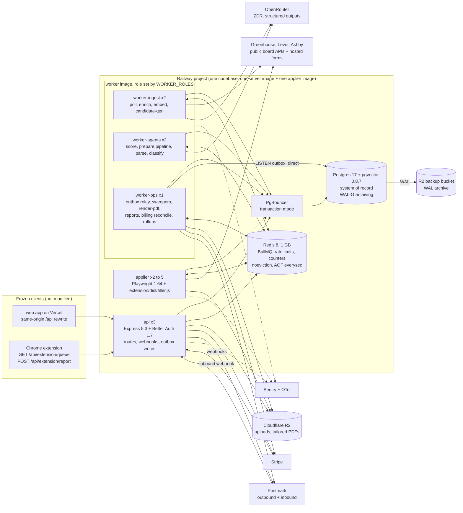
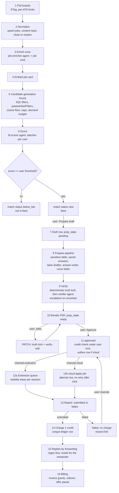

# Architecture option: evolved monolith

Date: 2026-10-16. Status: option for decision (one of several candidate architectures). Scope: backend only (`server/`, additive types in `shared/`, Railway infrastructure). No file under `web/` or `extension/` is created, edited or deleted by this design or by its implementation.

Inputs read in full: `_research/as-built.md`, `_research/cost-model.md`, `_research/openrouter.md`, `_research/stack-options.md`, `_research/requirements.md`, `_research/integrations.md`, `shared/src/plans.ts`, `extension/src/lib/api.ts`. Ids such as FR-17, INV-4, NFR-1, D-07 and S-01 refer to those documents. Skills applied: `engineering:architecture`, `ecc:backend-patterns`, `bullmq-specialist` (all loaded).

## 0. The option in one page

**Thesis.** The skeleton is right about its shape (one TypeScript codebase, three process types, Postgres as the system of record, BullMQ for work) and wrong about its seams (dual writes between Postgres and Redis, no leases, no pre-ranking, no agent runtime, no cost ledger). This option keeps the shape and fixes the seams. It does not change the queue engine, the API framework, the ORM or the auth library. It adds five things:

1. **A transactional outbox in Postgres** in front of BullMQ, plus reconcilers, so Redis holds only work in flight that can always be rebuilt from Postgres. Losing Redis delays work; it never loses an approval, a charge or a draft.
2. **A matching pipeline that pre-ranks before any model call**: an enrich-once job card, pgvector embeddings, SQL hard filters, the existing pure `passesHardFilters`, a similarity floor, per-plan daily caps and a demand budget. Scoring falls from about 1.61 million to about 289,000 model calls per day at 10,000 users (cost model section 3.2).
3. **An agent runtime on OpenRouter**: one gateway module, nine agents each with a versioned prompt, a strict JSON schema, a model chain with fallbacks, a budget and an eval set, all called by deterministic worker code. An independent verifier from a different model family checks every drafted claim.
4. **An application state machine with leases**: preparation state, a server-side visibility lease for the frozen extension, a crash-safe cloud attempt record, a resend path, sweepers, and credit checks under a per-user row lock.
5. **The scale and cost levers**: `llm_calls` cost ledger, per-user and per-agent budgets, alarms, horizontally scalable worker roles, PgBouncer, pgvector with point-in-time recovery.

**Cost at 10,000 users (base case S2):** about **$0.0048 per submitted application** ($0.0041 model, $0.0007 compute), against the $0.01 TRD target. Monthly: about $3,760 of model spend and about $650 of compute for about 927,000 submissions.

**Where this option is strongest:** continuity. Every verified flow (polling, fit gate, tailoring, review, approve, extension and cloud submit, single charge) keeps running on the code path that was verified, and each phase of the migration is a small, reversible diff. There is no engine migration, no new execution model and no new vendor in the correctness path.

**Where it is weaker than a Postgres-only engine (for example the DBOS option):** two stateful stores instead of one, an outbox relay and reconcilers that we write and own (about 600 lines), step memoization that we build in a table instead of getting it from an engine, and fairness that is achieved by job design rather than by an engine feature. Section 12 lists these as risks with retirement plans.

---

## 1. Components

### 1.1 Diagram



### 1.2 Component list

| Component | Process | Responsibility | Scales by |
|---|---|---|---|
| HTTP API | `api` (`server/src/api.ts`) | Every frozen route with unchanged shapes; new routes; Better Auth; Stripe and Postmark webhooks; state transitions with outbox writes in the same transaction | Replicas (stateless); 3 at beta |
| Ingest worker | `worker` with `WORKER_ROLES=ingest` | `poll-greenhouse`, `poll-lever`, `poll-ashby`, `enrich-job`, `embed-batch`, `candidate-gen`, `scan-form` (Greenhouse API part) | Replicas; per-ATS rate limits are global in Redis |
| Agents worker | `worker` with `WORKER_ROLES=agents` | `score-batch`, `prepare-application` (tailor, answers, cover letter, verify), `verify-edit`, `parse-resume`, `classify-email` | Replicas; IO-bound, concurrency 50 per replica, capped by OpenRouter limiters |
| Ops worker | `worker` with `WORKER_ROLES=ops` | Outbox relay, `render-pdf`, sweepers (`expire-leases`, `stuck-attempts`, `reconcile-queues`), `billing-reconcile`, `outcome-report`, `refresh-priority`, `submission-health`, `cost-rollup`, `catalog-drift`, `partition-maintenance`, `cleanup` | 1 replica; relay is safe with more (SKIP LOCKED) |
| Cloud applier | `applier` (`server/src/applier.ts`) | `cloud-apply` queues (one per ATS) and the Lever and Ashby `scan-form` browser path; injects `extension/dist/filler.js` unchanged | Replicas of 2 vCPU and 4 GB, 4 browser contexts each |
| Agent runtime | library in `server/src/agents/` | Agent registry, prompt files, schemas, model chains, budgets, evals | With the worker that calls it |
| LLM gateway | library in `server/src/llm/gateway.ts` | The only code that talks to OpenRouter; routing flags, structured outputs, validation, retries, fallbacks, cost rows | n/a |
| Postgres | Railway service, own image | System of record for every business fact, the outbox, `llm_calls`, vectors | Vertical to 8 vCPU and 32 GB; read replica later |
| PgBouncer | Railway service | Transaction pooling for all application pools | 1 replica |
| Redis | Railway service | BullMQ queues, shared rate limits, short counters, poll ETag cache, alert de-duplication. Never the only copy of a business fact | Vertical; 1 GB at beta |
| R2 | Cloudflare | Uploaded resumes, tailored PDFs, sampled LLM bodies, failure screenshots; separate bucket for WAL archives | n/a |

### 1.3 Code layout (modular monolith)

One package, `server/`, with module folders that only talk to each other through their exported functions. A lint rule (`eslint-plugin-boundaries` or a simple import-path check in CI) forbids reaching into another module's internals.

```
server/src/
  api.ts  worker.ts  applier.ts  migrate.ts          entry points (unchanged names)
  app.ts                                             Express app (unchanged middleware order)
  routes/                                            frozen routes + new routes
  modules/
    identity/        Better Auth config, sign-up hook, abuse limits
    profile/         resumes, facts, preferences, saved answers, uploads
    catalog/         companies, polling, ATS adapters (kept), job cards, embeddings
    matching/        hard filters (kept, pure), candidate generation, scoring orchestration
    applications/    state machine, prepare pipeline, approval, leases, resend, PDF
    submission/      extension report, cloud attempts, applier glue
    billing/         ledger, Stripe, rollover, offer pause, reconciliation
    inbox/           inbound email, forwarding verification, classification
    reports/         outcome report, priority polling
  agents/            registry, prompts/<agent>/v<N>.md, schemas, evals harness
  llm/               gateway, cost, catalog drift
  jobs/              BullMQ queue definitions, processors (thin: call module functions)
  outbox/            outbox writer, relay, reconcilers
  lib/               env, errors, logger, redis, db, telemetry, flags
```

The rule that makes this a monolith that can still be split later: a processor in `jobs/` contains no business logic. It parses a payload of ids, calls one module function, and returns. Any module could later move to its own service by moving its queue consumers, without touching the others.

---

## 2. Stack per layer

Versions are those verified with `npm view` on 2026-10-15 in `stack-options.md` unless marked [unverified].

| Layer | Choice | Version | Why (and what it replaces) |
|---|---|---|---|
| Runtime | Node.js LTS, TypeScript, ESM, esbuild bundle (`server/build.mjs`, kept) | Node 22, TypeScript 5.9 | Unchanged. One codebase, one lockfile |
| API | Express | 5.3.0 (kept) | Peak load is 60 to 150 requests per second, under 1% of one core. The frozen clients depend on exact status codes, error bodies, query parsing and cookie behavior; a framework swap risks silent contract breaks for no gain |
| Validation | zod (shared with `shared/`) | 4.6.7 (kept) | `z.toJSONSchema` also produces the strict JSON schemas sent to OpenRouter, so one schema per agent serves both |
| Auth | Better Auth, exact pin | 1.7.10 (kept) | The frozen clients call its routes, cookie and bearer plugin directly. Add `session.cookieCache` to remove one session query per request [verify option name on 1.7.x] |
| Queue | BullMQ on Redis | 6.3.15 (kept, pinned exactly) | The skeleton's six queues work. Keep job-id deduplication, job schedulers and limiters; add the outbox so Redis is never the only copy of intent. BullMQ Pro is not required |
| Redis | Railway Redis 8 (or Valkey 8) | image tag pinned | `maxmemory-policy noeviction` (BullMQ requires it), `appendonly yes`, `appendfsync everysec`, 1 GB |
| ORM | Drizzle ORM + drizzle-kit, postgres.js driver | drizzle-orm 0.45.4, drizzle-kit 0.31.11, postgres 3.4.9 (kept) | Typed, close to SQL, Better Auth adapter. Raw SQL through `drizzle-kit generate --custom` for vectors, partitions and HNSW indexes. Stay on 0.45.x until 1.0 is `latest` |
| Database | PostgreSQL 17 on an own image `FROM pgvector/pgvector:pg17` plus WAL-G | pgvector 0.8.7 | Default Railway template has no extensions and no point-in-time recovery. The own image adds `vector`, `pg_trgm` and continuous WAL archiving to R2 (RPO about 1 minute) |
| Pooler | PgBouncer, transaction mode | 1.2x image [unverified exact tag] | 13 replicas with their own pools exceed `max_connections = 100`. postgres.js runs with `prepare: false`. BullMQ does not touch Postgres, so nothing needs session features except the outbox `LISTEN` connection, which connects directly |
| Object storage | Cloudflare R2 via `@aws-sdk/client-s3` | 3.1152.0 | No egress fee, S3 API, presigned URLs |
| PDF | pdfkit, with a text round-trip check by unpdf | pdfkit 0.20.2, unpdf 1.9.0 | Deterministic one-page layout with a real text layer; the round trip proves the PDF holds exactly the verified lines |
| File text extraction | unpdf (PDF), mammoth (DOCX) | 1.9.0, 1.13.0 | Pure JavaScript, no native dependencies |
| Browser | Playwright with the matching `mcr.microsoft.com/playwright:v1.64.x-noble` image | playwright-core 1.64.1 | Kept. Improvements wrap the unchanged `filler.js` |
| LLM access | In-house gateway over `fetch` (undici) to OpenRouter's OpenAI-compatible API | n/a | One module owns routing flags, schemas, retries, cost rows. No agent framework: the agents are single structured calls orchestrated by deterministic code, so a framework would add surface without capability |
| Embeddings | OpenRouter `/api/v1/embeddings`, `qwen/qwen3-embedding-8b` primary | n/a | $0.01 per million tokens on ZDR routes; one key and one cost ledger |
| Rate limits | `rate-limiter-flexible` on Redis | 11.2.2 | Replaces per-process memory limiters (S-09). Auth limits fail closed to a Postgres counter if Redis is down |
| Observability | OpenTelemetry SDK, Sentry, pino with redaction, bull-board | `@opentelemetry/sdk-node` 0.223.0, `@sentry/node` 11.8.0, pino 10.4, `@bull-board/express` [version unverified, pin at install] | Errors and traces with no PII; queue UI for free; `llm_calls` table for model telemetry. Langfuse deferred |
| Tests | vitest (kept), Testcontainers for Postgres 17 + pgvector and Redis 8 in CI | vitest 5 | Invariants get database-level tests; contract tests replay the frozen clients' calls |

What is deliberately not added: Kubernetes, a service mesh, Kafka, a workflow engine, a vector database other than pgvector, an agent framework, Langfuse, a feature-flag vendor. Each is a later option with a named trigger in section 9.6.

---

## 3. Application lifecycle end to end

### 3.1 Overview



### 3.2 Step by step

**1. Poll.** A job scheduler (`upsertJobScheduler("poll-tick", { every: 60_000 })`, created once by the ops role, not by every process) runs `scheduleDuePolls`. It selects due companies with `SELECT ... WHERE active AND next_poll_at <= now() ORDER BY next_poll_at LIMIT 2000 FOR UPDATE SKIP LOCKED`, sets `next_poll_at = now() + interval + jitter` (jitter up to 10% of the interval), and enqueues one job per company into `poll-greenhouse`, `poll-lever` or `poll-ashby` with job id `poll:<companyId>:<epochMinute>`. Each ATS queue has its own BullMQ limiter (`{ max: 10, duration: 1000 }`) and worker concurrency 8. The request sends `If-None-Match` with the ETag stored on `companies.etag`; a 304 updates `last_polled_at` and stops. Ashby boards never poll faster than 60 seconds (edge cache). 403 and 429 responses call `worker.rateLimit(30_000)` for that queue and rethrow `Worker.RateLimitError()`, which pauses the whole ATS queue rather than retrying into a WAF. Interval: 30 minutes, or 5 minutes for priority companies (FR-53).

**2. Normalize.** The kept adapters normalize postings. The new upsert is `INSERT ... ON CONFLICT (company_id, external_id) DO UPDATE SET title, location, remote, apply_url, salary, content_hash, closed_at = NULL, updated_at WHERE jobs.content_hash IS DISTINCT FROM EXCLUDED.content_hash OR jobs.closed_at IS NOT NULL RETURNING id, (xmax = 0) AS inserted`. This fixes D-19: reopened jobs reopen, edited postings update. Inserts are chunked at 500 rows to stay far under the 65,535 bind-parameter limit (S-05). `raw` is trimmed to 1 KB of identifiers. Closure: postings missing from a non-empty board response are closed; an empty response closes nothing until it repeats on two consecutive polls (`companies.empty_streak`). New or changed jobs enqueue `enrich-job` with job id `enrich:<jobId>:<contentHash8>`.

**3. Enrich once.** `job-enricher` (section 5) reads the fenced description (cut to 1,100 tokens) and returns a job card: seniority, sponsorship signal with the quoted phrase, location and remote, salary range, 3 to 8 must-haves, a 120-token summary. The card is stored in `jobs.card` with `card_version`. It runs once per job and serves every user. Deterministic extraction still runs first and wins on conflict: the sponsorship phrase list (OQ-13) and salary parsing in the adapters are authoritative; the model only fills fields the rules left empty. The enrich queue has a limiter of 5 jobs per second, which smooths the burst when a new company is onboarded (S-04).

**4. Embed.** `embed-batch` collects up to 64 newly carded jobs (job id per 30-second window) and calls the embeddings endpoint once. Vectors go into `job_embeddings` as `halfvec(1024)` with `embedding_model` and `dims`.

**5. Candidate generation.** Section 4 gives the full pipeline. Output per eligible user: at most `budget` pre-ranked job ids per hour slot.

**6. Score.** `score-batch` (job id `score:<userId>:<hourSlot>`) holds up to 20 job ids for one user. It loads the user's profile summary once (cached prefix), calls `fit-scorer` for each job sequentially with `session_id = <userHash>:fit:<hourSlot>` so the prefix stays warm, and writes all results in one multi-row insert into `matches` (`ON CONFLICT (user_id, job_id) DO NOTHING`). Scores at or above the user's threshold get status `new`; others get the new status `below_bar`, which no frozen route returns. Each completed call is memoized in `agent_runs`, so a retried batch never pays twice for the same pair (S-02).

**7. Prepare draft.** Unchanged route `POST /api/matches/:id/queue`. In one transaction it inserts the draft (`ON CONFLICT (user_id, job_id) DO NOTHING`), sets `prep_state = 'pending'`, marks the match `queued`, and inserts an outbox row `prepare-application:<applicationId>`. Response shape unchanged (201 or 200 `{applicationId}`).

**8. Prepare pipeline.** One BullMQ job per application (`prepare:<applicationId>`), run by the agents role. The job is a fixed sequence of steps; each step's result is memoized in `agent_runs` keyed by `(application_id, step, input_hash)`, so a retry after a crash resumes after the last completed step:

| Step | Kind | What it does |
|---|---|---|
| `load` | deterministic | Load confirmed facts only, the job card, the form questions (from `form_questions`, filled by `scan-form` at enrich time for Greenhouse, at prepare time for Lever and Ashby through the applier) |
| `profile-answers` | deterministic | Contact fields from the profile (existing behavior) |
| `sensitive` | deterministic | `classifySensitive(label)` and the fixed table (FR-24, FR-25). EEO, disability, veteran, gender, race, sexual orientation, salary and visa questions are answered here or left blank, never sent to a model (INV-9) |
| `saved-answers` | deterministic | Approved saved answers by `question_key` (FR-28) |
| `tailor` | agent `tailor-drafter` | 8 to 12 rewritten bullets plus a summary line, each with `factIds` |
| `answers` | agent `answer-writer` | All remaining text, textarea and select questions in one call; select answers must equal an option or become blank |
| `cover-letter` | agent `cover-letter` | Paid plans only (`coverLetters` in `plans.ts`), only when the form has a letter field; at most 4 paragraphs and 250 words |
| `truth-lock` | deterministic | Every line, answer and paragraph must cite at least one fact id, and every id must be a confirmed fact of this user (fixes D-03: confirmed only) |
| `verify` | agent `verifier`, then `verifier-escalation` | Section 3.3 |
| `redraft` | agent `tailor-drafter` | At most once, only if fewer than 6 resume lines survived; the dropped claims are passed as "do not claim" hints |
| `render` | deterministic | Enqueue `render-pdf` through the outbox; the PDF is written to `resumes/{userId}/{applicationId}.pdf` and checked by text round trip |
| `ready` | deterministic | In one transaction: write `resume_lines`, `answers`, `cover_letter`, `verification`, set `prep_state = 'ready'` |

If the pipeline fails permanently (3 attempts), `prep_state = 'failed'` with `prep_error`, and the draft is visible with empty content as today. A new route `POST /api/applications/:id/prepare` re-runs it (fixes D-22). The tailor step never overwrites user edits: it only writes when `prep_state = 'pending'` (fixes the re-run hazard in section 4 of the audit).

**9. Verify.** See 3.3.

**10. Review and edit.** Unchanged route `PATCH /api/applications/:id`, draft only. Section 3.3 describes how edits are verified.

**11. Approve.** Unchanged route and request `POST /api/applications/approve` `{applicationIds, channel}`. In one transaction:

1. `SELECT ... FROM subscriptions WHERE user_id = $1 FOR UPDATE` serializes every credit decision of this user (fixes D-08). Every user has this row since sign-up.
2. Plan check for cloud: 403 "The cloud applier is on Pro and Max" (AC-8, unchanged).
3. Eligible set: owned, `status = 'draft'`, `prep_state = 'ready'`, no unresolved verification, required answers present (FR-26), cover letter present when required on Free (FR-29), per-company cap not exceeded counting `approved`, `submitting` and `submitted` in 30 days (fixes D-18).
4. `available = balance - inFlight`; if `available < eligible.length`, 402 `payment_required` and nothing changes (AC-7, unchanged).
5. `UPDATE applications SET status = 'approved', channel, approved_at WHERE id = ANY($ids) AND status = 'draft' RETURNING id`.
6. For cloud: one outbox row per id (`cloud-apply:<applicationId>:<attemptNo>`).

Response: `{ approved: string[] }` as today, plus the optional field `skipped: { id: string, reason: "not_ready" | "verification_pending" | "required_answers_missing" | "cover_letter_required" | "company_cap" }[]`. Today non-draft ids are silently skipped; the new reasons use the same skip behavior so the frozen web app sees the same contract. The 422 codes `required_answers_missing` and `cover_letter_required` from FR-26 and FR-29 are reserved for when the web app is unfrozen; until then the skip list carries the same information without a new error code on an existing route.

**12a. Extension channel.** The frozen extension calls only `GET /api/extension/queue` and `POST /api/extension/report` (read in `extension/src/lib/api.ts`). It has no claim call, so FR-34's explicit claim cannot be used. The backend adds a **visibility lease** inside the existing queue route:

```sql
-- inside GET /api/extension/queue, one statement
UPDATE applications
SET lease_session_id = $sessionId, lease_expires_at = now() + interval '10 minutes'
WHERE user_id = $userId AND status = 'approved' AND channel = 'extension'
  AND (lease_session_id IS NULL OR lease_expires_at < now() OR lease_session_id = $sessionId)
  AND id IN (SELECT id FROM applications WHERE user_id = $userId AND status = 'approved'
             AND channel = 'extension' ORDER BY approved_at LIMIT 20)
RETURNING id, ...;
```

A second browser or device (a different Better Auth session) does not see items leased to the first, and a report from a session that does not hold a live lease gets 409 `conflict`, which the existing extension already handles as an error. The lease keeps the status `approved`, so viewing the queue never strands an application: an unused lease simply expires. Queue items gain the optional `resumePdfUrl` already present in the shared `FillPayload` type (a presigned R2 URL, 10 minutes). Residual risk, stated honestly: two tabs inside the same extension share one session token, so the server cannot tell them apart; that case is covered only by the extension's own single background queue and by the idempotent charge. Full two-tab protection on one session needs the claim route (FR-34) in a future extension release.

**12b. Cloud channel.** The relay enqueues `cloud-apply-<ats>` with job id `apply:<applicationId>:<attemptNo>` and `attempts: 1`. The applier:

1. Re-reads the row and the user's plan (cloud only on `cloudApplier: true`).
2. Claims in one transaction: `UPDATE applications SET status = 'submitting', attempt_no = attempt_no + 1 WHERE id = $id AND status = 'approved' RETURNING attempt_no` and `INSERT INTO submission_attempts (application_id, attempt_no, channel, state, started_at) VALUES (..., 'running', now())`. Zero rows means withdrawn or already taken: stop (fixes D-11).
3. Checks the apply URL host against the ATS allowlist and blocks private address ranges in a Playwright route handler (P-04).
4. Opens a fresh context, blocks images, fonts and media, navigates (45 s), attaches the tailored PDF with `setInputFiles` on the resume input when present, injects the unchanged `filler.js`, calls `window.__kairosFill({... submit: true })` under an outer 120-second timeout.
5. Classifies the outcome: confirmation, filler-reported failure, captcha challenge (visible challenge element, a "could not verify" response, or no confirmation), closed posting.
6. Records the report through the same `recordSubmission` used by the extension.

A crash at any point after step 2 leaves a `running` attempt. BullMQ marks the job stalled; with `attempts: 1` and `maxStalledCount: 0` it fails instead of re-running, and the `stuck-attempts` sweeper (every minute) moves any attempt `running` for more than 5 minutes to `failed` with reason "No report from the cloud applier. Check for the employer's confirmation email before you resend." and no charge (fixes D-12). The submit click is therefore at most once per attempt.

**13. Report.** `recordSubmission` keeps its `SELECT ... FOR UPDATE` and idempotency (already `submitted` returns the row). Additions: the extension report is accepted only from the lease-holding session (or any session when no lease is live); `submitted_at` is set to the server time, and the client time is kept in `receipt.clientSubmittedAt` (D-27); the attempt row is closed.

**14. Charge.** In the same transaction as the status change: `INSERT INTO credit_ledger (user_id, delta, reason, application_id) VALUES ($u, -1, 'submission', $a) ON CONFLICT DO NOTHING` on the kept partial unique index. `failed` writes no ledger row. One charge per application regardless of how many reports, tabs or attempts (AC-9, AC-10).

**15. Failure and resend.** `failed` applications get a new route `POST /api/applications/:id/resend` (`{channel?: "extension" | "cloud"}`, default `extension`), which re-runs the approval checks under the user lock and moves `failed` to `approved` (FR-35). Because the web app is frozen and has no resend button, the backend also emails the user a signed one-time resend link: `GET /api/applications/:id/resend-link?t=<token>`, where the token is an HMAC of `(applicationId, attemptNo, userId, expiry)` valid for 7 days and single-use (stored hash). The link performs the resend to the extension channel and redirects to `/applications/:id` on the web app. This is the backend path for "a challenged cloud run fails without charge and the user resends through the extension" (fixes D-10).

**16. Replies.** Postmark posts to the inbound webhook; the row is stored idempotently on `MessageID` and the user is resolved from `OriginalRecipient`. `classify-email` runs deterministic rules first: Gmail forwarding confirmation (stores the 9-digit code in `forwarding_verifications` and emails it to the user; [unverified] sender and format, pinned by a captured sample), then the kept regex classifier, then `reply-classifier` only for mail the rules cannot tag (about 25%). Linking to an application uses sender domain against the job's ATS and company domains, then subject and body tokens with a minimum company-name length of 4 and word boundaries (D-26).

**17. Billing.** Section 7.3.

### 3.3 Verification and the truth lock

The truth lock has two layers, in this order, for every resume line, answer and cover-letter paragraph:

1. **Deterministic** (kept and fixed): non-empty `factIds`; every id is a confirmed fact owned by the user. Violation on a user edit: 422 `truth_lock` with `details = rejected[]`, nothing stored (AC-6). Violation in the pipeline: the item is dropped and recorded.
2. **Semantic** (new): the `verifier` agent receives only the claims and the text of the facts each claim cites, and returns a verdict per claim: `supported`, `unsupported`, `contradicted` or `uncertain`, with the supporting fact id. `uncertain` claims go to `verifier-escalation` (a stronger model of a third family). The verifier and escalation models are never from the drafter's family; the registry asserts this at load time.

| Verdict | In the prepare pipeline | On a user edit (`PATCH`) |
|---|---|---|
| supported | kept | stored |
| unsupported or contradicted | dropped; recorded in `applications.verification` with the claim, verdict and cited ids (fixes D-02) | 422 `truth_lock`, `details` lists the lines with `reason: "unsupported_by_cited_facts"`; nothing stored |
| uncertain after escalation | dropped | 422 `truth_lock` as above |
| verifier unavailable (timeout 8 s, all models in the chain failed) | pipeline step retries with backoff; the draft stays `pending` | edit stored with `verification.state = 'pending'`; a `verify-edit` job re-checks; approval skips the draft with reason `verification_pending` until it passes |

`PATCH` verifies only changed items (diff against the stored draft), so a typical edit costs one verifier call of about $0.00035 and 1 to 3 seconds. The existing `details` shape of `truth_lock` is an array of rejected lines; the new `reason` is an added optional field on each element.

---

## 4. Matching pipeline at 10,000 users

### 4.1 Funnel and numbers (S2 base: 10,000 companies, 10,000 new postings per day)

```mermaid
flowchart LR
    J[10,000 new postings/day<br/>about 420/hour] --> EN[enrich + embed once<br/>11,000 cards, 12,800 vectors]
    EN --> EL[eligible users<br/>4,800 of 10,000]
    EL --> SQL[SQL coarse filters per shard<br/>location, remote, salary floor,<br/>excluded companies, seniority band]
    SQL --> HF[passesHardFilters in TS<br/>exact rules, kept reason strings<br/>1,095,000 pairs/day]
    HF --> FL[cosine floor<br/>keeps about 50%: 547,500]
    FL --> TK[top-K per user<br/>min of plan cap, demand budget]
    TK --> SC[fit-scorer<br/>269,400 + 20,000 backfill<br/>= 289,400 calls/day]
    SC --> MT[80,820 matches/day<br/>at or above threshold]
```



| Stage | Rule | Where it runs | Volume per day (S2) |
|---|---|---|---|
| Eligibility | Preferences saved, signed in within 7 days, available credits > 0, not paused by an offer, not over `dailyModelBudgetUsd` | `eligible_users` view, refreshed each hour | 4,800 users |
| Coarse filters | Location or remote, salary floor against card salary, excluded companies, excluded keywords on title (pg_trgm), seniority band from the card | One SQL statement per shard of 100 users against postings since the user's cursor | about 20 million pair checks, in SQL |
| Exact hard filters | The kept pure `passesHardFilters` (seniority, sponsorship, per-company cap, locations, excludes, salary, roles); reason strings unchanged (the landing test pins them) | TypeScript on the coarse survivors | 1,095,000 passes |
| Similarity floor | `1 - (job_vec <=> profile_vec) >= floor`, best over the user's resume-profile vectors; floor calibrated so that it drops under 2% of pairs that would score 75 or more on the scorer eval set | SQL on survivors | 547,500 |
| Top-K | `K = min(dailyScoringCap remaining, demand budget)`, ordered by cosine | TypeScript | 269,400 |
| Onboarding backfill | When preferences are first saved or changed: HNSW search over open postings, hard filters, top 100 | Same code path, `candidate-gen` with `mode: backfill` | 20,000 |
| Model | `fit-scorer` | Agents worker | 289,400 calls |

Hard-filter rejections are not stored as rows (that would be about 48 million rows a day). The reason a job was filtered for a user is computed on demand from `passesHardFilters` if ever needed. Only scored pairs are stored.

### 4.2 Caps and demand budget

Two additive fields in `shared/src/plans.ts` (the only source of plan limits, INV-10):

```ts
export interface Plan {
  // ...existing fields unchanged...
  /** Maximum fit-scoring model calls per user per UTC day, after pre-ranking. */
  dailyScoringCap: number;
  /** Hard ceiling on model spend per user per UTC day, in USD. Scoring stops first, drafting second. */
  dailyModelBudgetUsd: number;
}
```

| Plan | `dailyScoringCap` | `dailyModelBudgetUsd` |
|---|---|---|
| Free | 15 | 0.03 |
| Starter | 60 | 0.08 |
| Pro | 150 | 0.20 |
| Max | 250 | 0.30 |

Demand budget per user per day: `budget = clamp(10 + 2.5 × avgDailyMatchActions(last 3 days), 10, dailyScoringCap)`, where a match action is queue or skip. Scoring for a user pauses while their unacted `new` matches exceed `2 × budget`. This keeps spend proportional to what the user actually reviews.

When a user reaches `dailyModelBudgetUsd`: scoring stops for the rest of the UTC day; drafting continues up to 1.5 times the budget because the user is waiting; above that, the optional cover letter is deferred to the next day. Verification is never skipped to save money: a draft that cannot be verified is not marked ready.

### 4.3 Candidate generation job design

- **Schedule.** Job scheduler `candidate-tick` every hour at minute 5 (timezone `UTC`). It enqueues 48 `candidate-gen` jobs, one per shard of 100 eligible users (`shard = hashtext(user_id) % 48`), job id `cand:<hourSlot>:<shard>`.
- **Per shard.** One SQL statement joins the shard's users with postings whose `card_ready_at` is after each user's `match_cursor`, applying coarse predicates; TypeScript applies `passesHardFilters` with one batched per-company count query for the cap; one SQL statement computes cosine for survivors with the exact `<=>` operator (about 420 new postings per hour times a handful of survivors per user, so no index is needed); TypeScript picks top-K and enqueues `score-batch` per user. Then `match_cursor` advances in the same transaction that records the hour's candidate counts.
- **Cost.** About 40 ms per user, 4 seconds per shard, 48 shards per hour on one replica: under 5% of one worker.
- **Fairness.** Fairness comes from the job shape: every eligible user gets at most one `score-batch` per hour of at most 20 calls, so a Max user with 250 per day cannot starve a Free user. `score-batch` jobs carry BullMQ priority by plan (Max 1, Pro 2, Starter 3, Free 4) so that under backlog paid users are served first, but no user gets a second batch in an hour.
- **Back-pressure.** Before enqueueing, `candidate-gen` checks the `score-batch` waiting count; above 5,000 waiting jobs it enqueues only users with no `new` matches (starved users first) and logs `candidate_gen_throttled`.

### 4.4 Vectors

| Vector | Text embedded | Count at S2 | Storage |
|---|---|---|---|
| Job | Job card summary plus title plus must-haves (about 500 tokens) | 400,000 open, about 700,000 kept 30 days after close | `halfvec(1024)`, partial HNSW index `WHERE closed_at IS NULL` (m = 16, ef_construction = 64), about 0.9 GB in RAM |
| Resume profile | Preferences roles plus the top 25 confirmed facts (about 400 tokens) | 1 per resume profile, about 15,000 | `halfvec(1024)`; re-embedded when facts or preferences change |

Model: `qwen/qwen3-embedding-8b` with `dimensions: 1024` [unverified: Matryoshka truncation support must be proven in the week-1 spike]. Fallback: `openai/text-embedding-3-small` at 1024 dimensions on Azure ZDR, written to a separate `embedding_model` value; vectors from different models are never compared. HNSW is used only for onboarding backfill; hourly generation uses exact distance on a small set.

### 4.5 Capacity of the matching path

| Item | Value at S2 |
|---|---|
| `candidate-gen` jobs | 1,152 per day, about 4 s each |
| `score-batch` jobs | about 14,500 per day, up to 20 calls each |
| Scoring calls in flight at peak | 13 (8.4 per second at 1.5 s per call) |
| Matches rows written | 289,400 per day in about 14,500 multi-row inserts |
| Postgres load from matching | under 0.5 vCPU average |

---

## 5. Agent runtime on OpenRouter

### 5.1 Agents

Each agent is one role with a versioned prompt file, a strict output schema, a model chain, a per-call budget and an eval set. Workers call agents from fixed code paths; no agent decides what runs next, and no agent has tools. Retrieval that would otherwise be a tool (which facts to show the answer writer) is done deterministically before the call: the answer writer receives the 25 confirmed facts with the highest cosine similarity to the question text, chosen in SQL.

| Agent | Class | Input (fenced parts in italics) | Output schema (summary) | Primary model | Fallbacks | `max_tokens` | Eval set |
|---|---|---|---|---|---|---|---|
| `job-enricher` | A | Static prefix; *job description cut to 1,100 tokens* | `{seniority, sponsorship: {signal, quote}, location, remote, salary, mustHaves[3..8], summary}` | `openai/gpt-6-luna` | `anthropic/claude-haiku-5.5`, `deepseek/deepseek-v4.1-flash` | 400 | 200 labeled postings, 20 injection cases |
| `fit-scorer` | B | Static prefix; per-user profile summary (600 tokens, cached); *job card* | `{score: 0..100, reasons[1..4] ≤ 20 words, mustHaveHits[]}` | `openai/gpt-6-luna` | `anthropic/claude-haiku-5.5`; challenger `deepseek/deepseek-v4-flash-0731` | 200 | 300 labeled (profile, job) pairs |
| `resume-parser` | A | Static prefix; *resume text with the contact block redacted* | `{facts[1..200]: {kind, text, start, end}}` (character offsets instead of echoing source spans) | `anthropic/claude-haiku-5.5` | `openai/gpt-6-luna` | 3,000 | 60 resumes with gold facts |
| `tailor-drafter` | C | Static prefix; confirmed facts `{id, kind, text}` (cached per user); *job card*; do-not-claim hints | `{summary: Line, bullets[6..12]: {id, section, text ≤ 400, factIds[1..]}}` | `openai/gpt-6-luna` | `z-ai/glm-5.3` | 900 | 200 (facts, job, draft) cases, rubric |
| `answer-writer` | C | Static prefix; top 25 relevant facts; *questions with labels and options* | `{answers[]: {fieldKey, value ≤ 5000, factIds[1..]}}` | `openai/gpt-6-luna` | `z-ai/glm-5.3` | 600 | 150 forms |
| `cover-letter` | C | Static prefix; facts; *job card* | `{paragraphs[1..4]: {text, factIds[1..]}}`, 250 words total | `openai/gpt-6-luna` (option: `anthropic/claude-sonnet-5` on Pro and Max only) | `z-ai/glm-5.3` | 600 | 100 letters |
| `verifier` | D | Static prefix; claims; only the facts each claim cites | `{verdicts[]: {claimId, verdict: supported or unsupported or contradicted or uncertain, factId?}}` | `anthropic/claude-haiku-5.5` | `deepseek/deepseek-v4-flash-0731` | 450 | 400 adversarial claims |
| `verifier-escalation` | D+ | Same, uncertain claims only | Same | `anthropic/claude-sonnet-5` when the drafter is OpenAI; `openai/gpt-6-sol` when the drafter fell back to Z.ai | none | 650 | Same set, uncertain subset |
| `reply-classifier` | A | Static prefix; *redacted email body cut to 550 tokens* | `{kind: confirmation or rejection or interview or assessment or offer or other, confidence}` | `openai/gpt-6-luna` | `deepseek/deepseek-v4-flash-0731` | 80 | 300 emails including 40 near-miss offers |
| embeddings | E | Job card text, profile text | vector | `qwen/qwen3-embedding-8b` | `openai/text-embedding-3-small` (separate index version) | n/a | 500 labeled (user, job) pairs for retrieval recall |

Family rule: the drafter chain is OpenAI then Z.ai; the verifier chain is Anthropic then DeepSeek; escalation is Anthropic or OpenAI, chosen so it differs from the model that drafted. Prices and the per-agent cost math are in the cost model section 5 and are not repeated here. All model slugs must be re-validated by the nightly `catalog-drift` job.

The model never decides billing pause, never answers a sensitive question, and never chooses which application is sent. An offer email pauses billing only when the deterministic offer rule matches, the sender domain matches a submitted application's company or ATS, and the user has not undone a previous pause for that application; the classifier may only add a candidate for the rule to check.

### 5.2 Agent definition (TypeScript)

```ts
// server/src/agents/types.ts
import type { z } from "zod";

export type AgentId =
  | "job-enricher" | "fit-scorer" | "resume-parser" | "tailor-drafter"
  | "answer-writer" | "cover-letter" | "verifier" | "verifier-escalation" | "reply-classifier";

export type ModelFamily = "openai" | "anthropic" | "deepseek" | "zai" | "google" | "qwen";

export interface ModelRoute {
  slug: string;                                   // exact versioned slug, never a "-latest" alias
  family: ModelFamily;
  maxPrice: { prompt: number; completion: number }; // USD per 1M tokens, 1.5 x budgeted
  reasoning?: { effort: "low" | "medium" } | { enabled: false };
  quantizations?: ("fp8" | "bf16")[];
  samplingAllowed: boolean;                        // false for Claude 5.x routes
}

export interface AgentSpec<I, O> {
  id: AgentId;
  promptVersion: number;                           // prompts/<id>/v<promptVersion>.md
  input: z.ZodType<I>;
  output: z.ZodType<O>;                            // also compiled to strict JSON schema
  chain: [ModelRoute, ...ModelRoute[]];            // primary first; at most 2 fallbacks
  maxTokens: number;
  keyClass: "batch" | "interactive";               // which OpenRouter key
  budgetUsdPerCall: number;                        // alert above p95
  mustDifferFrom?: AgentId;                        // family rule (verifier vs drafter)
  render: (input: I) => { stable: string[]; untrusted: { label: string; text: string }[] };
  postValidate?: (out: O, input: I) => O;          // deterministic checks after zod
}
```

```ts
// server/src/llm/gateway.ts (signature)
export interface AgentCallContext {
  userId?: string;          // hashed before it leaves the process
  sessionKey: string;       // "<agent>:<batchId>", becomes session_id with the user hash
  applicationId?: string;
  memoKey?: string;         // agent_runs key; a hit returns the stored output, no call
}

export interface AgentResult<O> {
  data: O;
  servedModel: string;
  provider: string;
  usage: { promptTokens: number; completionTokens: number; cachedTokens: number;
           cacheWriteTokens: number; reasoningTokens: number; costUsd: number };
  attempts: number;
  fallbackUsed: boolean;
  llmCallId: string;
}

export declare function runAgent<I, O>(spec: AgentSpec<I, O>, input: I, ctx: AgentCallContext): Promise<AgentResult<O>>;
```

### 5.3 Request policy (every call)

```json
{
  "model": "<primary slug>",
  "models": ["<primary slug>", "<fallback 1>", "<fallback 2>"],
  "messages": ["system: static prefix", "user: stable per-user block", "user: fenced untrusted block"],
  "response_format": { "type": "json_schema", "json_schema": { "name": "<agent>_v<N>", "strict": true, "schema": {} } },
  "provider": { "zdr": true, "data_collection": "deny", "require_parameters": true, "allow_fallbacks": true,
                "max_price": { "prompt": 0.15, "completion": 0.75 } },
  "max_tokens": 200,
  "session_id": "<userHash>:<agent>:<batchId>",
  "user": "<HMAC-SHA256(userId, USER_HASH_KEY)>"
}
```

Rules enforced by the gateway, not by agent code:

- **Routing.** `zdr: true` and `data_collection: "deny"` on every call, plus an account guardrail that enforces ZDR for all model groups (a request flag can add ZDR but not remove account enforcement). `require_parameters: true` because every call has a schema. No `provider.order` or `sort` (they disable sticky routing and hurt caching), except a temporary pin set by an operator flag.
- **Structured outputs.** `json_schema` with `strict: true`, generated from the zod schema by `z.toJSONSchema` and normalized to the strict subset (every property required, `additionalProperties: false`, no recursive references). The reply is validated again with zod, then by `postValidate` (fact ids must belong to the input fact set, select values must match options, scores are integers in range). One repair re-ask with the validation error appended; then the job step fails. `finish_reason: "length"` is a failure, never a partial success.
- **Errors.** The body is checked for `error` even on HTTP 200, and empty `choices` is a failure. Retries per model attempt: at most 2 on 408, 429, 502 and 5xx, exponential backoff from 500 ms with full jitter, capped at 8 s, honoring `Retry-After`. 503 "no provider meets requirements" moves to the next model. 400 and 401 fail fast and alert. 402 and 403 budget errors pause the batch queues (`queue.pause()` on `score-batch`, `enrich-job`, `candidate-gen`) and alert; the interactive key keeps running.
- **Rate limits.** BullMQ limiters cap calls per second per agent queue, and on a 429 the worker calls `worker.rateLimit(retryAfterMs)`. The beta needs a written throughput commitment from OpenRouter: about 940 requests per minute at peak; ask for 2,000 requests and 4 million tokens per minute.
- **Untrusted input.** Job descriptions, form questions and email bodies are placed only in the last user message, inside a block delimited by a per-call random boundary (`<<UNTRUSTED-7f3a9c>> ... <<END-7f3a9c>>`); occurrences of the boundary inside the text are stripped. The system prompt states that text in that block is data and never instructions. Nothing untrusted is ever placed in the system message.
- **Minimum data.** Resume text is sent to the parser with the contact block (name, email, phone, address, links) removed by deterministic redaction. Other agents receive fact text and ids, never contact details, work-authorization status or salary floor (those drive deterministic code only). Email bodies are redacted (signatures, phone numbers, addresses) and cut to 550 tokens.

### 5.4 Caching

- Prompt layout: static system text, schema description and few-shot examples first (padded to at least 1,024 tokens for OpenAI routes, 512 for Claude 5.5), then the per-user stable block (profile summary or confirmed facts), then the variable fenced block. No timestamps or ids before the variable block.
- Anthropic routes get `cache_control` breakpoints after the static block and after the per-user block.
- Calls are batched per user (`score-batch`, the prepare pipeline) under one `session_id`, which keeps sticky routing on one endpoint inside the 5-minute cache window.
- Expected hit rates (cost model P4): static prefix 95%, per-user block 60% to 85%. Alarm when `cached_tokens / prompt_tokens` falls below 50% on the scorer, drafter or verifier for an hour. If the week-1 spike shows Azure `gpt-6-luna` routes do not cache under ZDR (`supports_implicit_caching = false` in the catalog), cost rises to about $0.0073 per submission (cost model section 10), still under target; the lever is then to move the scorer to Vertex Haiku.
- Output memoization in `agent_runs` (keyed by agent, prompt version, model chain hash and input hash) makes retries free and stops a re-run from changing a result the user already saw.

### 5.5 Budgets and cost recording

Every call writes one `llm_calls` row (section 6) with requested model, served model, provider, tokens, `usage.cost`, latency, finish reason, attempts and a hashed user id. In the same statement the per-user counter `user_daily_usage.model_usd` is incremented. Budget checks before a call:

1. Per user: `user_daily_usage.model_usd < plan.dailyModelBudgetUsd` (with the 1.5 times drafting allowance described in 4.2).
2. Per agent: today's spend from `llm_cost_daily` (rolled up every minute by `cost-rollup`) below the agent's daily envelope (cost model section 12.1: enricher $5, scorer $60, drafter $35, answers $12, letters $8, verifier $35, escalation $40, classifier $1, parser $1.50). At 80% the batch agents throttle to half rate and an alert fires; at 100% batch agents stop until the UTC day rolls; interactive agents continue to the key limit.
3. Per call: `provider.max_price` at 1.5 times the budgeted price per model in the chain.
4. Hard stop: OpenRouter key daily limits, `kairos-prod-batch` $150 and `kairos-prod-interactive` $250.

A nightly `billing-reconcile` step compares `sum(llm_calls.cost_usd)` with the OpenRouter key usage (`GET /api/v1/key`) and alerts on more than 2% drift.

### 5.6 Evals

| Gate | When | Pass bar |
|---|---|---|
| Prompt or model change | CI job `npm run eval -- --agent <id>` on every PR that touches `agents/<id>/` or the model registry; uses the `kairos-evals` key with synthetic data only | Agent-specific (below); the PR cannot merge on a failing gate |
| Nightly | Full suite on the production chain and on each fallback model | Same bars; a fallback that fails is disabled in the registry by config |
| Catalog drift | Nightly download of `/api/v1/models` and `/api/v1/endpoints/zdr` | Every configured slug exists, has at least 2 ZDR endpoints with `structured_outputs`, price within +25% of the stored price, family rule holds. A failing primary is disabled (the chain moves to the next) and an alert is raised; nobody is paged |
| Production sampling | 2% of calls and every verifier rejection stored (bodies with fact text replaced by fact ids where possible) in R2 for 35 days | Weekly review of 50 samples |

Pass bars: `fit-scorer` Spearman correlation with labels ≥ 0.70 and recall of label-fit pairs at threshold 75 ≥ 0.90; `tailor-drafter` zero unsupported claims after the verifier on all 200 cases and rubric ≥ 4 of 5 on 90%; `verifier` false-accept ≤ 1% and false-reject ≤ 5% on the adversarial set; `resume-parser` fact recall ≥ 0.95 with zero invented facts; `reply-classifier` offer precision 100% on the near-miss set ("offer you an interview" must never be `offer`); every agent passes its injection cases (output unchanged by instructions inside the fenced block).

Evals are files in `server/evals/<agent>/cases.jsonl` with expected outputs; results are written to `eval_runs` with prompt version, model, scores and cost.

---

## 6. Data model outline

Postgres stays the system of record. Existing 17 tables and 9 enums are kept; every change below is additive (new tables, new nullable columns, new enum values, widened indexes), applied in expand-then-contract order (NFR-10). Migrations are generated with drizzle-kit; hand SQL uses `drizzle-kit generate --custom` and is never edited after it is applied.

### 6.1 Changes to existing tables

```sql
-- extensions (own image)
CREATE EXTENSION IF NOT EXISTS vector;
CREATE EXTENSION IF NOT EXISTS pg_trgm;

-- companies: conditional polling and scheduling
ALTER TABLE companies
  ADD COLUMN etag text,
  ADD COLUMN next_poll_at timestamptz NOT NULL DEFAULT now(),
  ADD COLUMN empty_streak smallint NOT NULL DEFAULT 0,
  ADD COLUMN domains text[] NOT NULL DEFAULT '{}';
CREATE INDEX companies_due_idx ON companies (next_poll_at) WHERE active;

-- jobs: update semantics and the enrich-once card
ALTER TABLE jobs
  ADD COLUMN content_hash text,
  ADD COLUMN updated_at timestamptz,
  ADD COLUMN card jsonb,
  ADD COLUMN card_version smallint,
  ADD COLUMN card_ready_at timestamptz;
CREATE INDEX jobs_open_card_ready_idx ON jobs (card_ready_at) WHERE closed_at IS NULL;
CREATE INDEX jobs_title_trgm_idx ON jobs USING gin (title gin_trgm_ops);

-- matches: scored pairs only; new status that the feed never returns
ALTER TYPE match_status ADD VALUE IF NOT EXISTS 'below_bar';
ALTER TABLE matches
  ADD COLUMN similarity real,
  ADD COLUMN scorer_version text,
  ADD COLUMN must_have_hits jsonb;
CREATE INDEX matches_job_idx ON matches (job_id);

-- applications: preparation, verification, leases, attempts, PDF
ALTER TABLE applications
  ADD COLUMN prep_state text NOT NULL DEFAULT 'ready'          -- backfill: existing drafts are ready
    CHECK (prep_state IN ('pending','ready','failed')),
  ADD COLUMN prep_error text,
  ADD COLUMN verification jsonb,                               -- per-claim verdicts and dropped items
  ADD COLUMN questions jsonb,                                  -- snapshot of form questions used
  ADD COLUMN lease_session_id text,
  ADD COLUMN lease_expires_at timestamptz,
  ADD COLUMN attempt_no integer NOT NULL DEFAULT 0,
  ADD COLUMN resume_pdf_key text;
ALTER TABLE applications ALTER COLUMN prep_state SET DEFAULT 'pending';  -- new drafts start pending
CREATE INDEX applications_job_idx ON applications (job_id);
CREATE INDEX applications_match_idx ON applications (match_id);
CREATE INDEX applications_ext_queue_idx ON applications (user_id, approved_at)
  WHERE status = 'approved' AND channel = 'extension';

-- facts: index for the confirmed-only reads
CREATE INDEX facts_user_confirmed_idx ON facts (user_id) WHERE confirmed;

-- credit_ledger: rollover expiry needs (invoice, reason) uniqueness
CREATE UNIQUE INDEX credit_ledger_invoice_reason_uq
  ON credit_ledger (stripe_invoice_id, reason) WHERE stripe_invoice_id IS NOT NULL;
DROP INDEX credit_ledger_invoice_uq;                           -- in the following release (contract step)

-- stripe_events: processed atomically with the handler
ALTER TABLE stripe_events ADD COLUMN received_at timestamptz NOT NULL DEFAULT now();
-- processed_at becomes nullable semantics: set in the same transaction as the handler's effects

-- inbound_emails: bounded body, attachments metadata only
ALTER TABLE inbound_emails ADD COLUMN attachments jsonb, ADD COLUMN spam_score real;

-- profiles: billing pause and match cursor
ALTER TABLE profiles
  ADD COLUMN applications_paused_at timestamptz,
  ADD COLUMN match_cursor timestamptz,
  ADD COLUMN forwarding_state text NOT NULL DEFAULT 'not_started';
```

### 6.2 New tables

```sql
-- Outbox: every enqueue intent, written in the same transaction as the state change
CREATE TABLE outbox (
  id            bigserial PRIMARY KEY,
  queue         text NOT NULL,
  job_id        text NOT NULL,              -- BullMQ jobId; deduplicates double dispatch
  payload       jsonb NOT NULL,             -- ids only, plus payload version
  available_at  timestamptz NOT NULL DEFAULT now(),
  dispatched_at timestamptz,
  attempts      integer NOT NULL DEFAULT 0,
  last_error    text,
  created_at    timestamptz NOT NULL DEFAULT now()
);
CREATE UNIQUE INDEX outbox_job_id_uq ON outbox (job_id);
CREATE INDEX outbox_pending_idx ON outbox (available_at) WHERE dispatched_at IS NULL;

-- Submission attempts: one row per send attempt (extension or cloud)
CREATE TABLE submission_attempts (
  id              uuid PRIMARY KEY DEFAULT gen_random_uuid(),
  application_id  uuid NOT NULL REFERENCES applications(id) ON DELETE CASCADE,
  user_id         text NOT NULL REFERENCES "user"(id) ON DELETE CASCADE,
  attempt_no      integer NOT NULL,
  channel         submit_channel NOT NULL,
  state           text NOT NULL CHECK (state IN ('running','submitted','failed')),
  failure_code    text,                      -- captcha_challenge, posting_closed, required_missing, timeout, no_report, filler_error
  session_id      text,                      -- extension session that reported
  started_at      timestamptz NOT NULL DEFAULT now(),
  finished_at     timestamptz,
  page_ms         integer,
  UNIQUE (application_id, attempt_no)
);
CREATE INDEX submission_attempts_running_idx ON submission_attempts (started_at) WHERE state = 'running';

-- Memoized agent and pipeline step outputs
CREATE TABLE agent_runs (
  memo_key       text PRIMARY KEY,           -- agent:promptVersion:chainHash:inputHash
  agent          text NOT NULL,
  application_id uuid REFERENCES applications(id) ON DELETE CASCADE,
  user_id        text REFERENCES "user"(id) ON DELETE CASCADE,
  output         jsonb NOT NULL,
  llm_call_id    bigint,
  created_at     timestamptz NOT NULL DEFAULT now()
);
CREATE INDEX agent_runs_created_idx ON agent_runs (created_at);

-- Model call ledger, partitioned weekly, 35 days of detail
CREATE TABLE llm_calls (
  id                 bigserial,
  created_at         timestamptz NOT NULL DEFAULT now(),
  agent              text NOT NULL,
  prompt_version     smallint NOT NULL,
  requested_model    text NOT NULL,
  served_model       text,
  provider           text,
  user_hash          text,
  application_id     uuid,
  prompt_tokens      integer,
  completion_tokens  integer,
  cached_tokens      integer,
  cache_write_tokens integer,
  reasoning_tokens   integer,
  cost_usd           numeric(12,8),
  latency_ms         integer,
  finish_reason      text,
  attempts           smallint NOT NULL DEFAULT 1,
  fallback_used      boolean NOT NULL DEFAULT false,
  schema_valid       boolean NOT NULL,
  error_code         text,
  input_hash         text,
  PRIMARY KEY (id, created_at)
) PARTITION BY RANGE (created_at);

CREATE TABLE llm_cost_daily (
  day            date NOT NULL,
  agent          text NOT NULL,
  served_model   text NOT NULL,
  calls          integer NOT NULL,
  cost_usd       numeric(12,6) NOT NULL,
  prompt_tokens  bigint NOT NULL,
  cached_tokens  bigint NOT NULL,
  PRIMARY KEY (day, agent, served_model)
);

CREATE TABLE user_daily_usage (
  user_id   text NOT NULL REFERENCES "user"(id) ON DELETE CASCADE,
  day       date NOT NULL,
  scored    integer NOT NULL DEFAULT 0,
  model_usd numeric(10,6) NOT NULL DEFAULT 0,
  PRIMARY KEY (user_id, day)
);

-- Vectors
CREATE TABLE job_embeddings (
  job_id          uuid PRIMARY KEY REFERENCES jobs(id) ON DELETE CASCADE,
  embedding_model text NOT NULL,
  dims            smallint NOT NULL,
  vec             halfvec(1024) NOT NULL,
  is_open         boolean NOT NULL DEFAULT true,
  created_at      timestamptz NOT NULL DEFAULT now()
);
CREATE INDEX job_embeddings_hnsw ON job_embeddings
  USING hnsw (vec halfvec_cosine_ops) WITH (m = 16, ef_construction = 64) WHERE is_open;

CREATE TABLE profile_embeddings (
  resume_profile_id uuid PRIMARY KEY REFERENCES resume_profiles(id) ON DELETE CASCADE,
  user_id           text NOT NULL REFERENCES "user"(id) ON DELETE CASCADE,
  embedding_model   text NOT NULL,
  dims              smallint NOT NULL,
  vec               halfvec(1024) NOT NULL,
  source_hash       text NOT NULL,
  updated_at        timestamptz NOT NULL DEFAULT now()
);
CREATE INDEX profile_embeddings_user_idx ON profile_embeddings (user_id);

-- Form questions per job (Greenhouse API, Lever and Ashby scan)
CREATE TABLE form_questions (
  job_id      uuid PRIMARY KEY REFERENCES jobs(id) ON DELETE CASCADE,
  source      text NOT NULL CHECK (source IN ('greenhouse_api','browser_scan')),
  parser_version smallint NOT NULL,
  questions   jsonb NOT NULL,             -- [{fieldKey,label,type,required,options[],sensitive}]
  scanned_at  timestamptz NOT NULL DEFAULT now()
);

-- Gmail forwarding confirmation codes, short-lived
CREATE TABLE forwarding_verifications (
  user_id     text NOT NULL REFERENCES "user"(id) ON DELETE CASCADE,
  provider    text NOT NULL,
  code        text,
  link        text,
  received_at timestamptz NOT NULL DEFAULT now(),
  expires_at  timestamptz NOT NULL,
  PRIMARY KEY (user_id, provider)
);

-- Single-use resend links
CREATE TABLE resend_tokens (
  token_hash     text PRIMARY KEY,
  application_id uuid NOT NULL REFERENCES applications(id) ON DELETE CASCADE,
  attempt_no     integer NOT NULL,
  expires_at     timestamptz NOT NULL,
  used_at        timestamptz
);

-- Eval history
CREATE TABLE eval_runs (
  id             bigserial PRIMARY KEY,
  agent          text NOT NULL,
  prompt_version smallint NOT NULL,
  model          text NOT NULL,
  cases          integer NOT NULL,
  metrics        jsonb NOT NULL,
  passed         boolean NOT NULL,
  cost_usd       numeric(10,4) NOT NULL,
  git_sha        text NOT NULL,
  created_at     timestamptz NOT NULL DEFAULT now()
);

-- Per-user rollout flags (percentage rollouts during migration)
CREATE TABLE feature_flags (
  key        text PRIMARY KEY,
  percent    smallint NOT NULL DEFAULT 0 CHECK (percent BETWEEN 0 AND 100),
  allow_user_ids text[] NOT NULL DEFAULT '{}',
  updated_at timestamptz NOT NULL DEFAULT now()
);
```

### 6.3 Application state machine (target)

```mermaid
stateDiagram-v2
    [*] --> draft: queue match (prep_state pending, outbox prepare)
    draft --> draft: prepare pipeline sets prep_state ready or failed; PATCH edits (truth lock + verify)
    draft --> approved: approve (user row lock, credits, ready, required answers, company cap)
    draft --> withdrawn: withdraw
    approved --> withdrawn: withdraw (conditional on status approved)
    approved --> approved: extension visibility lease taken or renewed (status unchanged)
    approved --> submitting: cloud attempt claim (conditional UPDATE, attempt row running)
    approved --> submitted: extension report submitted (lease holder), charge 1
    approved --> failed: extension report failed, no charge
    submitting --> submitted: report submitted, charge 1
    submitting --> failed: report failed, captcha, closed, timeout, or stuck-attempt sweeper; no charge
    failed --> approved: resend route or signed resend link (credit check under lock)
    submitted --> submitted: duplicate report, no second charge
    withdrawn --> [*]
    submitted --> [*]
```



`refunded` stays in the enum for `refund_failed_submit` ledger corrections by an admin path; no automated path sets it.

### 6.4 Retention

| Data | Rule |
|---|---|
| `llm_calls` | Weekly partitions; detail dropped after 35 days, totals kept in `llm_cost_daily` |
| `matches` with `below_bar` | Deleted after 30 days |
| `matches` new, queued, skipped | Kept until 90 days after the job closes |
| `agent_runs` | Deleted after 30 days, except rows referenced by a submitted application's verification |
| `outbox` | Deleted 7 days after dispatch |
| `jobs` | Closed, unreferenced, older than 180 days: deleted (FR-58); `job_embeddings.is_open = false` on close, row deleted after 30 days |
| `inbound_emails` | Body capped at 16 KB on write; trimmed to 2 KB after 180 days; attachment content never stored |
| Drafts never approved | Content cleared after 30 days |
| `stripe_events` | 90 days (FR-58) |
| R2 tailored PDFs | 90 days unless the application is not yet submitted; deleted with the account |

---

## 7. Reliability

### 7.1 The outbox and reconcilers (the core of this option)

The rule: **a state change and the intent to do follow-up work commit in one Postgres transaction.** Redis receives work only from the outbox relay, never directly from a request handler that also writes state.

```mermaid
sequenceDiagram
    participant U as Web app
    participant API as api (Express)
    participant PG as Postgres
    participant RL as outbox relay (ops role)
    participant RQ as Redis (BullMQ)
    participant AP as applier
    U->>API: POST /api/applications/approve
    API->>PG: BEGIN; lock subscriptions row; checks;<br/>UPDATE applications -> approved;<br/>INSERT outbox (job_id apply:APP:1); COMMIT
    API-->>U: 200 {approved, skipped?}
    PG-->>RL: NOTIFY outbox (or 1 s poll)
    RL->>PG: SELECT pending FOR UPDATE SKIP LOCKED LIMIT 200
    RL->>RQ: queue.addBulk with jobId (duplicate ids ignored)
    RL->>PG: UPDATE outbox SET dispatched_at = now()
    RQ->>AP: job apply:APP:1
    AP->>PG: conditional claim approved -> submitting + attempt row
```

Properties:

- **No lost intent.** If Redis is down, outbox rows wait; the relay retries with backoff and the approval response is unaffected. If the relay crashes between `addBulk` and `UPDATE`, the next pass re-adds the same job ids, which BullMQ ignores while the job is retained.
- **Latency.** The relay holds one direct (non-pooled) connection that `LISTEN`s on `outbox`; an `AFTER INSERT` trigger issues `NOTIFY outbox`. Typical dispatch is under 100 ms; the 1-second poll is the fallback.
- **Reconcilers** cover Redis data loss (AOF `everysec` can lose about one second; a lost instance loses everything). `reconcile-queues` runs every 5 minutes and re-inserts outbox rows for: drafts `pending` for more than 10 minutes with no live `prepare` job; cloud `approved` applications with no live `apply` job for more than 5 minutes; jobs without a card for more than 30 minutes. Scheduled work (polls, candidate generation, sweepers) re-creates itself from Postgres state on the next tick. So the worst case of a total Redis loss is a delay of a few minutes, not lost work.
- **BullMQ retention.** `removeOnComplete: { age: 3600, count: 1000 }` and `removeOnFail: { age: 7 * 24 * 3600, count: 5000 }` per queue. Because the outbox holds the durable record, the Redis copy only needs to live long enough to deduplicate a re-dispatch (the relay never re-dispatches rows older than 1 hour without the reconciler's check).
- **Payloads.** Ids only, plus `v` (payload version). Processors accept the current and previous version during a deploy.

### 7.2 Idempotency map

| Operation | Key | Mechanism |
|---|---|---|
| One application per (user, job) | `(user_id, job_id)` | Kept unique index |
| One match per (user, job) | `(user_id, job_id)` | Kept unique index |
| Job dispatch | BullMQ `jobId` from the outbox | `outbox_job_id_uq` and BullMQ dedup |
| Poll per company per minute | `poll:<companyId>:<epochMinute>` | BullMQ job id |
| Model call | `agent_runs.memo_key` | Memo hit returns the stored output |
| One submit click per attempt | `(application_id, attempt_no)` plus conditional claim | `attempts: 1`, `maxStalledCount: 0`, stuck-attempt sweeper |
| One sender across devices | `lease_session_id` | Visibility lease in the queue route; report from a non-holder is 409 |
| One charge per application | `(application_id, reason)` partial unique | Kept; insert in the status transaction |
| One grant per invoice, one expiry per invoice | `(stripe_invoice_id, reason)` partial unique | Widened index |
| Stripe event processed once | `stripe_events.id` | Insert and handler effects in one transaction |
| Stripe API calls | `Idempotency-Key` header | `pause:<userId>:<messageId>`, `cancel:<userId>` |
| Inbound email | `provider_message_id` | Kept unique index |
| Resend link | `resend_tokens.token_hash` | `used_at` set in the resend transaction |

### 7.3 Exactly-once credit charges and billing

- **Reservation.** Available credits = balance minus applications in `approved` or `submitting`. Approval and resend take the per-user `subscriptions` row lock, so two tabs approving at once are serialized and cannot both pass the check (fixes D-08). Charges happen only for reserved applications, so the balance cannot go negative through user paths. A nightly invariant query alarms if any user's `SUM(delta)` is negative or if any application has more than one `submission` row.
- **Charge.** Exactly one `-1 submission` row per application, written in the transaction that sets `submitted`, guarded by the partial unique index. `failed` never charges. Duplicate reports return the stored row.
- **Stripe webhook** (fixes D-14, D-15, D-16). Raw body, signature checked. Then one transaction: `INSERT INTO stripe_events ... ON CONFLICT DO NOTHING RETURNING id`; on conflict with `processed_at` set, return 200 `{received: true, duplicate: true}` (unchanged response). Otherwise run the handler and set `processed_at`, then commit. A handler error rolls back the event row too, returns 500, and Stripe's retry is processed normally. Subscription events do not trust the payload order: the handler fetches the subscription from the Stripe API and writes its current state. Invoice grants: only on `invoice.paid`, only for the subscription line identified by price (not `lines.data[0]`), only when `amount_paid > 0` or the invoice carries an allowlisted beta coupon. Rollover in the same transaction: `expiry = max(0, (balanceAfterGrant - inFlight) - 2 × grant)` written with the same invoice id and reason `expiry` (FR-47; the in-flight term stops expiry from removing credits reserved for approved applications).
- **Reconciliation.** `billing-reconcile` runs daily: lists paid invoices of the last 7 days and inserts any missing grant (same unique key), lists active subscriptions and syncs any row that differs.
- **Offer pause** (fixes D-26). Requires: the deterministic offer rule matches ("offer you an interview" and "extend an offer to interview" never match, tests kept); the email is linked to a `submitted` application by sender domain; the user's subscription is active. Effects: Stripe `pause_collection: { behavior: "void" }` with an idempotency key, `profiles.applications_paused_at` set (eligibility drops the user, approvals return 402 is not used; approvals are skipped with reason `paused` in `skipped`), and an email to the user with a signed undo link. The model never triggers a pause.
- **Account deletion** (fixes D-24). Better Auth `beforeDelete` hook cancels the Stripe subscription (idempotency key) and deletes R2 prefixes before the cascade.

### 7.4 Failure handling

| Failure | Effect | Handling |
|---|---|---|
| Redis down | No new jobs start; rate limits degrade | Outbox accumulates; auth rate limits fail closed to a Postgres counter, other limits fail open; `/health` reports `redis: degraded` but the api stays up (health returns 200 with degraded detail when only Redis fails, so Railway does not restart a healthy api) [behavior change of the health body only; status remains 503 only when Postgres fails] |
| Redis data loss | In-flight jobs lost | Reconcilers rebuild within 5 minutes; jobs are idempotent |
| Postgres down | API 503; workers fail jobs | BullMQ retries with exponential backoff (3 attempts, 10 s base); outbox rows are not lost because they were never committed; WAL-G restore runbook |
| OpenRouter 429 or provider outage | Agent calls slow | Fallback chain; `worker.rateLimit`; batch queues pause on sustained failure; interactive prepare continues |
| OpenRouter 402 or 403 budget | Calls rejected | Batch queues paused, alert; interactive key separate |
| Applier crash or OOM | Attempt stuck in `running` | `maxStalledCount: 0` fails the job; sweeper fails the attempt with no charge after 5 minutes; resend link emailed |
| Chromium disconnect | Later jobs on that replica fail | `browser.on("disconnected")` exits the process; Railway restarts it; recycle the browser every 50 contexts |
| Captcha challenge | Cloud run cannot complete | `failed` with `captcha_challenge`, no charge, resend link; per-ATS challenge rate above 30% for 24 hours sets that ATS to extension-only for new cloud approvals (skip reason `cloud_unavailable_for_ats`) |
| Closed posting | Submit impossible | `failed` "This posting has closed", `jobs.closed_at`, match `expired`, no charge (INV-23) |
| Prepare pipeline permanent failure | Draft without content | `prep_state = failed`; re-run route; approval skips it |
| Stripe webhook handler error | Event not applied | Transaction rollback, 500, Stripe retries for 3 days; daily reconciliation heals beyond that |
| Postmark retry storm | Duplicate deliveries | Idempotent on `MessageID`; unknown recipients return 200 and are discarded; failed auth returns 403 to stop retries |
| Deploy during work | Workers restart | SIGTERM handler: `worker.close()` waits up to 30 s for active jobs (Railway drain time set to 60 s); the applier stops taking jobs and finishes active pages within the 120 s cap |

### 7.5 Back-pressure

| Pressure point | Signal | Response |
|---|---|---|
| Scoring backlog | `score-batch` waiting > 5,000 | `candidate-gen` only enqueues starved users; alert at 20,000 |
| Prepare backlog | `prepare-application` waiting > 500 or p95 wait > 2 min | Agents role autoscale is manual: add a replica (runbook); score queue priority lowered by pausing `score-batch` for 10 minutes |
| User flood of unread matches | Unacted `new` matches > 2 × budget | Scoring pauses for that user |
| Spend | Agent envelope at 80% | Batch agents to half rate; at 100% batch agents stop until the next UTC day |
| ATS politeness | 403 or 429 from a host | `worker.rateLimit(30_000)` on that ATS queue; `companies.next_poll_at` pushed by the backoff |
| New company onboarding | Hundreds of new postings at once | `enrich-job` limiter 5 per second; candidate generation picks them up hourly |
| Applier saturation | `cloud-apply-*` waiting > 100 for 15 minutes | Alert; add replicas; approvals still succeed (they only write the outbox) |
| Redis memory | `used_memory` > 70% of 1 GB | Alert; trim retention counts; never switch to an evicting policy |
| Postgres connections | PgBouncer `cl_waiting` > 0 for 1 minute | Alert; check for long transactions |

---

## 8. Security and privacy

### 8.1 Authorization and API

- Every query filters by the session user id; no route accepts a user id from a body or query (INV-11). An authorization matrix test runs every route with two users and asserts 404 on the other user's rows (T-13).
- Better Auth pinned at 1.7.10; `session.cookieCache` enabled; auth routes rate limited through the Redis store.
- Rate limits move to Redis (`rate-limiter-flexible`): 120 requests per minute per IP on `/api`, 5 per hour on `/api/contact`, plus a per-user limit of 600 requests per minute on authenticated routes.
- Sign-up abuse (D-25): disposable-domain blocklist, Gmail dot and plus normalization for the free grant (one free grant per normalized address, enforced by a unique index on `profiles.normalized_email_hash`), 3 sign-ups per IP per day. The +25 free grant still happens at sign-up (AC-1 is unchanged).
- `PATCH /api/profile/facts/:id` sets `confirmed` only when the key is present in the raw body (fixes D-05 while keeping the request shape).
- Admin surfaces (bull-board, eval results, queue controls) mount under `/api/admin/*`, require a session whose user id is in `ADMIN_USER_IDS`, and are excluded from the CORS allowlist.

### 8.2 Webhooks and inbound mail

- Stripe: raw body, signature verified with a 5-minute tolerance, event table in the handler transaction.
- Postmark inbound: new path `POST /api/webhooks/postmark/inbound/:pathSecret` with HTTP Basic auth (constant-time compare). The old `?token=` route stays for the switch-over week, then is removed (it is configured in Postmark, not in a frozen client). pino redaction now includes `req.url` query strings for webhook routes (P-03). Unknown recipient: 200 and discard; bad auth: 403.
- Inbound mail is untrusted: attachments never stored, body capped, deterministic rules first, model output can never trigger an action alone.

### 8.3 Cloud applier

- Apply URLs must match the ATS host allowlist (`*.greenhouse.io`, `jobs.lever.co`, `jobs.eu.lever.co`, `jobs.ashbyhq.com`, and the company domains recorded for Greenhouse `gh_jid` pages). A Playwright route handler aborts requests to private, loopback and link-local addresses and to Railway's internal domain.
- One browser context per attempt, closed in `finally`; no persistent storage; no employer passwords ever stored (INV-6).
- No CAPTCHA solving, no stealth plugins, no fingerprint changes, no proxy rotation (INV-8). Challenges fail without charge.
- Failure screenshots are stored in R2 only when the page has no filled personal fields visible; otherwise only the DOM path of the failing element is kept.

### 8.4 Data sent to model providers

| Agent | Sent | Never sent |
|---|---|---|
| `resume-parser` | Resume text with the contact block removed | Name, email, phone, address, links |
| `fit-scorer` | Preferences roles and seniority, top 25 confirmed facts, job card | Work authorization, salary floor (deterministic filters use them) |
| `tailor-drafter`, `answer-writer`, `cover-letter` | Confirmed fact ids and text, job card, non-sensitive question labels and options | Sensitive questions (INV-9), contact details, unconfirmed facts |
| `verifier`, `verifier-escalation` | Claims and the cited facts only | Everything else |
| `reply-classifier` | Redacted body (550 tokens), subject | Sender address, attachments |
| `job-enricher` | Public job description | Nothing personal |

All routes are ZDR with `data_collection: "deny"`, plus an account guardrail; OpenRouter logging opt-ins stay off; the `user` field is an HMAC, never an email. The residual risk that OpenRouter samples prompts anonymously for categorization is recorded in the privacy review (`openrouter.md` section 5). EU users: regional endpoints with `provider.only` are a config switch if the DPA requires it [unverified, spike item].

### 8.5 Storage, logs and regulation

- OAuth tokens in the Better Auth `account` table are encrypted at rest with an application key (AES-256-GCM through Better Auth's hooks) (P-03).
- Logs and traces: `sendDefaultPii: false`; request and response bodies never logged on resume, facts, answers, applications and inbound routes; span attributes carry `user_hash`, never email or content.
- `server/dump.rdb` removed from the tree and `*.rdb` added to `.gitignore` (D-45).
- DPDP Act 2023 and GDPR: account deletion removes database rows, R2 prefixes and cancels Stripe (FR-6); export stays manual in v1 with a documented SQL script that produces JSON (FR-60); retention table in 6.4; processors list (Railway, Cloudflare, OpenRouter and its ZDR providers, Stripe, Postmark, Sentry) in the privacy notice.

---

## 9. Operations for a solo developer

### 9.1 Services and deploy

| Service | Image | Start | Replicas at beta | Health |
|---|---|---|---|---|
| api | `server/Dockerfile` | `node dist/api.js` | 3 | `GET /health` |
| worker-ingest | same | `WORKER_ROLES=ingest node dist/worker.js` | 2 | `GET /health` on port 4001 (new tiny HTTP listener in the worker) |
| worker-agents | same | `WORKER_ROLES=agents node dist/worker.js` | 2 | same |
| worker-ops | same | `WORKER_ROLES=ops node dist/worker.js` | 1 | same |
| applier | `server/Dockerfile.applier` | `node dist/applier.js` | 2 (scale to 5 at peak) | same, plus browser connected |
| postgres | own `Dockerfile.postgres` (`pgvector/pgvector:pg17` + WAL-G) | | 1 | Railway TCP |
| pgbouncer | `edoburu/pgbouncer` or equivalent [unverified image choice] | | 1 | TCP |
| redis | `redis:8` | `--maxmemory 1gb --maxmemory-policy noeviction --appendonly yes` | 1 | TCP |

Deploy pipeline: GitHub Actions on push to `main` runs typecheck, lint, unit tests, integration tests (Testcontainers Postgres + Redis), contract tests and agent evals for changed agents; then Railway deploys staging; `scripts/smoke.mjs` runs the sign-up-to-submit journey against staging with a test board; promotion to production is a manual Railway redeploy of the same image. Migrations run as the api's pre-deploy command (kept); workers and the applier start only after the api deploy succeeds (Railway service dependency), and every migration is expand-only, so N-1 code runs on the N schema. Rollback is a redeploy of the previous image; no schema rollback is ever needed (NFR-10).

Feature flags: env vars for global switches (`MATCHING_V2`, `PREPARE_V2`, `OUTBOX_DISPATCH`), and the `feature_flags` table for per-user percentage rollouts (`hash(userId) % 100 < percent`).

### 9.2 Observability

| Signal | Tool | Content |
|---|---|---|
| Errors | Sentry Team | api, workers, applier; no PII; release tags from git sha |
| Traces | OpenTelemetry, exported through Sentry's provider | Express, postgres.js, undici (OpenRouter, ATS), ioredis; BullMQ job spans with `job.id` and queue; sampling: errors 100%, api 10%, polls 1%, applier runs 100% |
| Logs | pino JSON to Railway logs | Request id, job id, user hash on every line; redaction list extended to URLs and bodies |
| Queues | bull-board at `/api/admin/queues`; BullMQ metrics (`queue.getMetrics`) exported every minute to a `queue_metrics` log line | Waiting, active, failed, delayed per queue; job duration |
| Model telemetry | `llm_calls`, `llm_cost_daily` | Cost, cache hit, fallback rate, latency per agent |
| Business health | SQL views | Submissions per hour, failure rate per ATS and channel, verifier rejection rate, credits charged versus submitted |

Dashboards (five, as saved SQL queries rendered in Railway or Metabase later): pipeline funnel, spend and cost per submission, queue health, applier health, billing integrity.

### 9.3 Alerts (paging means a push notification to the founder's phone)

| Alert | Condition | Severity |
|---|---|---|
| API down | `/health` failing 3 minutes | Page |
| Postgres unavailable or WAL archiving failing | `pg_stat_archiver.last_failed_time` within 15 minutes | Page |
| Billing integrity | Any negative balance, any double `submission` row, any `invoice.paid` without a grant after 1 hour | Page |
| Stuck submissions | Any attempt `running` > 10 minutes after the sweeper should have failed it | Page |
| Submission failure rate | Per ATS, ≥ 10 attempts and > 20% failed in 1 hour (FR-56), at most once per 6 hours per ATS | Email |
| Spend | Agent envelope > 80%; 7-day cost per submission > $0.008; reconciliation drift > 2% | Email (page at 100% envelope) |
| Fallback or cache | Fallback rate > 10% or cache hit < 50% for an agent for 1 hour | Email |
| Queue backlog | `score-batch` > 20,000 waiting; `prepare-application` p95 wait > 5 minutes; `cloud-apply-*` > 100 for 15 minutes | Email |
| Redis memory | > 70% | Email |
| Outbox lag | Oldest undispatched row > 2 minutes | Page |
| Catalog drift | A configured model fails the drift check | Email |

### 9.4 On-call load estimate

Expected after stabilization: 1 to 3 emailed alerts per week (ATS failure-rate spikes and catalog drift dominate) and under 1 page per month. The design keeps pages rare by making the common failures self-healing: outbox and reconcilers for Redis, sweepers for stuck attempts, fallback chains for model outages, Stripe reconciliation for missed webhooks. Weekly routine: 1 hour reviewing spend, eval drift, 50 sampled model outputs and failure reasons.

### 9.5 Runbooks (in `docs/runbook.md`)

Redis loss; Postgres point-in-time restore (WAL-G, drill before launch and quarterly); OpenRouter key exhausted; ATS blocking (pause one ATS queue); applier memory leak; replaying a dead outbox row; Stripe reconciliation by hand; disabling a model; rolling back a prompt version (the registry keeps the previous version selectable by config).

### 9.6 When to add what was left out

| Addition | Trigger |
|---|---|
| Postgres read replica | Read p95 > 300 ms on `/api/matches` with the primary CPU > 70% |
| Split worker roles into separate repositories or services | A second engineer owns a module, or a role needs a different runtime |
| Durable workflow engine | More than three multi-day human waits appear in one flow, or step memoization code exceeds 1,500 lines |
| Langfuse | Eval work outgrows the `eval_runs` table and CI harness |
| Autoscaler for the applier | Peak concurrency varies more than 3 times week over week |
| Managed Postgres with native PITR | 50 GB of data, a failed restore drill, or a second on-call person |

---

## 10. Cost and capacity at 10,000 users

All numbers come from `_research/cost-model.md` (S2 base case: 10,000 users, 10,000 companies, 10,000 new postings per day) unless stated. This option's infrastructure matches the cost model's assumed topology (BullMQ on a 1 GB Redis, PgBouncer, worker roles), so its compute figure applies directly.

### 10.1 Volumes

| Quantity | Per day | Per month |
|---|---|---|
| Board polls | 552,000 (most answered 304) | 16.6 million |
| Jobs enriched | 11,000 | 330,000 |
| Scoring calls | 289,400 (as built: 1,612,500) | 8.68 million |
| Matches at or above threshold | 80,820 | 2.42 million |
| Drafts prepared | 40,410 | 1.21 million |
| Submitted applications | 30,914 | 927,000 |
| Cloud attempts | 12,904 | 387,000 |
| All model calls | 450,000 | 13.5 million |
| BullMQ jobs | about 1.3 million (15 per second average, 35 at peak) | about 39 million |

### 10.2 Model spend

| Agent | $ per day | Share |
|---|---|---|
| fit-scorer (including backfill) | 37.90 | 30% |
| verifier + escalation | 22.54 + 26.35 = 48.89 | 39% |
| tailor-drafter | 21.67 | 17% |
| answer-writer | 7.76 | 6% |
| cover-letter | 5.12 | 4% |
| job-enricher | 3.02 | 2% |
| reply-classifier, parser, embeddings | 0.99 | 1% |
| **Total** | **125.34** ($3,760 per month) | |

Per submitted application: $125.34 ÷ 30,914 = **$0.00405**.

### 10.3 Compute

| Service | Replicas | $ per month |
|---|---|---|
| api | 3 | 48 |
| worker-ingest | 2 | 56 |
| worker-agents | 2 | 36 |
| worker-ops | 1 | 17 |
| applier | 2 to 5 | 143 |
| Postgres (4 vCPU, 16 GB, 150 GB volume) | 1 | 265 |
| PgBouncer | 1 | 8 |
| Redis (1 GB, AOF on a 2 GB volume) | 1 | 15 |
| R2 (PDFs, uploads, WAL archive) | | 15 |
| Railway egress | | 26 |
| Sentry Team | | 26 |
| **Total** | | **about $655** |

Per submitted application: $655 ÷ 927,000 = **$0.00071**. Railway and R2 prices are [unverified] list prices from the research.

### 10.4 Total and target

| | Per submitted application |
|---|---|
| Model | $0.00405 |
| Compute | $0.00071 |
| **Total** | **$0.0048** |
| TRD target | $0.01 (met with about 2 times headroom) |
| Recommended operating target | $0.006, alarm at $0.008 over 7 days |

Per plan (cost model section 9): Free $0.0044, Starter $0.0046, Pro and Max $0.0049. Gross margin on variable cost at full use: Starter 90%, Pro 85%, Max 81%. A Max user at full use (3,000 submissions) costs about $14.64 per month.

What breaks the target (cost model section 10): a $2 / $10 drafter for everything ($0.026), no eligibility rule and no pre-ranking ($0.0102), or the as-built scoring prompt without pre-ranking ($0.0278). The design prevents all three: drafter choice is gated by evals and cost alarms, pre-ranking and caps are structural, and the enrich-once card replaces the full description in scoring. Sonnet cover letters on Pro and Max only stay within target ($0.0083 for those plans).

S1 seed (2,000 companies): about $42.50 per day of model spend, about $400 per month of compute, about $0.0055 per submission. At S1 the binding constraint is job supply (Pro about 103 and Max about 138 submissions per month), not cost.

### 10.5 Capacity headroom

| Resource | Load at S2 peak | Capacity provisioned | Headroom |
|---|---|---|---|
| API | 10 to 60 requests per second (design point 150) | 3 replicas, about 2,000 requests per second each for Express on these routes | > 10× |
| Postgres | about 150 queries per second, about 3 of 4 vCPU average | 4 vCPU, 16 GB; vertical to 8 vCPU | 2× before resize |
| Postgres connections | 40 server connections through PgBouncer + 3 direct | `max_connections = 100` | 2× |
| Redis | 390 MB peak, 35 jobs per second | 1 GB, tens of thousands of operations per second | 2.5× memory |
| OpenRouter | 940 requests per minute peak | Request 2,000 per minute in writing | 2× |
| Applier | 20 concurrent pages at peak | 5 replicas × 4 pages | 1×, scale by replicas (Railway Pro allows 42) |
| Database size | about 16 GB per month growth; about 105 GB after 12 months | 150 GB volume year one | 1.4× |

---

## 11. Migration path from the skeleton

Principles: every phase is a set of additive migrations and flag-guarded code; the verified flows keep running on their verified code path until the new path has run in parallel and matched; each phase has an exit check. Contract tests guard the frozen clients throughout.

### Phase 0: safety net (1 week)

- Contract tests: record every call made by `web/lib/api.ts`, `web/hooks/*.ts` and `extension/src/lib/api.ts` against the skeleton (status, headers that matter, body shape, error codes), replay on every build.
- Integration test harness with Testcontainers (Postgres 17 + pgvector, Redis 8).
- Invariant tests that do not exist today: charge once (two reports, concurrent), approve credit race (two concurrent approvals), one grant per invoice, Stripe redelivery, nothing sent before approval, no model call for hard-filter failures (spy), no model call for sensitive questions (spy).
- Remove `server/dump.rdb`; set Redis `noeviction` and AOF explicitly; assert `maxmemory-policy` at worker boot.

Exit: all 41 existing tests plus the new ones pass on the unchanged skeleton.

### Phase 1: correctness fixes on the existing path (1 to 2 weeks)

Each item is small and keeps the route contracts:

| Fix | Defects |
|---|---|
| Outbox table, relay in the ops role, reconcilers; approve, queue and inbound webhook write outbox rows instead of calling `enqueue` | D-13 |
| Per-user `subscriptions` row lock in approve | D-08 |
| `prep_state` (existing drafts backfilled `ready`); approve skips drafts not ready | D-07, D-22 |
| Conditional claim, `submission_attempts`, `attempts: 1`, stuck-attempt sweeper | D-11, D-12 |
| Visibility lease in `/api/extension/queue`, lease check in report | D-09 (cross-device) |
| Resend route and signed resend link | D-10 |
| Stripe event in the handler transaction, API fetch for subscription state, widened ledger index | D-14, D-15, D-16, D-23 |
| Facts PATCH confirm fix; truth lock uses confirmed facts only | D-05, D-03 |
| Postmark Basic auth path; URL redaction | P-03, P-05 |
| Redis-backed rate limits | S-09 |

Exit: invariant tests green; the seven verified flows re-verified end to end in staging (polling, fit gate, tailoring, review, approve, extension submit and cloud submit, single charge).

### Phase 2: LLM gateway and agent runtime (1 to 2 weeks)

- `llm/gateway.ts` with the OpenRouter request policy, `llm_calls` (partitioned), `user_daily_usage`, `cost-rollup`, `catalog-drift`, two keys with daily limits.
- Port the three existing prompts verbatim as version 1 of `fit-scorer`, `tailor-drafter` and `resume-parser` behind the gateway (same behavior, now with ZDR, timeouts, fallbacks and cost rows). `fit.ts` keeps its exports and the pure `passesHardFilters` reason strings, so `landing-fit-sample.test.ts` and `web/content/fit-sample.json` are untouched.
- Eval harness and first eval sets; version 2 prompts (fenced input, structured outputs, redacted resume) promoted only when they pass.

Exit: 100% of model calls go through the gateway with ZDR flags; cost per call visible; version 2 prompts at or above version 1 on evals.

### Phase 3: database image and matching v2 (2 weeks)

- Switch Postgres to the own image (pgvector + WAL-G): restore a dump into the new service in a 15-minute maintenance window; verify WAL archiving; run the first restore drill.
- PgBouncer in front of the application pools.
- `job-enricher`, `job_embeddings`, `profile_embeddings`, polling v2 (ETag, update semantics, per-ATS queues, chunked upserts).
- `candidate-gen` and `score-batch` behind `MATCHING_V2`, rolled out by user percentage (10%, 50%, 100%). During rollout the old per-job `score-matches` path skips users in the new cohort. Compare match rates and feed quality per cohort for 7 days.
- `dailyScoringCap` and `dailyModelBudgetUsd` added to `shared/src/plans.ts`.

Exit: scoring calls per eligible user per day within caps; feed match rate per user not lower than the old path by more than 10%; the old `score-matches` queue drained and removed.

### Phase 4: preparation pipeline v2 (2 weeks)

- `form_questions` (Greenhouse API scan), sensitive table, saved answers, `answer-writer`, `cover-letter`, `verifier`, `verifier-escalation`, `verify-edit`, `render-pdf` with round-trip check, `resumePdfUrl` in queue items.
- Behind `PREPARE_V2` by user percentage; the old tailor job remains for the rest.

Exit: zero unsupported claims in the sampled production review for 7 days; prepare p95 under 30 seconds; cost per draft within budget.

### Phase 5: applier hardening and scans (1 week)

- Per-ATS cloud queues, host allowlist and private-IP block, resource blocking, outer timeout, browser recycle, challenge detection, resume PDF attach around the filler, Lever and Ashby `scan-form` through the applier.

Exit: 50 forced crashes produce zero duplicate submissions and zero charges for unreported attempts; challenge rate per ATS measured.

### Phase 6: billing and reporting completions (1 week)

- Rollover expiry, daily billing reconciliation, offer pause hardening with undo, account deletion hook, outcome report, priority polling, submission health alert, retention cleanup.

Exit: billing integrity dashboard clean for 14 days in staging with Stripe test clocks.

### Phase 7: load and launch gates (1 week)

- Load test at S2 volumes on staging for 24 hours with a stub OpenRouter (recorded latencies) and recorded ATS responses; restore drill under 45 minutes with RPO under 5 minutes; OpenRouter throughput commitment received; cost per submission measured on beta traffic.

Total: about 10 to 12 weeks of one engineer. Each phase ships to production on its own.

---

## 12. Top risks and how to retire each

| # | Risk | Likelihood | Impact | Retire by |
|---|---|---|---|---|
| R1 | **Dual store drift**: an outbox bug or a reconciler gap leaves an approved cloud application with no job, or a draft stuck in `pending` | Medium | High (silent stalls) | Phase 1 chaos test: kill Redis (FLUSHALL) and the relay at random points during a scripted load of 1,000 approvals; pass when every application reaches a terminal state within 10 minutes. Keep the outbox-lag and stuck-state alerts permanently |
| R2 | **Duplicate employer submission** after an applier crash or two tabs on one extension session | Low (cloud), Medium (same-session tabs) | High | Cloud: `attempts: 1`, `maxStalledCount: 0`, conditional claim and the 50-crash test in phase 5. Same session: accepted residual until the extension can call a claim route; measure duplicate reports per session (both reports arrive) and alert on any |
| R3 | **Cost target miss** because Azure `gpt-6-luna` does not cache under ZDR or the drafter fails evals and the fallback is used often | Medium | Medium | Week-1 OpenRouter spike: 20 calls with a fixed prefix per route and read `cached_tokens`; drafter evals before phase 4. Even with no caching the total is $0.0073; with a Z.ai drafter the fallback-rate alarm triggers a review well before the monthly bill |
| R4 | **Verifier quality**: false accepts weaken the truth lock, false rejects empty the drafts | Medium | High (user trust) | 400-case adversarial set before phase 4; production sampling of every rejection plus 2% of accepts; escalation rate tracked (each point costs $0.00014 per submission) |
| R5 | **ATS blocks or captcha rates** make cloud apply mostly fail | High for some ATS | Medium | Phase 5 measurement; automatic extension-only routing per ATS above 30% challenges; ETag polling and per-ATS limits keep polling polite; 10-minute soak test from the Railway egress IP before launch |
| R6 | **Postgres recovery**: WAL archiving silently stops, or a restore takes too long | Medium if unmonitored | High (ledger loss) | Archiver failure alert; restore drill as a launch gate and quarterly; managed Postgres with PITR as the named fallback |
| R7 | **Redis memory exhaustion** with `noeviction` stops all queues | Low | High | 1 GB for a 390 MB peak, retention counts on every queue, alert at 70%, ids-only payloads, a CI check that rejects job payloads over 2 KB |
| R8 | **OpenRouter throughput or outage** at peak | Medium | Medium | Written throughput commitment; spread agents across Azure, Vertex and DeepInfra routes; batch work tolerates hours of delay; BYOK keys as the scale lever (free below $25,000 per month of list-price inference) |
| R9 | **Frozen-client contract break** from a new status value, a new error code or a response change | Low | High | Contract tests from phase 0; new statuses (`below_bar`) never returned by frozen routes; new conditions expressed through the optional `skipped` field rather than new error codes on existing routes |
| R10 | **Step memoization grows into an ad hoc workflow engine** that is hard to reason about | Medium | Medium | Keep pipelines linear and short (minutes), memo keyed by content hash; the trigger in 9.6 (more than three multi-day waits, or more than 1,500 lines) moves the lifecycle to a durable engine, with the outbox as the bridge |
| R11 | **Matching quality regression** from the similarity floor or caps hiding good jobs | Medium | Medium | Floor calibrated to drop under 2% of fits on the eval set; phase 3 cohort comparison; the onboarding backfill path covers late sign-ups and preference changes |
| R12 | **Solo on-call fatigue** | Medium | Medium | Self-healing reconcilers and sweepers, only five paging alerts, a weekly one-hour review, runbooks for every page |

### Spikes to run in week 1 (each ends pass or fail in this document)

1. OpenRouter: ZDR plus structured outputs on every chain model, cache hit per route, gateway latency, throughput request sent.
2. Embeddings: `qwen3-embedding-8b` with `dimensions: 1024` (Matryoshka) versus `text-embedding-3-small` on 500 labeled pairs.
3. Postgres image on Railway: `CREATE EXTENSION vector, pg_trgm`, partial HNSW index, WAL-G to R2, timed restore.
4. Outbox chaos test (R1) on the skeleton with BullMQ 6.3.15.
5. Chromium memory per context on recorded Greenhouse, Lever and Ashby forms.
6. Railway `max_connections` and PgBouncer with postgres.js `prepare: false`.
