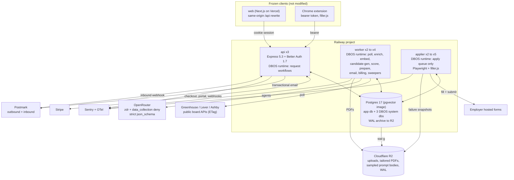
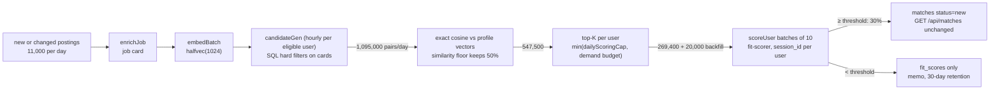

# Architecture option "postgres-durable": Postgres as the backbone

Date: 2026-10-16. Scope: backend only (`server/`, additive types in `shared/`, Railway infrastructure). Nothing under `web/` or `extension/` is created, edited or deleted by this option or by its implementation (INV-17). `extension/dist/filler.js` stays the cloud applier's filler unchanged (INV-16).

Inputs read in full: `_research/as-built.md`, `_research/cost-model.md`, `_research/openrouter.md`, `_research/stack-options.md`, `_research/integrations.md`, the NFR, INV and OQ sections of `_research/requirements.md`, `shared/src/plans.ts`, `shared/src/schemas.ts`, `shared/src/types.ts`, `web/lib/api.ts`, `web/hooks/*.ts`, `extension/src/lib/api.ts`, `extension/src/lib/messages.ts`, `server/src/services/submissions.ts`, `server/src/routes/extension.ts`, `server/src/db/client.ts` and the three files under `server/src/ai/` (`openrouter.ts`, `budget.ts`, `untrusted.ts`), which exist in the tree but are imported by nothing yet. Skills applied: `dbos-typescript`, `postgres-best-practices`, `architecture-patterns`.

Evidence tags: **[research]** taken from a research file named above; **[dbos-docs]** from the DBOS skill reference rules; **[est]** my arithmetic from stated assumptions; **[verify]** a behavior this option depends on that must be proven in a week-1 spike before it is treated as a fact.

---

## 0. The option in one paragraph

Postgres is the only system of record and the only coordination layer. Durable workflows and queues run inside the application processes with DBOS Transact (a library, not a service) and checkpoint into Postgres; every application state change and the follow-up work it triggers are either one transaction or two checkpointed steps of one durable workflow, so there is no outbox table and no Redis-to-Postgres dual write. The application lifecycle is one durable state machine: a `prepare` workflow drafts, verifies and renders; the human approval is a persisted row state (`approved`) that is written by a short `approve` workflow which also enqueues the `apply` workflow; the `apply` workflow leases the row, drives Playwright with the unchanged filler, waits for the report with a durable timeout, and charges exactly one credit through a transaction guarded by the existing partial unique index. Matching is pre-ranked in SQL and pgvector before any model call. All model traffic goes through one gateway on OpenRouter with zero-data-retention routing, strict schemas, cached prompt prefixes, per-agent budgets and a `llm_calls` ledger. Redis is removed from the correctness path; at the end of the migration it is removed entirely, with API rate limiting on a Postgres store. Express 5, Better Auth, Drizzle, the ATS adapters, the credit ledger and the error envelope are kept, so the frozen web app and extension see the same routes, shapes and codes.

What this option is not: it is not a long-lived "one workflow per application that sleeps for days waiting for a human". Section 3.7 explains why that version is weaker at 40,000 drafts per day and how the chosen design still gives a durable approval wait.

---

## 1. Components



| Component | Role | Runs where | Scales by |
|---|---|---|---|
| **api** | Express 5.3 routes (unchanged contracts), Better Auth, Stripe and Postmark webhooks. Runs the DBOS runtime for *request workflows* only: `approveApplications`, `queueMatch`, `resendApplication`, `withdrawApplication`, `stripeEvent`, `inboundEmail`. Each finishes in under 5 seconds and exists so that "write the row, then enqueue the follow-up" survives a crash between the two. | Railway service, 3 replicas | Replica count; stateless apart from DBOS recovery of its own in-flight request workflows |
| **worker** | DBOS runtime for background queues: `poll`, `enrich`, `embed`, `candidate-gen`, `score`, `prepare`, `email`, `billing`, scheduled sweepers. Hosts the LLM gateway. | Railway service, 2 to 4 replicas | Replica count; queue `workerConcurrency` per replica, global `concurrency` and `rateLimit` per queue |
| **applier** | DBOS runtime for the `cloud-apply` queue only. One Chromium per replica, one context per attempt, `extension/dist/filler.js` injected unchanged. | Railway service (Playwright image), 2 to 5 replicas | Replica count; `workerConcurrency` 4 per 4 GB replica; partitioned by ATS host for politeness |
| **Postgres** | Application database (Drizzle schema, pgvector, pg_trgm) plus three DBOS system databases (`kairos_sys_api`, `kairos_sys_worker`, `kairos_sys_applier`) on the same server. WAL archived to R2 for point-in-time recovery. | Railway, custom `pgvector/pgvector:pg17` image with `wal-g` | Vertical (4 vCPU, 16 GB at 10k users); read replica is the next step, not needed at beta |
| **LLM gateway** (module `server/src/ai/`) | The only code that calls OpenRouter. Agent registry, prompt versions, strict schemas, fencing, routing block, budgets, `llm_calls` rows. | Inside worker (and api for the synchronous verifier on `PATCH`) | With its host process |
| **Cloudflare R2** | `uploads/{userId}/…`, `resumes/{userId}/{applicationId}.pdf`, applier failure snapshots, 2% sampled prompt bodies, WAL archive (separate bucket and credential) | External | Pay per GB |
| **Sentry + OpenTelemetry** | Errors and traces from all three services; DBOS emits workflow and step spans | External | Plan tier |
| **Redis** | None after migration phase 6. During migration it carries the BullMQ bridge only. | Removed | n/a |

Three DBOS applications instead of one: in DBOS every process of one application registers the same workflow set and dequeues from every queue it knows about [dbos-docs], so one application would make applier replicas pull scoring work and worker replicas need Chromium. Three applications, each with its own system database, keep deploy units, versions and recovery domains separate. They talk through `DBOSClient.enqueue`, which is idempotent on `workflowID` and therefore safe to call from a retried step [dbos-docs]. If a week-1 spike shows that DBOS 5.x lets a process opt out of specific queues [verify], the worker and applier collapse into one application and `DBOSClient` hops disappear; nothing else in this document changes.

---

## 2. Stack per layer

| Layer | Choice | Version | Why this and not the alternative |
|---|---|---|---|
| Runtime | Node 22 LTS, TypeScript 5.9, ESM, esbuild bundles per entry point (existing `build.mjs`) | as built | Keep; nothing in the option needs a runtime change |
| API | **Express 5.3** (keep) | 5.3.0 [research] | Peak load is about 60 requests per second; the frozen clients depend on Express defaults for 404 bodies, JSON parse errors and query parsing. A contract test (section 11, phase 0) guards every route. Fastify stays the fallback if OpenAPI generation is ever wanted |
| Auth | **Better Auth** (keep, pin) | `~1.7.10` [research] | The clients call its routes and cookies directly. Add `session.cookieCache` so 60 requests per second do not become 60 session reads [verify option name on 1.7.x] |
| Durable workflows and queues | **DBOS Transact for TypeScript** | `@dbos-inc/dbos-sdk` 5.3.x, pinned exactly [research] | Checkpointed steps, partitioned queues with per-partition concurrency and rate limits, priority, deduplication, `send`/`recv` with durable timeouts, scheduled workflows, all in Postgres, MIT, no extra service [dbos-docs, research]. pg-boss 12 is the fallback (section 12, risk R-1) |
| Transactions inside workflows | **`@dbos-inc/drizzle-datasource`** over `pg` | matching SDK version | `runTransaction` commits the application write and the step checkpoint together through the `transaction_completion` table, so a database write inside a workflow is exactly-once [dbos-docs]. This is what makes the credit charge and the status transitions safe without an outbox |
| ORM and driver | **Drizzle 0.45.4** (keep) over **`pg` 8.x** (switch from postgres.js) | drizzle-orm 0.45.4, pg 8.23 [research] | The DBOS datasource needs node-postgres. One driver, one pool per process, one connection budget. `drizzle(pool, { schema, casing: "snake_case" })` keeps every existing query. Raw SQL through `drizzle-kit generate --custom` for extensions, partitions, HNSW and triggers (NFR-29 respected: generated file, never edited after apply) |
| Database | **Postgres 17 on a pgvector image** with `vector`, `pg_trgm`; `wal-g` archiving to R2, `archive_timeout = 60` | pgvector 0.8.7 [research] | Railway's default template has no extensions and no point-in-time recovery [research]. The ledger needs PITR. Restore drill is a launch gate. Managed Postgres with native PITR (Neon, Supabase, Crunchy) is the documented alternative if the owner prefers zero database operations; Drizzle and DBOS are provider-neutral |
| Vector search | **pgvector `halfvec(1024)`**, HNSW partial index on open jobs | 0.8.7 | 400,000 open postings at 2 bytes per dimension is about 800 MB plus a 0.9 GB index; fits in RAM. Exact scan for the per-user "new since last run" direction (10 to 20 survivors), HNSW only for onboarding backfill [research cost-model 8.1] |
| Rate limiting | **`rate-limiter-flexible` with the Postgres store** | 11.2.x [research] | 120 requests per minute per IP across 3 api replicas is about 2 writes per second; no Redis needed. Auth-route limits fail closed |
| Object storage | **Cloudflare R2** via `@aws-sdk/client-s3` | 3.1152 [research] | Zero egress; presigned URLs with 5-minute expiry; separate bucket and credential for WAL |
| PDF | **pdfkit** + `unpdf` round-trip check | 0.20.2, 1.9.0 [research] | Pure Node, 10 to 30 ms per page; the round trip asserts the PDF contains exactly the verified lines |
| Browser | **playwright-core** in the official Playwright image | 1.64.x [research] | One browser per replica, one context per attempt, recycle after 50 contexts |
| LLM access | **OpenRouter** through the in-house gateway (`server/src/ai/openrouter.ts` extended) | n/a | Decision 1. `openai` SDK not needed; the existing fetch client already handles 200-with-error bodies and `usage.cost` |
| Embeddings | `qwen/qwen3-embedding-8b` (ZDR), fallback `openai/text-embedding-3-small` on Azure, never mixed in one index | catalog 2026-10-15 [research] | $0.01 per 1M tokens; the fallback writes to a separate `embedding_model` version |
| Observability | **Sentry** (`@sentry/node` 11.8) owning the OTel provider, OTel auto-instrumentation for http, express, pg, undici; **`llm_calls` table** for model telemetry | [research] | Metadata-only traces; prompt bodies never leave the boundary except a 2% sample to R2 |
| Email | Postmark (keep) | 5.1 | Inbound webhook with Basic auth in the URL plus a secret path segment, not `?token=` (closes OQ-14 and P-03) |
| Billing | Stripe SDK (keep) | 23.x | Snapshot event destination, `invoice.paid` grants, `Idempotency-Key` on every write |

Removed from the stack: BullMQ and Redis (after phase 6), postgres.js (replaced by `pg`), `express-rate-limit` (replaced by `rate-limiter-flexible`).

---

## 3. The application lifecycle end to end

### 3.1 State machine (persisted in `applications.status` plus `applications.prepare_state`)

`applications.status` keeps its seven values (`draft`, `approved`, `submitting`, `submitted`, `failed`, `refunded`, `withdrawn`) because `shared/src/types.ts` and the web app read them. Two additive columns carry what the skeleton lacked: `prepare_state` (`pending`, `drafting`, `verifying`, `ready`, `failed`) and `attempt_no`.

```mermaid
stateDiagram-v2
    [*] --> draft_pending: queueMatch workflow (insert ON CONFLICT, mark match queued)
    draft_pending --> draft_ready: prepare workflow (draft, truth lock, verifier, render PDF)
    draft_pending --> draft_failed: prepare workflow exhausted (user sees failure_reason)
    draft_failed --> draft_pending: POST /applications/:id/retry (new route)
    draft_ready --> draft_ready: PATCH edits (truth lock + verifier, 422 truth_lock stores nothing)
    draft_ready --> approved: approve workflow (credit lock, plan gate, prepare_state = ready)
    draft_ready --> withdrawn: withdraw
    approved --> withdrawn: withdraw (conditional UPDATE; 409 if already submitting)
    approved --> submitting: apply workflow leases the row (cloud) 
    approved --> submitted: extension report submitted (charge one credit)
    approved --> failed: extension report failed (no charge)
    submitting --> submitted: cloud report submitted (charge one credit)
    submitting --> failed: cloud report failed, challenge, closed posting, lease expired (no charge)
    failed --> approved: POST /applications/:id/resend {channel} (new route; attempt_no + 1)
    submitted --> [*]
    withdrawn --> [*]
```



Every transition is a conditional `UPDATE … WHERE status = <expected> RETURNING id`; zero rows returned means another actor won and the caller reacts (409 `conflict` on the API, "skip" inside a workflow). This closes D-07, D-08, D-10, D-11, D-12 and D-13 from the as-built audit.

### 3.2 Poll

Scheduled workflow `pollTick` runs every minute on the worker (`DBOS.registerScheduled`, `ExactlyOncePerInterval`). Step 1 is a transaction that selects due companies (`active = true AND (last_polled_at IS NULL OR last_polled_at < now() - interval)`, interval 30 minutes or 5 minutes when `priority = true`), ordered by `last_polled_at NULLS FIRST`, `LIMIT 600`, and stamps `poll_claimed_at = now()` so the next tick does not pick them again. Step 2 enqueues one `pollBatch` workflow per group of up to 25 companies of the same ATS host, on queue `poll` with `partitionQueue: true`, `queuePartitionKey = atsHost`, `partitionConcurrency: 6`, `partitionRateLimit: { limitPerPeriod: 300, periodSec: 60 }` (5 requests per second per host, below the 10 per second budget in the integrations research), `deduplicationID = "poll:" + batchKey`, priority 1 for priority companies and 100 otherwise.

`pollBatch` runs one step per company: `GET` with `If-None-Match: companies.etag`; on 304 only `last_polled_at` moves; on 200 the adapter normalizes, and a transaction step diffs the board against open jobs of that company: new postings are inserted (`ON CONFLICT (company_id, external_id) DO UPDATE SET closed_at = NULL, title, description_text, apply_url, raw_trimmed, updated_at` when the board's `updated_at` changed, which fixes D-19), postings missing from a non-empty board are closed, and an empty board response with `openIds.length === 0` closes nothing until it repeats three times (`companies.empty_streak`). Each new or changed job gets an `enrichJob` workflow enqueued inside the same transaction step, with `deduplicationID = "enrich:" + jobId`. Bind-parameter limits (S-05) are avoided by inserting in chunks of 200 rows. A `BoardNotFoundError` deactivates the company; other errors are retried by the step (`retriesAllowed: true`, `maxAttempts: 3`) and then recorded in `last_poll_error`.

Capacity: 552,000 polls per day at S2 is 6.4 per second average, 7.7 at peak, which is 24 concurrent fetches at 3 seconds each; 2 worker replicas cover it [research cost-model 8.3].

### 3.3 Normalize and enrich

`enrichJob` (queue `enrich`, `workerConcurrency: 8`, `rateLimit: 120 per minute`): step 1 calls agent `job-enricher` (section 5) with the fenced description cut to 1,100 tokens and writes the **job card** to `jobs.card` (JSONB: `seniority`, `sponsorship_signal` as `offers | unable | silent`, `location_norm`, `remote`, `salary_min_usd`, `salary_max_usd`, `must_haves[]` 3 to 8 items, `summary` of at most 120 tokens, `card_version`). Step 2 sets `jobs.card_ready_at = now()`. Embeddings are produced by the scheduled workflow `embedBatch` every minute: it selects up to 64 jobs with `card_ready_at IS NOT NULL AND embedding IS NULL`, calls the embeddings endpoint once, and writes `job_embeddings` rows. Postings whose description changed are re-enriched and re-embedded (10% of new postings [research]). Cost: 11,000 enrich calls per day at $0.000274 is about $3 per day [research].

The sponsorship filter (INV-1) uses the deterministic phrase list from `passesHardFilters` first and the card's `sponsorship_signal` only to add `unable` hits the phrase list missed; the card can never turn a phrase-list `unable` into a pass. The existing reason strings are kept unchanged because `landing-fit-sample.test.ts` pins them.

### 3.4 Match and pre-rank

Section 4 gives the full pipeline. The output is a set of `fit_scores` rows and, for pairs at or above the user's threshold, a `matches` row with `status = 'new'`, which is what `GET /api/matches` already returns.

### 3.5 Queue, draft, tailor, verify, render

`POST /api/matches/:id/queue` starts request workflow `queueMatch` on the api with `workflowID = "queue:" + matchId` (idempotent: the second tab gets the same handle and the same result). Step 1 is a transaction: re-check the per-company cap for the last 30 days counting `applications.status IN ('approved','submitting','submitted')` (fixes D-18), insert the draft with `ON CONFLICT (user_id, job_id) DO NOTHING RETURNING id`, select the existing id on conflict, mark the match `queued`, return `{ applicationId, created }`. Step 2 enqueues `prepareApplication` into the worker application through `DBOSClient` with `workflowID = "prepare:" + applicationId + ":" + revision`. The route awaits `getResult()` with a 5-second timeout and answers 201 or 200 with `{ applicationId }` exactly as today; if the wait times out the route answers 202 with the same body shape (the web hook reads `applicationId` and refreshes). Exceeding the per-company cap returns 409 `conflict`, an existing code.

`prepareApplication` (queue `prepare`, `partitionQueue: true` by `userId` with `partitionConcurrency: 2` so one user cannot occupy the drafting capacity, global `concurrency: 24`, `workflowTimeoutMS: 10 minutes`):

1. **Load** (transaction): the application row (must be `draft`, `prepare_state IN ('pending','failed')`), the job card, the user's **confirmed** facts (`confirmed = true` only, fixes D-03), profile fields, saved answers, plan. Sets `prepare_state = 'drafting'`.
2. **Questions** (step): for Greenhouse, fetch `?questions=true` and classify each field deterministically: `profile` (name, email, phone, links), `sensitive` (the `compliance` and `demographic_questions` blocks, plus any label matching the EEO, disability, veteran, gender, race, sexual orientation, salary or visa patterns) which are **never** sent to a model (INV-9), `saved_answer` when a `saved_answers` row exists and is approved, `free_text` otherwise. Lever and Ashby expose no questions through their APIs [research], so the question set is `profile` fields plus a `cover_letter` slot and the form is marked `questions_unknown`, which the extension handles today by filling what it can.
3. **Draft bullets** (step, agent `tailor-drafter`): rewrites 8 to 12 bullets plus one summary line, each with `factIds`. Output validated by zod; `finish_reason = "length"` is a failure.
4. **Deterministic truth lock** (pure function `enforceTruthLock`, kept): every line has at least one `factId` and all ids are in the confirmed set. Rejected lines are stored in `applications.verification.dropped[]` with the reason `unknown_fact_id` (fixes D-02).
5. **Answers** (step, agent `answer-writer`): all `free_text` questions in one call, each answer with `factIds`; skipped when there are none (40% of drafts [research]).
6. **Cover letter** (step, agent `cover-letter`): only when the plan has `coverLetters: true` and the form has a letter field; at most four paragraphs, each with `factIds`.
7. **Verify** (step, agent `verifier`, different model family from the drafter): claims are the lines, answers and paragraphs; the prompt contains each claim and only the facts it cites. Verdict per claim: `supported`, `unsupported`, `contradicted`, `uncertain`. `uncertain` claims go to `verifier-escalation` in a second step. `unsupported` and `contradicted` claims are dropped and recorded in `verification.dropped[]` with the verdict and the cited fact ids. If fewer than four resume lines survive, the step asks the drafter once more with the dropped claims listed as "do not claim"; if the second pass still leaves fewer than four lines, the draft fails with `failure_reason = "could_not_verify"`.
8. **Render** (step): pdfkit renders the one-page resume from the surviving lines; `unpdf` extracts the text and asserts each line appears in order; the file is written to R2 at `resumes/{userId}/{applicationId}-{revision}.pdf` and `applications.resume_pdf_key` is set. `GET /api/extension/queue` gains the optional `resumePdfUrl` field (a 5-minute presigned URL), which `FillPayload` already declares as optional (fixes D-28 without touching the extension).
9. **Store** (transaction): writes `resume_lines`, `answers` (profile answers with `source: "profile"`, saved answers with `source: "saved_answer"`, model answers with `source: "generated"`), `cover_letter`, `verification`, `prepare_state = 'ready'`, `prepared_at`. The write happens only after verification, so a draft that cannot be verified stores nothing (INV-2, INV-7).

End-to-end latency is about 12 seconds p50 [research], so the user who queues a match and opens the draft sees it filled on the first or second refresh of the frozen UI, which already polls.

`PATCH /api/applications/:id` (frozen contract: `{answers?, resumeLines?, coverLetter?}`, 422 `truth_lock` with `details = rejected[]`): the route runs the deterministic truth lock against **confirmed** facts, then calls the verifier synchronously through the gateway with an 8-second timeout on the changed lines, answers and paragraphs only. Any `unsupported` or `contradicted` claim returns 422 `truth_lock` with the same `details` shape as today and stores nothing. If the verifier is unavailable (timeout, 5xx after fallbacks), the route stores the edit with `verification.pending = true`, sets `prepare_state = 'verifying'` and starts `verifyEdit:<applicationId>:<revision>` on the worker; approval skips the draft until it is `ready`. This keeps the 10-second interactive budget and never weakens the gate.

### 3.6 Approve (the human step) and the durable handoff

`POST /api/applications/approve` `{applicationIds (1..50), channel}` starts request workflow `approveApplications` on the api with `workflowID = "approve:" + sha256(userId + sorted ids + channel + minuteBucket)`; a double click or a second tab within the same minute gets the same result.

Step 1 (transaction, the credit lock):

```sql
-- one row lock per user serializes every approval and every charge for that user
SELECT pg_advisory_xact_lock(hashtext('credits:' || $userId));

WITH bal AS (
  SELECT COALESCE(SUM(delta), 0)::int AS balance FROM credit_ledger WHERE user_id = $userId
), inflight AS (
  SELECT COUNT(*)::int AS n FROM applications
  WHERE user_id = $userId AND status IN ('approved', 'submitting')
), eligible AS (
  SELECT id FROM applications
  WHERE user_id = $userId AND id = ANY($ids) AND status = 'draft' AND prepare_state = 'ready'
  ORDER BY created_at
)
SELECT (SELECT balance FROM bal) - (SELECT n FROM inflight) AS available,
       (SELECT COUNT(*) FROM eligible) AS eligible_count;
```

If `available < eligible_count` the step throws `paymentRequired` and the workflow ends with 402 `payment_required` and no status change (INV-18). If `channel = 'cloud'` and the plan (read inside the same transaction from `subscriptions`) has `cloudApplier = false`, 403 `forbidden` (INV-19). Otherwise `UPDATE applications SET status = 'approved', channel = $channel, approved_at = now(), attempt_no = attempt_no + 1 WHERE id IN (eligible)` and the step returns the approved ids. Drafts that are not `ready` are skipped silently, exactly as non-drafts are skipped today, so the response shape `{approved: ids[]}` is unchanged (fixes D-07 and D-08).

Step 2 (only for `cloud`): for each approved id, `DBOSClient.enqueue` into the applier application with `workflowID = "apply:" + applicationId + ":" + attempt_no`, queue `cloud-apply`, `queuePartitionKey = atsHost`, `priority` 10 for Max, 20 for Pro. Because step 1 is checkpointed, a crash between the two steps resumes at step 2 on recovery; there is no window in which an application is `approved` with no run scheduled (fixes D-13). A sweeper (`submissionHealth`, section 7) is the belt to this suspender.

For `channel = 'extension'` there is no workflow after approval. The extension polls `GET /api/extension/queue`; the route now records a **claim window**: each approved item is returned to one `GET` and then hidden from further `GET`s for 120 seconds (`applications.claimed_until`). Two tabs of the same browser that both fetch within those two seconds can still both show the item; the extension is frozen, so the backend cannot do better than this plus the existing idempotent report (one charge, one `submitted`). Two different devices (two sessions) are fully covered. This is stated honestly in the risk register (R-9).

### 3.7 Why not one long-lived workflow that `recv`s the approval

The angle asks for a durable workflow with a human approval wait. The strongest honest form of that is the design above, not a single workflow per application that blocks in `DBOS.recv("approval", 30 days)`. Three reasons, each measurable:

1. **Scale of pending workflows.** 40,410 drafts per day with a 15% never-approved tail means tens of thousands of `PENDING` workflows resident at any time. A `PENDING` workflow counts against the queue's global `concurrency`, including workflows from previous application versions [dbos-docs], so the `prepare` queue would need a concurrency cap far above the real drafting parallelism, which defeats the point of the cap.
2. **Versioning.** DBOS recovers a pending workflow only on the application version that started it [dbos-docs]. A workflow that sleeps for days pins that version's processes for days; with a weekly deploy cadence the drain procedure becomes the main operational cost (stack-options 4.6). Short workflows (seconds to minutes) make every deploy a trivial drain.
3. **The frozen web app already treats the approval as row state.** It polls `GET /api/applications?status=` and reads `status`. A row is the natural durable representation of "waiting for a human"; it needs no engine to wait.

The design still gives everything the long-lived form would: durability (the `approved` row and the checkpointed `approve` workflow), exactly-once handoff (`workflowID = apply:<id>:<n>`), inspectability (`DBOS.listWorkflows` plus `applications.status`), and a durable **short** wait where one is needed: the `apply` workflow waits for the submission report with `DBOS.recv`, which is the lease (section 3.8).

### 3.8 Submit: cloud

`applyCloud` runs on the applier (queue `cloud-apply`, `partitionQueue: true` by ATS host, `partitionConcurrency: 8`, `workerConcurrency: 4`, `priorityEnabled: true`, `workflowTimeoutMS: 6 minutes`).

```mermaid
sequenceDiagram
    participant W as applyCloud apply:APP:n
    participant DB as Postgres (app db)
    participant B as Chromium + filler.js
    participant X as Employer form
    W->>DB: tx lease: UPDATE applications SET status='submitting', lease_expires_at=now()+5min WHERE id=APP AND status='approved' RETURNING id; INSERT submission_attempts(attempt_id, started_at)
    Note over W,DB: 0 rows: withdrawn or already handled; workflow ends "skipped"
    W->>DB: tx recheck: plan still has cloudApplier; posting still open (closed -> report failed "closed")
    W->>B: step runBrowser (retriesAllowed=false): first write submission_attempts.browser_launched_at = now() (plain write, not a step)
    B->>X: goto applyUrl (120 s hard timeout), inject filler.js, __kairosFill({submit:true, resumePdfUrl})
    X-->>B: confirmation text, or challenge page, or error
    B-->>W: SubmissionReport
    W->>DB: tx record: SELECT ... FOR UPDATE; submitted -> INSERT credit_ledger(-1,'submission') ON CONFLICT DO NOTHING, status='submitted'; failed -> status='failed', failure_reason, no charge
    W->>DB: step: store failure snapshot in R2 if failed; send notification email
```

The one dangerous step is `runBrowser`: a DBOS step that started but did not checkpoint runs again on recovery [dbos-docs], and clicking submit twice sends the employer two applications. The guard is independent of the engine: before launching the browser the step writes `submission_attempts.browser_launched_at` directly (an ordinary write, deliberately outside the checkpoint). On recovery the step reads the row first; if `browser_launched_at IS NOT NULL` it does **not** open the browser and returns `{ outcome: "failed", failureReason: "no_report_after_crash" }`, which the record step stores as `failed` with no charge and a user-facing message to check the employer's confirmation email and resend through the extension if nothing arrived. `retriesAllowed: false` on the step prevents the engine's own retry. This is the stack-options 4.4 pattern made concrete.

Challenge detection (reCAPTCHA Enterprise, hCaptcha, Cloudflare interstitial) is a DOM check after navigation and after the filler's submit; a challenge yields `failed` with `failure_reason = "challenge"`, no charge, and the application is immediately resendable through the extension (INV-8). No stealth, no proxies, no solving.

Lease expiry: if the applier replica dies and recovery does not reach the record step within `lease_expires_at`, the scheduled `expireLeases` workflow (every minute) sets `status = 'failed', failure_reason = 'lease_expired'` for rows `WHERE status = 'submitting' AND lease_expires_at < now()` and no charge is made (fixes D-12). A late report for a row already `failed` is stored in `submission_attempts.late_report` and raises an alert, never a charge; the user can resend.

### 3.9 Submit: extension

Unchanged routes. `GET /api/extension/queue` adds `resumePdfUrl` (optional field) and the 120-second claim window. `POST /api/extension/report` runs `recordSubmission` as today (`SELECT … FOR UPDATE`, idempotent on `submitted`, charge through the partial unique index) with one addition: `submitted_at` is clamped to `now()` when the client value is in the future or older than the approval, and `filledFields` is capped and stored as-is (client-supplied, D-27 is a documented limitation: a modified client can only spend its own credits).

### 3.10 Resend and retry (new routes, additive)

- `POST /api/applications/:id/resend` `{channel}`: `failed → approved` with `attempt_no + 1`, same credit and plan checks as approve, same workflow pattern; returns `{applicationId, status}`. This is the backend path for "a challenged cloud run fails without charge and the user resends through the extension" (fixes D-10).
- `POST /api/applications/:id/retry`: `prepare_state = 'failed' → 'pending'` and starts `prepare:<id>:<revision+1>`.
- `GET /api/applications/:id/verification`: returns `verification` (dropped claims and reasons) so a future UI can show why lines were removed.

### 3.11 Track replies

`POST /api/webhooks/inbound-email` (Basic auth in the URL plus a secret path segment, constant-time compare, 2 MB body limit on this route only for the text fields; attachments' `Content` is dropped before storage) starts request workflow `inboundEmail` with `workflowID = "mail:" + MessageID` (Postmark retries map to the same workflow). Step 1 (transaction): resolve `OriginalRecipient` to a user; unknown recipient returns 200 and stores nothing; insert `inbound_emails` with the body capped at 16 KB. Step 2: deterministic rules first: Gmail forwarding confirmation (`From` in the allowlist and subject prefix) is parsed for the 9-digit code and the link host, stored in `forwarding_verifications` for 3 days, surfaced through the new route `GET /api/forwarding/verification` and a Kairos transactional email, and never classified as job mail. Otherwise `classifyByRules` (kept, with its tested "offer you an interview" guard); only the 25% the rules cannot tag go to agent `reply-classifier`. Step 3 (transaction): link to the most recent `submitted` application by sender domain match against `companies.careers_url` host first, then company-name match only when the name is at least 5 characters; store `kind` and `application_id`.

Offer handling (INV-5): a `kind = 'offer'` set by **rules** (never by the model alone) creates an `offer_pause_candidates` row and emails the user "We think you received an offer from X; billing will pause in 48 hours unless you tell us otherwise", with an undo link that hits a new route `POST /api/billing/pause/cancel`. The scheduled `offerPauses` workflow applies `pause_collection: { behavior: "void" }` with `Idempotency-Key = "pause:" + userId + ":" + messageId` after 48 hours without undo, and sets `profiles.applications_paused = true` so candidate generation and approval stop. This closes D-26 without a UI change.

### 3.12 Bill

Stripe webhook: the route verifies the signature on the raw body and starts request workflow `stripeEvent` with `workflowID = "stripe:" + event.id`. Step 1 (transaction) does **all** of the handling and inserts the `stripe_events` row in the same transaction, so a failed handler leaves no row and Stripe's retry re-runs it (fixes D-14). The route answers 200 on `SUCCESS`, 500 on `ERROR` (Stripe retries), and on a retry for a workflow already in `ERROR` calls `DBOS.resumeWorkflow` before waiting again. Subscription state is never taken from the event payload's ordering: the step fetches the subscription from the Stripe API inside the transaction step and writes the current truth (fixes D-15). `invoice.paid` grants `creditsPerInvoice(plan, interval)` from `shared/src/plans.ts` keyed by the line's price `lookup_key`, only when `amount_paid > 0` or the invoice total is zero for a defined reason, with the existing partial unique index on `stripe_invoice_id` as the guarantee; zero-amount promo invoices grant nothing (fixes D-16). A daily `stripeReconcile` workflow lists paid invoices of the last 7 days and inserts any missing grant.

Rollover and expiry (NFR-27): at each grant, the step computes the balance after the grant and, if it exceeds `rolloverCap(plan)`, inserts a negative `expiry` row for the excess in the same transaction with `period_key = invoiceId` and `stripe_invoice_id = NULL`. The new partial unique index `credit_ledger_expiry_uq (user_id, period_key) WHERE reason = 'expiry'` makes that idempotent and does not collide with the invoice index (fixes D-23). `rolloverCap` is an additive field in `plans.ts` (section 6.4).

Account deletion: a `beforeDelete` hook runs request workflow `deleteAccount:<userId>` whose steps cancel the Stripe subscription (idempotent), delete R2 prefixes, copy the user's `credit_ledger` rows into `credit_ledger_archive` (keeps the financial trail, INV-13), and then let Better Auth cascade (fixes D-24).

---

## 4. The matching pipeline at 10,000 users

Volumes are the S2 base case from the cost model [research]: 10,000 companies, 10,000 new postings per day, 4,800 scoring-eligible users.



**Eligibility** (step 1 of `candidateGen`, pure SQL): users with `preferences IS NOT NULL`, a session seen in the last 7 days, `available credits > 0` (balance minus in-flight, computed once per user per hour and cached in `user_daily_usage.available_credits`), `applications_paused = false`, and `scored_today < dailyScoringCap(plan)`. At S2 this is 4,800 users instead of the 7,500 the skeleton would loop over.

**Hard filters in SQL** against the job card, not in a per-user loop in Node: `jobs.card_ready_at > user.last_candidate_run_at`, `card->>'seniority' = ANY(prefs.seniority)`, location in the user's list or `remote = true AND prefs.remoteOk`, `card->>'sponsorship_signal' <> 'unable'` when the user needs sponsorship, salary floor against `card->>'salary_max_usd'`, excluded companies and keywords (`NOT EXISTS` and `NOT ILIKE ANY`), and the per-company cap (`COUNT(applications) < prefs.maxApplicationsPerCompanyPer30Days`). The pure `passesHardFilters` function remains the specification of these rules and the SQL is tested against it with a property test over the fixture set, so the reason strings the landing page pins are unchanged. Hard-filter rejections are **not** stored (48 million rows per day otherwise [research]); the reason a job was filtered out is computed on demand by `passesHardFilters` when a user opens a job.

**Similarity floor and top-K**: for the 10 to 400 survivors per user, exact cosine between `job_embeddings.embedding` and the user's profile vectors (one per resume profile, re-embedded when facts change) is computed in the same query (`1 - (embedding <=> $profileVector)`); pairs below the floor (calibrated on the scorer eval set so that fewer than 2% of pairs that would score at or above 75 are dropped) are discarded; the rest are ordered by similarity and cut at `min(dailyScoringCap - scored_today, demandBudget)` where `demandBudget = clamp(10 + 2.5 × average daily match actions over 3 days, 10, dailyScoringCap)` and scoring pauses for a user whose unacted `new` matches exceed 2 × budget. Pairs already present in `fit_scores` are excluded (the memo, fixes S-02). The HNSW index is used only by the onboarding `backfillUser` workflow (100 postings per new user over the 400,000 open postings).

**Scoring**: `candidateGen` enqueues one `scoreUser` workflow per user with candidates, on queue `score` (`partitionQueue: true` by `userId`, `partitionConcurrency: 1`, global `concurrency: 16`, `rateLimit: { limitPerPeriod: 600, periodSec: 60 }`). Each step scores a batch of 10 pairs with `fit-scorer` using `session_id = userId + ":fit-scorer:" + hour` so the user's 600-token profile prefix stays cached on one endpoint; the result step writes `fit_scores` rows and `matches` rows (`status = 'new'`) for scores at or above `prefs.fitThreshold`, and increments `user_daily_usage.scored_today` and `.model_usd` in the same transaction. A `BudgetExceededError` from the gateway ends the workflow cleanly with the remaining pairs left unscored for the next hour.

**Freshness and re-evaluation** (fixes D-20): a new user or a preference change sets `last_candidate_run_at = NULL` and enqueues `backfillUser`; `expireMatches` (daily) sets `status = 'expired'` on `new` matches whose job closed or whose age exceeds 30 days.

**Numbers** (S2): 289,400 scoring calls per day, 3.35 per second average, 8.4 at peak, 13 calls in flight at 1.5 seconds each [research]; `candidateGen` is 115,200 SQL runs per day at about 40 ms each, 1.3 per second, one worker thread. Model spend for scoring is $37.90 per day on `gpt-6-luna` [research].

---

## 5. The agent runtime on OpenRouter

### 5.1 One gateway, nine agents

`server/src/ai/openrouter.ts` already sends `response_format: json_schema` with `strict: true`, `provider.require_parameters: true`, `data_collection: "deny"`, optional `zdr: true`, a `models[]` fallback list, inspects 200-with-error bodies and reads `usage.cost`. It is kept and extended into `LlmGateway.run(call: AgentCall)`:

```ts
export interface AgentDefinition<TOut> {
  id: AgentId;                               // "job-enricher" | "fit-scorer" | "resume-parser" | "tailor-drafter" | "answer-writer" | "cover-letter" | "verifier" | "verifier-escalation" | "reply-classifier"
  promptVersion: string;                     // "fit-scorer@3", stored on every llm_calls row
  models: readonly string[];                 // primary first; every entry must have a ZDR + structured_outputs endpoint
  family: readonly ModelFamily[];            // parallel to models; the verifier chain never shares a family with the drafter chain
  schema: z.ZodType<TOut>;                   // zod, also compiled to strict JSON Schema (additionalProperties false, all required)
  maxTokens: number;                         // expected output + reasoning allowance + 25%
  reasoning?: { effort: "low" | "medium" };  // omitted for Classes A, B, D
  maxPrice: { prompt: number; completion: number }; // 1.5 × budgeted route price, USD per 1M
  quantizations?: readonly string[];         // ["fp8","bf16"] where fp4 is not acceptable
  cacheBreakpoints: "none" | "static" | "static+user";
  timeoutMs: number;                         // 20 s Class A/B/D, 45 s Class C
  budget: { perCallCeilingUsd: number; dailyEnvelopeUsd: number };
}

export interface AgentCall<TOut> {
  agent: AgentDefinition<TOut>;
  staticPrefix: string;                      // versioned system text + schema description + few-shot, padded to ≥ 1,100 tokens
  userPrefix?: string;                       // confirmed-fact block or profile summary; stable per user for the TTL
  variable: string;                          // fenced untrusted input last (ai/untrusted.ts)
  userIdHash: string;                        // HMAC of the user id, never the email
  sessionId: string;                         // "<userId>:<agent>:<batchId>"
  workflowId: string;                        // for the llm_calls row
}

export interface AgentResult<TOut> {
  data: TOut;
  servedModel: string; provider: string | null;
  usage: { promptTokens: number; completionTokens: number; cachedTokens: number; cacheWriteTokens: number; reasoningTokens: number; costUsd: number };
  retries: number; fallbackUsed: boolean; latencyMs: number;
}
```

Behavior of `run`: (1) check budgets in `user_daily_usage` and `agent_daily_usage` (Postgres, `UPDATE … RETURNING`, replacing the Redis `SpendStore` in `ai/budget.ts`; the `Budget` class and `BudgetExceededError` are kept, only the store changes); (2) assemble messages in cache order, with Anthropic `cache_control` breakpoints at the end of the static block and of the user block; (3) send with the provider block `{ zdr: true, data_collection: "deny", require_parameters: true, allow_fallbacks: true, max_price, quantizations? }` and `models[]`; (4) treat `finish_reason = "length"`, empty `choices` and body `error` as failures; (5) retry at most twice on 408, 429, 502 and 5xx-with-body with full-jitter backoff from 500 ms capped at 8 s, honoring `Retry-After`; never retry 400, 401 or 403-moderation; pause the batch queues on 402 and 403-budget; (6) validate with zod and re-ask once with the validation error appended; (7) write one `llm_calls` row with every field in section 6.2, inside the caller's transaction step when there is one, otherwise as its own step. The gateway refuses at config load if any model in a verifier chain shares a family with any model in the drafter chain [research openrouter 11.4].

### 5.2 Model table (catalog of 2026-10-15; re-validated nightly by `catalogDrift`)

| Agent | Class | Primary (ZDR route) | Fallbacks | Output schema (strict) | Expected $ per call |
|---|---|---|---|---|---|
| job-enricher | A | `openai/gpt-6-luna` (Azure) | `anthropic/claude-haiku-5.5` (Vertex), `deepseek/deepseek-v4.1-flash` fp8 | `job_card_v1` | 0.000274 |
| fit-scorer | B | `openai/gpt-6-luna` | `anthropic/claude-haiku-5.5`; challenger `deepseek/deepseek-v4-flash-0731` behind the scorer eval | `fit_score_v3 { score int 0..100, reasons string[1..4] ≤ 20 words, mustHaveHits string[] }` | 0.000131 |
| resume-parser | A | `anthropic/claude-haiku-5.5` | `openai/gpt-6-luna` | `facts_v2 { facts: { kind, text ≤ 400, start int, end int }[1..200] }` (offsets, not echoed spans) | 0.0017 |
| tailor-drafter | C | `openai/gpt-6-luna` (gated by the truth-lock and quality evals) | `z-ai/glm-5.3` (reasoning effort low, 1,500-token allowance) | `resume_lines_v2 { lines: { id, section, text ≤ 400, factIds string[1..] }[4..14] }` | 0.000536 |
| answer-writer | C | `openai/gpt-6-luna` | `z-ai/glm-5.3` | `answers_v1 { answers: { fieldKey, value ≤ 1500, factIds[1..] }[] }` | 0.00032 |
| cover-letter | C | `openai/gpt-6-luna` | `z-ai/glm-5.3`; optional `anthropic/claude-sonnet-5` for Pro and Max only | `letter_v1 { paragraphs: { text ≤ 700, factIds[1..] }[1..4] }` | 0.00039 |
| verifier | D | `anthropic/claude-haiku-5.5` (Vertex) | `deepseek/deepseek-v4-flash-0731` fp8 | `verdicts_v1 { claims: { claimId, verdict enum, factId? }[] }` | 0.00035 |
| verifier-escalation | D+ | `anthropic/claude-sonnet-5` | `openai/gpt-6-sol` (only when the drafter was not OpenAI) | same as verifier | 0.0109 |
| reply-classifier | A | `openai/gpt-6-luna` | `deepseek/deepseek-v4-flash-0731` | `email_kind_v1 { kind enum, confidence 0..1 }` | 0.00012 |
| embeddings | E | `qwen/qwen3-embedding-8b` | `openai/text-embedding-3-small` (separate `embedding_model` version) | vector 1024 | 0.000005 per job |

Haiku 5.5 reaches structured outputs only on Vertex under ZDR [research]; the fallback to `gpt-6-luna` covers a Vertex outage for the verifier's *fallback* role, but the verifier chain itself stays Anthropic then DeepSeek so the family rule holds.

### 5.3 Prompt layout, caching and sticky routing

Every prompt is: versioned system text, schema description and few-shot examples (static, padded to at least 1,100 tokens so OpenAI's 1,024-token minimum and Claude's 512 are both met), then the per-user block (confirmed facts for drafting, profile summary for scoring), then the fenced variable block (job card, questions or email) last. Nothing time-varying appears before the variable block. Calls are batched per user (10 scores, one draft set) with one `session_id` so OpenRouter's sticky routing keeps the provider cache warm within the 5-minute TTL [research]. Target cache hit rates: 95% on static prefixes, 85% on the scorer's user block, 60% on the drafter's. If the week-1 spike shows that Azure `gpt-6-luna` under ZDR reports `supports_implicit_caching = false` in practice [verify], the cost model's "no caching" row still meets the target at $0.0073 per submission [research].

### 5.4 Budgets and alarms

Per-agent daily envelopes, per-call ceilings and `max_price` guards are the cost model's section 12 values. Per-user caps come from two additive `plans.ts` fields (section 6.4): `dailyScoringCap` (15, 60, 150, 250) and `dailyModelBudgetUsd` (0.03, 0.08, 0.20, 0.30). Degradation order when a user hits the budget: stop scoring for the UTC day; keep drafting to 1.5 × budget; then skip the optional cover letter. Verification is never skipped; a draft that cannot be verified is not stored. Two OpenRouter keys: `kairos-prod-batch` ($150 per day) for enricher, embeddings, scorer, parser and classifier; `kairos-prod-api` ($250 per day) for drafter, answers, letter, verifier and escalation. Alarms (section 9) fire at 80% of any envelope, on a 7-day rolling cost per submission above $0.008, on fallback rate above 10% for an hour, on cache hit below 50% for an hour, on a 2% reconciliation gap against OpenRouter's credit change, and on any 402 or 403.

### 5.5 Evals

Each agent has an eval set in `server/eval/<agent>/cases.jsonl` and a runner `npm run eval -- <agent>` that calls the gateway with the staging key and writes `eval_runs` rows. Gates before a prompt version or model goes to production: fit-scorer, ranking agreement with 300 labeled (user, job) pairs at least equal to the current production model; tailor-drafter, 200 cases with zero unsupported claims after the verifier and a quality rubric at least 4 of 5 on 90%; verifier, false-accept at most 1% and false-reject at most 5% on a 400-case adversarial set including prompt-injection descriptions; reply-classifier, 500 labeled emails with no `offer` false positive on "offer you an interview" variants; resume-parser, offset accuracy on 50 resumes. Catalog drift (`catalogDrift`, nightly) downloads `/api/v1/models` and `/api/v1/endpoints/zdr`, asserts each configured slug still has at least two ZDR endpoints with `structured_outputs`, price within +25% of the stored value, context unchanged, `expiration_date` null, and the family rule, and auto-disables a failing primary in favor of the next model while opening an alert.

### 5.6 Tool use and loops

No agent receives tools. Retrieval that would earn tool use (facts, job card, saved answers) is done by SQL before the call and placed in the prompt. Workers orchestrate agents as fixed step sequences; there is no planner, no open-ended loop, and the only conditional branch (escalation on `uncertain`) is bounded to one extra call.

---

## 6. Data model outline

### 6.1 What is kept unchanged

All 17 tables and 9 enums from `0000_init.sql`, including `applications_user_job_uq`, `matches_user_job_uq`, the two partial unique indexes on `credit_ledger`, `stripe_events` and the Better Auth tables. Enum values are only added, never renamed.

### 6.2 Additive changes (one Drizzle migration per phase, `drizzle-kit generate --custom` for raw SQL)

```sql
-- extensions (phase 1, on the pgvector image)
CREATE EXTENSION IF NOT EXISTS vector;
CREATE EXTENSION IF NOT EXISTS pg_trgm;

-- companies: conditional requests and poll claiming
ALTER TABLE companies
  ADD COLUMN etag text,
  ADD COLUMN poll_claimed_at timestamptz,
  ADD COLUMN empty_streak int NOT NULL DEFAULT 0;
CREATE INDEX companies_due_idx ON companies (last_polled_at NULLS FIRST) WHERE active = true;

-- jobs: job card, update tracking, trimmed raw
ALTER TABLE jobs
  ADD COLUMN card jsonb,
  ADD COLUMN card_version text,
  ADD COLUMN card_ready_at timestamptz,
  ADD COLUMN board_updated_at timestamptz,
  ADD COLUMN updated_at timestamptz NOT NULL DEFAULT now();
CREATE INDEX jobs_open_ready_idx ON jobs (card_ready_at) WHERE closed_at IS NULL AND card_ready_at IS NOT NULL;
CREATE INDEX jobs_title_trgm_idx ON jobs USING gin (title gin_trgm_ops);
-- raw is trimmed to 1 KB in application code going forward; the old column stays.

CREATE TABLE job_embeddings (
  job_id uuid PRIMARY KEY REFERENCES jobs(id) ON DELETE CASCADE,
  embedding_model text NOT NULL,
  embedding halfvec(1024) NOT NULL,
  created_at timestamptz NOT NULL DEFAULT now()
);
-- HNSW only over open jobs; used by onboarding backfill
CREATE INDEX job_embeddings_open_hnsw ON job_embeddings USING hnsw (embedding halfvec_cosine_ops) WITH (m = 16, ef_construction = 64)
  WHERE job_id IN (SELECT id FROM jobs WHERE closed_at IS NULL);
-- Note: pgvector partial indexes cannot reference another table; the real DDL keeps a denormalized
-- job_embeddings.closed boolean maintained by the close step and uses WHERE closed = false.

CREATE TABLE profile_embeddings (
  user_id text NOT NULL REFERENCES "user"(id) ON DELETE CASCADE,
  resume_profile_id uuid NOT NULL REFERENCES resume_profiles(id) ON DELETE CASCADE,
  embedding_model text NOT NULL,
  embedding halfvec(1024) NOT NULL,
  facts_hash text NOT NULL,
  created_at timestamptz NOT NULL DEFAULT now(),
  PRIMARY KEY (user_id, resume_profile_id)
);

-- scored pairs (memo + analytics), monthly partitions, 30-day retention below threshold
CREATE TABLE fit_scores (
  user_id text NOT NULL,
  job_id uuid NOT NULL,
  score smallint NOT NULL,
  reasons jsonb NOT NULL DEFAULT '[]',
  served_model text NOT NULL,
  prompt_version text NOT NULL,
  similarity real,
  scored_at timestamptz NOT NULL DEFAULT now(),
  PRIMARY KEY (user_id, job_id, scored_at)
) PARTITION BY RANGE (scored_at);
-- partitions created a month ahead by the scheduled workflow `partitionMaintenance`

-- applications: prepare pipeline, lease, attempts, verification, PDF
ALTER TABLE applications
  ADD COLUMN prepare_state text NOT NULL DEFAULT 'pending'
    CHECK (prepare_state IN ('pending','drafting','verifying','ready','failed')),
  ADD COLUMN prepared_at timestamptz,
  ADD COLUMN revision int NOT NULL DEFAULT 1,
  ADD COLUMN attempt_no int NOT NULL DEFAULT 0,
  ADD COLUMN lease_expires_at timestamptz,
  ADD COLUMN claimed_until timestamptz,
  ADD COLUMN verification jsonb NOT NULL DEFAULT '{}',
  ADD COLUMN resume_pdf_key text,
  ADD COLUMN questions jsonb,
  ADD CONSTRAINT applications_channel_set CHECK (status = 'draft' OR status = 'withdrawn' OR channel IS NOT NULL);
CREATE INDEX applications_submitting_lease_idx ON applications (lease_expires_at) WHERE status = 'submitting';
CREATE INDEX applications_job_idx ON applications (job_id);
CREATE INDEX matches_job_idx ON matches (job_id);

CREATE TABLE submission_attempts (
  id uuid PRIMARY KEY DEFAULT gen_random_uuid(),
  application_id uuid NOT NULL REFERENCES applications(id) ON DELETE CASCADE,
  attempt_no int NOT NULL,
  channel submit_channel NOT NULL,
  workflow_id text,
  started_at timestamptz NOT NULL DEFAULT now(),
  browser_launched_at timestamptz,          -- written outside the checkpoint; non-null on replay means "do not click again"
  finished_at timestamptz,
  outcome text CHECK (outcome IN ('submitted','failed','skipped')),
  failure_code text,                        -- challenge | closed | timeout | lease_expired | no_report_after_crash | filler_error | other
  snapshot_key text,                        -- R2 key of the failure screenshot and DOM
  late_report jsonb,
  UNIQUE (application_id, attempt_no)
);

-- credits: expiry rows and a non-negative guard
ALTER TABLE credit_ledger ADD COLUMN period_key text;
CREATE UNIQUE INDEX credit_ledger_expiry_uq ON credit_ledger (user_id, period_key) WHERE reason = 'expiry';
CREATE TABLE credit_ledger_archive (LIKE credit_ledger INCLUDING ALL, deleted_user_email_hash text, archived_at timestamptz NOT NULL DEFAULT now());
-- balance >= 0 is enforced by the advisory lock in the approve and charge transactions plus this trigger as the last line of defense
CREATE OR REPLACE FUNCTION credit_ledger_nonnegative() RETURNS trigger LANGUAGE plpgsql AS $$
BEGIN
  IF (SELECT COALESCE(SUM(delta),0) FROM credit_ledger WHERE user_id = NEW.user_id) < 0 THEN
    RAISE EXCEPTION 'credit balance would go negative for user %', NEW.user_id USING ERRCODE = '23514';
  END IF;
  RETURN NEW;
END $$;
CREATE CONSTRAINT TRIGGER credit_ledger_nonnegative_trg AFTER INSERT ON credit_ledger
  DEFERRABLE INITIALLY DEFERRED FOR EACH ROW EXECUTE FUNCTION credit_ledger_nonnegative();

-- per-user daily usage: caps, budgets, eligibility cache
CREATE TABLE user_daily_usage (
  user_id text NOT NULL REFERENCES "user"(id) ON DELETE CASCADE,
  day date NOT NULL,
  scored_today int NOT NULL DEFAULT 0,
  model_usd numeric(10,6) NOT NULL DEFAULT 0,
  match_actions int NOT NULL DEFAULT 0,
  available_credits int,
  PRIMARY KEY (user_id, day)
);
CREATE TABLE agent_daily_usage (
  agent_id text NOT NULL, day date NOT NULL,
  calls int NOT NULL DEFAULT 0, usd numeric(12,6) NOT NULL DEFAULT 0, fallback_calls int NOT NULL DEFAULT 0,
  PRIMARY KEY (agent_id, day)
);

-- model call ledger, weekly partitions, 35 days hot, then rolled up
CREATE TABLE llm_calls (
  id uuid NOT NULL DEFAULT gen_random_uuid(),
  created_at timestamptz NOT NULL DEFAULT now(),
  agent_id text NOT NULL,
  prompt_version text NOT NULL,
  requested_model text NOT NULL,
  served_model text NOT NULL,
  provider text,
  prompt_tokens int NOT NULL, completion_tokens int NOT NULL,
  cached_tokens int NOT NULL DEFAULT 0, cache_write_tokens int NOT NULL DEFAULT 0, reasoning_tokens int NOT NULL DEFAULT 0,
  cost_usd numeric(10,7) NOT NULL,
  latency_ms int NOT NULL,
  finish_reason text, schema_valid boolean NOT NULL, retries smallint NOT NULL DEFAULT 0, fallback_used boolean NOT NULL DEFAULT false,
  user_id_hash text, workflow_id text, session_id text,
  input_hash text NOT NULL,                 -- sha256 of the assembled messages; dedupe and sample lookup
  body_sample_key text,                     -- R2 key when sampled (2%) or on verifier rejection
  PRIMARY KEY (created_at, id)
) PARTITION BY RANGE (created_at);
CREATE INDEX llm_calls_agent_day_idx ON llm_calls (agent_id, created_at);
CREATE TABLE llm_cost_daily (day date NOT NULL, agent_id text NOT NULL, served_model text NOT NULL, calls int, usd numeric(12,6), cached_share real, PRIMARY KEY (day, agent_id, served_model));

CREATE TABLE agent_prompts (agent_id text NOT NULL, version text NOT NULL, system_text text NOT NULL, schema_json jsonb NOT NULL, created_at timestamptz NOT NULL DEFAULT now(), active boolean NOT NULL DEFAULT false, PRIMARY KEY (agent_id, version));
CREATE TABLE eval_runs (id uuid PRIMARY KEY DEFAULT gen_random_uuid(), agent_id text NOT NULL, prompt_version text NOT NULL, model text NOT NULL, cases int NOT NULL, passed int NOT NULL, metrics jsonb NOT NULL, ran_at timestamptz NOT NULL DEFAULT now());

-- replies and offers
ALTER TABLE inbound_emails ADD COLUMN rule_kind email_kind, ADD COLUMN model_kind email_kind, ADD COLUMN model_confidence real;
CREATE TABLE forwarding_verifications (user_id text PRIMARY KEY REFERENCES "user"(id) ON DELETE CASCADE, provider text NOT NULL, code text, link text, received_at timestamptz NOT NULL, expires_at timestamptz NOT NULL);
CREATE TABLE offer_pause_candidates (id uuid PRIMARY KEY DEFAULT gen_random_uuid(), user_id text NOT NULL REFERENCES "user"(id) ON DELETE CASCADE, inbound_email_id uuid NOT NULL REFERENCES inbound_emails(id) ON DELETE CASCADE, apply_after timestamptz NOT NULL, cancelled_at timestamptz, applied_at timestamptz, UNIQUE (inbound_email_id));
ALTER TABLE profiles ADD COLUMN applications_paused boolean NOT NULL DEFAULT false, ADD COLUMN forwarding_state text NOT NULL DEFAULT 'not_started', ADD COLUMN last_candidate_run_at timestamptz;

-- facts: edits never confirm implicitly (D-05 is a route fix; this records who confirmed)
ALTER TABLE facts ADD COLUMN confirmed_at timestamptz, ADD COLUMN confirmed_by text CHECK (confirmed_by IN ('user','import'));
CREATE INDEX facts_user_confirmed_idx ON facts (user_id) WHERE confirmed = true;

-- stripe events: processed together with their effects
ALTER TABLE stripe_events ADD COLUMN object_id text, ADD COLUMN workflow_id text;
CREATE INDEX stripe_events_object_idx ON stripe_events (type, object_id);
```

### 6.3 DBOS system databases

Three databases on the same Postgres server: `kairos_sys_api`, `kairos_sys_worker`, `kairos_sys_applier`. DBOS owns their schema (`workflow_status`, `operation_outputs`, `notifications`, `workflow_events`, queue tables). The Drizzle datasource's `transaction_completion` table lives in the **application** database and is installed by `initializeDBOSSchema` in the migration step. Retention: the scheduled `dbosGarbageCollect` workflow runs `DBOS.garbageCollect` [verify exact API in 5.3] daily for `SUCCESS` workflows older than 2 days on `poll`, `enrich`, `embed`, `candidate-gen`, `score` and `email`, and 14 days for `prepare`, `cloud-apply`, `billing` and request workflows. Growth before collection: about 1.3 million workflows and 4 million steps per day at S2 is about 1.4 GB per day [est], so the 2-day window keeps the hot set under 3 GB.

### 6.4 Additive types in `shared/src/plans.ts` (the only source of limits)

```ts
export interface Plan {
  // ...existing fields unchanged...
  /** Maximum fit-scoring model calls per user per UTC day (after pre-ranking). */
  dailyScoringCap: number;          // free 15, starter 60, pro 150, max 250
  /** Hard ceiling on model spend per user per UTC day, USD. Scoring stops first, drafting second. */
  dailyModelBudgetUsd: number;      // 0.03, 0.08, 0.20, 0.30
  /** Credits above this balance expire at the next grant. */
  rolloverCap: number;              // free 25, starter 800, pro 2400, max 6000 (2 × applicationsPerCycle; validate with pricing review)
}
```

`shared/src/types.ts` gains nothing; `APPLICATION_STATUSES` and `MATCH_STATUSES` keep their values. `APPLICATION_STATUSES` keeps `refunded` unused.

### 6.5 Retention

| Table | Rule | Mechanism |
|---|---|---|
| `fit_scores` | below-threshold rows 30 days; others until the job has been closed 90 days | drop monthly partitions; `expireMatches` |
| `llm_calls` | 35 days, then `llm_cost_daily` | drop weekly partitions after rollup |
| `jobs` | closed, unreferenced, older than 180 days deleted (FR-58) | `cleanup` weekly, batched 5,000 rows |
| `job_embeddings` | 30 days after the job closes | `cleanup` |
| `inbound_emails` | body trimmed to 2 KB after 180 days | `cleanup` |
| `submission_attempts` snapshots in R2 | 90 days | R2 lifecycle rule |
| DBOS system tables | 2 or 14 days as above | `dbosGarbageCollect` |
| `credit_ledger` | never deleted; archived on account deletion | `deleteAccount` workflow |

---

## 7. Reliability

### 7.1 Idempotency map

| Operation | Key | Mechanism |
|---|---|---|
| Queue a match | `queue:<matchId>` | DBOS workflow id; `ON CONFLICT (user_id, job_id)` |
| Prepare a draft | `prepare:<applicationId>:<revision>` | workflow id; stores only in the final transaction |
| Approve | `approve:<hash(user, ids, channel, minute)>` | workflow id; conditional `UPDATE … WHERE status = 'draft' AND prepare_state = 'ready'` |
| Enqueue the cloud run | `apply:<applicationId>:<attemptNo>` | `DBOSClient.enqueue` with workflow id; safe to repeat from a recovered step |
| Lease the row | conditional `UPDATE … WHERE status = 'approved'` | zero rows means skip |
| Click submit | `submission_attempts.browser_launched_at` | step reads before acting; `retriesAllowed: false` |
| Record the report | `SELECT … FOR UPDATE`; `submitted` returns the row | existing `recordSubmission` |
| Charge one credit | `credit_ledger (application_id, reason) WHERE application_id IS NOT NULL` | existing partial unique index; insert inside the DBOS transaction step |
| Grant per invoice | `credit_ledger (stripe_invoice_id)` partial unique | existing |
| Expiry per grant | `credit_ledger_expiry_uq (user_id, period_key)` | new |
| Stripe event | `stripe:<eventId>` workflow id; `stripe_events` row in the same transaction as the effects | new |
| Inbound email | `mail:<MessageID>` workflow id; `inbound_emails.provider_message_id` unique | new and existing |
| Poll a company | `poll:<batchKey>` dedup id; `poll_claimed_at` | new |
| Enrich a job | `enrich:<jobId>` dedup id | new |
| Score a pair | `fit_scores` memo | new |
| Stripe writes | `Idempotency-Key` header on every call | new |
| LLM call | none available upstream; one `llm_calls` row per attempt, Kairos side idempotent by workflow and step | accepted cost |

### 7.2 Exactly-once credit charge, stated precisely

A credit is debited when and only when a `SubmissionReport` with `outcome = "submitted"` is recorded for an application in `approved` or `submitting`. The debit is one `INSERT INTO credit_ledger (…, reason 'submission', application_id) ON CONFLICT DO NOTHING` inside the same transaction that sets `status = 'submitted'`, holding `SELECT … FOR UPDATE` on the application row. The partial unique index makes a second insert a no-op, the row lock makes a concurrent report wait and then see `submitted`, and the DBOS transaction step makes a workflow replay skip the committed transaction. `failed`, `skipped`, `lease_expired`, `challenge` and `closed` never execute the insert. Negative balances are prevented by the per-user advisory lock in approve and by the deferred constraint trigger.

### 7.3 Failure handling by component

| Failure | Behavior |
|---|---|
| Worker replica dies mid-workflow | DBOS recovers `PENDING` workflows of that executor id when a process with the same id restarts; Railway restarts the replica and `executorID` is derived from `RAILWAY_REPLICA_ID` [verify stability]. `recoverPendingWorkflows` sweeper (every 5 minutes) lists `PENDING` workflows whose executor has not heartbeated for 10 minutes and calls `DBOS.resumeWorkflow` [verify API]. |
| Applier dies mid-browser | Lease expiry marks `failed`, no charge; replay guard prevents a second click |
| OpenRouter 429 or 5xx | Gateway retries twice with jitter; `models[]` fallback; queue `rateLimit` shapes demand; the `score` and `prepare` queues back off through DBOS step retries (`intervalSeconds: 5, backoffRate: 2`) |
| OpenRouter 402 or 403 | Batch queues paused by a `queue_state` row the workers check at step start; interactive paths continue; page |
| Postgres unavailable | Everything stops and resumes; no work is lost because nothing is in memory only. API returns 503 `degraded` from `/health` |
| Stripe webhook handler throws | No `stripe_events` row; 500; Stripe retries; `resumeWorkflow` on retry |
| Postmark retry storm | Same `mail:<MessageID>` workflow; 200 after the first success |
| ATS returns 403 or 429 | `pollBatch` step records `last_poll_error`, halves the partition rate for that host for 15 minutes (a `host_backoff` row), no retry inside the minute |
| Draft cannot be verified | `prepare_state = 'failed'`, `failure_reason`, nothing stored; `retry` route |
| Deploy with pending workflows | Request and apply workflows finish in seconds to minutes; `applicationVersion` is set explicitly from the git SHA; the deploy script waits until `listWorkflows({applicationVersion: previous, status: 'PENDING'})` is empty before scaling the old version to zero (Railway keeps the old deployment alive during the healthcheck window) |

### 7.4 Back-pressure

Capacity is a property of queue configuration, not of Node event-loop luck: `poll` is bounded per ATS host; `enrich`, `score` and `prepare` are bounded by global concurrency and rate limits sized to the OpenRouter commitment (2,000 requests per minute requested in writing [research]); `cloud-apply` is bounded by `workerConcurrency` 4 per replica and `partitionConcurrency` 8 per host. Burst sources are bounded at the source: a newly onboarded company's postings enqueue `enrich` workflows at 120 per minute and its first `candidateGen` pass is capped by `dailyScoringCap`; a provider outage leaves work `ENQUEUED` in Postgres (about 1 KB per workflow, 200,000 backlog is 200 MB) and drains at the configured rate when the provider returns. Queue depth per queue and per partition is a SQL query over the system database and is exported as a metric every minute (section 9).

---

## 8. Security and privacy

- **Authorization**: every query filters by the session user id (NFR-11). New routes (`resend`, `retry`, `verification`, `forwarding/verification`, `billing/pause/cancel`) follow the same `requireAuth` middleware and 404 on other users' rows.
- **Data minimization to model providers** (INV-15): the resume parser receives the resume with the contact block removed by `scrubContact`; scorer and drafter receive fact text and the job card, never the resume; the verifier receives only the claims and the facts they cite; the classifier receives a 550-token redacted body. Every call carries `provider: { zdr: true, data_collection: "deny" }`, the account has ZDR and the guardrail enabled, both logging opt-ins are off, and `user` is an HMAC of the user id. The residual anonymous prompt sampling by OpenRouter is disclosed in the DPA review [research].
- **Untrusted input** (INV-14): job descriptions, questions and emails enter prompts only through `untrusted()` fences with the `UNTRUSTED_RULES` text in the system prompt; outputs are strict-schema validated and re-checked outside the model (fact ids must exist and be confirmed and owned; enums restricted). The deterministic sponsorship phrase list and the deterministic `offer` rule can never be overridden by model output.
- **Sensitive questions** (INV-9): the deterministic classifier routes EEO, disability, veteran, gender, race, sexual orientation, salary and visa fields to `sensitive`; they are never in any prompt and are left for the user (work-authorization fields are answered from the profile's `workAuthorization` by a fixed table, not a model).
- **Secrets and logs**: the Postmark secret moves to Basic auth plus a path segment; pino redaction adds `req.url` query strings and the `authorization` URL userinfo; Sentry `sendDefaultPii: false` with a `beforeSend` that strips bodies on resume, application and email routes; `llm_calls` stores no bodies; the 2% body sample goes to R2 with 30-day lifecycle and fact text replaced by fact ids where possible.
- **Applier**: `apply_url` host must match an allowlist of ATS hosts and the company's `careers_url` host; private IP ranges and non-HTTPS are refused before navigation (closes P-04); images, fonts and media are blocked; `bypassCSP` is dropped unless the filler needs it on a given host (tracked per host); one context per attempt, closed in `finally`; failure snapshots are redacted of the user's own answers before upload.
- **Webhooks**: Stripe raw-body signature with the library's default tolerance; Postmark Basic auth compared in constant time; malformed inbound payloads return 400, not 500 (closes P-05).
- **Billing pause**: only a rule-tagged offer plus 48 hours without undo can pause a subscription (closes D-26 and the spoofing path).
- **Free-credit abuse** (D-25): sign-up grants happen in the Better Auth hook as today, but `approve` for a Free user requires a verified email older than 10 minutes and at most 3 Free accounts per IP per day (Postgres rate-limit store); the 25 credits remain, the abuse surface is the 25 real submissions.
- **Encryption at rest**: Railway volumes are encrypted at rest [research]; OAuth tokens in `account` are encrypted at the application layer with a key from env in phase 0 (Better Auth supports this hook) [verify option in 1.7.x].
- **Deletion** (DPDP, GDPR): `deleteAccount` workflow deletes R2 prefixes, cancels Stripe, archives the ledger and lets the cascade run; `GET /api/me/export` (new) produces a JSON export by email for OQ-12.

---

## 9. Operations for a solo developer

**Deploy.** One repository, one `build.mjs`, three Railway services from two Dockerfiles as today. `preDeployCommand: node dist/migrate.js` runs on the api only; worker and applier start after the api's healthcheck passes (Railway service dependency), so they never see an old schema. `applicationVersion = RAILWAY_GIT_COMMIT_SHA` on all three DBOS applications. Deploy order: api, then worker, then applier. A pre-deploy check (`npm run deploy:check`) refuses to proceed if any `PENDING` workflow on the previous version is older than 10 minutes. Rollback is a Railway redeploy of the previous image; migrations are additive (NFR-10).

**Health.** `GET /health` keeps `{status, checks: {database, redis}}`; `redis` reports `"ok"` with `"skipped": true` once Redis is gone (not a frontend contract). Worker and applier gain `GET /health` on an internal port reporting DBOS launch state, queue depth and, for the applier, browser liveness. Railway healthchecks on all three.

**Observability** (what the one person on call actually looks at):

| Signal | Source | Alert rule |
|---|---|---|
| Errors | Sentry (all services, 100% of workflow failures) | Any new issue in `apply`, `approve`, `stripeEvent`; more than 10 errors per minute anywhere |
| Stuck work | SQL over DBOS `workflow_status`: `PENDING` older than 30 minutes; `ENQUEUED` depth per queue and partition | Page when `prepare` or `cloud-apply` has `PENDING` older than 30 minutes or depth above 2,000 |
| Submission health (FR-56) | `submission_attempts` last hour: failures ÷ attempts | Page when above 20% with at least 10 attempts; one email per failure code per 6 hours |
| Cost | `agent_daily_usage`, `llm_cost_daily`, OpenRouter key balance | Section 5.4 alarms |
| Polling | `companies.last_poll_error` count, 304 share, host backoff rows | Alert when a host's error share exceeds 10% for 30 minutes |
| Database | `pg_stat_archiver.last_failed_time`, connections ÷ `max_connections`, replication of WAL to R2 age, volume use | Page on archive failure, connections above 80%, WAL age above 10 minutes, volume above 80% |
| Browser fleet | contexts per replica, resident memory, challenge rate | Alert when challenge rate exceeds 25% for an hour (OQ-11) |

All metrics are SQL queries scheduled by one `metrics` workflow every minute that writes a `metrics_minute` table and pushes gauges to Sentry metrics or an OTLP endpoint; dashboards are a handful of saved queries. No Grafana stack is required at beta; Langfuse is deferred and would ingest the same OTel GenAI spans later.

**Runbooks** (kept in `docs/runbooks/`): stuck `submitting` row (check `submission_attempts`, confirm with the user, `resend`); failed Stripe grant (`stripeReconcile`, `resumeWorkflow`); OpenRouter key exhausted (raise key limit, unpause `queue_state`); provider degraded (disable primary in `agent_prompts.active` routing, `catalogDrift` alert); restore drill (quarterly, timed, recorded).

**On-call load estimate**: with the alarms above and the self-healing paths (lease expiry, workflow recovery, reconciliation), the expected interrupt rate at 10,000 users is one to three actionable alerts per week, dominated by ATS changes and provider incidents [est]. Nothing requires a human to re-drive work by hand; the sweepers do it.

**Connections**: `max_connections = 200`; api 3 × (pg pool 8 + DBOS 4), worker 4 × (10 + 6 + 1 LISTEN), applier 5 × (3 + 3), admin 5: about 146 [est]. No PgBouncer in front of DBOS (LISTEN/NOTIFY); if the api ever needs a pooler, only its pool goes through it with `prepare: false`.

---

## 10. Cost and capacity at 10,000 users

Model costs are the cost model's S2 numbers [research]; compute is adjusted for this option (no Redis, no PgBouncer, a larger Postgres volume for the DBOS tables).

| Item | Per day | Per month | Per submitted application (30,914 per day) |
|---|---|---|---|
| Model spend, all agents (section 5.2 picks) | $125.34 | $3,760 | $0.00405 |
| Compute: api 3, worker 3, applier 2 to 5 | | $171 | |
| Postgres 4 vCPU, 16 GB, 200 GB volume | | $275 | |
| R2 (PDFs, snapshots, WAL) | | $14 | |
| Sentry Team | | $26 | |
| Railway egress | | $26 | |
| **Compute total** | | **$512** | **$0.00055** |
| **Model plus compute** | | **$4,272** | **$0.0046** |
| TRD target | | | $0.01 (46% used) |

Sensitivity (from the cost model, unchanged by this option): no prompt caching anywhere, $0.0073; Sonnet 5 cover letters for Pro and Max only, $0.0083 on those plans; `glm-5.3` or Sonnet drafting everything, $0.024 to $0.026, which misses, so the drafter stays `gpt-6-luna` behind the eval gate. Operating target $0.006, alarm at $0.008, hard ceiling $0.01.

Capacity table (S2, with the peak factors from the cost model):

| Resource | Average | Peak | Provisioned | Headroom |
|---|---|---|---|---|
| API requests | 10 per second | 60 per second | 3 Express replicas | more than 10× |
| Postgres queries (app) | 150 per second | 400 per second | 4 vCPU | about 5× [est] |
| DBOS checkpoint writes | 93 per second | 230 per second | same instance | included above [est] |
| LLM calls | 312 per minute | 940 per minute | 2,000 per minute requested from OpenRouter | 2× |
| Scoring calls in flight | 5 | 13 | `score` concurrency 16 | 1.2× (raise with the commitment) |
| Drafting pipelines in flight | 6 | 17 | `prepare` concurrency 24 | 1.4× |
| Cloud attempts in flight | 7 pages | 20 pages | 5 replicas × 4 | 1× at peak, scale replicas to 6 for 1.2× |
| Polls | 6.4 per second | 7.7 per second | 3 hosts × 6 partitions | 2× |
| Postgres growth | 545 MB per day | | 200 GB volume | 12 months before 50% |
| DBOS table growth before GC | 1.4 GB per day [est] | | 2-day GC window | hot set under 3 GB |

Growth path beyond 10,000 users: the first bottleneck is the single Postgres (writes from checkpoints plus app). Steps in order: move `llm_calls` and `fit_scores` to a second Postgres (they are append-only telemetry); add a read replica for `GET /api/*` reads; increase `score` and `prepare` concurrency with the OpenRouter commitment; add applier replicas linearly. None of these changes the design.

---

## 11. Migration path from the skeleton

Every phase keeps the verified end-to-end flows (polling, fit gate, tailoring, review, approve, extension and cloud submit, single charge) working, is behind a flag where traffic moves, and is reversible without a schema rollback (NFR-10).

| Phase | Weeks | Content | Flag and rollback | Exit test |
|---|---|---|---|---|
| **0. Guard rails** | 1 | Contract test replaying every call in `web/lib/api.ts`, `web/hooks/*.ts` and `extension/src/lib/api.ts` against the running app. Defect fixes that need no re-architecture: D-05 (`PATCH /facts/:id` no longer defaults `confirmed`), D-03 (`PATCH` truth lock uses confirmed facts), D-14 (Stripe event row committed with effects), D-17 (`past_due` consistency), P-03 (URL redaction), P-05 (400 on malformed inbound), D-45 (remove `dump.rdb`). Switch Drizzle to `pg`. | None needed | Contract test green; 41 existing tests green |
| **1. DBOS foundation and gateway** | 2 | Add the pgvector image with WAL archiving (restore drill), extensions, `llm_calls`, `agent_daily_usage`, `user_daily_usage`. Install DBOS in worker with `kairos_sys_worker`; `initializeDBOSSchema`. Wire `server/src/ai/*` into the gateway; replace `chatJson` so the three existing calls go through OpenRouter with ZDR, strict schemas and cost rows. BullMQ keeps running every queue. | `LLM_GATEWAY=openrouter` (fallback: old `chatJson`) | Spike 1 to 4 from stack-options passed; every model call has a `llm_calls` row |
| **2. Leaf jobs to DBOS** | 1 | `classify-email` (as `inboundEmail` request workflow on the api with DBOS runtime), `parse-resume`, sweepers (`expireLeases`, `cleanup`, `metrics`, `catalogDrift`, `partitionMaintenance`, `dbosGarbageCollect`). Polling moves to `pollTick` and `pollBatch` with ETags and update semantics. | Per-queue flag `QUEUE_<name>=dbos|bullmq`; BullMQ consumer stays registered until drained | 7 days with zero stuck workflows; poll 304 share above 60% |
| **3. Matching pipeline** | 2 | `enrichJob`, `embedBatch`, `candidateGen`, `scoreUser`, `backfillUser`, `fit_scores`, `plans.ts` caps. The old `score-matches` consumer is disabled per company cohort. | `MATCHING=v2` per 10% of companies, then all | Scoring calls per day within 20% of the cost model; match rate measured; scorer eval passed |
| **4. Lifecycle** | 3 | `queueMatch`, `prepareApplication` (drafter, truth lock, verifier, PDF), `approveApplications` with the advisory lock, `applyCloud` on `kairos_sys_applier` with lease and replay guard, `resend` and `retry` routes, claim window on the extension queue, `expireLeases` live. Old `tailor-application` and `cloud-apply` BullMQ consumers stay for applications created before the cutover (they finish within days). | `LIFECYCLE=v2` per user percentage (1%, 10%, 50%, 100%); old path untouched for the rest | Drafter and verifier evals passed; 50 forced crashes with zero duplicate submissions and zero double charges in the chaos test; contract test green |
| **5. Billing and replies** | 1 | `stripeEvent` workflow, `stripeReconcile`, rollover and expiry rows, `offer_pause_candidates` with 48-hour undo, Gmail verification route, `deleteAccount` workflow. | `BILLING=v2` | Replay of 30 days of recorded Stripe events yields identical ledgers; no double grants |
| **6. Decommission** | 1 | Drain and delete the six BullMQ queues, remove `bullmq`, `ioredis`, `express-rate-limit`, `postgres`; rate limits on the Postgres store; delete the Redis service; `/health` reports `redis` skipped. | Keep Redis one more week with no readers before deletion | No reference to Redis in `server/src`; cost roll-up matches section 10 |

Total: about 11 weeks for one developer at a steady pace, with the first user-visible improvements (verified drafts, resend path, no stuck applications) landing at the end of phase 4 (about week 9). Phases 0 to 2 carry no user-visible risk and can ship continuously.

---

## 12. Top risks and how each is retired

| # | Risk | Likelihood | Impact | How it is retired |
|---|---|---|---|---|
| R-1 | **DBOS maturity and churn** (2.x to 5.x in about a year; recovery, executor ids and garbage collection behavior not fully verified today) | Medium | High | Exact version pin; all engine calls behind `server/src/durable/` (start, enqueue, recv, transaction) so pg-boss plus a typed state machine remains a one-folder swap; week-1 spike with 50 forced crashes and a rolling deploy with pending workflows; `applicationVersion` set explicitly |
| R-2 | **Duplicate employer submission** after an applier crash | Low | High | `browser_launched_at` replay guard, `retriesAllowed: false`, lease expiry marks `failed` without charge; chaos test in phase 4 is the gate |
| R-3 | **Postgres as the single hot component** (checkpoints plus app writes) | Medium | High | 4 vCPU, 16 GB sized for 3× peak; `dbosGarbageCollect` at 2 days; weekly partitions for telemetry; WAL archiving and a timed restore drill as a launch gate; growth path in section 10 |
| R-4 | **No PITR on the default Railway Postgres** | Certain if unaddressed | High | Phase 1 moves to the pgvector image with `wal-g` to R2; alert on `pg_stat_archiver`; managed PITR provider as the documented alternative |
| R-5 | **Drafter quality on `gpt-6-luna`** (the cost target depends on it) | Medium | Medium | Eval gate before phase 4; documented fallback that keeps the target: Sonnet only for Pro and Max cover letters ($0.0083); if `gpt-6-luna` fails the gate for bullets, the revised justified target is $0.015 per submission, still under 1.1% of the lowest revenue per application |
| R-6 | **Prompt caching not effective on ZDR routes** (catalog flags `supports_implicit_caching = false` on Azure and Vertex) | Medium | Low | Measured in the week-1 spike; the no-cache case still meets the target at $0.0073 |
| R-7 | **Vertex-only routing for Haiku 5.5 strict schemas** | Medium | Medium | Verifier fallback to DeepSeek keeps the family rule; `catalogDrift` auto-disables a failing primary; throughput commitment requested in writing |
| R-8 | **Verifier false rejects** make drafts thin or fail | Medium | Medium | Second drafter pass with "do not claim" list; false-reject gate at 5%; `verification.dropped[]` visible through the new route so a future UI can explain |
| R-9 | **Frozen extension allows two tabs of one browser to both send** | Low | Medium | 120-second claim window on the queue route; record-level idempotency guarantees one charge; stated as a known limitation until the extension can be changed |
| R-10 | **Connection exhaustion** from three DBOS runtimes plus app pools | Medium | High | Budget of 146 against `max_connections = 200`; pool sizes from env; alert at 80% |
| R-11 | **OpenRouter throughput or key limits** during a burst | Medium | Medium | Queue rate limits sized to the commitment; two keys; 402 and 403 pause only batch queues; backlog persists in Postgres |
| R-12 | **ATS behavior change** (Lever HTML form parsing, Ashby internal endpoints) | High over a year | Low | Questions are optional; `questions_unknown` keeps the extension path working; snapshot tests per adapter; per-host backoff |
| R-13 | **Spoofed offer email pauses billing** | Low after fix | Medium | Rule plus 48-hour undo plus notification; model never decides alone |
| R-14 | **Operational load on one person** | Medium | Medium | Self-healing sweepers, seven alert rules, runbooks; weekly review of `metrics_minute`; the DBOS console ($99 per month) is the first thing to buy if `listWorkflows` queries become a chore |

Items marked [verify] in this document, to be settled in the week-1 spikes: DBOS 5.3 per-process queue opt-in; `DBOS.garbageCollect` API shape; `executorID` stability from `RAILWAY_REPLICA_ID` and the recovery API for orphaned executors; Better Auth 1.7 `cookieCache` option name and OAuth token encryption hook; real cache hit rates on Azure `gpt-6-luna` and Vertex Haiku under ZDR; Railway `max_connections` on the custom image.
