# Kairos backend: as-built audit (2026-10-15)

Scope: everything under `server/` (src, test, drizzle, package.json, .env.example, railway/*.json, Dockerfiles, build.mjs, scripts), `shared/src`, `extension/src` (read only, for contracts), and `docker-compose.yml`. `web/` and `extension/` are frozen and were not modified. All statements below were verified by reading the code; numbers marked "estimate" are my arithmetic from the code's limits and are not measurements. The skill `ecc:codebase-onboarding` loaded and was applied.

Sections: 1 Component map, 2 Data model, 3 LLM calls, 4 Application state machine, 5 Credits and billing, 6 Tests, 7 Defects and risks, 8 Keep versus replace.

---

## 1. Component map

### 1.1 Runtime topology

One TypeScript codebase (`server/`, ESM, Node 22, bundled by `server/build.mjs` with esbuild into `dist/api.js`, `dist/worker.js`, `dist/applier.js`, `dist/migrate.js`; npm dependencies stay external, `@auto-career/shared` is bundled in). Three Railway services plus Railway Postgres and Railway Redis:

| Service | Entry point | Image | Start command | Notes |
|---|---|---|---|---|
| api | `src/api.ts` | `server/Dockerfile` (node:22-slim, `USER node`, prod deps pruned to about 120 MB) | `node dist/api.js` | `preDeployCommand: node dist/migrate.js`, healthcheck `GET /health` (60 s timeout), restart ON_FAILURE max 5 |
| worker | `src/worker.ts` | same image | `node dist/worker.js` | restart ALWAYS; no migration step, no health endpoint |
| applier | `src/applier.ts` | `server/Dockerfile.applier` (mcr.microsoft.com/playwright:v1.64.0-noble, `USER pwuser`, copies `extension/dist/filler.js` to `/app/filler.js`) | `node dist/applier.js` | restart ALWAYS; no health endpoint |

`docker-compose.yml` runs Postgres 17 and Redis 7 locally and, under the `app` profile, the api and worker (no applier, no web). `server/dump.rdb` (4,454 bytes, dated Oct 13) is a Redis snapshot sitting in the source tree; `.gitignore` does not exclude `*.rdb` (see defect D-45).

Process-level facts:
- Postgres: one `postgres.js` pool per process, `max: 10`, `idle_timeout: 20`, `connect_timeout: 10`, drizzle with `casing: "snake_case"` (`src/db/client.ts`).
- Redis: `ioredis` with `maxRetriesPerRequest: null`, `family: 0`. `redisConnection()` creates a brand new connection per Queue and per Worker. A separate shared `redis()` client exists for health pings only.
- Environment is validated once by zod in `src/lib/env.ts` (refuses to boot in production without `POSTMARK_SERVER_TOKEN`). Variables: NODE_ENV, PORT (4000), LOG_LEVEL, DATABASE_URL, REDIS_URL, BETTER_AUTH_SECRET (min 32), BETTER_AUTH_URL, WEB_ORIGIN, EXTENSION_ORIGIN (must start `chrome-extension://`), GOOGLE_CLIENT_ID/SECRET, POSTMARK_SERVER_TOKEN, EMAIL_FROM, INBOUND_EMAIL_DOMAIN (default `replies.kairos.app`), INBOUND_WEBHOOK_SECRET (min 16), STRIPE_SECRET_KEY, STRIPE_WEBHOOK_SECRET, STRIPE_PRICES (JSON `"plan:interval" -> price id`), LLM_BASE_URL (default `https://api.openai.com/v1`), LLM_API_KEY, LLM_MODEL_FAST, LLM_MODEL_SMART (both default to literal placeholder strings that pass validation), CHROMIUM_EXECUTABLE_PATH, APPLIER_CONCURRENCY (1 to 8, default 2), FILLER_SCRIPT_PATH.
- Logging: pino (+ pino-http on the api; `/health` not logged). Redaction covers `req.headers.authorization`, `req.headers.cookie`, `*.password`, `*.otp`, `*.token`. No metrics, no tracing, no error tracker, no request id.
- Graceful shutdown: api calls `server.close()` without awaiting it, then closes queues, db, redis and `process.exit(0)`; worker awaits `worker.close()` for every worker (waits for active jobs); applier awaits `worker.close()` then closes the browser and db.

### 1.2 Express app (`src/app.ts`)

Middleware order: `trust proxy = 1`, `helmet()`, `pino-http`, `cors({origin: [WEB_ORIGIN, EXTENSION_ORIGIN?], credentials: true, allowedHeaders: [content-type, authorization]})`, health router, Better Auth handler at `/api/auth/*splat`, webhooks router at `/api/webhooks` (before `express.json`, because Stripe signs the raw body), `express.json({limit: "1mb"})`, `/api` router, JSON 404 (`route_not_found`), error handler.

Error envelope (every error): `{ "error": { "code": string, "message": string, "details"?: unknown } }`. `HttpError(status, code, message, details)`; helpers `notFound` (404 `not_found`), `forbidden` (403 `forbidden`), `paymentRequired` (402 `payment_required`), `conflict` (409 `conflict`). Unknown errors become 500 `internal` and are logged. Validation: `validateBody` returns 422 `invalid_body` with zod issues in `details`; `parseParam` returns 400 `invalid_param`.

Auth middleware (`requireAuth`): calls Better Auth `getSession` on every request (cookie from the web app via the same-origin `/api` rewrite, or `Authorization: Bearer` from the extension). No session: 401 `unauthorized`. Session with unverified email: 403 `email_unverified`. There is no session cookie cache, so every authenticated request costs at least one session query.

Rate limits (all in-memory, per process, keyed by IP): `apiLimiter` 120 requests per minute on the whole `/api` router (not on `/api/auth` or `/api/webhooks`); `publicFormLimiter` 5 per hour on `POST /api/contact`; Better Auth has its own in-memory limit of 30 per 60 s.

### 1.3 Routes

Auth column: "none", "session" (cookie or bearer, verified email), "sig" (provider signature), "token" (shared secret).

| Method | Path | Auth | Request | Response and behavior |
|---|---|---|---|---|
| GET | `/health` | none | | 200 `{status:"ok",checks:{database,redis}}` or 503 `degraded`; 3 s timeout per check |
| ALL | `/api/auth/*` | Better Auth | | email+password (min 10 chars, verification required), email OTP (6 digits, 10 min, 5 attempts, hashed), Google OAuth if configured, `one-time-token` (5 min) used by the extension connect flow (`POST /api/auth/one-time-token/verify` returns `session.token`), bearer plugin, `deleteUser` enabled, session 30 days with 1 day refresh |
| POST | `/api/webhooks/stripe` | sig | raw body | verifies `stripe-signature`; inserts `stripe_events` row (duplicate returns `{received:true,duplicate:true}`); handles `customer.subscription.created/updated/deleted/paused/resumed` and `invoice.paid`; 400 `bad_signature` |
| POST | `/api/webhooks/inbound-email` | token (`?token=INBOUND_WEBHOOK_SECRET`, timing-safe compare) | Postmark inbound JSON, 2 MB limit | resolves recipient to `profiles.forwarding_address`, inserts `inbound_emails` (idempotent on `provider_message_id`), enqueues `classify-email`; returns `{stored:boolean}` |
| POST | `/api/contact` | none (5/hour/IP) | `{name,email,topic,message}` | stores `contact_messages`, emails `hello@kairos.app`, 202 |
| GET | `/api/me` | session | | `{user, plan, subscription, credits:{balance,inFlight,available}, onboardingStep, forwardingAddress}` (about 6 sequential queries) |
| GET | `/api/profile` | session | | `{profile}` |
| PUT | `/api/profile/contact` | session | `{phone,city,country,linkedinUrl,githubUrl,portfolioUrl}` (all nullable) | updates profile |
| PUT | `/api/profile/preferences` | session | `preferencesSchema` | stores JSONB, sets `onboarding_step = "done"` |
| POST | `/api/profile/resumes` | session | `{name, text (200 to 60,000 chars)}` | plan-limited count (403 `forbidden`), inserts `resume_profiles`, enqueues `parse-resume`, 202 `{resume}` |
| GET | `/api/profile/facts` | session | | `{facts}` ordered by created_at, unbounded |
| POST | `/api/profile/facts` | session | `{kind,text(3..400),confirmed(default true)}` | 201 `{fact}` |
| PATCH | `/api/profile/facts/:id` | session | `factSchema.partial()` | `{fact}`; see defect D-05 |
| DELETE | `/api/profile/facts/:id` | session | | 204 |
| GET | `/api/profile/answers` | session | | `{answers}` |
| PATCH | `/api/profile/answers/:id` | session | `{answer(<=5000),approved}` | `{answer}`; nothing in the codebase inserts `saved_answers` rows |
| GET | `/api/matches` | session | | up to 100 `new` matches on open jobs, by score desc then first_seen desc |
| POST | `/api/matches/:id/skip` | session | | marks `skipped` |
| POST | `/api/matches/:id/queue` | session | | inserts draft application (`ON CONFLICT (user_id, job_id) DO NOTHING`), marks match `queued`, enqueues `tailor-application` with jobId `tailor-<appId>` when created; 201 or 200 `{applicationId}` |
| GET | `/api/applications` | session | `?status=` | up to 200 rows by updated_at desc, with job and company |
| GET | `/api/applications/:id` | session | | `{application, job (all columns including raw), companyName}` |
| PATCH | `/api/applications/:id` | session | `{answers?,resumeLines?,coverLetter?}` | draft only; resume lines pass `enforceTruthLock` against all of the user's facts, violations return 422 `truth_lock` with `details = rejected[]`; answers are rewritten with `source: "user_edit"` |
| POST | `/api/applications/approve` | session | `{applicationIds (1..50), channel}` | credit check, drafts become `approved`; cloud channel requires Pro or Max (403) and enqueues `cloud-apply` jobId `apply-<id>`; returns `{approved: ids[]}` |
| POST | `/api/applications/:id/withdraw` | session | | `draft` or `approved` becomes `withdrawn` |
| GET | `/api/credits` | session | | `{balance,inFlight,available,entries (200 newest)}` |
| GET | `/api/inbox` | session | | 100 newest forwarded emails, preview 280 chars |
| POST | `/api/billing/checkout` | session | `{plan: starter|pro|max, interval: week|month|quarter}` | creates Stripe customer if missing, Checkout session (subscription mode), returns `{url}` |
| POST | `/api/billing/portal` | session | | Stripe billing portal `{url}` |
| GET | `/api/extension/queue` | session (bearer) | | up to 20 `approved` + `extension` applications, oldest approval first: `{applicationId, applyUrl, title, answers, resumeLines, coverLetter}` (no `resumePdfUrl` is ever returned) |
| POST | `/api/extension/report` | session (bearer) | `SubmissionReport` | `recordSubmission(..., "extension")`; `{status}` |

### 1.4 Services (`src/services`)

| File | Responsibility |
|---|---|
| `llm.ts` | `chatJson({tier, messages, schema, maxTokens})`: raw `fetch` to `${LLM_BASE_URL}/chat/completions`, `response_format: json_object`, `temperature: 0.2`, `max_tokens` default 1500; zod-validates the reply; throws `LlmError`. No timeout, retry, fallback, caching or persisted usage. |
| `fit.ts` | `passesHardFilters` (pure, tested) and `scoreFit` (LLM, fast tier) |
| `tailor.ts` | `enforceTruthLock` (pure, tested) and `tailorResume` (LLM, smart tier) |
| `resume-parser.ts` | `parseResumeToFacts` (LLM, smart tier) |
| `credits.ts` | `getBalance` (`SUM(delta)`), `countInFlight` (`approved`+`submitting`), `availableCredits`, `chargeSubmission`, `refundSubmission` (never called) |
| `submissions.ts` | `planFor`, `approveApplications`, `recordSubmission` |
| `stripe.ts` | lazy Stripe client (503 `billing_unavailable` when unconfigured), `priceIdFor` (400 `price_unavailable`), `planForPriceId`, `pauseForOffer` |
| `email-classifier.ts` | regex rules `classifyByRules`; `senderDomain` (exported, never used outside tests) |
| `ats/{greenhouse,lever,ashby}.ts`, `ats/types.ts` | public board adapters, normalizers, `htmlToText`, `looksRemote`, `getJson` (user agent `KairosBot/1.0`, 404 becomes `BoardNotFoundError`) |

`lib/`: `auth.ts` (Better Auth config plus the `user.create.after` hook), `mailer.ts` (Postmark; logs the email body when no token), `env.ts`, `errors.ts`, `logger.ts`, `redis.ts`.

### 1.5 Jobs (BullMQ 6, Redis)

Default job options on every queue (`jobs/queues.ts`): `attempts: 3`, exponential backoff starting at 10 s (10 s then 20 s), `removeOnComplete: {age: 24 h, count: 5000}`, `removeOnFail: {age: 7 d}`. `enqueue(name, data, jobId?)` makes enqueue idempotent while the jobId is retained.

| Queue | Payload | Producer and trigger | Consumer, concurrency | jobId | What it does |
|---|---|---|---|---|---|
| `poll-boards` (scheduler) | `{schedule:true}` | `upsertJobScheduler("schedule-board-polls", {every: 60_000})` called by every worker process at boot | worker, 8 | scheduler-generated | `scheduleDuePolls`: select up to 500 active companies never polled, or with `last_polled_at` older than 30 min (standard) or 5 min (`priority = true`); enqueue one `poll-boards` job each |
| `poll-boards` (per company) | `{companyId}` | the scheduler job above | worker, 8 | `poll-<companyId>-<epochMinute>` | `pollCompany`: fetch board, bulk insert postings `ON CONFLICT (company_id, external_id) DO NOTHING RETURNING id`, close jobs missing from the board, update `companies.last_polled_at` / `last_poll_error`, enqueue `score-matches` for each newly inserted job. `BoardNotFoundError` deactivates the company; other errors rethrow (retry). |
| `score-matches` | `{jobId}` | `poll-boards` for each new job | worker, 4 | `score-<jobId>` | loops over every profile with preferences (see 7.2) |
| `tailor-application` | `{applicationId}` | `POST /api/matches/:id/queue` | worker, 4 | `tailor-<appId>` | smart-tier LLM tailoring, builds base answers, writes `resume_lines` and `answers` on the draft |
| `parse-resume` | `{resumeProfileId}` | `POST /api/profile/resumes` | worker, 2 | `parse-<id>` | smart-tier LLM resume to facts; in one transaction deletes the resume's facts, inserts unconfirmed facts, sets `onboarding_step = "confirm-facts"` |
| `classify-email` | `{inboundEmailId}` | inbound email webhook | worker, 4 | `classify-<id>` | regex tag, link to most recent submitted application whose company name appears in sender/subject/body, pause Stripe on `offer` |
| `cloud-apply` | `{applicationId}` | `POST /api/applications/approve` with `channel: "cloud"` | applier, `APPLIER_CONCURRENCY` (default 2), `lockDuration: 120_000` | `apply-<appId>` | headless Chromium fills and submits using the extension's `filler.js` |

All handlers live in one process per service with hard-coded concurrency (worker) and no rate limiter on any queue, no per-host politeness for ATS polling, no queue-level metrics.

Cloud applier detail (`jobs/cloud-apply.ts`): one shared `chromium.launch({headless:true})` per process; per job a new context with `bypassCSP: true`; `page.goto(applyUrl, {waitUntil: "domcontentloaded", timeout: 45 s})`; `page.addScriptTag` with the filler source; `page.evaluate(window.__kairosFill({applicationId, answers, resumeLines, coverLetter, submit: true}))`; the report goes through `recordSubmission(..., "cloud")`. If the filler file is missing the application is failed. Every thrown error becomes a `failed` report (so BullMQ never retries; and a retry would be skipped anyway, see D-12).

---

## 2. Data model (Postgres, one migration `0000_init.sql`, 17 tables, 9 enums)

Enums: `application_status` (draft, approved, submitting, submitted, failed, refunded, withdrawn), `ats_provider` (greenhouse, lever, ashby), `billing_interval` (week, month, quarter), `credit_reason` (plan_grant, free_grant, submission, refund_failed_submit, admin_adjustment, expiry), `email_kind` (confirmation, rejection, interview, offer, assessment, other), `fact_kind` (role, project, skill, metric, education, certification), `match_status` (new, queued, skipped, expired), `plan_id` (free, starter, pro, max), `submit_channel` (extension, cloud). Enums are generated from `shared/` arrays, so adding a value needs a migration.

All timestamps are `timestamptz`. All primary keys are `uuid DEFAULT gen_random_uuid()` except Better Auth tables (text) and `profiles`/`subscriptions` (PK = `user_id`). All `user_id` FKs are `ON DELETE CASCADE` unless stated.

| Table | Columns | Keys, indexes, constraints |
|---|---|---|
| `user` | id text PK, name, email (unique), email_verified bool default false, image, created_at, updated_at | `user_email_unique` |
| `session` | id PK, expires_at, token (unique), created_at, updated_at, ip_address, user_agent, user_id FK | `session_user_id_idx(user_id)` |
| `account` | id PK, account_id, provider_id, user_id FK, access_token, refresh_token, id_token, access/refresh expiry, scope, password, created_at, updated_at | `account_user_id_idx(user_id)` (OAuth tokens stored in plain text columns) |
| `verification` | id PK, identifier, value, expires_at, created_at, updated_at | `verification_identifier_idx(identifier)` |
| `profiles` | user_id PK FK, phone, city, country, linkedin_url, github_url, portfolio_url, preferences jsonb (`Preferences`, nullable), onboarding_step text default `resume`, forwarding_address (unique, not null), created_at, updated_at | PK, `profiles_forwarding_address_unique` |
| `resume_profiles` | id, user_id FK, name, is_default bool, source_text, file_key (never written), created_at | `resume_profiles_user_idx(user_id)` |
| `facts` | id, user_id FK, resume_profile_id FK (cascade, nullable), kind `fact_kind`, text, source_span, confirmed bool default false, created_at | `facts_user_idx(user_id)` |
| `saved_answers` | id, user_id FK, question_key, label, answer, approved bool default false, last_used_at, created_at | `UNIQUE (user_id, question_key)` |
| `companies` | id, name, ats `ats_provider`, board_token, careers_url, priority bool default false, active bool default true, last_polled_at, last_poll_error, created_at | `UNIQUE (ats, board_token)` |
| `jobs` | id, company_id FK (cascade), external_id, title, location, remote bool, department, description_text, apply_url, salary_min_usd int, salary_max_usd int, posted_at, first_seen_at default now, closed_at, raw jsonb | `UNIQUE (company_id, external_id)`, `jobs_first_seen_idx(first_seen_at)` (no query uses it) |
| `matches` | id, user_id FK, job_id FK (cascade), passed_filters bool, score int, reasons jsonb default `[]`, status `match_status` default new, created_at | `UNIQUE (user_id, job_id)`, `matches_user_status_idx(user_id, status)` |
| `applications` | id, user_id FK, job_id FK (cascade), match_id FK (set null), resume_profile_id FK (set null, never written), status default draft, channel (nullable), resume_lines jsonb default `[]`, answers jsonb default `[]`, cover_letter, receipt jsonb, failure_reason, approved_at, submitted_at, created_at, updated_at | `UNIQUE (user_id, job_id)` (one application per user and job), `applications_user_status_idx(user_id, status)` |
| `inbound_emails` | id, user_id FK, application_id FK (set null), provider_message_id (unique), sender, subject, text_body, kind (nullable), received_at | `inbound_emails_provider_message_id_unique`, `inbound_emails_user_idx(user_id, received_at)` |
| `contact_messages` | id, name, email, topic, message, created_at | none |
| `credit_ledger` | id, user_id FK, delta int, reason, application_id FK (set null), stripe_invoice_id, note, created_at | `credit_ledger_user_idx(user_id, created_at)`; partial `UNIQUE (application_id, reason) WHERE application_id IS NOT NULL`; partial `UNIQUE (stripe_invoice_id) WHERE stripe_invoice_id IS NOT NULL` |
| `subscriptions` | user_id PK FK, plan default free, interval, status text default `active`, stripe_customer_id (unique), stripe_subscription_id (unique), current_period_end, cancel_at_period_end bool, paused_until, updated_at | two unique constraints |
| `stripe_events` | id text PK (Stripe event id), type, processed_at | PK |

TypeScript shapes embedded in JSONB: `Preferences` (roles 1..10, seniority 1+, locations <=20, remoteOk, workAuthorization, salaryFloorUsd, excludedCompanies <=200, excludedKeywords <=100, fitThreshold 50..95, maxApplicationsPerCompanyPer30Days 1..5; defaults: entry, threshold 75, cap 2), `ResumeLine {id, section, text<=400, factIds[] min 1}`, `ApplicationAnswer {fieldKey, label, value<=5000, source: profile|saved_answer|generated|user_edit}`, `Receipt {filledFields[], confirmationText?, channel}`.

### Invariants enforced in SQL (and only those)

1. One application per (user, job): `applications_user_job_uq`.
2. One match per (user, job): `matches_user_job_uq`.
3. One job per (company, external id): `jobs_company_external_uq`.
4. One credit debit (reason `submission`) and one refund (reason `refund_failed_submit`) per application: partial unique `(application_id, reason)`.
5. One grant per Stripe invoice: partial unique `(stripe_invoice_id)`.
6. One Stripe event processed once: PK on `stripe_events.id`.
7. One inbound email per provider message id.
8. Unique forwarding address, Stripe customer id and Stripe subscription id.
9. Cascades: deleting a `user` removes every dependent row (including the credit ledger, which also removes the financial audit trail).

Not enforced in SQL (all app-level or absent): non-negative credit balance (no CHECK, no trigger), valid status transitions, `channel` set whenever status is not `draft`, `delta` sign per reason, at most one `free_grant` per user, `fact.confirmed` ownership on `resume_lines.factIds` (JSONB has no FK), per-company cap, plan limits on resumes.

Not indexed but queried or cascaded: `matches(job_id)`, `applications(job_id)`, `applications(match_id)`, `inbound_emails(application_id)`, `credit_ledger(application_id)` (covered only by the partial unique), `facts(user_id, confirmed)`, `companies(active, last_polled_at)`.

---

## 3. LLM calls (all three go through `chatJson`)

Common request body: `POST {LLM_BASE_URL}/chat/completions`, headers `content-type: application/json`, `authorization: Bearer LLM_API_KEY`; body `{model, messages, max_tokens, temperature: 0.2, response_format: {type: "json_object"}}`. `fast` tier model = `LLM_MODEL_FAST`, `smart` tier model = `LLM_MODEL_SMART`. No `seed`, no `user` field, no provider routing or data-retention flags, no timeout (a stalled socket stalls the job), no retry inside the call (only BullMQ job retries), no fallback model, no response caching, usage only in `logger.debug`. Output is `JSON.parse`d then validated with zod; any failure throws `LlmError` (invalid JSON, schema mismatch, non-2xx, missing key).

### 3.1 Fit score

- Call site: `services/fit.ts` `scoreFit()`, called from `jobs/score-matches.ts` once per (new job, candidate user that passed the hard filters). Tier `fast`, `maxTokens: 300`.
- System prompt, verbatim: `You judge how well a candidate fits a job. Reply as JSON {"score": 0-100, "reasons": [1-4 short reasons]}. Use only facts in the candidate summary. Penalize missing must-have requirements.`
- User message template, verbatim: `Candidate:\n${profileSummary}\n\nJob: ${job.title} at ${job.companyName}\nLocation: ${job.location ?? "unspecified"}${job.remote ? " (remote)" : ""}\n\n${job.descriptionText.slice(0, 6000)}` where `profileSummary` is up to 80 confirmed facts rendered as `- (${kind}) ${text}` lines (an unordered `LIMIT 80` with no ORDER BY).
- Output schema: `{score: int 0..100, reasons: string(<=200)[] with 1..4 items}`.
- Estimated tokens: input about 3.2k to 4.0k (80 facts x 20 to 30 tokens, plus up to 1.5k for the description), output 60 to 150.

### 3.2 Resume tailoring

- Call site: `services/tailor.ts` `tailorResume()`, called from `jobs/tailor-application.ts`. Tier `smart`, `maxTokens: 2500`.
- System prompt, verbatim: `Rewrite resume lines for the target job. Every line must cite the ids of the facts it uses in factIds. Never add a skill, employer, number or date that is not in the cited facts. Reply as JSON {"lines":[{"id","section","text","factIds"}]}.`
- User message template, verbatim: `Facts:\n${factList}\n\nTarget job: ${job.title} at ${job.companyName}\n${job.descriptionText.slice(0, 6000)}` where `factList` is every confirmed fact of the user (no cap) rendered as `[${id}] (${kind}) ${text}`.
- Output schema: `{lines: ResumeLine[] with 1..60 items}`; `ResumeLine = {id: string, section: string, text: string(1..400), factIds: string[] (min 1)}`.
- Post-processing: `enforceTruthLock` keeps a line only if `factIds` is non-empty and every id is in the user's confirmed fact set. Rejected lines are logged as a count and dropped silently. There is no semantic check that `text` is supported by the cited facts.
- Estimated tokens: input 3k to 5.6k (grows with the number of facts), output 800 to 2,000.

### 3.3 Resume parsing

- Call site: `services/resume-parser.ts` `parseResumeToFacts()`, called from `jobs/parse-resume.ts`. Tier `smart`, `maxTokens: 4000`.
- System prompt, verbatim (the kinds are interpolated from `FACT_KINDS`): `Split this resume into atomic facts. kind is one of role, project, skill, metric, education, certification. text restates one fact in plain words. sourceSpan quotes the resume words it came from. Do not infer anything that is not written. Reply as JSON {"facts":[...]}.`
- User message: the raw resume text `resumeText.slice(0, 20000)`, which contains the user's name, email, phone and address.
- Output schema: `{facts: {kind: FactKind, text: string(3..400), sourceSpan: string(<=400)}[] with 1..200 items}`.
- Estimated tokens: input up to about 5k, output 2k to 4k (the model must emit both `text` and `sourceSpan` per fact, so output is large and may truncate at `max_tokens`, which makes the JSON invalid and the job fail).

### 3.4 What does not use a model

Email classification (regex, `services/email-classifier.ts`), hard filters, sponsorship detection, base application answers (profile fields), saved answers, EEO and similar questions (never answered by anything), cover letters (the column and the `coverLetters` plan flag exist but nothing generates or fills one), answer memory (`answerMemory` flag exists; nothing proposes or inserts saved answers).

### 3.5 Cost shape as built (illustrative, prices are my assumptions and unverified)

Model names are not fixed anywhere in the repo, so real cost is unknowable from the code. With assumed fast-tier pricing of $0.15 in / $0.60 out per million tokens, one fit call is about 3.6k x 0.15e-6 + 0.1k x 0.6e-6 = $0.0006. With assumed smart-tier pricing of $3 in / $15 out, one tailoring call is about 4k x 3e-6 + 1.2k x 15e-6 = $0.030; with a cheap mid-tier model ($0.50 / $2) it is about $0.0044. Because scoring is paid for every pair that passes the hard filters, not only for matches, the cost per submitted application includes the scored-but-rejected pairs: if 1 in 100 scored pairs ends up submitted, scoring alone is about $0.06 per submission at the fast price above. The TRD target of about $0.01 is therefore not met by this design unless pre-ranking removes most pairs before any model call (the new design must show this math).

---

## 4. Application state machine as implemented

Statuses: `draft`, `approved`, `submitting`, `submitted`, `failed`, `refunded`, `withdrawn`. `refunded` is never assigned by any code.

```mermaid
stateDiagram-v2
    [*] --> draft: POST /matches/:id/queue (insert, unique user+job)
    draft --> draft: tailor job writes resume_lines and answers; PATCH edits (truth lock on lines)
    draft --> approved: POST /applications/approve (credit check, sets channel, approved_at)
    draft --> withdrawn: POST /:id/withdraw
    approved --> withdrawn: POST /:id/withdraw
    approved --> submitting: cloud-apply job starts (unconditional UPDATE)
    approved --> submitted: extension report outcome=submitted (charge 1 credit)
    approved --> failed: extension report outcome=failed
    submitting --> submitted: cloud or extension report submitted (charge 1 credit)
    submitting --> failed: cloud or extension report failed (no charge)
    submitted --> submitted: duplicate report returns the row, no second charge
    failed --> [*]: terminal, no route back
    withdrawn --> [*]: terminal
```

Transition code:
- Create: `matches.ts` inserts the draft with `ON CONFLICT (user_id, job_id) DO NOTHING`, then marks the match `queued` regardless of whether the insert was new.
- Tailor: `processTailorApplication` runs only while `status = 'draft'` and overwrites `resume_lines` and `answers` (it would erase user edits if it ever ran twice).
- Approve (`approveApplications`): plan check for cloud, then a transaction that computes `available = max(0, SUM(ledger) - count(approved + submitting))`, throws 402 `payment_required` if `available < ids.length`, and updates `WHERE id IN (...) AND user_id = ? AND status = 'draft'`. Ids that are not drafts are silently skipped; the response lists only those approved. No row lock or advisory lock on the user, so two concurrent approvals can both pass the check (D-08). There is no check that the draft has finished tailoring (D-07).
- Cloud start: `UPDATE ... SET status='submitting' WHERE id = ?` with no status predicate after a prior SELECT (D-11).
- Record (`recordSubmission`): one transaction, `SELECT ... FOR UPDATE` on the application row; already `submitted` returns the row (idempotent); statuses other than `approved`/`submitting` throw 409 `conflict`; `submitted` inserts the debit (`ON CONFLICT DO NOTHING` on the partial unique index) and sets `submitted_at` from the client-supplied timestamp and `receipt` from the client-supplied fields; `failed` stores `failure_reason`.
- Withdraw: `UPDATE ... WHERE status IN ('draft','approved')`; no cancellation of a queued or running cloud job, and no signal to an extension that already cached the item.

Missing transitions: `failed -> approved` (resend), `submitting -> failed` on timeout or crash, `draft` stuck when tailoring permanently fails, `approved -> draft` (un-approve), anything that sets `refunded`. The match status `expired` is likewise never set.

---

## 5. Credits and billing as implemented

### 5.1 Credit ledger

- Append-only `credit_ledger`; balance is `COALESCE(SUM(delta), 0)::int` over all of the user's rows (no running balance column, no snapshot). `inFlight` = count of applications in `approved` or `submitting`. `available = max(0, balance - inFlight)`.
- Free grant: Better Auth `databaseHooks.user.create.after` runs a transaction that inserts `profiles` (with a generated forwarding address `u-<first 8 chars of user id>-<8 hex>@<INBOUND_EMAIL_DOMAIN>`), a `subscriptions` row (`plan: free`) and a ledger row `+25 free_grant`. The hook runs after the user row is committed, not in the same transaction, and runs at sign-up, before email verification.
- Plan grant: `invoice.paid` webhook, handler `grantInvoiceCredits`: takes the first invoice line's price id, maps it to (plan, interval) through `STRIPE_PRICES`, reads `userId` from `invoice.parent.subscription_details.metadata`, inserts `+creditsPerInvoice(plan, interval)` with reason `plan_grant` and `stripe_invoice_id`, `ON CONFLICT DO NOTHING`. `creditsPerInvoice` (from `shared/src/plans.ts`): month = `applicationsPerCycle`; week = `ceil(perCycle x 7 / 30)`; quarter = `perCycle x 3`. Starter 400/94/1,200; Pro 1,200/280/3,600; Max 3,000/700/9,000.
- Charge: `chargeSubmission` inside `recordSubmission` inserts `-1 submission` for the application; a duplicate report conflicts on the partial unique index and charges nothing. `failed` outcomes never charge.
- Refund: `refundSubmission` (+1, reason `refund_failed_submit`) exists and is covered by the partial unique index but is never called.
- Rollover cap and expiry: not implemented. `expiry` is in the enum only. `docs/06-implementation-plan.md` Task 12 plans an `expiry` row carrying the same invoice id; that would violate `credit_ledger_invoice_uq`, so the plan as written cannot work without changing the index (D-23).
- Admin adjustment: enum value only; no code path.

### 5.2 Stripe

- Checkout: `POST /api/billing/checkout` creates (or reuses) a Stripe customer stored on `subscriptions`, creates a subscription-mode Checkout session with `client_reference_id = userId`, `subscription_data.metadata.userId`, promotion codes allowed; success and cancel URLs on `WEB_ORIGIN`. Portal: `POST /api/billing/portal`.
- Webhook: signature verified with `STRIPE_WEBHOOK_SECRET`; event id inserted into `stripe_events` first (before any handling); subscription events call `syncSubscription`, which maps the first item's price to (plan, interval), requires `sub.metadata.userId`, and writes `plan` (free when status is not active, trialing or past_due), `interval`, `status`, Stripe ids, `current_period_end` (from the item), `cancel_at_period_end`, `paused_until` (from `pause_collection.resumes_at`).
- Effective plan: `planFor` returns the stored plan only when `subscriptions.status` is `active` or `trialing`, otherwise `free` (so `past_due` keeps the stored plan in the row but behaves as free in the API; and a paused subscription remains `active`, so it keeps its plan).
- Offer pause: `classify-email` tags a message `offer` by regex, and if `STRIPE_SECRET_KEY` is set and the subscription row is `active` with a Stripe subscription id, calls `subscriptions.update(id, {pause_collection: {behavior: "void"}, metadata: {pausedBy: "offer-email"}})`. Regex `OFFER` requires a job-offer phrase and excludes "offer you an interview" and "extend an offer to interview" (tested). The user resumes from the portal; the subscription webhook syncs `paused_until`.
- Plan flags defined in `shared/src/plans.ts` but with no server behavior: `priorityPolling` (polling priority is a global `companies.priority` flag, not per user plan), `outcomeReport`, `coverLetters`, `answerMemory`. Enforced flags: `resumeProfiles` (count check on upload), `cloudApplier` (checked at approval only).

---

## 6. Tests (41 tests, vitest 5, node environment; no test touches a database, Redis, Stripe or a model)

| File | Tests | What it proves |
|---|---|---|
| `app.test.ts` | 5 | health returns 200/503 with per-dependency status; protected routes return 401 `unauthorized` without a session; `/api/auth/*` is delegated to the auth handler; unknown routes return JSON 404 `route_not_found` (uses a fake `AuthGateway`) |
| `ats.test.ts` | 4 | Greenhouse, Lever and Ashby normalizers on committed fixtures (HTML decoding, remote detection, salary extraction, unlisted Ashby jobs skipped, hosted-form apply URL); Greenhouse 404 raises `BoardNotFoundError` |
| `billing.test.ts` | 3 | `creditsPerInvoice` values (400 / 94 / 3,600), `planForPriceId` reverse lookup, `availableCredits` floors at 0 |
| `email-classifier.test.ts` | 11 | nine tag cases including the two "offer you an interview" cases that must not tag `offer`, `null` for unmatched text, `senderDomain` |
| `env.test.ts` | 3 | development boots without an email token; production refuses without it; production accepts it |
| `fit.test.ts` | 7 | `passesHardFilters` happy path, senior-title rejection, no-sponsorship rejection, remote exception to location list, location rejection, per-company cap, exclusion list, keyword and salary floor |
| `landing-fit-sample.test.ts` | 6 | `web/content/fit-sample.json` (read from the frontend tree) equals what `scripts/build-landing-fit-sample.ts` regenerates, contains exactly the nine reason strings `passesHardFilters` can emit, has 48 postings and 18 combinations, meets the landing design targets. It pins the exact reason strings, so changing them in `fit.ts` breaks this test and the landing page data. |
| `tailor.test.ts` | 2 | `enforceTruthLock` keeps lines that cite owned facts and drops lines that cite unknown ids or none |

Not covered: `recordSubmission` (idempotency, charge-once, `FOR UPDATE`), `approveApplications` (credit gate, plan gate, concurrency), every route handler except the four in `app.test.ts`, the Stripe webhook (dedup, grant, sync), `chatJson` (parsing, error paths), all jobs, the `PATCH /applications` truth-lock path, `classify-email` linking and the pause call, the ledger partial unique indexes (no database in tests), migrations, the applier, rate limits, auth hooks. The invariants "charged once", "one grant per invoice", "no negative credits" and "nothing sent before approval" have zero automated coverage.

---

## 7. Defects, risks and scale bottlenecks

Severity: H = breaks an invariant or loses money/data; M = wrong behavior or cost under realistic use; L = hygiene. Each is visible in the code cited.

### 7.1 Invariant and correctness defects

- **D-01 (H) Semantic truth lock is absent.** `enforceTruthLock` checks only that cited ids belong to the user's confirmed facts. The `text` of a line is never compared with the facts it cites, so a line citing a valid id can claim "led 40 engineers". `PATCH /applications/:id` enforces the same id-only check and then stores any `text`.
- **D-02 (M) Tailor drops violations silently.** Rejected lines are counted in a log line only; the user gets fewer lines with no explanation, and nothing is stored about which lines were dropped.
- **D-03 (H) `PATCH` truth lock uses all facts, including unconfirmed ones.** `routes/applications.ts` selects every fact of the user, but the invariant says "confirmed fact ids". An unconfirmed (parser-generated, never reviewed) fact can back a line.
- **D-04 (M) Cover letters and non-profile answers have no truth lock.** `cover_letter` and `answers[].value` accept arbitrary text; `source: "generated"` exists but nothing generates and nothing verifies.
- **D-05 (H) `PATCH /profile/facts/:id` silently confirms facts.** The body schema is `factSchema.partial()` and `confirmed` is `z.boolean().default(true)`. Verified with the installed zod 4.6.7: `factSchema.partial().parse({text: "edited"})` returns `{text: "edited", confirmed: true}`. Any edit that does not send `confirmed` marks the fact confirmed, which feeds scoring and tailoring.
- **D-06 (M) Facts from a re-parse destroy user work.** `parse-resume` deletes all facts of that resume (including ones the user confirmed or edited) and re-inserts unconfirmed ones. It only runs once per resume today, but the code is not safe for a re-run, and a retry after the transaction commits (job retried after a late error) would wipe confirmations.
- **D-07 (H) A draft can be approved before it is tailored.** `approveApplications` only requires `status = 'draft'`. Approving immediately after `POST /matches/:id/queue` (or after tailoring permanently failed) submits an empty `resume_lines` and an answers array without even the profile fields (the tailor job builds those). With the cloud channel this goes straight to a live employer form.
- **D-08 (H) Credit check is racy.** The balance and in-flight reads inside the approve transaction run at READ COMMITTED with no lock; two concurrent approvals both see the same `available` and both commit. The ledger has no CHECK, so `recordSubmission` can drive the balance negative.
- **D-09 (H) "Same application from two tabs submits once" holds only for the record, not for the employer.** `GET /api/extension/queue` has no claim or lease; two tabs (or two devices) can both open the form and both press submit. Only the second report is deduplicated (no second charge); the employer receives two applications. The `FOR UPDATE` in `recordSubmission` protects the ledger, not the outside world.
- **D-10 (H) A failed application can never be resent.** `failed` has no outgoing transition and `UNIQUE(user_id, job_id)` blocks creating another application, `GET /extension/queue` lists only `approved`, and no route moves `failed` to `approved`. The product rule "a challenged cloud run fails without charge and the user resends through the extension" has no backend path.
- **D-11 (M) Withdraw races the applier.** `cloud-apply` selects the row, checks `approved`, then runs an unconditional `UPDATE ... SET status='submitting'`. A withdraw landing between the two is overwritten and the form is submitted anyway. Likewise an extension that already cached an item still submits a withdrawn application; the report then gets 409, the employer already has the application and the user is not charged.
- **D-12 (H) Applications can stick in `submitting` forever.** If the applier crashes or is OOM-killed after the status update, BullMQ retries the job (attempts 3) but the handler returns `skipped` because the status is no longer `approved`. There is no sweeper, no timeout, and `submitting` counts as in-flight, so the user's available credits stay reduced indefinitely.
- **D-13 (H) Approve then enqueue is not atomic.** The cloud job is enqueued after the approve transaction commits. If Redis is down or the process dies in between, applications stay `approved` with no job; a retry of the approve call returns an empty list (they are no longer drafts) and never enqueues. There is no outbox or reconciler.
- **D-14 (H) Stripe webhook loses events on handler failure.** The event id is inserted into `stripe_events` before processing and not rolled back on error. If `syncSubscription` or `grantInvoiceCredits` throws (database blip), the handler returns 500, Stripe retries, and the retry is answered `duplicate: true` without processing. A paid invoice can therefore never be credited.
- **D-15 (M) Subscription events can apply out of order.** `syncSubscription` has no `event.created` comparison, so a delayed `updated` event can overwrite a newer `deleted`.
- **D-16 (M) Invoice grant edge cases.** Only `lines.data[0]` is read (a proration or multi-line invoice may map to the wrong plan); a zero-amount invoice (100% promo code, trial) still grants a full cycle of credits; no handling of refunds, disputes or `charge.refunded`; no clawback on cancellation.
- **D-17 (M) Plan state is inconsistent for `past_due`.** `syncSubscription` keeps the paid plan for `past_due`, but `planFor` treats anything other than `active`/`trialing` as `free`.
- **D-18 (M) Per-company cap is not enforced where the user acts.** It is applied only inside `score-matches` using `applications.created_at` (so withdrawn and failed drafts count against it, and pending matches do not). A user can queue and approve many matches for one company that were scored before any application existed; `/queue` and `/approve` never re-check the cap.
- **D-19 (M) Jobs that close and reopen stay closed, and updated postings are never refreshed.** Inserts use `ON CONFLICT DO NOTHING`, so `closed_at` is never cleared and title, description and apply URL changes are never applied. A transient empty board response (`openIds.length === 0`) executes `closed_at = now()` for every open job of that company (`sql\`true\``).
- **D-20 (M) Late sign-ups and preference edits are never scored.** Scoring is triggered only by newly inserted jobs. A user who finishes onboarding after the jobs were polled sees no matches until fresh postings arrive; changing preferences does not re-evaluate existing jobs. Existing `matches` are also never invalidated (`expired` is unused) apart from the `closed_at` filter at read time.
- **D-21 (M) Fit scoring failures are swallowed.** In `score-matches`, an `LlmError` for a user is logged and skipped; the job still completes, so the pair is never retried and the user silently misses the match.
- **D-22 (M) Tailoring failure leaves a silent empty draft.** After 3 attempts `tailor-application` fails permanently (7 day retention), the application stays `draft` with empty content, `POST /queue` will not re-enqueue (the insert conflicts), and no status or error is exposed to the user.
- **D-23 (M) Planned rollover design conflicts with the schema.** See 5.1: the `expiry` row with the invoice id violates `credit_ledger_invoice_uq`.
- **D-24 (M) Account deletion does not cancel Stripe.** `deleteUser` is enabled with no `beforeDelete` hook; the cascade removes the `subscriptions` row but the Stripe subscription keeps billing, and the ledger (audit trail of charges) is cascaded away.
- **D-25 (M) Free-credit abuse.** 25 free credits are granted at user creation. Nothing limits sign-ups per IP, device or email alias (plus-addressing, disposable domains); each verified address can consume 25 real submissions, including on the extension channel.
- **D-26 (M) Offer-based billing pause is spoofable and over-eager.** Any sender who knows the forwarding address can send text matching `OFFER`, and the worker pauses the user's paid subscription with no sender check, no user confirmation and no notification. A job-board newsletter containing "job offer" also matches. Linking the email to an application is a substring match on company name, so short names ("Box", "Ramp", "Scale") match unrelated mail.
- **D-27 (M) `submitted_at`, `filledFields` and `confirmationText` are client-supplied and unverified.** A modified client can report `submitted` for any approved application (spending the user's own credit) or `failed`; the server cannot tell. Cloud reports are produced by our own filler, which is trusted only if the page is.
- **D-28 (M) No resume PDF exists anywhere in the backend.** `FillPayload.resumePdfUrl` is never produced by `/extension/queue` or the cloud applier; `resume_profiles.file_key` and `applications.resume_profile_id` are never written; `resumeLines` and `coverLetter` are never used by the filler to fill anything. Forms that require a resume upload will not be satisfied by the tailored content.
- **D-29 (L) Dead or unreachable code and schema.** `refundSubmission`, `senderDomain`, `refunded` and `expired` statuses, `admin_adjustment`, `expiry`, `saved_answers` inserts (nothing writes them), `jobs_first_seen_idx` (no reader), `profiles.country` (unused), `answers.source = "generated"`.
- **D-30 (L) Onboarding step can regress.** `parse-resume` sets `onboarding_step = "confirm-facts"` even if the user already saved preferences (`done`).

### 7.2 Scale bottlenecks and unbounded work

- **S-01 Scoring is a per-job loop over all users.** `processScoreMatches` loads every profile with preferences (preference JSON per row) for every new job, then for each user runs a count query (joins `applications` and `jobs`), a pure-function filter, and, if the filter passes, a facts query (`LIMIT 80`) and a sequential LLM call. Cost is O(new jobs x users) queries and O(new jobs x users passing filters) model calls, all inside one worker job with concurrency 4. Estimates for 10,000 users: 1,000 new jobs per day means 10 million count queries and about 10 GB of profile JSON read per day; if 5% of users pass the hard filters, each job makes about 500 sequential model calls (at 2 s each, roughly 17 minutes per job), which is about 280 hours of serial model time per 1,000 jobs, far beyond 4 workers.
- **S-02 Retry multiplies model cost.** A failed `score-matches` job retries all users from the beginning (below-threshold scores are never stored, so there is no memo); up to 3x spend.
- **S-03 No pre-ranking and no caps.** Only regex/keyword hard filters run before the model. There is no embedding or keyword-overlap ranking, no top-N per user, no per-user daily scoring cap, no global daily spend cap, no cost alarm, no batching of jobs per user.
- **S-04 First poll of a company is a burst.** A new company inserts every open posting at once and enqueues a `score-matches` job for each (hundreds to thousands) with no throttle.
- **S-05 Poll writes the whole board every cycle.** Each poll sends every posting (description plus `raw` JSONB, often 10 to 50 KB each) in one `INSERT ... ON CONFLICT DO NOTHING`. At 5,000 companies on a 30-minute cycle this is tens of MB per poll cycle per thousand postings of avoidable traffic and CPU, and a board with more than about 4,600 postings (14 columns) exceeds Postgres's 65,535 bind parameter limit and fails permanently. Storage doubles because `raw` duplicates `description_text`. There is no retention or pruning of closed jobs.
- **S-06 Polling has no per-host politeness.** Concurrency 8 on one worker, no rate limiter, no conditional requests (ETag/If-Modified-Since), no jitter (due companies are selected `LIMIT 500` with no ORDER BY, so starvation is possible if more than 500 are due at once), and a `priority` flag is global, not tied to the Max plan.
- **S-07 Per-request DB overhead.** Each authenticated request does a session lookup; `GET /api/me` runs about 6 sequential queries including two aggregates; balance is an unbounded `SUM` over the user's whole ledger. `GET /api/applications/:id` returns the entire `jobs` row including `raw`.
- **S-08 Connection math.** Pool of 10 per process across api, worker and applier replicas, against Railway Postgres's default connection limit (about 100), with no pgbouncer; 10 replicas exhaust it.
- **S-09 Rate limits are per-process memory.** `express-rate-limit` and Better Auth's limiter are not shared across api replicas (the code comments acknowledge this); limits multiply with replica count and reset on deploy.
- **S-10 BullMQ/Redis configuration is implicit.** `maxmemory-policy` must be `noeviction` for BullMQ and is not asserted anywhere; each Queue and Worker opens its own connection; worker concurrency is hard-coded and not tunable per environment; no queue depth, latency or failure metrics, no dead-letter handling beyond a 7-day failed set.
- **S-11 Applier fragility.** One shared Chromium; if it crashes, the module-level `browser` handle is never reset (no `disconnected` handler), so every later job on that process fails until restart. `page.evaluate` has no outer timeout (only the filler's own waits), so a hung page holds a concurrency slot. Plan eligibility is not rechecked at run time. Concurrency is 2 per replica with about 1 GB per Chromium.
- **S-12 Inbound email storage is unbounded.** Full `text_body` stored forever (2 MB request limit), no retention, and the inbox list endpoint selects the whole body to return 280 characters.

### 7.3 Security, privacy and prompt-injection exposure

- **P-01 Job descriptions are injected unfenced into both job-facing prompts.** `scoreFit` and `tailorResume` concatenate `descriptionText` (third-party content, up to 6,000 characters) into the user message with no delimiter, no instruction hierarchy and no output sanitization. A posting can raise its own score ("output score 100") or steer tailoring text. The id-only truth lock limits the damage to text that still cites a valid fact id, but `text` itself is unchecked (D-01).
- **P-02 Resume text is sent whole to the provider.** Parse sends the raw resume (name, email, phone, address) to whichever provider `LLM_BASE_URL` names, with no data-retention or no-training request flags, no provider allowlist, and no redaction. Fit and tailor send fact text, which may contain employer names and dates.
- **P-03 Sensitive data in logs.** `pino-http` logs `req.url`, which for the inbound-email webhook includes `?token=INBOUND_WEBHOOK_SECRET`; the redact list covers headers and `*.token` objects, not URLs. The dev mailer logs OTP bodies when no token (guarded in production by env validation). The `account` table stores OAuth access, refresh and id tokens in clear text.
- **P-04 SSRF and untrusted page surface in the applier.** `apply_url` comes from third-party ATS payloads (Lever `applyUrl`, Ashby `applyUrl`/`jobUrl` are used as given; only Greenhouse is rewritten to a fixed host). The headless browser follows it with `bypassCSP: true` from inside Railway's private network, with no host allowlist, no private-IP block, and the user's answers (name, email, phone) are passed to whatever the page is.
- **P-05 Webhook robustness.** The inbound webhook uses `postmarkInbound.parse` (a `ZodError`, not an `HttpError`), so malformed payloads return 500 instead of 4xx and may trigger provider retries; the secret travels in the query string.
- **P-06 Forged or hostile inbound mail** reaches the classifier and the Stripe pause (D-26); body content is regex-only today, but any future model use of emails must treat it as untrusted.
- **P-07 CORS and bearer.** `credentials: true` with an extension origin allowed; the extension keeps a long-lived session token (30-day Better Auth session) in `chrome.storage.local`.
- **P-08 No audit trail of model calls.** No table records prompt version, model, tokens, latency, cost, input hash or output for any call, so a truth-lock dispute or cost anomaly cannot be investigated.

### 7.4 Missing observability and cost logging

No persisted model usage or cost; `usage` only in a debug log. No per-user or per-day spend counter, no budget alarm. No metrics (queue depth, job duration, failures, Stripe event lag), no tracing, no error tracker, no job-level correlation id on logs, no alert on `last_poll_error` accumulation, no health endpoint for the worker or applier, no dashboards.

### 7.5 Operational

- **D-45** `server/dump.rdb` is committed to the source tree and not ignored; Redis snapshots can contain job payloads (application ids, inbound email ids) and should not live in the repo.
- Deploy ordering: only the api runs `migrate` (pre-deploy); worker and applier can start on an old schema during a release.
- `LLM_MODEL_FAST/SMART` default to placeholder strings, so a missing variable passes validation and fails only at the first model call.
- `express` api shutdown does not drain in-flight requests (`server.close()` is not awaited before `process.exit(0)`).

---

## 8. What is worth keeping in a re-architecture, and what is not

Keep (it already wins, with the reason):

1. **Postgres as the system of record, SQL migrations in `server/drizzle/`, Drizzle + postgres.js.** Typed, light, the schema is small and already uses the right primitives (partial unique indexes, FK cascades). Migrating the ORM would be churn without benefit; extend the migrations additively.
2. **The append-only credit ledger and its partial unique indexes** (`(application_id, reason)`, `(stripe_invoice_id)`): the cleanest part of the system and the one that makes "charged once" and "one grant per invoice" database-enforced. Add a non-negative guard and fix the rollover design around it.
3. **`recordSubmission`'s `SELECT ... FOR UPDATE` plus idempotent report handling**: correct pattern for duplicate reports; extend it with a claim/lease so the employer-side duplicate is also prevented (D-09).
4. **Better Auth** with cookie sessions for the web app, bearer + one-time-token for the extension, email OTP and Google: the web and extension depend on those exact endpoints, so it is contract-bound. Keep the user-create hook idea but make it transactional and abuse-resistant.
5. **The error envelope `{error:{code,message,details}}`, status codes and route shapes**: frozen by the web and extension; every code listed in section 1.3 must stay (`unauthorized`, `email_unverified`, `forbidden`, `payment_required`, `conflict`, `not_found`, `invalid_body`, `invalid_param`, `truth_lock`, `route_not_found`, `bad_signature`, `billing_unavailable`, `price_unavailable`, `checkout_failed`, `internal`).
6. **`shared/` zod schemas and `plans.ts`** as the single source of limits and prices (additive changes only).
7. **`passesHardFilters` (pure, tested) and the reason strings**: they are also pinned by `landing-fit-sample.test.ts` and `web/content/fit-sample.json`, so change by adding, not renaming.
8. **The ATS adapters, normalizers and fixtures** (Greenhouse, Lever, Ashby via public APIs, zod-validated), including the Greenhouse hosted-form URL trick and `htmlToText`; extend with conditional requests and update semantics.
9. **BullMQ on Redis with jobId-based enqueue idempotency, job schedulers and the "one codebase, three entry points" deployment** (api, worker, applier on Railway). The mechanics are sound; what changes is the orchestration above them (outbox, step-level pipelines, fan-out shape, backpressure, metrics). If the new design replaces the queue engine, the migration path must drain these six queues first.
10. **Running the extension's `filler.js` inside Playwright** for the cloud applier: one code path for both channels, unchanged by owner decision; improve around it (lease, timeout, host allowlist, crash-safe browser handle, challenge detection that fails without charge).
11. **Webhook raw-body handling, timing-safe secret compare, event-id dedup table** (reorder the insert so it commits together with the handler's effects, D-14).
12. **zod env validation with fail-fast production rules**, pino logging with redaction (extend the redact list to URLs), the Dockerfile pruning and `build.mjs` bundling.
13. **Regex email tagging with the tested "offer" guard** as a cheap first pass; the rule that a rejection or offer must never be missed stays, but billing pause should require a confirmation signal.

Replace or add (each item above in section 7 is the evidence): a pre-ranking and fan-in design for matching instead of the per-job per-user loop (S-01 to S-04); an LLM gateway module (OpenRouter, model per agent, fallbacks, timeouts, retries, usage and cost rows, prompt versions, ZDR routing, input fencing) in place of `chatJson` (P-01, P-02, P-08); a verifier stage and a `truth_lock` check that also covers cover letters and answers (D-01 to D-04); an application state machine with leases, timeouts, a resend path and an outbox for enqueues (D-07 to D-13); Stripe handling that processes and records atomically with ordering and refund/dispute events (D-14 to D-17, D-23, D-24); a shared rate-limit store, session cookie cache, metrics and cost alarms (S-07 to S-10, 7.4).
