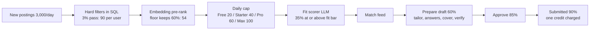

# Kairos backend: scale and cost model for about 10,000 users

Date: 2026-10-16. Scope: backend only (`server/`, additive `shared/` types). Nothing under `web/` or `extension/` is touched.

Inputs read: `_research/openrouter.md` (model prices on zero-data-retention plus structured-output routes, caching rules, fees), `_research/requirements.md` (FR, NFR, INV register), `_research/as-built.md` (current prompts, token estimates, defects S-01 to S-06), `_research/stack-options.md` (Railway unit prices, browser fleet, load model), `docs/pricing.md`, `shared/src/plans.ts`. Method: the `llm-cost-optimizer` skill in "design a cost-efficient architecture" mode (budget envelopes per agent and per plan, routing by task class, caching, output caps, cost observability before launch).

Confidence tags: **[catalog]** price taken from the OpenRouter research (catalog of 2026-10-15, cheapest endpoint that is both ZDR and `structured_outputs`); **[vendor]** Railway or other vendor price quoted in `stack-options.md`; **[est]** an assumption or derived estimate in this document, to be replaced by beta measurements. Every computed number below comes from one script-checked model, so tables agree with each other; rounding is to 2 or 3 significant figures.

---

## 0. Bottom line

1. **The $0.01 target holds, with headroom, if drafting stays on a cheap model.** With the recommended per-agent models, the all-in cost per submitted application is **$0.0033 (Free), $0.0035 (Starter), $0.0038 (Pro and Max)**: model calls about $0.0030, cloud applier $0.0003 (Pro and Max only), fixed infrastructure $0.0004. That is 33% to 38% of the TRD target.
2. **The drafter model is the one decision that can break the target.** Moving resume-line tailoring, answers and cover letters to a $2 / $10 per million token model (Claude Sonnet 5, GPT-6 Sol) or to GLM 5.3 with mandatory reasoning raises the cost to **$0.026 to $0.030 per submitted application**, which is above the lowest revenue per application any plan earns (Starter quarterly at full use, $0.015, after the 2026-10-23 change to 1,000 Starter applications; Max quarterly $0.021). The verifier agent is what makes a cheap drafter safe; the strong model is reserved for verifier escalations.
3. **Pair volume, not price per call, is what grows with scale.** The as-built design (every user with preferences times every job that passes hard filters, long uncached prompt) would make 756,000 scoring calls per day at 2,000 companies ($206 to $413 per day) and 3.0 million per day at 10,000 companies ($825 to $1,650 per day). Activity gating, embedding pre-rank and per-plan daily caps bring this to 115,000 calls per day ($11.70) and 132,000 per day ($13.50) respectively: a 17x to 120x cost reduction that also makes the monthly bill bounded by user count, not by job count.
4. **Base-case monthly spend at 10,000 registered users and 2,000 companies:** model calls about **$1,590**, Railway plus tools about **$265**, total about **$1,850** per month for about **528,000 submitted applications**. At 10,000 companies: about **$2,060** model plus about **$330** infrastructure for about **606,000** submitted applications.
5. **Recommendation:** keep $0.01 as the hard ceiling (it is justified by revenue: see section 14), budget agents to an internal target of $0.005, and enforce it with per-call `max_price`, per-agent daily envelopes, per-user daily spend caps and two OpenRouter keys with hard daily limits (section 17).

---

## 1. Design constraints the numbers assume

These are the architectural choices that the cost model depends on. If the architecture spec changes one of them, the matching section here must be recomputed.

| ID | Constraint | Why it matters for cost |
|---|---|---|
| C-1 | Hard filters (FR-17) run in SQL for each new job against eligible users only; hard-filter rejections are **not** persisted per pair (only counters per user per day). | Persisting every rejected pair, as a literal reading of FR-17 suggests, would write about 8.3 million rows (about 2.5 GB) per day at the base case. Section 11 flags this; the architecture spec must decide to store rejections only for jobs that reached pre-rank. |
| C-2 | "Eligible" users are those who completed onboarding, were active in the last 7 days, and have available credits (or a remaining free grant). Dormant users are not scored. | Removes about 64% of the as-built pair volume (8,000 users with preferences versus 2,850 eligible per day). |
| C-3 | Embeddings are computed per entity (one per job, one per resume profile), never per pair. Pre-rank is a pgvector similarity query plus a similarity floor. | An embedding call is user-independent, so no per-(user, job) model call happens before the fit gate (INV-1). |
| C-4 | Job enrichment (structured extraction of seniority, years, must-have skills, sponsorship statement, salary, remote) runs **lazily**: only for a job that survived hard filters and pre-rank for at least one user, immediately before its first scoring call. Estimated 75% of new jobs. | Keeps INV-1 literal (no model call for a job that failed the gate for everyone), and replaces the 1,500-token description in every scoring prompt with a 350-token job card plus a 350-token requirements excerpt. |
| C-5 | Scoring runs in per-user batches (one queue job scores up to 20 pre-ranked pairs for one user in a row, same `session_id`) so the user's profile block stays cached. | Cache hit on the per-user prefix of about 90%. |
| C-6 | Per-plan daily scoring caps: Free 20, Starter 40, Pro 60, Max 100 model scoring calls per user per day, including onboarding backfill and re-scores after a preference change. Proposed as an additive `dailyScoringCap` field in `shared/src/plans.ts` (INV-10: plan limits live only there). | Bounds the largest call stream by user count. |
| C-7 | Drafting happens only when the user presses "Prepare draft"; nothing is drafted speculatively. Tailoring rewrites only the selected resume lines (bullet-level, at most 16 lines), not the whole resume. | Output tokens dominate drafting cost; bullet-level output is about 800 tokens instead of 2,000. |
| C-8 | One verifier call per draft covers every resume line, answer and cover-letter paragraph, and receives only the cited facts. A user edit re-verifies only the changed items. Claims the verifier marks `uncertain` (estimated 5% of drafts) go to one escalation call on a stronger model from a different family than the drafter. | Verification is about 30% of model spend; escalation is the only use of a $2 / $10 model. |
| C-9 | Email tagging is regex first; the model sees only the ambiguous remainder (estimated 25%). Offer-driven billing pause never depends on the model alone. | Classification cost becomes negligible. |
| C-10 | Every call goes through one gateway with `zdr: true`, `data_collection: "deny"`, `require_parameters: true`, a per-agent `max_price` and `max_tokens`, and writes an `llm_calls` row with `usage.cost`. | Makes the budget enforceable and measurable (the skill's first rule: instrument before optimizing). |

---

## 2. Assumptions (value and range)

All values are **[est]** unless tagged. "Range" is the low-to-high band used for the sensitivity runs in section 15.

### 2.1 Users and plans

| Assumption | Base value | Range | Basis |
|---|---|---|---|
| Registered users | 10,000 | 10,000 (fixed by decision 3) | Locked decision 3 |
| Plan mix of registered users | Free 75% (7,500), Starter 13% (1,300), Pro 9% (900), Max 3% (300) | Paid share 15% to 35% | Beta assumption; 2,500 paying users, same as `stack-options.md` |
| Daily active users (open the app or extension on a given day) | 3,500 | 2,500 to 6,000 | About 35% of registered |
| Weekly active searchers | 4,000 | 3,000 to 7,000 | `stack-options.md` load model |
| Scoring-eligible users per day (C-2) | 2,850: Free 900, Starter 975, Pro 720, Max 255 | 1,950 (Free 600, Starter 700, Pro 500, Max 150) to 4,750 (Free 1,500, Starter 1,600, Pro 1,200, Max 450) | Paid daily activity 75%, 80%, 85%; Free bounded by sign-up inflow (next row) |
| New sign-ups per day | 150, of which 70% finish onboarding | 50 to 500 | Free users with credits left: 150 x 0.7 x about 8 active days = about 850 to 900 |
| Free users: days to use the 25 free credits | about 8 | 4 to 20 | 3.2 submissions per active day |

### 2.2 Jobs and companies

| Assumption | Base value | Range | Basis |
|---|---|---|---|
| Target companies polled | 2,000 at beta (1,700 standard at 30 minutes, 300 priority at 5 minutes) | grows to 10,000 (9,700 standard, 300 priority) | FR-13, FR-53, OQ-3 |
| New postings per day | 3,000 at 2,000 companies | 1,500 to 6,000; 12,000 at 10,000 companies (smaller companies post less per board) | About 75 open jobs per board, 50-day posting life |
| Open jobs in the live index | 150,000 | 75,000 to 300,000; 600,000 at 10,000 companies | New postings x 50 days |
| Hard-filter pass rate per (user, job) | 3% | 1.5% to 6% | Role keyword, seniority, location, sponsorship, salary, excludes for a typical new-grad or laid-off engineer profile |
| Candidate pairs per eligible user per day (after hard filters) | 90 (3,000 x 3%) | 45 to 180; 360 at 10,000 companies | Derived |
| Onboarding backfill candidates per new user | 4,500 (150,000 x 3%) | 2,250 to 9,000 | Drawn down by the daily cap, never scored in full |
| Pre-rank keep rate (similarity above floor) | 60% | 40% to 80% | Floor tuned on the scoring eval set |
| Share of new jobs that need enrichment (C-4) | 75% | 50% to 95% | Jobs that reach at least one user's scoring set |

### 2.3 Funnel

| Assumption | Base value | Range | Basis |
|---|---|---|---|
| Scored pairs at or above the user's fit bar (default 75) | 35% | 20% to 50% | After pre-rank, so already similar |
| Matches per eligible user per day | Free 7.0, Starter 14.0, Pro 18.9, Max 18.9 (2,000 companies); Pro 21.0, Max 35.0 at 10,000 companies | 3 to 45 | Scored x 35% |
| Draft rate (user presses "Prepare draft" on a match) | 60% | 40% to 80% | |
| Approval rate (draft approved for sending) | 85% | 70% to 95% | Remainder skipped, withdrawn, or blocked by `required_answers_missing` |
| Submission success (report `submitted`) | 90% | 75% to 95% | Failures: closed postings, timeouts, cloud challenges; never charged |
| Submissions per eligible user per day | Free 3.21, Starter 6.43, Pro 8.68, Max 8.68 at 2,000 companies; Pro 9.64, Max 16.06 at 10,000 | see section 3 | Derived; supply-bound at 2,000 companies |
| Cloud channel share of Pro and Max approvals | 70% | 50% to 90% | Free and Starter are extension only (INV-10) |
| Cloud runs challenged by a bot check | 15% of cloud runs | 5% to 30% | OQ-11; fails without charge and is resent through the extension |
| Drafts with at least one model-answered question | 55% (one batched call per draft) | 30% to 80% | Sensitive questions (INV-9) never reach the model |
| Drafts with a cover letter (paid plans only) | 30% | 15% to 50% | Field present and required or opted in |
| Drafts edited by the user (re-verify changed items) | 25% | 10% to 50% | |
| Drafts with a verifier escalation | 5% | 2% to 20% | |
| Forwarded replies per submitted application | 0.4 | 0.2 to 0.8 | 50% of users set up forwarding; about 0.8 emails per submission among them (auto-acknowledgements dominate) |
| Replies resolved by regex without a model | 75% | 60% to 90% | C-9 |
| Resume parses per day | 215 (sign-ups x 1.1 plus 50 extra profiles and re-uploads) | 80 to 600 | |

### 2.4 Pricing and overhead parameters

| Assumption | Value | Range | Basis |
|---|---|---|---|
| OpenRouter credit fee multiplier | 1.055 | 1.00 (BYOK under the $25,000 monthly allowance) to 1.08 (Business) | **[catalog]** / `openrouter.md` section 8 |
| Call-count overhead for retries and schema re-asks | 1.05 | 1.02 to 1.15 | One re-ask on schema failure; 408/429/502 retries |
| Cache hit, static system and schema prefix | 90% to 95% on high-volume agents, 30% on resume parsing | 0% (caching off) to 95% | Thousands of calls per 5-minute TTL; sticky routing by `session_id` |
| Cache hit, per-user prefix (profile or confirmed-fact block) | 90% scoring, 60% tailoring and answers, 50% cover letters | 0% to 95% | Batch per user (C-5) |
| Cache write price on a miss | 1.25x input for Anthropic and OpenAI GPT-6 routes; input price for DeepSeek, Z.ai, Xiaomi, Gemma | | **[catalog]** |
| Cloud run duration | 45 s average (including failures) | 30 to 90 s | `stack-options.md` |
| Cloud run resources | 0.6 vCPU and 0.4 GB during the run | | `stack-options.md` |
| Railway unit prices | $20 per vCPU-month, $10 per GB-month, $0.15 per GB-month volume | | **[vendor]** |
| Tokenizer | Token counts below are nominal; Anthropic Haiku 5.5 produces about 30% more tokens for the same text | | **[catalog]**; raises Haiku-routed agents by up to 30%, already inside the budgets of section 17 |

---

## 3. Funnel per eligible user per day



| Per eligible user per day | Free | Starter | Pro | Max | Pro (10k companies) | Max (10k companies) |
|---|---|---|---|---|---|---|
| Candidate pairs after hard filters | 90 | 90 | 90 | 90 | 360 | 360 |
| After pre-rank floor | 54 | 54 | 54 | 54 | 216 | 216 |
| Scored by the model (cap applied) | 20 | 40 | 54 | 54 | 60 | 100 |
| Matches at or above fit bar | 7.0 | 14.0 | 18.9 | 18.9 | 21.0 | 35.0 |
| Drafts prepared | 4.2 | 8.4 | 11.3 | 11.3 | 12.6 | 21.0 |
| Approved | 3.57 | 7.14 | 9.64 | 9.64 | 10.71 | 17.85 |
| Submitted | 3.21 | 6.43 | 8.68 | 8.68 | 9.64 | 16.06 |
| Cloud runs | 0 | 0 | 6.75 | 6.75 | 7.50 | 12.49 |
| Cover letters drafted | 0 | 2.52 | 3.40 | 3.40 | 3.78 | 6.30 |
| Submitted per subscriber per month (x daily activity x 30) | about 25 lifetime | 145 | 208 | 221 | 231 | 410 |
| Plan allowance per 30 days (`plans.ts`) | 25 once | 400 | 1,200 | 3,000 | 1,200 | 3,000 |

Findings:

- At 2,000 companies the job supply, not the cap, limits Pro and Max: both see 54 pre-ranked candidates a day, so Max users get no more matches than Pro. Priority polling makes Max faster, not larger. The Max value proposition only becomes visible in volume once the company list grows past about 4,000 boards. This is a product point to raise in the architecture review, not a cost problem.
- No paid plan reaches its allowance at base assumptions (Starter 36%, Pro 17%, Max 7% to 14% utilization), so revenue per submitted application is far above the "full use" figures in `docs/pricing.md`. Section 14 shows both.
- The cost ratios per submitted application are the same on every plan: 6.2 scoring calls and 1.31 drafts per submitted application (1 / (0.35 x 0.60 x 0.85 x 0.90) and 1 / (0.85 x 0.90)). Anything that improves fit precision or approval lowers both.

---

## 4. Daily and monthly volumes

Recommended architecture (C-1 to C-10). Monthly = daily x 30. Model call counts include the 5% retry overhead.

| Stream | Base per day (2,000 companies) | Base per month | Growth per day (10,000 companies) | Growth per month |
|---|---|---|---|---|
| Board polls | 168,000 (1,700 x 48 + 300 x 288) | 5.04 M | 552,000 (9,700 x 48 + 300 x 288) | 16.6 M |
| New jobs inserted | 3,000 | 90,000 | 12,000 | 360,000 |
| Jobs enriched (LLM, lazy) | 2,250 (2,362 calls) | 67,500 | 9,000 (9,450 calls) | 270,000 |
| Embeddings computed (jobs + resume profiles) | 3,400 (3,000 + 400) | 102,000 | 12,400 | 372,000 |
| Hard-filter pair evaluations (SQL, no model) | 8.55 M (3,000 jobs x 2,850 users) | 257 M | 34.2 M | 1.03 B |
| Candidate pairs (passed hard filters) | 256,500 | 7.7 M | 1,026,000 | 30.8 M |
| LLM scoring calls | 115,100 | 3.45 M | 132,000 | 3.96 M |
| Matches at or above fit bar | 38,400 | 1.15 M | 44,000 | 1.32 M |
| Drafts, each with one tailoring call | 23,000 (24,200 calls) | 725,000 | 26,400 (27,700 calls) | 832,000 |
| Answer calls (batched per draft) | 13,300 | 399,000 | 15,200 | 457,000 |
| Cover-letter calls | 6,060 | 182,000 | 7,120 | 214,000 |
| Verification calls (draft + edits + escalations) | 24,200 + 6,040 + 1,210 = 31,400 | 943,000 | 27,700 + 6,930 + 1,390 = 36,000 | 1.08 M |
| Approved applications | 19,600 | 587,000 | 22,400 | 673,000 |
| Submitted applications (charged) | 17,600 | 528,000 | 20,200 | 606,000 |
| Failed submissions (not charged) | 1,960 | 58,700 | 2,240 | 67,300 |
| Cloud runs (Pro and Max) | 6,580 | 197,000 | 8,580 | 258,000 |
| Approved for the extension channel | 13,000 | 391,000 | 13,850 | 416,000 |
| Form scans in the applier (Lever and Ashby, once per job) | 900 | 27,000 | 2,000 | 60,000 |
| Forwarded replies received | 7,050 | 211,000 | 8,080 | 242,000 |
| Reply classifications by model | 1,850 | 55,500 | 2,120 | 63,600 |
| Resume parses (LLM) | 226 | 6,780 | 226 | 6,780 |
| Total LLM calls (excluding embeddings) | about 194,000 | 5.8 M | about 225,000 | 6.8 M |

Volumes scale linearly with eligible users for every stream except board polls, enrichment and job embeddings, which scale with companies. Rule of thumb for growth beyond 10,000 users: per 1,000 additional eligible users, add about 38,500 scoring calls, 8,100 drafts and 6,200 submitted applications per day.

---

## 5. Scoring volume with and without pre-ranking and caps

All rows priced with the recommended scorer (`deepseek/deepseek-v4-flash-0731`, $0.000102 per call with the compact cached prompt) except row A, which uses the as-built prompt shape (80 facts plus 6,000 characters of description, no caching, 3,960 input tokens: $0.000273 per call on the same model, $0.000546 on `gpt-6-luna`). Calls include the 5% retry overhead.

| Row | Policy | Calls per day (2,000 companies) | Cost per day | Cost per month | Calls per day (10,000 companies) | Cost per day | Cost per month |
|---|---|---|---|---|---|---|---|
| A | As built: every user with preferences (8,000) x every hard-filter survivor, long uncached prompt | 756,000 | $206 to $413 | $6,200 to $12,400 | 3.02 M | $825 to $1,650 | $24,800 to $49,500 |
| B | Activity gating (C-2) only | 269,000 | $27.50 | $825 | 1.08 M | $110 | $3,300 |
| B+ | Row B plus uncapped onboarding backfill (105 new eligible users x 4,500 candidates) | 765,000 | $78 | $2,340 | 3.06 M (18,000 candidates each) | $312 | $9,370 |
| C | Gating plus pre-rank floor, no cap | 162,000 | $16.50 | $495 | 646,000 | $66 | $1,980 |
| D | Gating plus pre-rank plus per-plan daily caps (recommended; backfill inside the cap) | 115,000 | $11.70 | $352 | 132,000 | $13.50 | $404 |

Reading the table:

- Row D grows 15% when the company list grows 5x and the job flow 4x. Rows A to C grow 4x. The cap is what makes the bill a function of users rather than jobs.
- Uncapped backfill (row B+) is the single largest unbounded burst in the system: one launch-day cohort of 1,000 sign-ups would request 4.5 million scoring calls. With the cap, backfill is drawn down at the plan's daily rate in order of similarity.
- The model's funnel ratios are held constant across rows, so cost per submitted application looks flat between C and D; in practice the pairs that only an uncapped policy reaches are the lowest-similarity ones, with a lower match rate, so cost per submission rises without the cap. The cap also matches what a user can review: 100 scored pairs a day yields about 35 matches on Max.

---

## 6. Tokens per call per agent

S = static prefix (system role text, schema description, fixed examples; identical for every user). U = per-user stable prefix (profile summary for scoring; confirmed-fact block for drafting). V = variable part (job card, questions, claims; untrusted content is fenced here). O = output. Reasoning tokens are extra and billed as output on models with mandatory reasoning (GLM 5.3 about 2,000, GLM 5.3 Flash about 1,000).

| Agent | Class | S | U | V | Input total | Cached input (expected) | Output O | `max_tokens` | Calls per day (base) |
|---|---|---|---|---|---|---|---|---|---|
| `resume-parser` | A (extraction, PII redacted before the call) | 1,000 | 0 | 3,000 | 4,000 | 300 | 2,200 | 3,500 | 226 |
| `job-enricher` | A | 700 | 0 | 1,600 | 2,300 | 630 | 250 | 400 | 2,362 |
| `fit-scorer` | B | 900 | 900 | 700 | 2,500 | 1,665 | 120 | 200 | 115,132 |
| `resume-tailor` | C (cheap drafter by default) | 1,200 | 2,000 | 1,000 | 4,200 | 2,280 | 800 | 1,400 | 24,178 |
| `answer-drafter` | C | 900 | 2,000 | 700 | 3,600 | 2,010 | 350 | 700 | 13,298 |
| `cover-letter-writer` | C | 900 | 2,000 | 900 | 3,800 | 1,810 | 450 | 800 | 6,063 |
| `claim-verifier` (per draft) | D | 900 | 0 | 1,900 (claims 1,000 + cited facts 900) | 2,800 | 810 | 350 | 600 | 24,178 |
| `claim-verifier` (on edit) | D | 900 | 0 | 600 | 1,500 | 810 | 100 | 200 | 6,044 |
| `claim-verifier-escalation` | D, strong, other family | 900 | 0 | 600 (uncertain claims only) | 1,500 | 450 | 150 | 300 | 1,209 |
| `reply-classifier` | A (ambiguous remainder only) | 700 | 0 | 900 (redacted, truncated) | 1,600 | 560 | 80 | 120 | 1,850 |
| `embedder` | E | | | 1,500 per job, 1,200 per profile | | n/a | n/a | n/a | 3,400 texts in 53 batches of 64 |

Tokens per day (base, recommended models): about **548 M input** (of which about 312 M cached) and **51 M output**. Scoring is 52% of input tokens; tailoring is 38% of output tokens.

---

## 7. Cost per call by candidate model

Per-call cost = (S x blended static price + U x blended user-prefix price + V x input price + (O + reasoning) x output price) / 1,000,000 x 1.055, where "blended" = hit share x cache-read price + miss share x cache-write price. Route prices are **[catalog]** USD per million tokens, input / output / cache read.

| Agent | Candidate 1 (recommended) | Candidate 2 | Candidate 3 | Notes |
|---|---|---|---|---|
| `resume-parser` | `anthropic/claude-haiku-5.5` (Vertex, 0.10 / 0.50 / 0.010): **$0.00157** | `openai/gpt-6-luna` (Azure, 0.10 / 0.50 / 0.010): $0.00157 | `anthropic/claude-sonnet-5` (2.00 / 10.00 / 0.20): $0.0315 | 226 calls a day: even Sonnet would cost $7 a day; choose by extraction eval, not price |
| `job-enricher` | `deepseek/deepseek-v4-flash-0731` (DeepInfra fp8, 0.06 / 0.18 / 0.015): **$0.000163** | `google/gemma-4-26b-a4b-it` (0.07 / 0.34): $0.000260 | `openai/gpt-6-luna`: $0.000317 | Public data only; no personal data in the prompt |
| `fit-scorer` | `deepseek/deepseek-v4-flash-0731`: **$0.000102** | `xiaomi/mimo-v2.6-flash` (0.133 / 0.266 / 0.003): $0.000156 | `openai/gpt-6-luna` (fallback) or `anthropic/claude-haiku-5.5`: $0.000173 | `z-ai/glm-5.3-flash` with its reasoning allowance: $0.000388. As-built prompt shape on the same model: $0.000273 |
| `resume-tailor` | `openai/gpt-6-luna`: **$0.000673** | `z-ai/glm-5.3` (Sail fp8, 0.15 / 3.40 / 0.14, 2,000 reasoning): $0.0107 | `anthropic/claude-sonnet-5` or `openai/gpt-6-sol`: $0.0135 | Recommended only if the tailoring eval (truth lock, relevance, tone) passes; otherwise see the fallback ladder in section 17.3 |
| `answer-drafter` | `openai/gpt-6-luna`: **$0.000397** | `z-ai/glm-5.3`: $0.00898 | `anthropic/claude-sonnet-5`: $0.00794 | Same family as the tailor, so the same verifier pairing applies |
| `cover-letter-writer` | `openai/gpt-6-luna`: **$0.000495** | `z-ai/glm-5.3`: $0.00937 | `anthropic/claude-sonnet-5`: $0.00990 | Sonnet for letters only, paid plans: +$0.0032 per submitted application (section 15) |
| `claim-verifier` | `anthropic/claude-haiku-5.5` (different family from the OpenAI drafter): **$0.000405** | `deepseek/deepseek-v4-flash-0731`: $0.000205 | `z-ai/glm-5.3-flash`: $0.000526 | `gpt-6-luna` is excluded while the drafter is OpenAI (family rule) |
| `claim-verifier` (edit) | `anthropic/claude-haiku-5.5`: **$0.000136** | `deepseek/deepseek-v4-flash-0731`: $0.000075 | | |
| `claim-verifier-escalation` | `anthropic/claude-sonnet-5`: **$0.00413** | `openai/gpt-6-sol`: $0.00413 (only if the drafter is not OpenAI) | | 5% of drafts |
| `reply-classifier` | `deepseek/deepseek-v4-flash-0731`: **$0.000090** | `google/gemma-4-26b-a4b-it`: $0.000147 | `openai/gpt-6-luna`: $0.000162 | Emails are personal data: ZDR route required on all three |
| `embedder` (per 1,500-token job) | `qwen/qwen3-embedding-8b` (0.010): **$0.0000158** | `openai/text-embedding-3-small` (0.020): $0.0000317 | `perplexity/pplx-embed-v1-0.6b` (0.004): $0.0000063 | Never mix vectors across models (store `embedding_model` and `dims`) |

---

## 8. Model spend by agent (recommended configuration)

| Agent | Calls per day | Input M tokens per day | Cached M | Output M | $ per day | $ per month | Share |
|---|---|---|---|---|---|---|---|
| `fit-scorer` | 115,132 | 287.8 | 191.7 | 13.8 | 11.74 | 352 | 22.2% |
| `resume-tailor` | 24,178 | 101.5 | 55.1 | 19.3 | 16.27 | 488 | 30.8% |
| `answer-drafter` | 13,298 | 47.9 | 26.7 | 4.7 | 5.28 | 158 | 10.0% |
| `cover-letter-writer` | 6,063 | 23.0 | 11.0 | 2.7 | 3.00 | 90 | 5.7% |
| `claim-verifier` (draft) | 24,178 | 67.7 | 19.6 | 8.5 | 9.80 | 294 | 18.5% |
| `claim-verifier` (edit) | 6,044 | 9.1 | 4.9 | 0.6 | 0.82 | 25 | 1.6% |
| `claim-verifier-escalation` | 1,209 | 1.8 | 0.5 | 0.2 | 4.99 | 150 | 9.4% |
| `job-enricher` | 2,362 | 5.4 | 1.5 | 0.6 | 0.39 | 12 | 0.7% |
| `resume-parser` | 226 | 0.9 | 0.1 | 0.5 | 0.35 | 11 | 0.7% |
| `reply-classifier` | 1,850 | 3.0 | 1.0 | 0.1 | 0.17 | 5 | 0.3% |
| `embedder` | 3,400 texts | 5.0 | n/a | n/a | 0.05 | 2 | 0.1% |
| **Total** | **about 197,000** | **553** | **312** | **51** | **52.87** | **1,586** | 100% |

At 10,000 companies the total is $68.6 per day ($2,058 per month): scoring rises to $13.46 and enrichment to $1.54 per day; drafting grows with the Max users' extra matches.

Spend per eligible user per day: Free $0.0089, Starter $0.0192, Pro $0.0259, Max $0.0259 (Max $0.048 at 10,000 companies). Per draft, the full drafting pipeline (tailor, answers on 55%, verify, edit re-verify on 25%, escalation on 5%, retries) costs **$0.00161**, plus **$0.00050** when a cover letter is written.

---

## 9. Cloud applier browser-hours and compute

Unit prices **[vendor]**: vCPU-second $0.0000077, GB-second $0.00000386.

| Item | Base (2,000 companies) | Growth (10,000 companies) |
|---|---|---|
| Cloud runs per day | 6,580 (of which about 990 challenged and failed without charge) | 8,580 |
| Browser time for runs | 6,580 x 45 s = 82.2 browser-hours per day | 107 browser-hours per day |
| Form scans (Lever and Ashby, 20 s each) | 900 x 20 s = 5.0 hours per day | 2,000 x 20 s = 11.1 hours per day |
| Total browser-hours | 87 per day, about 2,610 per month | 118 per day, about 3,550 per month |
| CPU cost per run | 45 s x 0.6 vCPU x $0.0000077 = $0.000208 | same |
| Memory cost per run | 45 s x 0.4 GB x $0.00000386 = $0.0000695 | same |
| Run compute per month | 197,000 x $0.000278 = $55 | $72 |
| Scan compute per month | 27,000 x 20 s x (0.6 x $0.0000077 + 0.4 x $0.00000386) = $3.3 | $7.4 |
| Idle baseline (4 replicas x 0.35 GB resident) | $14 | $21 (6 replicas) |
| **Applier total per month** | **about $72** | **about $100** |
| Cost per cloud run, all-in | **$0.00037** | $0.00039 |
| Cost per Pro or Max submitted application (0.78 cloud runs each) | $0.0003 | $0.0003 |
| Peak concurrency (40% of runs in a 2-hour window) | 2,630 runs / 7,200 s x 45 s = 16.4 contexts | 21.5 contexts |
| Recommended fleet | 4 replicas x 3 contexts = 12 slots; peak backlog of about 700 runs drains in about 45 minutes after the window | 6 replicas x 3 contexts = 18 slots |

A queue-smoothed fleet is acceptable because cloud sends are asynchronous ("applies while your laptop is closed"). If the product wants every approved cloud send started within 10 minutes, size to 6 replicas at base (+$7 per month idle).

---

## 10. Fixed infrastructure per month

| Item | Base | Growth | Basis |
|---|---|---|---|
| api, 2 replicas | $14 | $14 | `stack-options.md` section 13 **[vendor]** rates |
| worker, 3 replicas (polling, pipelines, sweepers) | $54 | $70 (polling 3.3x) | **[est]** |
| applier | $72 | $100 | Section 9 |
| Postgres 2 vCPU, 4 GB, 100 GB volume | $71 | $85 (4 vCPU at 12 months) | Section 11 sizing |
| Redis 512 MB | $5 | $5 | Section 12 |
| Railway Pro fee | $20 | $20 | **[vendor]** |
| Sentry Team, Cloudflare R2 | $29 | $32 | `stack-options.md` |
| **Total** | **$265** | **$326** | |
| Of which non-applier | $193 | $226 | Allocated evenly per submitted application: $0.00037 base (with 20% contingency $0.00044) |

---

## 11. Postgres row and storage growth

Bytes per row include indexes and TOAST compression of JSONB and text. Retention follows NFR-23 and FR-58 where they exist; items marked "proposed" are recommendations to the architecture spec.

| Table | Rows per day (base) | Bytes per row | Gross MB per day | Retention | Size after 12 months at 10,000 users |
|---|---|---|---|---|---|
| `jobs` (no `raw` JSONB duplicate; description compressed) | 3,000 | 4,000 | 12 | Kept for dedupe; nearly every job is referenced by an application, so FR-58 pruning removes little. Proposed: null `description_text` of jobs closed more than 180 days | 4.4 GB (2.2 GB with the proposal) |
| `jobs` if `raw` is kept as today | | +12,000 | +36 | | +13 GB |
| `job_cards` (enrichment output) | 2,250 | 1,200 | 2.7 | With the job | 1.0 GB |
| `job_embeddings` (`halfvec(1024)` + HNSW partial index on open jobs) | 3,000 | 4,600 | 13.8 | Proposed: delete 7 days after close | 0.7 GB (150,000 live) |
| `profile_embeddings` | 400 updates | 4,600 | 0 (in-place) | Latest per resume profile | 0.07 GB |
| `matches` (scored pairs only) | 109,650 | 700 | 77 | Proposed: below fit bar 30 days; unqueued `new` or `skipped` 90 days; queued kept with the application | 8.4 GB |
| Hard-filter rejections per pair (not stored, C-1) | would be 8.3 M | 300 | would be 2,500 | | would exceed 900 GB per year |
| `applications` (lines, answers, cover letter, receipt) | 23,000 | 5,000 | 115 | Account lifetime; proposed: never-approved drafts deleted 30 days after skip or withdraw | 36 GB |
| `verification_results` (per-claim verdicts, separate table) | 23,000 | 2,500 | 58 | Proposed: 90 days, then keep the summary row only | 5.2 GB |
| `llm_calls` | 194,000 | 450 | 87 | Proposed: 90 days, then rolled into `llm_cost_daily` | 7.9 GB |
| `llm_cost_daily` (rollup) | about 200 | 200 | 0.04 | Forever | under 0.02 GB |
| Workflow or step state (engine dependent; about 12 steps per draft) | 276,000 | 300 | 83 | 30 days | 2.5 GB |
| `credit_ledger` | 17,700 | 200 | 3.5 | Forever (audit) | 1.3 GB |
| `inbound_emails` | 7,050 | 5,000 | 35 | Proposed: body 180 days, metadata forever | 6.4 GB |
| `facts` | 4,200 | 400 | 1.7 | Account lifetime | 0.6 GB |
| `poll_runs` log | 168,000 | 150 | 25 | 7 days | 0.2 GB |
| Auth, profiles, subscriptions, companies, others | small | | under 1 | | 0.3 GB |
| **Total** | about 840,000 rows per day | | **about 513 MB per day gross, about 160 MB per day net** | | **about 75 GB** (about 40 GB with a linear 0-to-10,000 user ramp over the year) |

At 10,000 companies add about 40 MB per day for jobs, cards and vectors, and about 13 GB at 12 months. Recommendation: 100 GB volume at launch ($15 per month), alert at 70% use, and treat `applications` as the table to watch (48% of the 12-month size).

The rollup table that lets `llm_calls` be pruned without losing the cost history:

```sql
CREATE TABLE llm_cost_daily (
  day              date        NOT NULL,
  agent_id         text        NOT NULL,
  plan             plan_id     NOT NULL,
  served_model     text        NOT NULL,
  calls            integer     NOT NULL,
  input_tokens     bigint      NOT NULL,
  cached_tokens    bigint      NOT NULL,
  output_tokens    bigint      NOT NULL,
  reasoning_tokens bigint      NOT NULL,
  cost_usd         numeric(12, 6) NOT NULL,
  PRIMARY KEY (day, agent_id, plan, served_model)
);
```

---

## 12. Redis memory

Sized for BullMQ on Redis (the as-built engine). If the architecture spec moves orchestration into Postgres, only rate limits, spend counters and caches stay in Redis (about 20 MB).

| Item | Count | Bytes each | Memory |
|---|---|---|---|
| Completed jobs retained (recommend `removeOnComplete: { age: 3600 }` instead of 24 hours) | about 12,500 (one hour of about 300,000 jobs per day) | 1,300 | 16 MB |
| Failed jobs retained 7 days at about 1% failure | about 21,000 | 1,500 | 32 MB |
| Waiting and delayed jobs at peak (first poll of a batch of new companies, morning scoring wave) | about 30,000 | 1,300 | 39 MB |
| Job scheduler and queue metadata, 12 queues | | | 2 MB |
| Rate-limit keys (api 120 per minute per IP, contact form, per-host polling, per-model limiters) | about 20,000 | 120 | 2.4 MB |
| Per-user daily spend and scoring counters (`spend:{userId}:{yyyymmdd}`, `scored:{userId}:{yyyymmdd}`, 48 h TTL) | 20,000 | 100 | 2 MB |
| Per-agent daily envelope counters | 30 | 100 | under 0.1 MB |
| Session cookie cache (if adopted to fix S-07) | 15,000 | 600 | 9 MB |
| Redis base overhead, replication buffers | | | 50 MB |
| **Peak total** | | | **about 150 MB** |

Recommendation: 512 MB instance with `maxmemory-policy noeviction` asserted at boot, alert at 60% (300 MB). At 10,000 companies the polling share of retained jobs grows 3.3x, bringing the peak to about 200 MB.

---

## 13. Queue throughput and concurrency

Peak factor: polling 2x (5-minute priority waves on top of the 30-minute cycle, smoothed with jitter); user-driven streams 4x to 5x the daily average.

| Stream | Jobs per day (base) | Average per second | Peak per second | Typical duration | Concurrency needed at peak | Growth (10,000 companies) |
|---|---|---|---|---|---|---|
| `poll-boards` | 168,000 | 1.94 | 4 | 0.6 s fetch and diff | 3 (configure 8) | 552,000 per day, 6.4 per second, peak 13; needs per-host limiter at 5 requests per second for the Greenhouse API host and conditional requests |
| `enrich-job` | 2,362 | 0.03 | 0.5 (new company burst, throttled) | 3 s | 2 (configure 4) | 9,450 per day |
| `embed` (batches of 64) | 53 | | | 2 s | 1 | 194 per day |
| `score-matches` (per-user batch of up to 20) | about 20,700 jobs carrying 115,000 calls | 1.33 calls per second | 6.7 calls per second | 1.5 s per call | 10 concurrent model calls | 132,000 calls per day |
| Draft pipeline (tailor, answers, cover letter, verify) | 23,000 drafts, about 87,000 step jobs | 0.27 drafts per second | 1.1 drafts per second | tailor 8 s, answers 4 s, letter 5 s, verify 4 s | about 17 concurrent model calls | 26,400 drafts per day |
| `cloud-apply` | 6,580 | 0.076 | 0.37 | 45 s | 12 to 16 browser contexts | 8,580 per day |
| `scan-form` | 900 | 0.01 | 0.05 | 20 s | 1 | 2,000 per day |
| `classify-email` | 7,050 (1,850 model calls) | 0.08 | 0.4 | regex under 5 ms, model 1 s | 1 | 8,080 per day |
| `parse-resume` | 226 | | 0.05 | 25 s | 2 | same |
| Sweepers (`expire-claims`, health, reconcilers) | about 6,000 | | | | 1 | same |
| **All queues** | **about 300,000** | **3.5** | **about 15** | | | about 700,000 per day |

Model-provider throughput to request in writing from OpenRouter before beta (`openrouter.md` section 8): average about 380,000 input tokens per minute, peak about 1.5 million; scoring alone on DeepSeek V4 Flash about 200,000 average and 800,000 peak; drafting on GPT-6 Luna (Azure) about 120,000 average and 500,000 peak; requests about 135 per minute average and 600 per minute peak.

---

## 14. Cost per submitted application per plan

### 14.1 Cost breakdown (base, recommended models)

| Cost per submitted application | Free | Starter | Pro | Max |
|---|---|---|---|---|
| Fit scoring (6.2 calls) | $0.00067 | $0.00067 | $0.00067 | $0.00067 |
| Drafting and verification (1.31 drafts; letters on paid plans) | $0.00211 | $0.00231 | $0.00231 | $0.00231 |
| Shared agents (parse, enrich, embed, classify) | $0.00005 | $0.00005 | $0.00005 | $0.00005 |
| **Model subtotal** | **$0.00283** | **$0.00304** | **$0.00304** | **$0.00304** |
| Cloud applier | $0 | $0 | $0.00030 | $0.00030 |
| Fixed infrastructure share (non-applier, with contingency) | $0.00044 | $0.00044 | $0.00044 | $0.00044 |
| **Total** | **$0.0033** | **$0.0035** | **$0.0038** | **$0.0038** |
| Against the $0.01 TRD target | 33% | 35% | 38% | 38% |

At 10,000 companies the totals are the same within $0.0001 (shared agents rise to $0.00011, the fixed share stays at about $0.00045).

### 14.2 Against plan revenue per submitted application

Revenue is the plan price divided by submitted applications. Net of Stripe card fees (2.9% plus $0.30 per invoice **[est]**), the monthly prices net $18.15, $37.57 and $76.41.

| | Starter | Pro | Max |
|---|---|---|---|
| Revenue per application at modeled usage, monthly billing (2,000 companies) | $19 / 145 = $0.131 | $39 / 208 = $0.187 | $79 / 221 = $0.357 |
| Cost as share of that revenue | 2.7% | 2.0% | 1.1% |
| Revenue per application at modeled usage, 10,000 companies | $0.131 | $39 / 231 = $0.169 | $79 / 410 = $0.193 |
| Revenue per application at full use, monthly (`pricing.md`; Starter 1,000 since 2026-10-23) | $0.019 | $0.0325 | $0.0263 |
| Cost as share, full use monthly | 18.4% | 11.7% | 14.4% |
| Revenue per application at full use, weekly | $6 / 234 = $0.026 | $12 / 280 = $0.043 | $25 / 700 = $0.036 |
| Revenue per application at full use, quarterly | $45 / 3,000 = $0.015 | $95 / 3,600 = $0.0264 | $189 / 9,000 = $0.0210 |
| Cost as share, full use quarterly (worst case) | 23.3% | 14.4% | 18.1% |
| Model and compute per subscriber per month at modeled usage | $0.51 | $0.79 | $0.84 (2,000 companies), $1.56 (10,000) |
| Max subscriber at full use (3,000 applications) | | | about $11.40 on $79 |

Free plan: about $0.083 for a user's 25 submitted applications, plus about $0.01 of parsing and scoring for users who never submit: about **$0.09 of model and compute per Free sign-up**, or about $14 per day of acquisition cost at 150 sign-ups per day (already included in the totals above).

### 14.3 Verdict on the $0.01 target

Met, with about 60% headroom, at the recommended configuration. The target should not be raised: the worst-case revenue per application is $0.021 (Max quarterly at full use, $0.0204 after card fees), so a cost of $0.01 already consumes about half of it. The configurations that need a revised target (strong-model drafting at $0.026 to $0.030) would lose money on every fully used Max quarterly subscription, so the right response to a failed cheap-drafter eval is the fallback ladder in section 17.3, not a higher target. Recommended internal target: **$0.005** per submitted application all-in, with $0.01 as the alarm ceiling.

---

## 15. Sensitivity (model cost per submitted application, base volumes)

Model-only cost; add $0.0004 to $0.0008 for compute. Baseline is $0.0030.

| Change | Model cost per submitted application | Model spend per month | Verdict against $0.01 all-in |
|---|---|---|---|
| Baseline (recommended) | $0.0030 | $1,586 | Met |
| Scorer `gpt-6-luna` or `claude-haiku-5.5` instead of DeepSeek V4 Flash | $0.0035 | $1,830 | Met |
| Verifier `deepseek-v4-flash-0731` instead of Haiku 5.5 | $0.0027 | $1,430 | Met |
| Prompt caching off entirely (or sticky routing broken) | $0.0044 | $2,330 | Met, 47% worse |
| Cover letters only on `claude-sonnet-5` (paid plans) | $0.0062 | $3,300 | Met |
| Verifier escalation rate 20% instead of 5% | $0.0039 | $2,035 | Met |
| All drafting on `z-ai/glm-5.3` (verifier `gpt-6-luna`) | $0.0263 | $13,900 | **Missed** |
| All drafting on `claude-sonnet-5` (verifier `gpt-6-luna`, escalation `gpt-6-sol`) | $0.0295 | $15,600 | **Missed** |
| Fit-bar pass rate 50% instead of 35% | $0.0028 | $2,100 | Met |
| Fit-bar pass rate 20% | $0.0035 | $1,070 | Met |
| Draft rate 80% / 40% | $0.0028 / $0.0034 | $1,990 / $1,180 | Met |
| Submission success 75% instead of 90% | $0.0036 | $1,585 | Met |
| Low case (1,950 eligible users, 1.5% hard-filter pass) | $0.0034 | $790 | Met |
| High case (4,750 eligible users, 6% pass, 45% fit, 75% drafts) | $0.0031 | $5,000 | Met |
| Caps doubled, 10,000 companies | $0.0030 | $3,650 | Met per application; monthly bill +77% |
| No caps, 10,000 companies | $0.0029 (constant-ratio model, see section 5) | $8,740 | Bill 4.2x baseline growth case |
| As-built shape (row A scoring, whole-resume Sonnet-class tailoring, no verifier) | $0.045 to $0.057 | $23,800 to $30,000 | **Missed by 4.5x to 5.7x** |

---

## 16. Levers that matter most, ranked

Ranked by dollars per month at stake at the base case.

| Rank | Lever | What it changes | Monthly effect (base) | How to hold it |
|---|---|---|---|---|
| 1 | Drafter model class (tailor, answers, cover letter) | $0.00161 versus $0.019 to $0.022 per draft | $12,300 to $14,000 per month avoided; decides whether the target is met | Cheap drafter plus independent verifier; strong model only for escalations; eval gate per prompt version |
| 2 | Pair-volume control: activity gating, embedding pre-rank, per-plan daily caps | 756,000 to 115,000 scoring calls per day (3.0 M to 132,000 at 10,000 companies) | $5,800 to $12,000 per month avoided at 2,000 companies; $24,000 to $49,000 at 10,000 | C-2, C-3, C-6; `dailyScoringCap` in `plans.ts`; backfill drawn from the cap |
| 3 | Compact, cached prompts (lazy job enrichment to a job card, static-first ordering, per-user batching, `session_id`) | Scoring input 3,960 to 2,500 tokens, 67% cached; drafting user block cached | $740 per month (caching) plus about $175 per month (job card replacing the long description) | Prompt-assembly rules from `openrouter.md` section 6; alert when `cached_tokens / prompt_tokens` falls under 55% on scoring |
| 4 | Bullet-level tailoring and output caps (`max_tokens` per agent) | Tailor output 2,000 to 800 tokens | $460 per month on GPT-6 Luna; $9,200 per month if a $10 output model were used | C-7; schema caps `lines` at 16 |
| 5 | Verifier design: one call per draft with cited facts only; edits re-verify changed items only; escalation share | Verification 30% of spend | Each 5 points of escalation rate costs about $150 per month | Track escalation rate per prompt version; cap escalations at 10% of drafts per day before alerting |
| 6 | Funnel precision (fit-bar pass rate, draft and approval rates, submission success) | Scoring calls and drafts per submitted application | plus or minus $0.0005 per application, about $260 per month | Better scoring prompt and pre-rank floor; closed-posting checks before drafting |
| 7 | OpenRouter fee | 5.5% on credit purchases | about $85 per month | Invoice billing or BYOK under the $25,000 allowance once provider contracts exist |
| 8 | Scorer model choice within Class B | $0.000102 versus $0.000173 per call | about $250 per month | Eval-gated; fallback stays within the class |
| 9 | Regex-first email tagging, answer memory reuse, embedding model choice | | under $20 per month each | Keep as designed |

Rejected lever: scoring several jobs in one call. It would save about $100 per month at most because the prefix is already cached, and it adds position bias and cross-job contamination of reasons.

---

## 17. Recommended per-agent cost budget

### 17.1 Budget table

"Expected" is the modeled cost. "Budget per submitted application" is the envelope the agent must stay inside (the sum is $0.0066, leaving $0.0034 of the $0.01 ceiling for compute, evals and anomalies). "Max per call" becomes the gateway's hard refusal threshold; `max_price` per million tokens is set at 1.5x the route price. Daily envelopes are 1.5x the base expected spend, with an alert at 80%.

| Agent | Primary model | Fallbacks (same role, ZDR + structured outputs) | `max_tokens` | `max_price` prompt / completion (USD per M) | Expected per call | Max per call | Expected per submitted application | Budget per submitted application | Daily envelope (base) | OpenRouter key |
|---|---|---|---|---|---|---|---|---|---|---|
| `fit-scorer` | `deepseek/deepseek-v4-flash-0731` | `openai/gpt-6-luna`, `xiaomi/mimo-v2.6-flash` | 200 | 0.20 / 0.75 | $0.000102 | $0.00035 | $0.00067 | $0.0012 | $18 | batch |
| `job-enricher` | `deepseek/deepseek-v4-flash-0731` | `google/gemma-4-26b-a4b-it`, `openai/gpt-6-luna` | 400 | 0.20 / 0.75 | $0.000163 | $0.0005 | $0.00002 | $0.0001 | $2.50 | batch |
| `embedder` | `qwen/qwen3-embedding-8b` | separate index version on `openai/text-embedding-3-small` | n/a | 0.03 | $0.000016 | $0.00005 | $0.000003 | $0.00005 | $0.30 | batch |
| `resume-parser` | `anthropic/claude-haiku-5.5` | `openai/gpt-6-luna` | 3,500 | 0.15 / 0.75 | $0.00157 | $0.004 | $0.00002 | $0.0001 | $0.60 | batch |
| `reply-classifier` | `deepseek/deepseek-v4-flash-0731` | `google/gemma-4-26b-a4b-it` | 120 | 0.20 / 0.75 | $0.000090 | $0.0003 | $0.00001 | $0.00005 | $0.30 | batch |
| `resume-tailor` | `openai/gpt-6-luna` | `xiaomi/mimo-v2.6-flash` | 1,400 | 0.15 / 0.75 | $0.000673 | $0.0015 | $0.00092 | $0.0020 | $25 | interactive |
| `answer-drafter` | `openai/gpt-6-luna` | `xiaomi/mimo-v2.6-flash` | 700 | 0.15 / 0.75 | $0.000397 | $0.0010 | $0.00030 | $0.0007 | $8 | interactive |
| `cover-letter-writer` | `openai/gpt-6-luna` | `xiaomi/mimo-v2.6-flash` | 800 | 0.15 / 0.75 | $0.000495 | $0.0012 | $0.00017 | $0.0006 | $4.50 | interactive |
| `claim-verifier` (draft and edit) | `anthropic/claude-haiku-5.5` | `deepseek/deepseek-v4-flash-0731` | 600 / 200 | 0.15 / 0.75 | $0.000405 / $0.000136 | $0.0010 | $0.00060 | $0.0012 | $16 | interactive |
| `claim-verifier-escalation` | `anthropic/claude-sonnet-5` | none (fail closed: unverified claims are dropped, the user sees why) | 300 | 3.00 / 15.00 | $0.00413 | $0.0080 | $0.00028 | $0.0006 | $7.50 | interactive |
| **Total** | | | | | | | **$0.0030** | **$0.0066** | **$82** | |

`max_price` applies to the whole request including the `models` fallback list, so it is set to cover the most expensive fallback in the chain (for example 0.20 / 0.75 on DeepSeek-primary agents so that a `gpt-6-luna` fallback at 0.10 / 0.50 still routes), while `maxCostPerCallUsd` in the gateway enforces the per-call dollar ceiling independently.

Family rule check: drafters are OpenAI (`gpt-6-luna`) with a Xiaomi fallback; verifiers are Anthropic and DeepSeek; the escalation is Anthropic. No verifier chain contains a drafter family. If the drafter is ever switched to an Anthropic model, the verifier must switch to `gpt-6-luna` or DeepSeek and the escalation to `gpt-6-sol`.

### 17.2 Per-user and per-key limits

| Control | Value | Basis |
|---|---|---|
| `dailyScoringCap` (additive field in `shared/src/plans.ts`) | Free 20, Starter 40, Pro 60, Max 100 | C-6 |
| `dailyModelSpendCapUsd` (additive field in `shared/src/plans.ts`) | Free $0.03, Starter $0.06, Pro $0.10, Max $0.16 | About 3.3x the modeled spend per eligible user per day (Max at 10,000 companies: $0.048). When reached, scoring pauses until 00:00 UTC; user-initiated drafting continues up to 2x the cap, then returns a retryable status through existing draft states (no new error codes for the frozen clients) |
| OpenRouter key `kairos-prod-batch` daily limit | $45 (expected $12.6) | 3x expected, `openrouter.md` section 8 |
| OpenRouter key `kairos-prod-api` daily limit | $120 (expected $40.3) | 3x expected |
| Global alert | 80% of the $82 daily envelope sum, or model cost per submitted application above $0.005 over a rolling 24 hours | Skill rule: alert at 80% of the envelope |
| Reconciliation | Nightly: `sum(llm_calls.cost_usd)` against the OpenRouter balance change; alert above 2% drift | `openrouter.md` section 7 |

Gateway-side type for the budget table (the architecture spec owns the final shape):

```ts
export type AgentId =
  | "fit-scorer" | "job-enricher" | "embedder" | "resume-parser" | "reply-classifier"
  | "resume-tailor" | "answer-drafter" | "cover-letter-writer"
  | "claim-verifier" | "claim-verifier-escalation";

export interface AgentBudget {
  agentId: AgentId;
  primaryModel: string;            // exact versioned slug, never a "~...-latest" alias
  fallbackModels: string[];        // same role; verifier chains exclude drafter families
  maxTokens: number;
  maxPricePerMTok: { prompt: number; completion: number };  // sent as provider.max_price
  expectedCostPerCallUsd: number;
  maxCostPerCallUsd: number;       // gateway refuses estimates above this before sending
  budgetPerSubmittedAppUsd: number;
  dailyEnvelopeUsd: number;        // alert at 80%, pause batch agents at 100%
  openRouterKey: "batch" | "interactive";
}

export interface PlanCostLimits {   // additive fields proposed for shared/src/plans.ts
  dailyScoringCap: number;
  dailyModelSpendCapUsd: number;
}
```

### 17.3 Fallback ladder if the cheap drafter fails its eval

Apply in order, re-running the cost check after each step:

1. Swap to the other cheap drafter (`xiaomi/mimo-v2.6-flash` at about $0.0005 per tailor call, or `claude-haiku-5.5` with `gpt-6-luna` as verifier): cost unchanged.
2. Keep the cheap drafter for resume lines and answers; use `claude-sonnet-5` for cover letters on paid plans only: $0.0062 per submitted application, within target.
3. Two-pass drafting: cheap draft, then a strong-model rewrite only of lines the verifier flags or the user rejects (expected 10% to 20% of lines): about $0.002 extra per draft, $0.0057 per submitted application.
4. Only if all three fail the eval: strong drafter for all artifacts, and reprice. This is a pricing decision (Max quarterly would run at a loss at full use), not an engineering one.

---

## 18. How to verify in beta

| Metric | Source | Target | Alarm |
|---|---|---|---|
| Model cost per submitted application | `llm_calls` and `credit_ledger` (query below) | $0.0030 | above $0.005 for 24 hours |
| Scoring calls per submitted application | `llm_calls` where `agent_id = 'fit-scorer'` / submissions | 6.2 | above 10 |
| Drafts per submitted application | `applications` | 1.31 | above 1.6 |
| Cached share of prompt tokens on `fit-scorer` | `llm_calls.cached_tokens / input_tokens` | 67% | under 55% |
| Verifier escalation rate | `llm_calls` by agent | 5% of drafts | above 10% |
| Cloud run seconds per run | applier metrics | 45 s | above 90 s |
| Per-user daily spend at cap | Redis counters | under 1% of users | above 5% |

```sql
-- Model cost per submitted application, by day, last 30 days.
-- Assumes llm_calls(agent_id text, user_id text, cost_usd numeric(12,8), created_at timestamptz).
WITH spend AS (
  SELECT date_trunc('day', created_at) AS day, sum(cost_usd) AS llm_usd
  FROM llm_calls
  WHERE created_at >= now() - interval '30 days'
  GROUP BY 1
), subs AS (
  SELECT date_trunc('day', created_at) AS day, count(*) AS submitted
  FROM credit_ledger
  WHERE reason = 'submission' AND created_at >= now() - interval '30 days'
  GROUP BY 1
)
SELECT s.day,
       s.llm_usd,
       b.submitted,
       round(s.llm_usd / nullif(b.submitted, 0), 5) AS llm_usd_per_submitted
FROM spend s
LEFT JOIN subs b USING (day)
ORDER BY s.day;
```

Replace every **[est]** row in section 2 with the beta's measured value after 14 days of traffic, and re-run this model. The two numbers most likely to be wrong, in order: the hard-filter pass rate (drives candidate supply and therefore whether Pro and Max differ), and the cheap drafter's eval pass rate (drives whether section 17.3 is needed).
