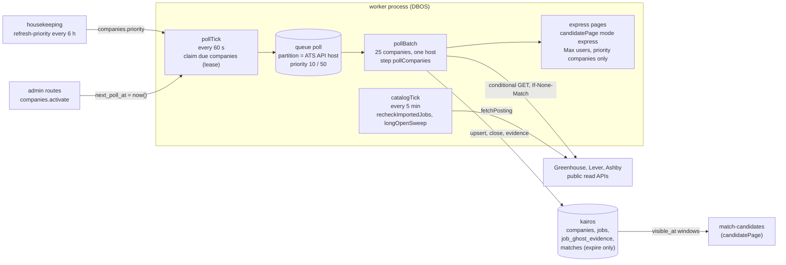

# Worker spec 01: ingest-poller (board polling)

Revision 1, 2026-10-25. Tier: standard. Process: `worker`. Queue: `poll`. Agents invoked: none.

This document specifies the worker called `ingest-poller` in `01-architecture.md` Part C. It implements the ingestion half of `04-matching.md` section 2 (polling, normalization, upsert, close guard, families, ghost evidence) on the DBOS design of `01-architecture.md` B.5, with the corrections of spike S-D1 (`_research/spike-s-d1-local.md`). Where `02-database.md` revision 2 and `04-matching.md` disagree, this document follows `02-database.md` and says so. Every place where this document refines or corrects a sibling specification is listed in section 13.

Inputs read: `01-architecture.md` (B.5, B.7, B.11.5, Part C), `02-database.md` (7.2, 8.4, 8.5, 12.2, R-5, R-9, R-14), `04-matching.md` (sections 2, 3.4, 5.3, 13, 20, 22, 23), `05-api.md` (admin routes), `06-infrastructure.md` (6.4, 6.6, 6.7, 7.4, 9.3, 9.4), `_research/integrations.md` (sections 1 to 4), `_research/as-built.md` (D-19, S-04, S-06), the skeleton files `server/src/jobs/poll-boards.ts`, `server/src/services/ats/*.ts`, `server/src/db/schema/jobs.ts`, `server/test/ats.test.ts`, and the sibling worker specs `02-match-candidates.md`, `14-durable-ops.md`, `15-ops-monitors.md`, `16-housekeeping.md`. The skills `dbos-typescript` and `error-handling-patterns` were loaded and applied.

Evidence tags follow the architecture: **[V]** verified in a research file or vendor documentation, **[est]** an estimate to be replaced by beta measurements, **[verify]** a behavior a named spike or the first implementation test must prove.

---

## 1. Purpose and place in the lifecycle

`ingest-poller` turns the public job boards of about 2,000 companies at base and 10,000 at growth into rows of `jobs`, and keeps those rows true: new postings appear within the freshness target, changed postings are updated, closed postings are closed, reposts are grouped into families, and each row carries the deterministic columns that the fit gate needs. It makes no model call, and no step of it reads user data. It is the only writer of the catalog's ingestion columns (`jobs.title_lc` through `jobs.simhash`, `jobs.family_id`, `jobs.visible_at`, `jobs.closed_at`, `jobs.injection_suspect`, `jobs.unlisted`, and the structural rows of `job_ghost_evidence`).

Its place in the lifecycle (`01-architecture.md` B.6.1) is the first arrow: ATS boards to Postgres. Everything downstream (candidate generation, F1 pre-rank, scoring, drafting, sending) starts from a row this worker wrote.



What it hands to other workers, and through which contract:

| Consumer | Contract | Written by this worker |
|---|---|---|
| `match-candidates` (`candidateTick`, `candidatePage`) | The `visible_at` window (`jobs_visible_open_idx`), `closed_at IS NULL`, `ghost_verdict`, the deterministic gate columns, `family_id` | `jobs` rows |
| `match-candidates`, express lane | `candidatePage` workflows of mode `express` with ids `express:<companyId>:<epochMinute>:<page>` | `pollBatch` workflow body |
| `fit-scoring`, `prepare-application` | `jobs.card` slots (empty until `jd-analyst` runs lazily), `jobs.description_text` | `jobs.description_text`, `jobs.description_hash`, `jobs.content_hash` |
| `housekeeping` (`ghostSignals`, `retention`) | `job_ghost_evidence` structural rows; `jobs.closed_at` for retention bands | evidence kinds `unlisted`, `repost_pattern`, `long_open` |
| `applier` precheck, `approveCore` | `jobs.closed_at`, `job_fresh_at(j, c)` through `companies.last_success_at` | `closed_at`, `closed_by`, `last_seen_at`, `last_success_at` |
| `ops-monitors` | `metrics_minute` series, `companies` health columns | metrics of section 8 |

Not in scope: the catalog's `jd-analyst` job cards (lazy, owned by `match-candidates`), hint recomputation after a `HINTS_VERSION` bump (`refreshHints`, owned by `housekeeping`, although this worker refreshes hints opportunistically on rows it re-reads), outcome ghost criteria (`silent_applications`, `user_reports`, owned by `housekeeping`), choice of priority companies (`refresh-priority`, `housekeeping`), and the paste-a-URL import route (an api request path that shares `normalizePosting` and `upsert` code with this worker).

---

## 2. Trigger, schedule and payload (a TypeScript type), plus the idempotency key

### 2.1 Workflows

| Workflow | Kind | Started by | Workflow id (idempotency key) | Queue and options | Timeout (`timeoutMS`) |
|---|---|---|---|---|---|
| `pollTick` | DBOS scheduled workflow, every 60 s (`DBOS.registerScheduled`, cron `* * * * *`, registered only in the worker entry point) | DBOS scheduler, exactly once per interval across worker replicas **[V]** | `sched-pollTick-<ISO time of the interval>` assigned by DBOS **[verify the exact prefix in S-D1]** | none | 60,000 |
| `pollBatch` | Queue workflow | `pollTick` | `poll:<host>:<firstCompanyId>:<epochMinute>` where `firstCompanyId` is the smallest company id in the batch and `epochMinute` is the tick minute (`01-architecture.md` B.5.4) | `poll`: partition key = `companies.api_host`, priority 10 (priority companies) or 50 | 300,000 |
| `catalogTick` | DBOS scheduled workflow, every 5 minutes | DBOS scheduler | `sched-catalogTick-<ISO time>` | none | 120,000 |

`catalogTick` is one schedule with independent steps owned by different workers: `recheckImportedJobs` and `longOpenSweep` are owned here; reconciler M-1 of `02-database.md` 8.5 (create missing `user_match_state` rows) is owned by `match-candidates`. See section 13.

The idempotency model follows rule D3: a duplicate start of the same id returns the existing workflow. A batch id includes the tick minute on purpose: when a lease expires (section 5.1) and the companies are claimed again, the new batch gets a new id and runs, and the database makes the second poll harmless (section 6).

### 2.2 Queue declaration (S-D1 corrections applied)

Queues are database-backed. `server/src/durable/queues.ts` registers `poll` after `DBOS.launch()`:

```ts
// server/src/durable/queues.ts (fragment)
await DBOS.registerQueue("poll", {
  priorityEnabled: true,          // priority 10 for priority companies, 50 for the rest (01 B.5.3)
  partitionConcurrency: 4,        // per ATS API host, cluster wide. Any partition* limit partitions the queue: no partitionQueue option exists in 5.3.0
  workerConcurrency: 4,           // per worker process
});                               // onConflict defaults to update_if_latest_version, safe for rolling deploys
```

`concurrency` is not used (deprecated alias of `globalConcurrency`; this queue sets no global limit because the host partitions bound it at 3 to 4 hosts times 4). Every enqueue passes a partition key. The imports follow the S-D1 rule: `import dbosSdk from "@dbos-inc/dbos-sdk"; const { DBOS } = dbosSdk;`.

### 2.3 Payload types

All workflow inputs, step outputs and thrown errors carry ids, enums, small integers, ISO timestamps and hashes only (rule D4, B.5.6). Posting text never enters a checkpoint: it is fetched, validated, written to `kairos` and dropped inside one step.

```ts
// server/src/durable/workflows/poll.ts
export type PollTier = "priority" | "standard";

/** One company claimed by pollTick. dueAt is the next_poll_at value before the lease, used only to measure lateness. */
export interface DueCompany {
  id: string;        // companies.id (uuid)
  dueAt: string;     // ISO timestamp
}

export interface PollBatchInput {
  host: string;                // companies.api_host: boards-api.greenhouse.io | api.lever.co | api.eu.lever.co | api.ashbyhq.com
  tier: PollTier;              // one tier per batch, so priority polls never wait behind standard ones
  tickEpochMinute: number;     // floor(tick start / 60000); part of the workflow id and of express ids
  companies: DueCompany[];     // 1..25, sorted by id
}

export interface PollTickResult {
  claimed: number;                                  // companies leased
  batches: number;                                  // pollBatch workflows enqueued
  skipped: "paused" | "queue_backlog" | null;       // ops_flags pause_polling, or more than 300 poll batches pending
}

export type PollOutcomeKind = "not_modified" | "listing" | "not_found" | "throttled" | "failed" | "deferred";

export interface ExpressTarget {
  companyId: string;
  jobIds: string[];            // 1..500 jobs inserted, reopened or materially changed in this poll
}

export interface PollBatchOutcome {
  polled: number;
  outcomes: Record<PollOutcomeKind, number>;
  inserted: number;
  changed: number;            // material and cosmetic
  reopened: number;
  closed: number;
  rejectedPostings: number;
  hostBackoff: boolean;       // a host_backoff flag was written or honored
  express: ExpressTarget[];   // priority companies with new or materially changed jobs; empty for first polls
}
```

`pollCompanies` is the one step of `pollBatch` that does the work (D8: coarse steps). Its input is `PollBatchInput` and its output is `PollBatchOutcome`. A second, tiny step `listExpressUsers` runs only when `express` is non-empty.

### 2.4 Configuration (all overridable through `ops_flags`, key regex `^(matching|catalog)\.[a-z0-9_]{2,60}$`, value in `detail.value`)

| Key | Default | Meaning |
|---|---|---|
| `catalog.standard_poll_minutes` | 30 | Standard cadence (04 section 23). Section 9.3 recommends 27 |
| `catalog.priority_poll_minutes` | 5 | Priority cadence. Section 9.3 recommends 4 |
| `catalog.poll_lease_minutes` | 10 (standard), 4 (priority) | Lease written by the claim; a lost batch is retried after it expires |
| `catalog.host_backoff_base_minutes` | 15 | First host back-off |
| `catalog.shrink_guard_ratio` / `catalog.shrink_guard_min_open` | 0.5 / 10 | A listing smaller than ratio x open jobs, with at least min open jobs, is "suspect" (section 3.3) |
| `catalog.full_refresh_one_in` | 96 | One poll in N ignores the stored ETag (self-heal) |
| `catalog.ingest_unlisted` | true | Ingest Ashby postings with `isListed: false` and mark them `unlisted` |
| Existing from 04 | `catalog.repost_simhash_max_distance` 3, `catalog.repost_lookback_days` 180 | Family assignment |

The flag `pause_polling` (`ops_flags`) stops claims. `host_backoff:<host>` flags are written by this worker (section 3.4).

---

## 3. Algorithm, step by step

Every step runs as `kairos_worker` through the PgBouncer pool unless stated. "Reads" and "writes" list tables and columns. No step invokes an agent. External calls are listed per step; the only external calls of this worker are the ATS public read APIs through `safeFetch`.

### 3.1 `pollTick` (every 60 s)

| Step | Reads | Writes | External calls |
|---|---|---|---|
| T0 guard (inside T1) | `ops_flags` (`pause_polling`), `durable.queueStats()` for queue `poll` (pending count) | none | none |
| T1 `claimDueCompanies` (datasource transaction, exactly once with its checkpoint **[V]** S-D1) | `companies` (`active`, `next_poll_at`, `api_host`, `priority`), `ops_flags` (`host_backoff:<host>`) | `companies.next_poll_at` (the lease) | none |
| T2 group and enqueue (workflow body, deterministic) | step T1 output | one `pollBatch` workflow per group, checkpointed enqueue | none |

T0: when `pause_polling` is active, return `{ skipped: "paused" }` and claim nothing. When more than 300 `pollBatch` workflows are pending (about 7,500 companies, over 20 minutes of work at growth), return `{ skipped: "queue_backlog" }` and raise the metric; claiming more would only start duplicate polls after the leases expire.

T1:

```sql
WITH backoff AS (
  SELECT substr(key, length('host_backoff:') + 1) AS host
    FROM ops_flags
   WHERE key LIKE 'host_backoff:%' AND active AND (expires_at IS NULL OR expires_at > now())
), due AS (
  SELECT c.id, c.next_poll_at AS due_at
    FROM companies c
   WHERE c.active AND c.next_poll_at <= now()
     AND c.api_host NOT IN (SELECT host FROM backoff)
   ORDER BY c.priority DESC, c.next_poll_at
   LIMIT 2000
   FOR UPDATE OF c SKIP LOCKED                          -- companies_due_idx
)
UPDATE companies c
   SET next_poll_at = now() + CASE WHEN c.priority THEN interval '4 minutes' ELSE interval '10 minutes' END
  FROM due
 WHERE c.id = due.id
RETURNING c.id, c.api_host, c.priority, due.due_at;
```

The lease replaces the skeleton's `last_polled_at < now() - interval` test, which re-selected every unfinished company on each tick (as-built S-06, no ordering, `LIMIT 500` starvation). Hosts under back-off are excluded in SQL, so a throttled host is not even claimed.

T2 groups the returned rows by `(api_host, priority)`, sorts each group by id, cuts groups of 25, and starts each batch:

```ts
await DBOS.startWorkflow(pollBatch, {
  workflowID: `poll:${b.host}:${b.companies[0]!.id}:${tickEpochMinute}`,
  queueName: "poll",
  enqueueOptions: { priority: b.tier === "priority" ? 10 : 50, queuePartitionKey: b.host },   // [verify option names against the 5.3.0 types in S-D1]
})(b);
```

If the process dies after T1 commits and before all enqueues, DBOS replays the workflow body from the checkpointed T1 output and the deterministic ids make the repeated enqueues no-ops. A crash cannot lose a lease: the claim and its checkpoint are one transaction.

Sizing: at growth about 383 companies are due per minute on average (552,000 polls a day), which is about 15 batches a minute; a tick claims at most 2,000.

### 3.2 `pollBatch`: step `pollCompanies`

```ts
async function pollBatchFn(input: PollBatchInput): Promise<PollBatchOutcome> {
  const outcome = await DBOS.runStep(() => pollCompanies(input), {
    name: "pollCompanies", retriesAllowed: true, maxAttempts: 2, intervalSeconds: 10, backoffRate: 2,
  });
  if (outcome.express.length > 0) {
    const maxUserIds = await DBOS.runStep(() => listExpressUsers(), { name: "listExpressUsers" });   // ids only
    await enqueueExpressPages(input.tickEpochMinute, outcome.express, maxUserIds);                    // deterministic ids, section 3.7
  }
  return outcome;
}
DBOS.registerWorkflow(pollBatchFn, { name: "pollBatch", maxRecoveryAttempts: 3 });                   // [verify option name in 5.3.0]
```

The step processes the companies sequentially. It has a wall-clock deadline of 240 s (the workflow timeout is 300 s) and a drain flag set by the `SIGTERM` handler. Before each company it checks, in this order: the drain flag, the deadline, `ops_flag_on('pause_polling')`, and the host back-off flag. If any is set, the remaining companies are deferred in one statement (section 3.5, "deferral") and the step returns normally. A step that returns early is correct, not an error: nothing is lost, the companies come back on a later tick.

The per-company procedure `pollOne` (C1 to C9) is below. Rows read from `companies` for the batch (one query): `id, ats, board_token, api_host, api_region, apply_host, etag, empty_streak, consecutive_errors, last_polled_at, priority, active`.

**C1 Preconditions.** Skip silently a company that is no longer `active` (deactivated between claim and poll). Draw `ignoreEtag = random() < 1 / catalog.full_refresh_one_in` (self-heal sampling; a missing or null ETag also forces a full fetch). Record `lateness = pollStart - dueAt` for the SLO metric.

**C2 Fetch.** `adapter.pollBoard({ boardToken, region, etag: ignoreEtag ? null : etag, fetcher })` (adapter contract in section 12.3). One GET to the fixed URL of the ATS:

| ATS | `api_host` | URL | Timeout | Body cap (decompressed) | Minimum interval |
|---|---|---|---|---|---|
| Greenhouse | `boards-api.greenhouse.io` | `https://boards-api.greenhouse.io/v1/boards/{token}/jobs?content=true` | 20 s | 24 MiB | none documented |
| Lever (US) | `api.lever.co` | `https://api.lever.co/v0/postings/{token}?mode=json` | 15 s | 8 MiB | none documented |
| Lever (EU) | `api.eu.lever.co` | `https://api.eu.lever.co/v0/postings/{token}?mode=json` | 15 s | 8 MiB | none documented |
| Ashby | `api.ashbyhq.com` | `https://api.ashbyhq.com/posting-api/job-board/{token}?includeCompensation=true` | 15 s | 12 MiB | 60 s (edge cache `max-age=60` **[V]**) |

Headers: `Accept: application/json`, `Accept-Encoding: gzip, br`, `User-Agent: KairosBot/1.0 (+https://<domain>/bot)`, `If-None-Match: <companies.etag>` when present. No cookies, no credentials, no proxy, one egress path. The host comes from `companies.api_host` (pinned by `companies_hosts_ck`) and the token from `companies.board_token` (pinned by `companies_board_token_ck`); both are re-validated by `safeFetch` (allowed hosts, https, port 443, no redirects, address checked at connect time, 06 section 7.4). The result is one of five kinds (section 12.3): `not_modified`, `listing`, `not_found`, `throttled` (429, or 403), `failed(code)`.

**C3 `not_modified` (304).** No row of `jobs` is touched. The company row is updated in the batch statement of section 3.5: `last_polled_at = now()`, `last_success_at = now()`, `consecutive_errors = 0`, `last_poll_error = NULL`, `empty_streak = 0`, `next_poll_at` per section 3.5. The ETag is unchanged. A 304 resets `empty_streak` because it proves the board is back to the last trusted body.

**C4 `throttled`.** 429 always writes a host back-off. 403 writes a host back-off only when at least two distinct boards of the same host returned 403 within 10 minutes (`SELECT count(DISTINCT id) FROM companies WHERE api_host = $1 AND last_poll_error = 'forbidden' AND last_polled_at > now() - interval '10 minutes'`, including the current one); a lone 403 is a company error with code `forbidden` (section 3.5). This refines `04-matching.md` 2.1 and `06-infrastructure.md` 7.4, which back off the whole host on any 403; one disabled board would otherwise stop all Greenhouse polling for 15 minutes at a time (section 13). Host back-off, section 3.4, ends the step for the remaining companies.

**C5 `failed(code)`.** Company error path, section 3.5. Codes: `http_5xx`, `http_4xx` (other 4xx), `timeout`, `connection`, `tls`, `parse_error` (strict zod schema failure), `response_too_large`, `forbidden`, `blocked_host` (a `safeFetch` refusal; also written to Sentry as an error because the database constraint should make it impossible).

**C6 `not_found` (404).** Treated as a suspect poll (section 3.3), not an immediate deactivation. The first 404 sets `empty_streak = 1`, `last_poll_error = 'board_not_found'`, and schedules the confirmation poll 27 to 33 minutes later. The second consecutive 404 sets `active = false`, `inactive_reason = 'board_not_found'`, and closes the company's open board jobs (`closed_by = 'poll'`). The skeleton deactivated on the first 404 and never closed jobs; a transient edge 404 therefore silently removed a company (as-built D-19 family). The owner can reactivate through `POST /api/admin/companies/:id/activate`, and the next listing reopens the jobs.

**C7 `listing` (200), pure phase** (no database access):

1. Validate with the adapter's strict zod schema (unknown fields ignored); failure is `failed(parse_error)`.
2. Drop duplicate `externalId` values inside the listing (keep the last).
3. `normalizePosting(job)` for every posting (04 section 2.2), then `validatePosting` (section 12.2). A posting that fails validation is rejected and counted in `ingest.postings_rejected{reason}`; it never reaches the database. Reasons: `external_id_length` (over 200), `empty_title`, `apply_url_host` (not one of the five allowed hosts, `jobs_apply_url_host_ck`), `apply_url_length` (over 2,000). An invalid salary is not a rejection: it is nulled. Text fields are sanitized before hashing: NUL and other C0 control characters except `\n` and `\t` removed (Postgres rejects NUL), title cut to 500, location to 500, department to 200, description to `DESCRIPTION_MAX_CHARS` (60,000), salaries rounded to integers and nulled when negative, above 10,000,000, or when min exceeds max (`jobs_salary_ck`). One malformed posting can therefore never fail the whole company transaction.
4. `scanInjection(title + "\n" + descriptionText, hiddenMarkup)` sets `injectionSuspect` and a list of reason slugs (section 12.2). The reasons are logged and counted, never stored.
5. Event-loop courtesy: yield to the event loop (`await setImmediate`) every 25 postings, so a 1,500-posting Greenhouse board does not push the event-loop lag alert (A-NODE-1, 200 ms p99).

**C8 `listing`, database phase** (one transaction per company, `kairos_worker`, default isolation):

| Sub-step | SQL (summary) | Tables and columns |
|---|---|---|
| C8.0 lock | `SELECT pg_advisory_xact_lock(hashtextextended('catalog-company:' \|\| $companyId, 0))` | none. Serializes two pollers (a duplicate batch after a lease expiry) and the import route for the same company |
| C8.1 read state | `SELECT count(*) FROM jobs WHERE company_id = $1 AND closed_at IS NULL AND source = 'board'` (`jobs_company_open_idx`) as `openBefore`; `SELECT external_id, id, content_hash, closed_at, closed_by, hints_version, unlisted FROM jobs WHERE company_id = $1 AND external_id = ANY($listedIds)` | `jobs` |
| C8.2 decide | `decideListing(openBefore, listedCount, streak)` returns `trusted` or `suspect(kind)` (section 3.3) | none |
| C8.3 classify | In memory: `new` (no row), `changed` (`content_hash` differs, or `hints_version` below `HINTS_VERSION`), `reopen` (row closed and reopen allowed), `unchanged`. Only `new`, `changed` and `reopen` rows are sent to the database | none |
| C8.4 upsert | The statement below, chunks of 500 rows | `jobs` (all content columns) |
| C8.5 families | `assignFamily(tx, insertedIds)` (04 section 2.6) with the tie-break of section 12.4 | `jobs.family_id` |
| C8.6 evidence | `unlisted` rows; `repost_pattern` rows for the families of inserted jobs; `SELECT refresh_ghost_verdicts($ids)` | `job_ghost_evidence`, `jobs.unlisted`, `jobs.ghost_verdict` |
| C8.7 close | Unless suspect: `UPDATE jobs SET closed_at = now(), closed_by = 'poll', updated_at = now() WHERE company_id = $1 AND closed_at IS NULL AND source = 'board' AND NOT (external_id = ANY($listedIds)) RETURNING id`, then `closeJobs` expiry (section 3.6) | `jobs`, `matches.status` |
| C8.8 reopen restore | Section 5.4 | `matches.status` |
| C8.9 company row | Section 3.5 | `companies` |

The upsert statement. Rows have an application-supplied `id` and `family_id = id` (the `jobs_hints_coherent_ck` check requires `family_id IS NOT NULL` once `hints_version > 0`, so a row must carry its family at insert; `assignFamily` may then move it into an older family). `$material` below stands for the single TypeScript constant `MATERIAL_CHANGE_SQL`, interpolated into each place it is used so that the copies cannot drift: `j.closed_at IS NOT NULL OR j.title IS DISTINCT FROM EXCLUDED.title OR j.location IS DISTINCT FROM EXCLUDED.location OR j.remote IS DISTINCT FROM EXCLUDED.remote OR j.salary_min_usd IS DISTINCT FROM EXCLUDED.salary_min_usd OR j.salary_max_usd IS DISTINCT FROM EXCLUDED.salary_max_usd OR j.apply_url IS DISTINCT FROM EXCLUDED.apply_url OR j.description_hash IS DISTINCT FROM EXCLUDED.description_hash`.

```sql
INSERT INTO jobs AS j (id, family_id, company_id, external_id, title, title_lc, title_norm, location, location_lc, location_norm,
                       remote, department, description_text, apply_url, posted_at, salary_min_usd, salary_max_usd,
                       title_senior_flag, title_junior_flag, seniority_hint, sponsorship_hint, hints_version,
                       content_hash, description_hash, simhash, raw, source, unlisted, injection_suspect, search_tsv,
                       first_seen_at, visible_at, last_seen_at, updated_at)
VALUES (...)                                                          -- chunks of 500 rows (S-05)
ON CONFLICT (company_id, external_id) DO UPDATE SET
  title = EXCLUDED.title, title_lc = EXCLUDED.title_lc, title_norm = EXCLUDED.title_norm,
  location = EXCLUDED.location, location_lc = EXCLUDED.location_lc, location_norm = EXCLUDED.location_norm,
  remote = EXCLUDED.remote, department = EXCLUDED.department, description_text = EXCLUDED.description_text,
  apply_url = EXCLUDED.apply_url, posted_at = EXCLUDED.posted_at,
  salary_min_usd = EXCLUDED.salary_min_usd, salary_max_usd = EXCLUDED.salary_max_usd,
  title_senior_flag = EXCLUDED.title_senior_flag, title_junior_flag = EXCLUDED.title_junior_flag,
  seniority_hint = EXCLUDED.seniority_hint, sponsorship_hint = EXCLUDED.sponsorship_hint,
  hints_version = EXCLUDED.hints_version, description_hash = EXCLUDED.description_hash,
  simhash = CASE WHEN j.description_hash IS DISTINCT FROM EXCLUDED.description_hash THEN EXCLUDED.simhash ELSE j.simhash END,
  raw = EXCLUDED.raw, unlisted = EXCLUDED.unlisted, injection_suspect = EXCLUDED.injection_suspect,
  source = 'board', next_check_at = NULL,                             -- a manual_url job that the board lists becomes a board job
  card_content_hash = CASE WHEN NOT ($material) AND j.card_content_hash = j.content_hash
                           THEN EXCLUDED.content_hash ELSE j.card_content_hash END,      -- a cosmetic change keeps a fresh card fresh
  search_tsv = CASE WHEN ($material) THEN EXCLUDED.search_tsv ELSE j.search_tsv END,
  visible_at = CASE WHEN ($material) THEN now() ELSE j.visible_at END,
  closed_at  = CASE WHEN j.closed_by IN ('apply_page','questions_404') AND j.closed_at > now() - interval '24 hours'
                    THEN j.closed_at ELSE NULL END,
  closed_by  = CASE WHEN j.closed_by IN ('apply_page','questions_404') AND j.closed_at > now() - interval '24 hours'
                    THEN j.closed_by ELSE NULL END,
  content_hash = EXCLUDED.content_hash, last_seen_at = now(), updated_at = now()
WHERE j.content_hash IS DISTINCT FROM EXCLUDED.content_hash
   OR (j.closed_at IS NOT NULL AND (j.closed_by IN ('poll','posting_fetch') OR j.closed_at < now() - interval '24 hours'))
RETURNING j.id, (xmax = 0) AS inserted, (j.visible_at = now()) AS material, j.family_id;
```

Notes on this statement, all tied to `02-database.md` revision 2:

- `last_seen_at = now()` is set only on a row that changed, was inserted or reopened. It is **not** a per-poll heartbeat (R-14 supersedes the first bullet of `04-matching.md` 2.4). Freshness of an unchanged job comes from `companies.last_success_at` through `job_fresh_at(j, c)`.
- A close that the applier recorded (`closed_by` `apply_page` or `questions_404`) is sticky for 24 hours: an employer's apply page that says "closed" beats a board listing that lags. After 24 hours, if the board still lists the posting, it reopens.
- A **cosmetic** change (only text outside title, location, remote, salary, apply URL, or the digit-masked and boilerplate-stripped `description_hash`) updates the row but does not move `visible_at`, does not rebuild `search_tsv` (which may hold card keywords of weight B) and keeps a fresh job card fresh. This prevents boards that embed volatile text such as "posted 3 days ago" from re-presenting every job to every user and re-running `jd-analyst` on each poll. It refines `04-matching.md` 2.4, which bumped `visible_at` on any `content_hash` change (section 13).
- A reopen or any material change sets `visible_at = now()`, so users who have no match for the job see it through the window.
- `simhash` is recomputed only for inserted rows and rows whose `description_hash` changed (CPU, section 9).
- Retention-purged rows (`description_purged_at IS NOT NULL`) are not touched by polls: the purge happens 180 days after close, and a reopen supplies a fresh description; the `jobs_description_ck` check holds because `description_text` is supplied.

C8.4 conflict note: with the advisory lock the pre-read is authoritative, and `ON CONFLICT` only absorbs a concurrent import of the same posting by a path that does not take the lock.

**C9 Collect and move on.** Counters are added to the batch outcome. A priority company with `inserted + material changes + reopened > 0`, `openBefore > 0` (not a first load) and at most 500 such jobs contributes one `ExpressTarget`. The inserted rows' `posted_at` feed the ingestion-lag histogram (section 8).

### 3.3 The suspect-listing guard (empty-board and shrink guard)

`decideListing(openBefore, listedCount, streak)`:

| Condition | Verdict | Effect |
|---|---|---|
| `openBefore = 0` | trusted | Nothing to protect. Even an empty listing is accepted |
| `listedCount = 0` and `openBefore > 0` | suspect `empty` | No close |
| `openBefore >= catalog.shrink_guard_min_open` (10) and `listedCount < catalog.shrink_guard_ratio x openBefore` (0.5) | suspect `shrink` | No close |
| HTTP 404 | suspect `not_found` | No close, no deactivation |
| otherwise | trusted | Close the missing jobs |

A suspect verdict becomes trusted when `streak >= 1` already (a second consecutive suspect poll). On the first suspect poll the transaction still upserts new and changed postings, but it withholds the close, does not store the new ETag, does not advance `last_success_at`, sets `empty_streak = empty_streak + 1`, writes `last_poll_error = 'suspect_listing'` (or `board_not_found`), and schedules the next poll 27 to 33 minutes later regardless of tier. The confirmation poll is therefore always at least 25 minutes after the first, without any new column, and it re-fetches the full body because the old ETag no longer matches. A trusted poll resets `empty_streak = 0`.

Why this exists: closing a job expires the open matches of every user (`closeJobs`, section 3.6), and an expired match is never shown again (the family exclusion keeps a row, and `matches_status_guard` allows only `expired` to `new`). A mistaken mass close is therefore expensive, while a 27-minute delay on a real mass close is harmless. The skeleton's guard handled only the empty case, with a TODO for exactly this (`poll-boards.ts`, "second-empty-poll rule").

### 3.4 Host back-off

Written on `throttled` outcomes, in its own small transaction:

```sql
INSERT INTO ops_flags (key, active, reason, detail, set_by, expires_at)
VALUES ('host_backoff:' || $host, true, $reason, jsonb_build_object('level', $level, 'count', $count), 'system:ingest-poller', now() + $delay)
ON CONFLICT (key) DO UPDATE
   SET active = true, reason = EXCLUDED.reason, detail = EXCLUDED.detail, set_at = now(), expires_at = EXCLUDED.expires_at, updated_at = now();
```

`reason` is `rate_limited` (429) or `forbidden` (403 rule of C4); both match `ops_flags_reason_ck`. The key matches the `host_backoff:` pattern of `ops_flags_key_ck`. `level` is read from the previous row when it expired less than 6 hours ago, otherwise 1. The delay is `max(base x 2^(level-1), Retry-After)` with base 15 minutes, capped at 120 minutes (levels: 15, 30, 60, 120). The `Retry-After` header (seconds or HTTP date) is honored up to 60 minutes. Each change writes an `ops_audit` row through the flag trigger (R-9), which at most a few times a day is acceptable.

On writing the flag, the step ends: every not-yet-polled company of the batch gets `next_poll_at = expires_at + random(0, 300) seconds`. Other in-flight batches of the same host notice the flag before their next company (C1 precondition) and do the same. No request is retried in the same minute, no other IP or proxy is used, and the user agent is never changed. A challenge from an ATS is respected, not circumvented (the same principle as the cloud applier's no-evasion rule).

### 3.5 Company row updates, scheduling and deferral

Schedule function (pure, unit tested; `rand` injected):

| Situation | `next_poll_at` |
|---|---|
| Trusted `listing` or `not_modified` | `dueAt + interval x U(0.95, 1.05)`, never earlier than `now() + interval x 0.5` (fixed-rate scheduling, so batch latency does not stretch the cadence). `interval` is 30 minutes (standard) or 5 minutes (priority); Ashby never below 60 s |
| First poll (`last_polled_at IS NULL`) | `now() + 30 minutes x U(0.5, 1.5)` (spreads a newly seeded or activated population over the cycle; as-built S-04) |
| Suspect | `now() + 30 minutes x U(0.9, 1.1)` |
| Company error, `n = consecutive_errors` after increment | `now() + min(base x 2^(n-1), 6 hours) x U(0.9, 1.1)`, `base` 30 minutes (standard) or 5 minutes (priority) |
| Throttled or deferred by host back-off | `expires_at + U(0, 300) s` |
| Deferred by deadline, drain or `pause_polling` | `now() + 1 minute` |

Company error write: `consecutive_errors = consecutive_errors + 1`, `last_poll_error = <code>`, `last_polled_at = now()`, `next_poll_at` as above. `last_success_at` and the ETag are not touched. After 20 consecutive errors the company stays active (backed off to 6 hours) and is counted in `ingest.companies_in_error{bucket="20+"}` for the weekly review. Database errors are not company errors: a connection loss or deadlock inside C8 is retried once after 250 ms for that company; a second failure throws `KairosStepError("db_unavailable")` and fails the step (DBOS retries it, then the leases expire). Counting database outages against companies would back every board off for hours.

Batch statement for 304s and deferrals (one statement per batch, written at the end of the step or at the deadline):

```sql
UPDATE companies c
   SET last_polled_at = v.polled_at, last_success_at = v.success_at,                     -- null leaves unchanged via COALESCE
       consecutive_errors = 0, last_poll_error = NULL, empty_streak = 0, next_poll_at = v.next_poll_at
  FROM (VALUES ...) AS v(id, polled_at, success_at, next_poll_at)
 WHERE c.id = v.id;
```

Companies with `listing` outcomes write their own row inside their transaction (C8.9): `last_polled_at = now()`, `etag = <new> | unchanged on suspect`, `last_success_at = now() | unchanged on suspect`, `consecutive_errors = 0`, `last_poll_error = NULL | 'suspect_listing' | 'board_not_found'`, `empty_streak`, `next_poll_at`, and for the second `not_found` also `active = false, inactive_reason = 'board_not_found'`. Note `companies_active_reason_ck` accepts only `board_not_found`, `import_pending`, `owner` as reasons; `last_poll_error` is a short code and never a response body.

### 3.6 `closeJobs(tx, jobIds, closedBy)` (shared with the import path and the applier)

```sql
UPDATE jobs SET closed_at = now(), closed_by = $closedBy, updated_at = now()
 WHERE id = ANY($ids) AND closed_at IS NULL;
UPDATE matches SET status = 'expired'
 WHERE job_id = ANY($ids) AND status IN ('new','below_bar');                              -- 02 section 8.3: only open pairs
```

`queued` and `skipped` matches, drafts, approved and submitting applications, attempts and credits are not touched (the status guard raises on any system attempt to override a user decision). `search_tsv` is cleared by `retention` 14 days after close.

### 3.7 Express fan-out (workflow body of `pollBatch`)

For each `ExpressTarget` and each page of at most 100 Max users, start `candidatePage` as defined in `02-match-candidates.md` and `04-matching.md` 5.1:

```ts
await DBOS.startWorkflow(candidatePage, {
  workflowID: `express:${t.companyId}:${tickEpochMinute}:${page}`,
  queueName: "candidates",
  enqueueOptions: { priority: 5 },
})({ mode: "express", cohort: "max", userIds: pageUserIds, companyId: t.companyId, jobIds: t.jobIds, page });
```

`listExpressUsers` (a step, once per batch) returns the ids of users whose plan is Max, `profiles.preferences IS NOT NULL`, sorted by id (about 255 eligible, at most a few hundred). It does not decide eligibility: `candidatePage` re-evaluates conditions 1 to 8 for express (`02-match-candidates.md` step 3). The enqueue happens in the workflow body, not in the step (the DBOS rule against starting workflows inside steps), and `epochMinute` is the batch input value, so a replay produces the same ids. Express never moves a user's `cursor_at`.

### 3.8 `catalogTick` (every 5 minutes): `recheckImportedJobs` and `longOpenSweep`

**`recheckImportedJobs`** (reconciler M-3 of `02-database.md` 8.5). Imported jobs (`source = 'manual_url'`) of companies that are not polled have no listing to close them.

| Step | Reads | Writes | External |
|---|---|---|---|
| R1 claim | `jobs` (`next_check_at <= now()`, `closed_at IS NULL`, `source = 'manual_url'`; `jobs_recheck_idx`) joined to `companies` (`ats`, `board_token`, `api_host`, `api_region`), `LIMIT 50 FOR UPDATE OF jobs SKIP LOCKED` | `jobs.next_check_at = now() + interval '30 minutes'` (lease) | none |
| R2 fetch each | none | none | `adapter.fetchPosting(token, externalId)` via `safeFetch` (Ashby reads the whole board, a known ponytail of the skeleton) |
| R3 apply | `jobs` | posting found: the C8.4 upsert for that row with `next_check_at = now() + interval '12 hours'`. Posting missing (404, or absent from the Ashby board): `closeJobs(..., 'posting_fetch')` and `next_check_at = NULL`. Failure: `next_check_at` stays at the 30-minute lease | none |

A pasted posting of an unlisted Ashby job that is absent from the board listing also writes the `unlisted` evidence (section 3.9). The gauge `ingest.recheck_overdue` (jobs with `next_check_at < now() - 1 hour`) pages at 100, as in `02-database.md` 8.5.

**`longOpenSweep`** (the `long_open` structural criterion, open more than 60 days). It uses a watermark in `ops_flags` (key `backfill:long_open`, value = the last processed cutoff timestamp, `detail.value`), so each job crosses the line exactly once and the query is a narrow range scan:

```sql
INSERT INTO job_ghost_evidence (job_id, kind, detail)
SELECT j.id, 'long_open', jsonb_build_object('openSince', to_char(j.first_seen_at, 'YYYY-MM-DD'))
  FROM jobs j
 WHERE j.closed_at IS NULL
   AND j.first_seen_at <= now() - interval '60 days'
   AND ($watermark IS NULL OR j.first_seen_at > $watermark - interval '2 hours')           -- jobs_first_seen_idx
ON CONFLICT (job_id, kind) DO NOTHING;
SELECT refresh_ghost_verdicts($insertedIds);
```

then the watermark moves to `now() - 60 days`. The first run after the migration (watermark absent) covers every open job older than 60 days once; later runs touch a few hundred rows at most. Structural evidence alone never makes a job `likely` (`job_ghost_verdict_v`); a `long_open` job becomes `possible`, which Autopilot refuses and the UI explains.

### 3.9 Structural ghost evidence written by this worker

`01-architecture.md` B.7.8 and `16-housekeeping.md` 3.6 give the three structural criteria to this worker; `housekeeping` owns the two outcome criteria and the daily verdict refresh. (`04-matching.md` 2.6 point 4 attributes `repost_pattern` to `ghost-signals`; this document follows the later `01` and `16`. See section 13.)

| Kind | Written when | Rule | `detail` (counts and dates only) |
|---|---|---|---|
| `unlisted` | C8.6 on each poll, and in `recheckImportedJobs` | Ashby posting with `isListed: false` (ingested only when `catalog.ingest_unlisted` is true); an imported posting absent from its board's listing. The row is deleted and `jobs.unlisted = false` when the posting is listed again | `{"since": "YYYY-MM-DD", "source": "ashby_flag"}` |
| `repost_pattern` | C8.6 for the families of the rows inserted in this poll | A family and `location_norm` group with at least 3 members first seen within 120 days, of which at least `members - 1` are closed. Written for the open members | `{"members": n, "since": "YYYY-MM-DD"}` |
| `long_open` | `longOpenSweep` | Section 3.8 | `{"openSince": "YYYY-MM-DD"}` |

```sql
WITH fam AS (SELECT DISTINCT family_id, location_norm FROM jobs WHERE id = ANY($insertedIds)),
grp AS (
  SELECT j.family_id, j.location_norm, count(*) AS members, min(j.first_seen_at) AS since,
         count(*) FILTER (WHERE j.closed_at IS NOT NULL) AS closed_n
    FROM jobs j JOIN fam USING (family_id, location_norm)
   WHERE j.first_seen_at > now() - interval '120 days'
   GROUP BY j.family_id, j.location_norm
  HAVING count(*) >= 3 AND count(*) FILTER (WHERE j.closed_at IS NOT NULL) >= count(*) - 1
)
INSERT INTO job_ghost_evidence (job_id, kind, detail)
SELECT j.id, 'repost_pattern', jsonb_build_object('members', g.members, 'since', to_char(g.since, 'YYYY-MM-DD'))
  FROM grp g JOIN jobs j ON j.family_id = g.family_id AND j.location_norm = g.location_norm AND j.closed_at IS NULL
ON CONFLICT (job_id, kind) DO UPDATE SET detail = EXCLUDED.detail, updated_at = now();
```

Every evidence change is followed by `refresh_ghost_verdicts(<changed job ids>)` in the same transaction, so `jobs.ghost_verdict` (the cache the SQL prefilter reads) never lags the evidence by more than one poll. The fit gate skips `likely`; Autopilot skips `possible` and `likely`.

---

## 4. Concurrency, rate limits, ordering, batching and priorities, with numbers at 10,000 users

Base is 2,000 companies and growth is 10,000 companies; both have 10,000 registered users (`06-infrastructure.md` 9.1).

### 4.1 Volumes

| Quantity | Base | Growth | Source |
|---|---|---|---|
| Polls a day | 168,000 (1.9 a second) | 552,000 (6.4 a second, peak about 13) | `04-matching.md` section 1, `06` 9.4 |
| `pollBatch` runs a day (25 companies) | 6,720 | 22,080 | polls / 25 |
| Of which priority companies (cap 300, 5-minute cadence) | 86,400 polls | 86,400 polls | 300 x 288 |
| `pollTick` runs a day | 1,440 | 1,440 | |
| Share of polls answered 304 | about 90% | about 90% | **[est]**: at growth about 1.2 new and 1.2 closed postings per company per day over 48 polls |
| Listings (200) a day | about 17,000 | about 55,000 | **[est]** |
| New postings a day | 3,000 | 12,000 | `04` section 1 |
| Express events a day (priority company with new or changed jobs) | about 400 | about 1,500 | `02-match-candidates.md` 9 (4,500 express pages at growth) **[est]** |

### 4.2 Concurrency and rate limits

| Control | Value | Reason |
|---|---|---|
| Concurrent requests per ATS host | at most 4 (queue `poll`, `partitionConcurrency` 4, cluster wide) | The documented guidance is about 5 concurrent per host (`integrations.md` section 1); no ATS publishes a limit for GET **[V]** |
| Requests per board | one per poll, never concurrent for one company (advisory lock plus lease) | At most 1 request per second per board |
| Requests inside one batch | sequential | 25 companies of one host; the 4 partitions give the parallelism |
| Worker slots | `workerConcurrency` 4 per worker process, 12 to 16 slots across 3 to 4 replicas | Matches 3 to 4 hosts x 4 partitions |
| Priority | priority companies 10, standard 50; DBOS dequeues by priority then enqueue time within a partition **[V]** | A priority poll never waits behind a standard batch once a slot frees |
| Claim size | at most 2,000 companies per tick; no claim when more than 300 batches are pending | Bounds the lease debt |
| Per-request limits | timeout 15 to 20 s, decompressed body cap 8 to 24 MiB, no redirects | Section 3.2 table |
| Ashby floor | no poll of one Ashby board more often than every 60 s | Edge cache of 60 s **[V]** |
| Host back-off | 15, 30, 60, 120 minutes with escalation, `Retry-After` honored up to 60 minutes | Section 3.4 |
| Self-heal sampling | 1 poll in 96 ignores the ETag | At 552,000 polls, about 5,750 extra listings a day |

### 4.3 Utilization at growth

Assumed host mix **[est, to be measured from the seed list]**: Greenhouse 55%, Lever US 28%, Lever EU 2%, Ashby 15%. A 304 poll takes 0.15 to 0.4 s and a listing 1 to 3 s including the transaction, so the mean is about 0.45 s.

| Host | Average polls a second | Peak polls a second (x2) | Concurrent at peak (x 0.45 s) | Capacity (4 partitions) | Headroom |
|---|---|---|---|---|---|
| `boards-api.greenhouse.io` | 3.5 | 7.2 | 3.2 | 4 | 1.25x (thin) |
| `api.lever.co` | 1.8 | 3.6 | 1.6 | 4 | 2.5x |
| `api.eu.lever.co` | 0.13 | 0.3 | 0.1 | 4 | large |
| `api.ashbyhq.com` | 1.0 | 2.0 | 0.9 | 4 | 4.4x |

Greenhouse is the binding host. The lever, in order: (1) raise `partitionConcurrency` to 5 at runtime with `DBOS.registerQueue("poll", ...)` (runbook R-DBOS-6; the guidance is about 5); (2) add a worker replica only if the worker CPU is the limit (it is not, section 9); (3) two-phase Greenhouse listing (list without content, fetch detail only for changed `updated_at`), deferred and triggered by the metric `ingest.listing_bytes_p95{ats="greenhouse"}` above 8 MiB or any `response_too_large`.

A batch takes about 12 s on average (25 x 0.45 s) and at most 240 s by the step deadline. At growth the average number of batches in flight is 22,080 x 12 s / 86,400 s = 3.1; the queue holds 12 to 16 slots.

### 4.4 Ordering and batching rules

- Within a tick, companies are claimed priority first, then oldest due first (`ORDER BY priority DESC, next_poll_at`).
- Batches are formed per `(host, tier)`, so one back-off decision applies to one batch and a priority batch holds only priority companies.
- Within a batch, priority companies are processed in id order; the order is irrelevant to correctness.
- Within a company transaction the order is fixed: lock, read, upsert, families, evidence, close, restore, company row. The statements for different companies never share locks except the advisory key, so there is no deadlock between companies; the import route takes the same advisory key.
- Two batches of the same company (duplicate after lease expiry) serialize on the advisory lock; the second sees the first's committed state, finds no difference (or the same ETag) and does nothing.

---

## 5. Retries, backoff, timeouts, dead-letter handling, poison messages and compensation

### 5.1 Layers

| Layer | Policy |
|---|---|
| HTTP request | One attempt per poll. No in-poll retry (a retry would double the load on a struggling host). The poll cadence and the company back-off are the retry mechanism. Timeout 15 to 20 s; body cap enforced on the decompressed stream |
| Company | Error back-off `min(base x 2^(n-1), 6 h)` with 10% jitter (section 3.5). Never deactivates a company except the confirmed double 404 |
| Host | 429 or two-board 403: flag with escalating delay 15, 30, 60, 120 minutes (section 3.4); the flag expires by itself |
| Step `pollCompanies` | DBOS retry: `maxAttempts` 2, `intervalSeconds` 10, `backoffRate` 2. A retry re-polls the batch; companies already committed hold their new ETag and answer 304, so the retry costs at most 25 cheap requests. Safe because every effect is idempotent by the database (rule D1) |
| Workflow `pollBatch` | `timeoutMS` 300,000; `maxRecoveryAttempts` 3 **[verify option name in 5.3.0]**. A workflow recovered more than 3 times (a crash loop on a poison batch) is parked by DBOS in its dead-letter status (`MAX_RECOVERY_ATTEMPTS_EXCEEDED`) and is not resumed. It stays visible in `kairos_ops.stuck_workflows_v` and in `GET /api/admin/workflows` |
| Lease | The companies of a lost or parked batch are re-claimed when their lease expires (10 minutes standard, 4 minutes priority). This is the redelivery mechanism and the dead-letter exit: no manual replay is needed |
| Orphans | A batch whose executor died is resumed by `dbos-orphan-recovery` (cancel then resume, S-D1 check 2) within about 2 minutes, or its lease expires first and a new batch polls the same companies; either order is harmless |

### 5.2 Deploys and drain

`SIGTERM` stops dequeuing and sets the drain flag. The running step finishes the company it is on, defers the rest (`next_poll_at = now() + 1 minute`) and returns, normally well within the 30 s drain budget (`01-architecture.md` D9). If the process is killed anyway, the batch is recovered after the orphan window and re-polls from the start; ETags make this cheap.

### 5.3 Poison messages

There is no message broker, so "poison" means poison input.

| Poison | Handling |
|---|---|
| A malformed posting (NUL byte, over-long field, bad salary, foreign `apply_url` host) | Rejected or sanitized before the transaction (C7 step 3); counted in `ingest.postings_rejected{reason}`; never fails the company |
| A board whose JSON fails the schema | `failed(parse_error)`, company back-off up to 6 hours; the weekly review lists companies with `last_poll_error = 'parse_error'`; if many boards of one ATS fail at once, alert A-ING-3 (an API change, not bad data) |
| A board larger than the cap | `failed(response_too_large)`, same back-off, alert A-ING-3 and the two-phase lever of section 4.3 |
| A company whose transaction keeps throwing a database constraint error | Cannot happen for validated postings; if it does, the error is logged with the constraint name and external id (no text), the company is backed off as `failed(db_constraint)`, and Sentry groups it by constraint. The rest of the batch continues |
| A hostile description (prompt injection, hidden text) | Stored as inert plain text, flagged `injection_suspect`, never sent to a model by this worker (section 10) |

### 5.4 Compensation

Polling has no money or user-visible side effects to undo; the compensations are about not losing user value after a wrong close.

- **Wrong close.** The suspect-listing guard (section 3.3) prevents the common causes. If a job nevertheless closes and the next listing reopens it, C8.8 restores matches that were expired by that close, within 72 hours:

  ```sql
  UPDATE matches m SET status = 'new'
    FROM profiles p
   WHERE m.job_id = ANY($reopenedIds) AND m.status = 'expired' AND m.status_changed_at > now() - interval '72 hours'
     AND p.user_id = m.user_id AND m.score >= coalesce((p.preferences->>'fitThreshold')::int, 75);
  ```

  The system actor may move `expired` to `new` (`matches_status_guard`); it cannot restore `below_bar` matches (`expired` to `below_bar` is not allowed), which is acceptable because `below_bar` is never shown. Queued and skipped matches were never touched.
- **Wrong deactivation.** Two consecutive 404s required; the owner reactivates with `POST /api/admin/companies/:id/activate`, which sets `next_poll_at = now()`; jobs reopen through the upsert.
- **Wrong unlisted evidence.** Deleted on the next poll that lists the posting.
- **Applier close versus board listing.** The 24-hour stickiness avoids flapping.
- **Bad deploy that corrupts hints.** `HINTS_VERSION` bump plus the opportunistic refresh on re-read rows restore the columns; the SQL prefilter treats stale rows as unknown (`04-matching.md` 6.2), so the superset property holds meanwhile.

---

## 6. State transitions it performs and the invariants it must uphold (and how)

### 6.1 State transitions

```mermaid
stateDiagram-v2
  [*] --> open: insert (visible_at = now, family_id = id)
  open --> open: change (cosmetic keeps visible_at; material moves it)
  open --> closed: closed_by poll, after a trusted listing omits it
  closed --> open: listed again (closed_by poll or posting_fetch, or 24 h after apply_page / questions_404)
  closed --> [*]: retention deletes after 180 days (housekeeping)
```



| Entity | Transition | Actor and condition |
|---|---|---|
| `jobs` | none to open | Poll, new `external_id` |
| `jobs` | open to closed (`closed_by = 'poll'`) | Trusted listing without it; double 404 deactivation; (`posting_fetch` in `recheckImportedJobs`) |
| `jobs` | closed to open | Listed again, subject to the sticky rule |
| `jobs.source` | `manual_url` to `board` | A poll lists the posting |
| `jobs.unlisted`, `job_ghost_evidence` | set or cleared | Section 3.9 |
| `jobs.ghost_verdict` | recomputed | `refresh_ghost_verdicts(ids)` after evidence changes |
| `jobs.injection_suspect` | set or cleared | Recomputed on every written row |
| `matches.status` | `new` or `below_bar` to `expired` | `closeJobs` |
| `matches.status` | `expired` to `new` | Reopen restore within 72 hours, score at or above the user's threshold |
| `companies.active` | true to false (`board_not_found`) | Second consecutive 404 |
| `companies` polling state | leased, polled, backed off | Sections 3.1 to 3.5 |
| `ops_flags` `host_backoff:<host>` | set, escalated, expired | Section 3.4 |

The worker never writes `applications`, `submission_attempts`, `credit_*`, `subscriptions` or any user-owned table, and never moves a `queued` or `skipped` match.

### 6.2 Invariants and how they are upheld

| Invariant | How this worker upholds it |
|---|---|
| INV-1: the fit gate runs before any model call | This worker calls no model. It writes the deterministic gate columns (`title_lc`, `location_lc`, `title_senior_flag`, `title_junior_flag`, `sponsorship_hint`, `salary_max_usd`, `remote`, `hints_version`) only through `normalizePosting`, so the SQL prefilter and `passesHardFilters` read the same values. No column is derived from a model. Job cards are not created here |
| INV-6: never automate LinkedIn, no employer passwords, no mailbox | Polls go only to the four hosts pinned by `companies_hosts_ck`; no credential of any kind is used; `apply_url` must match `jobs_apply_url_host_ck` or the posting is rejected |
| No CAPTCHA solving, no evasion, no proxy rotation | Honest `KairosBot` user agent, one egress path, `Retry-After` and 429/403 honored with escalating host back-off, no header spoofing, no retries within the minute. An employer can ask to be excluded at `/bot`; exclusion sets `companies.active = false` with reason `owner` |
| INV-14: untrusted input never changes instructions | Descriptions are stored as plain text (HTML stripped), never rendered as HTML, never passed to a model here; the injection canary sets `injection_suspect`, which Autopilot honors (`01-architecture.md` B.11.5) |
| Truth lock, approval before send, credits, one charge per application | Not reachable from this worker (no access to those tables, no workflow of this worker touches them) |
| One match per (user, job); user decisions are final | The worker never inserts `matches` and never overrides `queued` or `skipped` (database guard `matches_status_guard`) |
| Closed postings never charge (INV-23) | Closing sets `closed_at`, which the applier precheck and `approveCore` read; a stale-open job is caught by the precheck and `posting_closed` is uncharged. Poll freshness is exposed through `job_fresh_at` |
| `jobs` constraints (`jobs_hints_coherent_ck`, `jobs_closed_coherent_ck`, `jobs_lengths_ck`, `jobs_salary_ck`, `jobs_apply_url_host_ck`, `jobs_raw_size_ck`, `jobs_card_ck`) | Rows are built to satisfy them (family at insert, `closed_by` set and cleared together, sanitizing validator, `raw` trimmed to under 1 KB). A property test fuzzes 10,000 postings through the validator and the real constraints (section 11) |
| Idempotency: duplicates of a poll change nothing | Pre-read diff on `content_hash`, `ON CONFLICT ... WHERE` guard, advisory lock per company, ETag stored in the same transaction as the rows it describes |
| Checkpoints carry ids only | Inputs and outputs of section 2.3; the PII scan covers `poll` workflows |
| Plan limits and prices | Not applicable (no per-plan behavior). Priority polling is a global company flag set by `housekeeping`, not a per-user plan feature |

---

## 7. Failure modes table

| # | Cause | Detection | User-visible effect | Recovery |
|---|---|---|---|---|
| 1 | One board returns 5xx, times out or resets | `ingest.polls{outcome="failed"}`, `companies.consecutive_errors`, `last_poll_error` | That company's new jobs are late; its existing jobs stay open | Per-company back-off 30 min doubling to 6 h; automatic; weekly review of companies at 20+ errors |
| 2 | ATS rate-limits the host (429) | `ingest.host_backoff_active{host}`, A-ING-2 | All boards of that ATS are late by 15 to 120 minutes | Host flag with escalation; claims skip the host; resumes by expiry; check the Railway egress IP and the soak result (S-I1) if repeated |
| 3 | A single board returns 403 | `last_poll_error = 'forbidden'` on one company | One company late | Company back-off; host back-off only if two boards 403 within 10 minutes |
| 4 | Board token removed (404) | Suspect counter, then `inactive_reason = 'board_not_found'` | After confirmation (about 30 minutes) the company's jobs close and its matches expire | Automatic; owner can reactivate; a one-off edge 404 self-heals on the confirmation poll |
| 5 | Truncated or empty listing during an ATS outage | `ingest.suspect_polls{kind}` | None if the next poll is healthy (closes withheld) | Confirmation poll 27 to 33 minutes later; if still suspect, jobs close; reopen restore covers a late recovery |
| 6 | ATS changes its JSON schema (every board of one ATS) | `ingest.polls{outcome="failed"}` with `parse_error`, A-ING-3 | New postings from that ATS stop; existing stay open | Fix the adapter schema; boards back off at most 6 h; after the fix a full cycle re-polls |
| 7 | Adapter keeps parsing but silently returns fewer postings (renamed field mapped to null) | A-ING-4: inserted jobs in 24 h below half of the trailing 7-day median; `ingest.postings_rejected` spike | Feed thins out | Revert or fix the adapter; the shrink guard blocks mass closes, so no matches expire |
| 8 | Response over the size cap | `response_too_large` error code, `ingest.listing_bytes_p95` | That big company is not ingested | Raise the cap or use the two-phase Greenhouse listing (section 4.3) |
| 9 | Poison posting (NUL, overlong field, bad salary, foreign apply URL) | `ingest.postings_rejected{reason}`, A-ING-5 above 2% | That posting is missing | Sanitized or rejected before the transaction; add a sanitizer rule if a new class appears |
| 10 | Worker killed mid-step or by a deploy | `durable.orphans`, orphan sweeper, lease expiry | Up to 25 companies about 10 minutes late | Orphan resume or lease re-claim; ETag makes the re-poll cheap; no duplicate rows |
| 11 | Crash between claim and enqueue in `pollTick` | None needed | None | Claim is a datasource transaction checkpointed atomically; replay re-enqueues with the same ids |
| 12 | Duplicate batches for one company (lease expired while queued) | `pg_stat_activity` advisory lock waits; no symptom | None | Advisory lock serializes; second poll is a no-op |
| 13 | Queue backlog (worker shortage, slow ATS) | `ingest.oldest_due_age_s`, A-DUR-7, A-ING-1 | Feed freshness degrades | Claim pauses above 300 pending batches; add a worker replica (R-SCALE-1) or raise Greenhouse `partitionConcurrency` to 5 |
| 14 | Postgres failover or connection loss | `KairosStepError("db_unavailable")`, A-PG-1 | Polling stops during the outage | DBOS retries the step twice, leases expire, polling resumes on its own; companies are not penalized |
| 15 | Large first poll holds a long transaction (1,500 postings) | A-PG-9 (transaction over 60 s), batch duration p95 | None | Chunks of 500 rows inside one company transaction usually stay under 5 s; if not, split the first load into one transaction per chunk (it is idempotent) |
| 16 | Volatile description text changes on every poll | `matching_jobs_upserted_total{kind="changed"}` high with stable `visible_at` | None (cosmetic changes do not re-present jobs) | Handled by the material/cosmetic rule; if the digit-masked hash still differs, extend `normalizeForHash` |
| 17 | Reopen flapping (applier says closed, board says open) | Count of reopen events per job | None | 24-hour sticky close for `apply_page` and `questions_404` |
| 18 | Hostile posting (prompt injection, hidden text, invisible characters) | `jobs.injection_suspect`, `ingest.injection_suspects` (from `ops-monitors`), A-ING-7 | Autopilot never sends to that job; user can still review it manually | Canary patterns updated by code release |
| 19 | `pause_polling` left on | `ingest.oldest_due_age_s` growing; flag visible in `ops_flags` | Stale feed | Alert A-ING-1; lift the flag; claims drain in about 10 minutes |
| 20 | Employer asks to be excluded | Email to the address on `/bot` | None for users beyond missing jobs | Owner sets the company inactive (`owner`) |
| 21 | Thundering herd after an outage or a mass seed | Burst of due companies | Short lateness spike | Claim cap 2,000 per tick, first-poll spread, back-pressure above 300 batches |
| 22 | Clock or timezone drift between app and database | None expected | None | All times come from the database (`now()`); the app uses epoch minutes only for ids |
| 23 | Schema drift: `HINTS_VERSION` bumped | `hints_version` counts | None | Rows re-read by polls refresh on the fly; `housekeeping` `refreshHints` covers the rest |
| 24 | `companies` row with a host outside the allowlist (should be impossible) | `blocked_host` code, Sentry error | One company not polled | The check constraint prevents it; if it happens, fix the row |

---

## 8. Observability: logs, metrics, traces and alerts with thresholds

### 8.1 Logs (pino, 06 section 6.2)

Fields on every line: `service`, `replica`, `version`, `workflowId`, `queue` = `poll`, `msg`. Never logged: posting text, titles, URLs with query strings, response bodies.

| Level | Line | Fields |
|---|---|---|
| info | `poll batch done` (one per workflow) | `host`, `tier`, `polled`, `outcomes`, `inserted`, `changed`, `reopened`, `closed`, `rejected`, `durationMs`, `deferred` |
| warn | `poll backing off` | `host`, `level`, `delayMinutes`, `reason` |
| warn | `poll suspect listing` | `companyId`, `kind`, `openBefore`, `listedCount`, `streak` |
| warn | `poll company error` | `companyId`, `code`, `consecutiveErrors` |
| warn | `posting rejected` (sampled 1 in 20) | `companyId`, `reason` (no text) |
| warn | `injection suspect` | `jobId`, `reasons` (slugs) |
| error | `poll blocked host`, `poll db_unavailable`, constraint violations | `constraint`, `companyId` |

### 8.2 Metrics (rows of `metrics_minute`)

Each `pollBatch` writes its counters with one `INSERT ... ON CONFLICT (name, labels, minute) DO UPDATE SET value = metrics_minute.value + EXCLUDED.value` statement at the end of the step (about 22,000 small statements a day at growth); histograms are bucket counters with an `le` label, as in `06-infrastructure.md` 6.4. Metrics are write-only telemetry: no workflow logic reads them. The three series that `04-matching.md` section 20 already names keep their names.

| Series | Type | Labels | Definition |
|---|---|---|---|
| `matching_poll_lateness_seconds` | histogram | `tier` | Poll start minus `DueCompany.dueAt` (04). Buckets 30, 60, 120, 300, 600, 1800 |
| `matching_ingest_lag_seconds` | histogram | `tier`, `ats` | `first_seen_at - posted_at` at insert, for ATSs that publish a time (04) |
| `matching_jobs_upserted_total` | counter | `kind` = `inserted`, `changed`, `cosmetic`, `reopened`, `closed` | (04; `cosmetic` added) |
| `matching_repost_joined_total` | counter | `kind` = `repost`, `multi_location` | (04) |
| `ingest.polls` | counter | `ats`, `outcome` = `not_modified`, `listing`, `not_found`, `throttled`, `failed`, `deferred` | One per company poll |
| `ingest.poll_errors` | counter | `ats`, `code` | Codes of section 3.2 C5 |
| `ingest.suspect_polls` | counter | `kind` = `empty`, `shrink`, `not_found` | Section 3.3 |
| `ingest.postings_rejected` | counter | `reason` | Section 3.2 C7 |
| `ingest.batch_duration_ms` | histogram | `tier` | Whole `pollCompanies` step |
| `ingest.listing_bytes` | histogram | `ats` | Decompressed bytes of 200 responses |
| `ingest.host_backoff_active` | gauge | `host` | 1 while a flag is active (written by `pollTick` each minute) |
| `ingest.oldest_due_age_s` | gauge | `tier` | `now() - min(next_poll_at)` over active companies not under a host back-off or lease; written by `pollTick` each minute. This is the "oldest due poll" scale signal of A-DUR-7 |
| `ingest.companies_in_error` | gauge | `bucket` = `3+`, `10+`, `20+` | `consecutive_errors` buckets; written by `pollTick` every 5 minutes |
| `ingest.recheck_overdue` | gauge | none | Imported jobs with `next_check_at < now() - 1 hour` (M-3) |
| `ingest.express_events` | counter | none | `ExpressTarget`s produced |
| `slo.S6.good`, `slo.S6.total` | counter | `tier` | A poll is good when lateness is at most 300 s (priority) or 1,800 s (standard), the SLO of `06` 6.6 |

`ingest.injection_suspects` (06) is computed by `ops-monitors` from `jobs.injection_suspect`; this worker only logs the hit.

### 8.3 Traces

OpenTelemetry through Sentry: workflow span `pollBatch` and one child span per company (`poll.company`), attributes `kairos.poll.host`, `kairos.poll.tier`, `kairos.poll.outcome`, `kairos.poll.postings`, no URLs with tokens beyond the host. Sampling 1% (`06` 6.3 `pollBatch` row); every error event is sent regardless of trace sampling.

### 8.4 Alerts (proposed additions to `06-infrastructure.md` 6.7; thresholds are starting values)

| Id | Condition | For | Severity | Runbook |
|---|---|---|---|---|
| A-ING-1 | `ingest.oldest_due_age_s{tier="priority"}` above 600, or `{tier="standard"}` above 3600 | 10 min | Email | R-ING-1 |
| A-ING-2 | A host back-off active for more than 60 minutes continuously, or four back-off episodes for one host in 24 hours | 0 | Email | R-ING-2 |
| A-ING-3 | `ingest.polls{outcome="failed"}` above 10% of polls in 30 minutes, or `parse_error` for 5 or more boards of one ATS in 30 minutes | 30 min | Email | R-ING-3 |
| A-ING-4 | Inserted jobs in the last 24 hours below 50% of the trailing 7-day median (median at least 1,000) | 1 h | Email | R-ING-3 |
| A-ING-5 | `ingest.postings_rejected` above 2% of listed postings in an hour | 1 h | Email | R-ING-3 |
| A-ING-6 | `ingest.suspect_polls` above 50 in an hour, or `ingest.recheck_overdue` above 100 | 0 | Email | R-ING-3 |
| A-ING-7 | Injection-suspect postings above 2% of inserted postings in a day | 0 | Email (security review) | R-SEC-3 |

Existing alerts that apply: A-DUR-7 (oldest due poll above 5 minutes late is a scale signal), A-DUR-1/2 (orphans, stuck workflows), A-NODE-1 (event-loop lag), the S6 burn-rate alerts (fast burn emails, `06` 6.6), A-PG-8/9. Runbooks: R-ING-1 (freshness: check flags, queue depth, hosts, add capacity), R-ING-2 (host throttling: confirm egress IP and request rate, raise or lower `partitionConcurrency`), R-ING-3 (ingestion quality: adapter diff, rollback, recheck fixtures).

---

## 9. Capacity and cost at 10,000 users

### 9.1 Runs and checkpoint writes per day

| Workflow | Base runs | Growth runs | Writes per run | Growth writes a day | Source |
|---|---|---|---|---|---|
| `pollBatch` | 6,720 | 22,080 | about 5.9 | 130,000 | `06` 9.3 (S-D1: about 6 fixed writes plus 1 per step) |
| `pollTick` | 1,440 | 1,440 | about 12 (6 fixed, 1 datasource transaction, 15 enqueues) | about 17,000 | estimate |
| `catalogTick` (this worker's steps) | 288 | 288 | about 8 | about 2,300 | estimate |
| Express `candidatePage` started from here | about 1,200 | about 4,500 | counted in `match-candidates` | n/a here | `02-match-candidates.md` 9 |

This worker contributes about 150,000 of the 1.11 million daily checkpoint writes (14%), which is inside the 60 per submitted application target (`durable.checkpoint_writes_per_submitted`, alert 80). If the metric drifts, the lever for this worker is a larger batch (50 companies) halving `pollBatch` writes; it is not needed at the planned size.

### 9.2 CPU, memory, database and network (growth)

| Resource | Estimate | Basis |
|---|---|---|
| Worker CPU | about 600 CPU-seconds a day, under 1% of one vCPU on average, about 5% at peak | 1.4 M postings parsed and hashed a day (about 0.15 ms each for schema parse, `htmlToText`, SHA-256) plus simhash for about 25,000 written rows (about 1.5 ms each) plus HTTP and TLS. Simhash is computed lazily, only for inserted rows and changed descriptions; computing it for every posting would add about 2,000 CPU-seconds |
| Worker memory | typical listing 250 KB (2 MB transient); worst case 24 MiB listing (about 100 MB transient) times 4 concurrent polls per process, about 400 MB worst case | Fits the 1.5 GB worker limit with the 300 MB budget of `04` section 19.2 for matching in normal operation |
| Postgres CPU | under 0.1 vCPU | About 55,000 listing transactions a day (0.64 a second) at 5 to 40 ms each |
| Postgres writes | `jobs` about 50,000 row writes a day (12,000 inserts, about 12,000 changes, 12,000 closes, 1,000 reopens, family updates); `companies` 552,000 row updates a day (every poll moves `next_poll_at`, an indexed column, so updates are not HOT) | `companies` has 10,000 rows with `fillfactor` 60 and an autovacuum scale factor of 0.05, so vacuum runs about every 80 seconds on a 3 MB table |
| WAL | about 100 MB a day for `companies`, a few hundred MB for `jobs` | Small against about 8 GB a day total |
| Storage | `jobs` about 150 MB a day at 12,000 new postings of about 8 KB with indexes; 13 GB at 180 days | `02-database.md` 9.2 |
| Network | Ingress about 14 GB a day (55,000 listings of about 250 KB); egress under 1 GB (requests) | Railway does not bill ingress |
| Anthropic | none | no agents |

### 9.3 Model cost and freshness arithmetic

- **Model cost per day: $0**, with no agent invoked. The per-submitted-application share of this worker is below $0.00001 (worker CPU, a small part of the platform line already counted in `06` section 11).
- **Freshness arithmetic.** A posting goes live at a uniformly random moment between two polls, so its ingestion lag is at worst one interval plus lateness. With a 30-minute standard interval (jitter plus or minus 5%) the 95th percentile is about 0.95 x 31.5 + 2 = 32 minutes, above the 30-minute p95 target of `04` section 13 and NFR-2. With a 5-minute priority interval the p95 is about 6.7 minutes against a 5-minute target. This document uses the configured keys, but recommends `catalog.standard_poll_minutes` = 27 (p95 about 29.5 minutes, 11% more polls, +61,000 a day) and `catalog.priority_poll_minutes` = 4 (+21,600 polls a day), both trivially cheap because 90% of polls are 304s. Listed in section 13.

---

## 10. Security and privacy notes

- **No personal data.** The worker reads only public postings and company rows. Postings can contain recruiter names or business email addresses; they are public business data, stored in `description_text` for at most 180 days after close (retention) and never sent to a model by this worker. The job-card step drops emails and URLs from card text (`04` 3.4).
- **SSRF and fetch hygiene.** Every outbound request goes through `safeFetch` (06 section 7.4): https only, port 443, exact host allowlist, literal IPs refused, address checked at connect time, no redirects, byte and time caps, no cookies or credentials. The host is read from `companies.api_host` (database-pinned) and the token from `companies.board_token` (database-pinned and regex-checked again at use). No URL supplied by a user or found in a posting is ever fetched by this worker. A Semgrep rule fails CI on `fetch(`, `undici.request(` or `http.request(` outside the safe wrapper.
- **Decompression bombs and oversized bodies.** The byte cap applies to the decompressed stream. JSON parsing happens only after the cap check.
- **Strict parsing.** zod schemas ignore unknown fields; responses are never evaluated or templated; HTML is stripped to plain text by `htmlToText` and the web renders `description_text` as text only (06 H6).
- **Regex safety.** The canary and sponsorship patterns have no nested quantifiers and run on at most 60,000 characters.
- **Prompt injection.** The worker never builds a prompt. The canary (section 12.2) marks instruction-like text, bidirectional or zero-width character density, and hidden-text markup (detected by the adapter before HTML is stripped, since the plain text no longer shows it). `injection_suspect` is cleared when the text no longer matches.
- **Least privilege.** Role `kairos_worker` has `SIUD` on `companies`, `jobs`, `job_ghost_evidence`, `SIU` on `matches` (used only to set `expired` and restore `new`), `SIUD` on `ops_flags` through the audit trigger. The worker holds no Stripe, Postmark, Anthropic or R2 secret for this job (the process has them for other workers; this code path never reads them; `envFor("worker")` is shared, so least privilege here is by code path and by the Semgrep rules, not by process).
- **Checkpoints.** Ids, enums, integers, hashes and ISO times only. The `kairos_dbos` PII scan runs over `poll` and `catalogTick` workflows.
- **Politeness and identity.** `User-Agent: KairosBot/1.0 (+https://<domain>/bot)`; a public `/bot` page explains the purpose and how to opt out; exclusions are honored by setting the company inactive. No attempt is made to hide the traffic source.
- **Logs.** No posting text, no response body, no URLs with query strings; reasons as slugs.

---

## 11. Tests (unit, integration, failure injection) and acceptance criteria

### 11.1 Unit

| Test | Asserts |
|---|---|
| `catalog/normalize.test.ts` (04, 120 recorded postings) | `titleNorm`, `locationNorm`, `seniorityHint`, `sponsorshipHint`, `contentHash` stability; hash changes when `unlisted` changes |
| `catalog/validate.test.ts` | NUL and C0 controls removed; titles, locations, departments cut; salary rounded, nulled when negative, huge or inverted; `apply_url` host rejection; `external_id` over 200 rejected; every output satisfies the `jobs` check constraints |
| `catalog/injection.test.ts` | Each pattern fires on its fixture and not on 200 benign postings; hidden-markup flag; zero-width density threshold; patterns finish within 5 ms on 60,000 characters (ReDoS guard) |
| `catalog/decide-listing.test.ts` | Table of section 3.3: empty with and without open jobs, shrink at the ratio boundary and below the minimum open count, streak confirmation |
| `catalog/schedule.test.ts` | Section 3.5 formulas with an injected random source; Ashby 60 s floor; fixed-rate floor of half an interval; error back-off ladder and the 6-hour cap |
| `catalog/host-backoff.test.ts` | Escalation 15, 30, 60, 120; reset after 6 quiet hours; `Retry-After` in seconds and as a date; cap at 60 minutes for the header |
| Adapter tests (existing `ats.test.ts`, extended) | `normalizeAshby` still skips unlisted postings; `normalizeAshbyBoard` returns them flagged; Lever EU host selection; `pollBoard` maps 200, 304, 404, 429, 403, 5xx, timeout, oversize and schema failure to the five result kinds; the 15 s abort signal test still passes |
| `safe-fetch` suite (06 7.4) | Run against `pollBoard` with the rebinding resolver and the redirect fixture |

### 11.2 Integration (Testcontainers Postgres 18, DBOS, `ops/fake-ats`)

| Test | Asserts |
|---|---|
| `poll.first-load.int.test.ts` | A 1,500-posting board loads in chunks, each row satisfies the checks, `family_id` is set, no express event, `next_poll_at` is spread |
| `poll.idempotent.int.test.ts` | Polling the same listing twice: second poll changes zero rows of `jobs` (compare `xmin`), and a stored ETag yields 304 |
| `poll.change-classes.int.test.ts` | Title change moves `visible_at`; description digit change (`posted 3 days ago` to `4 days ago`) does not move `visible_at`, keeps `search_tsv` and keeps a fresh `card_content_hash`; description rewrite moves it |
| `poll.close-reopen.int.test.ts` | Close, reopen, restore of expired matches within 72 hours for a score at or above the threshold, no restore after 72 hours, no change to `queued` or `skipped`; `apply_page` close stays closed for 24 hours then reopens |
| `poll.guards.int.test.ts` | Empty board and 60% shrink withhold closes on the first poll and apply them on the confirming poll (27 minutes later, with injected time); 304 resets the streak; first 404 does not deactivate, second does and closes jobs |
| `poll.backoff.int.test.ts` | 429 writes `host_backoff:<host>`, the claim excludes the host, remaining companies are deferred past `expires_at`, flag expiry resumes polling; a lone 403 does not write a host flag; two 403s on two boards do |
| `poll.ashby-unlisted.int.test.ts` | Unlisted posting ingested with `unlisted` evidence and verdict `possible`; flips to listed and the evidence disappears; `catalog.ingest_unlisted = false` skips it |
| `poll.ghost-structural.int.test.ts` | `repost_pattern` for a family with three members and two closed; `long_open` watermark sweep crosses each job once; `refresh_ghost_verdicts` agrees with `job_ghost_verdict_v` |
| `poll.families.int.test.ts` | Two siblings inserted in one poll get one family (lowest id wins); repost joins the oldest member (04 `family.int.test.ts` shares fixtures) |
| `poll.fuzz.int.test.ts` | 10,000 seeded random postings through `normalizePosting`, `validatePosting` and the real insert: zero constraint violations, rejects counted |
| `poll.express.int.test.ts` | A priority company with a new job enqueues pages with ids `express:<companyId>:<epochMinute>:<page>`; replays create no duplicates; first loads and standard companies enqueue none |
| `poll.concurrency.int.test.ts` | Two pollers on one company produce one set of rows (advisory lock); the import route and the poller on the same posting converge |
| `poll.prefilter-superset` (04, shared) | Rows written by the poller feed the 10,000-fixture property test |
| `durable/pii-scan.test.ts` | Seeded markers in posting text never appear in `kairos_dbos` after poll and `catalogTick` runs |

### 11.3 Failure injection

| Test | Procedure | Expected |
|---|---|---|
| Kill inside the step | `process.exit(137)` after the third company commits | After relaunch with the same executor id, or by orphan recovery from another executor, the batch completes; state equals the no-kill run (row hash comparison); no duplicate rows |
| Kill between claim and enqueue | Exit in `pollTick` after T1 | Replay enqueues the same batch ids; no company is lost or polled twice concurrently |
| 50 random kills during 5 simulated polling cycles of 2,000 companies | Chaos harness (the P5 chaos tooling reused) | Final `jobs` and `companies` state equals the no-kill state; poll lateness p95 within 2x target during the chaos window |
| Database restart during C8 | Stop Postgres for 20 s | Step fails with `db_unavailable`, DBOS retries, leases expire, no company has `consecutive_errors` incremented |
| ATS misbehavior from the fake ATS | Latency 20 s, truncated gzip, 200 with HTML, oversized body, 302 to an internal address, TLS error | Each maps to its error code; no redirect followed; no process crash; batch finishes within 240 s |
| Drain | `SIGTERM` during a batch of 25 slow companies | Step returns within 30 s with the remaining companies deferred by one minute |

### 11.4 Acceptance criteria

1. With 10,000 simulated companies on the fake ATS at 1.5x growth volumes: poll lateness p95 at most 2 minutes for both tiers over 2 hours; no `pollBatch` above 240 s; Greenhouse concurrency never above 4 (5 after the runtime lever).
2. Ingestion lag p95: at most 30 minutes (standard) and 5 minutes (priority) with the recommended cadence keys of section 9.3; the measured values with the default keys are recorded and sent to the owner.
3. Zero duplicate `jobs` rows; zero `jobs` constraint violations over the fuzz run; a second poll of an unchanged listing writes zero `jobs` rows.
4. Mass-close protection: with the fake ATS returning an empty or truncated body once, no job closes and no match expires; with the condition persisting for a second poll, closes occur exactly once.
5. After 50 forced crashes the final database state equals the no-kill state and every batch is terminal within 10 minutes.
6. SSRF suite and Semgrep rule green; the PII scan finds no marker in `kairos_dbos`.
7. `matching_poll_lateness_seconds`, `ingest.oldest_due_age_s` and the A-ING alerts fire in staging when a fake ATS is slowed, and clear when it recovers.
8. The 14-day shadow of phase P4 step 2: for 3 days the old `poll-boards` and the new poller run side by side on staging against the same recorded boards and produce the same open-job sets (set equality of `(company_id, external_id)` among open rows) except for documented differences (unlisted Ashby postings, sticky closes).

---

## 12. Migration from the skeleton: which files it replaces and what is kept

### 12.1 Replaces

| Skeleton | Replacement | Notes |
|---|---|---|
| `server/src/jobs/poll-boards.ts` (`scheduleDuePolls`, `closeMissingJobs`, `pollCompany`, `processPollBoards`) | `server/src/durable/workflows/poll.ts` (`pollTick`, `pollBatch`), `server/src/modules/catalog/poll.ts` (`pollCompanies`, `pollOne`, `decideListing`, `scheduleNext`), `server/src/modules/catalog/upsert.ts` (`upsertPostings`, `closeJobs`), `server/src/modules/catalog/tick.ts` (`catalogTick` steps) | `closeMissingJobs` is replaced by the guarded close of section 3.2 C8.7. The skeleton's `onConflictDoNothing` insert (as-built D-19) is replaced by the guarded upsert |
| BullMQ queue `poll-boards` and its scheduler in `server/src/worker.ts` (`upsertJobScheduler("schedule-board-polls", { every: 60_000 }, ...)`) | DBOS schedule `pollTick` and queue `poll` | P4 step 2 drains `poll-boards` |
| `enqueue("score-matches", { jobId })` per inserted job (as-built S-04 burst) | None: `visible_at` windows and the express lane | `score-matches` is drained and deleted by `match-candidates` (`02-match-candidates.md` section 12) |
| Last-polled arithmetic selection (`last_polled_at < now() - interval`) | `companies.next_poll_at` with a lease | Needs migration `catalog_01_companies` (02) |

### 12.2 New modules written by this worker

- `server/src/modules/catalog/normalize.ts` (`normalizePosting`, `HINTS_VERSION`, owned jointly with `04-matching.md` 2.2), `validate.ts` (`validatePosting`, `PostingRejectReason`), `injection.ts` (`scanInjection`, `INJECTION_PATTERNS`), `family.ts` (`assignFamily`, 04 2.6), `ghost.ts` (evidence writers), `host-backoff.ts`, `schedule.ts`.
- `INJECTION_PATTERNS` (case-insensitive, line-anchored where noted), each with a slug used for metrics and logs:

  | Slug | Pattern (summary) |
  |---|---|
  | `ignore_instructions` | `ignore (all\|any\|the)? (previous\|prior\|above) (instructions\|prompts?)`, `disregard (the )?(previous\|above\|prior\|system)` |
  | `system_prompt` | `\bsystem prompt\b`, `\bnew instructions?:` |
  | `role_marker` | `^\s*(assistant\|system\|developer\|human)\s*:` per line, `<\|?(im_start\|im_end\|system\|endoftext)\|?>`, `\[\[?(INST\|SYS)\]?\]` |
  | `persona_switch` | `\byou are now\b`, `\bact as (an? )?(ai\|assistant\|language model)\b` |
  | `scoring_attack` | `\b(score\|rate) (this\|the) (job\|candidate\|applicant\|application) (as\|with)? ?(100\|perfect\|10/10)\b` |
  | `invisible_text` | more than 5 characters from `U+200B..U+200F, U+202A..U+202E, U+2060..U+2064, U+2066..U+2069, U+FEFF`, or more than 0.5% of the text |
  | `hidden_markup` | adapter flag: `display:none`, `visibility:hidden`, `font-size:0`, `color:#fff` on a white background, or `aria-hidden` text blocks in the source HTML |

  A match on any slug sets `injection_suspect = true`. False positives are acceptable because the only effect is that Autopilot declines the job.

### 12.3 Adapter changes (the adapters are kept; changes are additive)

The files `server/src/services/ats/{greenhouse,lever,ashby,types,index}.ts` stay. `fetchBoard(boardToken, fetchImpl?)` and `fetchPosting(boardToken, postingId, fetchImpl?)` keep their signatures and behavior (the import route and the tests use them). Added:

```ts
// server/src/services/ats/types.ts (additions)
export interface NormalizedJob { /* existing fields */ unlisted?: boolean; hiddenMarkup?: boolean; }

export interface BoardRequest {
  boardToken: string;
  apiHost: string;                         // companies.api_host, must be in the adapter's allowlist
  etag: string | null;
  fetcher: ConditionalFetcher;             // wraps safeFetchConditional
}

export type BoardFetchResult =
  | { kind: "not_modified" }
  | { kind: "listing"; etag: string | null; postings: NormalizedJob[]; bytes: number }
  | { kind: "not_found" }
  | { kind: "throttled"; status: 403 | 429; retryAfterSec: number | null }
  | { kind: "failed"; code: PollErrorCode };

export type PollErrorCode =
  | "http_5xx" | "http_4xx" | "timeout" | "connection" | "tls"
  | "parse_error" | "response_too_large" | "forbidden" | "blocked_host" | "db_constraint";

export interface AtsAdapter {
  /* existing members */
  pollBoard(req: BoardRequest): Promise<BoardFetchResult>;
}
```

`pollBoard` builds the fixed URL of section 3.2 (Lever picks `api.lever.co` or `api.eu.lever.co` from `apiHost`), sends the ETag, maps statuses, parses with the existing zod schemas, and returns `normalizeGreenhouse`, `normalizeLever` or `normalizeAshbyBoard` results. `normalizeAshby` keeps skipping unlisted postings (existing test); `normalizeAshbyBoard` returns them with `unlisted: true`. Each adapter computes `hiddenMarkup` from the HTML before `htmlToText` strips it. `getJson` remains for `fetchPosting` until the import route moves to `safeFetch` (06 H4 makes that mandatory in P5).

### 12.4 Other changes to kept code

- `server/src/services/fit.ts`: `passesHardFilters`, `SENIOR_TITLE`, `JUNIOR_TITLE`, `NO_SPONSORSHIP` stay unchanged and are imported by `normalizePosting` (04).
- `server/src/db/schema/jobs.ts`: the Drizzle definitions of `companies` and `jobs` gain the columns of `02-database.md` 7.2.1 and 7.2.2 (migrations `catalog_01_companies`, `catalog_03_matching`).
- `assignFamily` lookup gains the tie-break `AND (first_seen_at, id) < (<own first_seen_at>, <own id>)` and `ORDER BY first_seen_at, id`, so two siblings inserted in one transaction (same `now()`) form one family rooted at the lowest id instead of a cycle of pointers.
- `server/src/worker.ts`: the BullMQ scheduler line is removed in P7; until P4 step 2 both run, switched by `MATCHING_V2_POLL` (the old path polls when the flag is off, the new when it is on, never both for one cohort of companies: the flag is evaluated per company by `hashtext(id) % 100 < rolloutPercent`).

### 12.5 Phases and flags (P4 of `01-architecture.md` B.14, `04-matching.md` section 22 step 2)

| Step | Content | Flag | Exit |
|---|---|---|---|
| 1 | Migrations `catalog_01_companies` and `catalog_03_matching`; TypeScript backfill of job columns and families | none | Every open job has `hints_version = 1` and a `family_id` |
| 2a | Deploy `pollTick`/`pollBatch`/`catalogTick`, polling only a 5% company slice | `MATCHING_V2_POLL` rollout 5% | 3 days of acceptance criteria 1 to 4 on the slice |
| 2b | Raise to 25%, 100% by company hash | `MATCHING_V2_POLL` | Criteria 1 to 8; ingestion lag targets met for 3 days |
| 3 | Stop `poll-boards` production; drain; delete in P7 | `MATCHING_V2_POLL` = 100% | `poll-boards` drained |
| 4 | Enable the express lane | `matching` express flag (owned by `match-candidates`) | Feed-lag targets of 04 section 13 |

Rollback at any step: set `MATCHING_V2_POLL` to 0%; the old loop resumes for those companies. The new columns are additive, and the old loop ignores them. The ETag column is already present in `companies` revision 2 and is simply unused by the old loop.

Spike S-D1 changes applied in this document: queue registration with `DBOS.registerQueue` after launch; `partitionConcurrency` without `partitionQueue`; no `concurrency` option; default import of the CommonJS SDK; `pg@8`; retention of `poll` workflows by `listWorkflows` plus `deleteWorkflows` in batches of 500 (14-durable-ops); checkpoint write budget from the S-D1 numbers (section 9.1); state-conditional design (rule D1) so that `forkWorkflow` replay from step 0 is safe (every effect is idempotent by the database); exactly-once claim through the datasource transaction.

---

## 13. Additions requested: anything this worker needs that the foundation documents lack

Each row is something the foundation documents do not yet say, or a place this specification refines or corrects them.

| # | Document | Request | Why |
|---|---|---|---|
| 1 | `06-infrastructure.md` 7.4 | `safeFetchJson` returns only the parsed body. Add `safeFetchConditional(url, opts): Promise<{ status; etag; retryAfterSec; bytes; body }>` that returns status 304, 404, 403 and 429 as typed results, passes `If-None-Match`, sets `Accept-Encoding: gzip, br`, decompresses with the byte cap applied to the decompressed stream, and allows `maxBytes` per call (8 to 24 MiB; the default of 2 MiB is too small for a Greenhouse listing with `content=true`) and `timeoutMs` 15 to 20 s | The poller needs status, ETag and larger bodies |
| 2 | `06-infrastructure.md` 7.4 and 3.x | Back off a host on any 429, but on 403 only when two distinct boards of the host return 403 within 10 minutes; a lone 403 is a company error | One disabled board must not stop a whole ATS for 15 minutes (section 3.2 C4). Also `04-matching.md` 2.1 |
| 3 | `04-matching.md` 2.4 | Replace "`visible_at = now()` on any `content_hash` change" by the material/cosmetic rule of section 3.2 C8.4 (cosmetic: no `visible_at` move, no `search_tsv` rebuild, fresh card stays fresh); sticky 24-hour close for `apply_page` and `questions_404`; `source` flips to `board`; the first bullet (per-poll `last_seen_at` heartbeat) is superseded by `02-database.md` R-14 and should be deleted | Prevents re-presenting and re-carding on volatile text; avoids reopen flapping; aligns with R-14 |
| 4 | `04-matching.md` 2.6 | Add the tie-break `(first_seen_at, id)` strictly older than self to the `assignFamily` lookup; and move the ownership of `repost_pattern` (point 4) from `ghost-signals` to this worker, as `01-architecture.md` B.7.8 and `16-housekeeping.md` 3.6 already say | Avoids pointer cycles among siblings inserted in one transaction; resolves a three-way ownership mismatch |
| 5 | `04-matching.md` 2.2 | `normalizePosting` needs: lazy simhash (`normalizePosting(job, { simhash: false })` for the diff pass, a separate `computeSimhash`), a `unlisted` field in `contentHash`, text sanitizing and field bounds (section 3.2 C7 step 3), and an exported `validatePosting`; the canary pattern list of section 12.2 is new (`01-architecture.md` B.11.5 gives prose only) | Constraint safety and CPU (section 9.2) |
| 6 | `06-infrastructure.md` 9.4 and `01-architecture.md` B.5.3 | Queue `poll` options: add `priorityEnabled: true` (B.5.3 lists priorities 10 and 50 but 06's capacity row omits the option) | Priority polls must jump the queue |
| 7 | `06-infrastructure.md` 6.4, 6.7 | Add the series of section 8.2, the SLO counters `slo.S6.good` and `.total` written by this worker at poll time (06 derives S6 from "`companies`, `pollBatch` ends", but the lease overwrites `next_poll_at`, so lateness must be recorded at poll time from `DueCompany.dueAt`), alerts A-ING-1 to A-ING-7 and runbooks R-ING-1 to R-ING-3; document that the worker writes its own counters with an additive upsert (06 only describes the api flushing counters) | Observability of ingestion |
| 8 | `02-database.md` 8.5 and `01-architecture.md` Part C | `catalog-tick` is named in 02 (M-1, M-3) but in no worker; assign it: the schedule and its steps `recheckImportedJobs` and `longOpenSweep` belong to `ingest-poller`, M-1 stays with `match-candidates` as its spec already states | Ownership gap |
| 9 | `02-database.md` 7.2.1 | Document the meaning of `companies.empty_streak` as the count of consecutive suspect polls (empty, shrunken, or 404), and a vocabulary for `companies.last_poll_error` (`http_5xx`, `http_4xx`, `timeout`, `connection`, `tls`, `parse_error`, `response_too_large`, `forbidden`, `board_not_found`, `suspect_listing`, `blocked_host`, `db_constraint`); no DDL change required. Optionally a `CHECK (last_poll_error ~ '^[a-z0-9_]{1,40}$')` | The column comment says "short code" without a list |
| 10 | `02-database.md` 12.2 and `04-matching.md` 23 | New `catalog.*` keys of section 2.4 (`poll_lease_minutes`, `host_backoff_base_minutes`, `shrink_guard_ratio`, `shrink_guard_min_open`, `full_refresh_one_in`, `ingest_unlisted`); the keys already satisfy the `ops_flags_key_ck` pattern | Configuration |
| 11 | `04-matching.md` 23 and NFR-2 | The freshness arithmetic of section 9.3: with 30-minute and 5-minute cadences the p95 ingestion lags are about 32 and 6.7 minutes, above the 30 and 5 minute targets. Recommend `catalog.standard_poll_minutes` 27 and `catalog.priority_poll_minutes` 4 (about 83,000 more cheap polls a day at growth), or relax the p95 targets to 35 and 8 minutes | The targets and the cadences contradict each other |
| 12 | `02-database.md` R-6 and `01-architecture.md` | A TypeScript `newUuidV7()` helper (`server/src/lib/ids.ts`): job ids are generated by the application because `jobs_hints_coherent_ck` needs `family_id` at insert time; R-6 allows application-supplied ids but names no helper | The insert needs the id before the statement |
| 13 | `06-infrastructure.md` 7.4, web plan | The public page `/bot` (user agent identity and opt-out contact) must exist before P4 step 2a, and an operator path for employer exclusion (`companies.active = false`, reason `owner`) | The user agent advertises it |
| 14 | `02-match-candidates.md` and `04-matching.md` 5.3 | Express contract: this worker passes `userIds` = Max users with preferences (no eligibility check), pages of 100, `jobIds` at most 500, never for a first load; `candidatePage` re-checks eligibility. Confirm the event volume (about 1,500 events and 4,500 pages a day at growth) in the checkpoint budget of `06-infrastructure.md` 9.3 (the 130,000 writes of `pollBatch` do not include them) | Cross-worker contract |
| 15 | `01-architecture.md` B.7.8 | Ashby `isListed: false` postings are ingested (flagged `unlisted`, verdict `possible`) because the criterion needs the row, which contradicts the gotcha in `_research/integrations.md` section 3 (drop them). Owner to confirm; `catalog.ingest_unlisted = false` restores dropping | Policy |
| 16 | `14-durable-ops.md` | `MIGRATION_POLICY`: `pollTick` and `catalogTick` are scheduled and safe to `cancel_only`; `pollBatch` may be `fork` (its first step is state-conditional through ETag and database diff, so replay from step 0 is safe). Add to the registry | Version migrations |
| 17 | S-D1 Railway half | Verify: the exact option names `queuePartitionKey` (enqueue), `maxRecoveryAttempts` (registration) and the scheduled-workflow id prefix in 5.3.0 | Section 2 marks them [verify] |
