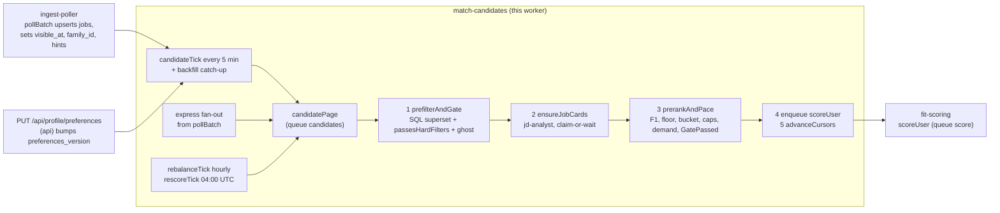

# Worker spec: `match-candidates` (candidate generation)

Revision 1, 2026-10-25. Tier: standard. Process: `worker` (DBOS queue `candidates`, schedules `candidateTick`, `rebalanceTick`, `rescoreTick`). Agent invoked: `jd-analyst`. Implements `04-matching.md` sections 3, 5 to 9, 12 and 16, `01-architecture.md` B.7.2 to B.7.6, and the `match-candidates` row of Part C.2. Database domain: `catalog-matching` (`02-database.md` section 7.2). Owning code: `server/src/modules/matching/` (`candidates.ts`, `eligibility.ts`, `prefilter.ts`, `hard-filters.ts`, `gate.ts`, `f1.ts`, `pacing.ts`, `select.ts`, `config.ts`) and `server/src/modules/catalog/cards.ts` (`ensureJobCards`).

Tags: **[V]** verified in a foundation document or the S-D1 spike; **[est]** an estimate to be replaced by beta measurements; **[S-D1]** a change forced by the S-D1 spike corrections; **[new]** a clarification or addition this document makes to a foundation document (all are listed in section 13).

---

## 1. Purpose and place in the lifecycle

`match-candidates` turns "a job exists" and "a user wants jobs" into a short, ordered, budgeted list of `GatePassed` pairs for the `fit-scoring` worker. It is the only place where the fit gate (INV-1) and the money controls on scoring (per-user daily scoring cap, pipeline spend cap, token bucket, demand budget) are applied before a model is called.



What it reads: `profiles`, `user_match_state`, `subscriptions` (through `effective_plan`), `credit_balances`, `session`, `facts`, `employments`, `user_daily_usage`, `jobs`, `companies`, `matches`, `applications`. What it writes: `user_match_state`, `user_daily_usage.filtered`, the card columns of `jobs`, and, in backfill only, `matches.status` through `reconcileMatchesForPrefs`. It never inserts a `matches` row (that is `scoreUser`'s chunk transaction) and never calls a model except `jd-analyst`, which sees public posting text only.

Invariants owned here: INV-1 (no model call for a pair that fails the gate), the pacing half of INV-10 (limits come from `shared/src/plans.ts` only), and the freshness service levels of `04-matching.md` section 13.

---

## 2. Trigger, schedule and payload (a TypeScript type), plus the idempotency key

### 2.1 Workflows

| Workflow | Kind | Trigger | Workflow id (idempotency key) | Queue and priority | Timeout |
|---|---|---|---|---|---|
| `candidateTick` | scheduled, worker only | every 5 minutes (`*/5 * * * *`); DBOS runs each interval once across replicas [V] | DBOS schedule id; `tickEpoch = floor(scheduledTime / 300 s)` | none | 1 min |
| `candidatePage`, mode `incremental` | queue | `candidateTick` | `cand:<tickEpoch>:<cohort>:<page>` | `candidates`; Max 10, Pro 20, Starter 30, Free 40 | 5 min |
| `candidatePage`, mode `backfill` | queue | `PUT /api/profile/preferences` (api, fire and forget); the backfill catch-up of `candidateTick` | `backfill:<userId>:<prefsVersion>`; eligibility-triggered variant `backfill:<userId>:<prefsVersion>:first` **[new]** | `candidates`; 15 | 5 min |
| `candidatePage`, mode `express` | queue | `pollBatch` after upserting a priority company (`enqueueExpressPages`) | `express:<companyId>:<epochMinute>:<page>` | `candidates`; 5 | 5 min |
| `rebalanceTick` | scheduled | hourly at minute 05 | schedule id | none | 1 min |
| `candidatePage`, mode `rebalance` | queue | `rebalanceTick` | `rebal:<userId>:<localDate>` | `candidates`; 35 | 5 min |
| `rescoreTick` | scheduled | daily 04:00 UTC | schedule id | none | 1 min |
| `candidatePage`, mode `rescore` | queue | `rescoreTick` | `rescore:<userId>:<factsVersion>` | `candidates`; 45 | 5 min |

The architecture's trigger line for this worker names the tick and the backfill; `express`, `rebalance` and `rescore` are the other three modes of the same `candidatePage` workflow defined in `04-matching.md` section 5.1 and are owned here.

### 2.2 Queue registration **[S-D1]**

Queues are database-backed and registered after launch; `partitionQueue` and `concurrency` do not exist in 5.3.0.

```ts
// server/src/durable/queues.ts (excerpt)
await DBOS.registerQueue("candidates", {
  globalConcurrency: 4,        // was "concurrency" in 01 B.5.3
  workerConcurrency: 2,        // per replica
  priorityEnabled: true,       // 01 lists priorities for this queue but not the flag [new]
});
// Enqueue onto "score" (partitioned by user): every enqueue must pass the partition key.
```

`candidates` is not partitioned. Two pages that contain the same user (a tick page and a backfill) are serialized by the row lock of step 3, not by the queue.

### 2.3 Payload

```ts
// server/src/modules/matching/candidates.ts
export type PlanId = "free" | "starter" | "pro" | "max";
export type CandidateMode = "incremental" | "express" | "backfill" | "rebalance" | "rescore";

/** Superset of 04-matching 5.1: every added field is an id, enum, integer or ISO date, so the ids-only rule (B.5.6) holds. */
export interface CandidatePageInput {
  mode: CandidateMode;
  userIds: string[];            // 1..100, one cohort (backfill, rebalance, rescore: exactly 1)
  cohort: PlanId;               // used for the workflow id and priority [new]
  tickEpoch?: number;           // incremental
  page?: number;                // incremental, express: 0-based
  windowUpperIso?: string;      // incremental: now() - 15 s at tick start, fixed so a replay sees the same window
  jobIds?: string[];            // express: new or changed jobs of one priority company (1..500)
  companyId?: string;           // express
  prefsVersion?: number;        // backfill: profiles.preferences_version that started it
  firstEligibility?: boolean;   // backfill: the ":first" variant, skips reconcileMatchesForPrefs [new]
  factsVersion?: number;        // rescore
  localDate?: string;           // rebalance: YYYY-MM-DD in the user's time zone
  shadow: boolean;              // MATCHING_V2 shadow phase, section 12 [new]
}

export interface CandidateTickInput { scheduledTimeIso: string; startTimeIso: string }   // DBOS schedule arguments

/** Handed to scoreUser (fit-scoring). Contract proposed here; see section 13 item 6. */
export interface ScoreUserInput {
  userId: string;
  runId: string;                                   // candidatePage workflow id (+ ":<n>" when a run is split into groups of 20)
  mode: CandidateMode;
  pairs: { jobId: string; f1: number; selection: Selection }[];   // 1..20; f1 integer 0..100
  windowFromIso: string | null;                    // lets a failed scoreUser roll the cursor back (D-21)
  prefsVersion: number;
  shadow: boolean;
}
```

### 2.4 Idempotency

| Effect | Key | Mechanism |
|---|---|---|
| A page runs once | the workflow ids above | DBOS: a second start with the same id returns the existing workflow [V S-D1 check 3] |
| A scoring run starts once | `score:<userId>:<runId>` with partition key `<userId>` | same; `runId` is the page's workflow id, so a replayed page re-enqueues the same ids |
| A pair is scored once | `UNIQUE (user_id, job_id)` and the family exclusion on `matches` | `ON CONFLICT DO NOTHING` in `scoreChunk`; steps 1 and 3 re-check `matches` |
| A card is created once per job version | `jobs.card_claimed_until` plus `card_content_hash` | claim-or-wait, section 3.4 |
| Cursor only moves forward on success | `cursor_at` written last, in step 5 | a terminally failed page leaves it unchanged |
| Bucket tokens spent once | step 3 is a datasource transaction (exactly-once, S-D1) under `user_match_state ... FOR UPDATE` | DBOS plus row lock |

Forking a page from step 0 (the `dbos-version-migrate` procedure, rule D1) is safe: every step recomputes from the database, step 3 re-reads counters under the row lock, and nothing is written outside idempotent statements. **[S-D1]** (`forkWorkflow` replays from step 0.)

---

## 3. Algorithm, step by step: for every step name the tables and columns read and written, the agents invoked and the external calls made

### 3.1 `candidateTick` (workflow body, about 16 checkpoint writes)

| # | Step | Kind | Reads | Writes | Agents | External calls |
|---|---|---|---|---|---|---|
| T0 | Gate | body | `ops_flags` via `ops_flag_on('pause_scoring')`, `ops_flag_on('llm_paused')`, `feature_flags` (`MATCHING_V2`) | none | none | none |
| T1 | `selectDueUsers` | datasource tx (read only) | `user_match_state`, `profiles`, `subscriptions` (`effective_plan(plan, status, past_due_since)`), `credit_balances`, `session`, `facts`, `user_daily_usage`, `matches` | none | none | none |
| T2 | `selectBackfillCatchUp` | same tx | `profiles.preferences_version > user_match_state.prefs_version`, or `first_eligible_at IS NULL` and every eligibility condition now true | none | none | none |
| T3 | Enqueue | body | T1 and T2 outputs | DBOS: one workflow row per page and per backfill | none | none |

T1 is the SQL of `04-matching.md` section 5.5 with these exact rules:

- Plan is `effective_plan(s.plan, s.status, s.past_due_since)` so a lapsed paid plan is paced as Free (INV-10).
- `ums.next_match_at <= now()`; `ORDER BY` plan rank (Max, Pro, Starter, Free), then `next_match_at`; `LIMIT 5000` (`matching.tick_user_limit` **[new]**, default 5000).
- Conditions 1 to 8 of the eligibility table are in SQL; condition 9 (unread matches) is evaluated in step 3 because it needs the demand budget.
- When the `score` queue has more than 5,000 waiting workflows (read from `durable.queueStats()`), T1 adds `AND NOT EXISTS (SELECT 1 FROM matches m WHERE m.user_id = ums.user_id AND m.status = 'new')`, which is the back-pressure rule of B.11.3.
- Users without a `user_match_state` row are not selected; reconciler M-1 (`catalog-tick`) creates the row within 5 minutes [V 02 section 8.5].

T2 exists because `PUT /api/profile/preferences` enqueues its backfill fire-and-forget and returns 200 even if the enqueue failed (`05-api.md`), and because facts are confirmed after preferences for some users. It enqueues `backfill:<userId>:<prefsVersion>` when `preferences_version` is ahead, and `backfill:<userId>:<prefsVersion>:first` **[new]** once for a user whose `first_eligible_at` is null and who has just become eligible (the bare id would be rejected as a duplicate when the preferences were saved before any fact was confirmed and the first backfill ended as a no-op).

T3 chunks each cohort into pages of 100 and starts `candidatePage` workflows. The page arrays are the tick's step output (ids only; typically about 650 user ids, at most 5,000, at most about 200 KB).

**Cadence arithmetic [new].** After a run, `next_match_at = tickStartedAt + cadence - 30 s`, not `now() + cadence`. With `now()` a Max user processed at tick T gets `T + 5 min + a few seconds`, misses tick `T + 5 min` and runs every 10 minutes. With the 30-second slack each cohort runs on exactly every first, third or twelfth tick (Max, Pro, Starter and Free).

### 3.2 `candidatePage` (all modes)

Every step is ids-only. Step outputs are counts and compact index tuples, never text.

| # | Step | Kind | Notes |
|---|---|---|---|
| 1 | `prefilterAndGate` | plain step (`DBOS.runStep`), read only, retries 4 | section 3.3 |
| 2 | `ensureJobCards` | plain step, effects idempotent by the claim | section 3.4 |
| 3 | `prerankAndPace` | datasource transaction on `kairos` (exactly-once) | section 3.5 |
| 4 | enqueue `scoreUser` | workflow body, one `DBOS.startWorkflow` per user | section 3.6 |
| 5 | `advanceCursors` | datasource transaction | section 3.7 |

Checkpoint cost: 6 fixed writes, plus 1 + 1 + 2 + 2 for the four steps, plus one row per enqueued `scoreUser`: 12 writes plus `N` enqueues **[S-D1: 04 and 01 B.5.7 assumed 7]**.

### 3.3 Step 1 `prefilterAndGate`

1. **Mode and flags.** Return a no-op result when `ops_flag_on('pause_scoring')` or `llm_paused`. When `shadow` is true, read exclusion and counters from `matches_shadow` instead of `matches` and `user_daily_usage` (section 12).
2. **Load per-user context** for `userIds` in four queries (no per-user loops): `profiles` (`preferences`, `preferences_version`, `facts_version`, `timezone`); `user_match_state` (all columns); plan and `credit_balances` and `session` recency; `user_daily_usage` for today and the previous three days; confirmed-fact count through `facts_user_confirmed_idx`. A zod parse of `preferences` failing is a per-user error (section 5).
3. **Re-evaluate eligibility** with `evaluateEligibility(snapshot, plan, now)` (shared with `GET /api/usage/today` so both produce the same `pausedReason`). Backfill, rebalance, express and rescore do not come through the tick SQL, so conditions 1 to 8 are checked here for them. An ineligible user produces `{ eligible: false, pausedReason }` and takes no further part; the reason is counted in `matching_users_paused{reason}`.
4. **Per-company cap counts.** One `companyApplicationCounts(userIds)` query (`04-matching.md` 6.3) over `applications_company_cap_idx`, statuses `draft`, `approved`, `submitting`, `submitted`, last 30 days.
5. **SQL superset prefilter**, one query per user, at most 2 in parallel per page (the worker pool is 12 connections through PgBouncer, B.4.2). `buildPrefilterQuery` is the SQL of `04-matching.md` 6.2 plus two clauses **[new]**: `JOIN companies c ON c.id = j.company_id AND c.active` (imported jobs of an unreviewed company must not reach other users, `04-matching.md` 2.8; this is a policy predicate outside the superset claim and is covered by its own test), and `ORDER BY j.visible_at, j.id LIMIT :survivorCap` for the `window` and `jobs` scopes (`matching.max_survivors_per_run`, default 400). Scope per mode:

   | Mode | Scope | Lower bound | Retrieval order |
   |---|---|---|---|
   | `incremental` | `window` | `greatest(cursor_at - 2 min, now() - matching.window_max_hours)`; `window_max_hours` default 72 **[new]** so a user returning after a month does not scan a month of jobs (backfill and rebalance cover older jobs) | `visible_at` ascending |
   | `express` | `jobs` (the listed ids) | none | none |
   | `backfill` | `open`, `visibleSince = null` | none | `ts_rank_cd(search_tsv, :q) DESC, visible_at DESC`, `LIMIT min(4 x K, 400)` with `K` from section 3.5 computed first |
   | `rebalance` | `open`, `visibleSince = now() - 14 days` | none | same |
   | `rescore` | no prefilter: rows come from `matches` (below) | none | none |

   `statement_timeout` is set per query with `SET LOCAL`: 5 s for window and jobs scopes, 10 s for open scopes. A timeout is a per-user error.
6. **Truncation.** If a window query returns exactly `survivorCap` rows, the user is marked `truncated` and the cursor (step 5) moves only to the last returned `visible_at`; `next_match_at` is set to `now()` so the next tick continues. This bounds work after an outage without leaving a gap.
7. **Load gate inputs for the union of survivors** in chunks of 200: `jobs` (`id`, `company_id`, `family_id`, `title`, `location`, `remote`, `description_text`, `salary_max_usd`, `ghost_verdict`, `visible_at`, `injection_suspect`) and `companies.name`. Descriptions are fetched once per page for the union, not per user; the prefilter itself never reads `description_text`.
8. **Gate.** `gate(job, prefs, ctx)` (`04-matching.md` 6.4): the unchanged `passesHardFilters` (moved to `matching/hard-filters.ts` and re-exported from `services/fit.ts`), reasons ordered by FR-17, plus `Likely ghost posting` for `ghost_verdict = 'likely'`. Excluded companies and excluded keywords are only checked here (SQL is looser, which keeps the superset property). Rejections increment per-reason counters.
9. **Rescore mode only:** instead of steps 5 to 7, read the user's `matches` created in the last 21 days with `status IN ('new','below_bar')` on open jobs, then run `gate()` on them with the current preferences (INV-1 applies to re-scores: a pair that no longer passes is never sent to the model).

**Output:** per user `{ userId, eligible, pausedReason, windowFromIso, truncated, lastVisibleIso, gatePassedJobIdx[] }`, the distinct gate-passed `jobIds` (at most 3,000), and counters `{ survivors, gatePassed, rejectedByReason }`. If the pair total would exceed 3,000 the lowest-priority users are marked `truncated`.

Tables read: `profiles`, `user_match_state`, `subscriptions`, `credit_balances`, `session`, `facts`, `user_daily_usage`, `matches` (or `matches_shadow`), `applications`, `jobs`, `companies`. Written: none. Agents: none. External calls: none.

### 3.4 Step 2 `ensureJobCards`

Input: the distinct gate-passed job ids. For backfill and rebalance the set is bounded to `min(4 x K, 400)` by the retrieval limit. Per job (up to 8 in parallel):

1. **Fresh card:** `card IS NOT NULL AND card_version = <jd-analyst promptVersion> AND card_content_hash = content_hash` is used as is.
2. **Family reuse:** a job with the same `family_id` and `description_hash` and a fresh card (through `jobs_family_idx`) is copied: `UPDATE jobs SET card, card_version, card_content_hash = content_hash`. No model call.
3. **Per-company hourly bound:** at most `matching.card_max_per_company_hour` (100) cards per company per hour, counted from `jobs.card_content_hash` writes in the last hour; beyond that the job is `deferred`.
4. **Claim:** `UPDATE jobs SET card_claimed_until = now() + interval '60 seconds' WHERE id = $1 AND (card IS NULL OR card_version < $v OR card_content_hash IS DISTINCT FROM content_hash) AND (card_claimed_until IS NULL OR card_claimed_until < now()) RETURNING id`.
5. **Winner** calls `runAgent(jdAnalyst, { title, location, descriptionFenced }, ctx)` with the description cut to 2,500 tokens (head 2,000, tail 500) inside the per-call nonce fence. Context: `budgetClass: "ops"`, `workspace: "batch"` (the background key `ANTHROPIC_KEY_BATCH`, not the Batch API), `jobId`, `inputRefs: [jobId]`, `callKind: "primary"`, no user id. Gateway ladder per `03-agent-runtime.md`: SDK retry, one repair, Sonnet 5.5 for at most 2% of the day's calls, then defer. `postValidate` normalizes terms through `normalizeTerm`. Then one transaction writes `card`, `card_version`, `card_content_hash`, adds card keywords to `search_tsv` with weight B, and sets `card_claimed_until = NULL`. An `injection_echo` result sets `jobs.injection_suspect = true`.
6. **Loser** (claim held by another run, `card_claimed_until` at most 90 s ahead) re-reads every 500 ms for up to 15 s, then throws a retryable `KairosStepError("card_wait")`; DBOS retries the step after 10 s.
7. **Backoff marker [new]:** on terminal `jd-analyst` failure the winner sets `card_claimed_until = now() + interval '6 hours'` instead of clearing it. A loser that sees a claim more than 90 s ahead does not wait: it marks the job `deferred` immediately. A poison posting therefore costs at most four attempts a day.
8. **Envelope:** at 100% of the `jd-analyst` daily envelope ($11 at growth, 03) or `agent_disabled:jd-analyst` or `llm_batch_paused`, every card needed is `deferred`.

A deferred job is dropped from the page's pairs, and every user who had it among their gate-passed pairs gets `holdCursor = true` (step 5), so the job is reconsidered next run (bounded by `window_max_hours`). Output: `{ fresh, familyReuse, created, deferred, waitTimeouts }` and the ids of deferred jobs.

Tables read: `jobs`, `companies`. Written: `jobs.card`, `card_version`, `card_content_hash`, `card_claimed_until`, `search_tsv`, `injection_suspect`; `llm_calls` and `llm_cost_daily` through the gateway ledger. Agent: `jd-analyst`. External call: Anthropic Messages API, public text only.

### 3.5 Step 3 `prerankAndPace` (one datasource transaction)

Inside the transaction, before taking locks, in memory:

1. **F1 pre-rank** per surviving pair: `computeF1(input, { mode: "prerank", unconfirmedCredit })` from the pair's card, the job title, `jobs.seniority_hint` (deterministic hint wins), the user's facts and `prefs.roles`/`seniority`. Facts are the user's confirmed facts (and, for cold start only, unconfirmed `asserted_by = 'import'` facts at half credit); terms come from `extractTerms` cached in a process-local LRU keyed `(userId, factsVersion)` (3,000 entries, about 5 MB). F1 never reads `resumeText` here.
2. **Floor and exploration.** Floor is `matching.f1_floor` (35), or `matching.f1_floor_cold_start` (20) while the user has fewer than `matching.cold_start_fact_goal` (8) confirmed facts. The exploration candidate is drawn with `rng = seeded(hash(userId, workflowId))`, probability `matching.explore_rate` (0.01), at most `matching.explore_max_per_user_day` (1) per UTC day.

Then, in order:

3. `SELECT ... FROM user_match_state WHERE user_id = ANY($page) ORDER BY user_id FOR UPDATE` (the single global lock order, 02 section 7.2.8). Lock hold time is the statements below, a few milliseconds.
4. **Re-read authoritative counters under the lock:** `user_daily_usage` (`scored`, `pipeline_usd`, `match_actions` for the last three days), the unread count `count(*) FROM matches WHERE user_id AND status = 'new'` (index-only on `matches_user_new_idx`), today's exploration count, per-company scored and open-`new` counts for the diversity rules, and `matches`/family existence for each pair (pairs already scored or in a family the user already has are removed).
5. **Condition 9:** if unread `new` matches exceed `2 x demandBudget`, the user is paused with `pausedReason = 'unread_matches'`; no pair is selected, `holdCursor = true`, and `next_match_at = now() + 60 min` (a longer back-off, since only a user action unpauses).
6. **Budget.** Refill `bucket_tokens = min(matching.bucket_burst (5), bucket_tokens + elapsedDays x matching.bucket_refill_factor (1.25) x plan.dailyScoringCap)`. Then `K = runAllowance(budget, mode, plan)` from `04-matching.md` 8.2: `min(floor(bucketTokens), capRemaining, floor(spendRemaining / fitScorer.expectedCostUsd), demandRemaining)` for incremental and express (`expectedCostUsd` = 0.00021 read from the agent registry); no bucket for backfill; `ceil(0.25 x cap)` bound for rebalance. `capRemaining = min(plan.dailyScoringCap, coldStart ? matching.cold_start_daily_cap (15) : infinity) - scored`. `demandBudget = clamp(10 + 2.5 x avg(match_actions, last 3 days), 10, plan.dailyScoringCap)`, and `min(plan.dailyScoringCap, matching.cold_start_demand_budget (40))` for the first `matching.cold_start_demand_days` (3) days after `first_eligible_at`. Rescore uses `K = min(matching.rescore_max_pairs (20), ceil(0.25 x plan.dailyScoringCap), capRemaining, spend bound)` against today's row **[new: 04 says "next UTC day"; the 04:00 UTC run already is that day, and the 25% share keeps Free users from spending their whole cap on re-scores]**.
7. **Selection.** `selectForScoring(candidates, K, floor, explore)` (`04-matching.md` section 9): order by F1 descending, then `visible_at` descending, then job id; one job per family (best location first); at most `max_scored_per_company_day` (4) and `max_open_new_per_company` (3) per company; never more from one company than its remaining application cap plus 1; round-robin across companies. Every selected pair goes through `admit(job, ctx, f1, floor, selection)`, the only constructor of `GatePassed`.
8. **Minimum batch.** If the user has 1 or 2 selected pairs and `now() - last_scored_at < matching.min_batch_wait_minutes` (60), nothing is enqueued, tokens are not spent and `holdCursor = true`; the pairs are re-derived next run (cadence at most 15 minutes for Pro, 5 for Max, so at most 12 re-derivations). With zero pairs the cursor advances normally.
9. **Writes:** `user_match_state` (`bucket_tokens` minus pairs, `bucket_at = now()`, `first_eligible_at` if null, `rebalanced_on` for rebalance, `top_gaps`: the five most frequent F1 `missing` requirement terms across the run's gate-passed jobs, public vocabulary only); `user_daily_usage` upsert adding the per-reason counters with `kairos_jsonb_add(filtered, delta)` (about 10 keys, under the 1 KB check). Bucket tokens are spent here; `scored` is not (that is `scoreChunk`).

**Output** per user: `pairs[{ jobId, f1, selection }]`, `status` (`selected`, `held`, `paused:<reason>`, `empty`, `error:<code>`), and counters `{ belowFloor, diversity, budget, bucket, cap, spend, demand }` for `matching_pairs_deferred_total`.

### 3.6 Step 4 enqueue `scoreUser`

For each user with pairs, in chunks of `matching.score_pairs_per_workflow` (20), the body starts `scoreUser` with `ScoreUserInput`, workflow id `score:<userId>:<runId>[:<n>]`, queue `score`, partition key `<userId>`, priority Max 10, Pro 20, Starter 30, Free 40, plus 5 for backfill **[S-D1: every enqueue to a partitioned queue must carry the key]**. Backfill runs enqueue the first group of at most `matching.backfill_sync_pairs` (15) pairs first and the rest as later groups at the same priority; **all backfill scoring goes through the `score` queue**, because `03-agent-runtime.md` section 10.5 rules out the Message Batches API for `fit-scorer` (it is not ZDR eligible), which supersedes `04-matching.md` 5.4 and 10.3 **[new]**. The enqueue loop is outside any step, as rule D2 requires; a crash resumes at the next enqueue.

### 3.7 Step 5 `advanceCursors` (datasource transaction)

Per incremental user not marked `holdCursor`: `cursor_at = greatest(cursor_at, windowUpper)` (or `lastVisibleIso` when truncated); `next_match_at = tickStartedAt + cadence - 30 s` (`now()` when truncated; `now() + 60 min` already set for unread-paused); `prefs_version = greatest(prefs_version, input.prefsVersion)` for backfill; `rescored_facts_version = input.factsVersion` for rescore. Express runs never move `cursor_at` or `next_match_at`. A user in `error:<code>` state gets only `next_match_at` advanced (so the failure is not retried in a tight loop) and an unchanged cursor.

The cursor is written last on purpose: a page that fails terminally before step 5 leaves it unchanged, and the next run re-derives the same pairs. A `scoreUser` that fails terminally later moves it back itself (`UPDATE user_match_state SET cursor_at = least(cursor_at, :windowFrom)`) and refunds `bucket_tokens` for unscored pairs; that is part of the `ScoreUserInput` contract (section 13 item 6).

### 3.8 Backfill step 0: `reconcileMatchesForPrefs`

Runs first in `backfill` mode unless `firstEligibility` is true. One datasource transaction applying the table of `04-matching.md` 12.1: `new` matches whose job now fails `gate()` become `expired`; raised `fitThreshold` moves `new` matches below the bar to `below_bar`; lowered threshold moves qualifying `below_bar` matches on open, gate-passing jobs to `new`; `queued` and `skipped` never change. Writes `matches.status` only, through `matches_status_guard_bu` (actor `user`). No model calls. Cost: one `UPDATE` per class, chunks of 1,000 rows.

---

## 4. Concurrency, rate limits, ordering, batching and priorities, with numbers at 10,000 users

At 10,000 users, 2,850 scoring-eligible (Free 900, Starter 975, Pro 720, Max 255) [V 01 B.7.1].

| Quantity | Value | Derivation |
|---|---|---|
| User-runs per day (upper bound) | 187,560 | Max 255 x 288 + Pro 720 x 96 + Starter and Free 1,875 x 24 |
| Pages per day (incremental) | about 1,880 | 187,560 / 100, minus partial pages; about 6.5 per tick |
| Users due per tick | 255 at ordinary ticks, 975 at every third, 2,850 at every twelfth | cohort cadence on a 5-minute grid |
| Pages at the heaviest tick | 29 | 2,850 / 100, split by cohort |
| `candidates` throughput | 4 pages at once (`globalConcurrency` 4, `workerConcurrency` 2 per replica, 3 to 4 replicas) | a page takes 2 to 4 s at base, 3 to 6 s at growth [V 04 19.2] |
| Time to drain the heaviest tick | 29 x 4 s / 4 = about 30 s (about 90 s at 3x peak) | leaves 3.5 minutes of the tick period free |
| DB parallelism per page | 2 prefilter queries, 1 transaction | worker pool is 12 per replica (B.4.2); two pages per replica use at most 6 |
| Prefilter queries per day | about 190,000 (2.2 per second), 1 to 5 ms each on `jobs_visible_open_idx` | 04 19.2 |
| Backfill and rebalance queries per day | about 2,950 at 50 to 600 ms | 100 backfills plus 2,850 rebalances |
| Express pages per day | about 1,200 at base, about 4,500 at growth **[est]** | priority-company change events x at most 3 pages of 100 Max users |
| `jd-analyst` calls per day | 2,362 base, 9,450 growth from this worker | B.7.1; 3,112 and 10,200 including imports and the workspace |
| Card concurrency inside a page | 8 | `LLM_MAX_CONCURRENCY` semaphore applies globally (03) |
| Ordering of pages on the queue | by priority number (lower first): express 5, Max 10, backfill 15, Pro 20, Starter 30, rebalance 35, Free 40, rescore 45 | 04 5.1 |
| Ordering inside a page | users sorted by `user_id` for the lock; pairs by F1, `visible_at`, job id | 02 7.2.8; 04 7.4 |
| Batching | pages of 100 users; at most 20 pairs per `scoreUser`; minimum batch 3 pairs or 60 minutes | 04 10.1 |

Rate limits that apply to this worker: the Anthropic RPM limiter and semaphores of the gateway (`LLM_RPM_HAIKU`, 03), the 100 cards per company per hour bound, and the `score` queue's `rateLimit` (1,200 per minute) on the enqueue side. There are no ATS or third-party HTTP calls.

Back-pressure inputs: `score` waiting above 5,000 narrows eligibility to users with no `new` matches (section 3.1); `prepare` p95 wait above 2 minutes pauses new `score` starts for 10 minutes, and the page still runs but step 4 delays its enqueues with a `DBOS.sleep` of up to 60 s per page (B.11.3); `pause_scoring` makes both ticks and pages no-ops; `llm_shed_level` follows 03 section 9.5: level 1 skips backfill beyond its first 15 pairs and all rescore pages; level 2 skips scoring pages for Free and Starter users and halves the bucket refill for Pro and Max; level 3 skips all scoring pages. A skipped page leaves cursors untouched, so the pairs are re-derived after the shed level drops (within the 72-hour window).

---

## 5. Retries, backoff, timeouts, dead-letter handling, poison messages and compensation

| Level | Policy |
|---|---|
| Workflow | `timeoutMS` 300,000 for `candidatePage`, 60,000 for ticks; `maxRecoveryAttempts: 5` (the SDK default of 100 would let a crashing page loop) **[new]** |
| Step 1 and 2 (plain steps) | `retriesAllowed: true`, `maxAttempts: 4`, `intervalSeconds: 10`, `backoffRate: 3` (10 s, 30 s, 90 s) |
| Step 3 and 5 (transactions) | same; a serialization failure or lock timeout (`lock_timeout` 3 s) retries |
| `ensureJobCards` loser | retryable `card_wait` after 15 s, step retry after 10 s |
| Anthropic | the gateway ladder (SDK retries 2, one repair, one tier up within 2%, else defer); a deferred card is not an error |
| Dead letter | DBOS has no dead-letter queue. A page that exhausts retries or recovery attempts ends `ERROR` or `MAX_RECOVERY_ATTEMPTS_EXCEEDED` and is listed by `stuck_workflows_v`. Nothing needs replaying: step 5 never ran, so every affected user keeps the old `cursor_at` and `next_match_at`, and the next tick selects them again |
| Poison input | A page whose input fails its zod schema throws a non-retryable `KairosStepError("invalid_input")` and ends immediately |
| Poison user | Corrupt `preferences` JSON, a zod failure, a prefilter timeout or an F1 exception is caught per user, produces `status = error:<code>` for that user only, logs the user hash and code, increments `matching_user_errors_total{code}`, advances only `next_match_at`, and never blocks the other 99 users of the page |
| Poison job | A posting that makes `jd-analyst` fail terminally is backed off for 6 hours through `card_claimed_until` (section 3.4 item 7); a posting that triggers the echo canary gets `injection_suspect = true` and is still matched |
| Compensation | Cursor rollback and bucket refund by a failed `scoreUser` (section 3.7). A lost `scoreUser` enqueue (terminal failure between step 3 and step 4) loses at most 5 bucket tokens: the cursor was not advanced, so the pairs are re-derived |
| Orphans | A page on a dead executor is recovered by `dbos-orphan-recovery` (cancel then resume, S-D1 check 2); a resumed page continues from its last completed step |
| Stale pages | A page whose `windowUpperIso` is older than 30 minutes when it starts (queue backlog) recomputes `windowUpper = now() - 15 s` for incremental users; it is state-conditional, so this is safe |

---

## 6. State transitions it performs and the invariants it must uphold (and how)

### 6.1 State this worker changes

| State | Transition | By |
|---|---|---|
| `user_match_state.cursor_at` | forward only (`greatest`), written last | step 5 |
| `user_match_state.next_match_at` | `tickStartedAt + cadence - 30 s` after a run; `now()` after truncation; `now() + 60 min` when unread-paused | steps 3 and 5 |
| `user_match_state.bucket_tokens`, `bucket_at` | refill then spend, bound 0 to 5 (`user_match_state_bucket_ck`) | step 3 |
| `user_match_state.first_eligible_at` | null to a timestamp, once | step 3 |
| `user_match_state.prefs_version`, `rescored_facts_version` | forward only | step 5 |
| `user_match_state.top_gaps`, `rebalanced_on` | overwritten | step 3 |
| `user_daily_usage.filtered` | counters added | step 3 |
| `jobs.card*`, `search_tsv`, `injection_suspect` | null to a card; card replaced when `content_hash` or the prompt version changes | step 2 |
| `matches.status` | `new` to `expired` or `below_bar`; `below_bar` to `new` | backfill step 0, actor `user` |

### 6.2 Invariants and how they hold

| Invariant | How this worker upholds it |
|---|---|
| INV-1 fit gate before any model call | `fit-scorer` accepts only a `GatePassed`, created only by `admit()`; `jd-analyst` runs only for jobs that passed `gate()` for at least one user; rescore re-gates. A lint rule forbids `as GatePassed`. Because a branded type does not survive JSON, `scoreUser` rehydrates each pair by re-running `gate()` with the current preferences before its first model call (section 13 item 6). Test `no-model-before-gate.test.ts` |
| Threshold, per-company cap, sponsorship | `passesHardFilters` unchanged; the cap count uses the same query for the prefilter and the gate; `queueMatch` and `approveCore` re-check at write time |
| Ghost | `ghost_verdict = 'likely'` is excluded in SQL and in `gate()`; `possible` passes with its evidence shown later; Autopilot's refusal of `possible` and `likely` is in `approveCore` |
| INV-10 plan limits | every number comes from `planFor(userId)` (`shared/src/plans.ts`); configuration keys are never plan limits; a grep test forbids literals |
| One match per (user, job) and per family | prefilter `NOT EXISTS` on `matches_user_family_idx`; `matches_user_job_uq` |
| No pair paid twice | `matches` re-check in steps 1 and 3; `scoreChunk` skips existing pairs; `score` partition concurrency 1 per user |
| Privacy of checkpoints | ids, enums, integers and ISO dates only (B.5.6); the PII scan test covers all workflows |
| No evasion, no mailbox, no LinkedIn | not applicable: no network call to an ATS or employer exists in this worker |

---

## 7. Failure modes table: cause, detection, user-visible effect, recovery

| Cause | Detection | User-visible effect | Recovery |
|---|---|---|---|
| Worker process crashes mid-page | executor heartbeat lapse; `durable.orphans` | none or a delay of a minute | orphan sweeper resumes from the last completed step; transactions are not repeated (S-D1 checks 1, 2, 7) |
| Postgres briefly unavailable | step errors; `pg` pool errors | feed delayed | step retries (10 s, 30 s, 90 s); then the page ends `ERROR` and the next tick re-selects the users |
| Duplicate tick or page | DBOS id uniqueness | none | second start returns the existing workflow |
| Anthropic 429 or outage (`jd-analyst`) | `llm.calls.jd-analyst.error`, breaker open | jobs lacking a card are not matched; matches for jobs with cards continue | cards deferred, cursors held, retried next run; `llm_paused` stops them cleanly |
| `jd-analyst` envelope reached | envelope metric at 100% | new jobs unmatched until 00:00 UTC | cards defer, cursors held up to 72 h; backlog drains the next day within per-company hourly bounds |
| Card claim holder dies | `card_claimed_until` expires after 60 s | none | next claimant succeeds |
| Poison posting | `card_wait` or terminal failure counts | one job unmatched | 6-hour backoff marker; operator can null `card_claimed_until` after fixing |
| Corrupt preferences for one user | `matching_user_errors_total{code=invalid_prefs}` | that user's feed stalls | the preference save path validates with `preferences_valid()`; data fix; other users unaffected |
| Preference save but enqueue lost | `preferences_version > prefs_version` | up to 5 minutes without a backfill | tick catch-up (T2) |
| Window overlap and commit-order skew | `matching_window_skew_total` | none | 2-minute overlap plus `matches` re-check |
| Large backlog after outage | `matching_window_truncated_total` | feed catches up in steps | truncation protocol (section 3.3 item 6), 72-hour cap |
| User paused for unread matches | `matching_users_paused{reason=unread_matches}` | `GET /api/usage/today` shows the reason | resumes after the user acts; cursor held, window capped at 72 h |
| Stale hints during a `HINTS_VERSION` refresh | `jobs_hints_stale_idx` count | none | SQL treats stale flags as unknown, so only more rows pass; the gate in TypeScript decides |
| `score` queue backlog above 5,000 | `durable.queue.pending{score}` | users with open matches wait | narrowed eligibility, section 3.1; replica added per the runbook |
| Cache or fact-term LRU stale | factsVersion mismatch | none | keyed by `(userId, factsVersion)` |
| Shadow mode divergence | shadow comparison dashboard | none (shadow) | section 12 exit criteria |

---

## 8. Observability: logs, metrics, traces and alerts with thresholds

**Logs** (pino JSON, one line per page, user hash only): `candidate page` with `workflowId`, `mode`, `cohort`, `users`, `eligible`, `survivors`, `gatePassed`, `cardsCreated`, `cardsDeferred`, `pairsSelected`, `held`, `truncatedUsers`, `errors`, `durationMs` per step. Preferences, facts, excluded keywords and job text are never logged; SQL parameters are not logged.

**Traces**: span `matching.candidatePage` (attributes `kairos.mode`, `kairos.cohort`, `kairos.users`, `kairos.pairs`), child spans per step, and the DBOS workflow and step spans (B.11.4); `kairos.run_id` links to `scoreUser`. Sampling 1% for `candidatePage` (06-infrastructure.md section 6.3).

**Metrics** (04 section 20 names plus new ones, written to `metrics_minute`):

| Metric | Type | Labels |
|---|---|---|
| `matching_candidate_page_seconds` **[new]** | histogram | `mode`, `step` |
| `matching_tick_lateness_seconds` **[new]** | gauge | none (actual start minus scheduled time) |
| `matching_cursor_lag_seconds` **[new]** | gauge p95 | `plan` (now minus `cursor_at` for eligible users) |
| `matching_prefilter_survivors_total`, `matching_gate_rejections_total`, `matching_f1_keep_ratio`, `matching_pairs_selected_total`, `matching_pairs_deferred_total`, `matching_cards_total`, `matching_users_paused` | as 04 | as 04 |
| `matching_user_errors_total` **[new]** | counter | `code` |
| `matching_window_truncated_total`, `matching_batch_held_total`, `matching_window_skew_total` **[new]** | counter | `plan` |
| `matching_feed_lag_seconds`, `matching_poll_lateness_seconds` | as 04 | as 04 |

**Alerts** (email, standard tier; proposed ids to add to `ALERT_RULES` in `06-infrastructure.md`):

| Id | Condition | For |
|---|---|---|
| A-MATCH-1 | no `candidateTick` completed in 12 minutes, or `matching_tick_lateness_seconds` above 120 | 10 min |
| A-MATCH-2 | `matching_cursor_lag_seconds` p95 above 20 min for Max, 45 for Pro, 130 for Starter and Free | 30 min |
| A-MATCH-3 | `matching_feed_lag_seconds` p95 above 2x the section 13 targets of 04 | 1 h |
| A-MATCH-4 | card `wait_timeout` above 1% of card requests, or `deferred` above 5% | 1 h |
| A-MATCH-5 | `matching_user_errors_total` above 20 in an hour, or 5 distinct users with the same code | 1 h |
| A-MATCH-6 | `candidatePage` workflows in `ERROR` or `MAX_RECOVERY_ATTEMPTS_EXCEEDED` above 3 in an hour | 1 h |
| existing | A-DUR-7 (`score` waiting above 5,000), A-LLM-5 (`jd-analyst` schema failures), A-LLM-2 and A-LLM-3 (envelope) | as 06 |

Escalation: if A-MATCH-1 is still firing after 60 minutes the whole product has stopped matching; the on-call treats it as a page by hand (the worker is standard tier, so no automatic page).

---

## 9. Capacity and cost at 10,000 users: runs per day, CPU and memory, model cost per day

| Item | Base (2,000 companies) | Growth (10,000 companies) |
|---|---|---|
| Incremental pages a day | about 1,880 | about 1,880 |
| Express pages | about 1,200 [est] | about 4,500 [est] |
| Rebalance, backfill and rescore pages (1 user each) | about 3,850 | about 3,850 |
| Prefilter queries | about 190,000 | about 190,000 |
| Gate evaluations | about 256,500 passes from about 350,000 survivors | about 1,026,000 from about 1,400,000 |
| F1 evaluations | about 256,500 | about 1,026,000 |
| Page duration | 2 to 4 s | 3 to 6 s |
| Worker CPU | about 6,000 to 8,000 CPU-seconds a day, under 0.1 vCPU average, bursts of 1 vCPU for 30 s every 5 minutes | about 3x that, still under 0.3 vCPU average |
| Memory per replica | under 200 MB | under 300 MB (page descriptions plus the fact-term LRU) |
| Postgres load | under 0.5 vCPU | under 1 vCPU |
| Checkpoint writes a day | about 70,000 | about 130,000 |
| `jd-analyst` calls (this worker) | 2,362 | 9,450 |
| Model cost a day | $1.72 (2,362 x $0.00073) | $6.90 |
| Per submitted application | $0.00010 (17,600 a day) | $0.00034 (20,200 a day) |
| Anthropic calls to `fit-scorer` | none here; the scoring cost belongs to `fit-scoring` | none |

Checkpoint writes at growth: `candidateTick` 288 x 16 = 4,600; incremental pages 1,880 x 12 = 22,600; `scoreUser` enqueue rows about 19,000; express 4,500 x 12 = 54,000 (an upper bound; the bound assumes 3 pages per event); single-user pages 3,850 x 12 = 46,000; total about 146,000, reduced to about 130,000 when express events average fewer than 3 pages. That is about 7 writes per submitted application, 11% of the 60 target and about 12% of the 1.1 M a day budget [S-D1]. If express fan-out grows, coalesce all priority companies of one `pollBatch` into one page set (the id would then use the batch id instead of the company id).

The $0.00010 to $0.00034 sits inside the architecture's all-in $0.0076 (B.12): the `jd-analyst` share is already counted in the 04 funnel.

---

## 10. Security and privacy notes

- **Data minimization.** The only Anthropic call is `jd-analyst` over public posting text; no user data, preference, fact or identifier is sent. Zero-data-retention terms are therefore not a dependency for this worker, and `jd-analyst` on public text is the one agent allowed on the Batch API (used for catalog re-analysis by the catalog code, not here).
- **Checkpoints.** Inputs and outputs hold uuids, text ids, enums, integers and ISO dates. No preference text, fact text, excluded keyword or company name enters a step output; `top_gaps` is public vocabulary and is written to the database, not returned. The CI PII scan seeds markers in preferences and facts and fails on any hit in `kairos_dbos`.
- **Sensitive preferences.** `workAuthorization` is reduced to the boolean `needsSponsorship` before it is used in SQL and never logged; excluded keywords and companies are bound parameters; logs carry the user hash (`USER_HASH_KEY`), never the id or the email.
- **SQL safety.** Every prefilter value is a bound parameter; `LIKE` patterns are built by `escapeLike`; the tsquery is `plainto_tsquery` over parameters, so a role named `' | drop` cannot change the query. Array sizes are bounded by `preferencesSchema` (10 roles, 20 locations, 100 keywords, 200 companies); the builder rejects more than 80 LIKE patterns and treats it as a per-user error.
- **Untrusted input.** Job descriptions are untrusted: `jd-analyst` receives them fenced with a per-call nonce and an echo canary; `postValidate` drops strings that are long, contain URLs or email addresses, or contain instruction-like phrases; `jobs.injection_suspect` only restricts Autopilot; the card never feeds the gate, and deterministic hints win over card fields.
- **Roles.** The worker role `kairos_worker` has `SELECT` on the tables above, `UPDATE` on `user_match_state`, the card columns of `jobs` and `matches.status`, and `INSERT/UPDATE` on `user_daily_usage` (02 section 4). The api role never runs this code; the applier role has no access.
- **Isolation.** Pages carry up to 100 users but every statement is keyed by user id; step 3 has no cross-user write except the shared `jobs` card. The cross-tenant scan (INV-11) already covers `matches`.

---

## 11. Tests (unit, integration, failure injection) and acceptance criteria

### 11.1 Unit

| Test | Asserts |
|---|---|
| `evaluateEligibility.test.ts` | each of the nine conditions yields its `pausedReason` in order; parity with the tick SQL (property test over generated snapshots) |
| `pacing.test.ts` | bucket refill and burst 5; `runAllowance` per mode; cold start (cap 15, floor 20, demand 40 for 3 days); cadence arithmetic keeps Max on every tick |
| `select.test.ts` | ordering, diversity, family best-location, exploration seeded by workflow id (replay gives the same pair) |
| `prefilter.test.ts` | SQL text for each preference shape; the survivor cap and truncation protocol |
| `hard-filters.test.ts`, `landing-fit-sample.test.ts` | unchanged `passesHardFilters` reasons and outcomes |
| `f1.property.test.ts` | monotonic, deterministic, unverifiable inputs never raise the score, display mode never credits unconfirmed facts |
| `cards.test.ts` | claim-or-wait with 10 concurrent callers makes one gateway call; loser timeout; backoff marker; family reuse; per-company hourly bound |

### 11.2 Integration (Testcontainers Postgres 18, DBOS launched)

| Test | Asserts |
|---|---|
| `prefilter-superset.int.test.ts` | 10,000 seeded fixtures: `passesHardFilters(x).pass` implies the prefilter returns `x`; at least 99% of SQL-expressible failures are excluded; the `companies.active` clause is tested separately |
| `no-model-before-gate.test.ts` | gateway spy: zero `fit-scorer` and `jd-analyst` calls for every hard-filter and ghost fixture; `jd-analyst` only for jobs that passed for at least one user |
| `candidates.window.int.test.ts` | commit-order skew inside the 2-minute overlap; 72-hour cap; truncation; cursor held on card deferral and on minimum-batch hold |
| `candidates.tick.int.test.ts` | cadence: Max runs on every tick for an hour, Pro every third, Starter every twelfth; heavy tick of 2,850 users drains in under 60 s with a stub gateway; catch-up T2 starts backfill once per version and the `:first` variant once |
| `candidates.backfill.int.test.ts` | reconcile table of 04 12.1; first 15 pairs enqueued first; remaining pairs on `score`, none on batch; allowance draws from the daily cap and never adds |
| `candidates.rescore.int.test.ts` | selection rules of 04 12.2; gate re-applied; no call when F1 did not move; Free-plan limit of 5 |
| `replay.int.test.ts` | kill the worker inside step 1, 2, 3 and between steps 3 and 5: no duplicate card call after the claim, no double bucket spend, cursor unchanged after a terminal failure |
| `shadow.int.test.ts` | with `shadow = true` no `user_daily_usage` counter and no `matches` row changes; pairs land only in `matches_shadow` |
| `pii-scan.test.ts` | markers seeded in preferences, facts and a posting never appear in `kairos_dbos` |

### 11.3 Failure injection

Process kill (`process.exit(137)`) at each step boundary (S-D1 harness); Postgres connection drop during step 3; Anthropic stub returning 429, a schema failure and a refusal for `jd-analyst`; a poison posting; corrupt `preferences` for one user in a page of 100; duplicate tick start; clock skew of 30 seconds on one replica; `pause_scoring` toggled mid-page; `score` queue stub reporting 6,000 waiting.

### 11.4 Acceptance criteria

1. Superset property: zero counterexamples in 10,000 fixtures; tightness at least 99%.
2. Zero model calls for gate-failing pairs (INV-1) across the whole fixture set.
3. Chaos run (phase P4 gate, S-D1 half 2): 50 forced worker kills during a scripted 200-user, 24-hour compressed day; zero duplicate `jd-analyst` calls beyond the claim race, zero double bucket spend, zero pairs scored twice, all workflows terminal.
4. Heaviest tick (2,850 users) completes in under 60 seconds with the stub gateway; no page above 30 seconds at 1.5x growth volume (04 19.3).
5. Freshness: feed lag and poll lateness targets of 04 section 13 met at p95 in staging at 1.5x growth.
6. `jd-analyst` calls within 20% of the cost model row D scaled to live users; card cost under $0.00034 per submitted application.
7. Shadow reproduces at least 90% of the old loop's above-bar matches after caps (phase P4 exit).
8. Checkpoint writes from this worker under 10 per submitted application.

---

## 12. Migration from the skeleton: which files it replaces and what is kept

| Skeleton | Fate |
|---|---|
| `server/src/jobs/score-matches.ts` (BullMQ job per posting; loops every user with preferences; per-user queries; scores every gate-passed pair) | Replaced by `candidateTick`, `candidatePage` and `scoreUser`. Drained queue by queue in phase P4 and deleted in P7 together with `QUEUES.scoreMatches` in `server/src/jobs/queues.ts` and `poll-boards.ts` producing `score-matches` jobs |
| `server/src/services/fit.ts`: `passesHardFilters`, `FitJob`, `SENIOR_TITLE`, `JUNIOR_TITLE`, `NO_SPONSORSHIP` | Kept with no change to logic or reason strings. `passesHardFilters` moves to `server/src/modules/matching/hard-filters.ts`; `services/fit.ts` re-exports it so `landing-fit-sample.test.ts` and `fit.test.ts` stay green. The three regexes are exported for `normalizePosting`. Its `scoreFit` is replaced by `fit-scorer` (fit-scoring worker) |
| `server/src/services/skills-dictionary.ts` | Becomes the seed of the shared vocabulary behind `normalizeTerm` and `extractTerms` |
| The per-company count in the old loop (every application status) | Replaced by `companyApplicationCounts` (statuses `draft`, `approved`, `submitting`, `submitted`) |
| `GET /api/matches` (`routes/matches.ts`) | Frozen and unchanged; reads `status = 'new'` |
| `profiles.preferences` save route | Gains the fire-and-forget `backfill:<userId>:<prefsVersion>` start (05-api) |

**Phase P4 rollout** (`MATCHING_V2`, `04-matching.md` section 22): (1) migrations and TypeScript backfill of job columns and families; (2) polling on DBOS (not this worker); (3) **shadow**: `candidateTick` and `candidatePage` run for real compute, including real `jd-analyst` cards, while `scoreUser` writes `matches_shadow` and the old loop keeps writing real matches. In shadow, `capRemaining` and `spendRemaining` are derived from today's `matches_shadow` row count x 0.00021 and from `matches_shadow` for the exclusion, so shadow never consumes a real user's `user_daily_usage` caps and never hides a pair the old loop already stored **[new]**; (4) cut-over by cohort (Max, Pro, Starter, Free) through `feature_flags.MATCHING_V2`; the old loop skips users whose bucket is cut over; (5) enable the express lane and the exploration slot; drop `matches_shadow`.

Exit gate for this worker: items 1 to 7 of section 11.4.

---

## 13. Additions requested: anything this worker needs that the foundation documents lack (or "none")

Foundation items this worker needs that are missing or inconsistent. Each is additive; none changes a frozen contract.

1. **Config keys** (`04-matching.md` section 23, `ops_flags` pattern `^(matching|catalog)\.` already allows them): `matching.window_max_hours` = 72, `matching.max_survivors_per_run` = 400, `matching.tick_user_limit` = 5000.
2. **Cadence formula** in `04-matching.md` 5.2 and `01-architecture.md` B.7.3: `next_match_at = tickStartedAt + cadence - 30 s` instead of `now() + cadence`, otherwise Max users run every 10 minutes.
3. **Backfill id variant** `backfill:<userId>:<preferencesVersion>:first` in `02-database.md` section 2 (workflow id list), for the first-eligibility backfill when the bare id was already used by a no-op run.
4. **Queue registration**: `candidates` needs `priorityEnabled: true` in `durable/queues.ts`; `globalConcurrency` replaces `concurrency`; no `partitionQueue` [S-D1]. Every enqueue to `score` and `autopilot` passes a partition key.
5. **`CandidatePageInput`** gains `cohort`, `tickEpoch`, `page`, `companyId`, `firstEligibility`, `localDate`, `shadow` (section 2.3).
6. **`ScoreUserInput` contract** for the `fit-scoring` spec: pairs with `f1` and `selection`; `windowFromIso` and `runId`; on terminal failure `scoreUser` rolls `cursor_at` back and refunds `bucket_tokens`; its first step re-runs `gate()` with current preferences and `admit()` (a `GatePassed` brand does not cross JSON); `scoreChunk` enforces the cap and spend inside its transaction (`scored + n <= cap`), because step 3 only reserves allowance; shadow runs skip `user_daily_usage` increments and write `matches_shadow`.
7. **Reconcile 04 with 03**: (a) `jd-analyst` daily envelope is $11 in `03-agent-runtime.md` and $8 base / $20 growth in `04-matching.md` 3.2; this document uses 03's $11. (b) `04-matching.md` 5.4 and 10.3 route backfill remainder and re-scores to Message Batches; 03 section 10.5 says `fit-scorer` never uses batch (not ZDR eligible). This document sends all scoring through the `score` queue.
8. **Policy predicate**: the prefilter joins `companies` and requires `c.active` (04 6.2 omits it, but 04 2.8 requires that imported jobs of unreviewed companies reach only the importing user). Add it to the superset test as a documented exclusion.
9. **Alerts and metrics** A-MATCH-1 to A-MATCH-6 and the new `matching_*` series (section 8) for `ALERT_RULES` and the saved dashboards.
10. **Rescore accounting**: `K = min(20, ceil(0.25 x cap), ...)` against today's row, replacing "next UTC day" in `04-matching.md` 8.2 and 12.2.
11. **DBOS workflow config**: `maxRecoveryAttempts: 5` for `candidatePage` and the ticks.
12. **Shadow-mode counters** (section 12): during `MATCHING_V2` shadow, caps come from `matches_shadow`.

Changes made here because of the S-D1 spike: queue registration and `globalConcurrency` (section 2.2); partition key on `score` enqueues (3.6); checkpoint arithmetic of 6 fixed writes plus per-step and per-transaction rows (3.2, 9); state-conditional steps for `forkWorkflow` replay from step 0 (2.4); `maxRecoveryAttempts` and recovery by cancel then resume (5); retention of `candidates` workflows after 2 days with `deleteWorkflows` (no change to this worker); `pg@8` and CJS `import dbosSdk from ...` apply to the implementation (no spec change).

Items marked **[est]** are replaced by beta measurements at the phase P8 load test.
