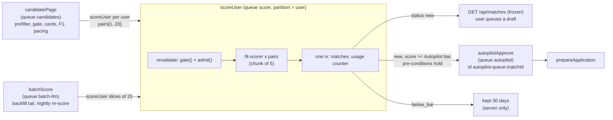
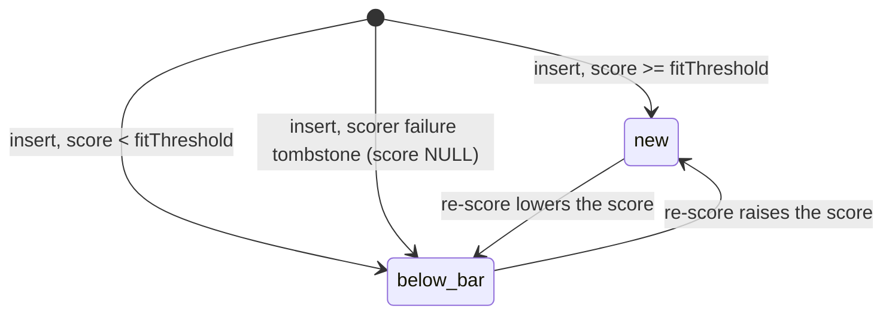

# Worker spec: fit-scoring (Fit scoring)

Revision 1, 2026-10-23. Tier: standard. Process: `worker`. Module: `server/src/modules/matching/` (files listed in section 12). Agent invoked: `fit-scorer` (Haiku 5.5, expected $0.00021 and at most $0.0006 per call, daily envelope $40, `tierUp: null`, `onFailure: "defer"`, `batchEligible: "never"`).

Inputs read in full: `04-matching.md`, `01-architecture.md` (B.5, B.6.3, B.6.4, B.7, B.9, B.11, Part C), `02-database.md` (sections 3.2, 7.1.9, 7.2.7, 7.2.8, 7.6, 8.3), `03-agent-runtime.md` (sections 2 to 9, 10.5), `_research/spike-s-d1-local.md`, and `06-infrastructure.md` sections 9.3 and 9.4. The `05-api.md` routes are not touched by this worker. The agent specs being written in `agents/` are referred to by id only.

Tags: **[S-D1]** marks a place that follows the Spike S-D1 correction table rather than the earlier text of `01-architecture.md`. **[verify]** marks an API detail that the Railway half of S-D1 must confirm. **[est]** is an estimate to be replaced by beta measurements.

---

## 1. Purpose and place in the lifecycle

`scoreUser` turns `GatePassed` pairs, chosen by `candidatePage` (worker `match-candidates`), into scored `matches` rows. It is the only place in the system where `fit-scorer` is called for the pipeline. For one user it renders the profile block, calls `fit-scorer` once per pair in chunks of 5, writes the `matches` rows and the usage counter in one transaction per chunk, and, for new matches at or above the user's Autopilot bar, hands the match to `autopilotApprove`.

It does four things and nothing else:

1. **Re-checks the fit gate at the point of spend.** `candidatePage` ran the gate seconds to minutes earlier. Preferences, caps, jobs and families can change in between, so every pair is re-gated (`gate()` then `admit()`) immediately before its model call (INV-1).
2. **Scores.** One `fit-scorer` call per pair, sequentially per user, so the cached profile block stays warm.
3. **Persists.** `matches` rows with status `new` (score at or above `fitThreshold`) or `below_bar`, the `user_daily_usage.scored` counter, and `user_match_state.last_scored_at`, in one transaction per chunk.
4. **Hands off to Autopilot.** For `new` matches that meet the Autopilot pre-conditions it starts `autopilotApprove`. It never writes an `applications` row, never approves, never sends.



Match status moves performed here, and only these (the `matches_status_guard` trigger of `02-database.md` 8.3 permits them for an unset actor):



`queued`, `skipped` and `expired` rows are never written by this worker (a user decision is never overridden; `expired` belongs to `closeJob` and `reconcileMatchesForPrefs`).

Out of scope: candidate generation, F1, caps and pacing (`match-candidates`), job cards (`jd-analyst`), the import scoring call (`POST /api/jobs/import` runs `fit-scorer` synchronously in the `interactive` workspace and writes its own `matches` row with `source = 'manual_url'`), and everything after the hand-off (`approval-autopilot`).

---

## 2. Trigger, schedule and payload (a TypeScript type), plus the idempotency key

### 2.1 Triggers

`scoreUser` has no schedule of its own. It is started by workflow bodies:

| Producer | Mode | Workflow started | Queue and priority |
|---|---|---|---|
| `candidatePage` step `prerankAndPace`, after `candidateTick` (every 5 minutes, per-plan cadence) | `incremental` | `scoreUser` | `score`, plan priority (Max 10, Pro 20, Starter 30, Free 40) |
| `candidatePage` after `pollBatch` of a priority company (express lane) | `express` | `scoreUser` | `score`, priority 5 |
| `candidatePage` backfill (preference save, first parsed resume): the first `matching.backfill_sync_pairs` (15) pairs | `backfill` | `scoreUser` | `score`, plan priority + 5 |
| `candidatePage` backfill: pairs beyond the first 15 | `backfill` | `batchScore` (which starts `scoreUser` slices) | `batch-llm`, then `score` at plan priority + 5 |
| `candidatePage` rebalance (`rebalanceTick` hourly, local 06:00 to 06:59) | `rebalance` | `scoreUser` | `score`, plan priority + 8 |
| `rescoreTick` (daily 04:00 UTC), through `candidatePage` mode `rescore` | `rescore` | `batchScore` | `batch-llm`, then `score` at plan priority + 10 |
| Admin `POST /api/admin/workflows/:id/resume` or `fork` | any | the same workflow | unchanged |

Lower priority numbers run first. The offsets 8 and 10 and the express priority 5 on `score` are additions of this document (section 13); `04-matching.md` fixes only the `candidates` priorities and "backfill +5" on `score`.

`batchScore` exists because of the contract name in `01-architecture.md` B.5.4, but at beta it does **not** use the Message Batches API. `03-agent-runtime.md` 10.5 closes Message Batches for every agent that sees personal data (29-day retention, outside zero data retention), and the registry test requires `fit-scorer.batchEligible = "never"`. This overrides "through the Message Batches API if the zero-data-retention terms allow" in `04-matching.md` 10.3 and `01-architecture.md` B.7.9. So `batchScore` is a thin, low-priority fan-out: it cuts a long pair list into slices of 20, starts one `scoreUser` per slice on the `score` queue, and returns. All model calls still go through `runAgent` on the synchronous Messages API in the `batch` Anthropic workspace (the key and spend limit, `ANTHROPIC_KEY_BATCH`; `is_batch = false`).

### 2.2 Payload types

All payloads are ids, enums, small integers and ISO timestamps, validated by a zod schema per workflow (`scoreUserInputSchema`, `batchScoreInputSchema`); the CI rule of `01-architecture.md` B.5.6 (no free-text string outside uuid, enum, date, hash or 64 characters) applies. No fact text, job text, reason text or score explanation is ever in a payload, a step output or a thrown error.

```ts
// server/src/modules/matching/score-types.ts
import type { CandidateMode, Selection } from "./candidates";

/** "import" pairs are scored synchronously by the workspace route and never reach this worker. */
export type ScoreSelection = Exclude<Selection, "import">;

export interface ScorePair {
  jobId: string;                 // uuid
  selection: ScoreSelection;     // written to matches.selection on insert; rescore keeps the existing value
  prerankScore: number;          // F1 at pre-rank, integer 0..100 (matches.prerank_score)
}

export interface ScoreUserInput {
  userId: string;                // from the database, never from a request body
  runId: string;                 // /^[a-z0-9][a-z0-9.-]{3,39}$/ , see 2.3
  mode: CandidateMode;           // incremental | express | backfill | rebalance | rescore
  bulk: boolean;                 // true for backfill beyond the first 15 pairs and for rescore: stopped by shed level 1
  target: "matches" | "matches_shadow";   // matches_shadow only during phase P4 step 3
  runStartedIso: string;         // fixed by the producing step; the replay guard of mode rescore
  windowStartIso: string | null; // incremental only: the cursor to restore on failure
  prefsVersion: number | null;   // backfill: profiles.preferences_version that started it
  factsVersion: number | null;   // rescore: profiles.facts_version that started it
  pairs: ScorePair[];            // 1..20, best first (F1 descending, then visible_at descending, then job id)
}

export interface ScoreUserResult {   // the workflow return value: counters only
  scored: number;                // rows inserted or updated with a score
  tombstoned: number;            // non-retryable scorer failures stored as score NULL rows
  dropped: number;               // pairs not scored: stale gate, closed job, family taken, card stale, below floor now
  handedOff: number;             // autopilotApprove workflows started
  costUsd: number;               // sum of AgentResult.totalCostUsd (information only; the ledger is llm_calls)
  stop: StopReason | null;
}

export type StopReason = "cap" | "spend" | "no_facts" | "ineligible" | "paused" | "shed";

export interface BatchScoreInput {
  userId: string;
  key: string;                   // /^[a-z0-9]{1,24}$/ : "b<prefsVersion>" for backfill, "s<factsVersion>" for rescore
  mode: "backfill" | "rescore";
  target: "matches" | "matches_shadow";
  runStartedIso: string;
  prefsVersion: number | null;
  factsVersion: number | null;
  pairs: ScorePair[];            // 1..400
}
```

The step output of `scoreChunk`, which is what DBOS checkpoints:

```ts
export interface ScoreChunkResult {
  settledJobIds: string[];       // written, tombstoned or dropped in this chunk; never retried in this run
  scored: number; tombstoned: number; dropped: number;
  billedPairs: number;           // pairs that reached at least one billed send: added to user_daily_usage.scored
  handoffMatchIds: string[];     // matches.id uuids that meet the Autopilot pre-conditions
  costUsd: number;
  stop: StopReason | null;       // when set, the run ends gracefully after this chunk
}
```

### 2.3 Idempotency keys

| Thing | Key | Mechanism |
|---|---|---|
| A scoring run | Workflow id `score:<userId>:<runId>` | DBOS: a second start with the same id returns the existing workflow |
| A bulk fan-out | Workflow id `batch:fit-scorer:<userId>:<key>` (`01-architecture.md` B.5.4 form `batch:<agent>:<batchKey>`) | Same. Its slices start `score:<userId>:<key>.<n>` for n = 0, 1, 2, ... |
| One pair | `UNIQUE (user_id, job_id)` (`matches_user_job_uq`) with `ON CONFLICT DO NOTHING` | Database. A replayed chunk cannot create a second row |
| One family per user | Chunk-time `NOT EXISTS` on `matches (user_id, family_id)` (index `matches_user_family_idx`) | Application check inside the same chunk, serialized per user by the queue partition |
| Autopilot hand-off | Workflow id `autopilot-queue:<matchId>` | DBOS dedup; the hand-off list is recomputed from table state on every run of the step, so a replay re-enqueues the same ids harmlessly |

`runId` is deterministic from the producing workflow id and a zero-based slice sequence, so a replayed producer step creates the same ids:

| Producer | `runId` |
|---|---|
| `candidatePage` incremental `cand:<tickEpoch>:<cohort>:<page>` | `i<tickEpoch>.<n>` |
| `candidatePage` express `express:<companyId>:<epochMinute>:<page>` | `x<epochMinute>.<companyId first 8 hex>.<n>` |
| `candidatePage` backfill `backfill:<userId>:<prefsVersion>` (first 15 pairs) | `b<prefsVersion>.<n>` (the tail uses the same prefix through `batchScore`, with higher `n`) |
| `candidatePage` rebalance `rebal:<userId>:<localDate>` | `r<yyyymmdd>.<n>` |
| `rescore:<userId>:<factsVersion>` through `batchScore` | `s<factsVersion>.<n>` with key `s<factsVersion>` |

The prefixes `i`, `x`, `b`, `r` and `s` are unique per producer family, so no two producers can create the same workflow id for one user.

---

## 3. Algorithm, step by step: for every step name the tables and columns read and written, the agents invoked and the external calls made

### 3.1 Workflow shape

```ts
// server/src/modules/matching/score-user.ts  (specification-level code)
import dbosSdk from "@dbos-inc/dbos-sdk";            // [S-D1] CJS package: default import, then destructure
const { DBOS } = dbosSdk;

async function scoreUserFn(raw: ScoreUserInput): Promise<ScoreUserResult> {
  const input = scoreUserInputSchema.parse(raw);
  const res: ScoreUserResult = { scored: 0, tombstoned: 0, dropped: 0, handedOff: 0, costUsd: 0, stop: null };
  let remaining = input.pairs.map((p) => p.jobId);
  let unbilled = 0;                                   // pairs that never reached a billed send (token refund, 3.4)
  try {
    for (let i = 0; i < MAX_CHUNKS && remaining.length > 0 && res.stop === null; i++) {   // MAX_CHUNKS = 6
      const out = await DBOS.runStep(
        () => scoreChunk(input, remaining.slice(0, CHUNK_PAIRS)),                         // CHUNK_PAIRS = 5
        { name: "scoreChunk", retriesAllowed: true, maxAttempts: 4, intervalSeconds: 10, backoffRate: 3 },   // retries after 10 s, 30 s, 90 s
      );
      if (out.settledJobIds.length === 0 && out.stop === null) break;                     // no progress guard
      remaining = remaining.filter((id) => !out.settledJobIds.includes(id));
      accumulate(res, out);
      unbilled += out.settledJobIds.length - out.billedPairs;
      for (const matchId of out.handoffMatchIds) {                                        // workflow body: D2 pattern
        await DBOS.startWorkflow(autopilotApprove, {
          workflowID: `autopilot-queue:${matchId}`,
          queueName: "autopilot",
          enqueueOptions: { queuePartitionKey: input.userId },   // [S-D1] the autopilot queue is partitioned: a key is mandatory [verify option names in 5.3.0]
        })({ kind: "from_match", matchId });
        res.handedOff += 1;
      }
    }
    unbilled += remaining.length;                      // pairs left when the run stopped
    if (needsFinalize(input, res, unbilled)) {
      await DBOS.runStep(() => finalizeRun(input, res.stop, unbilled), { name: "finalizeRun" });
    }
    return res;
  } catch (err) {
    await DBOS.runStep(() => compensate(input), { name: "compensate" });   // 3.5
    throw err;                                                              // workflow ends in ERROR
  }
}
export const scoreUser = DBOS.registerWorkflow(scoreUserFn, { name: "scoreUser" /* maxRecoveryAttempts: 5 [verify] */ });
```

Started with `timeoutMS: 300_000` (5 minutes, `01-architecture.md` B.5.4) by every producer. The loop is deterministic: it uses only the input and checkpointed step outputs. With 20 pairs at most, `MAX_CHUNKS = 6` leaves two spare iterations for chunks that stop early on a deadline.

### 3.2 Step list at a glance

| # | Step | Kind | Tables read | Tables written | Agent | External calls |
|---|---|---|---|---|---|---|
| 0 | zod validation | workflow body | none | none | none | none |
| 1 to n | `scoreChunk` (1 to 4 per run, usually 2) | plain step with one short write transaction inside | `ops_flags`, `profiles`, `subscriptions`, `credit_balances`, `user_daily_usage`, `user_match_state`, `facts`, `autopilot_settings`, `jobs`, `companies`, `matches`, `applications` | `matches`, `user_daily_usage`, `user_match_state`, `llm_calls` (by the gateway) | `fit-scorer` | Anthropic Messages API through `runAgent`; Postgres `kairos` through PgBouncer; DBOS checkpoint in `kairos_dbos` |
| after each | hand-off enqueue | workflow body | none | DBOS queue row | none | none |
| last (conditional) | `finalizeRun` | plain step | `user_match_state` | `user_match_state` | none | Postgres |
| on error (conditional) | `compensate` | plain step | none | `user_match_state` | none | Postgres |

Nothing in this worker reads Redis (removed), R2, Stripe, ATS hosts or the user's mailbox.

### 3.3 `scoreChunk`, sub-step by sub-step

One step call receives the validated input and the next up to 5 job ids. Everything below happens inside the step, in order. The step holds no database transaction open while it waits for the model: reads are autocommit, the model calls hold no connection, and a single short write transaction closes the step.

**C1. Kill switches and shed level** (reads `ops_flags` through `ops_flag_on(text)`, 10-second cache). Evaluated in this order; the first hit sets `stop` and the step returns without any call.

| Flag | Condition | `stop` |
|---|---|---|
| `pause_scoring`, `llm_paused`, `agent_disabled:fit-scorer` | any set | `paused` |
| `llm_shed_level` | level 1 and `input.bulk`; level 2 and plan is Free or Starter; level 3 for everyone | `shed` |

(Shed level 2 halving the Pro and Max rate is applied upstream by the token bucket in `candidatePage`.)

**C2. Load the run context** (autocommit reads, one round trip each, all filtered by `user_id = input.userId`).

| Read | Columns | Use |
|---|---|---|
| `profiles` | `preferences`, `preferences_version`, `facts_version`, `applications_paused_at` | Gate input, `fitThreshold`, eligibility. `preferences IS NULL` or `applications_paused_at IS NOT NULL` gives `stop = ineligible` |
| `subscriptions` through `effective_plan(plan, status, past_due_since)` | plan id | `planFor(userId)` from `shared/src/plans.ts`: `dailyScoringCap`, `dailyModelSpendCapUsd`, `autopilotDailySendCap` |
| `credit_balances` | `balance`, `in_flight` | `balance - in_flight <= 0` gives `ineligible` (no credits) |
| `user_daily_usage` (`day = current_date`, UTC) | `scored`, `pipeline_usd`, `autopilot_sends` | Allowance, Autopilot pre-condition |
| `facts` | count where `confirmed`; top 25 confirmed ordered by `kind` (enum order: role, project, skill, metric, education, certification) then `confirmed_at DESC`, rendered in `(kind, id)` order | Profile block. Zero confirmed facts gives `stop = no_facts` (no call is ever made for an empty profile) |
| `user_match_state` | `first_eligible_at` | Cold-start detection (fewer than `matching.cold_start_fact_goal` (8) confirmed facts) |
| `autopilot_settings` | `enabled`, `threshold`, `daily_send_cap`, `paused_at` | Hand-off pre-conditions (C7) |
| `ops_flags` | `autopilot_frozen` | Hand-off pre-condition |
| `applications` joined to `jobs` (`companyApplicationCounts([userId])`, index `applications_company_cap_idx`) | count per `company_id`, statuses `draft`, `approved`, `submitting`, `submitted`, last 30 days | `GateContext.recentApplicationsToCompany` |

The gate reads the full preferences object in TypeScript (it needs work authorization and the salary floor), but the prompt input is built from an allowlist: target roles, seniority levels, locations, `remoteOk` and confirmed facts. The salary floor, work authorization, contact fields, `sensitive_answers_enc` and every unconfirmed fact are never copied into a prompt input. Allowance for this chunk:

```
effectiveCap   = confirmedFacts < matching.cold_start_fact_goal ? min(plan.dailyScoringCap, matching.cold_start_daily_cap) : plan.dailyScoringCap
capRemaining   = effectiveCap - scored_today
spendRemaining = plan.dailyModelSpendCapUsd - pipeline_usd_today
allow          = min(5, capRemaining, floor(spendRemaining / getAgent("fit-scorer").expectedCostUsd), pairsInChunk)
```

`allow <= 0` gives `stop = cap` or `stop = spend`. Pairs beyond `allow` are not settled; the run ends and they are counted as unbilled. For mode `rescore` the day is the UTC day of the run: `rescoreTick` runs at 04:00 UTC and uses that day's cap (`04-matching.md` 8.2 says "the next UTC day's cap" for a run counted against the day after the facts changed; this document counts it on the run's own UTC day, which is the same thing seen from the night the facts changed).

**C3. Re-validate each pair** (reads `jobs`, `companies`, `matches`). One query loads the chunk's jobs: `jobs.id, family_id, company_id, title, location, remote, description_text, salary_max_usd, closed_at, ghost_verdict, injection_suspect, card, card_content_hash, content_hash` joined to `companies.name`. A pair is dropped (no call, no row) when any of these holds, and the reason is counted in `scoring_pairs_total{outcome="dropped",cause}`:

| Cause | Test |
|---|---|
| `job_closed` | `closed_at IS NOT NULL` |
| `already_scored` | Modes other than `rescore`: a `matches` row exists for `(user_id, job_id)`. This is the rule D1 check that makes a replay, a fork from step 0 [S-D1], and a duplicate run cost nothing |
| `family_taken` | Modes other than `rescore`: a `matches` row exists for `(user_id, family_id)` with a different job (another run of the same user won) |
| `stale_gate` | `gate(job, prefs, ctx)` returns `{ ok: false }` under the preferences just read (the unchanged `passesHardFilters` plus the ghost gate). Mode `rescore`: dropped as well, because `reconcileMatchesForPrefs` owns existing rows that no longer pass |
| `card_stale` | `card IS NULL OR card_content_hash IS DISTINCT FROM content_hash`: the posting changed after the card was written. The card version may be older than `JD_CARD_VERSION` (a stale version with a current content hash is usable). `scoreUser` never calls `jd-analyst`; the changed job returns through `visible_at` |
| `below_floor_now` | `admit(job, ctx, prerankScore, floor, selection)` returns `null`: the floor (`matching.f1_floor`, or `matching.f1_floor_cold_start` for a thin profile) rose since pre-rank. Pairs with `selection = 'explore'` bypass the floor by design |
| `status_locked` | Mode `rescore`: the match is no longer `new` or `below_bar` |

`admit()` is the only constructor of `GatePassed`; the `fit-scorer` input type requires it and the lint rule forbids `as GatePassed` (`01-architecture.md` B.7.5). Re-gating here, in addition to `candidatePage`, means a preference change that lands between pre-rank and the model call can never be paid for.

**C4. Call `fit-scorer`** (agent `fit-scorer`; external call: Anthropic Messages API through `runAgent`). For each surviving pair, in payload order, sequentially:

```ts
const res = await runAgent(getAgent("fit-scorer"), {
  pair: gatePassed,                  // from admit()
  profile: profileFields,            // roles, seniority, locations, remoteOk (allowlist of C2)
  facts: top25,                      // { id, kind, text }, text passed through redactContact
  job: { title, companyName, location, remote },
  card,                              // JobCard: summary, mustHaves, top 12 requirements (required first), seniority
}, {
  userId, jobId, plan, budgetClass: "pipeline", workspace: "batch", traceId, deadlineAt: chunkDeadline,
  inputRefs: { jobId: [jobId], factId: top25.map(f => f.id) },
}, { callKind: input.target === "matches_shadow" ? "shadow" : "primary" });
```

The prompt layout (static prefix with cache breakpoint 1, profile block with breakpoint 2, fenced variable block last) is the agent's `render` function and `03-agent-runtime.md` 7.1; this worker guarantees the property that makes the cache work: the profile block is rendered deterministically from `(user, facts_version)` (facts ordered by `(kind, id)`, no timestamps) and the 5 calls of a chunk and the chunks of a run follow each other within seconds, so the expected cached share is 67% (alert below 55%). Deadlines: `chunkDeadline = min(chunkStart + 40 s, workflowStart + 280 s)`; no pair starts once `now + spec.timeoutMs (20 s) > chunkDeadline`, and the unstarted pairs stay unsettled for the next chunk.

Per-pair outcome mapping (the gateway has already done its own retries, repair and ledger write; see section 5.1 for the retry layers):

| Outcome of `runAgent` | Handling in the step |
|---|---|
| Success | Keep `{score, reasons, mustHaveHits, llmCallId, promptVersion}` for the write (C5) |
| `AgentError` with `schema_invalid`, `max_tokens`, `refusal`, `injection_echo` after the gateway's repair | Poison pair. Modes other than `rescore`: write a **tombstone** (C5) so the pair is never re-selected and never re-paid. Mode `rescore`: leave the existing row untouched. Counted in `scoring_tombstones_total{code}` and `matching_scorer_failures_total` |
| `AgentError` retryable: `rate_limited`, `overloaded`, `server_error`, `timeout`, `connection`, `conflict`, `circuit_open`, `limiter_timeout` | Stop calling. Write every result already obtained in this chunk (C5), then throw `KairosStepError("model_unavailable")`; DBOS retries the step (5.1). On the retry, pairs already written are skipped by the `already_scored` check, so nothing is paid twice |
| `AgentError` `budget_stopped` with scope `call`, `user_pipeline` or `user_interactive` | `stop = spend`: write results so far, end the run (no rollback; the user is at their cap and the pair is not lost forever, rebalance recovers it) |
| `AgentError` `budget_stopped` with scope `agent`, `global` or `shed` | `stop = shed`: write results so far, end the run, compensate the cursor (3.5) |
| `AgentError` `agent_disabled`, `llm_paused`, `spend_limit`, `auth`, `permission`, `billing`, `model_not_found` | `stop = paused`: write results so far, end the run, compensate the cursor. The gateway has already set `llm_paused` or `llm_batch_paused` and paged where the table of `03-agent-runtime.md` 5.2 says so |
| `AgentError` `invalid_request`, `request_too_large`, `precheck_failed` | A Kairos bug, not a property of the pair. Drop the pair (`cause = bug`), log at error level, emit `scoring_pairs_total{outcome="dropped",cause="bug"}`; no tombstone, so the pair is retried after the fix |

**C5. Write, in one transaction** (writes `matches`, `user_daily_usage`, `user_match_state`; reads `profiles.preferences` for the bar inside the transaction so a preference change during scoring applies). `SET LOCAL kairos.actor` is not set (system actor). The target table is `matches` or, in phase P4 shadow, `matches_shadow`; the name is chosen from the two-value enum in the payload, never from request data.

```sql
-- modes other than rescore: insert scored pairs and tombstones
WITH scored(job_id, score, reasons, selection, prerank, hits, llm_call_id, scorer_version) AS (VALUES ...),   -- bound parameters; score NULL for a tombstone
bar AS (SELECT coalesce((p.preferences->>'fitThreshold')::int, 75) AS v FROM profiles p WHERE p.user_id = $1)
INSERT INTO matches (user_id, job_id, family_id, passed_filters, score, reasons, status, source, selection,
                     prerank_score, scorer_version, must_have_hits, llm_call_id, scored_at)
SELECT $1, j.id, j.family_id, true, s.score, coalesce(s.reasons, '[]'::jsonb),
       CASE WHEN s.score IS NOT NULL AND s.score >= bar.v THEN 'new'::match_status ELSE 'below_bar'::match_status END,
       'pipeline', s.selection, s.prerank, s.scorer_version, s.hits, s.llm_call_id,
       CASE WHEN s.score IS NULL THEN NULL ELSE now() END
FROM scored s JOIN jobs j ON j.id = s.job_id AND j.closed_at IS NULL CROSS JOIN bar        -- a job that closed during the call gets no row
ON CONFLICT (user_id, job_id) DO NOTHING;                                                  -- one match per (user, job)

-- mode rescore: replace the score of an existing, still system-owned row
UPDATE matches m SET score = s.score, reasons = s.reasons, prerank_score = s.prerank, scorer_version = s.scorer_version,
       must_have_hits = s.hits, llm_call_id = s.llm_call_id, scored_at = now(),
       status = CASE WHEN s.score >= bar.v THEN 'new'::match_status ELSE 'below_bar'::match_status END
FROM scored s CROSS JOIN bar
WHERE m.user_id = $1 AND m.job_id = s.job_id AND m.status IN ('new','below_bar')           -- never queued or skipped (R-18)
  AND (m.scored_at IS NULL OR m.scored_at < $runStartedAt);                                -- replay guard: already re-scored in this run

-- usage counter: pairs that reached a billed send
INSERT INTO user_daily_usage (user_id, day, scored) VALUES ($1, current_date, $billedPairs)
ON CONFLICT (user_id, day) DO UPDATE SET scored = user_daily_usage.scored + EXCLUDED.scored, updated_at = now();

UPDATE user_match_state SET last_scored_at = now(), updated_at = now() WHERE user_id = $1;
```

Rules:

- `score` is the agent output (integer 0 to 100, enforced by the zod schema and the `matches_score_ck` check); `reasons` is the agent's validated array (1 to 4 strings, rules of `04-matching.md` 11.2 enforced by the agent's `postValidate`); `must_have_hits` is the agent's validated array; `scorer_version` is `'fit-scorer@v' || promptVersion` from `AgentResult` (matches `matches_scorer_version_ck`); `llm_call_id` is `AgentResult.llmCallId`.
- **Tombstone.** A poison pair is stored as `status = 'below_bar'`, `score = NULL`, `reasons = '[]'`, `scored_at = NULL`, `must_have_hits = {"scorerFailure":"<code>"}`, `llm_call_id` of the last send. The constraints allow it (`matches_new_scored_ck` only forbids `new` without a score). It keeps the pair and its family out of every later selection for the 30-day `below_bar` retention, which bounds a deterministic failure to one billed attempt chain (at most 4 sends: 1 + 2 retries + 1 repair) per user and posting. Consumers of `matches` must treat `score IS NULL` as "no score" (section 13).
- **`scored` counts pairs, not sends.** `billedPairs` is the number of pairs that reached at least one billed send in this chunk (written, tombstoned, or dropped after a billed reply by `postValidate`). A repair re-ask or retry for the same pair is not another unit of the cap. Spend is not recorded here: the gateway writes `user_daily_usage.pipeline_usd` and the `llm_calls` row for every send at call time, in its own transaction (`03-agent-runtime.md` 8.3). This refines `01-architecture.md` B.7.9 and `04-matching.md` 10.2, which put `pipeline_usd` in the chunk transaction; the money is spent whether or not this transaction commits, and a replayed chunk that calls again is correctly counted again.
- **Exactly-once without DBOS completion rows.** The chunk is a plain step, not a datasource transaction, because a model call cannot sit inside a database transaction (it would hold a PgBouncer server connection for seconds) and the reasons text must not pass through a checkpoint. Idempotence comes from the database: the conflict key above, the `already_scored` check at the start of every chunk, and the rescore replay guard. The two crash windows are: (a) crash before the write transaction: the replay repays at most the 5 calls of that chunk and writes once; (b) crash after the write commit and before the DBOS checkpoint: the replay finds the rows, makes no call, and recomputes the hand-off list from table state (C7). This saves the two `transaction_completion` writes per chunk that a datasource transaction would add [S-D1].

**C6. Settle.** `settledJobIds` = every job id written, tombstoned or dropped (not those left because of a stop, a deadline or a retryable error). The step returns `ScoreChunkResult`; it contains ids, counters and enums only.

**C7. Compute the Autopilot hand-off list** (reads `matches`, `jobs`, and the values loaded in C2). Evaluated from table state for the chunk's job ids, not from "rows inserted just now", so that a replay or a fork from step 0 [S-D1] regenerates the same list:

```sql
SELECT m.id
FROM matches m JOIN jobs j ON j.id = m.job_id
WHERE m.user_id = $1 AND m.job_id = ANY($chunkJobIds)
  AND m.status = 'new' AND m.source = 'pipeline' AND m.score >= $effectiveThreshold
  AND j.ghost_verdict = 'none' AND j.injection_suspect = false AND j.closed_at IS NULL;
```

`$effectiveThreshold = greatest(autopilot_settings.threshold, profiles.preferences.fitThreshold)`. The query runs only when all user-level pre-conditions held in C2:

| Pre-condition (a subset of the guards of `01-architecture.md` B.6.3, checked early to avoid useless drafts) | Source |
|---|---|
| `autopilot_settings.enabled` and `paused_at IS NULL` | C2 |
| `ops_flags.autopilot_frozen` unset | C2 |
| `plan.autopilotDailySendCap > 0` (Free never) | `plans.ts` |
| `user_daily_usage.autopilot_sends < min(autopilot_settings.daily_send_cap, plan.autopilotDailySendCap)` | C2 |
| `pipeline_usd < 1.0 x plan.dailyModelSpendCapUsd` (Autopilot stops at 1.0x) | C2 |
| `balance - in_flight >= 1` | C2 |
| `target = 'matches'` (never in P4 shadow) | payload |

The authoritative checks (verification, sensitive answers, `stale_posting`, hourly spread, company cap, the daily cap under lock, credits under the balance lock) run later inside `approveCore` and `queueMatch`; this worker only decides whether starting that path is worthwhile. Matches with `selection = 'explore'` are eligible like any other scored pair.

After the step returns, the workflow body starts `autopilotApprove` for each id (3.1). A crash between the commit and the enqueue resumes at the enqueue (rule D2).

### 3.4 `finalizeRun` (conditional)

Runs only for modes `incremental` and `express` when pairs were not billed (stale gate, drops, a stop, a retryable abort), because `prerankAndPace` already spent bucket tokens for them. One statement, idempotent:

```sql
UPDATE user_match_state
SET bucket_tokens = least(5, bucket_tokens + $unbilled), updated_at = now()
WHERE user_id = $1;          -- refund; burst never exceeds 5 (user_match_state_bucket_ck)
```

Other modes spend no bucket tokens (`04-matching.md` 8.2), so they skip this step; for them the run ends without it. A run that settles every pair as billed also skips it. This keeps the fixed checkpoint cost low (section 9.2).

### 3.5 `compensate` (on error or deferral)

Reached when a step exhausts its retries (the workflow body catches, compensates, rethrows) or when `stop` is `paused` or `shed`. Each statement is idempotent and monotone, so the sweeper of section 5.4 can run the same logic later for workflows that could not run it themselves:

| Mode | Statement | Effect |
|---|---|---|
| `incremental` | `UPDATE user_match_state SET cursor_at = least(cursor_at, $windowStart), updated_at = now() WHERE user_id = $1` | The next tick re-derives the window; pairs already scored are excluded by the `matches` check (fixes D-21) |
| `backfill` | `UPDATE user_match_state SET prefs_version = least(prefs_version, $prefsVersion - 1) ...` | The backfill reconciler of section 13 sees `profiles.preferences_version` ahead of `user_match_state.prefs_version` and starts the backfill again |
| `rescore` | `UPDATE user_match_state SET rescored_facts_version = least(rescored_facts_version, $factsVersion - 1) ...` | `rescoreTick` selects the user again the next night |
| `express`, `rebalance` | none | The next incremental window and the next rebalance recover the pairs |

### 3.6 `batchScore`

```ts
async function batchScoreFn(raw: BatchScoreInput): Promise<{ slices: number }> {
  const input = batchScoreInputSchema.parse(raw);
  const shed = await DBOS.runStep(() => readShedAndPause(), { name: "readShed" });   // 1 step: flags only
  if (shed.level >= 1 || shed.paused) return { slices: 0 };                          // bulk work is shed first; producers re-derive it
  const slices = chunk(input.pairs, 20);
  for (let n = 0; n < slices.length; n++) {
    await DBOS.startWorkflow(scoreUser, {
      workflowID: `score:${input.userId}:${input.key}.${n}`,
      queueName: "score",
      enqueueOptions: { queuePartitionKey: input.userId, priority: planPriority(input.userId) + OFFSET[input.mode] },
    })({ ...sliceInput(input, slices[n], n), bulk: true });
  }
  return { slices: slices.length };
}
```

Tables read: `ops_flags`. Tables written: none. The `plan` for the priority is resolved in `readShedAndPause` (one extra read of `subscriptions`; the step returns the integer priority). Its purpose is one place to apply shed level 1, to bound the number of concurrent bulk fan-outs (`batch-llm` `globalConcurrency` 2), and to keep a single switch (`fit-scorer.batchEligible`) that would let a future Message Batches submit step replace the fan-out if Anthropic's zero-data-retention terms ever cover batch for personal data.

---

## 4. Concurrency, rate limits, ordering, batching and priorities, with numbers at 10,000 users

Operating point: 10,000 registered users, 3,500 daily active, 2,850 scoring-eligible (`04-matching.md` 0). Base is 2,000 polled companies, growth is 10,000.

### 4.1 Queue configuration

Declared in `server/src/durable/queues.ts` and registered after launch with `await DBOS.registerQueue(name, options)` [S-D1]:

| Queue | Options (DBOS 5.3.0 names [S-D1]) | Why |
|---|---|---|
| `score` | `partitionConcurrency: 1` (this alone partitions the queue: every enqueue passes `queuePartitionKey = userId`), `globalConcurrency: 24`, `workerConcurrency: 8`, `rateLimit: { limitPerPeriod: 1200, periodSec: 60 }`, `priorityEnabled: true` | One run at a time per user keeps the profile cache warm and makes the daily-cap read-then-write race-free; 24 concurrent runs is 2x the peak of 12 calls in flight; 8 per process spreads 24 over the 3 base replicas |
| `batch-llm` | `globalConcurrency: 2` | Bounds the bulk fan-outs; each is milliseconds of work |
| `autopilot` (enqueue side only) | partitioned by user (`partitionConcurrency: 1`), `globalConcurrency: 8` | Owned by `approval-autopilot` |

Two corrections to the earlier text, both from S-D1: `partitionQueue: true` does not exist (the `partition*` limit partitions the queue and the key is mandatory), and `concurrency` is a deprecated alias of `globalConcurrency`. `workerConcurrency: 8` for `score` is a value this document adds (the earlier text left it unset). The `rateLimit` of 1,200 per 60 seconds limits **workflow starts**, not model calls; at 19,000 runs a day (about 13 a minute) it can never bind, so it is only a safety net. The effective call throttle is the gateway's process RPM bucket and semaphore (`03-agent-runtime.md` 6.1).

### 4.2 Numbers

| Quantity | Base | Growth |
|---|---|---|
| `fit-scorer` calls a day (pairs, all modes, exploration included) | 115,100 | 132,000 |
| `scoreUser` runs a day (about 7 pairs per run) | about 16,400 | about 19,000 |
| `scoreChunk` steps a day (about 2 per run) | about 33,000 | about 38,000 |
| Average calls a second | 1.35 | 1.55 |
| Peak calls a second (about 5x average) | 6.8 | 7.7 |
| Calls in flight at peak (1.5 s per call) | 10 | 12 |
| Queue capacity (24 runs, one call each in flight) | 24 in flight, 16 calls a second | same |
| Gateway ceiling on the worker fleet (Haiku RPM bucket 300 a minute per replica, 3 or 4 replicas) | 900 a minute | 1,200 a minute (20 a second) |
| Peak Haiku demand on the worker fleet, all agents (`03` 6.2) | about 800 a minute | about 800 a minute; `fit-scorer` alone is about 462 a minute |
| Time to drain a 20,000-pair backlog at 16 calls a second | 21 minutes | 21 minutes |
| `matches` rows written a day | about 116,600 | about 133,500 |

The back-pressure threshold of `01-architecture.md` B.11.3 (`score` waiting above 5,000: `candidatePage` enqueues only users with no `new` matches) corresponds to about 5 minutes of drain at full capacity, so it engages before queue wait is visible to users; the email at 20,000 is about 21 minutes.

### 4.3 Ordering

- **Per user: strictly serial.** One `scoreUser` per user at a time (partition concurrency 1). Within the partition, DBOS orders by priority, then by enqueue time. An incremental run of a user therefore runs before that user's queued backfill tail (priority 10 to 40 against 15 to 45 for the same plan) but never interrupts a running slice.
- **Within a run: best first.** `pairs` arrive in F1 descending order (`04-matching.md` 7.4) and are scored in that order, so a user's best candidates appear in the feed after the first chunk; the feed order itself is frozen (`GET /api/matches`: score descending, then first seen).
- **Across users: priority, then FIFO.** Express 5, then plan priority 10 (Max), 20 (Pro), 30 (Starter), 40 (Free), plus the mode offset (backfill +5, rebalance +8, rescore +10). Strict priority can starve the lowest cohort under sustained overload; the defenses are the `score` back-pressure rule and shed levels 1 and 2, which stop bulk work and then the Free and Starter cohorts before they would wait indefinitely.

### 4.4 Batching

One pair per model call (multi-job prompts rejected, `04-matching.md` 10.1). Chunks of 5 pairs per step (`matching.score_pairs_per_step`), at most 20 pairs per run (`matching.score_pairs_per_workflow`), runs for one user are at least 3 pairs or 60 minutes apart (decided by `candidatePage`). The 5-minute prompt-cache TTL is refreshed by each call, so a run of 7 pairs pays one cache write for the profile block and about six reads.

### 4.5 Spike S-D1 adjustments made in this document

| # | Where | Change |
|---|---|---|
| 1 | 2.2, 3.1, 4.1 | Queue options use `globalConcurrency`, `partitionConcurrency`, `workerConcurrency`; no `partitionQueue`; every enqueue to `score` and `autopilot` passes `queuePartitionKey` |
| 2 | 4.1 | Queues are registered with `await DBOS.registerQueue` after launch, never with `new WorkflowQueue` |
| 3 | 3.1 | CommonJS import: `import dbosSdk from "@dbos-inc/dbos-sdk"; const { DBOS } = dbosSdk;` |
| 4 | 3.3 C3, C7 | `forkWorkflow` replays from step 0 and re-runs business effects, so rule D1 is applied literally: every chunk starts with the `already_scored` and `family_taken` checks, and the Autopilot hand-off list is derived from table state |
| 5 | 3.3 C5, 9.2 | Checkpoint write budget uses about 6 fixed writes per workflow plus 1 per step; the plain-step chunk avoids the 2 `transaction_completion` writes of a datasource transaction |
| 6 | 5.4 | Orphaned `scoreUser` workflows are recovered by `dbos-orphan-recovery` with cancel then resume (there is no recover-for-other-executors call); resume is safe because of item 4 |
| 7 | 5.4, 11 | Retention of finished `score` workflows uses `listWorkflows` plus `DBOS.deleteWorkflows` (no garbage-collection call) |
| 8 | 9.2 | The checkpoint estimate for `scoreUser` is about 8.75 writes a run, not the 5 of the earlier table |

---

## 5. Retries, backoff, timeouts, dead-letter handling, poison messages and compensation

### 5.1 Retry layers

| Layer | Owner | Rule |
|---|---|---|
| Gateway (inside each `runAgent`) | `03-agent-runtime.md` 5.2 | Up to 2 retries on `rate_limited` (`retry-after`, none if above 30 s), `overloaded`, `server_error` (full-jitter backoff up to 8 s), `timeout` (1 retry), `connection`; one repair re-ask for `schema_invalid` and `postValidate` violations; no tier-up for `fit-scorer` (`tierUp: null`); then `AgentError`. At most 4 sends per pair |
| Step | This worker | `scoreChunk`: `maxAttempts: 4`, `intervalSeconds: 10`, `backoffRate: 3`, so retries after 10, 30 and 90 seconds. Only `KairosStepError("model_unavailable")` and `KairosStepError("db_unavailable")` (a Postgres error classified as transient: connection reset, serialization failure, `57P01`) are retried; every other outcome is handled in the step and returns normally |
| Workflow | DBOS | `maxRecoveryAttempts: 5` [verify the registration option in 5.3.0]. A workflow that has been recovered more than 5 times (a crash loop) stops with status `MAX_RECOVERY_ATTEMPTS_EXCEEDED` instead of crashing the fleet forever |
| Producer | `match-candidates` | The cursor, the version columns and the reconcilers re-derive lost work (3.5) |

### 5.2 Timeouts

| Scope | Value |
|---|---|
| One model send | `spec.timeoutMs` = 20 s (+20 s the first time a process uses a new schema version) |
| One pair | at most 4 sends, but bounded by the chunk deadline |
| One chunk | `chunkDeadline = min(chunkStart + 40 s, workflowStart + 280 s)`; a typical chunk takes 5 x 1.5 s = 7.5 s |
| One run | `timeoutMS` 300,000 (5 minutes); typical run 15 s, p95 target 45 s |
| Worst case for one chunk with all retries | 4 attempts x 40 s + 10 + 30 + 90 s = 290 s, inside the 5 minutes; a second chunk behind a failing one cannot start because the run ends when a step exhausts its retries |

A run cancelled by its timeout cannot run `compensate` (a cancelled workflow cannot start further steps); the sweeper of 5.4 does it.

### 5.3 Poison messages

| Kind | Detection | Handling |
|---|---|---|
| Poison pair (a posting that deterministically makes the model refuse, echo an instruction, or break the schema) | `refusal`, `injection_echo`, `schema_invalid` or `max_tokens` after the gateway's repair | Tombstone row (3.3 C5): paid once, never again for 30 days, family included. The gateway already sets `jobs.injection_suspect` only for `jd-analyst`; for `fit-scorer` an `injection_echo` tombstone is the whole response, plus the metric below |
| Poison user (profile that always breaks a request) | `invalid_request` or `precheck_failed` on every pair of a user | Pairs dropped as `bug`, error logged, `scoring_pairs_total{cause="bug"}` alert (section 8); no tombstone, so the fix heals it |
| Poison workflow (crashes the process, for example an out-of-memory on a very large description) | Recovery count above 5 | Status `MAX_RECOVERY_ATTEMPTS_EXCEEDED` in `kairos_dbos`; the sweeper compensates; the alert fires; the owner can inspect through `GET /api/admin/workflows` and `fork` after a fix |
| Poison payload (fails zod) | `scoreUserInputSchema.parse` throws before any I/O | The workflow ends in ERROR with no side effect; counted in `scoring_runs_total{outcome="invalid_input"}` and treated as a producer bug |

### 5.4 Dead letters and the sweeper

There is no separate dead-letter queue. Workflows that end in `ERROR`, `CANCELLED` or `MAX_RECOVERY_ATTEMPTS_EXCEEDED` stay visible in `kairos_dbos` for 2 days (the `dbos-retention` window for `score`, using `listWorkflows` with `completedBefore` and `DBOS.deleteWorkflows`, batches of 500 [S-D1]) and are listed by `GET /api/admin/workflows?queue=score&status=ERROR`. Their inputs are ids-only, so they are safe to read and to resume.

The `score-failure-sweeper` schedule (worker, every 5 minutes, new in section 13) is the second line for compensation: it lists `score:*` workflows that reached `ERROR`, `CANCELLED` or `MAX_RECOVERY_ATTEMPTS_EXCEEDED` in the last 15 minutes and applies the `compensate` statements of 3.5 from their input (`windowStartIso`, `prefsVersion`, `factsVersion`). Because every statement uses `least(...)`, running it after the workflow already compensated, or twice, changes nothing. A workflow still `PENDING` on a dead executor is not the sweeper's concern: `dbos-orphan-recovery` cancels and resumes it [S-D1], and the resumed run continues from its last checkpoint (rule D1).

### 5.5 Compensation summary

| What went wrong | What is undone | What is not undone (and why) |
|---|---|---|
| Run failed or deferred (incremental) | `cursor_at` restored; unbilled bucket tokens refunded | Calls already made and billed (recorded in `llm_calls`; their rows were written) |
| Backfill or rescore failed | Version columns lowered so the reconciler or the next night retries | Nothing else |
| Autopilot hand-off started, then the user turned Autopilot off | Nothing here: `approveCore` checks `enabled` under the balance lock and `autopilotApprove` no-ops | n/a |
| Tombstone stored by mistake (a transient failure misclassified) | Expires in 30 days; an operator can `DELETE` the row | The 30-day exclusion |
| Credits | Never touched by this worker | n/a |

---

## 6. State transitions it performs and the invariants it must uphold (and how)

### 6.1 Transitions

| Object | Transition | When | Guard |
|---|---|---|---|
| `matches` | none to `new` | Score at or above `fitThreshold` | `ON CONFLICT (user_id, job_id) DO NOTHING`; threshold read in the transaction |
| `matches` | none to `below_bar` | Score below the bar, or a tombstone (`score IS NULL`) | same |
| `matches` | `new` to `below_bar`, `below_bar` to `new` | Mode `rescore` only | `WHERE status IN ('new','below_bar')`; `matches_status_guard` permits both for the system actor |
| `user_daily_usage` | `scored += billedPairs` | Each chunk | Upsert on `(user_id, day)`; `user_daily_usage_counts_ck` |
| `user_match_state` | `last_scored_at`, `bucket_tokens` refund, `cursor_at` / `prefs_version` / `rescored_facts_version` rollback | Chunk, finalize, compensate | `least()` makes each idempotent |
| `llm_calls` | one row per send | By the gateway | Not by this worker |
| `autopilotApprove` workflow | started | Pre-conditions of C7 hold | Deterministic id |

It never writes `applications`, `credit_ledger`, `credit_balances`, `submission_attempts`, `jobs`, `facts` or `profiles`.

### 6.2 Invariants

| Invariant | How this worker upholds it | Test |
|---|---|---|
| **Fit gate before any model call** (INV-1); threshold default 75; per-company cap; sponsorship filter | `fit-scorer` input type requires `GatePassed`; the only constructor `admit()` runs inside C3 immediately before the call with the preferences just read, the company counts just read and the ghost verdict of the job row just read. `passesHardFilters` is unchanged | `no-model-before-gate.test.ts` (gateway spy), `score-user.revalidate.int.test.ts` |
| **Truth lock** | The prompt contains only `confirmed = true` facts (`facts_user_confirmed_idx`), with ids, so `reasons` can only draw on confirmed facts. `matches.reasons` is display text and a scoring artifact, not a fact source: no drafting agent may read it (stated in section 13 for `prepare-application`). Nothing in this worker creates resume lines, answers or letters | `score-profile.test.ts` (unconfirmed fact never in the block) |
| **Approval before send** (default) | The worker writes no application. Its only effect toward sending is starting `autopilotApprove`, and only for users who opted in; the approval itself is `approveCore` | `autopilot-handoff.matrix.test.ts` |
| **Autopilot guards** | C7 pre-conditions mirror guards 1, 3, 6, 7, 9, 10 of `01-architecture.md` B.6.3 (enabled and not paused, frozen flag, threshold and `source = 'pipeline'`, ghost `none`, `injection_suspect = false`, daily cap, credits). Guards 2, 4, 5, 8 and the hourly spread run in `approveCore`; this worker never skips them and never marks anything approved | same |
| **One match per (user, job); one application per (user, job)** | Unique index and conflict clause; family check; no application writes | `replay.int.test.ts` |
| **Credits** | Not read for charging; read only to skip a user with no available credit. Scoring is never a charge | n/a |
| **Plan limits only from `shared/src/plans.ts`** (INV-10) | `planFor(userId)`; cap, spend cap and Autopilot cap are parameters; the cold-start cap 15 is `matching.cold_start_daily_cap` (configuration, not a plan limit) | grep test |
| **Sensitive data never reaches a model** (EEO, disability, veteran, gender, race, orientation, salary, visa/work authorization) | The profile allowlist excludes the salary floor and work authorization; sponsorship is a deterministic gate rule; the agent's `postValidate` rejects reasons that name protected attributes, visa or sponsorship | `gateway-spy.test.ts` sensitive fixtures |
| **Untrusted input** | Job text arrives as the `jd-analyst` card, fenced by the agent with the per-call nonce; the raw description is not sent; the echo canary turns an instruction echo into a tombstone | injection fixtures in the `fit-scorer` eval (30 cases) |
| **Cost** | Per-call, per-user, per-agent and global budgets live in the gateway; this worker adds the cap read before each chunk and the cold-start cap | cost tests of section 11 |
| **Never automate LinkedIn, no CAPTCHA, no mailbox reads** | Not applicable: no browser, no mail, no external host other than Anthropic | n/a |

---

## 7. Failure modes table: cause, detection, user-visible effect, recovery

| # | Cause | Detection | User-visible effect | Recovery |
|---|---|---|---|---|
| 1 | Anthropic 429 or 529 or 5xx | `llm_calls.status <> 'ok'`, `llm.calls.fit-scorer.error`, breaker metric | Feed freshness slips; nothing wrong is shown | Gateway retries, then step retries (10, 30, 90 s), then compensate; next tick re-derives the window |
| 2 | Anthropic outage; breaker open on the worker | `llm.breaker_open.batch.claude-haiku-5-5`; `circuit_open` errors | Same, for all users | Same; no tier-up for `fit-scorer`; email after 5 minutes, page when more than half the replicas have the breaker open for 10 minutes |
| 3 | Workspace spend limit reached | `spend_limit` error; the gateway sets `llm_batch_paused` and pages | New matches stop | Raise the console limit; `stop = paused` runs compensated; cursors re-derive on resume |
| 4 | Per-user spend or scoring cap reached | `stop = spend` or `cap` | Free tier sees no new matches until 00:00 UTC; `GET /api/usage/today` shows `daily_cap` or `spend_cap` | Resumes at the UTC day boundary; dropped pairs return through rebalance |
| 5 | Agent envelope ($40/day) at 100%, or shed level | `budget_stopped` scope `agent`, `global` or `shed` | Scoring pauses for everyone or for the cohorts of the shed level | `stop = shed`, cursor restored; resumes at 00:00 UTC or when the owner lowers the level |
| 6 | Worker process killed mid-chunk | DBOS recovery at launch, or `dbos-orphan-recovery` after 90 s | None | Replay repays at most 5 calls; rows written once |
| 7 | Crash after commit, before checkpoint | Replay shows `already_scored` for every pair | None | Replay makes zero calls; hand-off list regenerated from table state |
| 8 | Same `scoreUser` started twice | DBOS dedup by workflow id | None | One execution |
| 9 | Two different runs for one user overlap (backfill and incremental) | Partition concurrency 1; at chunk time the `already_scored` / `family_taken` checks | None | The second run drops what the first scored |
| 10 | Preferences changed during the run | C3 re-gate; `fitThreshold` read in the transaction | Matches follow the new preferences | None needed |
| 11 | Job closed or content changed during the run | `job_closed`, `card_stale` drops; insert joins `jobs` with `closed_at IS NULL` | None | Changed job returns via `visible_at` |
| 12 | User deleted facts to zero, paused billing, or ran out of credits mid-run | `no_facts`, `ineligible` | Scoring pauses for that user | Resumes when eligible |
| 13 | Poison pair | Tombstone, `scoring_tombstones_total{code}` | That posting is not suggested | 30-day exclusion; fix the prompt and the eval; `DELETE` the tombstones of one code if the cause was a bug |
| 14 | Prompt injection in a posting inflates its score | Score distribution alarm (section 8), `injection_echo`, `jobs.injection_suspect` from `jd-analyst` | An undeserving job may appear in the feed with a high score | The user still reviews before sending; Autopilot refuses `injection_suspect` jobs and anything not `ghost_verdict = 'none'`; the card is the only job text the scorer sees |
| 15 | Prompt cache regression (a time-varying value in the cached prefix) | `llm.cache_read_share.fit-scorer` below 55% | None; cost rises by up to about 0.00008 per call | Revert the prompt version with `ops_flags prompt_pin:fit-scorer` |
| 16 | Score drift after a model or prompt change | Weekly canary, eval gate, queue-rate and calibration metrics | Match quality changes | Pin the previous version; roll back |
| 17 | Postgres unavailable or PgBouncer saturated | `db_unavailable`, `cl_waiting` alert | Same as outage 1 | Step retries; compensation; pool alarm |
| 18 | `kairos_dbos` unavailable | Workflows cannot start or checkpoint | Scoring stops; the api keeps serving | Fix the database; workflows resume from checkpoints |
| 19 | Crash-looping workflow | `MAX_RECOVERY_ATTEMPTS_EXCEEDED` count | None | Alert; sweeper compensates; fix and `fork` |
| 20 | Run exceeds 5 minutes | Workflow `CANCELLED`, `scoring_runs_total{outcome="timeout"}` | A delayed batch of matches | Sweeper restores the cursor; examine slow Anthropic latency |
| 21 | UTC day boundary during a run | `current_date` is evaluated per transaction | None | A run that straddles midnight counts its pairs on the day each chunk commits |
| 22 | Shadow phase writes against a table without the unique key | Integration test | n/a (P4 only) | `matches_shadow` needs `UNIQUE (user_id, job_id)` (section 13) |

---

## 8. Observability: logs, metrics, traces and alerts with thresholds

### 8.1 Logs (pino, JSON)

One line per run and one per chunk, never any content:

```
{"msg":"score run","workflowId":"score:<userId>:i17600.0","userHash":"<32 hex>","mode":"incremental","pairs":7,"scored":6,"tombstoned":0,"dropped":1,"handedOff":0,"costUsd":0.00131,"stop":null,"durationMs":14210}
{"msg":"score chunk","workflowId":"...","chunk":0,"settled":5,"billedPairs":5,"dropped":0,"cacheReadShare":0.68,"durationMs":7400}
```

Not logged: reasons, fact text, job text, prompts, completions, provider error messages (the redaction paths of `03-agent-runtime.md` 10.4 apply). The user is identified by `userHash`, not the id, in logs.

### 8.2 Metrics

Written to `metrics_minute` by the `metrics` schedule and exported through OpenTelemetry. Existing names come from `04-matching.md` 20 and `03-agent-runtime.md` 12.2; names prefixed `scoring_` are new in this document.

| Metric | Type | Labels | Source |
|---|---|---|---|
| `scoring_runs_total` | counter | `mode`, `outcome` (`ok`, `deferred`, `error`, `timeout`, `invalid_input`) | workflow body |
| `scoring_run_duration_seconds` | histogram | `mode` | workflow body |
| `scoring_queue_wait_seconds` | histogram | `plan`, `mode` | workflow start minus enqueue |
| `scoring_chunk_duration_seconds` | histogram | none | step |
| `scoring_pairs_total` | counter | `outcome` (`scored`, `tombstoned`, `dropped`), `cause` | step |
| `scoring_tombstones_total` | counter | `code` | step |
| `scoring_score_bucket` | counter | `bucket` (0 to 9, 10 points each) | step |
| `scoring_autopilot_handoffs_total` | counter | `result` (`started`, `skipped_precondition`) | workflow body |
| `scoring_cursor_rollbacks_total` | counter | `mode`, `by` (`workflow`, `sweeper`) | compensate |
| `scoring_bucket_refunded_tokens_total` | counter | none | finalize |
| `matching_scorer_failures_total` | counter | `kind` (`schema`, `refusal`, `timeout`, `rate_limit`) | step (existing name) |
| `matching_pairs_selected_total`, `matching_feed_lag_seconds` | counter, histogram | as in 04 | existing |
| `llm.calls.fit-scorer.<status>`, `llm.cost_usd.fit-scorer`, `llm.cache_read_share.fit-scorer`, `llm.latency_ms_p95.fit-scorer`, `llm.schema_invalid_rate.fit-scorer` | gauges | as in 03 | gateway (existing) |
| `durable.queue.score.waiting`, `durable.queue.score.oldest_age_s` | gauge | none | `durable.queueStats()` (existing) |

### 8.3 Traces

Sampling follows `01-architecture.md` B.11.4 (errors 100%, `scoreUser` 1%). Span tree: `workflow scoreUser` (attributes `kairos.workflow.id`, `kairos.queue = score`, `kairos.mode`, `kairos.user_hash`) with child `step scoreChunk` (attributes pairs, billed, stop), and under it one gateway span per send (`gen_ai.*`, `kairos.agent.id = fit-scorer`, `kairos.prompt.version`, `kairos.call.kind`, `kairos.cache.read_tokens`, `kairos.cost_usd`, `kairos.llm_call_id`). Content capture is off.

### 8.4 Alerts

Email unless stated. Existing alerts are restated so this worker's thresholds are in one place.

| Alert | Condition | Severity and action |
|---|---|---|
| Scorer failures | `matching_scorer_failures_total` above 2% of calls for 30 minutes | Email: `fit-scorer` prompt or model regression; check `llm.schema_invalid_rate` |
| Cache share | `llm.cache_read_share.fit-scorer` below 55% for 1 hour | Email: prefix regression; pin the previous prompt version |
| Queue backlog | `durable.queue.score.waiting` above 5,000 for 10 minutes (scale signal, back-pressure engages); above 20,000 | Email; add a worker replica (R-SCALE-1) |
| Queue wait | `scoring_queue_wait_seconds` p95 above 60 s for Max or Pro, or above 300 s for Starter and Free, for 15 minutes | Email |
| Run errors | `scoring_runs_total{outcome=~"error|timeout"}` above 2% of runs over 30 minutes, or more than 10 in 15 minutes | Email |
| Crash loop | any `MAX_RECOVERY_ATTEMPTS_EXCEEDED` on `score:*` | Email |
| Cursor rollbacks | `scoring_cursor_rollbacks_total` above 50 in an hour | Email (likely an Anthropic degradation not yet caught by the breaker) |
| Bug drops | `scoring_pairs_total{cause="bug"}` above 20 in an hour | Email: a request-shape defect |
| Tombstones | `scoring_tombstones_total` above 1% of pairs for 1 hour | Email: the prompt now refuses or breaks on common postings |
| Score inflation | Share of `scoring_score_bucket{bucket="9"}` (90 to 100) above 2x its 7-day median for 1 hour, or above 8% of all scores for 1 hour | Email: injection campaign or model drift. Autopilot is unaffected by a campaign because of guard 7, but check `jobs.injection_suspect` |
| Cost | Scoring cost per submitted application above $0.0020 over 24 hours (expected $0.0014), or `fit-scorer` at 80% of its $40 envelope | Email; at 100% batch-workspace scoring refuses until 00:00 UTC |
| Feed lag | `matching_feed_lag_seconds` p95 above 2x target for 1 hour (targets: Max 10 min, Pro 20 min, Starter and Free 65 min after ingestion) | Email |
| Spend limit or auth | `spend_limit`, `auth`, `permission` or `billing` from the gateway | Page (owned by the gateway) |

Service-level objectives for this worker: queue wait p95 under 30 seconds (Max), 60 seconds (Pro), 5 minutes (Starter and Free); run duration p95 under 45 seconds; fewer than 0.5% of runs end in `ERROR`; fewer than 0.1% of billed pairs are paid twice.

---

## 9. Capacity and cost at 10,000 users

### 9.1 Runs, CPU and memory

| Item | Base | Growth |
|---|---|---|
| `scoreUser` runs a day | 16,400 | 19,000 |
| `batchScore` runs a day (backfill tails and nightly re-scores) | about 400 | about 600 |
| Model calls a day (pairs) | 115,100 | 132,000 |
| Repair re-asks (about 1.5% of calls, `03` metrics) and retries | about 1,700 sends | about 2,000 sends |
| CPU (prompt render, `redactContact`, zod, JSON, undici TLS: about 3 to 4 ms per call; gate re-run about 0.2 ms per pair) | about 0.4% of one vCPU on average, 3% at peak | about 0.6% average, 3% at peak |
| Memory per active run (5 jobs x up to 60 KB description + 25 facts + buffers) | under 1 MB | under 1 MB |
| Memory for 24 concurrent runs | under 30 MB of the worker's 1.5 GB | same |
| Outbound traffic (request about 12 KB) | about 1.4 GB a day | about 1.6 GB a day |
| Postgres from this worker | 33,000 to 38,000 write transactions a day (about 0.4 a second), each a handful of rows; about 0.1 vCPU | same |
| `llm_calls` rows (written by the gateway) | about 117,000 a day | about 134,000 a day |

Scoring is I/O-bound: the worker's capacity is set by Anthropic concurrency and the queue options, not by CPU. Adding worker replicas for scoring is a scale signal only through queue backlog and wait.

### 9.2 DBOS checkpoint writes (S-D1 numbers)

Per run: 6 fixed writes (status and input and output rows) + 1 per `scoreChunk` step (about 2 steps) + 1 per hand-off enqueue (about 0.35 a run) + 0.4 for the conditional `finalizeRun` (1 write in about 40% of runs, only for modes that spend bucket tokens) = about 8.75 writes. The chunk is a plain step, so there are no `transaction_completion` inserts and deletes (2 per datasource transaction) on this path.

| | Runs a day | Writes a day |
|---|---|---|
| `scoreUser` at growth | 19,000 | about 166,000 |
| `batchScore` at growth (6 fixed + 1 read step + 1 per slice enqueued, about 9 a run) | 600 | about 5,000 |
| Sum | | about 171,000 |
| In `06-infrastructure.md` 9.3 | | 141,000 |
| Difference | | +30,000 a day, about +1.5 writes per submitted application: from about 55 to about 56.5 against the target of 60 and the alert at 80 |

If the metric `durable.checkpoint_writes_per_submitted` drifts above 70, the first lever for this worker is raising `matching.score_pairs_per_step` from 5 to 10 (halves the step rows, doubles the paid pairs at risk per crash from 5 to 10).

### 9.3 Model cost per day

Expected cost per call is $0.00021 (`03-agent-runtime.md` 3.3): about 910 uncached input tokens ($0.000091 after the 1.3 tokenizer factor), 2,340 cached tokens read at $0.01 per million ($0.000023), 120 output tokens at $0.50 per million ($0.00006), plus the amortized cache write of the profile block on the roughly one call in five that finds a cold cache ($0.000028), which adds to about $0.0002.

| | Base | Growth |
|---|---|---|
| Pairs scored (calls) | 115,100 | 132,000 |
| Of which exploration (1% rule, at most one per user per day) | about 1,000 | about 1,000 |
| Cost at $0.00021 | $24.17 | $27.72 |
| Repair and retry sends (about 1.5% extra) | about $0.36 | about $0.41 |
| **Total** | **about $24.5 a day** | **about $28.1 a day** |
| Per submitted application (17,600 and 20,200 a day): 6.5 pairs x $0.00021 | $0.00137 | $0.00139 |
| Share of the all-in $0.0076 | 18% | 18% |
| Daily envelope (`dailyEnvelopeUsd`) | $40 | $40 (1.42x growth spend; alert at $32) |

The per-user caps are consistent with the plan numbers: at full use Max spends 350 x $0.00021 = $0.0735 on scoring (cap $0.50 for all pipeline spend), Pro $0.029 (cap $0.25), Starter $0.025 (cap $0.20), Free $0.0042 (cap $0.05). The `04-matching.md` total of $26.44 a day (base) adds $2.27 of `jd-analyst` cards, which belong to `match-candidates`.

---

## 10. Security and privacy notes

- **Data sent to Anthropic, per call:** the static prompt; the profile block (target roles, seniority and location preferences, remote flag, and at most 25 confirmed facts with ids and text, passed through `redactContact`); the job card fields (title, company, location, remote flag, summary, must-haves, the top 12 requirements, seniority). Never sent: name, email, phone, address, links, work authorization, visa status, salary floor, unconfirmed facts, resume text, the raw job description, other users' data. `metadata.user_id` is `userHash(userId)` (HMAC with `USER_HASH_KEY`).
- **Minimum and retention:** the Messages API, prompt caching and structured outputs are the only features used (zero-data-retention eligible, `03-agent-runtime.md` 10.5). The Message Batches API is not used for this agent. Until the zero-data-retention addendum is signed, the privacy notice states Anthropic's 30-day default retention.
- **Where scoring text lives:** `matches.reasons` and `must_have_hits` hold model text about a user's facts. They are in `kairos` only: deleted by the `ON DELETE CASCADE` of account erasure and by the 30-day `below_bar` retention. They are never in DBOS payloads, step outputs, logs, traces, metrics or error messages. The seeded-PII scan of `kairos_dbos` (`durable/pii-scan.test.ts`) includes a scoring run and fails the build if a marker from a fact or a reason appears.
- **Prompt injection:** the scorer's only job-derived input is the `jd-analyst` card, fenced with the per-call nonce; the output is a strict schema (`score`, `reasons`, `mustHaveHits`); the gateway's echo canary and the agent's `postValidate` reject outputs that repeat fence markers or instruction patterns. A successful injection can at worst raise one score; it cannot reach the truth lock, a send or a credit. Autopilot refuses `injection_suspect` jobs and every ghost verdict other than `none`, and `approveCore` re-checks everything.
- **Isolation:** every query carries `user_id = input.userId`; the id comes from the database through the producer, never from a request. Workflow ids contain the user id, which is a pseudonymous token, not personal data in the sense of the checkpoint rule.
- **Database role:** `kairos_worker` has `INSERT, UPDATE` on `matches`, `user_daily_usage`, `user_match_state` and `SELECT` on the tables in 3.2. This path uses no credit-ledger or application write, and its queries never select `sensitive_answers_enc`.
- **Abuse:** the per-user daily cap, cold-start cap, spend cap and the gateway's budgets bound the damage of any bug or abusive account; a user cannot trigger scoring directly (no route calls this worker except admin resume/fork).
- **Keys:** only the worker holds `ANTHROPIC_KEY_BATCH` (the `batch` workspace, spend limit $2,500 a month). The api never does.

---

## 11. Tests (unit, integration, failure injection) and acceptance criteria

All tests use the recorded or stubbed Anthropic client (`fakeAnthropic`, `ops/anthropic-stub/`) and Testcontainers Postgres 18 with DBOS launched in the worker role; no test touches the network (`ALLOW_LLM_NETWORK` unset).

### 11.1 Unit

| Test | Asserts |
|---|---|
| `score-chunk.allowance.test.ts` | `allow = min(5, capRemaining, floor(spendRemaining / 0.00021), pairs)`; cold-start cap 15 below 8 confirmed facts; Free/Starter/Pro/Max numbers from `plans.ts` |
| `score-write.sql.test.ts` | Insert, rescore update and tombstone statements against a scratch schema: status from the bar; `score NULL` only as `below_bar`; rescore never touches `queued` or `skipped` |
| `score-profile.test.ts` | Profile block byte-identical for equal `(user, facts_version)`; only confirmed facts; ordered by `(kind, id)`; no contact data; no work authorization or salary floor; `redactContact` applied |
| `autopilot-handoff.matrix.test.ts` | 14 cases: each of enabled, paused, frozen, plan cap 0, daily cap, spend 1.0x, credits, below Autopilot bar, `manual_url`, ghost `possible`, ghost `likely`, `injection_suspect`, shadow target, effective threshold `max(threshold, fitThreshold)` |
| `score-types.test.ts` | Payload zod schemas reject free text, 21 pairs, a `runId` outside the pattern; ids-only lint |
| `run-id.test.ts` | Each producer's `runId` is deterministic and unique across modes |

### 11.2 Integration

| Test | Asserts |
|---|---|
| `score-user.revalidate.int.test.ts` | A pair is dropped (and the gateway spy sees zero `fit-scorer` calls) when, between pre-rank and the chunk: preferences change to exclude it, the job closes, a family member is scored, the company cap is reached by a new application, the ghost verdict becomes `likely`, the F1 floor is raised, or the card goes stale (INV-1) |
| `score-user.idempotency.int.test.ts` | Same workflow id twice gives one run; running a chunk twice gives one row per pair and an exact `scored` counter; a fork from step 0 [S-D1] makes zero calls and re-enqueues the same hand-off ids |
| `score-user.partition.int.test.ts` | Two runs for one user with different `runId`s never overlap; combined `scored` never exceeds the cap; the second run drops `already_scored` pairs |
| `score-user.rescore.int.test.ts` | Updates only `new` and `below_bar`; replay guard by `runStartedIso`; status follows the bar; `queued` rows untouched |
| `score-user.stops.int.test.ts` | Each `StopReason` ends the run with the right compensation: `cap` and `spend` no rollback; `paused` and `shed` restore `cursor_at`; `no_facts` makes no call |
| `score-user.shed.int.test.ts` | Level 1 stops `bulk` runs, level 2 stops Free and Starter, level 3 stops all; Pro and Max continue at level 2 |
| `score-user.shadow.int.test.ts` | Target `matches_shadow`: rows go to the shadow table, `call_kind = 'shadow'`, no hand-off, no real counter increments |
| `batch-score.int.test.ts` | Slices of 20, ids `score:<userId>:<key>.<n>`, priority offsets, no work at shed level 1, re-run creates no duplicates |
| `pii-scan.test.ts` (extended) | Markers in facts, reasons and job text never appear in `kairos_dbos` |

### 11.3 Failure injection

| Test | Injection | Pass condition |
|---|---|---|
| Kill inside a chunk after 2 of 5 calls | `process.exit(137)` in the stub client | After recovery: 5 rows, `scored` = 5, at most 2 extra sends recorded in `llm_calls` |
| Kill after the write commit, before the checkpoint | Exit inside the step after the transaction | Replay makes 0 calls; hand-off list identical |
| 50 crashes across 200 runs of 7 pairs, 3 executors | Random kill points | 0 duplicate `matches` rows; `scored` = distinct pairs; every run terminal within 10 minutes |
| 429 storm, 529, timeouts | Stub returns the error for 3 minutes | Step retries at 10 s, 30 s, 90 s; on exhaustion `cursor_at` restored; after the stub recovers the next tick scores the same pairs; no pair paid twice |
| Refusal, schema-invalid twice, injection echo | Stub script | Tombstone row; not re-selected by the next tick or rebalance; one send chain (at most 4) per user and job |
| Crash loop | A step that exits on every attempt | Status `MAX_RECOVERY_ATTEMPTS_EXCEEDED` after 5 recoveries; the sweeper restores the cursor; the alert metric increments |
| Postgres restart during a chunk | Container restart | `db_unavailable` classified; step retried; no duplicate |
| Run timeout | Stub latency 60 s | Workflow cancelled at 5 minutes; the sweeper compensates within 5 more |
| Midnight rollover | Freeze the clock at 23:59:50 UTC | Each chunk's `scored` lands on the day its transaction commits |
| Ledger failure | Make `llm_calls` insert fail | The gateway's retry path runs; scoring continues; `llm_ledger_write_failed` logged |

### 11.4 Acceptance criteria

1. INV-1: across all fixtures, the gateway spy records zero `fit-scorer` calls for a pair that fails the hard filters, the ghost gate or the re-validation of C3.
2. Zero duplicate `(user_id, job_id)` and zero duplicate `(user_id, family_id)` in `matches` after the chaos test of 11.3 (200 runs, 50 crashes).
3. `user_daily_usage.scored` equals the number of distinct pairs that reached a billed send, for every user-day in the chaos test; it never exceeds `effectiveCap`.
4. With the stub at 1.5 s per call and 24 concurrent runs: 16 calls a second sustained, run duration p95 at most 45 seconds, chunk duration p95 at most 12 seconds, queue wait p95 at most 30 seconds for Max at 1.5x growth volume (phase P8 load test).
5. Cached share of input tokens at least 60% in the load test (recorded fixtures with the production prompt shape); the alert threshold is 55%.
6. Scoring cost per submitted application in the load test within 20% of $0.0014; total `fit-scorer` spend per user-day never exceeds `dailyModelSpendCapUsd`.
7. A pair that fails non-retryably is paid at most once per 30 days per user and job.
8. A run that fails or is deferred leaves `cursor_at` at or before its window start within 5 minutes (workflow or sweeper).
9. Autopilot: for every case of the matrix, `autopilotApprove` is started exactly when all pre-conditions hold and never in shadow; no `applications` row is written by this worker.
10. `kairos_dbos` seeded-PII scan: zero hits after a full scoring run.

---

## 12. Migration from the skeleton: which files it replaces and what is kept

### 12.1 Replaced

| Skeleton | Replaced by | When |
|---|---|---|
| `server/src/jobs/score-matches.ts` (BullMQ queue `score-matches`, job `score-<jobId>`; loops over every profile with preferences, one `scoreFit` per passing pair, stores only matches at or above the threshold, swallows `LlmError` per user (D-21), retries the whole job (S-02)) | `server/src/modules/matching/score-user.ts` (workflow), `score-chunk.ts` (step body), `score-write.ts` (the three statements of C5), `score-profile.ts` (allowlisted loader and block builder), `autopilot-handoff.ts` (C7), `batch-score.ts`, `score-sweeper.ts`, `score-types.ts` | Phase P4 step 3 (shadow) and step 4 (cohort cut-over) of `04-matching.md` 22; `score-matches` drained and deleted at P7 |
| `scoreFit()` in `server/src/services/fit.ts` and its inline prompt (`fit-score`, `chatJson`) | `runAgent(getAgent("fit-scorer"), ...)`. The gateway path already exists behind `LLM_GATEWAY=anthropic` (phase P1), and the inline prompt became `fit-scorer@v1` there | P1 (already), removed at P7 |
| Per-profile loop calling `passesHardFilters` once per user per job | `candidatePage` (prefilter, then `gate()`), re-checked in C3 | P4 |
| Unthrottled enqueue of one scoring job per new posting (S-04) | Caps, bucket, demand budget in `candidatePage`; queue partition per user here | P4 |

### 12.2 Kept

| Kept | Note |
|---|---|
| `passesHardFilters` and its reason strings | Moved unchanged to `modules/matching/hard-filters.ts`; `landing-fit-sample.test.ts` and `fit.test.ts` stay green |
| The `matches` table, `UNIQUE (user_id, job_id)` and `ON CONFLICT DO NOTHING` insert idiom | Gains columns (`family_id`, `selection`, `prerank_score`, `scorer_version`, `must_have_hits`, `llm_call_id`, `scored_at`, `status_changed_at`) and the `below_bar` status (migrations `catalog_00_enum_below_bar`, `catalog_03_matching`) |
| `GET /api/matches` (status `new`, open job, score then first seen, limit 100) | Frozen; unchanged response |
| `fitThreshold` default 75 and the preferences schema | Unchanged |
| The scoring model call's role (0 to 100 plus 1 to 4 reasons) | Same output shape, now a strict schema with `mustHaveHits` |

### 12.3 Cut-over mechanics

- **Shadow (P4 step 3, flag `MATCHING_V2` = shadow):** `scoreUser` runs with `target = 'matches_shadow'` for the shadow cohort and calls the real model with `call_kind = 'shadow'`; the old loop keeps writing `matches`. The shadow run writes no hand-off and no real usage counters. This needs the two additions in section 13 (shadow calls excluded from `user_daily_usage` by the ledger, and a unique key on `matches_shadow`). Exit: at least 90% of the old above-bar matches reproduced after caps, volumes within 20% of the cost model's row D, S-F1 passed.
- **Cohort cut-over (step 4):** the flag moves cohort by cohort (Max, Pro, Starter, Free); `target = 'matches'`; the Autopilot hand-off is enabled with the `AUTOPILOT` flag (phase P5 enforces 14 days of verified drafting before any Autopilot send).
- **Rollback:** setting `MATCHING_V2` back makes `candidateTick` stop enqueuing; in-flight `scoreUser` runs finish; the old loop resumes. No schema rollback is needed (all changes are additive).

---

## 13. Additions requested: anything this worker needs that the foundation documents lack

| # | Addition | Owner document | Reason |
|---|---|---|---|
| 1 | `scoreUser` payload fields beyond `04-matching.md` 5.1: `mode`, `bulk`, `target`, `runStartedIso`, `windowStartIso`, `prefsVersion`, `factsVersion`, and the `runId` format of section 2.3 | `04-matching.md` 5.1 and 10.1 | The rescore replay guard, the cursor restore, the version restore and shadow routing cannot be done from ids alone |
| 2 | Priority offsets on the `score` queue: express 5, rebalance +8, rescore +10 (backfill +5 already exists); `workerConcurrency: 8` for `score` | `01-architecture.md` B.5.3, `06-infrastructure.md` 9.4 | Fairness between urgent and bulk work; the 24 global slots must spread over the replicas |
| 3 | A note that `rateLimit` on `score` limits workflow starts and is a safety net, not a call throttle | `01-architecture.md` B.5.3, `06-infrastructure.md` 9.4 | The 1,200 per minute figure reads like a call rate |
| 4 | Tombstone semantics: a `matches` row with `status = 'below_bar'` and `score IS NULL` is "scorer failed, do not retry for 30 days". `queueMatch`, `GET /api/jobs/:jobId/fit` (optional `matchId`), `rescoreTick` selection, the queue-rate query and the retention job must treat `score IS NULL` as non-actionable and non-queueable | `02-database.md` 7.2.7, `05-api.md`, `04-matching.md` 12.2 and 14 | Without it a deterministic failure is re-paid at every rebalance for 14 days |
| 5 | Schedule `score-failure-sweeper` (worker, every 5 minutes): compensate `score:*` workflows that ended `ERROR`, `CANCELLED` or `MAX_RECOVERY_ATTEMPTS_EXCEEDED` (3.5) | `01-architecture.md` B.5.8 (reconciler table) | A cancelled workflow cannot run its own compensation |
| 6 | Reconciler `backfill-gap` (every 5 minutes): `profiles.preferences_version > user_match_state.prefs_version` with no non-terminal `backfill:<userId>:*` workflow starts the backfill; same for `facts_version > rescored_facts_version` (already `rescoreTick`) | `04-matching.md` 12, `02-database.md` 8.6 | A failed backfill otherwise leaves a new user's feed empty until new postings arrive |
| 7 | The gateway ledger must write calls with `call_kind = 'shadow'` to `llm_calls` but not add them to `user_daily_usage` | `03-agent-runtime.md` 8.3 | Shadow scoring would otherwise consume real users' caps and spend budgets during P4 |
| 8 | `matches_shadow` needs `UNIQUE (user_id, job_id)` (`LIKE matches INCLUDING DEFAULTS` copies no indexes) | `02-database.md` `catalog_03_matching` | The shadow insert uses `ON CONFLICT (user_id, job_id)` |
| 9 | `AgentError` exposes `llmCallId` and `promptVersion` of the last send (for tombstones and logs) | `03-agent-runtime.md` 3.1 | A tombstone records `llm_call_id` and `scorer_version` |
| 10 | `autopilotApprove` in mode "from match" must stop creating drafts once today's sends plus open Autopilot drafts reach `min(daily_send_cap, autopilotDailySendCap)` | `01-architecture.md` B.6.3 | This worker checks only `autopilot_sends` (approvals); a score burst could otherwise create drafts, and prepare-pipeline spend, that cannot be sent that day |
| 11 | Statement that `matches.reasons` and `must_have_hits` are display data and never a fact source for `resume-tailor`, `answer-drafter` or `cover-letter-writer` | `03-agent-runtime.md` agent notes, `prepare-application` worker | Keeps model prose about a user's facts out of the truth-locked pipeline |
| 12 | Workflow option `maxRecoveryAttempts: 5` on the `scoreUser` registration, and enqueue option names (`queuePartitionKey`, `priority`) confirmed against 5.3.0 | `06-infrastructure.md` S-D1 Railway half | Marked [verify] in this document |
| 13 | Metric names of section 8.2 (`scoring_*`) added to the metric catalogue, and the new alerts of 8.4 to `ALERT_RULES` | `06-infrastructure.md` 6 and `server/src/ops/alerts.ts` | Observability of this worker |
| 14 | `04-matching.md` 10.3 and `01-architecture.md` B.7.9 text about `batchScore` through Message Batches replaced by the fan-out of section 2.1 | `04-matching.md`, `01-architecture.md` | `03-agent-runtime.md` 10.5 closes Message Batches for personal data; the architecture's own registry test forbids `if_zdr_allows` |
| 15 | `04-matching.md` 10.2 and `01-architecture.md` B.7.9: remove `pipeline_usd` from the chunk transaction (the gateway records it per send) and document that `scored` counts pairs | `04-matching.md` 10.2, `01-architecture.md` B.7.9 | Matches `03-agent-runtime.md` 8.3 |
| 16 | `01-architecture.md` B.5.7 `scoreUser` row: about 8.75 writes a run, about 171,000 a day with `batchScore` at growth (+30,000), unit metric from 55 to about 56.5 | `01-architecture.md` B.5.7, `06-infrastructure.md` 9.3 | Step-level accounting of this worker |
