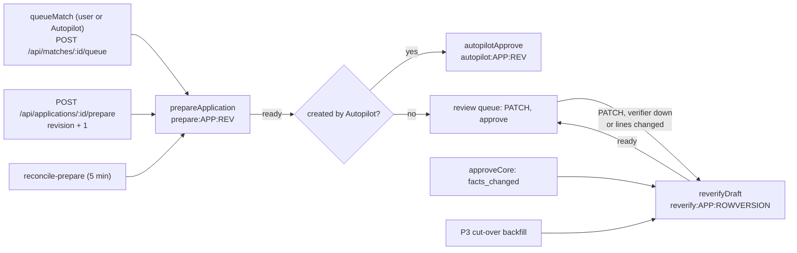
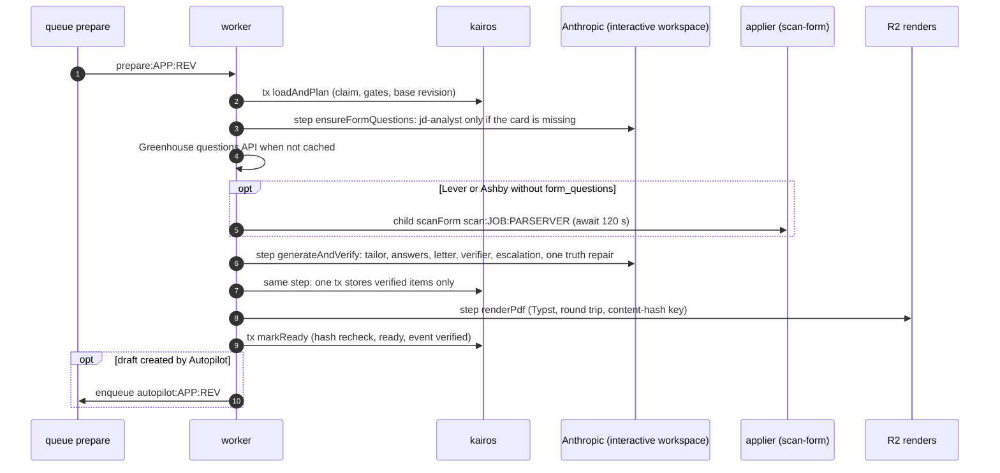

# Worker spec 04: `prepare-application` (draft preparation and re-verification)

Tier: critical. Process: `worker`. Module: `server/src/modules/applications/prepare/`. Workflows: `prepareApplication` (queue `prepare`) and `reverifyDraft` (queue `reverify`). Agents: `jd-analyst`, `resume-tailor`, `answer-drafter`, `cover-letter-writer`, `claim-verifier`, `claim-verifier-escalation`.

Sources this spec implements and refines: `01-architecture.md` B.5 (rules D1 to D9), B.6.2, B.6.5, B.8.7, B.9.6, B.9.7, B.9.9, B.11; `02-database.md` 7.3 and section 9; `03-agent-runtime.md` sections 2, 5, 9 and 11; `05-api.md` 10.5, 10.6 and 15; `06-infrastructure.md` 9.3 and 9.4; spike S-D1 (`_research/spike-s-d1-local.md`), whose correction table overrides the architecture where they differ. Model choices follow owner decision A (Anthropic only, Haiku 5.5 by default, Sonnet 5.5 for the escalation verifier, fallback is retry then one tier up).

---

## 1. Purpose and place in the lifecycle

`prepareApplication` turns a freshly created draft (`applications.status = 'draft'`, `draft_state = 'pending'`) into a draft a human or Autopilot can approve: tailored resume lines, form answers, an optional cover letter, a verification summary, a rendered PDF, and `draft_state = 'ready'`. It is the only pipeline that writes model-generated text that can reach an employer, so it is where the truth lock (INV-2), the independent verifier (INV-7) and the sensitive-question rule (INV-9) are enforced for pipeline content.

`reverifyDraft` brings a draft back to `ready` after something invalidated it without the user being able to wait: an edit stored while the verifier was unavailable (`draft_state = 'stale'`), a change to cited facts detected at approval (`facts_changed`), the P3 cut-over of drafts that predate the verifier, and (an addition requested in section 13) a line-changing edit whose PDF must be re-rendered.



What this worker never does: create an application (only `queueMatch` inserts, so INV-4 and the fit gate INV-1 are upstream), approve, charge, submit, or mutate the base resume (`resumes.document`). It reads the base resume through an immutable revision and writes tailored content only into the `applications` row.

## 2. Trigger, schedule and payload (a TypeScript type), plus the idempotency key

### 2.1 Triggers

| Workflow | Started by | Queue, priority, partition | Workflow id (idempotency key) | `timeoutMS` |
|---|---|---|---|---|
| `prepareApplication` | `queueMatch` request workflow (user); `autopilotApprove` running the `queueMatch` body as actor `autopilot`; the `POST /api/applications/:id/prepare` seam (after it increments `revision`); `reconcile-prepare` (every 5 minutes); this workflow itself when it defers (section 5.4) | `prepare`; priority 10 user, 50 Autopilot, 30 system (reconciler and deferral); partition key `user_id` | `prepare:<applicationId>:<revision>` | 600,000 |
| `reverifyDraft` | `PATCH /api/applications/:id` (verifier unavailable, or lines changed so the PDF key was cleared); `approveCore` on a `facts_snapshot_hash` mismatch; the cut-over backfill `backfill:prepare_v2_cutover:<batch>`; the nightly citation-integrity check I-8; `reconcile-prepare` for `stale` drafts | `reverify`; priority 20; not partitioned | `reverify:<applicationId>:<rowVersion>` | 300,000 |

No schedule belongs to this worker. The reconcilers that restart it (`reconcile-prepare`, I-8) are owned by `durable-ops` and `ops-monitors`; their rules for this worker are fixed in section 5.6.

### 2.2 Payloads

Inputs are ids and integers only (rule D4, B.5.6); a zod schema per workflow is checked at the top of the body and by the CI ids-only schema rule.

```ts
// server/src/modules/applications/prepare/types.ts
import { z } from "zod";

export const prepareInput = z.object({
  applicationId: z.uuid(),
  revision: z.int().min(1),          // applications.revision at enqueue time
}).strict();
export type PrepareInput = z.infer<typeof prepareInput>;

export const reverifyInput = z.object({
  applicationId: z.uuid(),
  rowVersion: z.int().min(0),        // applications.row_version that the enqueuer wrote
}).strict();
export type ReverifyInput = z.infer<typeof reverifyInput>;

/** Short codes only; stored in applications.draft_issue (CHECK ^[a-z0-9_:.-]{1,80}$). */
export type DraftIssueCode =
  | "needs_facts" | "posting_closed" | "form_questions_unknown" | "verification_unavailable"
  | "concurrent_edit" | "render_failed" | "prepare_timeout" | "prepare_poison" | "items_removed"
  | `model_failed:${string}`                       // LlmErrorCode, e.g. model_failed:refusal
  | `deferred:${"paused" | "daily_budget" | "shed" | "model_unavailable"}`
  | `deferred:model_unavailable:${1 | 2 | 3}`;

export type PrepareOutcome = "ready" | "needs_facts" | "posting_closed" | "deferred" | "superseded" | "failed" | "stale";
export interface PrepareResult { outcome: PrepareOutcome; issue: DraftIssueCode | null }   // workflow output, ids-only

/** Step outputs (checkpointed): counts, enums and hashes only. */
export interface LoadAndPlanOut {
  go: boolean; outcome: PrepareOutcome; issue: DraftIssueCode | null;
  userId: string; jobId: string; needsCard: boolean;
  questions: "cached" | "fetch_greenhouse" | "needs_scan" | "none";
  baseRevisionId: string | null; createdBy: "user" | "autopilot"; v2: boolean;
}
export interface GenerateOut { stored: boolean; outcome: PrepareOutcome; issue: DraftIssueCode | null;
  contentHash: string | null; lines: number; dropped: number; escalated: number; rowVersion: number | null }
export interface RenderOut { pdfKey: string; pages: number }
```

### 2.3 Enqueue helper (the only way to start the workflow)

Called from a workflow body, never from inside a step (DBOS rule: no workflow starts inside steps).

```ts
// server/src/modules/applications/prepare/enqueue.ts (specification-level code)
import dbosSdk from "@dbos-inc/dbos-sdk";          // S-D1: the package is CommonJS; default import, then destructure
const { DBOS } = dbosSdk;

export async function enqueuePrepare(a: { applicationId: string; revision: number; userId: string;
                                          initiator: "user" | "autopilot" | "system" }): Promise<void> {
  await DBOS.startWorkflow(prepareApplication, {
    workflowID: `prepare:${a.applicationId}:${a.revision}`,
    queueName: "prepare",
    timeoutMS: 600_000,
    enqueueOptions: {
      priority: a.initiator === "user" ? 10 : a.initiator === "system" ? 30 : 50,
      queuePartitionKey: a.userId,                 // S-D1: the queue is partitioned, so every enqueue passes a key
    },
  })({ applicationId: a.applicationId, revision: a.revision });
}
```

The exact name of the partition-key enqueue option is checked against the 5.3.0 typings in P1 (the spike proved partitioning, not the option spelling); the helper is the single place it appears.

### 2.4 Idempotency

| Duplicate | Why it is harmless |
|---|---|
| Same id started twice (double click, reconciler racing `queueMatch`) | DBOS returns the existing workflow (S-D1 check 3) |
| A stale id (revision already bumped) | Step `loadAndPlan` claims only `draft_state = 'pending' AND revision = $revision`; zero rows ends the run as `superseded` (rule D1) |
| Replay of `generateAndVerify` after its store committed but before its checkpoint | The step first reads `verification->>'revision'`; if this revision's content is already stored, it returns the stored counts without any model call |
| `forkWorkflow(id, 0, { applicationVersion })` during a version migration (S-D1: replays from step 0) | Same two guards; a fork after `markReady` ends at `loadAndPlan` as `superseded` |
| Same `reverify` id | The step re-reads `row_version`; a newer write means another run (or the synchronous `PATCH`) owns the row |

## 3. Algorithm, step by step

Every step names what it reads and writes. "Tx" is a datasource transaction (`kairosDs.runTransaction`, exactly-once through `dbos.transaction_completion`); "step" is `DBOS.runStep`. Personal text is read from `kairos` inside a step and never returned (B.5.6).

### 3.1 `prepareApplication`



**Step 1. `loadAndPlan` (tx).**

1. Claim: `UPDATE applications SET draft_issue = NULL, resume_base_revision_id = $baseRev WHERE id = $app AND status = 'draft' AND draft_state = 'pending' AND revision = $rev RETURNING user_id, job_id, resume_profile_id, match_id`. Zero rows: return `{ go: false, outcome: "superseded" }`. (The architecture also admitted `failed` and `stale`; with the prepare route moving those to `pending` before it starts the workflow, only `pending` is claimable, which closes a race with `reverifyDraft`.) `$baseRev` comes from `ensure_resume_revision(resumes.id)` for the application's `resume_profile_id` (the default slot when null); it returns the newest revision when its `document_hash` equals the current `resumes.document_hash`, else inserts one (`reason = 'save'`, `created_by = 'system'`). No resume row: `$baseRev = NULL` (legacy mode, step 4).
2. Reads: `jobs` (`closed_at`, `card IS NOT NULL AND card_version = <jd-analyst promptVersion> AND card_content_hash = content_hash` as `hasCard`, `company_id`), `companies` (`ats`), `form_questions` (`source`, `parser_version`) by primary key, `count(*)` of `facts WHERE user_id = $u AND confirmed` (index `facts_user_confirmed_idx`), `application_events` row `kind = 'drafted'` (its `actor` gives `createdBy`), `feature_enabled('PREPARE_V2', user_id, plan)`, ops flags `pause_drafting`, `llm_paused`, `agent_disabled:resume-tailor`, `agent_disabled:claim-verifier`, and `llm_shed_level`.
3. Gates, in order, each ending the run before any model call:

| Gate | Result |
|---|---|
| `jobs.closed_at IS NOT NULL` | `draft_state = 'failed'`, `draft_issue = 'posting_closed'` |
| Fewer than 3 confirmed facts | `draft_state = 'needs_facts'`, `draft_issue = 'needs_facts'`, `verification = {state: 'failed', revision, dropped: []}` |
| `pause_drafting`, `llm_paused`, or either agent disabled | Defer, reason `paused` (5.4) |
| Shed level 3 and `createdBy = 'autopilot'` | Defer, reason `shed` |

4. Output: `LoadAndPlanOut` with `questions = "cached"` when a `form_questions` row exists at the current parser version, `"fetch_greenhouse"` for Greenhouse, `"needs_scan"` for Lever and Ashby, `"none"` when the ATS has no form source.

Writes: `applications.draft_issue`, `resume_base_revision_id` (and, on a gate, `draft_state`, `verification`); `resume_revisions` (at most one insert). No event row.

**Step 2. `ensureFormQuestions` (step; `retriesAllowed`, `maxAttempts` 4, `intervalSeconds` 5, `backoffRate` 2).**

1. Job card: if `needsCard`, call `ensureJobCards([jobId])` from `modules/catalog` (04-matching): claim-or-wait on `jobs.card_claimed_until`, then `jd-analyst` (Haiku 5.5, interactive workspace for this caller, budget class `ops`) on public posting text only. Writes `jobs.card`, `card_version`, `card_content_hash`; an `injection_echo` sets `jobs.injection_suspect = true` (it restricts only Autopilot). A card that still fails after the agent's ladder leaves `card` null and the run continues with title and description excerpt as job context (drafting quality drops; truth is unaffected because the verifier never sees job text).
2. Greenhouse: `safeFetchJson("https://boards-api.greenhouse.io/v1/boards/{token}/jobs/{externalId}?questions=true")` (10-second timeout, 2 MB cap, fixed host, `server/src/lib/safe-fetch.ts`). Normalize with the kept Greenhouse adapter into `FormQuestion[]`, marking every question inside the `compliance` and `demographic_questions` blocks `sensitive: true`. Upsert `form_questions (job_id, source = 'greenhouse_api', parser_version, questions)`; `form_questions_derive` sets `questions_hash` and `question_count`. A 404 returns `{ source: "gone" }`.
3. Output `{ source: "greenhouse_api" | "browser_scan" | "unknown" | "needs_scan" | "gone" | "cached" }`.

Body after step 2: `gone` runs `markFailed('posting_closed')` (step 7). `needs_scan` starts the child `scanForm` with id `scan:<jobId>:<parserVersion>` on queue `scan-form` (applier) and awaits it for at most 120 seconds (`handle.getResult()` raced against `DBOS.sleep(120_000)`; both durable). Success means `form_questions` now holds a `browser_scan` row (written by the applier's `store_form_questions`); a timeout or failure upserts `form_questions (source = 'unknown', questions = '[]')` only if no row exists, and the run continues with `draft_issue = 'form_questions_unknown'` to be set at `markReady`.

**Step 3. `generateAndVerify` (step; `maxAttempts` 3, `intervalSeconds` 10, `backoffRate` 3).** One step, so unverified text never reaches a checkpoint and a draft that cannot be verified stores nothing (B.5.6, INV-2). Its deadline per attempt is 150 seconds (`ctx.deadlineAt`); no model retry, repair or tier-up starts past it.

1. **Re-entry check.** `SELECT row_version, verification, resume_lines, answers, cover_letter, draft_state, revision FROM applications WHERE id = $app`. If `draft_state <> 'pending'` or `revision <> $rev`: return `superseded`. If `verification->>'revision' = $rev` and `verification->>'state' IN ('passed','failed')`: return the stored counts (no model call). Record `R0 = row_version`.
2. **Load inputs (in memory only).** Confirmed facts `{id, kind, text, confirmed_at, employment_id}`; the base revision document (`resume_revisions.document` by `baseRevisionId`); `jobs.card`, `jobs.title`, `companies.name`; `form_questions.questions`; `saved_answers WHERE approved`; `profiles` (`phone`, `city`, `linkedin_url`, `github_url`, `portfolio_url`, `sensitive_answers_enc`) and `"user"` (`name`, `email`); plan from `effective_plan(...)` and `shared/src/plans.ts` (`coverLetters`).
3. **Question plan (deterministic, before any prompt).** Each question gets exactly one plan:

| Plan | Rule | Answer source |
|---|---|---|
| `sensitive` | `classifySensitive(label)` (kept `services/sensitive.ts`) matches, or the question sits in a Greenhouse `compliance` or `demographic_questions` block | Profile fixed table decrypted from `profiles.sensitive_answers_enc` (AES-256-GCM, `DATA_KEKS`), `source: "profile"`; blank when absent. Never in any prompt (INV-9) |
| `profile` | Field key or label is name, email, phone, location, LinkedIn, GitHub, portfolio or website | Profile and `"user"` columns, `source: "profile"` |
| `attachment` | Resume or cover-letter file field | Not an answer; the filler attaches the PDF or the letter |
| `saved_answer` | `questionKey(label)` equals an approved `saved_answers.question_key` | The saved value, `source: "saved_answer"` |
| `free_text` | Anything else, including non-sensitive selects | `answer-drafter` |

`questionKey(label)` lowercases, folds whitespace, strips punctuation and truncates to 200 characters (the `saved_answers_key_ck` form). The snapshot written to `applications.questions` is `{ fieldKey, label, type, required, options?, plan, sensitive }[]`.

4. **Retrieval (deterministic, B.9.7).** `resume-tailor` and `cover-letter-writer` receive every confirmed fact when there are at most 60, else the 60 that best cover the card's requirements (F1's requirement-to-fact map, then keyword overlap, then recency). `answer-drafter` receives the 25 facts with the highest BM25-style overlap with the question labels and the card's requirement terms. Facts are sorted `(kind priority, id)` so the cached user block is byte-identical across the three agents' calls of the same user (03 section 7.1).
5. **Drafting (sequential, so the user block stays warm).** Context for every call: `{ userId, applicationId, jobId, plan, budgetClass: "pipeline", workspace: "interactive", inputRefs: { facts, questions } , deadlineAt }`.
   - `resume-tailor`, skipped when `resume_lines` was non-empty at `R0` (the user's own lines from "Create draft" already landed; skeleton rule kept). Suggestion mode against the base revision's lines (with ids, sections and entry ids) when `baseRevisionId` is set; legacy mode (`summaryLine` plus 6 to 16 fact-only lines) otherwise. For every required F1 requirement that is `missing`, nothing is drafted: a JD keyword the user lacks never becomes a line.
   - `answer-drafter`, one call for all `free_text` questions, only when there is at least one. Labels and options are fenced as `form_questions` data. An `abstain` leaves the value blank.
   - `cover-letter-writer`, only when `plans.ts coverLetters` is true and the form has a cover-letter field (text or attachment).
6. **Materialize candidate items.** Lines: the base document's lines in document order (each `ResumeLine { id, section: <section title>, text, factIds }`), then the suggestions applied: `rewrite` replaces text and `factIds` of `lineId`; `add` inserts a new line after the last line of `entryId` and records `resume_line_entries[newId] = entryId`; `remove` drops the line. In legacy mode the model's lines are the candidates. Answers: profile, sensitive and saved answers (not checked by layers 2 and 3: they are the user's own assertions, as `PATCH` treats them) plus drafted `free_text` answers with their `factIds`. Paragraphs: the letter's paragraphs with their `factIds`.
7. **Three layers on every model-drafted item and every base line** (B.9.6):
   - Layer 1, deterministic lock: at least one fact id; every id in the confirmed, owned set loaded in 2.
   - Layer 2, `checkClaims` (`llm/claims.ts`, which absorbs `services/invented-details.ts`): number, entity, skill and injection-token containment against the cited facts' text; length bounds.
   - Layer 3, `claim-verifier`: one call with every item that passed layer 2 and is not already in `verified_claims` (key `sha256(itemText | sorted factIds | sha256 of cited texts | claim-verifier@vN)`). Items are given opaque ids `c01..c40` in randomized order with only the facts they cite; more than 40 items split into calls of 40. Verdicts `supported` and `unsupported` and `contradicted` are cached for 24 hours; `uncertain` is never cached.
   - Escalation: each `uncertain` item goes once to `claim-verifier-escalation` (Sonnet 5.5, effort low) unless today's escalations have reached 15% of draft-size verifications, in which case the agent refuses and the item is dropped with rule `unverified`.
8. **Truth repair (one fixed iteration).** If any model-drafted item was dropped, each drafting agent whose items were dropped gets one more `runAgent` call with `callKind: "truth_repair"` and a `doNotClaim` list (the dropped item's text and its failing rule, held in memory only). Only the repaired items pass layers 1 to 3 again; whatever fails is dropped for good. Base lines that fail are dropped without repair (they are the user's words; the review screen names them through `GET /api/applications/:id/verification`).
9. **Sensitive backstop.** Any drafted answer whose label matches the sensitive patterns is removed and logged at error level (a classifier miss is a bug, not a user event).
10. **Decide.** Fewer than 3 resume lines survive: outcome `needs_facts`, and only the verification summary is stored (content columns stay empty). Otherwise outcome `ready-to-store`.
11. **Store (one transaction inside the step).** `SELECT ... FROM applications WHERE id = $app FOR UPDATE`. The `credit_balances` lock is deliberately not taken: this transaction changes neither credits nor `status`, so it locks only the application row, which is rung 2 of the global lock order and cannot invert it. Then:
   - `draft_state <> 'pending'` or `revision <> $rev`: commit nothing, return `superseded`.
   - `row_version <> R0` (a `PATCH` landed during the model calls): roll back and throw `KairosStepError("draft_changed")`, so DBOS retries the step; the retry sees the user's lines in 3.1 and skips `resume-tailor`. After the third attempt the run ends `failed` with `concurrent_edit`.
   - Otherwise one `UPDATE` writes `resume_lines`, `resume_line_entries`, `answers` (each drafted answer carries an additive `factIds` key), `cover_letter` (paragraphs joined by a blank line), `cover_letter_citations` (requested column, section 13), `questions`, `verification = { state: 'passed', revision, promptVersion: 'claim-verifier@vN', checked, supported, escalated, dropped: [{ kind, ref, rule }], verifiedAt }`, and `facts_snapshot_hash = facts_snapshot_hash(user_id, <every cited fact id>)`. For `needs_facts` it writes `draft_state = 'needs_facts'`, `draft_issue = 'needs_facts'` and `verification.state = 'failed'` instead.
   - `INSERT INTO verification_results (...) ON CONFLICT (run_id, item_kind, item_id, check_source) DO NOTHING` for every dropped, escalated or uncertain item (every supported item too while `ops_flags.verification_full_log` is set); `run_id = uuidv5("prepare:<app>:<rev>:prepare")`, and `:repair` for the repair pass; `shadow = true` while the verifier runs in shadow (section 12.2).

   Writes: `applications` (the columns above), `verification_results`, `verified_claims` (by the verifier helper, autocommit), `llm_calls` and `user_daily_usage` (by the gateway, autocommit, 03 section 8.3). External calls: Anthropic Messages API on the `kairos-prod-interactive` key, at most 4 drafting calls plus 1 to 2 verifier calls plus escalations plus up to 3 repair calls on the typical path.

**Step 4. `renderPdf` (step; `maxAttempts` 3, `intervalSeconds` 2, `backoffRate` 2).** Skipped for `needs_facts`. Reads the stored `resume_lines`, `resume_line_entries`, the base revision document (or `defaultResume(confirmedFacts, contact)` from `services/resume-doc.ts` in legacy mode), `resumes.template`, and the contact block from `profiles` and `"user"`. Builds the tailored `ResumeInput` (lines placed by id; new lines by `resume_line_entries`, else the anchor rule of B.8.7), computes `key = renders/<userId>/<sha256(template, density, document)>.pdf`, and if `HeadObject` on `R2_BUCKET_RENDERS` finds it, returns it. Otherwise `renderResume(doc, { template, density })`: `typst compile` as a child process under `prlimit --as=268435456`, 10-second timeout, `--root server/templates/<templateId>`, the document passed as a JSON file in a per-run temporary directory removed in `finally`; the template reads it with `json()` and never evaluates text as markup. `unpdf` extracts the text layer; every printed line must appear in order, else the attempt fails with `render_mismatch`. Upload with `PutObject` (`If-None-Match: *`). Output `{ pdfKey, pages }`.

**Step 5. `markReady` (tx).** `SELECT ... FOR UPDATE` the application; require `status = 'draft' AND draft_state = 'pending' AND revision = $rev`, else `superseded`. Recompute `facts_snapshot_hash(user_id, cited ids)`; if it differs from the stored hash (a cited fact was edited, unconfirmed or deleted after the store), set `draft_state = 'stale'` and return `stale` (the body then enqueues `reverifyDraft`). Otherwise `UPDATE applications SET draft_state = 'ready', resume_pdf_key = $key, prepared_at = now(), draft_issue = $issue` (`form_questions_unknown` or null) and `INSERT INTO application_events (application_id, user_id, kind, actor, detail, dedupe_key) VALUES ($app, $u, 'verified', 'system', '{"lines":n,"dropped":d}', 'verified:<rev>:<rowVersion>') ON CONFLICT DO NOTHING`.

**Step 6. Hand-off (workflow body).** `ready` and `createdBy = 'autopilot'`: `DBOS.startWorkflow(autopilotApprove, { workflowID: "autopilot:<app>:<rev>", queueName: "autopilot", enqueueOptions: { queuePartitionKey: userId } })`. `stale`: enqueue `reverify:<app>:<rowVersion>` (the row version `markReady` produced). Nothing else; Autopilot guards run inside `approveCore` (B.6.3).

**Step 7. `markFailed` (tx, compensation; only from the body's `catch` or a gate).** Requires `status = 'draft' AND draft_state = 'pending' AND revision = $rev`; sets `draft_state = 'failed'`, `draft_issue = $code`, and clears `resume_lines`, `answers`, `cover_letter`, `cover_letter_citations`, `resume_line_entries`, `resume_pdf_key`, `questions` and `verification` (failed drafts hold no content, `_db/applications.md` 4.2). The content-hash PDF in R2, if any, is left for the 30-day unused-render expiry.

### 3.2 `reverifyDraft`

Steps: `reverifyAndStore` (step, `maxAttempts` 3, `intervalSeconds` 10, `backoffRate` 3), `renderPdf` (as 3.1 step 4, only when lines changed or `resume_pdf_key IS NULL`), `markReady` (tx, variant).

1. Read the application. Continue only if `status = 'draft'`, `row_version = $rowVersion`, and (`draft_state = 'stale'` or (`draft_state = 'ready'` and `resume_pdf_key IS NULL`)). Else no-op (rule D1: a newer write owns the row).
2. Run layers 1 to 3 and capped escalation over every resume line, every drafted or user-edited free-text answer and every letter paragraph (`verified_claims` makes unchanged items free); no drafting agent and no repair (a re-verification must not rewrite the user's words).
3. Store with `UPDATE ... WHERE id = $app AND row_version = $rowVersion` (zero rows: no-op): remove failing items, append them to `verification.dropped`, set `verification.state = 'passed'`, `runKind: 'reverify'`, recompute `facts_snapshot_hash`; `draft_issue = 'items_removed'` when anything was removed; `draft_state = 'needs_facts'` (survivors kept) when fewer than 3 lines remain. `verification_results` rows with `run_kind = 'reverify'`, `run_id = uuidv5("reverify:<app>:<rowVersion>")`.
4. `renderPdf`, then `markReady` conditional on the row version written in 3, with event `verified` (`dedupe_key 'verified:<rev>:<rowVersion>'`).

When the verifier is still unavailable after the step's attempts, the body sets `draft_issue = 'verification_unavailable'` (which moves `row_version` through `applications_row_version_bu`), so `reconcile-prepare` can start a fresh `reverify:<app>:<newRowVersion>` ten minutes later.

## 4. Concurrency, rate limits, ordering, batching and priorities, with numbers at 10,000 users

Queues are registered after `DBOS.launch()` with `await DBOS.registerQueue(name, options)` (S-D1), only the worker listens to them (`listenQueues`), and the api enqueues with `listenQueues: []`.

```ts
await DBOS.registerQueue("prepare",  { globalConcurrency: 32, workerConcurrency: 8, partitionConcurrency: 2, priorityEnabled: true });
await DBOS.registerQueue("reverify", { globalConcurrency: 8, priorityEnabled: true });
```

| Quantity | Base (about 3,500 daily active users) | Growth | Source |
|---|---|---|---|
| `prepareApplication` runs a day | about 24,200 | 27,700 | 01 B.5.7, 06 9.3 |
| of which Autopilot-initiated (priority 50) | about 2,900 [est] | about 3,350 [est: half of 6,700 `autopilotApprove` runs] | 06 9.3 |
| Peak arrival (evening, 3x the mean) | 0.84 a second | 0.96 a second (3,460 an hour) | [est] |
| Duration p50 / p95 (queue start to `ready`) | 12 s / 45 s | same | 01 B.6.5 |
| Workflows in flight at peak (arrival x mean 15 s) | about 13 | about 15 | Little's law |
| Model calls in flight at peak | about 15 | about 17 | 01 B.12.4 |
| Capacity | 32 global, 8 per worker x 3 replicas = 24 | 32 global, 8 x 4 = 32 | 1.9x headroom at growth |
| `reverifyDraft` runs a day | about 3,400 | about 3,900 [est: 3,500 PDF re-renders after line edits, 300 `facts_changed`, 100 verifier-unavailable] | |
| `reverify` in flight at peak | under 1 | under 1 (3 s mean) | |

**Ordering and fairness.** Within the queue, priority first (user 10, system 30, Autopilot 50), then enqueue order. `partitionConcurrency: 2` means one user can have at most two drafts preparing at once, so a user who queues 30 matches cannot starve others; their remaining drafts wait in their partition. The B.11.3 rule applies: when `prepare` p95 wait exceeds 2 minutes, `candidatePage` pauses new `score` starts for 10 minutes (interactive work first) and the runbook adds a worker replica (A-DUR-7).

**Rate limits.** Every call goes through the gateway's per-replica semaphore (40, shared with scoring) and per-(workspace, model) RPM bucket on the worker (Haiku 300 a minute, Sonnet 15). At growth peak the pipeline needs about 0.96 x 4.3 = 4.1 Haiku calls a second (about 62 a minute per replica) and about 3 Sonnet escalations a minute in total, well inside the buckets; `maxWaitMs` for worker calls is 30 seconds, after which the call defers (section 5.2).

**Batching.** No Message Batches API on this path (latency, and Batch is not ZDR-eligible; 03 section 10.5). Batching here means per-draft call grouping: the three drafting agents run back to back inside the 5-minute cache window on the same user block; the verifier takes every item of a draft in one call (40 items per call); `answer-drafter` answers every free-text question of a form in one call.

**Renders.** `RENDER_CONCURRENCY` 2 per worker replica (8 at growth); peak need is about 0.96 renders a second x 0.6 s = 0.6 concurrent.

## 5. Retries, backoff, timeouts, dead-letter handling, poison messages and compensation

### 5.1 Layers of retry

| Layer | Rule |
|---|---|
| Gateway (inside one `runAgent`) | 03 section 2.6: at most 2 transport retries with backoff, 1 schema repair, then tier-up to Sonnet 5.5 within the share cap (2% for the drafting agents, 100% for `claim-verifier`), then `onFailure` (`tier_up_then_defer` for the drafting agents and `claim-verifier` here; `fail_closed` for `claim-verifier-escalation`) |
| DBOS step | Only retryable errors are thrown; every permanent condition is returned as an outcome, so DBOS never burns attempts on it. Settings per step in section 3 |
| Workflow | `maxRecoveryAttempts: 5` at registration (`DBOS.registerWorkflow(fn, { name: "prepareApplication", maxRecoveryAttempts: 5 })`); a crash-looping run then lands in `MAX_RECOVERY_ATTEMPTS_EXCEEDED` (the dead-letter state) |
| Reconciler | `reconcile-prepare` every 5 minutes (5.6) |

### 5.2 Error classification inside a step

| Condition | Inside the step | Step result |
|---|---|---|
| `AgentError` retryable (`rate_limited`, `overloaded`, `server_error`, `timeout`, `connection`, `circuit_open` after tier-up) | Throw `KairosStepError("model_unavailable")` | DBOS retries; after the last attempt the body defers (5.4) |
| `AgentError` `budget_stopped` with `scope = 'user_pipeline'` | Return `deferred:daily_budget` | Deferred to the next UTC day |
| `budget_stopped` with scope `agent`, `global` or `shed` | Return `deferred:shed` | Deferred one reconciler cycle |
| `llm_paused`, `agent_disabled` | Return `deferred:paused` | Deferred until the flag clears |
| Drafting agent `refusal`, `max_tokens`, `injection_echo`, `schema_invalid` after repair and tier-up | Treat as "agent produced nothing": continue with what the other agents produced (an empty answer set, no letter); if `resume-tailor` failed in legacy mode, fewer than 3 lines exist, so the result is `failed` with `model_failed:<code>` | Stored outcome |
| `claim-verifier` unavailable after tier-up | Throw `KairosStepError("verifier_unavailable")`: verification is never skipped and nothing is stored | Retry, then defer |
| `claim-verifier-escalation` refused (cap) or failed | Item dropped with rule `unverified` | Continue |
| Postgres serialization failure or deadlock (40001, 40P01), connection loss | Throw | Retry |
| `draft_changed` | Throw | Retry (3.1 step 11) |
| Programming errors (zod parse of own data, `precheck_failed`) | Throw `KairosStepError("internal")` with Sentry capture | Retries exhaust, `failed` |

Thrown errors carry only a code (B.5.6); third-party messages go to Sentry through the redacting `beforeSend`, never into DBOS.

### 5.3 Timeouts

| Scope | Value |
|---|---|
| Workflow `timeoutMS` | 600 s (`prepareApplication`), 300 s (`reverifyDraft`) |
| `loadAndPlan`, `markReady`, `markFailed` | `statement_timeout` 5 s on the worker pool |
| `ensureFormQuestions` | Greenhouse fetch 10 s; `jd-analyst` 20 s per attempt; scan wait 120 s |
| `generateAndVerify` | 150 s per attempt (`deadlineAt`); agent timeouts per 03 section 3.3 (drafting 45 s, verifier 30 s, escalation 30 s) |
| `renderPdf` | Typst 10 s, R2 operations 10 s each |

Worst case: 2 + 10 + 120 + (150 + 10 + 150 + 30 + 150) + 3 x 12 + 2 = about 660 s, above the 600-second workflow timeout only when the scan times out and every generate attempt runs to its deadline; the workflow is then cancelled and `reconcile-prepare` marks it `prepare_timeout` (5.6).

### 5.4 Deferral (a retry with a new identity)

A deferral keeps `draft_state = 'pending'`, sets `draft_issue = 'deferred:<reason>'`, and increments `revision` in one transaction (`UPDATE ... WHERE draft_state = 'pending' AND revision = $rev`). The run ends successfully, so its workflow id is spent and the next start needs the new id `prepare:<app>:<rev+1>`, which only `reconcile-prepare` issues, and only when the reason has cleared:

| Reason | Reconciler enqueues when |
|---|---|
| `paused` | `pause_drafting`, `llm_paused` and the agent flags are all unset |
| `shed` | `llm_shed_level` below 3 (or the draft is user-initiated) |
| `daily_budget` | `updated_at` is before today's 00:00 UTC |
| `model_unavailable:<n>` | 10 minutes have passed; at `n = 3` the next failure is final (`failed`, `model_failed:model_unavailable`) |

User-initiated drafts therefore survive a 30-minute Anthropic incident without the user doing anything; the status endpoint shows `pending` with the `deferred:*` issue code.

### 5.5 Dead letters and poison messages

| Case | Detection | Handling |
|---|---|---|
| Crash loop (Typst or a parser pushing the worker out of memory) | DBOS status `MAX_RECOVERY_ATTEMPTS_EXCEEDED` after 5 recoveries | `reconcile-prepare` runs `markFailed('prepare_poison')`; more than 3 in an hour emails (A-PREP-4); the run stays listed in `GET /api/admin/workflows` for the operator |
| Input fails `prepareInput` | Body's first line | Logged at error level, run ends as no-op (cannot be produced by the enqueue helper) |
| Orphan (its executor vanished in a deploy) | `dbos-orphan-recovery` (B.5.5, S-D1: cancel then resume; there is no public recover-for-other-executors call) | Resumes from the last completed step; D1 guards make every step safe to repeat |
| Version migration | `dbos-version-migrate` forks from step 0 (S-D1) | Guards of 2.4 |

### 5.6 `reconcile-prepare` rules for this worker (every 5 minutes, `applications_draft_work_idx`)

| Row | Workflow state for the current id | Action |
|---|---|---|
| `pending`, `updated_at` older than 10 minutes | none exists | `enqueuePrepare(..., initiator: "system")`, subject to 5.4 |
| `pending` | `ERROR`, `CANCELLED` (timeout) | `markFailed('prepare_timeout')` |
| `pending` | `MAX_RECOVERY_ATTEMPTS_EXCEEDED` | `markFailed('prepare_poison')` |
| `pending` | `PENDING` or `ENQUEUED` | nothing (orphan recovery owns it) |
| `stale`, older than 10 minutes | no `reverify:<id>:<row_version>` | enqueue `reverifyDraft` |
| `ready`, `status = 'draft'`, `resume_pdf_key IS NULL`, older than 2 minutes | no `reverify:<id>:<row_version>` | enqueue `reverifyDraft` (requested addition, section 13) |

### 5.7 Compensation

The pipeline is a saga whose only side effects before `ready` are rows it can undo and money it cannot. Model spend is never refunded (it is recorded at call time, 03 section 8.3); prepare consumes no feature allowance. Compensations: `markFailed` clears stored content for a failed run; a stale run clears nothing (the user's work stays, unapprovable until re-verified); an orphaned R2 render is harmless and expires; the `resume_revisions` row inserted by `ensure_resume_revision` is a legitimate snapshot and stays. No compensation touches `credit_balances`, `status` or the base resume.

## 6. State transitions it performs and the invariants it must uphold (and how)

| Column | From | To | Step | Condition |
|---|---|---|---|---|
| `draft_state` | `pending` | `ready` | `markReady` | Verified content stored for this revision, PDF rendered, facts hash unchanged |
| `draft_state` | `pending` | `needs_facts` | `loadAndPlan` or `generateAndVerify` | Under 3 confirmed facts, or under 3 lines survive |
| `draft_state` | `pending` | `failed` | `markFailed` | `posting_closed`, `concurrent_edit`, `render_failed`, `model_failed:*`, `prepare_timeout`, `prepare_poison` |
| `draft_state` | `pending` | `pending` (revision + 1) | deferral | 5.4 |
| `draft_state` | `pending` | `stale` | `markReady` | Facts hash changed after the store |
| `draft_state` | `stale` | `ready` | `reverifyDraft` | Passed |
| `draft_state` | `ready` (PDF missing) | `ready` | `reverifyDraft` | PDF rendered |
| `draft_state` | `stale` | `needs_facts` | `reverifyDraft` | Under 3 lines remain |
| `verification->>'state'` | none, `pending` | `passed` or `failed` | store | `_db/applications.md` 4.4 |
| `status` | never changed | | | Prepare cannot approve, send or withdraw |

| Invariant | How this worker upholds it |
|---|---|
| INV-1 Fit gate before any model call | The worker starts only from an existing draft, which only `queueMatch` creates from a gate-passed match or an explicit manual import (`gate_override`); `jd-analyst` reads public text only; the gateway spy test asserts no user-data call happens for a job with no draft |
| INV-2 Truth lock, store nothing on violation | Layers 1 and 2 on every item; only items that pass all layers are written, in one transaction at the end of `generateAndVerify`; `verification_results` has no text column; step outputs are counts and hashes |
| INV-7 Independent verifier before approval | Every stored line, drafted answer and paragraph is `supported` by `claim-verifier` or escalation; uncertain without escalation is dropped; verification is never skipped at any shed level; the verifier never sees job text, drafter prompts or `why` |
| INV-9 Sensitive questions never answered by a model | `classifySensitive` and Greenhouse block structure before any prompt; sensitive values come only from `profiles.sensitive_answers_enc`; post-check removes any leaked answer; gateway spy test |
| INV-3 Approval before send; Autopilot within guards | Prepare never sets `status`; Autopilot drafts are handed to `autopilotApprove`, which runs `approveCore` with every guard |
| INV-10 Plan limits from `plans.ts` | `coverLetters` and spend caps read from `shared/src/plans.ts`; no number in this module |
| INV-14, INV-15 Untrusted input, minimum data | Job card, question labels, options and saved-answer labels are fenced with the per-call nonce; only confirmed facts relevant to the job (at most 60, or 25 for answers) are sent; contact data and work authorization never are |
| Cost target | Per-draft model spend about $0.0020 (section 9), inside the per-user pipeline cap (`dailyModelSpendCapUsd`, user-initiated to 1.5x, Autopilot 1.0x) |
| Base resume immutability (decision D) | Read through `resume_revisions`; no write to `resumes` |

## 7. Failure modes table: cause, detection, user-visible effect, recovery

| Cause | Detection | User-visible effect | Recovery |
|---|---|---|---|
| Anthropic outage or 529 storm | Breaker open, `KairosStepError("model_unavailable")` | Draft stays `pending`, issue `deferred:model_unavailable:<n>` | Reconciler restarts every 10 minutes, 3 times, then `failed`; user retries |
| Verifier unavailable after Sonnet tier-up | Step throws `verifier_unavailable` | Same as above; nothing stored | Same |
| Escalation cap reached (15% of drafts) | Escalation agent refuses | Some uncertain lines missing; listed in verification detail | Email at 10% (A-LLM); next UTC day |
| User pipeline cap spent | `budget_stopped` (`user_pipeline`) | `pending`, `deferred:daily_budget` | Restarted after 00:00 UTC |
| Shed level 3 | Gate in `loadAndPlan` | Autopilot drafts wait; user drafts continue | Level drops |
| `pause_drafting` or `llm_paused` | Gate | `pending`, `deferred:paused` | Flag cleared |
| Drafting agent refusal or invalid output | `AgentError` non-retryable | Fewer answers or no letter; or `failed` `model_failed:<code>` if no lines | User retry; prompt fix through evals |
| Prompt injection in the posting | Echo canary, `checkClaims` injection tokens, verifier blind to job text | Affected items dropped; `jobs.injection_suspect` blocks Autopilot only | None needed |
| Greenhouse questions API down | Step retries exhausted | `form_questions_unknown`; draft still `ready` | Filler handles live form; Autopilot skips (section 13) |
| Scan times out | 120-second wait | Same | Next draft for the job retries the scan |
| Posting closed or 404 | `closed_at` or 404 | `failed`, `posting_closed` | None |
| Fewer than 3 facts or lines | Counts | `needs_facts`; review screen asks for facts | User adds facts, presses retry (`POST /api/applications/:id/prepare`) |
| `PATCH` during generation | `row_version <> R0` | None (the user's lines win) | Step retry |
| Facts edited between store and ready | Hash recheck | `stale` briefly | `reverifyDraft` |
| Typst crash, timeout or memory cap | Child exit code, 10 s timer | `failed`, `render_failed` after 3 attempts | Page if above 1% (A-PREP-2); user retry |
| Text-layer mismatch | `render_mismatch` | Same | Template fix; golden tests |
| R2 unavailable | S3 error | Delay; `failed` after 3 attempts | User retry |
| Sensitive-answer key missing or decryption fails | GCM tag error | Sensitive answers blank; approval skips `required_answers_missing` when required | Fix `DATA_KEKS`; alert A-SEC |
| Worker crash mid-step | DBOS recovery | Up to a minute of delay; model calls of the step repeat | Automatic |
| Executor gone after deploy | Orphan sweeper | Same | Cancel and resume |
| Crash loop | `MAX_RECOVERY_ATTEMPTS_EXCEEDED` | `failed`, `prepare_poison` | Operator; A-PREP-4 |
| Workflow timeout | `CANCELLED` status | `failed`, `prepare_timeout` | User retry |
| Postgres failover | Connection errors | Seconds of delay | Step retry |

## 8. Observability: logs, metrics, traces and alerts with thresholds

**Logs** (pino, one line per step end, message `prepare step` or `reverify step`): `workflowId`, `applicationId`, `userHash`, `revision`, `step`, `outcome`, `issue`, `lines`, `dropped`, `escalated`, `repairCalls`, `modelCalls`, `costUsd`, `durationMs`. Never text, labels, facts, URLs or answers. A sensitive-backstop hit logs `prepare sensitive_backstop` at error level with `fieldKeyHash` only.

**Metrics** (written to `metrics_minute` by the `metrics` schedule, additions requested of 06):

| Metric | Type | Use |
|---|---|---|
| `prepare.runs{outcome}` | counter | ready, needs_facts, failed, deferred, superseded, stale |
| `prepare.failed{issue}` | counter | Failure mix |
| `prepare.ready_latency_ms` (p50, p95) | histogram | SLO S3 (95% ready or needs_facts within 60 s; p50 under 15 s) |
| `prepare.items_dropped{rule}` | counter | `CLAIM_RULES` mix |
| `prepare.escalation_share` | gauge | Escalations / draft-size verifications today |
| `prepare.repair_rate` | gauge | Drafts with a truth repair / drafts |
| `prepare.needs_facts_share` | gauge | Onboarding quality |
| `prepare.cost_usd_per_draft` (p50, p95) | gauge | From `llm_calls` by `application_id` |
| `prepare.render_ms`, `prepare.render_failures` | histogram, counter | Typst health |
| `prepare.sensitive_backstop` | counter | Must stay 0 |
| `reverify.runs{outcome}` | counter | |
| Existing: `durable.queue.wait_p95_s{queue="prepare"}`, `durable.checkpoint_writes_per_submitted` | | Scale and checkpoint budget |

**Traces.** 5% sampling of `prepareApplication` (06 section 6), 100% when an error occurs (error event always). Spans: workflow, each step, each `runAgent` (attributes of 03 section 12.1: `kairos.agent.id`, `kairos.call.kind`, `kairos.cost_usd`, `kairos.llm_call_id`), `typst.render`, `r2.put`. The workflow id is the correlation key between logs, `llm_calls.input_refs` and `GET /api/admin/workflows`.

**Alerts** (existing ids from 06 first, new ids requested):

| Id | Condition | Window | Severity |
|---|---|---|---|
| A-DUR-2 | A `prepare` workflow pending above 30 minutes | 1 min | Page |
| A-DUR-7 | `prepare` p95 wait above 2 minutes (scale signal) | 10 min | Email |
| A-DUR-6 | `prepare` p95 wait above 5 minutes | 10 min | Email |
| A-DUR-4 | Checkpoint writes per submitted application above 80 | 1 day | Email |
| A-PREP-1 (new) | `failed` above 5% of runs (excluding `posting_closed`) | 30 min | Email; above 15% page |
| A-PREP-2 (new) | `render_failures` above 1% of renders | 1 h | Email |
| A-PREP-3 (new) | `prepare.sensitive_backstop` above 0, or the nightly I-8 citation check finds any stored uncited or unconfirmed citation | Any | Page |
| A-PREP-4 (new) | More than 3 `prepare_poison` in an hour | 1 h | Email |
| A-PREP-5 (new) | `needs_facts_share` above 25% for a day | 1 day | Email (onboarding or verifier false rejects) |
| A-LLM (existing) | Escalations above 10% of drafts; tier-up above 2%; envelope 80% | | Email |

## 9. Capacity and cost at 10,000 users: runs per day, CPU and memory, model cost per day

**Runs.** 24,200 (base) and 27,700 (growth) preparations a day; about 3,400 and 3,900 re-verifications.

**Model cost per draft** (expected per-call values of 01 B.12.1, which carry the 1.3 tokenizer factor):

| Agent | Calls per draft | Cost per call | Per draft |
|---|---|---|---|
| `resume-tailor` | 1.0 (fewer when the user's lines arrive first) | $0.00082 | $0.00082 |
| `answer-drafter` | 0.55 | $0.00048 | $0.00026 |
| `cover-letter-writer` | 0.26 (paid plans with a letter field) | $0.0006 | $0.00016 |
| `claim-verifier` (draft-size) | 1.0 | $0.0005 | $0.0005 |
| `claim-verifier-escalation` | 0.05 | $0.0045 | $0.00023 |
| Truth repair calls | 0.08 [est] | $0.0006 | $0.00005 |
| `jd-analyst` (cards missing at prepare) | under 0.01 | $0.00073 | under $0.00001 |
| **Total** | | | **about $0.0020** |

| | Base | Growth |
|---|---|---|
| `prepareApplication` model spend a day | 24,200 x $0.0020 = **$48.4** | 27,700 x $0.0020 = **$55.4** |
| `reverifyDraft` model spend a day | about $0.2 (mostly cache hits) | about $0.2 |
| Per submitted application | $48.6 / 17,600 = $0.0028 | $55.6 / 20,200 = $0.0028 |

These figures are the prepare share of the B.12.1 totals, not an addition to them. Envelopes are unchanged: `resume-tailor` $36, `answer-drafter` $12, `cover-letter-writer` $7.50, `claim-verifier` $25, `claim-verifier-escalation` $10.

**CPU and memory (worker).** Per draft about 60 ms of JSON, zod and `checkClaims`, about 0.5 s of Typst CPU (child process) and 0.1 s of `unpdf`: 27,700 x 0.66 s = 5.1 CPU-hours a day, about 0.21 vCPU on average and 0.65 vCPU at the 3x peak, spread over 4 replicas of 1 vCPU. Memory: at most 2 Typst children of 256 MB each per replica plus about 20 MB per in-flight workflow (8 per replica) within the 1.5 GB limit (06 1.3).

**Postgres.** About 12 business writes per draft (claim, store, `markReady`, about 4.5 `llm_calls` rows and their `user_daily_usage` upserts, 1 to 3 `verification_results`, 1 event): about 330,000 a day, 3.8 a second on average.

**Checkpoint writes (S-D1 numbers).** 6 fixed per workflow, 1 per plain step, 2 per datasource transaction: `loadAndPlan` 3, `ensureFormQuestions` 1, `generateAndVerify` 1, `renderPdf` 1, `markReady` 3, plus 1 for the Autopilot child enqueue on about 12% of runs and about 3 for the rare scan wait: about 15 per run, 415,000 a day at growth, matching 06 9.3's 410,000 (37% of all checkpoint writes). Lever if A-DUR-4 fires: fold `markReady` into the end of `renderPdf` as an idempotent conditional update inside the step (13 per run, 55,000 fewer writes a day).

**R2.** 27,700 PDFs a day of about 60 KB (1.7 GB a day; 30-day unused expiry keeps about 25 GB, inside the $15 R2 line of B.12.2).

## 10. Security and privacy notes

- **Keys.** The worker uses `ANTHROPIC_KEY_INTERACTIVE` for this pipeline (01 B.9.1: the prepare pipeline is user-facing) and `DATA_KEKS` to decrypt sensitive answers; the applier, which runs `scanForm`, holds neither.
- **Checkpoints.** Inputs and outputs are ids, enums, counts and hashes; `durable/pii-scan.test.ts` seeds markers into names, facts, resume documents, saved answers and sensitive answers, runs this pipeline, and scans `kairos_dbos` and `dbos.transaction_completion`.
- **Minimum data to Anthropic.** Confirmed facts relevant to the job, base resume lines, the job card, non-sensitive question labels and options; never contact data, work authorization, salary, sensitive answers or unconfirmed facts. `metadata.user_id` is the HMAC user hash.
- **Untrusted input.** Job text, labels, options and saved-answer labels go into the fenced variable block with the per-call nonce; outputs are re-validated by zod, `postValidate` (fact ids in the input set, `fieldKey` in the question set, option values among the options) and the echo canary; the verifier is blind to job text, so an injected instruction cannot buy a `supported` verdict.
- **Typst.** No network, `--root` limited to the template directory, document passed as data and read with `json()`, memory and time capped, temporary directory per run deleted in `finally`, environment cleared except `PATH` and `TYPST_FONT_PATHS`; Semgrep allows `child_process` only in the renderer module.
- **Outbound HTTP.** Only `boards-api.greenhouse.io` through `safeFetch` (connect-time IP checks); R2 through the SDK.
- **Retention.** Tailored PDFs expire after 90 days; sensitive answer values in `answers` are blanked 7 days after a terminal state by the scrub; `verification_results` holds no text; `kairos_dbos` rows for `prepare` and `reverify` are deleted after 14 days by `dbos-retention` (`deleteWorkflows`, batches of 500).
- **Erasure.** Account deletion cascades `applications`, `verification_results` and events; `renders/<userId>/` is deleted by prefix in the erasure workflow.

## 11. Tests (unit, integration, failure injection) and acceptance criteria

**Unit (no network, `fakeAnthropic` fixtures).**

| Test | Asserts |
|---|---|
| `question-plan.test.ts` | Every sensitive fixture (EEO, disability, veteran, gender, race, sexual orientation, salary, visa, sponsorship, work authorization, Greenhouse compliance blocks) plans `sensitive`; profile keys plan `profile`; saved-answer key normalization matches `saved_answers_key_ck` |
| `materialize.test.ts` | `rewrite`, `add` (with `resume_line_entries`), `remove`; unknown `lineId` or `entryId` dropped; document order kept |
| `truth-layers.test.ts` | Layer 1 (unknown, foreign, unconfirmed ids), layer 2 (numbers, entities, skills, URLs), verdict handling, escalation cap, `unverified` drops |
| `repair.test.ts` | Exactly one `truth_repair` call per agent with dropped items; repaired items re-verified; no second repair |
| `store-merge.test.ts` | User lines present at `R0` skip `resume-tailor`; `row_version` change throws `draft_changed`; `revision` change returns `superseded` |
| `classify-errors.test.ts` | Each `LlmErrorCode` maps to throw, defer or outcome per 5.2 |
| Gateway spy | Sensitive questions never appear in any rendered prompt of the three drafting agents |

**Integration (Testcontainers Postgres 18 with DBOS launched, fake Greenhouse, `ops/fake-ats/`, stub R2, real Typst binary).**

1. Happy path: queue a match, `ready` with lines, answers, letter, PDF, event `verified`, one `verification_results` row per dropped item.
2. `needs_facts` with 2 confirmed facts: zero model calls.
3. Create-draft flow: queue then immediate `PATCH` with lines: the user's lines are kept, answers filled, `resume-tailor` not called.
4. Autopilot draft enqueues `autopilot:<app>:<rev>` exactly once; a user draft never does.
5. Lever job without questions: child `scanForm` stores questions; a stalled scan yields `form_questions_unknown` within 130 s.
6. Facts edited between store and ready: `stale`, then `reverifyDraft` returns it to `ready`.
7. `reverifyDraft` after a line-changing `PATCH` renders a new PDF; an unchanged document reuses the R2 key.
8. PII scan of `kairos_dbos` after every scenario above.

**Failure injection.**

| Injection | Expected |
|---|---|
| `process.exit(137)` inside each step, 50 runs per step, recovery on another executor | Every run terminal within 10 minutes; content written once; `verification_results` without duplicates; at most one extra set of model calls per crash |
| `forkWorkflow(id, 0)` after `markReady` | No-op, no model call |
| Anthropic stub returns 529 for 20 minutes | Drafts deferred, then `ready` after recovery, no `failed` |
| Verifier stub returns only `uncertain`, escalation stub down | Items dropped as `unverified`; under 3 lines gives `needs_facts`; nothing unverified stored |
| Typst killed by the memory cap | `render_failed` after 3 attempts, content cleared |
| `pause_drafting` set for 15 minutes | Drafts stay `pending`, start within 5 minutes of the flag clearing |
| Budget stub refuses with `user_pipeline` | `deferred:daily_budget`, restarted after the UTC day rolls (clock fake) |

**Acceptance criteria (P3 exit, in addition to 01 B.14).** Zero unsupported claims stored in the 7-day sampled review (200 drafts, human-labelled); draft-ready p95 under 60 seconds and p50 under 15 seconds on staging load of 1 run a second; checkpoint writes per prepare run at most 16 in the staging metric; `prepare.sensitive_backstop` 0; model cost per draft under $0.0025 over a staging day; every frozen contract test green (the frozen web poll sees `answers: []` until the verified store).

## 12. Migration from the skeleton: which files it replaces and what is kept

### 12.1 Files

| Skeleton | Fate |
|---|---|
| `server/src/jobs/tailor-application.ts` (BullMQ `tailor-application`) | Replaced by `modules/applications/prepare/`; deleted in P7 after the queue drains |
| `jobs/queues.ts` entry `tailorApplication`, `worker.ts` registration (concurrency 4) | Removed in P3 when `PREPARE_V2` reaches 100% and the queue is empty |
| `routes/matches.ts` `enqueue("tailor-application", ...)` | Replaced by the `queueMatch` request workflow (P2), which calls `enqueuePrepare` |
| `services/tailor.ts` `enforceTruthLock` | Kept as layer 1 (moved to `modules/applications/truth-lock.ts`; `PATCH` and prepare share it) |
| `services/tailor.ts` `tailorResume` chat path (`chatJson`) | Deleted with `LLM_GATEWAY=legacy` in P7; the gateway path stays |
| `services/invented-details.ts` | Absorbed into `llm/claims.ts` (`checkClaims`) |
| `services/sensitive.ts` `classifySensitive` | Kept unchanged |
| `services/resume-doc.ts` (`defaultResume`, `renderResumeText`) | Kept; used by legacy mode and the renderer |
| `services/draft-writer.ts` | Kept for the drafts route; shares the item builders and layers with prepare |
| `agents/resume-tailor`, `answer-drafter`, `cover-letter-writer` specs | Kept; the claim verifiers and `jd-analyst` specs are added in P3 |
| Skeleton profile-answer block (first name, last name, email, phone, LinkedIn, location) | Kept as the `profile` plan's mapping, extended with GitHub and portfolio |
| Skeleton rule "a PATCH that landed during the model call wins" | Kept, now enforced by `row_version` instead of per-column `CASE WHEN ... = '[]'` |

New files: `server/src/modules/applications/prepare/{types,enqueue,workflow,load-and-plan,form-questions,question-plan,retrieval,generate-and-verify,materialize,store,render-pdf,mark-ready,reverify}.ts`, `server/src/render/typst.ts`, `server/templates/kairos-single-v1/`.

### 12.2 Rollout

1. **P2.** `queueMatch` moves to DBOS and enqueues `prepareApplication` with `PREPARE_V2` off for every user: `generateAndVerify` runs the v1 path (skeleton parity: `resume-tailor` legacy mode, layer 1, profile and saved answers, no verifier, `verification = { state: 'none' }`, no PDF requirement) so behavior matches today. BullMQ `tailor-application` stops receiving jobs and drains.
2. **P3, week 1 (shadow).** `PREPARE_V2` on for staff, then 10% of users: full pipeline, verifier in shadow (items kept, verdicts written with `shadow = true`, `verification_full_log` set). Daily diff review of shadow drops.
3. **P3, weeks 2 to 3 (enforce).** Verifier enforces for `PREPARE_V2` users, raised to 100%. The cut-over backfill `backfill:prepare_v2_cutover:<batch>` moves unapproved drafts with `verification` null to `stale` (`verification.state = 'pending'`) in batches of 500 and enqueues `reverify:<id>:<rowVersion>` for each.
4. **After 14 days at 100%.** Status guard versions 2 and 3 (`apps_05_guard_v2`, `apps_06_guard_v3`) ship; the v1 path is deleted.

### 12.3 Places this spec changed because of spike S-D1

| Place | Change |
|---|---|
| 2.3 enqueue helper | Default import of the CommonJS package; the partitioned queue requires a partition key on every enqueue |
| 4 queue registration | `await DBOS.registerQueue(...)` after launch, never `new WorkflowQueue`; `globalConcurrency` instead of `concurrency`; no `partitionQueue` (the `partitionConcurrency` limit partitions the queue) |
| 2.4 and 5.5 | `forkWorkflow` replays from step 0, so every step is state-conditional (rule D1) and `generateAndVerify` has a re-entry check |
| 5.5 orphans | Cancel then resume; no public recover call for other executors |
| 10 retention | `dbos-retention` uses `deleteWorkflows` (no garbage-collection call) |
| 9 checkpoint budget | 6 fixed writes per workflow, 2 per datasource transaction: about 15 per run, not the architecture's 10 |
| 12.1 dependencies | `pg@8` pinned (DBOS deprecation warning under pg 9) |

## 13. Additions requested

1. **05-api 10.6, `PATCH` on a `pending` draft.** Store the verified lines but leave `draft_state = 'pending'` and `verification` untouched; prepare verifies the final content (cache hits make it free). Without this, a "Create draft" `PATCH` would mark a draft without answers `ready` and race the pipeline.
2. **05-api 10.6 and 01 B.5.8, PDF after an edit.** A `PATCH` that clears `resume_pdf_key` on a `ready` draft enqueues `reverify:<id>:<rowVersion>` (render-only when nothing needs verification); `reconcile-prepare` gains the row of 5.6 for `ready` drafts without a PDF; `approveCore` (01 B.6.4) skips with `not_ready` when `resume_pdf_key IS NULL` for `PREPARE_V2` users, so neither channel ever sends without the tailored PDF.
3. **02-database 7.3.1, citations.** Add `applications.cover_letter_citations jsonb` (`[{ paragraph: int, factIds: uuid[] }]`, at most 4 entries, 2 KB) and document the additive `factIds` key inside `answers` elements; extend invariant check I-8 to both.
4. **02-database 7.3.1, `verification` keys.** Document `revision` and `runKind` inside `applications.verification` (used for the re-entry check).
5. **02-database 7.6, `feature_flags.key`.** Add `VERIFIER_ENFORCE` (per-user percentage) for the shadow-then-enforce rollout of 12.2.
6. **05-api 15.3, `draftIssue` codes.** Add `posting_closed`, `concurrent_edit`, `render_failed`, `prepare_timeout`, `prepare_poison`, `items_removed`, `model_failed:<code>` and `deferred:<reason>[:<n>]` to the documented set.
7. **01 B.6.3, Autopilot guard.** When `form_questions.source = 'unknown'` for the job, skip with `required_answers_missing` (required answers cannot be proven present).
8. **01 B.6.4, verification check.** Apply `verification.state = 'passed'` in `approveCore` only for `PREPARE_V2` users until guard v3 ships, so v1-path drafts stay approvable during rollout.
9. **`shared/src/plans.ts` versus 01 and 04.** The file on disk has `dailyModelSpendCapUsd` 0.5, 2, 5 and 8 (Free to Max) while 01 B.11.2 and 04 use 0.05, 0.20, 0.25 and 0.50. This worker reads whatever `plans.ts` holds; the owner and 04-matching should settle one set.
10. **01 B.5.8 and `_db/applications.md` 6.1, `reconcile-prepare`.** Adopt the rules of 5.6 (enqueue only when no workflow exists for the current revision, terminal failures mark `failed`, deferral conditions of 5.4).
11. **06-infrastructure.** Add the `prepare.*` and `reverify.*` metrics of section 8, alerts A-PREP-1 to A-PREP-5, and `prlimit` (util-linux) in the server image for the Typst memory cap.
12. **Workflow registration.** `maxRecoveryAttempts: 5` on `prepareApplication` and `reverifyDraft`, and handling of `MAX_RECOVERY_ATTEMPTS_EXCEEDED` in `reconcile-prepare` (01 B.5.5 lists no dead-letter state).
