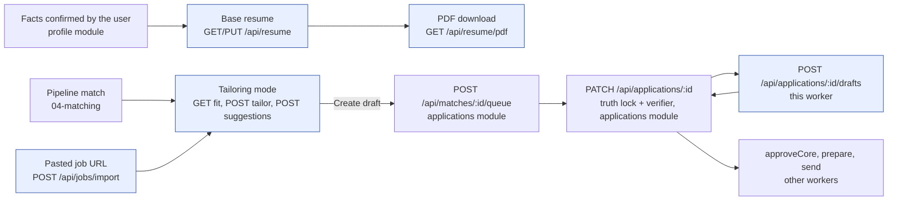
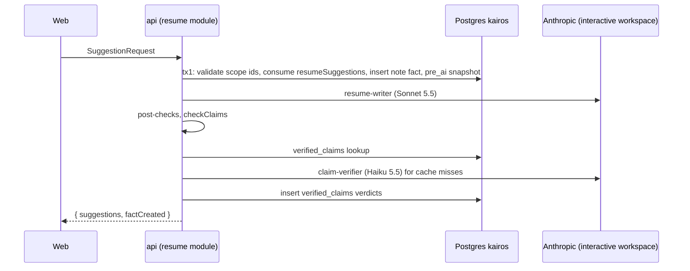
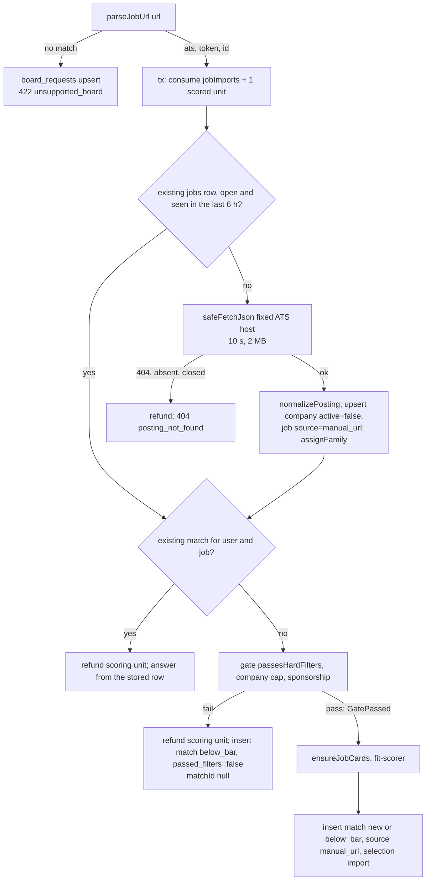

# Worker spec 05: `resume-workspace` (resume workspace request flows)

| Field | Value |
|---|---|
| Tier | critical |
| Process | `api` (synchronous Express handlers; no DBOS workflow, no queue) |
| Module | `server/src/modules/resume/` (document, revisions, truth lock, renderer), `server/src/modules/catalog/url-intake.ts` (F7), `server/src/modules/matching/f1.ts` (read only), `server/src/routes/resume.ts`, `server/src/routes/jobs.ts`, the drafts handler in `server/src/routes/applications.ts` |
| Agents | `resume-writer`, `resume-tailor`, `answer-drafter`, `cover-letter-writer`, `claim-verifier`, `claim-verifier-escalation`, `jd-analyst`, `fit-scorer` |
| Phase | P3 (routes, allowances, Typst renderer); P4 adds the `GatePassed` brand and cohort scoring that the import route reuses |
| Binding inputs | `docs/superpowers/specs/2026-10-23-resume-workspace/README.md` sections 3, 6, 7 and 8; the zod schemas at the end of `shared/src/schemas.ts`; `01-architecture.md` B.8; `02-database.md` 7.1, 7.6 and 8; `03-agent-runtime.md` 3.3, 5, 9 and 11; `05-api.md` 11 |
| Revision | 1, 2026-10-25 |

Skills applied: `dbos-typescript` (to decide that these flows are not workflows, and to keep any future move into one inside rule D1), `saga-orchestration` (the allowance reservation and its compensations in section 5.5), `error-handling-patterns` (the error taxonomy and the agent-error to HTTP mapping in section 5.3). All three loaded.

---

## 1. Purpose and place in the lifecycle

The resume workspace is the screen where a user builds a base resume from confirmed facts, tailors it to one job, and drafts answers and cover letters. This worker spec covers every server flow behind that screen. It implements the binding web contract exactly (README section 6), with no extra required field and no new status code on any contract route, and it is the place where the truth lock is applied to user-facing AI output that is shown before anything is stored.

What the worker does, in one list:

1. **Document truth lock.** `PUT /api/resume` stores the base resume only when every line cites confirmed facts the user owns and `checkClaims` finds nothing invented. Otherwise it answers 422 `truth_lock` with `details.lineIds` and stores nothing.
2. **F4 revisions.** It snapshots the document before every save burst, before every AI run (`pre_ai`) and before every restore. It lists, restores and names revisions.
3. **F3 provenance.** "Say it in your own words" text (`note`) becomes a fact with `asserted_by = 'user'` and `confirmed = false`. Only confirmed facts are ever citable.
4. **Verified suggestions.** `resume-writer` (Sonnet 5.5) proposes edits. Each proposal passes deterministic post-checks, `checkClaims` and `claim-verifier` before the user sees it. Anything unsupported is dropped, never shown with a warning.
5. **F1 fit.** `GET /api/jobs/:jobId/fit` returns the deterministic F1 score with `band` and `categories`. The score uses no model unless the shared job card is missing.
6. **Cached tailoring.** `POST /api/jobs/:jobId/tailor` runs `resume-tailor` (Haiku 5.5) once per input hash. It caches verified suggestions in `tailor_cache` for 24 hours. A JD keyword the user lacks becomes a deterministic `needsFact` question, never a line.
7. **F7 URL intake.** `POST /api/jobs/import` parses a pasted Greenhouse, Lever or Ashby link and calls only the fixed ATS API hosts. It never fetches the pasted URL. It applies the fit gate before any model call and stores a `manual_url` match.
8. **Drafts with the `profile_only` rule.** `POST /api/applications/:id/drafts` drafts one non-sensitive answer or a cover letter from facts. It refuses profile and sensitive questions with 422 `profile_only` before any model call. It stores nothing.
9. **Typst PDFs.** `GET /api/resume/pdf` renders the `kairos-single-v1` template (README section 8) with Typst, checks the text layer round trip and caches the file in R2 by content hash.
10. **F11 allowances.** Every model-backed route reserves units of its `aiDailyAllowance` feature from `shared/src/plans.ts` before the model call and refunds them when the request fails before reaching the model. A spent allowance answers 429 `rate_limited` with `details.reason = "daily_allowance"`.



**Why these flows are not DBOS workflows.** Each request finishes within its deadline (at most 60 seconds). Its only effects outside the `kairos` database are Anthropic calls, which are paid but leave no external state, and content-addressed R2 writes, which are idempotent. Its database effects are insert-once or conditional statements, so a client retry converges on the same rows. A workflow would add about 6 fixed checkpoint writes per request plus 1 per step and 2 per datasource transaction (spike S-D1). That buys nothing here, because a crashed request is simply retried by the user. The routes therefore write zero checkpoints, and the per-submission budget of about 55 writes (target 60, alert 80) is unaffected. If a later change moves one of these flows into a workflow, rule D1 applies: the first step must be a conditional read or claim, so that a fork replaying from step 0 is a no-op.

**What it does not own.** `PATCH /api/applications/:id` and its synchronous verifier, `POST /api/matches/:id/queue`, the prepare pipeline (`prepareApplication`, `reverifyDraft`), `parseResume`, `GET /api/applications/:id/pdf` (which reuses this worker's renderer), interview rehearsal, and the `housekeeping` purges of the caches this worker fills.

---

## 2. Trigger, schedule and payload (a TypeScript type), plus the idempotency key

### 2.1 Triggers

All triggers are HTTP requests on the api, authenticated by session cookie (`requireAuth` kind `session`). The registry names come from `05-api.md` section 9.2.

| Registry name | Method and path | Rate-limit class | Allowance feature (units) | Route deadline | Phase |
|---|---|---|---|---|---|
| `resume.get` | `GET /api/resume` (`?profileId=` optional) | `user_api` | none | 5 s | P3 |
| `resume.put` | `PUT /api/resume` | `user_api` | none | 5 s | P3 |
| `resume.pdf` | `GET /api/resume/pdf` (`?template=`, `?profileId=` optional) | `user_api` | none | 30 s | P3 |
| `resume.revisions.list` | `GET /api/resume/revisions` | `user_api` | none | 5 s | P3 |
| `resume.revisions.restore` | `POST /api/resume/revisions/:revisionId/restore` | `user_api` | none | 5 s | P3 |
| `resume.revisions.rename` | `PATCH /api/resume/revisions/:revisionId` | `user_api` | none | 5 s | P3 |
| `resume.suggestions` | `POST /api/resume/suggestions` | `ai_burst` | `resumeSuggestions` (1; 4 for scope `resume`) | 25 s (`line`, `entry`), 40 s (`section`, `summary`, `skills`), 60 s (`resume`) | P3 |
| `jobs.fit` | `GET /api/jobs/:jobId/fit` | `user_api` | none | 30 s (only when the card must be created; otherwise 5 s) | P3 |
| `jobs.tailor` | `POST /api/jobs/:jobId/tailor` | `ai_burst` | `jobTailor` (1; cache hits are free) | 45 s | P3 |
| `jobs.import` | `POST /api/jobs/import` | `ai_burst` | `jobImports` (1) plus one unit of `dailyScoringCap` | 25 s | P3 |
| `applications.drafts` | `POST /api/applications/:id/drafts` | `ai_burst` | `applicationDrafts` (1) | 30 s | P3 |

There is no schedule. The data this worker writes is purged by `housekeeping`: `verified_claims` every 10 minutes, `tailor_cache` after 7 days and `ai_usage` after 90 days by `retention`, `board_requests` by `retention`, and R2 renders by bucket lifecycle (30 days unused). `prune_resume_revisions` runs on every snapshot.

### 2.2 Payload type

```ts
// server/src/modules/resume/types.ts
import type {
  ResumeInput, SuggestionRequest, ImportJobInput, DraftRequest, PlanId, AiFeature,
} from "@auto-career/shared";

/** Built once per request by the route registry (05-api 2.2) and passed to every module function below. */
export interface WorkspaceCtx {
  userId: string;
  plan: PlanId;                 // effectivePlan(subscription), read once per request
  requestId: string;            // x-request-id
  traceId: string;              // OpenTelemetry trace id, copied to llm_calls.trace_id
  receivedAt: number;           // epoch ms
  deadlineAt: number;           // receivedAt + route deadline (section 2.1); passed to runAgent as ctx.deadlineAt
  signal: AbortSignal;          // aborted on client disconnect or at deadlineAt; cancels in-flight Anthropic requests
}

export type WorkspaceRequest =
  | { route: "resume.get"; profileId?: string }
  | { route: "resume.put"; profileId?: string; body: ResumeInput; ifMatch?: number }
  | { route: "resume.pdf"; profileId?: string; template?: string }
  | { route: "resume.revisions.list"; profileId?: string; cursor?: string; limit: number }   // limit 1..100, default 50
  | { route: "resume.revisions.restore"; revisionId: string }
  | { route: "resume.revisions.rename"; revisionId: string; name: string | null }
  | { route: "resume.suggestions"; body: SuggestionRequest }
  | { route: "jobs.fit"; jobId: string }
  | { route: "jobs.tailor"; jobId: string }
  | { route: "jobs.import"; body: ImportJobInput }
  | { route: "applications.drafts"; applicationId: string; body: DraftRequest };

/** A reservation taken before a model call; the compensation of section 5.5 refunds it. */
export interface AllowanceHold {
  feature: AiFeature;
  units: number;
  day: string;                  // UTC date 'YYYY-MM-DD' the units were taken from
  scoringUnit: boolean;         // jobs.import also holds one user_daily_usage.scored unit
}

/** One claim handed to the three truth-lock layers. Text never enters a log, span or checkpoint. */
export interface ClaimItem {
  id: string;                                        // line id, suggestion id, fieldKey or paragraph index
  kind: "resume_line" | "suggestion" | "answer" | "cover_paragraph";
  text: string;
  factIds: string[];
}
export type ClaimOutcome =
  | { id: string; kept: true; checkSource: "cache" | "verifier" | "escalation" }
  | { id: string; kept: false; reason: ClaimRule | "unsupported_by_cited_facts" | "contradicted" | "unverified" };
// ClaimRule: unknown_fact | unconfirmed_fact | number_not_in_facts | entity_not_in_facts | skill_not_in_facts | contact_data_in_line
```

### 2.3 Idempotency keys

No route takes an `Idempotency-Key` (`05-api.md` 7.3: model routes are deliberately not key-idempotent, because replaying a response would mean storing resume content). Each route is idempotent through its storage keys instead:

| Route | Key that makes a retry converge | Effect of a duplicate request |
|---|---|---|
| `resume.get` | `resumes_user_slot_uq (user_id, resume_profile_id)` (and `resumes_user_uq` until `RESUME_SLOTS_MULTI`); `INSERT ... ON CONFLICT DO NOTHING` | Both callers read the same row |
| `resume.put` | `resumes.document`: an identical document leaves `version` unchanged (`resumes_guard`), and `snapshot_resume` returns the latest revision when `document_hash` is unchanged | No new version, no new revision |
| `resume.revisions.restore` | `snapshot_resume(resume_id, 'restore', 'user', 10)` coalesces; restoring the same revision twice yields the same document | One extra version at most |
| `resume.revisions.rename` | Row update by primary key | None |
| `resume.suggestions` | None stored. Bounded by the in-process single-flight key `sha256(agentId, promptVersion, model, canonicalJson(input), userHash)` (`03-agent-runtime.md` 7.2), the `ai_burst` limit and `verified_claims` | At most one extra model call. A repeated `note` creates a second unconfirmed fact with the same text (accepted cost, `05-api.md` 11.2) |
| `jobs.tailor` | `tailor_cache (user_id, job_id, input_hash)` with `input_hash = sha256(document_hash, jobs.card_version, profiles.facts_version, "resume-tailor@v<N>")` | Cache hit within 24 hours: no model call, units refunded |
| `jobs.import` | `companies_ats_board_uq (ats, board_token)`, `jobs_company_external_uq (company_id, external_id)`, `matches_user_job_uq (user_id, job_id)`, `board_requests_user_target_uq (user_id, host, path)` | Same `jobId` and `matchId`. The second request reuses the stored match and calls no model |
| `jobs.fit` | Read only, apart from the job card claim (`jobs.card_claimed_until`, claim-or-wait) | None |
| `applications.drafts` | None stored. Single-flight key as above; `verified_claims` makes the verifier call of a repeat free | At most one extra drafting call |
| `resume.pdf` | R2 object key `renders/{userId}/{sha256(templateId, templateVersion, density, canonicalJson(document))}.pdf` | Second request is an R2 read |

`profiles.facts_version` stands in for the "confirmed facts hash" of `01-architecture.md` B.8.5. The facts statement triggers bump it exactly when the confirmed set, a confirmed fact's text or kind, or a confirmation instant changes, so it changes exactly when the hash would, at no extra cost.

---

## 3. Algorithm, step by step

### 3.0 Shared rules and helpers

- **Actor and locks.** Every write transaction starts with `asActor(tx, "user")` (`SET LOCAL kairos.actor = 'user'`). A transaction that writes `resumes`, `resume_revisions`, `facts` or `profiles` then takes `lockProfile(tx, userId)` (`SELECT 1 FROM profiles WHERE user_id = $1 FOR NO KEY UPDATE`) before touching identity children (lock order rule I1 of `02-database.md` 5.1). No transaction is ever held open across a model call, an ATS fetch or a Typst render.
- **Slot resolution.** `resolveSlot(userId, profileId?)`: with `profileId`, it must be a `resume_profiles` row the user owns (404 `not_found` otherwise). Without it, the default slot is used (`resume_profiles.is_default`), or `NULL` when the user has no slot (the no-slot resume of `resumes_user_slot_uq`).
- **Citable facts.** `loadFacts(userId)` reads `facts (id, kind, text, confirmed, employment_id, asserted_by)` through `facts_user_created_idx`. A fact is citable when it exists, belongs to the user and has `confirmed = true`. `asserted_by` never makes a fact citable.
- **Allowance helper** (`llm/allowance.ts`): `consumeAllowance(tx, userId, plan, feature, units)` runs the guarded upsert

  ```sql
  INSERT INTO ai_usage (user_id, day, feature, used) VALUES ($1, (now() AT TIME ZONE 'UTC')::date, $2, $3)
  ON CONFLICT (user_id, day, feature) DO UPDATE SET used = ai_usage.used + EXCLUDED.used, updated_at = now()
   WHERE ai_usage.used + EXCLUDED.used <= $4          -- $4 = getPlan(plan).aiDailyAllowance[feature]
  RETURNING used;
  ```

  When no row comes back, it throws `HttpError(429, "rate_limited", ..., { reason: "daily_allowance", feature, limit, used, resetsAt })`. A limit of 0 answers 403 `forbidden` before the statement runs (`05-api.md` 11.5). `refundAllowance(hold)` runs `UPDATE ai_usage SET used = used - $units WHERE user_id = $1 AND day = $hold.day AND feature = $2 AND used >= $units` in its own autocommit transaction.
- **Truth-lock layers** (`modules/resume/verify.ts#verifyItems`). Layer 1 is the deterministic id check against `loadFacts`. Layer 2 is `checkClaims` (`llm/claims.ts`, pure TypeScript: numbers, entities, skill vocabulary terms, URLs, emails, phone numbers and instruction-like phrases must appear in the cited facts; length bounds). Layer 3 looks up each surviving item in `verified_claims` by `claim_hash = sha256(itemText | sorted factIds | sha256 of the cited facts' texts | claim-verifier@vN)`. Misses go to one `claim-verifier` call covering all of them, with only the facts each claim cites, in randomized order. When the caller allows escalation, `uncertain` items go once to `claim-verifier-escalation`. `supported` and `contradicted` verdicts with no other failure are inserted into `verified_claims` with `expires_at = now() + interval '24 hours'`. `uncertain` is never cached.
- **Agent errors to HTTP**: see section 5.3. Every model-backed route refunds its hold before answering an error that happened before any model call completed.
- **Plain text of a document** (`modules/resume/plain-text.ts#resumePlainText(doc)`). It emits, in print order, the name, one contact line, then each visible section title and, for each visible entry, the heading line (`heading`, `subheading`, `meta`) and its lines. It is the `resumeText` that F1 reads, and the S-T1 golden suite checks that it equals the Typst text layer (normalized whitespace). It replaces the skeleton's `renderResumeText`.

### 3.1 `GET /api/resume`

1. `resolveSlot`. Read `resumes (id, document, template, version, updated_at)` by `(user_id, resume_profile_id)`.
2. If no row: build the default document (`modules/resume/default-doc.ts#buildDefaultDocument`) from:
   - **Contact:** `"user".name`, `"user".email`, `profiles.phone`, `profiles.city` and `country`, `linkedin_url`, `github_url`, `portfolio_url`, each clipped to `resumeContactSchema` limits.
   - **Summary:** empty.
   - **Experience:** one entry per confirmed `employments` row of the slot, ordered by `start_month DESC`, with `heading = title`, `subheading = company`, `meta = "<start> – <end or Present>"`, `headingFactId = null`, and lines from the confirmed `role`, `metric` and `project` facts with that `employment_id`. Then one entry per confirmed `role` fact with no employment, using `headingFactId = fact.id`, as the skeleton does today.
   - **Other sections:** Projects, Education and Certifications get one entry per confirmed fact of that kind. Skills get one entry whose lines are the confirmed `skill` facts.
   - **Lines:** every line is `{ id: "l_" + fact.id, section, text: fact.text, factIds: [fact.id] }`, capped at the schema limits (30 entries per section, 40 lines per entry).

   Insert it in one transaction (`lockProfile`, then `INSERT INTO resumes (user_id, resume_profile_id, document) ... ON CONFLICT DO NOTHING`) and re-read the row. Unconfirmed facts are never used.
3. Respond `{ resume: { ...document, id, updatedAt } }` with `ETag: "<version>"`. `If-None-Match` equal to the ETag answers 304.

Tables: reads `resume_profiles`, `resumes`, `profiles`, `"user"`, `employments`, `facts`; may insert `resumes`. Agents: none. External calls: none.

### 3.2 `PUT /api/resume`

1. Validate the body with `resumeInputSchema` (400 `invalid_body` on failure, which includes an empty `factIds`).
2. Begin the transaction: `asActor`, `lockProfile`, `resolveSlot`, then `SELECT id, document, version FROM resumes WHERE user_id = $1 AND resume_profile_id IS NOT DISTINCT FROM $2 FOR UPDATE`. A client that sent `If-Match` and gets a version mismatch receives 412 `precondition_failed`. The frozen web sends none and keeps last-write-wins.
3. **Layer 1.** Collect every `factIds` entry and every `headingFactId`. One query, `SELECT id, kind, text, confirmed FROM facts WHERE user_id = $1 AND id = ANY($2::uuid[])`, after discarding ids that are not UUIDs (`unknown_fact`). Any missing id gives `unknown_fact`; any unconfirmed id gives `unconfirmed_fact`.
4. **Layer 2.** Diff against the stored document by line id. For each line whose `text` or `factIds` changed, or that is new, run `checkClaims(line.text, citedFacts, { kind: "resume_line", targetCompany: null })`. The semantic verifier does not run on base-resume saves: the base resume reaches an employer only as the user's own download, and every accepted suggestion was already verified (B.8.3).
5. Any failure: roll back and answer 422 `truth_lock` with `details = { lineIds, reasons }` (`truthLockPutDetailsSchema`; `lineIds` is what the frozen web reads). Nothing is stored.
6. Success:
   - `SELECT snapshot_resume($resumeId, 'save', 'user', 10)` (coalescing autosave bursts; skipped when the row is new).
   - `UPDATE resumes SET document = $doc`. `resumes_guard` bumps `version` and `updated_at`. On first save it is an `INSERT`.
   - Write the contact back to `profiles`: `phone` from `contact.phone`; `city` from `contact.location`; links by host (`linkedin.com` to `linkedin_url`, `github.com` to `github_url`, the first other link to `portfolio_url`). A link is written back only when it matches `^https?://\S+$` and is at most 300 characters, so `profiles_urls_ck` can never fail. The name and email stay in the document only.
   - Commit. Respond `{ resume }` with the new `ETag`.

Tables: reads `facts`, `resumes`, `resume_revisions`; writes `resumes`, `resume_revisions` (through `snapshot_resume` and `prune_resume_revisions`), `profiles`. Agents: none. External calls: none.

### 3.3 Revisions

- **List.** `SELECT id, created_at, reason, name, created_by FROM resume_revisions WHERE resume_id = $1 AND (created_at, id) < ($cursorAt, $cursorId) ORDER BY created_at DESC, id DESC LIMIT $limit + 1` (index `resume_revisions_resume_created_idx`). Keyset cursor as in `05-api.md` 8.1. Documents are not returned.
- **Restore.**
  - In one transaction: `asActor`, `lockProfile`, then read the revision joined to `resumes` (404 unless the user owns it).
  - Run layers 1 and 2 of 3.2 against the revision's document, because facts may have been deleted or unconfirmed since the revision was taken. On failure, answer 422 `truth_lock` with `details.lineIds` and restore nothing (`05-api.md` 11.1 is authoritative here; see addition A5).
  - On success: `snapshot_resume(resume_id, 'restore', 'user', 10)`, then `UPDATE resumes SET document = <revision.document>`. Respond `{ resume }`.
- **Rename.** `UPDATE resume_revisions SET name = $name WHERE id = $1 AND resume_id IN (SELECT id FROM resumes WHERE user_id = $u)`. A duplicate name hits `resume_revisions_name_uq` and answers 409 `conflict`. `resume_revisions_immutable` allows only the name to change.

### 3.4 `POST /api/resume/suggestions`



1. Validate with `suggestionRequestSchema`.
2. **Load:** `loadResume` (3.1; the default document when none exists), `loadFacts`, and `profiles.facts_version`.
3. **Scope check.**
   - `resume`, `summary` and `skills` need no id.
   - `section` needs `sectionId`.
   - `entry` needs `sectionId` and `entryId`.
   - `line` needs all three ids.
   - Every given id must exist in the stored document. Otherwise 422 `invalid_scope`.
   - `jobId`, when given, must be a job the user can see: `EXISTS` a `matches` row or an `applications` row of this user for the job, otherwise 404 `not_found`.
4. **Transaction 1** (`asActor`, `lockProfile`):
   - `consumeAllowance(..., "resumeSuggestions", scope === "resume" ? 4 : 1)`.
   - If `note` is present, insert the note fact:

     ```sql
     INSERT INTO facts (user_id, resume_profile_id, employment_id, kind, text, asserted_by, confirmed)
     VALUES ($u, $slot, $employmentId, $kind, $note, 'user', false)
     RETURNING id, kind, text, source_span, confirmed;
     ```

     `kind` comes from the target line's first cited fact, or else from the section kind: experience to `role`, projects to `project`, skills to `skill`, education to `education`, certifications to `certification`, summary and custom to `role`. `employment_id` comes from the target entry's line facts when they share one. `facts_guard` accepts it because the actor is `user` and `asserted_by = 'user'`. The fact is unconfirmed, so `facts_version` does not move.
   - `snapshot_resume($resumeId, 'pre_ai', 'user', 10)`.
   - Commit.
5. **Build the agent input.**
   - The scope's current lines with ids. For `resume`, the whole document.
   - The scope facts:
     - entry scopes: the confirmed facts linked to the entry (its lines' facts plus facts sharing their `employment_id`);
     - summary, skills and resume: the top 60 confirmed facts. With `jobId`, they are ranked by F1 requirement coverage of the job card (B.9.7); otherwise by kind priority (`role`, `metric`, `project`, `skill`, `education`, `certification`) and `confirmed_at DESC`.
   - The job card's requirements when `jobId` is given. `ensureJobCards([jobId])` creates the card if it is missing (3.5 step 2).
   - The `refine` option, and `factCreated` labelled "unconfirmed, cite only if needed".
   - Untrusted parts are fenced with `fence()`: lines, facts and the note as T2, requirements as T3.
6. **Call** `runAgent(resumeWriter, input, { userId, jobId, plan, feature: "resumeSuggestions", budgetClass: "interactive", workspace: "interactive", traceId, deadlineAt, signal, inputRefs: { factIds, lineIds } }, { callKind: "primary" })`. `effort` is `low` for `line` and `entry`, `medium` otherwise. `max_tokens` is 800 or 2,600. Output: up to 3 suggestions for `line`, 8 for `entry`, `section`, `summary` and `skills`, and 20 for `resume`.
7. **Deterministic post-checks** (`postValidate` plus route checks). A suggestion is dropped when any check fails:
   - Ids: `sectionId`, `entryId` and `lineId` exist in the document, and lie inside the requested scope.
   - Actions: `rewrite` has a `lineId`. `add` has an `entryId` and a null `lineId`. `remove` has empty `factIds` and a null `after`.
   - `before`: the server overwrites it with the stored line text and never trusts the model's copy.
   - Citations: every `factIds` entry is a confirmed fact in the input set, or equals `factCreated.id`. A suggestion citing `factCreated` is returned. The web lets the user accept it only after the one-click confirm, and `PUT` enforces that.
   - `refine` compliance: `shorter` means `after` is shorter than `before`; `longer` means it is longer; `result_first` means the first clause holds a number or a result verb from the fixed list; `use_numbers` means a number from a cited `metric` fact appears.
   - `use_numbers` with no `metric` fact in scope yields exactly one suggestion with `needsFact = { kind: "metric", question: "What number shows the result of this work?" }`, a null `after` and empty `factIds`, and no model text.
   - `needsFact` suggestions keep a null `after` (README rule 3).
   - Fresh ULIDs replace the model's suggestion ids.
8. **Layers 2 and 3:** `verifyItems` on every suggestion with an `after`, with escalation off. `unsupported`, `contradicted`, `uncertain` and any `checkClaims` failure drop the suggestion (B.8.5 step 7: interactive latency stays bounded and the route fails closed). `remove` and `needsFact` items skip verification.
9. Respond `{ suggestions, factCreated }` with `Kairos-Allowance: feature=resumeSuggestions;used=<n>;limit=<n>;resets=<ISO>`. An empty `suggestions` array is a valid 200: everything was dropped, and the web shows "No suggestion this time".

Tables: reads `resumes`, `facts`, `profiles`, `matches`, `applications`, `jobs`; writes `ai_usage`, `facts` (note), `resume_revisions`, `verified_claims`, `llm_calls` and `user_daily_usage.interactive_usd` (through the gateway ledger). Agents: `resume-writer`, `claim-verifier`, and `jd-analyst` only when the card is missing. External calls: Anthropic Messages API (`kairos-prod-interactive`).

### 3.5 `GET /api/jobs/:jobId/fit`

1. A malformed id answers 404 `not_found`. Visibility: the user has a `matches` row (any status, including a `below_bar` import) or an `applications` row for the job. Otherwise 404, so the route cannot become an enumeration API for public jobs.
2. **Card.** `ensureJobCards([jobId])` (claim-or-wait, B.7.6):
   - A fresh card (`card_version = JD_CARD_VERSION AND card_content_hash = content_hash`) or a family reuse is used at once.
   - Otherwise the winner of `UPDATE jobs SET card_claimed_until = now() + interval '60 seconds' ... RETURNING id` calls `jd-analyst` (Haiku 5.5, budget class `ops`, interactive workspace on this path because a user is waiting).
   - Losers re-read every 500 ms for up to 15 seconds.
   - **Fallback:** if no card can be produced (agent error, `llm_paused`, the `jd-analyst` envelope spent, or the loser wait expires), the route does not fail. It builds requirements and keywords with the skeleton's heading parser (`services/job-fit.ts`, kept as `modules/matching/requirements-fallback.ts`), and `basis` says "Requirements read from the posting's headings; a full analysis was not available". The metric `workspace.fit.fallback` counts these.
3. **F1.** `computeF1({ card, jobTitle: jobs.title, seniorityHint: jobs.seniority_hint, facts, resumeText: resumePlainText(baseDocument), prefs })` runs in display mode:
   - `facts` holds every user fact, confirmed and unconfirmed, so requirements can show `unconfirmed`, with `terms` from `extractTerms` and `months` from employment dates.
   - `prefs` are `roles` and `seniority` from `profiles.preferences`.
   - `band` and `categories` are always filled.
4. Respond `{ fit, matchId?, ghost? }`. `matchId` is the user's match id for the job when one exists. `ghost` (`{ verdict, reasons }` from `jobs.ghost_verdict` and `job_ghost_evidence`) is present only when the verdict is not `none`.

Tables: reads `jobs`, `companies`, `matches`, `applications`, `facts`, `employments`, `resumes`, `profiles`, `job_ghost_evidence`; may write `jobs.card`, `card_version`, `card_content_hash`, `card_claimed_until`. Agents: `jd-analyst` only without a card. External calls: Anthropic only without a card.

### 3.6 `POST /api/jobs/:jobId/tailor`

1. Visibility as in 3.5. Load the base document (`loadResume`), `loadFacts`, `profiles.facts_version`, and the card through `ensureJobCards`. Unlike the fit route, tailoring needs the card and does not fall back: 503 `ai_unavailable` when no card can be produced.
2. Compute `fit` with F1 (3.5 step 3).
3. **Cache.** Compute `input_hash = sha256(resumes.document_hash | jobs.card_version | profiles.facts_version | "resume-tailor@v<N>")`. Then read `SELECT suggestions, fit FROM tailor_cache WHERE user_id = $1 AND job_id = $2 AND input_hash = $3 AND expires_at > now()`. On a hit, respond `{ resume, suggestions, fit }` with the fresh `fit`. No allowance is used and no snapshot is taken.
4. **Transaction 1:** `consumeAllowance(..., "jobTailor", 1)`; `lockProfile`; `snapshot_resume($resumeId, 'pre_ai', 'user', 10)`; commit.
5. **Deterministic questions first.** For each requirement with `required = true` and F1 status `missing` (at most 5, in card order), build a suggestion:
   - `id = "nf_" + requirementId`, `action = "add"`;
   - `sectionId` = the Skills section id when every requirement term is in the skill vocabulary, else the Experience section id;
   - `entryId`, `lineId`, `before` and `after` all null, and empty `factIds`;
   - `why = "The posting requires <text>. If it is true, add it as a fact."`;
   - `needsFact = { kind: "skill" or "role", question: "Do you have experience with <terms joined>?" }`.

   No model writes these. A keyword the user lacks becomes a question, never a line.
6. **Call** `resume-tailor` in suggestion mode (Haiku 5.5, `onFailure = tier_up_then_fail` on this route, budget class `interactive`). The input is the top 60 confirmed facts by requirement coverage, the document lines with ids, and the fenced card. The output is `{ suggestions[0..20 - questions]: { action, sectionId, entryId, lineId, after, why, factIds } }`. The server fills `before` from the document. Post-checks are the same as 3.4 step 7, without `refine`.
7. **Verify:** `verifyItems` with escalation on. Uncertain items go to `claim-verifier-escalation` (Sonnet 5.5) unless the day's escalation share has reached 15%, in which case they are dropped as `unverified`. There is no repair call on this route: suggestions are optional proposals, and dropping one is enough.
8. Upsert the verified result:

   ```sql
   INSERT INTO tailor_cache (user_id, job_id, input_hash, prompt_version, suggestions, fit, expires_at)
   VALUES ($1, $2, $3, $4, $5, $6, now() + interval '24 hours')
   ON CONFLICT (user_id, job_id, input_hash) DO UPDATE
     SET suggestions = EXCLUDED.suggestions, fit = EXCLUDED.fit, created_at = now(), expires_at = EXCLUDED.expires_at;
   ```

   It stores at most 20 suggestions (`tailor_cache_shape_ck`). Respond `{ resume, suggestions, fit }`. Nothing else is saved. "Create draft" goes through `POST /api/matches/:matchId/queue` and `PATCH /api/applications/:id`, where the truth lock runs again and the verifier calls are cache hits.

Tables: reads as in 3.5 plus `tailor_cache`; writes `ai_usage`, `resume_revisions`, `tailor_cache`, `verified_claims`, `llm_calls`, `user_daily_usage`. Agents: `jd-analyst` (no card only), `resume-tailor` (Sonnet 5.5 on tier-up within its 2% share), `claim-verifier`, `claim-verifier-escalation`. External calls: Anthropic.

### 3.7 `POST /api/jobs/import`



1. **Parse.** `parseJobUrl(url)` (the kept `services/job-url.ts`, moved to `modules/catalog/url-intake.ts`):
   - only `https:`, with no port and no userinfo;
   - exact hosts `boards.greenhouse.io`, `job-boards.greenhouse.io`, `jobs.lever.co`, `jobs.eu.lever.co` and `jobs.ashbyhq.com`;
   - board tokens matching `^[A-Za-z0-9_.-]{1,100}$` (the `companies_board_token_ck` pattern), Greenhouse ids numeric, and Lever and Ashby ids UUIDs, lower-cased.

   If there is no match, answer 422 `unsupported_board`. Unless the host is `linkedin.com`, a `*.linkedin.com` host or an IP literal (LinkedIn is never automated, and an IP fails `board_requests_host_ck`), first upsert `board_requests (user_id, host, path)` with the lower-cased host and the path without its query string, at most 200 characters; `ON CONFLICT` increments `times_seen` and sets `last_seen_at`. No allowance is used.
2. **Transaction 1:**
   - `consumeAllowance(..., "jobImports", 1)`.
   - Reserve one scoring unit with this upsert, where `$cap` is `dailyScoringCap` from `plans.ts`:

     ```sql
     INSERT INTO user_daily_usage (user_id, day, scored) VALUES ($1, (now() AT TIME ZONE 'UTC')::date, 1)
     ON CONFLICT (user_id, day) DO UPDATE SET scored = user_daily_usage.scored + 1, updated_at = now()
      WHERE user_daily_usage.scored + 1 <= $cap
     RETURNING scored;
     ```

   - If no row comes back, roll back and answer 429 `rate_limited` with `details.reason = "daily_allowance"` and `feature = "jobImports"`.
3. **Existing job.** Look up `companies` by `(ats, board_token)`, then `jobs` by `(company_id, external_id)`. When the job exists with `closed_at IS NULL` and `last_seen_at > now() - interval '6 hours'`, skip the fetch.
4. **Fetch** through the kept adapters, using `safeFetchJson(url, { allowedHosts: [the one fixed API host], timeoutMs: 10_000, maxBytes: 2 * 1024 * 1024 })`. The pasted URL itself is never requested. The call is one of:
   - `GET https://boards-api.greenhouse.io/v1/boards/{token}/jobs/{id}?questions=true`
   - `GET https://api.lever.co/v0/postings/{site}/{uuid}?mode=json` (`api.eu.lever.co` for EU links)
   - `GET https://api.ashbyhq.com/posting-api/job-board/{board}?includeCompensation=true`, then select `{uuid}`

   A 404, a posting absent from the board, or a closed posting refunds both units and answers 404 `posting_not_found`. A timeout, a 5xx or a body over the cap refunds both units and answers 503 `service_unavailable` with `Retry-After: 30`.
5. **Upsert** (one transaction, actor unset):
   - **Company:** `INSERT INTO companies (ats, board_token, name, discovered_by, active) VALUES (..., 'import', false) ON CONFLICT (ats, board_token) DO NOTHING`, then re-read. A company created by import is not polled until the owner activates it.
   - **Job:** `normalizePosting`, then the same upsert as polling. On a new row it sets `source = 'manual_url'`, the hints and `content_hash`. An existing polled row keeps `source = 'board'`. `last_seen_at = now()`, then `assignFamily`.
   - **Greenhouse questions:** stored in `form_questions` with `source = 'greenhouse_api'`.
   - **Injection canary:** the canary of `normalizePosting` sets `jobs.injection_suspect`.
6. **Existing match.** Read `matches` by `(user_id, job_id)`. If a row exists, refund the scoring unit and answer from the stored row, calling no model: `passed = passed_filters AND score IS NOT NULL AND score >= fitThreshold AND status IN ('new','queued','skipped')`, `matchId = passed ? id : null`, and `reasons` from the stored reasons. The stored status is never changed by an import (`matches_status_guard` would refuse overriding a user decision anyway).
7. **Gate before any model call (INV-1).** `gate(user, job)` runs `passesHardFilters` (preferences, excluded companies and keywords, seniority, location and remote, salary floor, sponsorship against `jobs.sponsorship_hint`) plus `companyApplicationCounts` against `maxApplicationsPerCompanyPer30Days`. If it fails:
   - refund the scoring unit;
   - `INSERT INTO matches (user_id, job_id, passed_filters, reasons, status, source, selection, family_id) VALUES ($u, $j, false, $reasons, 'below_bar', 'manual_url', 'import', $family) ON CONFLICT (user_id, job_id) DO NOTHING`;
   - answer `{ jobId, matchId: null, fit: { passed: false, reasons: [gate reason] } }`, with the gate's fixed reason strings.

   The job card is not created for a gate-failed import. If the user then chooses "Tailor anyway", the fit or tailor route creates it on demand (addition A2).
8. **Score** (gate passed, typed `GatePassed`):
   - `ensureJobCards([jobId])`.
   - `fit-scorer` (Haiku 5.5, interactive workspace and budget class on this path, onFailure `defer`, which on a route means 503 `ai_unavailable` after refunding both units).
   - `INSERT INTO matches (user_id, job_id, passed_filters, score, reasons, status, source, selection, family_id, scorer_version, must_have_hits, llm_call_id, scored_at) VALUES (..., true, $score, $reasons, CASE WHEN $score >= $fitThreshold THEN 'new' ELSE 'below_bar' END, 'manual_url', 'import', ...) ON CONFLICT (user_id, job_id) DO NOTHING RETURNING id`.
   - A conflict means a concurrent request won: re-read and answer from the row as in step 6.
9. Respond `{ jobId, matchId, fit: { passed, reasons } }`, where `matchId` and `passed = true` appear only for `new`, and `reasons` are the scorer's validated reasons. A `below_bar` import can still be queued by the user (`gate_override = true` in the applications module). Autopilot never acts on `manual_url` matches or gate overrides (`applications_autopilot_ck`).

Tables: reads and writes `board_requests`, `ai_usage`, `user_daily_usage`, `companies`, `jobs`, `form_questions`, `matches`; reads `profiles`, `applications`, `jobs.family_id` peers. Agents: `jd-analyst` (new card, gate passed), `fit-scorer`. External calls: one fixed ATS API host; Anthropic.

### 3.8 `POST /api/applications/:id/drafts`

1. Validate with `draftRequestSchema`. Read `applications (id, user_id, job_id, status, answers, questions, cover_letter)`. The row must be the caller's and in `draft`, otherwise 404 `not_found` "Draft application not found".
2. **`kind = "answer"`:**
   - The `fieldKey` must be among `applications.answers`, otherwise 404 "Answer not found".
   - Answer 422 `profile_only` ("This question is answered from your profile, never by AI"), with no allowance used and no model called, when any of these holds:
     - `classifySensitive(label)` (FR-25, with Greenhouse `compliance` and `demographic_questions` blocks sensitive by structure) marks the question sensitive;
     - it is a profile question (name, email, phone, links, citizenship);
     - the stored answer's `source` is `profile`.
3. **`kind = "cover_letter"`:** the plan must have `coverLetters` (403 `forbidden` "Tailored cover letters are on Starter and up").
4. `consumeAllowance(..., "applicationDrafts", 1)` in its own transaction.
5. **Input** (B.9.7 retrieval, no model tool):
   - Answer: the 25 confirmed facts with the highest BM25-style term overlap with the label and the job's requirement terms, the user's approved `saved_answers`, and the fenced label and options.
   - Letter: the top 60 confirmed facts by requirement coverage and the fenced job card (through `ensureJobCards`).
   - Contact data and sensitive answers are never sent.
6. **Call:** `answer-drafter` or `cover-letter-writer` (Haiku 5.5, `onFailure = tier_up_then_fail` on this route, budget class `interactive`).
   - Answer output: one `{ fieldKey, value, factIds }`, or `{ fieldKey, abstain }`.
   - An abstain of `sensitive` answers 422 `profile_only`, which is defense in depth and keeps the units consumed.
   - An abstain of `no_supporting_facts` or `not_answerable` answers 422 `truth_lock` with the message "There are no confirmed facts to answer this from. Add a fact first."
   - A deterministic post-check drops any answer whose label matches the sensitive patterns.
7. **Verify:** `verifyItems` with escalation on. The target company's name is allowed by `checkClaims` in answers and cover-letter paragraphs. If items were dropped, there is one repair call (`callKind: "truth_repair"`) with the dropped claims listed as "do not claim", and only the repaired items go through the three layers again. This is a single fixed iteration.
8. If nothing survives, answer 422 `truth_lock` with `details` omitted. Otherwise respond `{ text, factIds }`: `text` is the answer value, or the surviving paragraphs joined by a blank line (at most 4 paragraphs and 250 words), and `factIds` is the sorted union of cited ids. Nothing is stored. Acceptance goes through `PATCH /api/applications/:id`, where `verified_claims` makes the re-check free.

Tables: reads `applications`, `facts`, `saved_answers`, `jobs`; writes `ai_usage`, `verified_claims`, `llm_calls`, `user_daily_usage`. Agents: `answer-drafter`, `cover-letter-writer`, `claim-verifier`, `claim-verifier-escalation`, `jd-analyst` (letter without a card only). External calls: Anthropic.

### 3.9 `GET /api/resume/pdf` and the renderer

1. `resolveSlot`. A `template` other than a registered id answers 400 `invalid_param`; the only id is `kairos-single-v1`. Load the document with `loadResume`, which renders the default document when none is stored.
2. **Cache read.** `key = sha256(templateId | meta.json.version | density | canonicalJson(document))` and R2 `GetObject` from `R2_BUCKET_RENDERS` at `renders/{userId}/{key}.pdf`. On a hit, stream it.
3. **Render permit.** `acquireRenderPermit(maxWaitMs = 3000)`, with `RENDER_CONCURRENCY = 2` per api replica. If no permit frees up in time, answer 503 `service_unavailable` with `Retry-After: 3`.
4. **`renderResume(doc, { template, density })`** (`modules/resume/render.ts`, imported lazily):
   - Write `doc.json` into a fresh `mkdtemp` directory.
   - Spawn, with no shell and an argument array: `typst compile --root <tmp> --font-path server/templates/kairos-single-v1/fonts --package-path server/templates/packages --input data=doc.json server/templates/kairos-single-v1/template.typ <tmp>/out.pdf`.
   - The template reads the data with `json(sys.inputs.data)` and places every string as content, so user text can never become Typst markup.
   - Limits: a 10-second timeout (SIGKILL), a 256 MB address-space limit (`prlimit --as=268435456`), and the environment cleared except `PATH` and `TYPST_FONT_PATHS`.
   - The temp directory is removed in `finally`.
5. **Round trip.** `unpdf` extracts the text layer. Every line of `resumePlainText(doc)` must appear in order, compared after whitespace normalization. A mismatch is a render error (500 `internal`, alert A-WS-6), never a silent PDF.
6. **Cache write.** R2 `PutObject` is best effort: on failure the PDF is still served and `workspace.render.cache_write_failed` is counted.
7. **Stream** `application/pdf` with `Content-Disposition: attachment; filename="<slug(name)>-resume.pdf"` (slug: lower-case ASCII letters, digits and dashes, at most 60 characters) and `Cache-Control: private, no-store`.

Tables: reads `resume_profiles`, `resumes` (and the default-document sources). Agents: none. External calls: Cloudflare R2; the local Typst 0.13.1 binary.

---

## 4. Concurrency, rate limits, ordering, batching and priorities, with numbers at 10,000 users

**Volumes at growth (10,000 users, about 3,500 daily active).** About 15% of daily active users open the builder on a given day (525 users), with about 6 suggestion calls each (B.12.1).

| Route | Requests a day | Peak hour (12% of the day) | Model calls a day | Notes |
|---|---|---|---|---|
| `GET /api/resume` | 6,000 | 720 | 0 | Builder loads plus loads inside fit, tailor and PDF |
| `PUT /api/resume` | 21,000 | 2,520 (0.7 a second) | 0 | Autosave, about 40 per builder user; about 3,000 revisions written after coalescing |
| `POST /api/resume/suggestions` | 3,000 | 360 (6 a minute) | 3,000 `resume-writer`, 3,000 edit-size `claim-verifier` | 90% `line` or `entry` scope |
| `GET /api/jobs/:jobId/fit` | 6,000 | 720 | under 100 `jd-analyst` | Cards usually exist |
| `POST /api/jobs/:jobId/tailor` | 2,000 | 240 | 1,400 `resume-tailor`, 1,400 `claim-verifier`, 70 escalations | 30% cache hits |
| `POST /api/jobs/import` | 1,500 | 180 | 750 `jd-analyst`, 1,500 `fit-scorer` | Half are new jobs |
| `POST /api/applications/:id/drafts` | 2,500 | 300 | 1,500 `answer-drafter`, 1,000 `cover-letter-writer`, 2,500 `claim-verifier`, 125 escalations, about 250 repairs | |
| `GET /api/resume/pdf` | 1,500 | 180 | 0 | 50% R2 hits, so about 750 Typst renders |
| Revisions (list, restore, rename) | 500 | 60 | 0 | |
| **Total** | **about 44,000** | **about 5,300 (1.5 a second)** | **about 15,300** | Against an api sized for 25 requests a second on average and 150 at peak |

**Concurrency.**

| Resource | Bound | Load at peak | Headroom |
|---|---|---|---|
| Interactive model calls in flight | 20 per api replica (`llm/limiter.ts` semaphore), 60 at growth (3 replicas) | About 5 from this worker (Sonnet calls average 8 s, Haiku 3 s) | 12x |
| Sonnet 5.5 requests a minute | `LLM_RPM_SONNET` 40 per api replica, 120 in total | About 12 (`resume-writer` 6, escalations under 1, tier-ups under 1, `interview-coach` the rest) | 10x |
| Haiku 5.5 requests a minute (api) | `LLM_RPM_HAIKU` 150 per api replica, 450 in total | About 40 | 11x |
| Limiter wait | `maxWaitMs` 2 s, then 503 `ai_unavailable` and refund | | |
| Typst renders | `RENDER_CONCURRENCY` 2 per replica, 6 at growth | About 0.5 at peak (180 an hour, half cached, about 0.8 s each) | 12x |
| Postgres connections | The api's PgBouncer pool share (`06-infrastructure.md` 9) | Each request holds a connection only inside its short transactions (under 20 ms) | |

**Ordering and locks.**

- Writes for one user serialize on the `profiles` row (rule I1). That covers `PUT`, restore, note facts, `pre_ai` snapshots and default-document creation. The longest such transaction is a `PUT` with `checkClaims`, at about 10 ms of CPU and under 30 ms in total, so two tabs saving at once wait milliseconds.
- `snapshot_resume` takes the `resumes` row lock itself. It is called after `lockProfile`, which keeps the order profiles, then resumes, then resume_revisions.
- Model calls run outside every transaction. A user may run suggestions in two tabs at once: each reserves its own units, and both may snapshot `pre_ai` (coalesced to one revision).
- `PUT` from two tabs is last-write-wins for the frozen web. Clients that send `If-Match` get 412.

**Rate limits and allowances.**

- `ai_burst` allows 10 requests a minute per user across the five model routes. It is Postgres-backed and fails open.
- `user_api` allows 600 requests a minute per user.
- Daily allowances (`aiDailyAllowance` in `shared/src/plans.ts`):

| Plan | `resumeSuggestions` | `jobTailor` | `applicationDrafts` | `jobImports` |
|---|---|---|---|---|
| Free | 10 | 5 | 10 | 3 |
| Starter | 60 | 30 | 60 | 20 |
| Pro | 120 | 60 | 120 | 40 |
| Max | 240 | 120 | 240 | 80 |

Behind the allowances sit the interactive backstop (`interactiveSpendBackstopUsd`: Free $0.62, Starter $1.31, Pro $2.70, Max $4.53 a day), the per-agent daily envelopes (`resume-writer` $50, `resume-tailor` $36, `answer-drafter` $12, `cover-letter-writer` $7.50, `claim-verifier` $25, `claim-verifier-escalation` $10, `jd-analyst` $11, `fit-scorer` $40) and the global shed levels.

**Priorities under shedding** (`03-agent-runtime.md` 9.5):

- At shed level 3, `resume.suggestions` answers 429 `rate_limited` with `details.reason = "service_budget"` and refunds.
- Tailor, drafts, import and fit keep running at every level, because they are user-initiated drafting and verification.
- `jd-analyst` cards for this path are never deferred to a batch.
- `llm_paused` stops all model routes with 503 `ai_unavailable`. Fit and PDF keep working, fit through the heuristic fallback.

**Batching.** There is none toward Anthropic: the Message Batches API is asynchronous and not zero-data-retention eligible, so it is unusable here. Within a request, all claims go to one verifier call. Prompt caching keeps the per-user facts block warm across a builder session: the static block hits about 95%, and the `resume-writer` facts block about 45%.

---

## 5. Retries, backoff, timeouts, dead-letter handling, poison messages and compensation

### 5.1 Timeouts

| Layer | Value |
|---|---|
| Route deadline | Section 2.1. `ctx.deadlineAt` is passed to `runAgent`; no retry, repair or tier-up starts unless `now + spec.timeoutMs < deadlineAt` |
| Per agent attempt | `resume-writer` 60 s, `resume-tailor`, `answer-drafter` and `cover-letter-writer` 45 s, `claim-verifier` 30 s, `claim-verifier-escalation` 30 s, `jd-analyst` 20 s, `fit-scorer` 20 s; the first call per (agent, version) per process gets 20 s extra for grammar compilation |
| ATS fetch | 10 s total, 2 MB cap |
| Card claim wait | 15 s (loser), then the fallback (fit) or 503 (tailor, drafts, import) |
| Typst child | 10 s, then SIGKILL |
| Render permit wait | 3 s |
| Postgres statements | `statement_timeout` 5 s for the api role (`06-infrastructure.md`); `lock_timeout` 2 s on these transactions |
| Client disconnect | `ctx.signal` aborts the in-flight Anthropic request; the `llm_calls` row records `error_code = 'timeout'` with the cost reported so far |

### 5.2 Retries and backoff

These follow `03-agent-runtime.md` 5.2 with the api values:

| Failure | Retry on this path | Then |
|---|---|---|
| `rate_limited` (429 with `retry-after`) | Up to 2 when `retry-after` is at most 5 s | Tier-up where allowed, else 503 `ai_unavailable` |
| `overloaded`, `server_error`, `connection` | Up to 2, full jitter `random(0, min(8 s, 1 s x 2^attempt))` | Tier-up (`resume-tailor`, `answer-drafter`, `cover-letter-writer` within the 2% share; `claim-verifier` always), else 503 |
| `timeout` | 0 on the api | Tier-up where allowed, else 503 |
| `schema_invalid` | One repair re-ask | `onFailure` (tier-up or fail) |
| `circuit_open` | Never on this model | Tier-up where allowed, else 503 |
| `resume-writer` and `claim-verifier-escalation` failures | SDK retries only (no tier above Sonnet in production) | `fail_closed`: 503 (writer), or the claim is dropped as `unverified` (escalation) |
| Postgres `40P01`, `40001` | Once, after 50 ms | 503 `service_unavailable` |
| ATS fetch 5xx or timeout | None inside the request (the user retries) | 503 `service_unavailable`, `Retry-After: 30` |

### 5.3 Agent error to HTTP mapping

| `LlmErrorCode` (after the ladder) | HTTP | Allowance |
|---|---|---|
| `rate_limited`, `overloaded`, `server_error`, `timeout`, `connection`, `circuit_open`, `schema_invalid`, `max_tokens`, `llm_paused`, `agent_disabled` | 503 `ai_unavailable` "The writing assistant is busy. Try again in a minute.", `Retry-After: 60` | Refunded |
| `refusal`, `injection_echo` | 422 `ai_refused` "The assistant could not write this one. Try a different line or add a fact." | Kept (the model was reached; a retry would repeat the same outcome) |
| `budget_stopped` with scope `user_interactive` | 429 `rate_limited`, `reason: "daily_allowance"` | Refunded |
| `budget_stopped` with scope `agent`, `global` or `shed` | 429 `rate_limited`, `reason: "service_budget"` | Refunded |
| `spend_limit`, `auth`, `permission`, `billing`, `model_not_found` | 503 `ai_unavailable`; the gateway pages and sets `llm_paused` | Refunded |
| `invalid_request`, `request_too_large`, `precheck_failed` | 500 `internal` with an email alert (a bug) | Refunded |

A verifier failure after tier-up never lets unverified text through. Suggestions, tailor and drafts answer 503 rather than returning anything unchecked.

### 5.4 Dead letters and poison inputs

There is no queue, so there is no dead-letter queue: every failure is an HTTP answer and the user retries.

| Poison input | Handling |
|---|---|
| A posting the adapter cannot parse, or one that fails `normalizePosting` bounds | 404 `posting_not_found`, `import_parse_failed` log with ATS and host, metric `workspace.import.result{result=parse_failed}`; both units refunded |
| A posting whose text trips the injection canary | Stored with `jobs.injection_suspect = true`; scoring and tailoring continue with fenced text; Autopilot is restricted by its own guard |
| A document that makes Typst fail or exceed 10 s | 503 `service_unavailable` with `render_failed` in the log and the document hash (no content); the failing hash is held in an in-process deny set for 10 minutes so a reload loop does not burn CPU |
| A document whose text layer does not round-trip | 500 `internal`, alert A-WS-6, no PDF served |
| Facts or notes holding instruction text | Fenced as T2; output ids restricted to input sets; `checkClaims` blocks instruction-like phrases absent from the cited facts |
| A suggestion request whose model output is repeatedly schema-invalid | One repair, then 503; `llm.schema_invalid_rate.resume-writer` alerts at 5% over an hour |

### 5.5 Compensation (the request as a short saga)

Each model route reserves resources first and compensates them when a later step fails before value is delivered. Compensations are idempotent conditional statements, and each runs in its own autocommit transaction so that it survives the rollback of the failing step.

| Step | Effect | Compensation when a later step fails |
|---|---|---|
| Reserve `ai_usage` units | `used + units` | `refundAllowance` when the request ends before a model call completes (validation, 404, cache hit, ATS failure, `ai_unavailable`, `budget_stopped`). Not refunded once a model call completed (refusal, all items dropped, success) |
| Reserve one `user_daily_usage.scored` unit (import) | `scored + 1` | Refunded when no `fit-scorer` call completes (gate failure, existing match, fetch failure, scorer unavailable) |
| Insert the note fact | Unconfirmed fact | None. The user typed it, it is harmless while unconfirmed, and the facts list shows it for deletion |
| `pre_ai` snapshot | A revision | None (an extra undo point) |
| Company and job upsert (import) | Catalog rows | None. Public data, kept for the user's later tailor call and for owner review |
| Insert `verified_claims` and `tailor_cache` | Cache rows | None. They expire on their own and are written only for verified content |

**Crash semantics.** If an api replica dies between a reservation and its refund, the units stay consumed: at most 4 units for one request. This is accepted and bounded by the per-request maximum. The daily counter resets at 00:00 UTC. No double charge can result, since no credit is touched. Railway drains the api for 25 seconds on deploy, which is longer than every deadline except `resume` scope suggestions (60 s), so drains lose almost nothing.

---

## 6. State transitions it performs and the invariants it must uphold (and how)

### 6.1 State transitions

| Table and column | Transition | Path | Guard |
|---|---|---|---|
| `resumes` row | none to present (default or first `PUT`) | `GET`, `PUT` | `resumes_user_slot_uq`, `resumes_owner_profile` |
| `resumes.version` | `v` to `v+1` when `document` changes | `PUT`, restore | `resumes_guard` (trigger-owned) |
| `resume_revisions` | inserted with `reason` `save`, `pre_ai` or `restore`, and `created_by` `user` | `PUT`, suggestions, tailor, restore | `snapshot_resume`, `resume_revisions_immutable`, `prune_resume_revisions` |
| `resume_revisions.name` | null to name, or name to null | rename | `resume_revisions_name_uq`, `resume_revisions_name_ck` |
| `facts` | none to `{ asserted_by: 'user', confirmed: false }` | suggestions with `note` | `facts_guard_biu` (actor `user`) |
| `profiles.phone`, `city`, `*_url` | Contact write-back | `PUT` | `profiles_urls_ck`, `profiles_lengths_ck` |
| `ai_usage.used` | `+units`, or `-units` on refund | All model routes | `ai_usage_used_ck`; guarded upsert |
| `user_daily_usage.scored` | `+1`, or `-1` on refund | import | `user_daily_usage_counts_ck`; guarded upsert |
| `companies` | none to `{ discovered_by: 'import', active: false }` | import | `companies_ats_board_uq` |
| `jobs` | none to `source = 'manual_url'`; existing rows refreshed (`last_seen_at`, content) | import | `jobs_company_external_uq`, `jobs_source_ck` |
| `jobs.card*` | claim and card write | fit, tailor, drafts, import | claim-or-wait (B.7.6) |
| `matches` | none to `new` or `below_bar` with `source = 'manual_url'` and `selection = 'import'` | import | `matches_user_job_uq`, `matches_source_selection_ck`, `matches_failed_gate_ck`, `matches_new_scored_ck`; existing rows are never updated |
| `board_requests` | none to `open`, or `times_seen + 1` | import (unsupported) | `board_requests_user_target_uq`, host and path checks |
| `tailor_cache` | upsert | tailor | `tailor_cache_expiry_ck`, `tailor_cache_shape_ck` |
| `verified_claims` | insert | suggestions, tailor, drafts | `verified_claims_verdict_ck` (never `uncertain`) |

The worker never changes `applications`, `credit_ledger`, `credit_balances`, `submission_attempts` or `autopilot_settings`, and never moves an existing match.

### 6.2 Invariants

| Invariant | How this worker upholds it |
|---|---|
| Truth lock: every line, answer and paragraph cites confirmed facts the user owns; violations return 422 `truth_lock` and store nothing | Layer 1 on every stored document (`PUT`, restore); layers 1 to 3 on every AI item before it is shown; nothing AI-written is stored by these routes; `factCreated` is cited only as a proposal that `PUT` refuses until it is confirmed; `facts_guard` makes confirmation a user-only action |
| README truth rule 2: no added number, employer, title, date, tool, degree or scope | `checkClaims` number, entity and skill containment on every AI item and every changed user line; `claim-verifier` for meaning; `refine = use_numbers` uses only metric facts in scope |
| README truth rule 3: a missing detail is a question | `needsFact` items carry no `after`; tailor questions are built in code from F1 `missing` required requirements |
| README truth rule 5: deterministic score and check | F1 is pure code (`computeF1`, display mode), counts confirmed facts only for points, and reports categories and `basis`; the score is never called a chance of an interview |
| Fit gate before any model call; default threshold 75; per-company cap; sponsorship filter | Import runs `gate()` before `ensureJobCards` and `fit-scorer`; `fit-scorer` accepts only the `GatePassed` brand; `new` only at or above `profiles.preferences.fitThreshold` |
| Sensitive questions are never answered by a model | `classifySensitive` and the profile list before any allowance or model call (422 `profile_only`); `answer-drafter` abstains as defense in depth; a post-check drops any answer whose label matches; a gateway spy test asserts zero model calls carrying a sensitive fixture |
| Approval before send; Autopilot guards | The worker approves and sends nothing. Drafts and tailored lines reach an application only through `PATCH`; imported (`manual_url`) matches and gate overrides are never Autopilot candidates |
| Plan limits only from `shared/src/plans.ts` | Allowances, `dailyScoringCap`, `coverLetters` and `resumeProfiles` are read from `getPlan(plan)`; no number appears in SQL |
| Never automate LinkedIn; never fetch user-supplied URLs | `parseJobUrl` accepts only five hosts; LinkedIn links are refused and not even queued for review; only fixed API hosts are fetched, through `safeFetchJson` |
| Privacy: minimum data to the provider | Contact data, work authorization, salary and sensitive answers are never in a prompt; at most 60 facts; facts and lines fenced; `llm_calls` holds ids and token counts only |
| Cost target | Allowances, envelopes and the interactive backstop bound spend; section 9 shows the share per submitted application |

---

## 7. Failure modes table: cause, detection, user-visible effect, recovery

| # | Cause | Detection | User-visible effect | Recovery |
|---|---|---|---|---|
| 1 | Anthropic interactive outage or 529s | `llm.breaker_open.interactive.*`, A-LLM alerts, `workspace.requests{outcome=ai_unavailable}` | Suggestions, tailor, drafts and import answer 503 "busy, try again in a minute"; fit falls back to heading-parsed requirements; editing, saving and PDF keep working | Automatic when the breaker closes; units refunded |
| 2 | `llm_paused` or `agent_disabled:resume-writer` set by an operator | Flag audit row | 503 on the affected routes | Operator clears the flag |
| 3 | Daily allowance spent | `workspace.allowance.refused{feature}` | 429; the web shows the reset time from `details.resetsAt` | Next UTC day, or an upgrade |
| 4 | Global shed level 3 | `llm.shed_level` | Suggestions answer 429 `service_budget`; tailor, drafts and import continue | Level resets at 00:00 UTC or by the operator |
| 5 | Verifier unavailable after tier-up | `llm.calls.claim-verifier.error`, breaker | 503 on suggestions, tailor and drafts; nothing unverified is shown | Retry later |
| 6 | The model invents a number, tool or employer | `workspace.suggestions.dropped{layer=claims}` | The suggestion is not shown | None needed; the eval set catches a rising rate (alert A-WS-3) |
| 7 | Prompt injection in a posting | Echo canary, `jobs.injection_suspect` | Normal results; a refused call answers 422 `ai_refused` | The job is flagged for Autopilot; the fenced text stays data |
| 8 | Pasted link is not a supported board | `workspace.import.result{result=unsupported}` | 422 "That is not a Greenhouse, Lever or Ashby posting link." | `board_requests` row for owner review |
| 9 | Posting removed or closed | ATS 404 or absence | 404 `posting_not_found` | None |
| 10 | ATS API slow or down | Fetch timeout, `workspace.import.board_fetch_ms` | 503 `service_unavailable`, `Retry-After: 30`; units refunded | The user retries |
| 11 | Import gate fails | Normal path | `passed: false` with the gate reason; "Tailor anyway" | The user may tailor and queue (gate override) |
| 12 | Two concurrent imports of one link by one user | `matches_user_job_uq` conflict | Both get the same `jobId` and `matchId` | Built in |
| 13 | Typst crash, timeout or OOM | `workspace.render.failures{reason}` | 503 `service_unavailable`; the web keeps its v1 browser print | Alert A-WS-5 above 2% over 15 minutes; fix the template |
| 14 | Text-layer round-trip mismatch | A-WS-6 (any) | 500, no PDF | Template fix; S-T1 goldens updated |
| 15 | R2 unavailable | S3 client errors | None: the render is served uncached | Automatic |
| 16 | Render permits exhausted | `workspace.render.queue_wait_ms`, 503 count | 503 `Retry-After: 3` | Self-clearing; raise `RENDER_CONCURRENCY` only with api memory (addition A1) |
| 17 | Base resume cites a fact deleted or unconfirmed since | `resume_dangling_citations` nightly (R-6) | The next `PUT` returns 422 with those line ids; the web highlights them | Citation repair in the fact delete path (`resume_remove_facts`) |
| 18 | Two tabs save different documents | None (frozen web) | The last save wins; the earlier one is a revision | Restore from revisions |
| 19 | Deadlock or serialization failure | SQLSTATE `40P01`, `40001` | Usually none (one retry); otherwise 503 | Automatic |
| 20 | Card claim held by a crashed replica | Claim expires in 60 s | Fit falls back; tailor answers 503 for up to 60 s | Automatic |
| 21 | Api replica dies mid-request | Railway restart, `process.heartbeat` | The request fails; the client retries | At most 4 allowance units lost (5.5) |
| 22 | Interactive envelope of `resume-writer` reached | `llm.budget_stopped.resume-writer` | 429 `service_budget` on suggestions | Owner paged at 100%; envelope resets daily |
| 23 | Same-family verifier accepts an invention | Weekly 2% shadow audit, self-preference eval set | A wrong suggestion could be shown (never stored without the user accepting it) | Above 1% estimated false accept: `autopilot_frozen` and a prompt fix (B.9.6) |

---

## 8. Observability: logs, metrics, traces and alerts with thresholds

**Logs** (pino, one line per request through the HTTP layer of `05-api.md` 19.2, plus these events). They carry ids, counts and hashes only, never resume text, fact text, notes, posting text or the pasted URL's path beyond host and kind:

| Event (`msg`) | Level | Fields |
|---|---|---|
| `workspace truth_lock refused` | info | `route`, `userHash`, `lineCount`, `reasons` (rule names and counts) |
| `workspace suggestions` | info | `scope`, `refine`, `returned`, `droppedByLayer` `{ postcheck, claims, verifier }`, `noteCreated`, `units`, `llmCallIds` |
| `workspace tailor` | info | `jobId`, `cacheHit`, `questions`, `returned`, `dropped`, `escalated` |
| `workspace import` | info | `result` (`unsupported`, `not_found`, `fetch_failed`, `parse_failed`, `gate_failed`, `existing_match`, `new`, `below_bar`), `ats`, `host` (unsupported only), `jobId` |
| `workspace drafts` | info | `kind`, `result` (`profile_only`, `forbidden`, `truth_lock`, `ok`), `repaired`, `paragraphs` |
| `workspace render` | info or error | `cacheHit`, `ms`, `pages`, `bytes`, `docHash8`, `reason` on failure |
| `allowance refund` | info | `feature`, `units`, `cause` |
| `import_parse_failed` | warn | `ats`, `jobExternalIdHash` |

**Metrics** (written to `metrics_minute` by the `metrics` schedule and the HTTP middleware):

| Metric | Definition |
|---|---|
| `http.requests{route,status}`, `http.latency_bucket{route}` | From the HTTP layer, per registry name |
| `workspace.suggestions.returned`, `workspace.suggestions.dropped{layer,rule}` | Per minute |
| `workspace.suggestions.drop_share` | Dropped over (returned plus dropped), last hour |
| `workspace.tailor.cache_hit_ratio` | Last hour |
| `workspace.allowance.refused{feature,reason}`, `workspace.allowance.refunded{feature}` | Per minute |
| `workspace.allowance.users_at_cap{feature}` | Distinct users at their limit today (for the "more than 5% of active users at any cap" review, B.12.3) |
| `workspace.import.result{result}`, `workspace.import.board_fetch_ms{ats}` (p95) | |
| `workspace.fit.fallback` | Fit answers built without a card |
| `workspace.render.ms` (p50, p95), `workspace.render.cache_hit`, `workspace.render.failures{reason}`, `workspace.render.queue_wait_ms` | |
| `workspace.truth_lock.refused{route,reason}` | `PUT` and restore refusals |
| `workspace.notes_created`, `workspace.notes_confirmed_24h` | F3 provenance funnel |
| Agent metrics | `llm.*` of `03-agent-runtime.md` 12.2 for the eight agents, `budget_class = interactive` |

**Traces.** One server span per request (`HTTP <method> <route>`). Child spans: `resume.load`, `resume.truthlock` (attributes `kairos.lines_checked`, `kairos.violations`), `allowance.consume`, `catalog.import.fetch` (`kairos.ats`), `catalog.ensure_card`, `matching.f1`, `agent <agentId>` with its `chat <model>` children (attributes from `03-agent-runtime.md` 12.1), `verify.items` (`kairos.items`, `kairos.cache_hits`, `kairos.dropped`), and `render.typst` (`kairos.render.cache_hit`, `kairos.render.pages`). No content attributes. Sampling: errors 100%, api 10%, and every span with an agent status other than `ok`.

**Alerts** (to add to `ALERT_RULES`; addition A8):

| Id | Condition | Severity | Runbook |
|---|---|---|---|
| A-WS-1 | `resume.suggestions` p95 latency above 14 s (`line` and `entry`) or above 30 s (`resume`) for 15 minutes | email | R-LLM |
| A-WS-2 | 5xx share on any workspace route above 2% for 10 minutes | page | R-HEALTH |
| A-WS-3 | `workspace.suggestions.drop_share` above 25% for an hour, or the `claims` layer share above 10% | email (a prompt or model regression) | R-LLM |
| A-WS-4 | `workspace.tailor.cache_hit_ratio` below 15% for a day | email (cache key regression) | R-LLM |
| A-WS-5 | `workspace.render.failures` above 2% of renders over 15 minutes, or render p95 above 4 s | email | R-OPS-1 |
| A-WS-6 | Any text-layer round-trip mismatch | email | R-OPS-1 |
| A-WS-7 | `workspace.import.result{result=fetch_failed}` above 20% for one ATS over 30 minutes | email (ATS API change or block) | R-SUB |
| A-WS-8 | `workspace.allowance.users_at_cap` above 5% of active users for any feature on 3 days in a week | email (allowance review in `plans.ts`) | R-LLM |
| A-WS-9 | Any model call carrying a sensitive-question fixture in production canaries, or any `profile_only` bypass found by the nightly invariant check | page | R-SEC |

---

## 9. Capacity and cost at 10,000 users: runs per day, CPU and memory, model cost per day

### 9.1 Model cost per day (growth)

Per-call prices come from `01-architecture.md` B.12.1, which includes the 1.3 tokenizer factor and caching.

| Agent on this worker's routes | Calls a day | Expected per call | $ a day |
|---|---|---|---|
| `resume-writer` (Sonnet 5.5; 90% line or entry at $0.0084, 10% resume at $0.036) | 3,000 | $0.0112 | $33.60 |
| `claim-verifier`, edit-size (suggestions) | 3,000 | $0.00017 | $0.51 |
| `resume-tailor` (tailor route) | 1,400 | $0.00082 | $1.15 |
| `claim-verifier`, draft-size (tailor) | 1,400 | $0.0005 | $0.70 |
| `claim-verifier-escalation` (tailor, 5%) | 70 | $0.0045 | $0.32 |
| `answer-drafter` (drafts route) | 1,500 | $0.00048 | $0.72 |
| `cover-letter-writer` (drafts route) | 1,000 | $0.0006 | $0.60 |
| `claim-verifier`, edit-size (drafts) | 2,500 | $0.00017 | $0.43 |
| `claim-verifier-escalation` (drafts, 5%) | 125 | $0.0045 | $0.56 |
| Repair calls (drafts, about 10%) | 250 | about $0.0005 | $0.13 |
| `jd-analyst` (imports and missing cards) | 850 | $0.00073 | $0.62 |
| `fit-scorer` (imports) | 1,500 | $0.00021 | $0.32 |
| **Total** | **about 16,600** | | **about $39.66 a day (about $1,190 a month)** |

This is about 29% of the $136.39 daily model spend in B.12.1 and is already inside it. Per submitted application (20,200 a day at growth) it comes to **$0.0020**, of which `resume-writer` is $0.0017. At base (17,600 submissions a day, same interactive volumes) it is $0.0023. The biggest lever is running `resume-writer` on Haiku 5.5 if its eval passes (open question 13): this worker's cost would fall to about $6.40 a day and the all-in cost per application to about $0.0063.

**Worst case.** A user who spends every allowance in a day costs at most `interactiveSpendBackstopUsd`: $0.62 Free, $1.31 Starter, $2.70 Pro, $4.53 Max. Ordinary use never reaches the backstop. It exists to catch an allowance bypass bug.

### 9.2 CPU and memory (api)

| Work | Per unit | A day | Peak |
|---|---|---|---|
| `PUT` validation, `checkClaims` and JSON write | about 8 ms CPU | 21,000 x 8 ms = 168 CPU-seconds | 0.7 a second, about 0.6% of one vCPU |
| F1 compute (fit, tailor, import) | about 3 ms | 9,500 x 3 ms = 29 CPU-seconds | negligible |
| Suggestion post-checks and verify bookkeeping | about 5 ms | 3,000 x 5 ms = 15 CPU-seconds | negligible |
| Typst render plus `unpdf` round trip | about 0.8 s CPU in the child, 60 to 120 MB RSS (cap 256 MB) | 750 x 0.8 s = 600 CPU-seconds | 2 concurrent per replica |
| Node memory held per in-flight model request | under 1 MB | | about 5 MB |

The whole worker averages under 0.02 vCPU across the api fleet. The binding constraint is memory during renders: the api heap (768 MB) plus 2 Typst children at their 256 MB cap is 1,280 MB, above the api's 1 GB limit in `06-infrastructure.md` 1.2. Typical renders use far less, but the cap must hold in the worst case. Addition A1 asks for a 1.5 GB api limit, which costs nothing until it is used.

### 9.3 Postgres and R2

- **Postgres writes.** About 21,000 `resumes` updates a day, of 12 KB median documents (about 250 MB of WAL a day, kept short by HOT updates). About 3,000 revisions a day. `resume_revisions` holds 265,000 rows at 12 months, about 1.0 GB (worst case 1.06 million rows, about 5 GB; `02-database.md` 12.3). About 7,000 `ai_usage` upserts, 2,250 `matches` inserts, 1,400 `tailor_cache` upserts and about 6,000 `verified_claims` inserts a day. Combined, about 0.5 writes a second on average, under 1% of the primary's write load.
- **DBOS checkpoints:** zero.
- **R2.** About 750 renders a day at about 45 KB each, which is about 34 MB a day. With the 30-day unused lifecycle the cache holds about 1 GB, at about $0.02 a month in storage plus operation fees inside the $15 R2 line of B.12.2.

---

## 10. Security and privacy notes

- **No server-side request forgery path.** The pasted URL is parsed, never requested. Fetches go only to the five fixed ATS API hosts through `safeFetchJson`, which also applies connect-time address checks (`isBlockedAddress`), a 10-second timeout and a 2 MB cap. Semgrep rejects any other `fetch` sink in `modules/catalog/url-intake.ts`.
- **LinkedIn.** LinkedIn links are refused with 422, are never stored in `board_requests` and are never fetched.
- **Untrusted text.**
  - Job descriptions, card fields and form question labels are T3 data.
  - Facts, notes and resume lines are T2 data.
  - All are fenced with per-call nonces, and the per-user block with `userBlockNonce`.
  - Agents have no tools. Output ids must belong to the input sets. Free text passes `checkClaims`.
  - The web renders every model and posting string as text (H6).
- **Typst.**
  - Data enters only through `sys.inputs` and `json()`, never through string interpolation into Typst source, so user text cannot become markup or include a file.
  - `--root` is a fresh temp directory, fonts and packages come from vendored read-only paths, and the process has no network use.
  - It runs with no shell, under a 10-second and 256 MB limit, with a cleared environment.
  - Semgrep allows `child_process` only in `modules/resume/render.ts`, and the binary is pinned by SHA-256 in the image.
- **Authorization.**
  - Every read is scoped by `user_id` from the session.
  - Job visibility requires a match or application, which blocks enumeration.
  - Revisions, slots and applications are checked for ownership in the same query that reads them.
  - Cross-tenant fact ids fail layer 1, and the `assert_same_owner` triggers back this up.
- **Minimum data to Anthropic:**
  - no contact block, work authorization, salary or sensitive answers;
  - at most 60 facts (25 for answers);
  - the verifier sees only claims and their cited facts.
  - `metadata.user_id` is the HMAC user hash.
  - Calls run on `kairos-prod-interactive` under the zero-data-retention addendum, a P8 launch gate. No batch.
- **Storage of personal content.**
  - Nothing AI-written is stored by these routes except `tailor_cache` suggestions, which are verified, unlogged, expire after 24 hours, are deleted after 7 days and cascade on account or job deletion.
  - `verified_claims` holds hashes only.
  - `llm_calls` holds ids and token counts only.
  - R2 renders live under `renders/{userId}/` and are removed by the `erasure` schedule (`r2_done_at`) and by the 30-day lifecycle.
  - PDF responses are `Cache-Control: private, no-store`.
- **DPDP and GDPR.** The note-as-fact rule keeps the user's own words as their data with provenance (`asserted_by = 'user'`). Export (`scripts/export-user.mjs`) includes `resumes`, `resume_revisions`, facts and employments. Erasure cascades every table here from `"user"`.
- **Abuse.** `ai_burst` (10 a minute), daily allowances, the interactive backstop and per-agent envelopes bound spend per user and in total. `board_requests` is unique per user, host and path, so one user cannot flood the review queue.

---

## 11. Tests (unit, integration, failure injection) and acceptance criteria

**Unit (no network, recorded fixtures through `fakeAnthropic` and `loadFixture`):**

1. **Truth lock.** `truthLockViolations` over a fixture matrix: unknown, foreign, unconfirmed and non-UUID ids; `headingFactId`; an empty `factIds` is rejected by the schema. `checkClaims` covers numbers (including "2,000." and "2k"), years, currency, entities, skill aliases, emails, URLs and phones, plus the target-company exception for answers and letters.
2. **Post-checks.**
   - Ids outside the scope are dropped.
   - `before` is always rewritten from the document.
   - Refine compliance holds for each of the five options.
   - `use_numbers` without a metric fact yields exactly one `needsFact` and zero text.
   - A `remove` with `factIds` is dropped.
3. **Default document.**
   - Only confirmed facts and employments are used.
   - Ids are stable across calls.
   - Schema limits (30 entries, 40 lines) are respected.
   - The output parses with `resumeSchema`.
4. **Tailor questions.** For every required `missing` requirement there is a `needsFact` question with no `after`, and at most 5. A keyword with `no_fact` never yields an `add` with text.
5. **`parseJobUrl`.** Property and table tests: every accepted form; ports, userinfo, `http:`, IP hosts, look-alike hosts (`boards.greenhouse.io.evil.com`), encoded slashes and over-long tokens are refused; LinkedIn hosts are refused without a `board_requests` write.
6. **Allowance arithmetic.** Consume at the limit, over the limit, the 4-unit `resume` scope, refunds never going below zero, a limit of 0 giving 403, and `resetsAt` equal to the next 00:00 UTC.
7. **Error mapping.** Every `LlmErrorCode` maps to the status, code and refund of section 5.3.
8. **`resumePlainText`.** Order, hidden sections and entries skipped, and the density-independent text.
9. **Prompt layout.** For each agent on these routes, the static block equals the prompt file byte for byte, and an injection fixture sits inside its fence (`03-agent-runtime.md` 11.6).

**Integration (Testcontainers `postgres:18`, the stub Anthropic server `ops/anthropic-stub/`, a stub ATS server, real Typst):**

1. **The contract suite** (`server/test/contract/`, recorded web calls from `web/hooks/use-resume.ts`, `use-jobs.ts` and `use-drafts.ts`) is green for all seven contract routes plus `GET /api/resume/pdf`. Responses parse with the frozen zod schemas, and no route returns a status its client does not handle.
2. **`PUT`.**
   - It is atomic: an injected failure after the snapshot leaves neither a revision nor a version change.
   - Contact write-back maps links by host and skips invalid URLs.
   - Coalescing yields one revision for 10 saves in 10 minutes.
   - `If-Match` gives 412.
3. **Restore.** It refuses with 422 when the revision cites a deleted fact. A successful restore leaves a `restore` revision.
4. **Suggestions.**
   - Concurrent calls by one user both succeed and the units add up exactly.
   - A note creates one unconfirmed `user` fact and `facts_version` does not move.
   - Every returned suggestion has a `verified_claims` row, so a `PATCH` accepting it makes no verifier call (gateway spy).
5. **Import.**
   - Gate failure: zero model calls (gateway spy), a `below_bar` match with `passed_filters = false`, and the scoring unit refunded.
   - Existing match: zero model calls.
   - Two concurrent imports converge.
   - A closed posting gives 404 with both units refunded.
   - A company created by import is `active = false`.
   - An existing polled job keeps `source = 'board'`.
6. **Tailor.**
   - The second call with an unchanged document is a cache hit: no model call and no allowance used.
   - Editing the document, confirming a fact, or a new card or prompt version misses the cache.
7. **Drafts.**
   - Every sensitive and profile fixture answers 422 `profile_only` with zero model calls and zero allowance.
   - On Free, a cover letter gives 403.
   - A draft with one planted invented paragraph returns only the supported paragraphs after one repair.
8. **PDF.**
   - S-T1 goldens: 20 fixture resumes have identical text layers and page counts against the web print.
   - The R2 cache key changes with document, density and template version.
   - A third concurrent render waits, then gives 503 after 3 s.
9. **Grants.** The api role can do exactly what these routes need on `ai_usage`, `tailor_cache`, `verified_claims`, `board_requests`, `matches`, `jobs`, `companies`, `resumes` and `resume_revisions` (part of T-12).

**Failure injection:**

- Anthropic stub modes, each asserting the HTTP outcome and the refund: 529 storm, 429 with `retry-after` 3 and then 30, timeouts, schema-invalid twice, `refusal`, `max_tokens`, an echo of the fence nonce, the breaker opening after 5 failures.
- `claim-verifier` down while `resume-writer` is up: suggestions give 503 and nothing unverified is returned.
- ATS stub: slow (12 s), 2.5 MB body, 404, posting absent, malformed JSON.
- Typst: a fixture that loops (timeout), a fixture with 5,000 lines (memory cap), a corrupted binary path.
- R2 down: PDF still served.
- Kill the api process between allowance consumption and the model call: at most the reserved units are lost and no row is left half-written.
- Postgres `lock_timeout` on `profiles` held by another transaction: 503 after one retry.

**Evals** (CI gates, `03-agent-runtime.md` 13.5):

- `resume-writer`: invented-detail rate 0 on the seeded set, refine compliance 100% after post-checks, rubric at least 4 of 5 on 90%.
- `resume-tailor`, `answer-drafter` and `cover-letter-writer`: zero unsupported claims stored after the three layers.
- Protected-question leakage: 0.
- `claim-verifier`: false accept at most 1% overall and on the self-preference subset.

**Acceptance criteria (P3 exit for this worker):**

1. The contract suite is green against the QA mock fixtures and the real routes, and the web switches from the mock with `WORKSPACE_API` and no client change.
2. Zero unsupported claims are shown or stored in the 7-day sampled review of suggestions, tailor and drafts (200 samples, rebuilt from ids).
3. Zero model calls for gate-failed imports, sensitive or profile draft requests, and tailor cache hits, measured by the gateway spy in CI and by `llm_calls` in staging.
4. Latency at staging load (2x the growth peak hour):
   - suggestions p95 at most 14 s for `line` and `entry`, at most 30 s for `resume`;
   - tailor p95 at most 20 s on a miss and 300 ms on a hit;
   - import p95 at most 8 s;
   - fit p95 at most 300 ms with a card;
   - `PUT` p95 at most 150 ms;
   - PDF p95 at most 2.5 s on a miss and 300 ms on a hit.
5. S-T1 passes. The text-layer round-trip check has no false failures over 1,000 fixture renders.
6. The SSRF suite passes: no request leaves the api for any host other than the five fixed ATS API hosts and Anthropic during the import test matrix (egress capture in the integration run).
7. Allowance accounting: over 10,000 randomized requests with injected failures, `ai_usage.used` equals the sum of the units of requests that reached a model, give or take only the crash-injected requests.

---

## 12. Migration from the skeleton: which files it replaces and what is kept

The skeleton (`frontend/all-pages` and `backend/re-arch-spec`) already serves every contract route synchronously. This worker keeps the route shapes and replaces the internals.

| Skeleton file | Fate | Target |
|---|---|---|
| `server/src/routes/resume.ts` | Kept as a thin route file; logic moves out | `routes/resume.ts` calls `modules/resume/index.ts` (`getResume`, `putResume`, `listRevisions`, `restoreRevision`, `renameRevision`, `suggest`, `renderPdf`) |
| `routes/resume.ts` `writerLimiter` (in-memory `express-rate-limit`) | Replaced | `ai_burst` class on `rate-limiter-flexible` with `RateLimiterPostgres` (shared across replicas) |
| `routes/resume.ts` `PUT` truth lock (ids only), revision insert on every save, keep-50 prune | Replaced | Layers 1 and 2, `snapshot_resume` coalescing, `prune_resume_revisions` (100 plus named plus referenced), `lockProfile` |
| `routes/resume.ts` `loadResume`, `visibleJob`, `contactFor` | Kept, moved | `modules/resume/load.ts`; `visibleJob` also admits `below_bar` imports |
| `server/src/services/resume-doc.ts` (`defaultResume`, `truthLockViolations`, `profileContactFrom`, `renderResumeText`) | Kept and extended | `modules/resume/default-doc.ts` (now employment-aware, F3), `truth-lock.ts`, `contact.ts`, `plain-text.ts` (`resumePlainText` replaces `renderResumeText`) |
| `server/src/services/resume-writer.ts` (`suggestEdits`, `chatJson` path behind `gatewayEnabled`) | Replaced | `modules/resume/suggest.ts` calling `runAgent(resumeWriter)`; the `LLM_GATEWAY=legacy` path is deleted at P3 exit |
| `server/src/services/invented-details.ts` and `skills-dictionary.ts` | Kept as the core of `checkClaims` | `llm/claims.ts` plus the shared vocabulary (about 2,000 terms with aliases) used by F1 |
| `server/src/routes/jobs.ts` (`import`, `fit`, `tailor`, `importLimiter`) | Kept as thin routes | `modules/catalog/url-intake.ts#importJob`, `modules/matching/f1.ts#computeF1`, `modules/resume/tailor.ts` |
| `server/src/services/job-url.ts` (`parseJobUrl`) | Kept | Adds `jobs.eu.lever.co`; token pattern aligned to `companies_board_token_ck` |
| `server/src/services/job-import.ts` (`importJob`, `fetchPostingFromBoard`) | Kept, changed | Fetch through `safeFetchJson`; company `active = false` (was `true`); gate failure stores `below_bar` with `passed_filters = false` (was `skipped`); gate before the card; allowance and scoring unit |
| `server/src/services/job-fit.ts` (`computeJobFit`, heading parser) | Split | F1 over the `JobCard` in `modules/matching/f1.ts`; the heading parser is kept as `requirements-fallback.ts` for fit-route degradation |
| `server/src/services/draft-writer.ts` and the drafts handler in `routes/applications.ts` | Replaced | `modules/applications/drafts.ts` using `answer-drafter` and `cover-letter-writer` through `runAgent`, `verifyItems`, one repair |
| `server/src/services/sensitive.ts` | Kept | `classifySensitive`, shared with prepare and Autopilot |
| `server/src/services/tailor.ts`, `jobs/tailor-application.ts` | Out of scope here | The prepare pipeline (worker spec for `prepare-application`); the tailor route uses `resume-tailor` suggestion mode only |
| `server/src/agents/resume-writer/*`, `resume-tailor/*`, `answer-drafter/*`, `cover-letter-writer/*`, `fit-scorer/*` | Kept and versioned | Prompt v1 (the skeleton's prompts) becomes the baseline; v2 per the agent specs in `agents/` |
| Browser print PDF (web v1) | Kept on the web | Server `GET /api/resume/pdf` added; the web keeps print as its fallback |

**New files:** `modules/resume/{load,default-doc,truth-lock,contact,plain-text,revisions,suggest,tailor,verify,render,render-cache}.ts`, `modules/catalog/url-intake.ts`, `modules/applications/drafts.ts`, `llm/allowance.ts`, `server/templates/kairos-single-v1/{template.typ,meta.json,fonts/}`, `server/templates/packages/` (empty, vendored), and tests under `server/test/{unit,int,contract}/workspace/`.

**Order within P3:**

1. Migrations `identity_01_expand` (employments, fact provenance, `resumes.template` and `version`, revision columns), `platform_04_verifier_caches` (`verified_claims`, `tailor_cache`) and `ai_usage`. The resume functions arrive in `identity_02_triggers_routines`.
2. Ship `llm/allowance.ts`, `checkClaims` and `verifyItems` behind the existing routes. Routes keep their shapes, and the skeleton behavior stays the fallback while `LLM_GATEWAY=legacy`.
3. Switch the routes to `runAgent` with `LLM_GATEWAY=anthropic`. On these new interactive routes the verifier enforces from the first day (nothing is stored, so a shadow week adds nothing).
4. Ship the Typst renderer with S-T1 green, and turn on `WORKSPACE_API` for the web.
5. Delete the legacy writer path, `writerLimiter`, `importLimiter` and the in-memory limiters.

The data backfill is small: existing `resumes` rows get `template = 'kairos-single-v1'` and `version = 1` by column default. Existing `resume_revisions` rows get `reason = 'save'` and `created_by = 'user'` by default. Existing `matches` rows created by imports with `status = 'skipped'` and `passed_filters = false` are rewritten to `below_bar` by backfill B-10 (actor `migration:<name>`, admitted by `matches_status_guard`).

### 12.1 Places changed because of spike S-D1

| Place in this spec | Before the spike (ADR B.5 assumptions) | Now | Spike evidence |
|---|---|---|---|
| Section 1, "why these flows are not DBOS workflows" | A request workflow was considered for import and tailor | No workflow. The measured cost (about 6 fixed writes per workflow plus 1 per step and 2 per datasource transaction) buys nothing for a user-retried synchronous request | Corrections table, B.5.7 row; check 8 |
| Sections 4 and 9.3, checkpoint budget | Not stated | These routes write zero checkpoints; the about 55 writes per submitted application (target 60, alert 80) are unaffected | Check 8 arithmetic |
| Section 1, future move into a workflow | Not stated | Rule D1 is mandatory: the first step is a conditional read or claim, because `forkWorkflow` replays from step 0 | Check 5 |
| Section 3, module boundaries | Not stated | Nothing in `modules/resume/` or `modules/catalog/url-intake.ts` imports `@dbos-inc/*`; the api launches DBOS with `listenQueues: []` and the CommonJS default import inside `durable/`; this worker registers no queue (`DBOS.registerQueue` is never called for it) | Corrections table: CommonJS packages, queues registered after launch |
| Section 12, dependencies | Driver unspecified | The api pool these routes use is `pg@8` (pinned until DBOS supports 9) | Corrections table: pin `pg@8` |

---

## 13. Additions requested: anything this worker needs that the foundation documents lack

| # | Target document | Request | Why |
|---|---|---|---|
| A1 | `06-infrastructure.md` 1.2 | Raise the api limit from 1 GB to 1.5 GB (keep the heap at 768 MB), and list "up to 2 Typst child processes (256 MB each)" in the api row as the worker row does | The api renders base-resume PDFs (B.8.7, `05-api.md` 11.1). Heap plus two capped renders is 1,280 MB, above the 1 GB limit; Railway bills only usage, so the higher limit is free until used |
| A2 | `01-architecture.md` B.8.6 steps 4 and 5; `04-matching.md` 2.8 | Run `gate()` before `ensureJobCards` on import, and create the card for a gate-failed import only when the user opens fit or tailor ("Tailor anyway") | INV-1 says the fit gate runs before any model call; the gate uses only deterministic hints, so the order costs nothing and saves the card call on about 30% of imports |
| A3 | `shared/src/plans.ts` and `01-architecture.md` B.7.4 | Add `dailyScoringCap` (Free 20, Starter 120, Pro 140, Max 350), `matchCadenceMinutes` and `autopilotDailySendCap` to `Plan`. Reconcile `dailyModelSpendCapUsd`: the file has 0.5, 2, 5 and 8, while B.7.4 and `04-matching.md` say 0.05, 0.20, 0.25 and 0.50 | The import route reads `dailyScoringCap`, and plan limits must come only from `plans.ts`; today the field does not exist there |
| A4 | `01-architecture.md` B.6.4 (`approveCore`) | State whether the 6-hour `job_fresh_at` check applies to user approvals or only to Autopilot guard 8. If it applies to users, add a re-fetch of an imported posting at approval (same fixed-host adapter) | An imported job on an inactive company is never polled, so `job_fresh_at` is its import time; a user who imports, tailors and approves the next day would otherwise be refused |
| A5 | `02-database.md` (identity 5.6 note on restore) | Align the restore text with `05-api.md` 11.1: restore re-runs the truth lock and refuses with 422 `truth_lock` (nothing restored) instead of silently removing dangling citations | Two documents describe different behavior; this spec follows `05-api.md`, the route authority |
| A6 | `01-architecture.md` B.14 (P3) | Note that the 7-day verifier shadow applies to the prepare pipeline cut-over only; the workspace routes enforce from launch | These routes store nothing, so shadowing would only show users unverified text |
| A7 | `01-architecture.md` B.8.7 | Include the template version (`meta.json.version`) in the render cache key: `sha256(templateId, templateVersion, density, document)` | A template fix under the same id would otherwise keep serving stale cached PDFs for up to 30 days |
| A8 | `06-infrastructure.md` 6 (`ALERT_RULES`) and the runbook index | Add alerts A-WS-1 to A-WS-9 of section 8 and the `workspace.*` metric names | They are not in the current catalogue |
| A9 | `06-infrastructure.md` CI job `typst` (S-T1) | Also assert `resumePlainText(doc)` equals the Typst text layer for the 20 goldens | F1 reads `resumePlainText` on every fit request instead of rendering; parity must be tested |
| A10 | `agents/resume-writer` and `agents/resume-tailor` specs | `postValidate` must restrict ids to the requested scope, allow `factCreated.id` as the only unconfirmed citation (writer only), require null `after` with `needsFact`, and never trust the model's `before` | Section 3.4 step 7 depends on these exact rules |
| A11 | `05-api.md` 4.4 and 11.3 | Add 503 `service_unavailable` (`Retry-After: 30`) to `jobs.import` for an ATS API timeout, 5xx or oversized body, and 503 `ai_unavailable` to `jobs.tailor` when no card can be produced | Both statuses already exist in the catalogue and the web shows any server message; the route rows do not list them |
