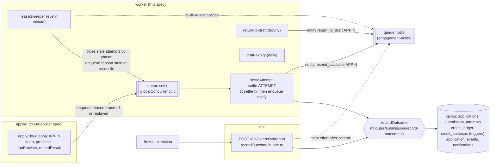

# Worker spec 08: `submission-settlement` (settlement, extension reports and submission sweepers)

Revision 1, 2026-10-25. Tier: **critical**. Agents invoked: **none**. Owner process: `worker` (workflows and schedules) and `api` (the synchronous extension report route).

Inputs read in full: `01-architecture.md` revision 2 (B.2, B.5, B.6, B.10, B.11.1, B.12.4, B.16, C.2), `02-database.md` revision 2 (sections 3 to 5, 7.3, 7.5, 7.6.10, 8, 9, 10), `_db/applications.md` (the domain draft that 02 merges; its sections 3.1, 3.2, 4, 5, 6 are the authoritative SQL text this spec calls), `05-api.md` section 13 and 4.7, `06-infrastructure.md` sections 6.6, 6.7, 9.3, 9.4 and 10, `_research/spike-s-d1-local.md`, and the skeleton files `server/src/services/submissions.ts`, `server/src/services/credits.ts`, `server/src/routes/extension.ts`, `server/src/jobs/cloud-apply.ts`, `server/src/worker.ts`.

Skills applied: `dbos-typescript` (workflow and step structure, no enqueue from inside a step, determinism, queue registration), `saga-orchestration` (the send is a pivot transaction: compensation before it, forward recovery only after it), `error-handling-patterns` (error taxonomy, retry classes, dead-letter and poison handling). All three loaded.

---

## 1. Purpose and place in the lifecycle

This worker turns "something happened on an employer form" into exactly one durable business outcome: an application is `submitted` and charged one credit, or it is `failed` with a code, a plain-words reason and no charge. It is the only place in the system where a submission is charged (B.2 rule 6: only `modules/submission/record-outcome.ts` sets `submitted`, or `failed` from a report), and it is the sweeper of every attempt and approval that would otherwise wait forever.

Responsibilities:

1. **`settleAttempt`** (queue `settle`): settle a cloud attempt, or an expired explicit extension claim, by the settlement decision table (B.6.8), reading the `submission_attempts` row and never a step result.
2. **`POST /api/extension/report`** (frozen route, synchronous on the api): record an extension report through the same `recordOutcome`, under the session-bound lease rules (B.6.6, 05-api 13.4).
3. **Late confirmation**: a genuine `submitted` report for an application `failed` with an ambiguous code (`unconfirmed`, `timeout`, `no_report`) becomes `submitted` and is charged once.
4. **`leaseSweeper`** (every minute): close stale cloud attempts by the phase they stopped in, close expired explicit extension claims, enqueue settlement for every closed and unsettled attempt, and re-drive lost resend notices.
5. **`return-to-draft`** (hourly): extension approvals unsent for 14 days go back to `draft`, releasing the reserved credit.
6. **`draft-expiry`** (daily): drafts not approved within 30 days of their last update become `draft_state = 'expired'` with their content cleared.
7. **Receipts and events**: the application receipt and `receipt_summary`, the `application_events` rows `sent` and `failed`, the `autopilot_sent` and `resend_available` notifications, and the hand-off of resend and return-to-draft emails to the `notify` queue.

**Saga framing.** Sending is a saga with one pivot. Approval reserves a credit (`credit_balances.in_flight + 1`, maintained by `applications_in_flight_aiud`); that reservation is the compensatable step. The employer's form submit is the **pivot transaction**: it cannot be undone. Before the pivot, the compensation is "release the reservation" (`failed`, no ledger row; the in-flight trigger subtracts 1). After the pivot, only forward recovery is allowed: record the truth and charge once. When the system cannot tell which side of the pivot it is on, it neither charges nor resends automatically (`needs_check`, failure code `unconfirmed`, `timeout` or `no_report`); the user checks the employer's email first, and a later genuine report settles it forward.



**Boundaries with neighbouring workers.**

| Neighbour | It owns | This worker relies on |
|---|---|---|
| `cloud-applier` | `claim_cloud_attempt`, `get_applier_payload`, `mark_browser_launched`, `mark_attempt_phase`, `record_attempt_result`; enqueues `settle:<attemptId>` as the last action of `applyCloud` | The attempt row is the only input; the applier never writes `applications.status` after the claim and never writes the ledger |
| `approval-autopilot` | `approveCore` (sets `approved`, `attempt_no + 1`, reserves the credit), resend, Autopilot off switch and spike pause (both return Autopilot approvals to `draft`) | `attempt_no` identifies the attempt; resend accepts only rows this worker failed |
| `engagement-notify` | The `notify` workflow `notify:<kind>:<entityId>`: `email_sends` claim, `action_tokens` mint, Postmark send, the hourly Autopilot email | Kinds `resend_available` and `return_to_draft` with entity `<applicationId>:<attemptNo>` |
| `ops-monitors` | `submission-health` (spike pause, `extension_only:<ats>`), invariants I-1 to I-10, ledger drift | The attempt rows and counters this worker writes |
| `housekeeping` | `failed-expiry` (90 days), `scrub-applications` (7 days after terminal), `retention` of `evidence` and `session_id` (90 days) | `terminal_at` set by the status guard on the transitions this worker makes |
| `durable-ops` | Orphan recovery (cancel then resume), version migration, `dbos-retention` | Deterministic ids and state-conditional first steps (rule D1) |

Code layout (B.2):

| File | Content |
|---|---|
| `server/src/modules/submission/record-outcome.ts` | `recordOutcome(tx, input)`; the only writer of `submitted` and of `failed` from a report |
| `server/src/modules/submission/decision.ts` | `decideSettlement(attempt, opts)` and `closeByPhase(attempt, opts)`: pure functions, the decision table as code |
| `server/src/modules/submission/receipt.ts` | `buildCloudReceipt`, `buildExtensionReceipt`, `receiptSummary` |
| `server/src/modules/submission/messages.ts` | `FAILURE_MESSAGES` (plain-words `failure_reason` per code), `RESENDABLE`, `AMBIGUOUS` |
| `server/src/modules/submission/extension-report.ts` | `handleExtensionReport(req)`: route body for `POST /api/extension/report` |
| `server/src/modules/submission/sweeps.ts` | `sweepAttempts()` (leaseSweeper body) |
| `server/src/modules/applications/lifecycle-sweeps.ts` | `returnToDraftBatch(tx)`, `expireDraftsBatch(db)` (writer module `applications/`, `_db/applications.md` 1.1) |
| `server/src/durable/workflows/settle-attempt.ts`, `lease-sweeper.ts`, `return-to-draft.ts`, `draft-expiry.ts` | Sequencing only (B.2 rule 2) |

---

## 2. Trigger, schedule and payload (a TypeScript type), plus the idempotency key

| Entry point | Kind | Started by | Idempotency key | Timeout |
|---|---|---|---|---|
| `settleAttempt` | Queued workflow, queue `settle` (worker) | `applyCloud` final body action (`reason: "reported"` or `"replayed"`); `leaseSweeper` (`"stale"` or `"reconcile"`); operator fork | Workflow id `settle:<attemptId>`; the database adds `submission_attempts.settled_at IS NULL` as the state condition | `timeoutMS: 120_000` |
| `POST /api/extension/report` | Synchronous route on the api (no workflow, B.5.4) | Frozen extension, bearer token | Natural: status checks under row locks, `submission_attempts_app_attempt_uq (application_id, attempt_no, channel)`, `credit_ledger_application_reason_uq` | Handler budget 10 s |
| `leaseSweeper` | Scheduled workflow, crontab `* * * * *` | Worker entry point only (`DBOS.registerScheduled`) | DBOS runs each scheduled interval once across replicas; every statement is conditional | `timeoutMS: 55_000` |
| `return-to-draft` | Scheduled workflow, crontab `7 * * * *` (hourly, minute 7) | Worker | Scheduled interval; conditional `UPDATE ... WHERE status = 'approved'` | `timeoutMS: 300_000` |
| `draft-expiry` | Scheduled workflow, crontab `40 3 * * *` (daily 03:40 UTC, after `dbos-retention` at 03:30) | Worker | Scheduled interval; conditional `UPDATE ... WHERE draft_state <> 'expired'` | `timeoutMS: 600_000` |

Payloads (ids, enums and dates only, rule D4; each validated by zod at the workflow boundary):

```ts
// server/src/durable/workflows/settle-attempt.ts
import { z } from "zod";

export const SETTLE_REASONS = ["reported", "replayed", "stale", "reconcile"] as const;
export type SettleReason = (typeof SETTLE_REASONS)[number];
//  reported  : applyCloud ran record_attempt_result; the attempt is closed
//  replayed  : applyCloud's runBrowser found browser_launched_at already set (crash replay); the attempt is open
//  stale     : leaseSweeper closed the attempt by phase in this run
//  reconcile : leaseSweeper found a closed attempt with settled_at IS NULL older than 60 s

export const settleAttemptInput = z.object({
  attemptId: z.uuid(),
  reason: z.enum(SETTLE_REASONS),
}).strict();
export type SettleAttemptInput = z.infer<typeof settleAttemptInput>;

export interface SettleAttemptOutput {          // also the checkpointed output of step settleTx
  result: "submitted" | "failed" | "noop";
  charged: boolean;
  applicationId: string | null;                 // uuid
  attemptNo: number | null;
  notify: "resend_available" | null;            // enqueue notify:resend_available:<applicationId>:<attemptNo>
}

// Scheduled workflows receive DBOS's (scheduledTime: Date, startTime: Date); nothing else.
export interface SweepOutput {                  // output of the leaseSweeper step
  settle: { attemptId: string; reason: "stale" | "reconcile" }[];   // at most 500
  notices: { applicationId: string; attemptNo: number }[];         // at most 200
  closedStale: number; closedClaims: number;
}
export interface ReturnToDraftOutput { returned: { applicationId: string; attemptNo: number }[]; more: boolean }   // at most 500
export interface DraftExpiryOutput { expired: number; more: boolean }
```

The extension report body is the frozen `submissionReportSchema` from `shared/` (`applicationId`, `outcome: "submitted" | "failed"`, `failureReason?` up to 500, `filledFields` up to 300 of `{ fieldKey, label, value }`, `confirmationText?` up to 4,000, `submittedAt`). The route adds `userId` and `sessionId` (the Better Auth session behind the bearer token) from `requireAuth`. Response `200 { status }`.

The shared core function (extends the B.6.9 declaration; the fields added here are marked):

```ts
// server/src/modules/submission/record-outcome.ts
export type FailureCode =
  | "challenge" | "posting_closed" | "required_missing" | "applier_error" | "unconfirmed"
  | "timeout" | "no_report" | "plan_lapsed" | "cloud_unavailable_for_ats" | "extension_reported";

export const AMBIGUOUS: ReadonlySet<FailureCode> = new Set(["unconfirmed", "timeout", "no_report"]);
export const RESENDABLE: ReadonlySet<FailureCode> = new Set([
  "challenge", "required_missing", "applier_error", "plan_lapsed", "cloud_unavailable_for_ats", "extension_reported",
]);                                             // AMBIGUOUS codes resend only with acknowledgeUnconfirmed; posting_closed never

export interface OutcomeInput {
  applicationId: string;
  source: "extension" | "cloud";
  userId?: string;                              // extension path: must own the row, else not_found
  sessionId?: string;                           // extension path: lease rules
  attemptId?: string;                           // settlement path: the attempt being settled (cloud, or an extension claim)
  outcome: "submitted" | "failed";
  failureCode?: FailureCode;
  failureReason?: string;                       // plain words; extension: the client's text, trimmed to 500
  receipt?: Receipt;                            // built by receipt.ts
  clientSubmittedAt?: string;                   // kept in the receipt only (D-27)
}

export interface Receipt {                      // frozen shape plus one optional key
  filledFields: { fieldKey: string; label: string; value: string }[];
  confirmationText?: string;
  channel: "extension" | "cloud";
  clientSubmittedAt?: string;                   // added (optional)
}

export type OutcomeResult =
  | { status: "submitted"; charged: boolean; duplicate: boolean; lateConfirm: boolean; leaseConflict: boolean }
  | { status: "failed" }
  | { status: "conflict"; current: ApplicationStatus }   // route: 409 conflict "Application is {status}, not approved"
  | { status: "not_found" }                               // route: 404 not_found "Application not found"
  | { status: "unchanged"; current: ApplicationStatus };  // settlement no-op; route returns 200 { status: current }

export declare function recordOutcome(tx: Tx, input: OutcomeInput): Promise<OutcomeResult>;
```

---

## 3. Algorithm, step by step: for every step name the tables and columns read and written, the agents invoked and the external calls made

No step of this worker invokes an agent or the Anthropic API. The only external calls are made by the `notify` workflow it enqueues (Postmark, owned by `engagement-notify`). Every transaction follows the global lock order of `02-database.md` 5.1 and rule L1: (1) the user's `credit_balances` row, (5) `applications` rows ordered by `id`, (6) `submission_attempts` rows.

### 3.1 `recordOutcome(tx, input)`: the one charge path

| # | Action | Reads | Writes |
|---|---|---|---|
| R1 | Owner lookup without a lock: `SELECT user_id, channel FROM applications WHERE id = $a` (extension path adds `AND user_id = $userId`). No row: return `not_found` | `applications.user_id`, `channel` | |
| R2 | Extension path: `asActor(tx, "user")`. Settlement path: actor unset. `SET LOCAL lock_timeout = '3s'` | | transaction settings |
| R3 | `lockCreditBalance(tx, userId)`: `SELECT ensure_credit_balance($u)`, then `SELECT balance, in_flight FROM credit_balances WHERE user_id = $u FOR UPDATE` | `credit_balances` | |
| R4 | `SELECT status, channel, attempt_no, current_attempt_id, approved_by, lease_session_id, lease_expires_at, failure_code, stage, answers, questions, job_id FROM applications WHERE id = $a FOR UPDATE` | `applications` | |
| R5 | Resolve the attempt row and lock it: settlement path `SELECT ... FROM submission_attempts WHERE id = $attemptId FOR UPDATE`; extension path, the open attempt `WHERE application_id = $a AND state = 'open' FOR UPDATE` if any, else the closed row `(application_id, attempt_no, 'extension')` if any | `submission_attempts` | |
| R6 | Apply the acceptance rules: table 3.3 (extension) or the decision table 3.2 (settlement) | | |
| R7a | **Submitted**: `INSERT INTO credit_ledger (user_id, delta, reason, application_id) VALUES ($u, -1, 'submission', $a) ON CONFLICT (application_id, reason) WHERE application_id IS NOT NULL DO NOTHING RETURNING id` (through `modules/billing/ledger.ts`, B.2 rule 5); `charged = row returned`. The `credit_ledger_ai` trigger adjusts `balance`. A negative balance is allowed (no `CHECK`; INV-5, RL-3) | | `credit_ledger`; `credit_balances.balance` (trigger) |
| R7b | **Submitted**: `UPDATE applications SET status = 'submitted', submitted_at = now(), receipt = $receipt, receipt_summary = $summary, stage = COALESCE(stage, 'applied'), failure_code = NULL, failure_reason = NULL, lease_session_id = NULL, lease_expires_at = NULL WHERE id = $a AND status = ANY($from)`; `$from` is `{approved, submitting}`, or `{failed}` for a late confirmation. The status guard sets `updated_at` and `terminal_at`; `applications_in_flight_aiud` subtracts 1 from `in_flight` when leaving `approved` or `submitting`; `applications_row_version_bu` bumps `row_version` | | `applications`; `credit_balances.in_flight` (trigger) |
| R7c | **Failed**: `UPDATE applications SET status = 'failed', failure_code = $code, failure_reason = $reason, lease_session_id = NULL, lease_expires_at = NULL WHERE id = $a AND status IN ('approved','submitting')`. No ledger row (INV-5). In-flight released by the trigger | | `applications`; `credit_balances.in_flight` |
| R8 | Attempt row: close or update it (3.2 and 3.3), set `settled_at = now()` on the settlement path and on every extension-path row (the report is its own settlement) | | `submission_attempts` |
| R9 | Events through `appendEvent(tx, ...)` with `ON CONFLICT (application_id, dedupe_key) DO NOTHING`: `sent` (dedupe `sent`, detail `{channel, attemptNo, charged, late}`), or `failed` (dedupe `failed:<attemptNo>`, detail `{channel, attemptNo, code}`); actor `user` on the extension path, `system` on the settlement path | | `application_events` |
| R10 | Notifications (`ON CONFLICT (user_id, kind, entity_id) DO NOTHING`): `autopilot_sent` (entity `<applicationId>`) when `approved_by = 'autopilot'` and the result is `submitted` (cloud and Starter extension); `resend_available` (entity `<applicationId>:<attemptNo>`, detail `{failureCode, ackRequired}`) when the result is `failed` with a code in `RESENDABLE` or `AMBIGUOUS` | | `notifications` |

`posting_closed` additionally calls the catalog's `closeJob(tx, jobId, 'apply_page')` in the same transaction (sets `jobs.closed_at`, `closed_by`; expires open `matches` pairs with status `new` or `below_bar`). Settlement never writes `jobs` directly.

### 3.2 `settleAttempt` (`settle:<attemptId>`)

Workflow body (sequencing only):

```ts
async function settleAttemptFn(input: SettleAttemptInput): Promise<SettleAttemptOutput> {
  const { attemptId, reason } = settleAttemptInput.parse(input);
  const out = await durable.runTx("settleTx", (tx) => settleTx(tx, attemptId, reason));      // step 1, datasource transaction
  if (out.notify && out.applicationId && out.attemptNo !== null) {                           // step 2, body-level enqueue
    await durable.enqueue("notify", notifyWorkflow,
      { kind: "resend_available", entityId: `${out.applicationId}:${out.attemptNo}` },
      { workflowID: `notify:resend_available:${out.applicationId}:${out.attemptNo}` });
  }
  return out;
}
```

The enqueue happens in the workflow body, never inside the step (DBOS rule: do not start or enqueue workflows from steps). A crash between step 1's commit and the enqueue resumes at the enqueue.

**Step 1, `settleTx` (one datasource transaction):**

| # | Action | Tables and columns |
|---|---|---|
| S1 | `SELECT application_id, user_id, settled_at FROM submission_attempts WHERE id = $attemptId` without a lock. No row (account deleted, or a bad id): return `noop`. `settled_at` set: return `noop` (rule D1; a fork from step 0 lands here) | read `submission_attempts` |
| S2 | R3 and R4 of 3.1 (balance row, then application row, `FOR UPDATE`) | lock `credit_balances`, `applications` |
| S3 | `SELECT id, channel, state, phase, failure_code, attempt_no, approved_by, evidence, submit_seen_at, browser_launched_at, heartbeat_at, started_at FROM submission_attempts WHERE id = $attemptId FOR UPDATE` | lock `submission_attempts` |
| S4 | If the attempt is still `open`: close it by phase (table below) only when `reason = 'replayed'`, or `heartbeat_at < now() - interval '90 seconds'`, or `started_at < now() - interval '8 minutes'`, or (extension channel) `applications.lease_expires_at < now()`. Otherwise return `noop` (a live attempt is never settled; the next sweep handles it) | update `submission_attempts.state`, `failure_code` (guard sets `finished_at`) |
| S5 | `ops_flag_on('ap2_verified')` decides how phase `filling` reads | read `ops_flags` |
| S6 | `decideSettlement(attempt, { ap2Verified })` (decision table below) | |
| S7 | If the application is not in the state this attempt can move (cloud: `status = 'submitting' AND current_attempt_id = $attemptId`; extension claim: `status = 'submitting' AND channel = 'extension'`), the application moved on (an extension report already recorded it, or the account was paused and it was resolved by hand): skip the application change, log `settle_app_moved_on`, continue at S9. A `submitted` attempt whose application is already `submitted` by another attempt increments metric `submissions.dual_detected` (I-1 pages) | read `applications` |
| S8 | `recordOutcome(tx, { source: attempt.channel, attemptId, outcome, failureCode, failureReason: FAILURE_MESSAGES[code], receipt })`; for `submitted` on cloud, `receipt = buildCloudReceipt(evidence, answers)` | 3.1 R7 to R10 |
| S9 | Promote an ambiguous failure: `UPDATE submission_attempts SET state = 'needs_check' WHERE id = $attemptId AND state = 'failed' AND failure_code IN ('unconfirmed','timeout','no_report')` (allowed by `submission_attempts_guard`; required by `submission_attempts_settled_ck`) | `submission_attempts.state` |
| S10 | `UPDATE submission_attempts SET settled_at = now() WHERE id = $attemptId AND settled_at IS NULL` | `submission_attempts.settled_at` |
| S11 | Return `SettleAttemptOutput` (`notify = 'resend_available'` when R10 inserted a `resend_available` row) | |

**Close by phase** (S4 here and step A of the sweeper; `closeByPhase` in `decision.ts`):

| Channel and phase when closed | New attempt state | Code |
|---|---|---|
| cloud, `claimed` or `navigating` | `failed` | `applier_error` |
| cloud, `filling`, `ops_flags.ap2_verified` unset (S-AP2 not passed) | `needs_check` | `unconfirmed` |
| cloud, `filling`, `ap2_verified` set and `submit_seen_at IS NULL` | `failed` | `applier_error` |
| cloud, `submit_seen` | `needs_check` | `unconfirmed` |
| extension (explicit claim), lease expired | `needs_check` | `no_report` |

**Decision table** (`decideSettlement`, the B.6.8 table and the failure-code catalog of `_db/applications.md` 4.8 as code; rows evaluated top to bottom):

| # | Attempt row after S4 | Attempt after settlement | Application result | `failure_reason` | Charge | Resend |
|---|---|---|---|---|---|---|
| D1 | `state = submitted` | unchanged | `submitted`, receipt, `stage = 'applied'` if null | | 1 credit | n/a |
| D2 | `state = failed`, `submit_seen_at IS NOT NULL`, code not `timeout` (defensive: a failure reported after the apply `POST` was seen is ambiguous whatever the applier said) | unchanged (a closed non-ambiguous attempt is final, guard 5.4); log `settle_failed_after_submit_seen` at error | `failed`, `unconfirmed` | `unconfirmed` text | none | with acknowledgement |
| D3 | `failed`, `challenge` | unchanged | `failed`, `challenge` | `challenge` text | none | allowed, through the extension (INV-8) |
| D4 | `failed`, `posting_closed` | unchanged | `failed`, `posting_closed`; `closeJob(tx, jobId, 'apply_page')` | `posting_closed` text | none | **not allowed** (INV-23) |
| D5 | `failed`, `required_missing` | unchanged | `failed`, `required_missing` | `required_missing` text | none | allowed after the answers are fixed |
| D6 | `failed`, `applier_error` | unchanged | `failed`, `applier_error` | `applier_error` text | none | allowed |
| D7 | `failed`, `plan_lapsed` or `cloud_unavailable_for_ats` | unchanged | `failed`, same code | code text | none | allowed, through the extension |
| D8 | `failed`, `timeout` | `needs_check` (S9) | `failed`, `timeout` | `timeout` text | none | with acknowledgement; late confirmation possible |
| D9 | `needs_check`, `unconfirmed` | unchanged | `failed`, `unconfirmed` | `unconfirmed` text | none | with acknowledgement; late confirmation possible |
| D10 | `needs_check`, `no_report` | unchanged | `failed`, `no_report` | `no_report` text | none | with acknowledgement; late confirmation possible |

`FAILURE_MESSAGES` (stored in `applications.failure_reason`, at most 500 characters, shown by the frozen web app):

| Code | Message |
|---|---|
| `challenge` | "The employer's site asked for a human check, so the cloud applier stopped. Nothing was sent and no credit was used. You can send it from the extension." |
| `posting_closed` | "This posting has closed. Nothing was sent and no credit was used." |
| `required_missing` | "A required question had no answer, so nothing was sent and no credit was used. Fill it in, then resend." |
| `applier_error` | "The cloud applier stopped before the submit step. Nothing was sent and no credit was used. You can resend it." |
| `plan_lapsed` | "Your plan no longer includes the cloud applier. Nothing was sent and no credit was used. You can send it from the extension." |
| `cloud_unavailable_for_ats` | "Cloud sending is paused for this job board. Nothing was sent and no credit was used. You can send it from the extension." |
| `unconfirmed` | "We could not confirm whether the employer received this application. No credit was used. Check your email for the employer's confirmation before you resend." |
| `timeout` | "The employer's site did not confirm in time after the submit step. No credit was used. Check your email for the employer's confirmation before you resend." |
| `no_report` | "No report from the extension within 10 minutes. Check for the employer's confirmation email before you resend." (B.6.6, verbatim) |
| `extension_reported` | The client's `failureReason` trimmed to 500 characters, or "The extension could not finish this application. No credit was used." |

**Cloud receipt** (`buildCloudReceipt`): the attempt's `evidence` holds field keys only (`submission_attempts_evidence_ck`), so values come from the application's own stored `answers`, which are what the filler typed: for each key in `evidence.filledFieldKeys`, the answer with that `fieldKey` gives `{ fieldKey, label, value }` (an unknown key gives `{ fieldKey, label: fieldKey, value: "" }`); `confirmationText = evidence.confirmationText`; `channel = "cloud"`. `receiptSummary` (both channels): `total` = length of the `questions` snapshot (or of `answers` when the snapshot is null), `filled` = filled fields with a non-empty value, `skipped = total - filled` (never below 0), `generated` = filled fields whose stored answer has `source = 'generated'`.

### 3.3 `POST /api/extension/report` (api, synchronous)

1. `requireAuth` (bearer), `user_api` limit class (fails open), 1 MB body limit, `submissionReportSchema` validation (422 `invalid_body` on a schema failure and 400 `invalid_json` on unparsable JSON, the existing behavior, 05-api 2.1).
2. `db.transaction` as role `kairos_api`: `recordOutcome(tx, { source: "extension", userId, sessionId, applicationId, outcome, failureCode: outcome === "failed" ? "extension_reported" : undefined, failureReason, receipt: buildExtensionReceipt(body), clientSubmittedAt: body.submittedAt })`.
3. Acceptance rules (R6 for the extension path; 05-api 13.4, B.6.6). "Live lease of another session" means `lease_session_id IS NOT NULL AND lease_session_id <> $session AND lease_expires_at > now()`:

| Report | Application now | Lease | Application change | Attempt row | HTTP |
|---|---|---|---|---|---|
| `submitted` | `approved` or `submitting` | any | R7a, R7b; charge 1 | The open attempt (explicit claim) becomes `submitted`, phase `reported`; else insert a closed row `(application_id, attempt_no = applications.attempt_no, 'extension', state 'submitted', phase 'reported', session_id, approved_by, evidence {confirmationText (first 2,048 chars), filledFieldKeys}, finished_at = now(), settled_at = now())`; `lease_conflict = true` when another session held a live lease | 200 `{ status: "submitted" }` |
| `submitted` | `submitted` | any | none | `UPDATE ... SET duplicate_reports = duplicate_reports + 1` on the application's current extension row (insert-or-update on `submission_attempts_app_attempt_uq`); metric and alert A-SUB-5 | 200 `{ status: "submitted" }` |
| `submitted` | `failed`, code in `unconfirmed`, `timeout`, `no_report` | any | **Late confirmation**: R7a, R7b with `$from = {failed}`; charge 1 | The attempt `current_attempt_id` points to moves `needs_check` (or `failed` with an ambiguous code) to `submitted` (guard sets `late_confirmation = true`); if that attempt cannot move (cloud row closed with a non-ambiguous code, D2), insert a closed extension row with state `submitted` | 200 `{ status: "submitted" }` |
| `submitted` | `failed` with another code, `withdrawn`, or `draft` | any | none | Evidence on the extension row for this `attempt_no` (insert closed `submitted` row, or `duplicate_reports + 1` when the row exists); alert A-SUB-5; log `report_after_terminal` at error | 409 `conflict` "Application is {status}, not approved", `details { status }` |
| `failed` | `approved` or `submitting` | holder or none | R7c with `extension_reported` | Open attempt becomes `failed` `extension_reported`; else insert closed `failed` row | 200 `{ status: "failed" }` |
| `failed` | `approved` | another session holds a live lease | none | none | 409 `conflict` (the holder may be submitting) |
| `failed` | `submitted` | any | none | none | 200 `{ status: "submitted" }` |
| `failed` | `failed`, `withdrawn` or `draft` | any | none | none | 409 `conflict` "Application is {status}, not approved" (unchanged skeleton behavior) |
| any | not the caller's or unknown | | | | 404 `not_found` "Application not found" |

4. After commit, when the result is `failed` (code `extension_reported` is resendable): best-effort `durable.enqueue("notify", ..., { workflowID: "notify:resend_available:<applicationId>:<attemptNo>" })`. If the api process dies between commit and enqueue, step D of the sweeper re-drives it (3.4). A failure to enqueue never changes the HTTP result.
5. Errors: `55P03` (lock timeout) or `40P01` retry the transaction once after 100 ms; a second failure answers 503 `service_unavailable` with `Retry-After: 5` (the frozen extension does not retry; the report-loss alert in 8 covers it). SQLSTATE `23514` from a guard is a bug: 409 `conflict`, logged at error.

### 3.4 `leaseSweeper` (every minute)

One plain step `sweepAttempts` (its own short transactions; every statement is idempotent, so the step needs no exactly-once datasource record), then body-level enqueues.

| Step | Statement | Index | Effect |
|---|---|---|---|
| A. Stale cloud attempts | `SELECT id, phase, submit_seen_at FROM submission_attempts WHERE state = 'open' AND channel = 'cloud' AND (heartbeat_at < now() - interval '90 seconds' OR started_at < now() - interval '8 minutes') LIMIT 200`; for each: `UPDATE submission_attempts SET state = $s, failure_code = $c WHERE id = $id AND state = 'open' AND (heartbeat_at < now() - interval '90 seconds' OR started_at < now() - interval '8 minutes')` with `$s, $c` from `closeByPhase` | `submission_attempts_one_open_uq` (holds only open rows) | Attempt closed; `finished_at` set by the guard. Only the attempt row is locked (no application status change here, so rule L1 does not apply; `settleAttempt` changes the application under L1) |
| B. Expired explicit extension claims | `SELECT a.current_attempt_id FROM applications a WHERE a.status = 'submitting' AND a.channel = 'extension' AND a.lease_expires_at < now() LIMIT 200`; for each: `UPDATE submission_attempts SET state = 'needs_check', failure_code = 'no_report' WHERE id = $cur AND state = 'open'` | `applications_ext_claim_idx` | Attempt closed as `needs_check`; application settled by `settleAttempt` (D10) |
| C. Closed and unsettled | `SELECT id FROM submission_attempts WHERE state <> 'open' AND settled_at IS NULL AND finished_at < now() - interval '60 seconds' ORDER BY finished_at LIMIT 500` | `submission_attempts_unsettled_idx` | Ids for `reason: "reconcile"` (this is the `reconcile-settle` check of B.5.8, run every minute instead of every 5) |
| D. Lost resend notices | `SELECT a.id, a.attempt_no FROM applications a WHERE a.status = 'failed' AND a.terminal_at BETWEEN now() - interval '48 hours' AND now() - interval '2 minutes' AND a.failure_code IN ('challenge','required_missing','applier_error','plan_lapsed','cloud_unavailable_for_ats','extension_reported','unconfirmed','timeout','no_report') AND NOT EXISTS (SELECT 1 FROM email_sends e WHERE e.kind = 'resend_available' AND e.entity_id = a.id::text || ':' || a.attempt_no) LIMIT 200` | `applications_failed_age_idx` | Notice keys |

Body: for every id from A and B, `enqueue settleAttempt { attemptId, reason: "stale" }`; for C, `reason: "reconcile"`; for D, `enqueue notify:resend_available:<applicationId>:<attemptNo>`. Every id is deterministic, so an id that already exists (the applier's own enqueue, an earlier sweep) is ignored (rule D3). If step A or B commits and the process dies before the step's checkpoint, the replayed step finds nothing open, and step C of the next run (60 seconds later) enqueues the settlement; the worst case adds about 2 minutes, inside SLO S5.

### 3.5 `return-to-draft` (hourly)

Step 1, `returnToDraftBatch` (one datasource transaction, at most 500 applications):

```sql
-- candidates; a lease taken in the last 24 hours means a side panel may still hold the item, so it is skipped
SELECT a.id, a.user_id FROM applications a
 WHERE a.status = 'approved' AND a.channel = 'extension' AND a.approved_at < now() - interval '14 days'
   AND (a.lease_expires_at IS NULL OR a.lease_expires_at < now() - interval '24 hours')
 ORDER BY a.approved_at
 LIMIT 501;                                                          -- applications_ext_queue_idx; 501st row sets more = true
-- rule L1 across several users: every balance row first, in user_id order, then the applications in id order
SELECT 1 FROM credit_balances WHERE user_id = ANY($users) ORDER BY user_id FOR UPDATE;
SELECT 1 FROM applications WHERE id = ANY($ids) ORDER BY id FOR UPDATE;
UPDATE applications
   SET status = 'draft', channel = NULL, approved_by = NULL, approved_at = NULL,
       lease_session_id = NULL, lease_expires_at = NULL
 WHERE id = ANY($ids) AND status = 'approved' AND channel = 'extension'
   AND approved_at < now() - interval '14 days'
   AND (lease_expires_at IS NULL OR lease_expires_at < now() - interval '24 hours')
RETURNING id, attempt_no;
```

Taking all balance rows before any application row keeps the global order: a single-user path never waits on another user's balance row, so no cycle is possible. The in-flight trigger releases one credit per row; `attempt_no` is kept (the next approval increments it); `draft_state` stays `ready`, and the facts-hash check at the next approval catches any drift. Reads and writes: `applications` (`status`, `channel`, `approved_by`, `approved_at`, lease columns), `credit_balances.in_flight` (trigger). No `application_events` row until the additive kind `returned_to_draft` exists (section 13, item 1); then dedupe key `returned:<attemptNo>`, actor `system`.

Step 2 (body): for each returned row, enqueue `notify:return_to_draft:<applicationId>:<attemptNo>` (email kind `return_to_draft`, one per application per attempt). If `more`, the next hourly run continues; a backlog above 2,000 rows raises an alert (section 8).

### 3.6 `draft-expiry` (daily)

One plain step `expireDrafts`, looping at most 25 times (50,000 rows a run):

```sql
UPDATE applications
   SET draft_state = 'expired', resume_lines = '[]', answers = '[]', cover_letter = NULL, resume_pdf_key = NULL,
       resume_line_entries = NULL, questions = NULL, verification = NULL, facts_snapshot_hash = NULL
 WHERE id IN (SELECT id FROM applications
               WHERE status = 'draft' AND draft_state <> 'expired' AND updated_at < now() - interval '30 days'
               ORDER BY updated_at LIMIT 2000 FOR UPDATE SKIP LOCKED);       -- applications_draft_age_idx
```

`updated_at` is not changed, so an expired draft keeps its place in the user's list. `applications_expired_ck` requires the content columns to be cleared in the same statement; `applications_guard_draft_state` makes `expired` terminal. No balance lock (a draft holds no reservation). The R2 object behind `resume_pdf_key` is not deleted here: render keys are content hashes that other applications may share, and the `kairos-renders` lifecycle removes renders unused for 30 days. No event and no email.

---

## 4. Concurrency, rate limits, ordering, batching and priorities, with numbers at 10,000 users

Volumes at growth (10,000 users, 20,200 submitted applications a day; `_db/applications.md` 7, B.12): 8,580 cloud attempts a day, about 14,000 extension reports a day (about 12,900 submitted, about 1,100 failed), about 260 extension approvals returned to draft a day (2% of extension approvals [est]), about 1,700 drafts expired a day [est]. Peak factor: checkpoint load peaks at 4 times the average (06 9.3), application writes at up to 10 times in the US evening; this section sizes for 10 times.

| Item | Setting | Load at growth (average / 10x peak) | Capacity | Headroom |
|---|---|---|---|---|
| Queue `settle` | `await DBOS.registerQueue("settle", { globalConcurrency: 8 })` after `DBOS.launch()`; not partitioned (no `partition*` option, so no partition key on enqueue); no priority; no rate limit | 0.10 / 1.0 settlements a second | 8 in flight x about 30 ms each = about 260 a second | more than 200x |
| `settleTx` lock hold | Balance row, application row, attempt row, about 8 statements | about 5 ms | | |
| Extension report route | `user_api` (600 a minute per user, fails open); 10 s budget; `lock_timeout 3s` | 0.16 / 1.6 reports a second, spread over users | 3 api replicas | more than 100x |
| `leaseSweeper` | 1 run a minute; A and B at most 200 rows each; C at most 500; D at most 200 | Open cloud attempts at any time: 21.5 at peak (applier contexts), so A reads fewer than 40 rows | 900 settlements enqueued a minute | large |
| `return-to-draft` | 500 rows per run, 24 runs a day | about 260 a day | 12,000 a day | 46x |
| `draft-expiry` | 2,000 per statement, 25 statements per run | about 1,700 a day | 50,000 a day | 29x |
| Notify fan-out | `notify` queue `globalConcurrency 4` (engagement-notify) | about 2,500 `resend_available` and 260 `return_to_draft` emails a day | | |

**Ordering.** Settlements of different attempts are independent. Two writers of one application serialize on the balance row, then the application row (rule L1): a settlement and an extension report for the same application, two extension reports from two tabs, a report and the withdraw route, a report and `return-to-draft`. Whichever commits first wins; the second sees the new status and follows its rule table (duplicate, conflict or no-op). Within one application, phases only move forward (guard 5.4) and `settled_at` is written once.

**Fairness.** Settlement does not need per-user partitioning: a settlement takes milliseconds and no user can produce more than one open attempt per application. The cloud-apply queue upstream is already partitioned by apply host.

**Kill switches.** No ops flag pauses settlement or report recording: `approvals_frozen`, `autopilot_frozen` and `pause_cloud_apply` stop new sends, never the recording of sends that happened (INV-5: a submission the employer received is always recordable). `LIFECYCLE_V2` (per user) chooses the new or the skeleton path during migration (section 12).

---

## 5. Retries, backoff, timeouts, dead-letter handling, poison messages and compensation

**Error taxonomy** (`classifyDbError` in `server/src/lib/db-errors.ts`):

| Class | SQLSTATE or cause | Handling |
|---|---|---|
| Transient contention | `40P01` deadlock, `40001` serialization, `55P03` lock timeout | Retry the transaction once after 100 ms (rule A-4), then fall through to the step retry policy |
| Transient infrastructure | `08000`, `08003`, `08006` connection, `57P01` admin shutdown, `53300` too many connections, PgBouncer `cl_waiting` timeout | Step retry policy below |
| Bug or invariant | `23514` (a guard or `CHECK` rejected the write), `23505` on a key that should have been handled by `ON CONFLICT`, `42501` privilege | Not retried. Logged at error with the constraint name; the workflow ends in `ERROR` |
| Business no-op | Zero rows from a conditional update, `settled_at` already set, application moved on | Not an error: `result: "noop"` |

**Retry policy.**

| Operation | Retries | Backoff | Timeout |
|---|---|---|---|
| `settleTx` (datasource transaction) | 5 attempts | 1 s, 2 s, 4 s, 8 s | `SET LOCAL statement_timeout = '5s'`, `lock_timeout = '3s'`; workflow `timeoutMS` 120 s |
| `notify` enqueue (body) | DBOS enqueue is a checkpointed operation; recovery resumes it | | |
| `sweepAttempts` (plain step) | `retriesAllowed: true, maxAttempts: 3, intervalSeconds: 2, backoffRate: 2` | 2 s, 4 s | statements 5 s each; workflow 55 s, so a slow run never overlaps the next interval |
| `returnToDraftBatch` | 5 attempts | 1 s doubling | `statement_timeout 30s`; workflow 300 s |
| `expireDrafts` | 3 attempts | 2 s doubling | `statement_timeout 30s` per statement; workflow 600 s |
| Extension report transaction | 1 retry after 100 ms on contention | | 10 s handler budget; then 503 |

**Dead letters.** A DBOS workflow that ends in `ERROR` is the dead letter. Re-enqueueing the same id is a no-op (DBOS returns the existing workflow), so a poison settlement never loops. It stays visible two ways: the attempt keeps `settled_at IS NULL`, which raises A-SUB-1 (page) after 10 minutes, and `GET /api/admin/workflows?status=ERROR&queue=settle` lists it. Redrive after the cause is fixed: `POST /api/admin/workflows/:id/fork` (fork from step 0 is safe because `settleTx` is state-conditional, rule D1, spike S-D1 check 5) or `resume` (runbook R-SUB-1). A scheduled run that ends in `ERROR` is not redriven: the next interval runs the same idempotent statements.

**Poison inputs.** The settlement input is two validated fields; an unknown or deleted attempt id is a `noop`, not an error. The extension report body is validated by the frozen schema before any database work; oversized evidence is truncated to the `submission_attempts_evidence_ck` bounds before the insert, so a hostile `confirmationText` cannot poison the transaction.

**Compensation (saga view).**

| Point of failure | Compensation or recovery |
|---|---|
| Before the pivot (claim, navigation, precheck, challenge, closed posting, required field missing, plan lapsed) | Compensate: application `failed`, reservation released by the in-flight trigger, no ledger row; resend offered where the code allows |
| At an unknown point around the pivot (stale in `filling` before S-AP2, in `submit_seen`, outer timeout, expired explicit claim) | No compensation and no automatic retry: `needs_check`, no charge, resend only with acknowledgement; a later genuine report settles forward (late confirmation, one charge) |
| After the pivot (confirmation seen, or `submitted` report) | Forward only: record and charge once, even when the balance goes negative |
| A charge that turns out wrong (the employer bounced it, an operator finds a dual submission) | Never automated: an operator inserts `refund_failed_submit` or `admin_adjustment` with a note and an `ops_audit` row (R-SUB-2, R-BILL-1); the application status is not reverted |

---

## 6. State transitions it performs and the invariants it must uphold (and how)

**Application status** (pairs of `applications_guard_status`; every one is a conditional `UPDATE ... WHERE status = <expected>`):

| From | To | Path in this worker | Credit effect |
|---|---|---|---|
| `approved` | `submitted` | Extension report `submitted` | in-flight -1, ledger -1 |
| `submitting` | `submitted` | `settleAttempt` D1; extension report for an explicit claim | in-flight -1, ledger -1 |
| `approved` | `failed` | Extension report `failed` | in-flight -1 |
| `submitting` | `failed` | `settleAttempt` D2 to D10 | in-flight -1 |
| `failed` | `submitted` | Late confirmation (extension report) | ledger -1 (in-flight unchanged) |
| `approved` | `draft` | `return-to-draft` | in-flight -1 |

**Draft state**: any non-terminal value to `expired` (`draft-expiry`). **Attempt state**: `open` to `failed` or `needs_check` (sweeper, `settleTx` S4); `failed` to `needs_check` (S9); `failed` or `needs_check` to `submitted` (late confirmation); insert closed `submitted` or `failed` rows (extension reports); `settled_at` set once. **Stage**: `null` to `applied` on `submitted`, otherwise untouched (forward-only guard).

| Invariant | How this worker upholds it |
|---|---|
| One credit charged only on `submitted`; `failed` never charged; one per application (INV-5) | The only ledger insert is R7a, on the submitted branch, guarded by `credit_ledger_application_reason_uq`; the failed branch writes no ledger row; late confirmation only after an ambiguous code (status guard and attempt guard) |
| A submission the employer received is always recorded (RL-1, RL-3) | `submitted` reports accepted from any session and in any lease state; no balance `CHECK`; ambiguous outcomes stay `needs_check`, never final `failed`; no ops flag pauses settlement |
| The same application sent from two tabs submits once (INV-4) | Balance-then-application locks serialize reports; the second `submitted` is `duplicate_reports + 1` with no charge; lease conflicts recorded and alerted; one open attempt per application (`submission_attempts_one_open_uq`) |
| No automatic resend of an ambiguous send (B.6.8) | This worker never enqueues `applyCloud`; ambiguous codes require `acknowledgeUnconfirmed` in `approveCore` |
| Failed is never charged after a challenge; no evasion (INV-8) | `challenge` is a failed code with no ledger row; the resend offer points to the extension |
| Closed postings never charge (INV-23) | D4 plus `closeJob` in the same transaction; `posting_closed` is not resendable |
| Approval before send (INV-3) | Settlement only consumes `approved` or `submitting` rows that `approveCore` produced; return-to-draft clears approval fields (`applications_approval_shape_ck`) |
| Autopilot receipts and notifications | `autopilot_sent` notification (one per application, `notifications_dedupe_uq`) and the `sent` event in the settlement transaction |
| Ledger append-only (INV-13) | Insert only; `kairos_api` and `kairos_worker` have no `UPDATE` or `DELETE` on `credit_ledger` |
| Ids-only checkpoints (INV-15, B.5.6) | Workflow inputs and step outputs are uuids, enums, counts and booleans; receipts and evidence never leave `kairos` |
| Lock order (02 5.1) | Balance row, application rows by id, attempt rows; the multi-user return-to-draft transaction takes every balance row first |

---

## 7. Failure modes table: cause, detection, user-visible effect, recovery

| # | Failure | Cause | Detection | User-visible effect | Recovery |
|---|---|---|---|---|---|
| F1 | Applier replica dies mid-run | Crash, OOM, deploy kill | Heartbeat stale 90 s; sweeper step A | Application stays "sending" up to about 2.5 minutes, then `failed` (`applier_error`, resend offered) or `unconfirmed` | Automatic; no charge; resend email |
| F2 | `applyCloud` replayed after a crash | DBOS recovery or orphan recovery re-runs the workflow | `mark_browser_launched` returns false; `reason: "replayed"` | As F1 | Settled by phase immediately; the browser never runs twice |
| F3 | `settleAttempt` never enqueued | Applier died after `record_attempt_result` and before the enqueue checkpoint | Sweeper step C (closed, unsettled, older than 60 s) | Status flips about a minute later | Automatic |
| F4 | Worker dies inside `settleTx` | Crash or deploy | DBOS recovery or orphan sweeper (cancel then resume) | Seconds of delay | Transaction committed or not as a unit; exactly-once by the datasource completion record |
| F5 | Worker dies after `settleTx`, before the notify enqueue | Crash | Workflow resumes at the enqueue | Resend email a minute later | Automatic; sweeper step D is the second line |
| F6 | Extension report lost | 429, 502, timeout; the frozen extension never retries | `kairos_extension_report_non2xx_total` above 1% of reports over 15 minutes pages (05-api 19.3); `submissions.report_5xx` | Application stays `approved`; after the lease expires it reappears in the queue and a second press sends again | Client-side fix in the next extension release (retry with the same body, which `recordOutcome` makes safe); until then the route fails open on limits and has a 10 s budget |
| F7 | Two tabs report the same application | Same session in two tabs | `duplicate_reports > 0`; A-SUB-5 | One charge, one `submitted` | Runbook R-SUB-5: confirm one charge, contact the user if the employer received two |
| F8 | Report from a session that does not hold the live lease | Second device or browser | `lease_conflict = true`; A-SUB-5 | Recorded and charged once | R-SUB-5 |
| F9 | `submitted` report after `withdrawn`, a non-ambiguous `failed`, or a return to draft | Side panel held the item in memory | `report_after_terminal` log; A-SUB-5; evidence row | Extension shows `api_409`; the employer has the application; no charge | R-SUB-5: operator confirms and records the truth with an `ops` actor; owner decision requested (section 13, item 5) |
| F10 | Settlement guard violation (`23514`) | Bug | Workflow `ERROR`; A-SUB-1 after 10 minutes; Sentry | Application stays "sending" | R-SUB-1: fix, then fork the workflow |
| F11 | Postgres unavailable | Outage, failover | `/health` 503; A-PG alerts | Reports answer 503 (lost, F6); settlements wait | Settlements resume after recovery (S5 budget); reports cannot be recovered server-side |
| F12 | Point-in-time restore to an older moment | Disaster recovery | `journal-reconcile.mjs` against the money journal (06 5.4) | Applications the employer received may show as `approved` | Operator marks them `needs_check` and repairs the ledger with `admin_adjustment`; never an automatic resend |
| F13 | Applier reports a failure after the apply `POST` was seen | Applier classification error | D2 rule; `settle_failed_after_submit_seen` log at error | `unconfirmed` instead of a false "nothing was sent" | Automatic; function change requested (section 13, item 4) |
| F14 | Dual submission (a needs-check send followed by an acknowledged resend that also reached the employer) | User resent after acknowledging | I-2 metric `possible_duplicates` | The employer has two applications; two charges is impossible (one per application) | Accepted risk the user acknowledged; tracked as a metric |
| F15 | Return-to-draft races a send | The user presses send as the sweep runs | Lock order serializes; the 24-hour lease skip makes it rare | If the sweep wins, the report gets 409 (F9) | F9 path |
| F16 | Sweeper lag | Worker outage, long statement | `submissions.unsettled_oldest_age_s`, A-SUB-1 | Applications stay "sending" | Automatic after recovery |
| F17 | `return-to-draft` or `draft-expiry` backlog | Worker outage, growth | Backlog gauges, A-SUB-8 (requested) | Credits stay reserved longer; drafts linger | Next runs drain at 500 an hour and 50,000 a day |
| F18 | Account deleted while an attempt is open | Erasure | Erasure step 2 waits up to 15 minutes for open attempts (02 16.2) | n/a | `settleTx` finds no attempt and ends as `noop` |

---

## 8. Observability: logs, metrics, traces and alerts with thresholds

**Logs** (pino, JSON, redacted; ids, enums and counts only, never answers, field values, confirmation text or failure text):

| Message | Level | Fields |
|---|---|---|
| `settlement` | info | `attemptId`, `applicationId`, `channel`, `reason`, `result`, `code`, `charged`, `late`, `phase`, `durationMs`, `traceId` |
| `extension report` | info | `applicationId`, `outcome`, `result`, `charged`, `duplicate`, `leaseConflict`, `late`, `http` |
| `report_after_terminal`, `settle_failed_after_submit_seen`, `settle_guard_violation` | error | ids, codes, constraint name |
| `settle_app_moved_on` | warn | ids, application status |
| `lease sweep` | info (debug when nothing happened) | `closedStale`, `closedClaims`, `reconciled`, `notices`, `durationMs` |
| `return to draft`, `draft expiry` | info | `count`, `more`, `durationMs` |

**Metrics** (written to `metrics_minute` by the `metrics` schedule; names follow 06 6.5):

| Metric | Type | Meaning |
|---|---|---|
| `submissions.settled{channel,result,code}` | counter | Settled outcomes |
| `submissions.charged`, `submissions.late_confirmations`, `submissions.needs_check{code}` | counter | Money and ambiguity |
| `submissions.duplicate_reports`, `submissions.lease_conflicts`, `submissions.report_conflicts{reason}` | counter | Extension anomalies |
| `submissions.settle_latency_s` | histogram | `settled_at - finished_at` (or minus the stale deadline) |
| `submissions.unsettled_oldest_age_s` | gauge | Oldest attempt with `settled_at IS NULL`, measured from `finished_at` or the stale deadline |
| `submissions.sweeper_closed{code}`, `submissions.claims_expired` | counter | Sweeper actions |
| `submissions.dual_detected` | counter | Settlement saw a second submitted path |
| `applications.returned_to_draft`, `applications.drafts_expired`, `applications.return_to_draft_backlog` | counter, counter, gauge | Lifecycle sweeps |
| `kairos_extension_report_non2xx_total` | counter | From the api layer (05-api 19.3) |

**Traces** (OpenTelemetry through DBOS hooks; metadata only): spans `settle.attempt` (workflow), `settle.tx`, `extension.report`, `sweep.lease`, `sweep.return_to_draft`, `sweep.draft_expiry`; attributes `kairos.attempt_id`, `kairos.application_id`, `kairos.settle.reason`, `kairos.settle.result`, `kairos.failure_code`, `kairos.charged`. The `apply:<id>:<n>` trace id is propagated into `settle:<attemptId>` so one trace covers claim to settlement.

**SLO and alerts:**

| Id | Condition | Window | Action | Runbook |
|---|---|---|---|---|
| S5 (06) | Attempts settled within 10 minutes of `finished_at` or the stale deadline: 99.9% | 30 days | Burn-rate alerts; any single breach pages | R-SUB-1 |
| A-SUB-1 | An open or closed attempt unsettled more than 10 minutes past its deadline | 1 min | Page | R-SUB-1 |
| A-SUB-2 | Dual submission (definition aligned to I-1 and I-2, section 13 item 3) | 1 min | Page, `approvals_frozen` | R-SUB-2 |
| A-SUB-5 | Any duplicate report, lease conflict or report after a terminal state | 0 | Email | R-SUB-5 |
| A-BILL-1 | Ledger or in-flight drift, negative balance | 0 | Page | R-BILL-1 |
| A-DUR-2 | A `settle` workflow pending above 30 minutes | 1 min | Page | R-DBOS-2 |
| Report loss (05-api 19.3) | Non-2xx share of `POST /api/extension/report` above 1% over 15 minutes | 15 min | Page | R-SUB-1 |
| A-SUB-7 (requested) | `needs_check` share of closed cloud attempts above 5% with at least 20 attempts in 24 hours | 1 h | Email | R-SUB-3 |
| A-SUB-8 (requested) | `applications.return_to_draft_backlog` above 2,000, or `draft-expiry` without a successful run for 26 hours, or `leaseSweeper` without a run for 5 minutes | 10 min | Email | R-SUB-1 |

---

## 9. Capacity and cost at 10,000 users: runs per day, CPU and memory, model cost per day

| Unit | Runs a day (growth) | CPU per run | CPU a day | Postgres row writes per run |
|---|---|---|---|---|
| `settleAttempt` | 8,580 | about 15 ms (zod, JSON, receipt build) | about 2.2 minutes | about 7 (ledger, application, attempt twice, event, notification, completion) |
| Extension reports (api) | 14,000 | about 10 ms | about 2.3 minutes | about 6 |
| `leaseSweeper` | 1,440 | about 20 ms | about 0.5 minutes | 0 to 40 |
| `return-to-draft` | 24 (about 260 rows) | about 50 ms | under 2 seconds | about 3 per row |
| `draft-expiry` | 1 (about 1,700 rows) | about 1 s | 1 second | 1 per row |

Average CPU is under 0.01 vCPU across the worker fleet and the api fleet; peak (10 times) under 0.05 vCPU. Memory: no heavy imports (no Playwright, Typst or parsers), under 20 MB of the worker's 1.5 GB. Connections: the worker's existing application pool (12 per replica through PgBouncer) and the api's (10 per replica); no new pool.

**DBOS checkpoint writes** (S-D1 measurements: about 6 fixed writes per workflow, 1 per step or enqueue, 2 per datasource transaction; a queued workflow with one transaction measured about 8):

| Unit | Writes per run | Writes a day |
|---|---|---|
| `settleAttempt` (8 base, plus 1 enqueue on about 30% of runs) | about 8.3 | about 71,000 |
| `leaseSweeper` (6 fixed, 1 step, rare enqueues) | about 7.2 | about 10,400 |
| `return-to-draft` (6 fixed, 1 transaction step of 3, about 11 enqueues per run) | about 20 | about 480 |
| `draft-expiry` | about 7 | 7 |
| **Total** | | **about 82,000 a day, about 4.1 per submitted application** |

This is about 7,000 a day above the `settleAttempt` row of 06 9.3 (64,000), because that row scaled B.5.7's five writes per run; the system-wide figure moves from about 55 to about 55.4 per submitted application, still under the target of 60 (A-DUR-4 alerts at 80). The notify workflows this worker enqueues are counted in the notify row of 06 9.3.

**Model cost: $0 a day** (no agent). Compute cost: under $1 a month of worker and api time, under $0.000002 per submitted application. Postmark volume handed to `engagement-notify`: about 2,800 emails a day (about 2,500 resend notices, about 260 return-to-draft notices), inside the Postmark line of 06 section 12.

---

## 10. Security and privacy notes

- **Authorization.** The report route resolves the application by `id` and `user_id = session user` before any lock (INV-11); another user's id is 404, indistinguishable from a missing one. Settlement runs as `kairos_worker` with no user input other than an attempt id produced by `claim_cloud_attempt` or by the sweeper's own queries.
- **Least privilege.** The applier role cannot reach any table this worker writes except through its functions; it never writes `applications.status` after the claim, `credit_ledger`, `application_events` or `notifications`. `kairos_api` inserts into `credit_ledger`, `submission_attempts`, `application_events` and `notifications` (02 4.2 matrix) and cannot update or delete the ledger or events.
- **Untrusted input.** `confirmationText`, `failureReason` and `filledFields` from the extension, and `evidence.confirmationText` from the employer page, are untrusted. They are length-capped, stored as data, shown only to their owner as text (never HTML), and never sent to any model or used in any decision except the accept rules, which read only `outcome`. `evidence` may not hold field values (`submission_attempts_evidence_ck` rejects `filledFields`, `values`, `answers`, `receipt` keys).
- **Personal data.** Receipts hold answer values, including sensitive ones (EEO, visa, salary), copied from answers the user approved; `housekeeping`'s `scrub-applications` blanks sensitive values 7 days after the terminal state and drops the `questions` snapshot; `retention` nulls `submission_attempts.evidence` and `session_id` 90 days after settlement. Checkpoints in `kairos_dbos` carry only uuids, enums, counts and booleans (B.5.6); the seeded-PII scan (`durable/pii-scan.test.ts`) covers `settle:*`, `leaseSweeper`, `return-to-draft` and `draft-expiry`.
- **Sessions.** `session_id` on extension attempts is the Better Auth session id, used only to detect lease conflicts; it is not a credential (sessions are revocable and the bearer token is not stored). Sign-out clears the session's leases (05-api 5.2).
- **Logs and traces.** Ids, codes and counts only; pino redaction covers request bodies on `/api/extension/report`.
- **Money integrity.** Every charge is reconstructable from the append-only ledger, the attempt rows and the money journal (06 5.4); drift pages and freezes approvals.
- **Erasure.** Deleting an account cascades to applications and attempts; the ledger is archived under a user hash first (`user_archive_ledger_bd`); a settlement that arrives afterwards is a `noop`.

---

## 11. Tests (unit, integration, failure injection) and acceptance criteria

Unit tests (vitest, no database):

| Id | Test |
|---|---|
| U-1 | `decideSettlement` exhaustively: every combination of channel, state, phase, failure code, `submit_seen_at` set or not, `ap2Verified` true or false yields exactly the row of the decision table and close-by-phase table; no combination yields a charge except D1 |
| U-2 | `buildCloudReceipt` and `receiptSummary`: unknown keys, empty values, generated answers, null questions snapshot, `skipped` never negative |
| U-3 | `FAILURE_MESSAGES` has a message for every `FailureCode` and each is at most 500 characters; `RESENDABLE` and `AMBIGUOUS` partition the codes with `posting_closed` alone outside both |
| U-4 | Workflow input and output schemas contain no unconstrained free-text string (the B.5.6 CI rule) |

Integration tests (Testcontainers Postgres 18, every migration applied, DBOS launched with the `settle` and `notify` queues registered, real triggers and grants):

| Id | Test | Asserts |
|---|---|---|
| I-1 | Every row of the extension rule table (3.3) | Status, HTTP result, ledger rows, `in_flight`, attempt row, events, notifications exactly as specified |
| I-2 | Every row D1 to D10 through `settleAttempt` | Same assertions; `closeJob` called for D4; `needs_check` for D8 to D10; `settled_at` set once |
| I-3 | Sweeper per phase with `ap2_verified` set and unset | Close-by-phase table; settlement enqueued; a fresh heartbeat is never closed |
| I-4 | Expired explicit extension claim | `needs_check`, `no_report`, application `failed`, credit released, resend notice enqueued |
| I-5 | Late confirmation from `needs_check`, from `failed`+`timeout` before settlement, and on a D2 attempt | One charge; `late_confirmation = true` or a new extension row; event `sent` with `late = true` |
| I-6 | Concurrency: 200 users x 4 connections interleaving reports, settlements, withdraw, return-to-draft and Autopilot off (02 T-DB-2 shape) | Zero `40P01` after the single retry; one charge per submitted application; balances equal the ledger recount; `in_flight` equals the count of `approved` and `submitting` |
| I-7 | Two simultaneous `submitted` reports for one application | One `submitted`, one charge, `duplicate_reports = 1` |
| I-8 | Return-to-draft respects the 24-hour lease skip and the 14-day boundary; draft-expiry clears content and keeps `updated_at` | Exact rows changed |
| I-9 | Grants (02 T-12 subset) | `kairos_applier` cannot call anything this worker uses; `kairos_api` cannot update `credit_ledger` |
| I-10 | Seeded-PII scan after running every flow | No marker string in any `kairos_dbos` table |
| I-11 | Contract suite replay of the frozen `POST /api/extension/report` calls | Byte-compatible `{ status }` and error envelopes |

Failure injection:

| Id | Injection | Asserts |
|---|---|---|
| X-1 | Kill the worker between `settleTx` commit and its checkpoint (process exit inside the step after commit) | On recovery the transaction is not re-applied (datasource completion record); one charge, one event |
| X-2 | Kill the worker after `settleTx`, before the notify enqueue | The enqueue happens on recovery; one `notify:resend_available:*` workflow |
| X-3 | `DBOS.forkWorkflow(settleId, 0)` on a completed settlement (S-D1 check 5: forks re-run effects) | `noop`; no second ledger row, event or notification |
| X-4 | Kill the applier in each phase (50 runs, P5 gate) | Every attempt settled within 10 minutes by the table; zero charges for unreported attempts; zero duplicate employer submissions on the fake ATS |
| X-5 | Kill the api between the report commit and the response | The row is recorded; a replayed identical report returns the stored status with no second charge |
| X-6 | Postgres restart during 1,000 scripted approvals (P2 chaos gate) | Every application terminal within 10 minutes; zero duplicate attempts; zero double charges |
| X-7 | Lock-timeout storm: hold the balance row for 5 s while a report arrives | One retry, then 503; no partial write |

**Acceptance criteria** (phase P2 exit for the extension path and settlement; P5 for the full cloud phase set):

1. Every row of the decision table and the extension rule table is covered by a passing integration test.
2. The P2 chaos gate passes: zero duplicate attempts, zero double charges, every application terminal within 10 minutes.
3. The P5 gate passes: 50 forced applier crashes produce zero duplicate submissions and zero charges for unreported attempts.
4. `submissions.unsettled_oldest_age_s` stays under 600 s for 7 consecutive days of beta traffic, and S5 is met.
5. The nightly drift check is clean for 14 days after `LIFECYCLE_V2` reaches 100%.
6. The recorded contract suite for the frozen report route stays green on every build.
7. Measured checkpoint writes for `settleAttempt` are within 25% of 8.3 per run.

---

## 12. Migration from the skeleton: which files it replaces and what is kept

| Skeleton file and symbol | Replaced by | What is kept |
|---|---|---|
| `server/src/services/submissions.ts` `recordSubmission` | `modules/submission/record-outcome.ts` `recordOutcome` (balance and application locks, lease rules, late confirmation, attempts, events, server-time `submitted_at`) | The 409 wording "Application is {status}, not approved", the duplicate-report no-op, the frozen `{ status }` response |
| `server/src/services/submissions.ts` `claimForCloud` | `claim_cloud_attempt` (cloud-applier spec) | The conditional `approved` to `submitting` claim as the single gate |
| `server/src/services/submissions.ts` `approveApplications` | `approveCore` (approval-autopilot spec) | |
| `server/src/services/credits.ts` `chargeSubmission` | `modules/billing/ledger.ts` `chargeSubmission(tx, userId, applicationId)` | The `ON CONFLICT DO NOTHING` charge on the partial unique index |
| `server/src/services/credits.ts` `availableCreditsNow`, `countInFlight` | `credit_balances` (trigger-maintained) | |
| `server/src/services/credits.ts` `refundSubmission` | An operator script that inserts `refund_failed_submit` with `ops_audit` | The ledger reason |
| `server/src/routes/extension.ts` `POST /report` body | `modules/submission/extension-report.ts` `handleExtensionReport` | Path, `submissionReportSchema`, bearer auth, response |
| `server/src/jobs/cloud-apply.ts` calls to `recordSubmission` | Removed: the applier writes only attempt rows; settlement happens here | |
| `server/src/worker.ts` BullMQ wiring | DBOS queue `settle` and three schedules in `server/src/durable/` | |

**Order (phase P2, B.14).**

1. Migrations `apps_m1_expand`, `apps_m2_backfill`, `apps_m3_indexes` and billing's `billing_02_ledger_balances` are applied (02 14.3). Backfill statement 6 turns every legacy `submitting` row into an open attempt in phase `submit_seen` with an epoch heartbeat.
2. Deploy this worker's code behind `LIFECYCLE_V2` (per user, through `feature_enabled`). Users off the flag keep the skeleton's `recordSubmission`; the triggers on `applications` and `credit_ledger` keep `credit_balances` correct for both paths.
3. Enable the flag for internal accounts, then 1%, 10%, 50%, 100%. On the first `leaseSweeper` run for a flagged user, each legacy `submitting` row closes as `needs_check` with `unconfirmed` and gets the resend notice with acknowledgement (the safe reading of "claimed by the old engine, outcome unknown").
4. The BullMQ `cloud-apply` queue drains: legacy jobs for unflagged users still call the skeleton's `recordSubmission`; `reconcile-apply` only considers flagged users, so no entity is processed by both engines (02 14.5, `_db/applications.md` 8.5).
5. After 14 days at 100%, the flag and the skeleton functions are deleted, and `apps_m7_contract` validates the late constraints.

Rollback: every step before `apps_m7_contract` is additive; turning `LIFECYCLE_V2` off returns users to the skeleton path with no schema change. Attempts and events written meanwhile stay valid.

### 12.1 Places this spec follows spike S-D1 (where it differs from B.5 of the architecture)

| # | Architecture text | This spec, per S-D1 |
|---|---|---|
| 1 | Queue `settle` declared with `concurrency: 8` | `await DBOS.registerQueue("settle", { globalConcurrency: 8 })` after `DBOS.launch()` in `durable/queues.ts`; no `new WorkflowQueue` |
| 2 | Partition options named `partitionQueue` | `settle` sets no `partition*` option, so it is not partitioned and enqueues pass no partition key |
| 3 | Rule D1 described as good practice | Mandatory: `forkWorkflow` replays from step 0 and re-runs business effects, so `settleTx` starts with the `settled_at` check, and every insert is insert-once (events by `dedupe_key`, notifications by `notifications_dedupe_uq`, ledger by `credit_ledger_application_reason_uq`) |
| 4 | Orphan recovery possibly through a public recovery call | Orphaned `settle` workflows are recovered by `durable-ops` with `cancelWorkflow` then `resumeWorkflow`; settlement depends only on that |
| 5 | Retention through an SDK garbage-collection call | `dbos-retention` uses `deleteWorkflows` in batches of 500; `settle:*` workflows are kept 14 days (not a short-retention queue), schedules 2 days |
| 6 | About 5 checkpoint writes per `settleAttempt` | About 8.3 per run (section 9); the sweeper uses a plain step instead of a datasource transaction to avoid the 2 completion writes on 1,440 idle runs a day |
| 7 | Named ESM imports of the SDK | Only `server/src/durable/` imports `@dbos-inc/dbos-sdk`, with a default import (`import dbosSdk from "@dbos-inc/dbos-sdk"; const { DBOS } = dbosSdk;`) |
| 8 | Driver version unspecified | Datasource transactions run on `pg@8` (8.23.1 pinned) |

---

## 13. Additions requested: anything this worker needs that the foundation documents lack (or "none")

| # | To | Request | Why |
|---|---|---|---|
| 1 | `02-database.md` 7.3.4 and `05-api.md` `EVENT_KINDS` | Add `returned_to_draft` to `application_events_kind_ck` (a `NOT VALID` constraint swap) and to the shared `EVENT_KINDS`, actor `system`, dedupe key `returned:<attemptNo>` | Return-to-draft changes status and releases a reservation, but the timeline has no kind for it today; this spec writes no event until the kind exists |
| 2 | `05-api.md` 13.3 | The explicit claim must insert an open `submission_attempts` row (channel `extension`, `attempt_no` of the application, `session_id`) and set `current_attempt_id` in the same transaction as `approved` to `submitting`; release must close that attempt as `failed`, `extension_reported`, `evidence.detail = 'released'` | The 13.3 statement as written violates `applications_submitting_ck` and leaves the sweeper nothing to close (`_db/applications.md` 4.1 already specifies the insert) |
| 3 | `06-infrastructure.md` A-SUB-2 | Align with invariants I-1 (more than one `submitted` attempt: page and freeze) and I-2 (an ambiguous attempt followed by an unacknowledged later submission: page); an acknowledged resend after `needs_check` is a metric, not a page | As written ("more than one attempt with state in submitted, needs_check") it would freeze approvals on every acknowledged resend |
| 4 | `02-database.md` `record_attempt_result` | When `submit_seen_at IS NOT NULL` and `p_state = 'failed'`, store `failure_code = 'timeout'` whatever code was passed | Keeps the attempt row ambiguous after the apply `POST` was seen, so late confirmation can update it; rule D2 here is the defensive copy |
| 5 | Owner, then `02-database.md` guard v4 | Decide whether a genuine extension `submitted` report after an extension `failed` report (`extension_reported`), after a return to draft, or after a withdraw, is recorded automatically. Default implemented: 409 `conflict`, evidence row, A-SUB-5 email, operator correction. Recommended: treat `extension_reported` as late-confirmable for the extension source only | The frozen side panel can hold an item for hours; today such a real submission is recorded only by an operator |
| 6 | `02-database.md` invariant I-6 | Add a grace window: `AND s.finished_at < now() - interval '10 minutes'` for the closed current attempt | Between the sweeper closing an explicit claim and settlement, an extension application is briefly `submitting` with no open attempt |
| 7 | `01-architecture.md` B.5.8 and `durable-ops` | `reconcile-settle` is run by `leaseSweeper` step C every minute; `durable-ops` need not run a second copy (a second copy is harmless). New reconciler row: "resendable failure without a resend notice" (step D) | Recorded so the reconciler list stays complete |
| 8 | `engagement-notify` | For `resend_available`, mint the `action_tokens` row with `expires_at = applications.terminal_at + interval '7 days'` so a repeated notify for the same `<applicationId>:<attemptNo>` is a no-op; the settlement side passes ids only | Settlement re-drives notices (step D); the mint must be idempotent |
| 9 | `06-infrastructure.md` 6.7 and 9.3 | Add alerts A-SUB-7 and A-SUB-8 (section 8) and the metrics of section 8 to the metric catalog; update the `settleAttempt` row of 9.3 to about 71,000 writes a day and add `leaseSweeper` at about 10,400 within the schedules row | Measured S-D1 shape |
| 10 | `05-api.md` 13.2 | Adopt `_db/applications.md` D10's renewal rule (renew the visibility lease only when this session does not hold it or less than 5 minutes remain) | Fewer non-HOT writes; this spec's 24-hour lease skip in return-to-draft works with either rule |
