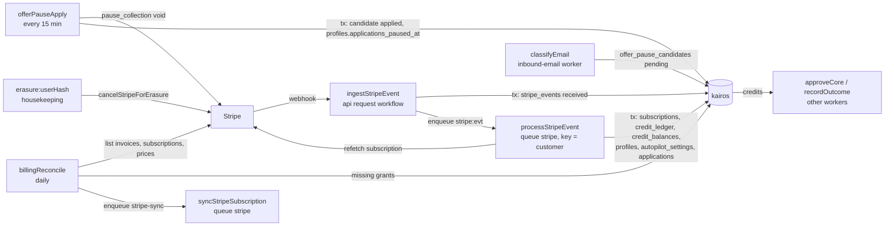

# Worker spec 09: billing-events (Stripe events and credits)

Revision 1, 2026-10-25. Tier: **critical** (money). Agents invoked: **none**; this worker never calls a model. Processes: `api` (the `ingestStripeEvent` request workflow behind `POST /api/webhooks/stripe`) and `worker` (everything else). Source module: `server/src/modules/billing/` (exists in the target layout of 01-architecture.md B.2); workflows in `server/src/durable/workflows/billing.ts` (new file).

Foundation documents used: 01-architecture.md (A.8 SC-5 and RL-3, B.5, B.6.4, B.6.9, B.6.11, B.10.3, B.16), 02-database.md (sections 3.2, 4, 5, 7.4, 8, 9, 10, 12, 14, 16.2, 18), `_db/billing.md` (sections 3 to 6, the domain draft that 02 merged), 05-api.md (sections 12.5, 14.1, 14.2, 16, 21.6), 06-infrastructure.md (A-BILL alerts, S7, R-BILL runbooks, money journal), the S-D1 spike correction table, `shared/src/plans.ts`, and the sibling worker specs 14-durable-ops (state reconciler for spent `stripe:` ids), 15-ops-monitors (billing invariant checks) and 16-housekeeping (erasure store X1, retention R12).

Skills applied: `dbos-typescript` (workflow and step structure, determinism, no workflow starts inside steps, queue usage), `saga-orchestration` (each Stripe interaction modeled as a local transaction plus an idempotent external call with an explicit compensation or a reason none is needed), `error-handling-patterns` (transient versus permanent versus anomaly classification, bounded retries, dead-lettering, error codes instead of messages). All three loaded.

Names this spec introduces that are not in the foundation documents are marked "(new)" and collected in section 13.

---

## 1. Purpose and place in the lifecycle

`billing-events` turns Stripe's view of a customer into Kairos state, and is the only path by which money becomes credits. It owns five jobs:

| Job | Trigger | What it protects |
|---|---|---|
| Ingest | `POST /api/webhooks/stripe` starts the request workflow `ingestStripeEvent` | Store then process (fixes D-14): a 2xx to Stripe means the event is durably stored, never that it was applied |
| Process | `processStripeEvent` on queue `stripe`, partitioned by Stripe customer | Subscription sync with refetch and ordering guard (D-15); invoice grants from `shared/src/plans.ts` with rollover under the balance lock (FR-46, FR-47, D-16, D-23); refund and dispute alerts |
| Offer pause apply | `offerPauseApply` (new name for the `offer-pause-apply` schedule), every 15 minutes | Billing pauses only on a genuine offer and only after the 48-hour undo window (FR-48, D-26) |
| Reconcile | `billingReconcile` (the `billing-reconcile` schedule), daily | Heals any lost webhook: paid invoices of the last 7 days without a grant, subscriptions that differ from Stripe, past-due grace expiry, Stripe prices that differ from `plans.ts` |
| Stripe cancel on deletion | `cancelStripeForErasure` (new), a module function that the `erasure:<userHash>` workflow of 16-housekeeping calls as its store X1 | Billing never outlives the account (FR-6, D-24) |

Place in the lifecycle:



What this worker does **not** do: it never charges a credit (only `recordOutcome` inserts `submission` rows), never changes an application to `approved` or `submitted`, never creates an offer-pause candidate (only the deterministic offer rule in `classifyEmail` does), and never decides a refund (refunds and disputes are alert-only; an operator posts `admin_adjustment` or `refund_failed_submit` through the operator CLI with an `ops_audit` row).

---

## 2. Trigger, schedule and payload (a TypeScript type), plus the idempotency key

### 2.1 Triggers and idempotency keys

| Workflow | Kind | Process | Trigger | Workflow id (idempotency key) | Queue | Timeout |
|---|---|---|---|---|---|---|
| `ingestStripeEvent` | request | api | `POST /api/webhooks/stripe` after signature verification (05-api 14.2) | `stripe-in:<eventId>` | none (runs in the request) | 5 s wait, then 503 |
| `processStripeEvent` | queued | worker | `ingestStripeEvent`; 14-durable-ops `state-reconcile` (kind `stripe`); `billingReconcile` (stuck-event pass, 4.5); operator redrive | `stripe:<eventId>` when `redrives = 0`, else `stripe:<eventId>:<redrives>` | `stripe`, partition key = `stripe_events.stripe_customer_id` or the literal `none` | 10 min |
| `syncStripeSubscription` (new) | queued | worker | `billingReconcile` when a local subscription differs from Stripe | `stripe-sync:<subscriptionId>:<yyyymmdd>` | `stripe`, partition key = customer id | 5 min |
| `offerPauseApply` | scheduled | worker | cron `*/15 * * * *` (UTC) | DBOS schedule id (one per scheduled time) | none | 10 min |
| `billingReconcile` | scheduled | worker | cron `15 4 * * *` (UTC; after `llm-usage-reconcile` 02:30, `eval-nightly` 03:00 and `dbos-retention` 03:30) | DBOS schedule id | none | 15 min |
| `cancelStripeForErasure` | module function, not a workflow | worker | step X1 of `erasure:<userHash>` (16-housekeeping) | Stripe idempotency keys `erase:<userHash>:sub:<subscriptionId>` and `erase:<userHash>:customer` | none | 30 s per call |

Stripe idempotency keys for writes this worker makes:

| Call | Key | Why it is safe to repeat |
|---|---|---|
| `subscriptions.update` with `pause_collection` (offer pause) | `pause:<userId>:<inboundEmailId>` (01 B.6.11) | Same request within 24 hours returns the cached result; after 24 hours, setting the same pause again is a no-op on Stripe's side |
| `subscriptions.cancel` (erasure) | `erase:<userHash>:sub:<subscriptionId>` | One key per subscription; a cancelled subscription answers `resource_missing` or its terminal state, treated as done |
| `customers.del` (erasure) | `erase:<userHash>:customer` | A deleted customer answers `resource_missing`, treated as done |

### 2.2 Payload types

Every workflow input and step output is ids, enums, integers, booleans and ISO timestamps only (rule D4, 01 B.5.6). The extract is built by the api route from the signature-verified event, using an allowlist per type; names, emails, addresses and card details never leave the route.

```ts
// server/src/modules/billing/types.ts
import { z } from "zod";

export const STRIPE_ID = /^[a-z]{2,6}_[A-Za-z0-9]{8,64}$/;            // evt_, sub_, cus_, in_, ch_, price_, dp_
const stripeId = z.string().regex(STRIPE_ID);
const userId = z.string().min(1).max(64).regex(/^[A-Za-z0-9_-]+$/);   // Better Auth ids

export const HANDLED_TYPES = [
  "customer.subscription.created", "customer.subscription.updated", "customer.subscription.deleted",
  "customer.subscription.paused", "customer.subscription.resumed",
  "invoice.paid", "invoice.payment_failed", "charge.refunded", "charge.dispute.created",
] as const;
export type HandledType = (typeof HANDLED_TYPES)[number];

export const stripeEventPayloadSchema = z.discriminatedUnion("kind", [
  z.object({ kind: z.literal("subscription"), subscriptionId: stripeId, customerId: stripeId, status: z.string().max(32) }),
  z.object({
    kind: z.literal("invoice"), invoiceId: stripeId, customerId: stripeId, subscriptionId: stripeId.nullable(),
    userId: userId.nullable(),                       // invoice.parent.subscription_details.metadata.userId
    amountPaid: z.number().int().nonnegative(),      // minor units (cents)
    couponIds: z.array(z.string().regex(/^[A-Za-z0-9_-]{1,64}$/)).max(10),
    lines: z.array(z.object({
      priceId: stripeId,
      lookupKey: z.string().regex(/^[a-z0-9_:-]{1,64}$/).nullable(),   // diagnostics only, see 3.4
      proration: z.boolean(),
    })).max(20),
    linesTruncated: z.boolean(),                     // true when Stripe's inline lines had has_more
  }),
  z.object({ kind: z.literal("payment_failed"), invoiceId: stripeId, customerId: stripeId, subscriptionId: stripeId.nullable(), attemptCount: z.number().int() }),
  z.object({ kind: z.literal("money_movement"), chargeId: stripeId, invoiceId: stripeId.nullable(), customerId: stripeId, amount: z.number().int() }),
]);
export type StripeEventPayload = z.infer<typeof stripeEventPayloadSchema>;

/** Input of ingestStripeEvent (api). payload is null for a type outside HANDLED_TYPES. */
export interface IngestStripeEventInput {
  eventId: string;            // evt_...
  type: string;               // Stripe event type, max 64 chars
  created: string;            // ISO timestamp of Stripe's event.created
  customerId: string | null;  // partition key; null only for events without a customer
  payload: StripeEventPayload | null;
}

/** Input of processStripeEvent. Everything else is read from stripe_events (rule D1). */
export interface ProcessStripeEventInput { eventId: string; redrives: number }

/** Input of syncStripeSubscription. */
export interface SyncStripeSubscriptionInput { subscriptionId: string; customerId: string; runDate: string /* yyyymmdd */ }

/** Output of the refetch step: the live subscription, reduced to what sync needs. */
export interface SubscriptionSnapshot {
  subscriptionId: string;
  customerId: string;
  metadataUserId: string | null;     // subscription.metadata.userId set at checkout
  status: "active" | "trialing" | "past_due" | "unpaid" | "canceled" | "incomplete" | "incomplete_expired" | "paused";
  priceId: string | null;            // first item
  currentPeriodEnd: string | null;   // ISO, from the first item
  cancelAtPeriodEnd: boolean;
  pauseCollection: null | { resumesAt: string | null; pausedBy: "offer_email" | "customer" };
}

export type ProcessOutcome =
  | "subscription_synced" | "subscription_stale" | "grant_applied" | "grant_duplicate" | "zero_amount"
  | "alert_only" | "unhandled_type" | "proration_only" | "user_deleted";          // last two are new (section 13)

export type BillingErrorCode =
  | "stripe_rate_limited" | "stripe_5xx" | "stripe_timeout" | "stripe_connection"  // transient
  | "stripe_auth" | "stripe_permission"                                            // systemic, retried, alarmed
  | "stripe_resource_missing" | "stripe_invalid_request" | "stripe_idempotency"    // permanent
  | "db_serialization" | "db_deadlock" | "db_unavailable"                          // transient
  | "payload_invalid" | "customer_conflict"                                         // permanent
  | "anomaly_no_user" | "anomaly_unmapped_price";                                   // anomaly, operator decides
```

### 2.3 Queue registration

Registered once by `server/src/durable/queues.ts` after `DBOS.launch()` (S-D1 correction):

```ts
await DBOS.registerQueue("stripe", { globalConcurrency: 4, partitionConcurrency: 1 });
// Any partition* option partitions the queue: every enqueue passes a partition key.
```

`partitionConcurrency: 1` serializes every event of one customer; `globalConcurrency: 4` bounds Stripe and Postgres pressure across customers. The worker is the only listener (`listenQueues` of the worker role includes `stripe`).

---

## 3. Algorithm, step by step

Notation: **tx** is a DBOS datasource transaction (exactly once with the business write), **step** is a checkpointed `runStep` (at least once, so it must be idempotent by the database), **body** is the deterministic workflow function. Every workflow's first step is a state-conditional read (rule D1, mandatory because `forkWorkflow` replays from step 0, S-D1 check 5).

### 3.1 `ingestStripeEvent` (api)

The route (05-api 14.2) verifies `Stripe-Signature` on the raw body with `stripe.webhooks.constructEvent(raw, header, secret, 300)` (current secret, then `STRIPE_WEBHOOK_SECRET_PREVIOUS`), builds `IngestStripeEventInput` with `buildEventExtract(event)` (new, `modules/billing/stripe-events.ts`), validates the extract with `stripeEventPayloadSchema` (a parse failure stores `payload = null` and marks the event for `payload_invalid` handling, section 5), reads `SELECT 1 FROM stripe_events WHERE id = $1` to set the informational `duplicate` flag, then calls `runRequestWorkflow(ingestStripeEvent, { workflowID: "stripe-in:" + eventId, waitMs: 5000 })`.

| # | Kind | Action | Reads | Writes | External |
|---|---|---|---|---|---|
| I1 | tx `storeEvent` | `INSERT INTO stripe_events (id, type, status, object_id, stripe_customer_id, event_created, payload) VALUES ($id, $type, 'received', $objectId, $customerId, $created, $payload) ON CONFLICT (id) DO NOTHING RETURNING id` | none | `stripe_events` (all listed columns; `received_at` default) | none |
| I2 | body | Enqueue `processStripeEvent({ eventId, redrives: 0 })` with id `stripe:<eventId>`, queue `stripe`, partition key `customerId ?? "none"`. Runs whether or not I1 inserted, so a crash between I1 and I2 heals on redelivery; a duplicate enqueue of the same id is ignored by DBOS | | DBOS queue row | none |

Response: 200 `{ received: true }` or 200 `{ received: true, duplicate: true }` (frozen shape). A wait above 5 seconds, a DBOS fault or a database fault answers 503 `service_unavailable` with `Retry-After: 2`, and Stripe redelivers to the same workflow id. The route never writes `subscriptions` or `credit_ledger` and never calls Stripe.

`object_id` is the invoice id for invoice and payment-failed events, the subscription id for subscription events, the charge id for money-movement events, and null otherwise.

### 3.2 `processStripeEvent` (worker, queue `stripe`)

```ts
// server/src/durable/workflows/billing.ts (specification-level code; DBOS is reached only through durable/)
export const processStripeEvent = registerWorkflow("processStripeEvent", async (input: ProcessStripeEventInput) => {
  const plan = await runTx("loadEvent", (tx) => billing.loadEvent(tx, input.eventId));          // P1
  if (plan.action === "done") return plan.outcome;                                              // D1 no-op
  try {
    const snap = plan.action === "sync"
      ? await runStep("refetchSubscription", () => billing.refetchSubscription(plan.subscriptionId), STRIPE_STEP_RETRY) // P2
      : null;
    const r = await runTx("applyEffects", (tx) => billing.applyEffects(tx, input.eventId, snap)); // P3
    if (r.autopilotPausedUserId) {                                                                 // P4
      await enqueue(notifyWorkflow, { kind: "autopilot_paused", entityId: `plan_change:${input.eventId}` },
                    { workflowID: `notify:autopilot_paused:plan_change:${input.eventId}`, queueName: "notify" });
    }
    return r.outcome;
  } catch (err) {
    const code = billing.classifyError(err);                                                       // section 5.1
    if (code.class === "permanent" || code.class === "anomaly") {
      await runTx("markDead", (tx) => billing.markDead(tx, input.eventId, code));                // P5
      return "dead";
    }
    await runTx("recordFailure", (tx) => billing.recordFailure(tx, input.eventId, code));        // P6
    throw new KairosStepError(code.code);                                                          // ERROR: 14-durable-ops redrives it
  }
});
```

| # | Kind | Action | Tables and columns read | Tables and columns written | Agents | External calls |
|---|---|---|---|---|---|---|
| P1 | tx `loadEvent` | Read the event; if `status <> 'received'` return `done`. Validate `payload` with `stripeEventPayloadSchema` (failure: permanent `payload_invalid`, P5). Decide the action by type: subscription types and `invoice.payment_failed` with a subscription id give `sync`; `invoice.paid` gives `grant`; `charge.refunded` and `charge.dispute.created` give `alert`; anything else gives `ignore`. For `sync`, resolve the local row by `stripe_subscription_id`, then by `stripe_customer_id`, and apply the **ordering guard**: when the row exists and `event_created < subscriptions.stripe_event_created`, set the event `ignored` / `subscription_stale` here and return `done` (saves a Stripe call). For `ignore` and `alert`, set the terminal status here (`ignored` / `unhandled_type`, or `processed` / `alert_only` with an error-level log and the metric of section 8) and return `done` | `stripe_events` (`id, type, status, stripe_customer_id, event_created, payload, redrives`); `subscriptions` (`user_id, stripe_subscription_id, stripe_customer_id, stripe_event_created`) | `stripe_events` (`status, outcome, processed_at, user_id`) for the early-terminal cases only | none | none |
| P2 | step `refetchSubscription` | `stripe().subscriptions.retrieve(id, {}, { timeout: 10_000, maxNetworkRetries: 0 })` and reduce to `SubscriptionSnapshot` (`toSnapshot`, new). Retries per `STRIPE_STEP_RETRY` (section 5.2). `resource_missing` is permanent | none | none (checkpoint holds the snapshot: ids, enums, timestamps) | none | Stripe `GET /v1/subscriptions/:id` |
| P3 | tx `applyEffects` | Re-read the event `FOR UPDATE`; if no longer `received`, roll back and return `done`. Then `syncSubscriptionTx` (3.3) or `applyInvoiceGrantTx` (3.4), then `UPDATE stripe_events SET status = $s, outcome = $o, processed_at = now(), user_id = $u WHERE id = $id AND status = 'received'` in the same transaction | see 3.3 and 3.4 | see 3.3 and 3.4; `stripe_events` (`status, outcome, processed_at, user_id`) | none | none |
| P4 | body | When 3.3 paused Autopilot, enqueue the `notify` workflow for the `autopilot_paused` notification and email (the notify worker writes `notifications` and `email_sends` with their unique keys) | | DBOS queue row | none | none |
| P5 | tx `markDead` | `UPDATE stripe_events SET status = 'dead', last_error = $code, outcome = $anomalyOutcome, attempts = attempts + 1 WHERE id = $id AND status = 'received'`. `outcome` is `anomaly_no_user` or `anomaly_unmapped_price` for anomalies, else null | `stripe_events` | `stripe_events` (`status, last_error, outcome, attempts`) | none | none |
| P6 | tx `recordFailure` | `UPDATE stripe_events SET attempts = attempts + 1, last_error = $code WHERE id = $id AND status = 'received'`, then rethrow so the workflow ends `ERROR` | `stripe_events` | `stripe_events` (`attempts, last_error`) | none | none |

### 3.3 `syncSubscriptionTx(tx, eventIdOrNull, snap)` (`modules/billing/subscription-sync.ts`)

One transaction, lock order of 02-database 5.1 with `subscriptions` at position 1a (section 13): (1) `credit_balances`, (1a) `subscriptions`, (2) `profiles`, (4) `autopilot_settings`, (5) `applications`.

1. **Resolve the user.** `userId = snap.metadataUserId ?? (SELECT user_id FROM subscriptions WHERE stripe_customer_id = snap.customerId)`. If no `"user"` row exists for it: when `deletion_tasks` has `user_hash = encode(sha256(convert_to($userId,'UTF8')),'hex')`, the outcome is `ignored` / `user_deleted`; otherwise throw anomaly `anomaly_no_user`.
2. **Map the price.** `planForPriceId(snap.priceId)` against `STRIPE_PRICES` (kept from `services/stripe.ts`). No mapping: anomaly `anomaly_unmapped_price`.
3. **Lock.** `lockCreditBalance(tx, userId)` (`ensure_credit_balance`, then `FOR UPDATE`), then `SELECT plan, "interval", status, stripe_subscription_id, collection_paused, pause_source, past_due_since, stripe_event_created FROM subscriptions WHERE user_id = $u FOR UPDATE` (the "before" row).
4. **Guard again** (the row may have moved since P1): when this run is for an event and `event_created < before.stripe_event_created`, outcome `ignored` / `subscription_stale`; stop.
5. **Compute the row.** `paid = status IN ('active','trialing','past_due')`; `plan = paid ? mapped.plan : 'free'`; `interval = paid ? mapped.interval : null`; `collection_paused = pauseCollection != null`; `pause_source = pauseCollection?.pausedBy ?? null`; `paused_until = pauseCollection?.resumesAt`.
6. **Write.**

```sql
INSERT INTO subscriptions AS s (user_id, plan, "interval", status, stripe_customer_id, stripe_subscription_id,
       current_period_end, cancel_at_period_end, paused_until, collection_paused, pause_source, past_due_since,
       stripe_event_created, updated_at)
VALUES ($u, $plan, $interval, $status, $cus, $sub, $cpe, $cape, $pausedUntil, $collectionPaused, $pauseSource,
        CASE WHEN $status = 'past_due' THEN now() END, $eventCreated, now())
ON CONFLICT (user_id) DO UPDATE SET
       plan = EXCLUDED.plan, "interval" = EXCLUDED."interval", status = EXCLUDED.status,
       stripe_customer_id = EXCLUDED.stripe_customer_id, stripe_subscription_id = EXCLUDED.stripe_subscription_id,
       current_period_end = EXCLUDED.current_period_end, cancel_at_period_end = EXCLUDED.cancel_at_period_end,
       paused_until = EXCLUDED.paused_until, collection_paused = EXCLUDED.collection_paused, pause_source = EXCLUDED.pause_source,
       past_due_since = CASE WHEN EXCLUDED.status = 'past_due' THEN COALESCE(s.past_due_since, now()) END,
       stripe_event_created = GREATEST(s.stripe_event_created, EXCLUDED.stripe_event_created),  -- reconcile passes NULL: guard unchanged
       updated_at = now()
 WHERE EXCLUDED.plan <> 'free'                                -- a paid state always wins (new or re-subscribed)
    OR s.stripe_subscription_id IS NULL                       -- or the row tracks nothing yet
    OR s.stripe_subscription_id = EXCLUDED.stripe_subscription_id; -- or it is about the tracked subscription
-- zero rows: a late event about an old subscription; outcome subscription_stale
```

A unique violation on `subscriptions_stripe_customer_id_unique` (another user already owns the customer) is permanent `customer_conflict`.

7. **Side effects** (`applyPlanChangeEffects`, new, same transaction), using `effectivePlan()` of the before and after rows (`modules/billing/effective-plan.ts`, mirrored by SQL `effective_plan()` with shared test vectors T-9):

| Condition | Effect | Tables |
|---|---|---|
| `before.collection_paused AND before.pause_source = 'offer_email' AND NOT after.collection_paused` (the user resumed billing in the portal) | `UPDATE profiles SET applications_paused_at = NULL WHERE user_id = $u AND applications_paused_at = (SELECT max(applied_at) FROM offer_pause_candidates WHERE user_id = $u AND state = 'applied')`. The equality ties the clear to the offer pause (both were set to the same `now()` in one transaction, 3.5), so any other pause reason is left alone | `profiles.applications_paused_at`; reads `offer_pause_candidates` |
| `autopilot_settings.enabled AND paused_at IS NULL` and `getPlan(after effective plan).autopilotDailySendCap = 0` | `UPDATE autopilot_settings SET paused_at = now(), paused_reason = 'plan_change'`; then `returnApprovalsToDraft(tx, userId, { approvedBy: 'autopilot', reason: 'plan_change' })` from `modules/applications` (rule L1; locks `applications` rows by id, moves `approved` rows with `approved_by = 'autopilot'` and no open attempt to `draft`; the in-flight trigger releases their reservations); set `autopilotPausedUserId` for P4 | `autopilot_settings.paused_at, paused_reason`; `applications.status`; `credit_balances.in_flight` by trigger; `application_events` by the applications module |
| Autopilot enabled and `daily_send_cap` above the new plan's `autopilotDailySendCap` (above 0) | `UPDATE autopilot_settings SET daily_send_cap = $cap` | `autopilot_settings.daily_send_cap` |
| Plan upgraded while `paused_reason = 'plan_change'` | Nothing. Autopilot is never re-enabled automatically; the user resumes it from settings (`PUT /api/autopilot`) | none |
| Effective plan lost the cloud applier (Pro or Max to Starter or Free) | Nothing here. User-approved cloud rows fail at the applier precheck with `plan_lapsed` (no charge, resendable through the extension, 01 B.6.8) | none |

Credits are never granted from a subscription status, only from a paid invoice (3.4).

### 3.4 `applyInvoiceGrantTx(tx, eventIdOrNull, invoice)` (`modules/billing/invoice-grant.ts`; inserts only through `modules/billing/ledger.ts`, rule 5 of B.2)

1. **Amount gate.** `amountPaid = 0` and no coupon in `STRIPE_GRANT_COUPONS` (new env, section 13): outcome `ignored` / `zero_amount`.
2. **Line selection** (kept from `invoiceGrant()`): the first line with `proration = false` whose `priceId` maps through `planForPriceId`. Proration lines carry the old plan's price and never decide the grant. If every line is a proration: `ignored` / `proration_only`. If `linesTruncated`, the step fetches the remaining lines (`invoices.listLineItems`) before deciding; this happens only in `billingReconcile` and in a P2-style step, never inside the transaction. A non-proration line exists but no line maps: anomaly `anomaly_unmapped_price`. `lookupKey` is logged for diagnostics; the mapping source is `STRIPE_PRICES` only, so price ids and plans cannot diverge from `plans.ts` keys.
3. **Resolve the user.** `invoice.userId ?? (SELECT user_id FROM subscriptions WHERE stripe_customer_id = $cus)`. Missing user: `user_deleted` when a `deletion_tasks` row matches the hash, else anomaly `anomaly_no_user`. A grant is never given to an erased account.
4. **Grant under the balance lock.**

```sql
SELECT ensure_credit_balance($u);
SELECT balance, in_flight FROM credit_balances WHERE user_id = $u FOR UPDATE;            -- L1 position 1
INSERT INTO credit_ledger (user_id, delta, reason, stripe_invoice_id, note)
VALUES ($u, $grant, 'plan_grant', $invoiceId, 'plan=' || $plan || ' interval=' || $interval)
ON CONFLICT (stripe_invoice_id, reason) WHERE stripe_invoice_id IS NOT NULL DO NOTHING
RETURNING id;                                                                              -- no row: grant_duplicate, stop
-- credit_ledger_ai has added $grant to credit_balances.balance in this transaction
SELECT balance, in_flight FROM credit_balances WHERE user_id = $u;
-- expiry = rolloverExpiry(balance, in_flight, grant) = max(0, balance - in_flight - 2 * grant)   (pure, tested)
INSERT INTO credit_ledger (user_id, delta, reason, stripe_invoice_id, note)
VALUES ($u, -$expiry, 'expiry', $invoiceId, 'rollover cap 2x grant=' || $grant)
ON CONFLICT (stripe_invoice_id, reason) WHERE stripe_invoice_id IS NOT NULL DO NOTHING;   -- only when expiry > 0
```

`$grant = creditsPerInvoice(plan, interval)` from `shared/src/plans.ts` (Starter week 234, month 1,000, quarter 3,000; Pro 280, 1,200, 3,600; Max 700, 3,000, 9,000). No number in this module is a plan limit. Outcome `grant_applied`, or `grant_duplicate` when the grant row already existed (for example from `billingReconcile`). Both notes match `credit_ledger_note_ck`.

### 3.5 `offerPauseApply` (every 15 minutes)

| # | Kind | Action | Reads | Writes | External |
|---|---|---|---|---|---|
| O1 | step `applyDuePauses` | `SELECT id, user_id FROM offer_pause_candidates WHERE state = 'pending' AND apply_after <= now() ORDER BY apply_after LIMIT 50` (index `offer_pause_due_idx`, no lock). For each candidate, one plain transaction (below). Returns `{ appliedIds: uuid[], skipped, failed, retried }` | `offer_pause_candidates` | per candidate, below | per candidate, below |
| O2 | body | For each applied id, enqueue `notify` with id `notify:offer_pause_applied:<candidateId>` (email kind `offer_pause_applied`, `email_sends (kind, entity_id)` dedupe) | | DBOS queue rows | none |

Per-candidate transaction (lock order: `profiles` at 2, then the candidate at 7):

```sql
SET LOCAL idle_in_transaction_session_timeout = '30s';
SELECT 1 FROM profiles WHERE user_id = $u FOR NO KEY UPDATE;
SELECT c.id, c.inbound_email_id, c.attempts, s.status, s.plan, s.collection_paused, s.stripe_subscription_id,
       e.kind, e.rule_kind
  FROM offer_pause_candidates c
  JOIN subscriptions  s ON s.user_id = c.user_id
  JOIN inbound_emails e ON e.id = c.inbound_email_id
 WHERE c.id = $id AND c.state = 'pending' AND c.apply_after <= now()
   FOR UPDATE OF c SKIP LOCKED;                              -- zero rows: undone, applied or locked elsewhere; next
```

Then, still holding the candidate row lock (so an undo `POST` waits and then finds the row no longer `pending`):

1. **Re-check genuineness.** `e.kind = 'offer' AND e.rule_kind = 'offer'` (the deterministic rule, guaranteed by `inbound_emails_offer_needs_rule_ck`). If the email is no longer an offer (reclassified), set `skipped` with `skip_reason = 'no_longer_offer'` (new value, section 13). A model can never trigger a pause.
2. **Re-check the subscription.** Not (`status = 'active' AND plan <> 'free'`): `skipped` / `no_active_subscription`. `collection_paused`: `skipped` / `already_paused`.
3. **Call Stripe** (bounded by `INLINE_REQUEST`, 10 s, no SDK retries): `subscriptions.update(sub, { pause_collection: { behavior: "void" }, metadata: { pausedBy: "offer-email" } }, { idempotencyKey: "pause:<userId>:<inboundEmailId>" })`.
4. **Success:** `UPDATE offer_pause_candidates SET state = 'applied', applied_at = now(), updated_at = now() WHERE id = $id AND state = 'pending'`; `UPDATE profiles SET applications_paused_at = now() WHERE user_id = $u AND applications_paused_at IS NULL`; commit. `subscriptions` is not written here: the `customer.subscription.updated` webhook that Stripe sends in response is the single writer of `collection_paused` (3.3).
5. **Stripe `resource_missing` or a cancelled subscription:** `skipped` / `no_active_subscription`.
6. **Transient Stripe error:** `attempts = attempts + 1`, `last_error = code`, state stays `pending` (retried next run, 15 minutes later). When `attempts` reaches 5: `state = 'failed'` and the A-BILL-5 page (new, section 13).

From then on approvals (`approveCore`) and Autopilot skip the user with reason `paused`. The step's writes are plain transactions, not datasource transactions, because a Stripe call sits between the lock and the update; every statement is conditional on `state = 'pending'`, so a replayed step does nothing twice, and the Stripe call is idempotent by key.

### 3.6 `billingReconcile` (daily, 04:15 UTC)

| # | Kind | Action | Reads | Writes | External |
|---|---|---|---|---|---|
| R1 | step `reconcileInvoices` | `stripe().invoices.list({ status: "paid", created: { gte: now - 7 days }, limit: 100 })` with auto-pagination (about 820 invoices, 9 pages at 10,000 users). One query finds which have no grant: `SELECT stripe_invoice_id FROM credit_ledger WHERE reason = 'plan_grant' AND stripe_invoice_id = ANY($ids)`. For each missing invoice: build the extract with the same `buildEventExtract` invoice branch, fetch truncated lines, and run `applyInvoiceGrantTx(tx, null, invoice)` in its own transaction. Returns counts `{ listed, missing, granted, ignored, anomalies }` | `credit_ledger` (`stripe_invoice_id, reason`) | `credit_ledger`, `credit_balances` (trigger) | Stripe `GET /v1/invoices`, `GET /v1/invoices/:id/lines` |
| R2 | step `findSubscriptionDrift` | `stripe().subscriptions.list({ status: "all", limit: 100 })` with auto-pagination (about 5,000 objects, 50 pages at 10,000 users), reduced to `SubscriptionSnapshot` in memory. Compare with `SELECT user_id, stripe_subscription_id, stripe_customer_id, plan, "interval", status, cancel_at_period_end, collection_paused, current_period_end FROM subscriptions WHERE stripe_subscription_id IS NOT NULL`. A difference in any compared column, or a local subscription id that Stripe no longer lists, is drift. Also counts customers with two or more live subscriptions (double checkout). Returns `{ drifted: { subscriptionId, customerId }[] (at most 500), doubleLive }` | `subscriptions` | none | Stripe `GET /v1/subscriptions` |
| R3 | body | For each drifted subscription, enqueue `syncStripeSubscription` with id `stripe-sync:<subscriptionId>:<yyyymmdd>`, queue `stripe`, partition key = customer id. It runs behind any event of that customer, so a reconcile snapshot can never overwrite a newer event | | DBOS queue rows | none |
| R4 | step `pastDueGrace` | `SELECT s.user_id FROM subscriptions s JOIN autopilot_settings a USING (user_id) WHERE s.status = 'past_due' AND s.past_due_since < now() - interval '7 days' AND a.enabled AND a.paused_at IS NULL`; for each, one transaction runs `applyPlanChangeEffects` with the effective plan `free` (the grace ended without an event). Returns `{ paused }` | `subscriptions`, `autopilot_settings` | as 3.3 side effects | none |
| R5 | step `checkPrices` | For each entry of `STRIPE_PRICES` (`plan:interval` to price id, 9 entries), `prices.retrieve(id)`; compare `unit_amount` with `getPlan(plan).priceUsd[interval] * 100`, `currency = 'usd'`, and `recurring` (`week`/1, `month`/1, `month`/3 for quarter). Returns `{ mismatches }` | none | none | Stripe `GET /v1/prices/:id` |
| R6 | step `stuckEvents` | Second line behind 14-durable-ops: events with `status = 'received' AND received_at < now() - interval '1 hour'` whose latest workflow is terminal without success and `redrives` is at least 3. If `redrives < 6`: `UPDATE stripe_events SET redrives = redrives + 1 WHERE id = $1 AND status = 'received' AND redrives = $old` and return the id for enqueue. If `redrives = 6`: `markDead(last_error = 'retries_exhausted')`, which pages (A-BILL-4). Returns `{ redrive: { eventId, customerId, redrives }[], dead }` | `stripe_events` | `stripe_events.redrives`, `status`, `last_error` | none |
| R7 | body | Enqueue `processStripeEvent` for each redrive with id `stripe:<eventId>:<redrives>` | | DBOS queue rows | none |
| R8 | tx `recordRun` | Write the counts as `metrics_minute` rows (`billing.reconcile.*`, section 8), including `billing.reconcile.last_success_at` | | `metrics_minute` | none |

`syncStripeSubscription`: step S1 `refetchSubscription` (as P2; `resource_missing` means Stripe no longer has it, which marks a local row `status = 'canceled', plan = 'free'` only if the row still tracks that id), then tx S2 `syncSubscriptionTx(tx, null, snap)` with `stripe_event_created` unchanged, then the P4 notification rule. Its first step is the refetch itself, which is state-conditional by nature: re-running it reads the current Stripe state.

### 3.7 `cancelStripeForErasure(userHash, customerId)` (`modules/billing/erasure.ts`)

Called by 16-housekeeping store X1 inside `erasure:<userHash>`; this worker owns the Stripe semantics so that every Stripe write lives in one module.

1. `subscriptions.list({ customer, status: "all", limit: 100 })`; for every subscription not in `canceled` or `incomplete_expired`: `subscriptions.cancel(id, { invoice_now: false, prorate: false }, { idempotencyKey: "erase:<userHash>:sub:<id>" })`. `resource_missing` counts as done (kept from `cancelBillingForDeletedUser`).
2. `invoices.list({ customer, status: "open", limit: 1 })`: if an open invoice exists, keep the customer (legal record) and return `kept_open_invoice`.
3. Otherwise `customers.del(customer, { idempotencyKey: "erase:<userHash>:customer" })`; `resource_missing` counts as done.
4. Return `done` or `kept_open_invoice`; the caller sets `deletion_tasks.stripe_done_at = now(), stripe_customer_id = NULL`.

Webhooks that Stripe sends afterwards (`customer.subscription.deleted`, a final `invoice.paid`) resolve to a missing user and end `ignored` / `user_deleted` (3.3 step 1, 3.4 step 3), so they never page and never grant.

---

## 4. Concurrency, rate limits, ordering, batching and priorities, with numbers at 10,000 users

### 4.1 Volumes (from `_db/billing.md` section 7 and the cost model mix: Free 7,500, Starter 1,300, Pro 900, Max 300; about 2,500 paying users)

| Item | Per month | Per day (average) | Burst assumption |
|---|---|---|---|
| Stripe events received | about 8,000 | about 270 (0.003 a second) | 60 a minute (a launch cohort renewing on one day, or Stripe catching up after its own incident) |
| `invoice.paid` | about 3,500 | about 117 | |
| Subscription events (create, update on renewal, cancel, pause, resume) | about 4,250 | about 140 | |
| `invoice.payment_failed` | about 100 | about 3 | |
| Refunds and disputes (alert only) | under 10 | under 1 | |
| Offer-pause candidates | about 80 (at most 1,000 a year) | about 3 | |
| Account deletions reaching X1 | about 165 (20% a year) | about 5.5 | |

### 4.2 Concurrency and ordering

| Mechanism | Value | Why |
|---|---|---|
| Queue `stripe` | `partitionConcurrency: 1` per customer, `globalConcurrency: 4` | One customer's events never run concurrently, so a sync can never interleave with another sync or grant of the same customer; 4 in flight across customers absorbs a 60-a-minute burst at about 0.4 s each (2.4 seconds of work a minute against 240 slot-seconds) |
| Ordering across one customer | Not assumed from Stripe. Subscription effects come from a refetch, never from the event body; the guard ignores an event strictly older than `subscriptions.stripe_event_created`; equal timestamps are processed (Stripe's `created` has 1-second resolution and `customer.subscription.created` and `.updated` often share a second; the refetch makes reprocessing harmless) | D-15 |
| Grant versus sync | Independent. A grant needs only the user id (from invoice metadata or the customer mapping written at checkout), not the subscription row, so `invoice.paid` arriving before `customer.subscription.created` grants correctly | |
| Grant versus approval and charge | Both lock `credit_balances` first (rule L1); the grant's rollover reads `balance` and `in_flight` under that lock, so reserved credits are never expired | |
| Reconcile versus events | R1 grants are insert-once by `credit_ledger_invoice_reason_uq`; R3 syncs go through the same `stripe` partition as events | |
| Offer pause versus undo | The apply transaction holds the candidate row lock across the Stripe call (at most 10 s); the undo route's conditional update waits and then sees `applied` (it answers with the "already paused, resume in the billing portal" page) | |
| Offer pause versus approvals | `approveCore` reads `profiles.applications_paused_at` under the balance lock without locking `profiles`; an approval that commits in the same second as the pause is allowed (at most one application at the boundary) | Accepted trade-off; no new lock on the approval path |

### 4.3 Rate limits

| Limit | Load at 10,000 users | Headroom |
|---|---|---|
| Stripe API (live mode 100 read and 100 write requests a second) | About 230 calls a day: 145 refetches, 60 reconcile list pages, 9 price reads, 3 pause writes, about 11 erasure writes. Peak: 4 concurrent refetches | More than 1,000 times |
| Webhook route `webhook_ip` limiter | 600 a minute per client IP (05-api 14.1 rule 7); Stripe bursts stay under 60 | 10 times |
| Postgres | About 6 writes per event in `kairos` plus checkpoints (section 9) | Negligible against the instance |

### 4.4 Batching and priorities

No batching of events: each event is one workflow so that a poison event cannot block or roll back others. The reconcile batches by Stripe page (100 objects) and applies each missing grant in its own transaction. `offerPauseApply` handles at most 50 due candidates per run (expected 0 to 3). The `stripe` queue uses no priorities: every event is money and they are rare.

### 4.5 Retry rounds across workflows

A transient failure that outlasts one workflow's step retries ends the workflow in `ERROR`. Three further rounds come from 14-durable-ops `state-reconcile` (every 5 minutes, for rows `received` more than 10 minutes, by incrementing `redrives` to 1, 2, 3), and three more from `billingReconcile` R6 (daily, `redrives` 4, 5, 6). That is 7 rounds of up to 8 attempts each, 56 attempts spread over about 72 hours, matching Stripe's own 3-day delivery retry window, without any workflow holding a `stripe` slot for longer than 10 minutes.

---

## 5. Retries, backoff, timeouts, dead-letter handling, poison messages and compensation

### 5.1 Error classification (`classifyError`, `modules/billing/errors.ts`, new)

| Class | Codes | Source | Action |
|---|---|---|---|
| Transient | `stripe_rate_limited` (429), `stripe_5xx`, `stripe_timeout`, `stripe_connection`, `db_serialization` (40001), `db_deadlock` (40P01), `db_unavailable` (08xxx, 57P01, pool timeout) | Stripe SDK error type and status; Postgres SQLSTATE | Retry inside the step (5.2); after the step budget, `recordFailure` and `ERROR`; the next round comes from 4.5 |
| Systemic | `stripe_auth` (401), `stripe_permission` (403) | Wrong or revoked `STRIPE_SECRET_KEY` | Treated as transient (every event would fail the same way, so dead-lettering them all would only create operator work); the backlog alert A-BILL-2 pages within 30 minutes and R-BILL-3 covers key checks |
| Permanent | `stripe_resource_missing` on a subscription refetch, `stripe_invalid_request`, `stripe_idempotency`, `payload_invalid`, `customer_conflict` | Stripe 400 and 404; zod; unique violation | `markDead` immediately; A-BILL-4 page |
| Anomaly | `anomaly_no_user`, `anomaly_unmapped_price` | Business checks in 3.3 and 3.4 | `markDead` with the anomaly outcome; A-BILL-4 page; the operator fixes the cause (map the price, link the user) and redrives |

Error messages from Stripe or Postgres are logged to Sentry with redaction and never stored or rethrown into DBOS; only the code reaches `stripe_events.last_error` (at most 120 characters) and checkpoints.

### 5.2 Retry and timeout settings

| Where | Setting |
|---|---|
| P2 and S1 `refetchSubscription` | `STRIPE_STEP_RETRY = { retriesAllowed: true, maxAttempts: 8, intervalSeconds: 3, backoffRate: 2 }`: waits 3, 6, 12, 24, 48, 96, 192 seconds (381 s) plus at most 8 calls of 10 s, about 7.7 minutes, inside the 10-minute workflow timeout. Only transient and systemic codes are retried; the step function throws a non-retryable wrapper for permanent codes so DBOS stops at once |
| Transactions P1, P3, P5, P6, S2 | DBOS datasource retry on `40001` and `40P01`, once (02-database 5.1); a third failure is transient for the round |
| R1, R2, R5 Stripe list and read calls | SDK `maxNetworkRetries: 2`, `timeout: 20_000`; step `{ maxAttempts: 3, intervalSeconds: 30, backoffRate: 2 }`; a failed reconcile step fails the run, which is retried the next day and alarmed (A-BILL-7, new) |
| O1 per-candidate Stripe call | `INLINE_REQUEST` (10 s, no retries); retry is the next 15-minute run; 5 failed runs move the candidate to `failed` |
| `cancelStripeForErasure` calls | `timeout: 10_000`, `maxNetworkRetries: 2`; the erasure task's own backoff (16-housekeeping: `least(2^attempts, 60)` minutes, never abandoned) |
| Workflow timeouts | `processStripeEvent` 10 min, `syncStripeSubscription` 5 min, `offerPauseApply` 10 min, `billingReconcile` 15 min (expected 30 to 60 seconds) |
| Ingest | 5 s wait for the request workflow, then 503 with `Retry-After: 2` |

### 5.3 Dead letters and poison messages

The dead-letter store is the `stripe_events` row itself with `status = 'dead'` (indexed by `stripe_events_open_idx`, never deleted by retention R12). A poison event (one that fails deterministically) cannot block others: each event is its own workflow and the partition is per customer, so only later events of the same customer wait behind it while it retries, and permanent codes end it immediately. Redrive is the operator CLI action `stripe_event.redrive` (05-api 16; `ops_audit` row), which sets `status = 'received'`, increments `redrives` and enqueues `stripe:<eventId>:<redrives>` so DBOS runs a fresh id. Offer-pause candidates in `failed` are reset to `pending` by the operator CLI (`attempts = 0`, `ops_audit`).

### 5.4 Compensation (saga view)

Every flow here is one local transaction plus at most one idempotent external call, so no multi-step compensation chain exists. The table states, for each external effect, what undoes it.

| Effect | If a later step fails | Compensation |
|---|---|---|
| Grant inserted (P3 or R1) | Nothing later can fail inside the same transaction; it commits atomically with the event status | A wrong grant (wrong price mapping, refund) is corrected by an operator `admin_adjustment` row with `ops_audit`; the ledger is append-only and never edited |
| Subscription row synced | Commits atomically with its side effects | The next event or reconcile overwrites it from Stripe's current state; no manual step |
| Autopilot paused and approvals returned to draft by `plan_change` | Commits atomically | The user re-enables Autopilot; returned drafts stay `ready` and can be approved again; no credit was spent (reservations released by the trigger) |
| Stripe `pause_collection` set, local commit fails | The candidate stays `pending` | Next run repeats the call with the same idempotency key, then commits; the user can always resume in the portal, which clears `applications_paused_at` through 3.3 |
| Offer pause applied in error (should not happen: rule-only candidates, 48-hour undo, genuineness re-check) | | The user resumes from the Stripe portal; support adds a goodwill `admin_adjustment` if a renewal was skipped |
| Refund or dispute | | Alert only; an operator decides `admin_adjustment` or `refund_failed_submit` (Q-4 of `_db/billing.md`) |
| Stripe subscription cancelled by erasure, then erasure cancelled by an operator | | Not reversible by design (16-housekeeping); the user subscribes again |

---

## 6. State transitions it performs and the invariants it must uphold (and how)

### 6.1 Transitions

| Entity | From | To | Performed in |
|---|---|---|---|
| `stripe_events.status` | (none) | `received` | I1 |
| `stripe_events.status` | `received` | `processed` (outcomes `subscription_synced`, `grant_applied`, `grant_duplicate`, `alert_only`) | P1, P3 |
| `stripe_events.status` | `received` | `ignored` (`subscription_stale`, `unhandled_type`, `zero_amount`, `proration_only`, `user_deleted`) | P1, P3 |
| `stripe_events.status` | `received` | `dead` | P5, R6 |
| `stripe_events.redrives` | n | n + 1, while `received` | R6 (and 14-durable-ops, the operator CLI) |
| `subscriptions` | any | Stripe's current state (status, plan, interval, ids, period end, cancel flag, pause fields, `past_due_since`, `stripe_event_created`) | 3.3 (single writer of these columns besides the sign-up insert and the checkout route's `stripe_customer_id`) |
| `credit_ledger` | | insert `plan_grant` (+n), `expiry` (-k) | 3.4 only |
| `credit_balances.balance` | | += delta | trigger `credit_ledger_ai` |
| `credit_balances.in_flight` | | -1 per returned approval | trigger `applications_in_flight_aiud` |
| `applications.status` | `approved` (`approved_by = 'autopilot'`, no open attempt) | `draft` | 3.3 via `returnApprovalsToDraft` |
| `autopilot_settings` | enabled, unpaused | `paused_at`, `paused_reason = 'plan_change'`; `daily_send_cap` clamped | 3.3, R4 |
| `profiles.applications_paused_at` | null | `now()` | 3.5 |
| `profiles.applications_paused_at` | set by the offer pause | null | 3.3 (portal resume) |
| `offer_pause_candidates.state` | `pending` | `applied`, `skipped`, `failed` | 3.5 |
| `deletion_tasks.stripe_done_at` | null | set (by the caller after 3.7) | 16-housekeeping X1 |

### 6.2 Invariants

| Invariant | How this worker upholds it |
|---|---|
| One grant per Stripe invoice (INV-5) | `credit_ledger_invoice_reason_uq` on `(stripe_invoice_id, reason)`; `INSERT ... ON CONFLICT DO NOTHING RETURNING id`; rollover runs only when the grant row was actually inserted, so a redelivered invoice expires nothing |
| Grants only from a paid invoice; amounts only from `plans.ts` (INV-10) | Only `invoice.paid` reaches `applyInvoiceGrantTx`; `creditsPerInvoice()` is the only source of the amount; `checkPrices` (R5) alarms when Stripe's price differs from `priceUsd`; a grep test forbids numeric literals for plan limits in `modules/billing/` |
| Rollover cap | `rolloverExpiry(balanceAfterGrant, inFlight, grant)` under the `credit_balances` lock; the `in_flight` term keeps credits reserved by approved applications |
| Failed is never charged; one charge per application | Not this worker's write path; this worker never inserts `submission` rows. Returning approvals to draft releases reservations through the trigger, never through a ledger row |
| Billing pauses only on a genuine offer, never on "offer you an interview" | Candidates exist only from the deterministic rule (`classifyEmail`); 3.5 re-checks `kind = 'offer' AND rule_kind = 'offer'` at apply time; the 48-hour `apply_after` and the undo link come first; one pending candidate per user (`offer_pause_one_pending_uq`) and one per email (`offer_pause_candidates_email_uq`) |
| Store then process; replays ignored (INV-12) | Signature verified on the raw body before anything is stored; `stripe_events` primary key; a 2xx only after the row is stored and the follow-up is enqueued in one durable unit (rule D2) |
| Stripe ordering never downgrades a user | Refetch plus guard; the "tracks this subscription" condition stops a late event about an old subscription from moving a re-subscribed user to Free |
| A real submission is always recordable | No `CHECK (balance >= 0)`; an expiry can make `balance - in_flight` small but never removes reserved credits |
| Lock order (no deadlocks) | Every transaction follows 02-database 5.1: `credit_balances`, `subscriptions` (1a), `profiles`, `autopilot_settings`, `applications`, then candidates and inserts |
| Ids-only checkpoints (B.5.6) | Inputs and outputs are typed by section 2.2; the seeded-PII scan `durable/pii-scan.test.ts` includes Stripe fixtures whose raw events carry marker names, emails and addresses |
| Erasure stops billing first | 3.7 runs as X1 before any database deletion; later webhooks for the erased user are `user_deleted` and never grant |
| Autopilot never sends on a plan without it | Plan-change pause plus the Autopilot guard in `approveCore`, which reads the effective plan's `autopilotDailySendCap` at approval time (the pause is the user-visible half, the guard the enforcing half) |

---

## 7. Failure modes table: cause, detection, user-visible effect, recovery

| # | Cause | Detection | User-visible effect | Recovery |
|---|---|---|---|---|
| 1 | Stripe API outage (refetch fails) | `stripe_events.attempts`, `last_error = 'stripe_5xx'`; `billing.stripe_unprocessed_oldest_age_s` above 1,800 (A-BILL-2) | Plan change shows up late; credits from `invoice.paid` are unaffected (no refetch on that path) | Rounds of 4.5; `billingReconcile` heals within 24 hours |
| 2 | Postgres unavailable during ingest | Route answers 503 | None; Stripe redelivers | Stripe retries for 3 days to the same `stripe-in:` id |
| 3 | Worker crash between P2 and P3 | DBOS recovery or `dbos-orphan-recovery` (cancel plus resume) | None | Resumes at P3 with the checkpointed snapshot; P3 re-checks `status = 'received'` |
| 4 | Deploy during processing | Drain (D9); otherwise recovery as 3 | None | As 3 |
| 5 | Webhook lost beyond Stripe's 3 days, or never sent | R1 `missing > 0`, R2 drift (A-BILL-6, new) | Credits late by at most 24 hours | R1 grants; R3 syncs |
| 6 | Events out of order | Guard (`subscription_stale` outcome count) | None | Refetch makes order irrelevant |
| 7 | Duplicate deliveries (up to dozens) | `duplicate: true` responses; `grant_duplicate` count | None | Primary key and unique indexes |
| 8 | `invoice.paid` before the subscription row is synced | none needed | Credits appear before the plan badge updates (seconds) | Next subscription event |
| 9 | Unmapped price (new Stripe price not in `STRIPE_PRICES`) | `dead` / `anomaly_unmapped_price`, A-BILL-4 page; R5 mismatch | Paid user gets no credits until fixed | Add the price to `STRIPE_PRICES`, redeploy, redrive |
| 10 | Stripe price amount differs from `plans.ts` | R5 mismatch (A-BILL-6) | Users charged a different price than the pricing page shows | Fix the Stripe price or `plans.ts`; a pricing change goes through `plans.ts` only |
| 11 | Invoice for a user that does not exist (not erased) | `dead` / `anomaly_no_user`, A-BILL-4 | A payer has no account | Operator links or refunds in Stripe; redrive |
| 12 | Customer already mapped to another user | `dead` / `customer_conflict` | Second account sees no plan | Operator decides which account owns the customer |
| 13 | Double checkout (two live subscriptions) | R2 `doubleLive > 0` (A-BILL-6) | User is charged twice | Operator cancels one in Stripe and posts an `admin_adjustment` if a duplicate grant occurred |
| 14 | Wrong `STRIPE_SECRET_KEY` | `stripe_auth` codes; A-BILL-2 | Plan changes stall | R-BILL-3; fix the key; rounds resume |
| 15 | Wrong or rolled `STRIPE_WEBHOOK_SECRET` | 400 `bad_signature` rate (A-BILL-3) | Events stall at Stripe | Fix the secret; Stripe redelivers; R1 heals |
| 16 | Poison event (bad payload) | `dead` / `payload_invalid`, A-BILL-4 | Possibly a delayed plan change | Fix the extract builder; R1 or R3 heal the effect; redrive or leave dead |
| 17 | Grant computed with a stale balance | Impossible: balance read under `FOR UPDATE` after the insert | | Nightly drift check (15-ops-monitors) would page |
| 18 | Ledger or in-flight drift | 15-ops-monitors nightly drift, A-BILL-1; `approvals_frozen` set | Approvals paused for everyone until repaired | R-BILL-1 repair script |
| 19 | Offer-pause Stripe call fails 5 times | Candidate `failed` (A-BILL-5, new) | Billing not paused although an offer arrived | Operator resets to `pending` or pauses in Stripe by hand |
| 20 | `offerPauseApply` not running | Pending candidate overdue by 2 hours (A-BILL-5) | Billing paused late | Check the worker schedule (R-BILL-5, new) |
| 21 | User undoes during the apply | Undo waits on the row lock, then sees `applied` | Undo page says the pause already happened and links the portal | User resumes in the portal; 3.3 clears `applications_paused_at` |
| 22 | Interview email misread as an offer | Upstream rule tests (classifier); 3.5 re-checks the rule | None (no candidate is created by a model) | Not reachable through this worker |
| 23 | Past-due grace ends with no event | R4 | Autopilot pauses with reason `plan_change` | User updates the card in the portal |
| 24 | Plan downgrade while Autopilot approvals are queued | 3.3 side effects | Autopilot pauses; queued Autopilot sends return to drafts; one notification | User re-approves manually or upgrades |
| 25 | Refund or dispute | `alert_only` outcome; A-BILL-4 page | None automatically | Operator decision (R-BILL-4) |
| 26 | `billingReconcile` fails or does not run | A-BILL-7 (new): no success for 26 hours | None directly | R-BILL-2 steps; next run |
| 27 | Erasure Stripe call fails | 16-housekeeping `last_error_code = 'stripe_5xx'` | Account shows "deleting" | Erasure backoff; page at 24 hours |
| 28 | DBOS version bump with pending billing workflows | `dbos-version-migrate` forks from step 0 | None | Rule D1: P1 re-reads the row, so replay is a no-op for finished events |

---

## 8. Observability: logs, metrics, traces and alerts with thresholds

### 8.1 Logs (pino, ids and codes only)

| Message | Level | Fields |
|---|---|---|
| `stripe event stored` | info | `eventId`, `type`, `duplicate`, `requestId` |
| `stripe event processed` | info | `eventId`, `type`, `outcome`, `userId`, `redrives`, `latencyMs` (from `received_at`) |
| `stripe event failed` | warn | `eventId`, `code`, `attempts`, `redrives` |
| `stripe event dead` | error | `eventId`, `type`, `code` (Sentry event, redacted) |
| `stripe money movement` | error | `eventId`, `type`, `chargeId`, `amount` (Sentry event; the page) |
| `credits granted` | info | `userId`, `invoiceId`, `plan`, `interval`, `grant`, `expiry` |
| `autopilot paused for plan` | info | `userId`, `fromPlan`, `toPlan` |
| `offer pause applied` / `skipped` / `failed` | info / info / error | `candidateId`, `userId`, `reason` or `code`, `attempts` |
| `billing reconcile` | info | all R-step counts, `durationMs` |

Never logged: webhook bodies, the signature header, card or address data, email addresses.

### 8.2 Metrics (written to `metrics_minute` by the module or the `metrics` schedule)

| Metric | Type | Source |
|---|---|---|
| `billing.stripe_unprocessed_oldest_age_s` (06) | gauge | oldest `received` row |
| `billing.stripe_events{type,outcome}` (new) | counter | P1, P3 |
| `billing.stripe_dead` (new) | gauge | count of `dead` rows |
| `billing.stripe_alert_only_24h` (new) | gauge | `processed` rows with outcome `alert_only` in 24 hours |
| `billing.stripe_process_latency_s_p95` (new) | gauge | `processed_at - received_at` over 1 hour |
| `billing.grants{plan,interval}`, `billing.expiry_credits` (new) | counter | 3.4 |
| `billing.offer_pause{state}` (new) | gauge | `offer_pause_candidates` by state; `offer_pause_overdue` (pending more than 2 hours past `apply_after`) |
| `billing.reconcile.missing_grants`, `billing.reconcile.subscription_drift`, `billing.reconcile.double_live`, `billing.reconcile.price_mismatch`, `billing.reconcile.last_success_at` (new) | gauge | R8 |
| `billing.ledger_drift_users`, `billing.negative_balances`, `billing.in_flight_drift_users` (06) | gauge | 15-ops-monitors |
| `durable.queue.pending{queue="stripe"}`, `durable.queue.oldest_age_s{queue="stripe"}` (06) | gauge | durable seam |

SLO S7 (06): 99.9% of Stripe events `processed` or `ignored` within 10 minutes of `received_at`, measured from `stripe_events`.

### 8.3 Traces

Spans `billing.ingest` (api), `billing.processStripeEvent`, `billing.syncSubscription`, `billing.applyInvoiceGrant`, `billing.offerPauseApply`, `billing.reconcile`, each with attributes `kairos.workflow_id`, `kairos.stripe.event_type`, `kairos.stripe.outcome`, `kairos.billing.error_code`. Stripe HTTP calls are child spans from auto-instrumentation with the `Authorization` header and query strings redacted. The ingest span links to the process span through the workflow id.

### 8.4 Alerts

| Id | Condition | Window | Action | Runbook |
|---|---|---|---|---|
| A-BILL-1 (06) | Negative balance, ledger or in-flight drift, or `invoice.paid` without a grant after 1 hour | 0 | Page; `approvals_frozen` for drift | R-BILL-1 |
| A-BILL-2 (06) | `billing.stripe_unprocessed_oldest_age_s` above 1,800 | 1 min | Page | R-BILL-2 |
| A-BILL-3 (06) | Webhook signature failures above 5 in 10 minutes | 10 min | Email | R-BILL-3 |
| A-BILL-4 (new) | `billing.stripe_dead` increased, or `billing.stripe_alert_only_24h` increased | immediate | Page | R-BILL-2 (dead), R-BILL-4 (refund, dispute) |
| A-BILL-5 (new) | `billing.offer_pause{state="failed"}` above 0, or `offer_pause_overdue` above 0 | 0 | Page | R-BILL-5 (new) |
| A-BILL-6 (new) | Any of `missing_grants`, `subscription_drift`, `double_live`, `price_mismatch` above 0 after a reconcile | per run | Email (a missing grant above 5 pages: webhook delivery is broken) | R-BILL-2 |
| A-BILL-7 (new) | `billing.reconcile.last_success_at` older than 26 hours | 5 min | Page | R-BILL-2 |
| S7 burn rate (06) | 2% of the monthly error budget in 1 hour | | Page | R-BILL-2 |

---

## 9. Capacity and cost at 10,000 users: runs per day, CPU and memory, model cost per day

| Workflow | Runs a day | DBOS checkpoint writes per run (S-D1: 6 fixed + 1 per step + 2 per datasource transaction) | Writes a day |
|---|---|---|---|
| `ingestStripeEvent` | 270 | 6 + 2 = 8 | 2,160 |
| `processStripeEvent` | 270 (plus a few redrive rounds) | 6 + 2 (P1) + 1 (P2, about half the events) + 2 (P3) = 10.5 | 2,840 |
| `syncStripeSubscription` | about 5 | 6 + 1 + 2 = 9 | 45 |
| `offerPauseApply` | 96 | 6 + 1 = 7 | 672 |
| `billingReconcile` | 1 | 6 + 6 steps + 2 = 14 | 14 |
| **Total** | about 640 | | **about 5,700 a day: 0.5% of the 1.1 million budget, about 0.28 per submitted application (20,200 a day)** |

| Resource | Estimate |
|---|---|
| Worker CPU | About 20 ms per event (zod, SQL, JSON) gives 5.4 CPU-seconds a day; the reconcile parses about 60 Stripe pages (about 1 MB of JSON) in under 1 CPU-second; total under 10 CPU-seconds a day, under 0.01% of the 4 worker replicas |
| Worker memory | Reconcile R2 holds about 5,000 snapshots (about 300 bytes each after reduction): under 5 MB peak; event processing under 1 MB per workflow |
| api | About 270 webhook requests a day, about 15 ms CPU each including the signature HMAC |
| Connections | At most 4 concurrent `processStripeEvent` transactions plus one schedule, inside the worker's existing pool; no new pool |
| Rows | `stripe_events` about 24,000 live (90-day retention), about 30 MB; `credit_ledger` grants and expiries about 84,000 a year (the ledger's bulk is `submission` rows written elsewhere); `offer_pause_candidates` under 1,000 a year |
| Stripe API | About 230 calls a day (section 4.3) |
| Wall time | Event p95 under 30 seconds from receipt (one refetch, about 300 ms, plus queue wait); reconcile about 30 to 60 seconds |
| **Model cost** | **$0.00 a day.** No agent is invoked; there is no Anthropic key in this worker's code path |

At 50,000 users every number scales linearly (about 1,350 events a day, about 250 reconcile pages); the first item to revisit is R2's full subscription listing, which would switch to `subscriptions.search` by `status` or to comparing only rows updated in the last 8 days.

---

## 10. Security and privacy notes

- **Authenticity.** Only signature-verified events are stored (HMAC over the raw body, 300-second tolerance, current and previous secret during a roll). Subscription effects never trust the event body: they refetch from the Stripe API with the server's secret key. Invoice grants use the signed `invoice.paid` body, which Stripe signs as final.
- **Minimization.** The route reduces each event to the allowlisted extract (ids, enums, integers); names, emails, billing addresses and card data are discarded before storage (`stripe_events_payload_ck` caps the extract at 4 KB). `SubscriptionSnapshot` is reduced the same way before it is checkpointed. No card data is ever stored by Kairos (Stripe is the processor).
- **Checkpoints.** Ids-only inputs and outputs; the CI seeded-PII scan of `kairos_dbos` covers the billing workflows with marker-laden Stripe fixtures.
- **Secrets.** `STRIPE_SECRET_KEY`, `STRIPE_WEBHOOK_SECRET`, `STRIPE_WEBHOOK_SECRET_PREVIOUS`, `STRIPE_PRICES` and `STRIPE_GRANT_COUPONS` live on api and worker only; the applier has none (06). `STRIPE_SECRET_KEY` must start with `sk_live_` in production and `sk_test_` elsewhere (06 `parseEnv`). The Stripe SDK pins its API version; the webhook endpoint is configured with the same version so event shapes match the extract builder.
- **Least privilege.** The api's `kairos_api` role inserts `stripe_events` (`SIU`); the worker's `kairos_worker` role has `SIUD` on `stripe_events` and the billing writes of 02-database 4.2; `credit_ledger` has no `UPDATE` or `DELETE` for any runtime role and the immutability trigger blocks them even for the owner. Ledger corrections exist only as operator CLI actions with `ops_audit`; the admin HTTP routes cannot write the ledger (05-api 16).
- **Signed links.** The undo link is HMAC-signed with `LINK_SIGNING_KEY`, single use, its SHA-256 stored in `action_tokens` (purpose `offer_pause_undo`); a `GET` changes nothing.
- **Privacy law (DPDP Act 2023, GDPR).** `stripe_events` rows are deleted after 90 days (R12) and cascade with the account; `credit_ledger` rows are archived under a SHA-256 user hash before deletion (`user_archive_ledger_bd`) as the financial audit trail; erasure cancels the subscription and deletes the Stripe customer unless an open invoice must be kept. Stripe acts as an independent controller for payment data under its own terms; the privacy notice says so (06 data map).
- **Untrusted input.** Stripe payloads are parsed with zod into fixed shapes; no string from an event is interpolated into SQL (all parameters) or logs beyond ids.

---

## 11. Tests (unit, integration, failure injection) and acceptance criteria

### 11.1 Unit (vitest, no network)

| Id | Test |
|---|---|
| T-BE-1 | `rolloverExpiry` vectors: zero balance; the worked example (balance 2,500, in-flight 20, Starter monthly grant 1,000 gives expiry 1,480); in-flight above the cap; grant from Free credits |
| T-BE-2 | `effectivePlan` TypeScript and SQL `effective_plan()` share one vector table (T-9 of 02), including past-due day 6 and day 8 |
| T-BE-3 | `creditsPerInvoice` is the only amount source: every (plan, interval) yields the `plans.ts` value; grep test for numeric plan literals in `modules/billing/` |
| T-BE-4 | Line selection: proration lines first, then the new plan; proration-only; unmapped non-proration line; truncated lines |
| T-BE-5 | `buildEventExtract` for each of the nine types from recorded fixtures whose raw events carry marker names, emails and addresses: the extract contains no marker and passes `stripeEventPayloadSchema` |
| T-BE-6 | `classifyError` table: every Stripe error type and status, every listed SQLSTATE |
| T-BE-7 | Ordering guard: strictly older ignored, equal processed, reconcile (null) leaves the guard unchanged |
| T-BE-8 | `toSnapshot` maps `pause_collection` with and without `resumes_at` and `pausedBy` metadata |

### 11.2 Integration (Testcontainers Postgres 18, DBOS 5.3.0, a fake Stripe client behind the `StripeGateway` interface, recorded fixtures)

| Id | Test |
|---|---|
| T-BE-10 | Replay the recorded P2 fixture event set (checkout, renewals, upgrade with proration, downgrade, cancel at period end, past due then recovered, pause and resume): ledgers and subscription rows identical to the recorded expectations (05-api 21.6) |
| T-BE-11 | Each fixture delivered 10 times concurrently and shuffled: exactly one grant per invoice, one expiry at most, identical final rows |
| T-BE-12 | `invoice.paid` before `customer.subscription.created`: grant correct, plan updates on the later event |
| T-BE-13 | Late `customer.subscription.deleted` for an old subscription after a re-subscribe: user stays on the paid plan |
| T-BE-14 | Grant concurrent with 50 approvals and 50 charges of the same user (T-2 style interleaving): zero deadlocks; rollover never expires reserved credits; final `balance = SUM(delta)` |
| T-BE-15 | Plan downgrade to Starter with Autopilot enabled and 3 Autopilot approvals (one with an open attempt): Autopilot paused `plan_change`, 2 rows back to `draft`, the one with an open attempt untouched, `in_flight` decreased by 2, one `autopilot_paused` notification |
| T-BE-16 | Offer pause: candidate created at T; undo at T+47h cancels; another candidate applied at T+48h15m; undo racing the apply waits and reports applied; reclassified email skipped `no_longer_offer`; portal resume clears `applications_paused_at`, while a pause from another source is not cleared |
| T-BE-17 | Reconcile: a paid invoice with no event gets its grant; a drifted subscription is synced through `stripe-sync:`; a Stripe price changed to a different amount is reported |
| T-BE-18 | Erasure: two live subscriptions are cancelled with distinct keys; open invoice keeps the customer; later `customer.subscription.deleted` and `invoice.paid` end `user_deleted` with no grant and no page |
| T-BE-19 | `kairos_dbos` PII scan after T-BE-10 to T-BE-18: zero marker hits |

### 11.3 Failure injection

| Id | Injection | Expected |
|---|---|---|
| T-BE-20 | `process.exit(137)` inside P2, inside P3 before commit, and between I1 and I2, 50 times each on staging | Every event ends `processed` or `ignored` exactly once; zero duplicate grants |
| T-BE-21 | Fake Stripe returns 503 for 2 hours, then recovers | Rounds of 4.5 progress; A-BILL-2 fires at 30 minutes; all events processed within one round after recovery; no event `dead` |
| T-BE-22 | Fake Stripe returns 401 | Treated as systemic; no event dead within 1 hour; A-BILL-2 fires |
| T-BE-23 | Postgres failover during ingest | Route answers 503; redelivery stores once |
| T-BE-24 | Poison payload for one customer among 100 customers' events | Only that event is `dead`; others processed within SLO |
| T-BE-25 | `WORKFLOW_SET_VERSION` bump with 20 pending `processStripeEvent` | Forked from step 0; finished events no-op at P1; no duplicate effects |
| T-BE-26 | Stripe pause call times out after Stripe applied it | Next run repeats with the same idempotency key and commits `applied`; Stripe shows one pause |

### 11.4 Acceptance criteria

1. T-BE-1 to T-BE-26 pass in CI or on staging as marked; contract tests for `POST /api/webhooks/stripe` responses stay green.
2. On staging with Stripe test clocks, a full year of renewals for 50 synthetic customers across all nine (plan, interval) pairs produces exactly one grant per paid invoice and the rollover of section 3.4.
3. S7 holds on staging under a 60-events-a-minute burst for 10 minutes (p95 under 30 seconds).
4. 15-ops-monitors billing integrity checks report zero findings for 14 consecutive days before P6 exits (05-api P6 gate).
5. Zero `kairos_dbos` PII hits; checkpoint writes for billing workflows within 10% of section 9.

---

## 12. Migration from the skeleton: which files it replaces and what is kept

### 12.1 Files

| Skeleton file | Fate |
|---|---|
| `server/src/routes/webhooks.ts` `/stripe` handler (one inline transaction with the Stripe refetch inside) | Replaced by the store-then-process route of 05-api 14.2 calling `ingestStripeEvent`. The `/inbound-email` handler belongs to the inbound-email worker |
| `server/src/services/billing-events.ts` | Split into `modules/billing/subscription-sync.ts` (`subscriptionRow` logic becomes `toSnapshot` plus `syncSubscriptionTx`; `PAID_STATUSES` kept), `invoice-grant.ts` (`invoiceGrant` line selection kept), `erasure.ts` (`cancelBillingForDeletedUser` kept as the core of `cancelStripeForErasure`), `stripe-events.ts` (extract builder) |
| `server/src/services/stripe.ts` | Moved to `modules/billing/stripe.ts`: `stripe()`, `INLINE_REQUEST`, `priceIdFor`, `planForPriceId` and the `creditsPerInvoice` re-export kept unchanged; `pauseForOffer` replaced by the 3.5 call with an idempotency key |
| `server/src/services/credits.ts` | `availableCreditsNow`, `getBalance`, `countInFlight` replaced by reads of `credit_balances` (01 B.10.3); `chargeSubmission` and `refundSubmission` move into `modules/billing/ledger.ts` (rule 5 of B.2); `availableCredits` kept |
| `server/src/jobs/classify-email.ts` immediate `pauseForOffer` | Replaced by candidate creation in `classifyEmail` (inbound-email worker) plus this worker's 48-hour apply |
| `server/src/routes/billing.ts` | Kept (checkout and portal, 05-api 12.5, with the customer idempotency fix) |
| `server/src/db/schema/billing.ts` | Updated to the 02-database 7.4 schema |
| `server/src/lib/auth.ts` free grant at sign-up | Kept (identity worker); `credit_balances` row created in the same transaction |

### 12.2 Order (phases of 01 B.14 and 02-database 14.3)

1. **P1:** `0007 billing_01_subscriptions_events` (expand; `stripe_events.status` default `processed` during the window, `effective_plan()`), backfill B-11.
2. **P2:** `billing_02_ledger_balances` (`credit_balances`, triggers, archive), `billing_03_offer_pause`. Ship `ingestStripeEvent` and `processStripeEvent` behind feature flag `LIFECYCLE_V2` with dual handling: while the flag is off, the old inline path runs and writes `stripe_events` with `status = 'processed'`; when on, the route stores `received` and the workflow processes. Both share the `stripe_events` primary key, so an event is never handled twice across the switch. `offerPauseApply` and `billingReconcile` start in P2 (the reconcile is harmless with the old path, because grants are insert-once). The skeleton's immediate offer pause is removed in the same release that ships candidate creation and the undo routes (section 13 asks 05-api to move the undo routes from P6 to P2).
3. **P3:** `billing_04_contract` after the cut-over has been stable for 7 days: `status` default `received`, `processed_at` default dropped, old handler deleted.
4. **P6:** billing integrity clean for 14 days (gate), rollover and reconciliation exercised on beta data.

There is no BullMQ queue to drain for billing: the skeleton processed Stripe events inline.

### 12.3 Places this spec changed because of spike S-D1

| # | Spike finding | Change here |
|---|---|---|
| 1 | Queues are database-backed, registered after launch with `await DBOS.registerQueue`; `globalConcurrency`, not `concurrency`; no `partitionQueue` | Section 2.3 registers `stripe` with `{ globalConcurrency: 4, partitionConcurrency: 1 }` (01 B.5.3 wrote `partitionQueue: true, concurrency: 4`) |
| 2 | Any `partition*` option partitions the queue and every enqueue must pass a key | Every enqueue passes the customer id, with the literal `none` for events without a customer (I2, R3, R7) |
| 3 | `forkWorkflow` replays from step 0, so rule D1 is mandatory | P1 and S1 are state-conditional first steps; test T-BE-25 |
| 4 | Checkpoint budget about 6 fixed writes per workflow plus 1 per step and 2 per datasource transaction (target 60, alert 80 per submitted application) | Section 9 uses that formula (about 0.28 writes per submitted application) |
| 5 | No garbage-collection call; retention uses `deleteWorkflows` | Billing workflows fall under the 14-day class of `dbos-retention` (14-durable-ops); `stripe_events` rows are retained separately (R12) |
| 6 | No public recover-for-other-executors call | Recovery relies on `dbos-orphan-recovery` cancel plus resume (failure modes 3 and 4) |
| 7 | Packages are CommonJS | DBOS is imported only in `server/src/durable/` (default import); this module calls `registerWorkflow`, `runTx`, `runStep`, `enqueue` from the seam |
| 8 | Pin `pg@8` | No change needed here beyond the platform pin |

---

## 13. Additions requested: anything this worker needs that the foundation documents lack

| # | Document | Request | Reason |
|---|---|---|---|
| 1 | 02-database 7.4.5 | Widen `stripe_events_outcome_ck` with `proration_only` and `user_deleted` | A proration-only invoice and a webhook for an erased account are expected, not anomalies; without these values they would either page (`anomaly_*`) or be mislabeled |
| 2 | 02-database 7.4.6 | Widen `offer_pause_skip_reason_ck` with `no_longer_offer` | 3.5 re-checks genuineness at apply time; a reclassified email must not pause billing |
| 3 | 02-database 5.1 | Insert `subscriptions` row of the user at lock position 1a (after `credit_balances`, before `profiles`) | The subscription sync locks it together with the balance, profile, Autopilot and application rows; no other path locks `subscriptions` together with another row, so this adds no cycle |
| 4 | 01-architecture B.5.4 and 02-database workflow id list | Add `syncStripeSubscription` with id `stripe-sync:<subscriptionId>:<yyyymmdd>` on queue `stripe` | Reconcile syncs must run behind events of the same customer |
| 5 | 01-architecture B.6.11 | Replace "the step retries up to 40 attempts over 72 hours" with the round model of 4.5 (8 in-step attempts per round; 3 rounds from 14-durable-ops, 3 daily rounds from `billingReconcile` R6, then `dead`) | A 72-hour step retry inside one workflow breaks the 10-minute timeout (D7) and would hold one of the 4 `stripe` slots per stuck event for days |
| 6 | 01-architecture B.6.11 | Ordering guard ignores only events strictly older than `stripe_event_created`; equal timestamps are processed | Stripe's 1-second resolution; refetch makes reprocessing harmless |
| 7 | 01-architecture B.6.11 | "price `lookup_key` maps to a plan" is implemented as price id to plan through `STRIPE_PRICES` (`planForPriceId`, kept); `lookupKey` is diagnostic only | One mapping source; matches the checkout route |
| 8 | 01-architecture B.6.11, 02-database 16.2, 16-housekeeping X1 | Stripe cancel on deletion runs in the worker's erasure step (not in the api `beforeDelete` hook with key `cancel:<userId>`), through `cancelStripeForErasure`, with one idempotency key per request: `erase:<userHash>:sub:<subscriptionId>` and `erase:<userHash>:customer` | A single key `erase:<userHash>` reused for a cancel and a customer delete (different parameters) makes Stripe answer `idempotency_error`; a customer with two live subscriptions needs two keys |
| 9 | 05-api section 22 (phases) and 12.5 | Move `billing.offerPause.page` and `billing.offerPause.submit` from P6 to P2 | 02 ships `billing_03_offer_pause` in P2 and the skeleton's immediate pause must be replaced by the 48-hour undo in one release; an undo email without a working route would be worse than either |
| 10 | 06-infrastructure 4 (secrets) and 05-api 20.1 | New env `STRIPE_GRANT_COUPONS` (comma-separated coupon ids allowed to grant on a zero-amount invoice; api and worker; default empty) | 01 B.6.11 mentions "an allowlisted beta coupon" without a configuration name |
| 11 | 06-infrastructure 6.7 and 10 | Alerts A-BILL-4 to A-BILL-7 (section 8.4) and runbook R-BILL-5 (offer pause failed or overdue: check the schedule, check Stripe, reset the candidate with `ops_audit` or pause by hand) | 06 has no alert for dead events, refunds and disputes, offer-pause failures, reconcile findings or a reconcile that stopped running |
| 12 | 06-infrastructure metric list | Metrics of section 8.2 marked (new) | Needed by the alerts |
| 13 | 02-database 7.6 (`feature_flags`) and 15 (seed) | Confirm that the webhook cut-over uses the seeded `LIFECYCLE_V2`; the `_db/billing.md` name `billing_store_then_process` is lower case and would be refused by `feature_flags_key_ck` | Avoids a flag outside the checked key set |
| 14 | `shared/src/plans.ts` | The additive field `autopilotDailySendCap` (01 B.7.4: Free 0, Starter 35, Pro 45, Max 110) is not yet in the file; 3.3 and R4 read it | Plan-change pause depends on it. Separately, the file's `dailyModelSpendCapUsd` values (0.5, 2, 5, 8) differ from 01 and 04 (0.05, 0.20, 0.25, 0.50); not a billing input, flagged for the owner of that field |
| 15 | 01-architecture C.2 | Purpose line of `billing-events` should name `syncStripeSubscription` and the price check (R5) | Inventory accuracy |
