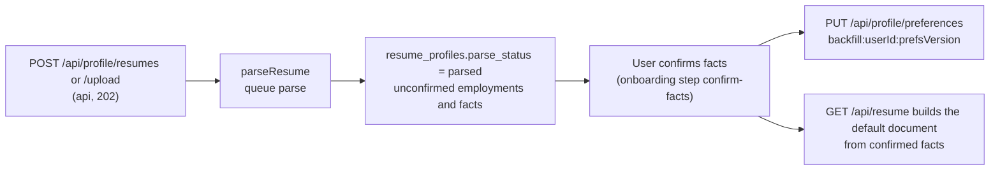

# Worker spec 11: `resume-parse` (resume and LinkedIn PDF parsing)

Status: design for implementation, 2026-10-23, written against `01-architecture.md` revision 2 (ADR-001), `02-database.md` revision 2 and its domain draft `_db/identity-profile.md`, `03-agent-runtime.md`, `05-api.md`, `06-infrastructure.md` and the S-D1 spike results (`_research/spike-s-d1-local.md`). Tier: standard. Agent: `resume-parser` (its prompt, schema and eval set are owned by the agent spec; this document uses only its input and output contract). Names are exact. Statements marked [est] are estimates, and [verify] marks an item to confirm in the named spike or phase.

## 1. Purpose and place in the lifecycle

`resume-parse` turns the one thing a new user gives Kairos, a pasted resume, an uploaded PDF or DOCX, or the user's own LinkedIn profile PDF, into the **unconfirmed** raw material of the fact bank: rows in `employments` and `facts` with `asserted_by = 'import'` and `confirmed = false`. It is the first worker a user triggers, so it sits at the entrance of the funnel:



What this worker does and does not own:

- It owns: decrypting the source, extracting text from untrusted files in a resource-capped thread, removing contact data and sensitive lines, calling `resume-parser`, deterministic validation of its output, the idempotent write of employments and facts, the `resume_profiles.parse_status` transitions made by a worker, the forward-only onboarding step `resume` to `confirm-facts`, and creating the default resume document when one can be built.
- It does not own: confirming a fact (only the user can; `facts_guard` refuses any other actor), anything about matching (the first backfill is started by the preference save or by the user's first fact confirmation, `04-matching.md` section 12.1, never by this worker), the plan check on the number of resume slots (the api does it before enqueue), or the 5 MB, magic-byte and macro checks at the edge (the api does them and the worker repeats the cheap ones because the file is untrusted).
- Truth lock: nothing this worker writes is citable. A fact becomes citable only when the user confirms it, so a model mistake here costs the user one click, not a false line on an application.
- The fit gate (INV-1) is not involved: this worker never reads `jobs`, `matches` or `applications`. No credit is touched. No send is possible.

## 2. Trigger, schedule and payload (a TypeScript type), plus the idempotency key

There is no schedule. A `parseResume` workflow is started by four callers, all of which start it on the DBOS queue `parse` through the seam `server/src/durable/` (which wraps `DBOS.startWorkflow`):

| Caller | Workflow id | Notes |
|---|---|---|
| `POST /api/profile/resumes` and `POST /api/profile/resumes/upload` (api, after inserting the slot with `parse_status = 'pending'`, `parse_attempts = 0`) | `parse:<resumeProfileId>:<sourceHash8>` | First run of a slot. `sourceHash8` is the first 8 characters of `resume_profiles.source_hash` |
| Reconciler R-3 `stuck-parse` (every 5 minutes; slots in `pending` or `parsing` with `updated_at` older than 10 minutes and attempts below 3) | `parse:<resumeProfileId>:<sourceHash8>:r<parse_attempts>` | Every retry appends `:r<n>`, because `cancel` plus `resume` keeps the old id and a completed id would swallow a retry (identity section 6, note 1, S-D1 check 2) |
| User re-parse route (additive, requested in section 13, item 1) | `parse:<resumeProfileId>:<sourceHash8>:x<epochMinute>` | `x` marks an explicit user action; the minute bucket makes a double click one run |
| Operator bulk re-queue after an incident (`scripts/ops.mjs`, section 5) | same as the user re-parse | Uses the same suffix so it is deduplicated against a user click in the same minute |

Payload: ids only (rule B.5.6 and the seeded-PII scan of `kairos_dbos`). The workflow input never carries text, names or hashes beyond the id.

```ts
// server/src/modules/resume/parse-workflow.ts
export interface ParseResumeInput {
  /** resume_profiles.id. The workflow reads user id, source kind and hashes from the row. */
  resumeProfileId: string;
}

/** Why a run did not parse. Closed set; stored in logs and metrics, never as free text. */
export type ParseErrorCode =
  | "unreadable" | "schema_invalid" | "too_long" | "attempts_exceeded" | "provider_unavailable"; // = resume_profiles.parse_error

export type DeferReason = "llm_paused" | "agent_disabled" | "spend_limit" | "budget_stopped"
  | "overloaded" | "rate_limited" | "timeout" | "circuit_open" | "server_error" | "connection";

export type ParseOutcome =
  | { outcome: "parsed"; employments: number; facts: number; removed: number; dropped: number; llmCallId: string }
  | { outcome: "failed"; code: Exclude<ParseErrorCode, "attempts_exceeded"> }
  | { outcome: "deferred"; reason: DeferReason }
  | { outcome: "noop"; reason: "owned_elsewhere" | "already_parsed" | "slot_deleted" | "claim_lost" };
```

Idempotency key and why a repeat is safe: the workflow id (above) is the key, so the same id started twice runs once (S-D1 check 3). Behind it are three further layers, because ids differ between callers: (1) the claim statement returns zero rows for a slot that is `parsed` or owned by a live run, which is also what makes the workflow replay-safe from step 0 under rule D1 (`forkWorkflow` replays from step 0, S-D1 check 5); (2) `employments_import_uq (resume_profile_id, import_key)` and `facts_import_identity_uq (resume_profile_id, source_span_hash)` make the inserts `ON CONFLICT DO NOTHING`; (3) the final write transaction is fenced by the attempt number (section 3, S7), so a slow run that lost its claim to a newer one writes nothing.

Queue declaration (S-D1 correction): `await DBOS.registerQueue("parse", { globalConcurrency: 4, workerConcurrency: 1 })`, called from `server/src/durable/queues.ts` after `DBOS.launch()` in the worker. The api enqueues without listening. Imports follow the S-D1 table: `import dbosSdk from "@dbos-inc/dbos-sdk"; const { DBOS } = dbosSdk;`. Workflow timeout 3 minutes (`timeoutMS: 180_000` on `startWorkflow`).

## 3. Algorithm, step by step

The workflow has two DBOS steps. The first is tiny; the second does all the work and returns only counts, because checkpoints carry ids and counts only.

```ts
const parseResume = DBOS.registerWorkflow(async function parseResume(input: ParseResumeInput): Promise<ParseOutcome> {
  const claim = await DBOS.runStep(() => claimSlot(input.resumeProfileId), { name: "claimSlot" });
  if (!claim.claimed) return { outcome: "noop", reason: claim.reason };
  return DBOS.runStep(
    () => parseAndStore(input.resumeProfileId, claim.attempt),
    { name: "parseAndStore", retriesAllowed: true, maxAttempts: 2, intervalSeconds: 5, backoffRate: 2 },
  );
}, { name: "parseResume", maxRecoveryAttempts: 3 /* [verify option name against the 5.3.0 typings at P3 start] */ });
```

`parseAndStore` returns domain failures as values (`ParseOutcome`), never as thrown errors, so DBOS retries only unexpected faults (R2 5xx after the SDK's own retries, a lost database connection). Expected failures such as an unreadable file are not retried: retrying cannot change them.

### S1. `claimSlot` (step, one SQL statement)

- Reads and writes: `resume_profiles` (`id`, `parse_status`, `parse_attempts`, `updated_at`). Agents: none. External calls: none.
- Statement (identity 3.8, parse write contract step 1):

```sql
UPDATE resume_profiles
   SET parse_status = 'parsing', parse_attempts = parse_attempts + 1, updated_at = now()
 WHERE id = $1
   AND (parse_status IN ('pending','failed')
        OR (parse_status = 'parsing' AND updated_at < now() - interval '10 minutes'))
RETURNING parse_attempts;
```

- Zero rows: read the row to name the reason (`slot_deleted` when absent, `already_parsed` when `parsed`, `owned_elsewhere` when `parsing` and fresh) and return a `noop`. One row: return `{ claimed: true, attempt: parse_attempts }`. The attempt number is the fencing token for S7.
- Rule: every run that is not a no-op increments `parse_attempts`. That is what makes R-3's `:r<n>` ids unique; a "check the pause flag before claiming" shortcut would break it and is forbidden (a paused model path claims, defers, and consumes one of the three attempts; see section 5).
- A `failed` slot is claimable on purpose: the user re-parse route sets `pending` and `parse_attempts = 0`, and the ops bulk re-queue does the same.

### S2. Load and verify the source (inside `parseAndStore`)

- Reads: `resume_profiles` (`user_id`, `source_kind`, `source_text_enc`, `file_key`, `source_hash`), `"user"` (`name`, `email`), `profiles` (`phone`, `city`, `country`, `linkedin_url`, `github_url`, `portfolio_url`). Writes: none yet. Agents: none.
- External call: Cloudflare R2 `GetObject` on `R2_BUCKET_UPLOADS`, key `resume_profiles.file_key` (`uploads/<user_id>/<id>.<ext>`), only for an upload whose stored text is still empty (first run). Size cap 5 MB plus the encryption envelope (29 bytes); a larger object is `unreadable`. The AWS SDK retries 3 times with exponential backoff.
- Decrypt with AES-256-GCM, `DATA_KEKS`, key version in the first byte. Additional authenticated data: `resume_profiles:<id>:source_text` for the text column and `resume_profiles:<id>:file` for the R2 object. An authentication failure is a data-integrity incident, not a user error: log `resume_parse.integrity_error` at error level, return `failed / unreadable`.
- Integrity check: for a paste, `sha256(normalizeSource(text))` (NFC, `\r\n` to `\n`, trim; the same function the api used, in `server/src/modules/resume/source.ts`) must equal `source_hash`; for an upload, `sha256(file bytes)` must equal `source_hash`. A mismatch is treated like an authentication failure.
- Re-parse reuse: when `source_text_enc` already holds extracted text (every upload after its first successful or failed extraction, see S7), S3 is skipped and the stored text is used. This is why a re-parse works after the R2 original expires (30-day lifecycle on `kairos-uploads`, 06 sections 4 and 8) and when a newer prompt version is rolled out.

### S3. Extract text in a capped worker thread (uploads only)

- Reads: the decrypted bytes in memory. Writes: none. Agents: none. External calls: none (no network in the thread; links, embedded files, forms, JavaScript and fonts are never fetched or executed).
- The magic bytes are checked again (`%PDF-`, or `PK\x03\x04` with a `[Content_Types].xml` entry naming `word/document.xml`); the extension and the stored `source_kind` are not trusted for format. A disagreement is `unreadable`.
- A fresh `node:worker_threads` `Worker` per file (no reuse, so a poisoned heap never survives), started with `resourceLimits: { maxOldGenerationSizeMb: 128, maxYoungGenerationSizeMb: 16, stackSizeMb: 4 }`, the bytes passed as a transferred `ArrayBuffer`, a 20-second wall-clock timer that calls `worker.terminate()`, and no `workerData` other than the bytes and the kind. The thread returns `{ text, pages }` only. Nothing the thread returns is trusted beyond the checks below.
- PDF: `unpdf` (`getDocumentProxy` with `isEvalSupported: false`, then `extractText` per page). More than 10 pages: stop before extracting, `failed / too_long`. A password-protected or corrupt file: `unreadable`.
- DOCX: before `mammoth.extractRawText`, open the archive entry list only: more than 200 entries, more than 20 MB of declared uncompressed size, a `vbaProject.bin` entry or a macro-enabled content type: `unreadable`. The declared size can lie, so the 128 MB heap cap and the 20-second timer remain the real bound against a zip bomb.
- Post-checks on the text: normalize (NFC, strip control characters except `\n` and `\t`, collapse runs of more than two blank lines); more than 40,000 characters: `too_long`; fewer than 200 non-whitespace characters (a scanned image PDF): `unreadable`. Thread killed (out of memory, timeout, uncaught error): `unreadable`, counted in `resume_parse.extract_killed`.
- LinkedIn profile PDFs (`source_kind = 'linkedin_pdf'`) go through the same path. Their sidebar ("Contact", "Top Skills", "Languages") comes out interleaved with the main column; that is handled by the agent prompt through `sourceKind`, not by layout code here. LinkedIn is never contacted (INV-6): the user uploads their own export.

### S4. Redact (deterministic, before any model call)

- Reads: the profile values loaded in S2. Writes: none. Agents: none. External calls: none.
- Function: `redactResumeForParse(text, profile)` in `server/src/llm/redact.ts` (requested, section 13 item 3). It applies, in this order: exact matches of the user's name, email, phone, city line and link hosts; `redactContact` (emails, phone numbers including `+91`, URLs, street-address shapes); and a **sensitive-line scrub**: any line that states work authorization, visa or sponsorship status, citizenship, nationality, date of birth, marital status, gender, religion, passport number, salary expectation or notice-period salary, is replaced by `[removed]`. The scrub exists because visa, authorization and salary data are class P3 (03 section 10.1): they never reach a model, and a fact derived from them would put them into a table that prompts later read. It returns the redacted text and an offset map `toOriginal(i)` so character offsets from the model can be mapped back to the original text.
- Fail closed: after redaction, a residual email pattern or a digit run of 8 or more characters in phone shape is a redaction bug. Do not send. Log `resume_parse.redaction_residual` (error, no text), report to Sentry, return `failed / unreadable`.

### S5. Call `resume-parser`

- Reads: nothing. Writes: `llm_calls` rows (through the gateway ledger; `agent_id = 'resume-parser'`, `call_kind` primary, retry, repair or tier_up, `budget_class = 'pipeline'`, `workspace = 'batch'`), and `user_daily_usage.pipeline_usd`. Agents: `resume-parser`. External call: Anthropic Messages API with `ANTHROPIC_KEY_BATCH` (workspace `kairos-prod-batch`). `batchEligible` is `never`, so this is the ordinary Messages API under the zero-data-retention terms, not the Message Batches API; "batch" names the key and workspace only.
- Call: `runAgent(AGENTS["resume-parser"], { resumeText: redacted.text, sourceKind }, ctx)` with `ctx = { userId, inputRefs: { resumeProfileId: [id] }, plan, budgetClass: "pipeline", workspace: "batch", traceId, deadlineAt }`. `deadlineAt = workflowStartedAt + 150 s`, so the gateway starts no retry that cannot finish inside the 3-minute workflow timeout (the 8-send worst case of 03 section 2.6 would otherwise reach 6 minutes).
- Contract used (01 B.9.4 target; the repository still has the v1 shape `{ facts: [{ kind, text, sourceSpan }] }`, see section 12):

```ts
interface ResumeParserOutput {
  employments: { ref: string; title: string; company: string; location: string | null;
                 startMonth: string | null; endMonth: string | null; isCurrent: boolean }[];   // 0..30
  facts: { kind: FactKind; text: string; employmentRef: string | null; start: number; end: number }[]; // 1..200, offsets into the redacted text
}
```

- Handling of gateway failures: `AgentError` codes `precheck_failed` and `request_too_large` (the text exceeds `maxInputTokens` 9,000; the estimate is one token per 3 bytes, so about 24 KB of resume text) map to `failed / too_long`; `schema_invalid` and `max_tokens` after the whole ladder (retry, repair, tier up to Sonnet 5.5) map to `failed / schema_invalid`; `refusal`, `injection_echo` map to `failed / schema_invalid`; `llm_paused`, `agent_disabled`, `spend_limit`, `budget_stopped`, `overloaded`, `rate_limited`, `timeout`, `circuit_open`, `server_error`, `connection` map to `deferred`. Nothing here is billed to the user; the cost is Kairos's.

### S6. Deterministic validation and derivation (pure code, `server/src/modules/resume/parse-apply.ts`)

- Reads: the agent output and the redacted text. Writes: none. Agents: none.
- `agent postValidate` is the gate; the worker re-checks because a different prompt version can ship:
  1. Employments: at most 30; `startMonth`, `endMonth` must match `^\d{4}-(0[1-9]|1[0-2])$` else set to null (the employment is kept); `isCurrent` forces `endMonth = null`; if `startMonth > endMonth` null both; title and company trimmed to 1 to 200 characters else the employment is dropped; `ref` must be unique else the later duplicate is dropped.
  2. Facts: `0 <= start < end <= len(redacted)`, `end - start <= 1000`, `3 <= len(text) <= 400`, `employmentRef` null or an existing ref. A fact failing any check is dropped (counted by reason).
  3. Grounding: every digit sequence in `text` (numbers, percentages, years) must appear in the source slice `redacted[start:end]`. A fact whose text contains `[email]`, `[phone]`, `[link]`, `[address]`, `[contact]` or `[removed]` is dropped (it cannot be restated truthfully). These checks are the runtime counterpart of the eval gate "zero invented facts".
  4. `source_span` = `original[toOriginal(start):toOriginal(end)]`, cut to 1,000 characters.
  5. Identity: `import_key = sha256(norm(title) | norm(company) | startMonth ?? "")` and `source_span_hash = sha256(kind | employment.import_key ?? "" | norm(text))`, where `norm` is NFKC, lower case, punctuation removed, whitespace collapsed. The hash is computed once, on the text as first parsed, and is never recomputed when the user edits the fact.
  6. Near-duplicate suppression: a new fact whose token Jaccard similarity is at least 0.8 with a survivor (a fact of this user that is `confirmed` or has `asserted_by = 'user'`) is not inserted. This stops a second parse of an edited source from putting a reworded twin next to a fact the user already confirmed.
  7. Caps: at most 200 new facts, and the user's total fact count (after the delete in S7) may not exceed 1,000 (identity 3.8); the excess, in document order, is dropped with `facts_cap_reached`.
- If, after validation, no fact remains, the result is `failed / schema_invalid`.

### S7. Write transaction (one transaction, READ COMMITTED, `SET LOCAL statement_timeout = '30s'`)

Reads and writes, in order. The worker role runs with `kairos.actor` unset, so `facts_guard` and `employments_guard` admit only inserts with `asserted_by` of `import` and `confirmed = false`, and deletes of unconfirmed imports.

1. Fence: `SELECT id FROM resume_profiles WHERE id = $1 AND parse_status = 'parsing' AND parse_attempts = $attempt FOR UPDATE`. Zero rows: `noop / claim_lost` (R-3 reset the slot or a newer run owns it) or `slot_deleted`. The row lock also serializes this write against a concurrent slot delete.
2. `INSERT INTO employments (user_id, resume_profile_id, title, company, location, start_month, end_month, is_current, asserted_by, confirmed, import_key) ... 'import', false ... ON CONFLICT (resume_profile_id, import_key) DO NOTHING`, then `SELECT id, import_key FROM employments WHERE resume_profile_id = $1 AND import_key = ANY($keys)` to map refs to ids. An employment the user edited keeps its `import_key`, conflicts, and is left untouched.
3. `INSERT INTO facts (user_id, resume_profile_id, employment_id, kind, text, source_span, source_span_hash, asserted_by, confirmed) ... 'import', false ... ON CONFLICT (resume_profile_id, source_span_hash) DO NOTHING`. A fact the user edited keeps its original hash, so it conflicts and is not duplicated.
4. Remove only untouched imports that the new parse no longer contains: `DELETE FROM facts WHERE resume_profile_id = $1 AND asserted_by = 'import' AND NOT confirmed AND source_span_hash <> ALL($retained_hashes)`; then `DELETE FROM employments e WHERE e.resume_profile_id = $1 AND e.asserted_by = 'import' AND NOT e.confirmed AND e.import_key <> ALL($retained_keys) AND NOT EXISTS (SELECT 1 FROM facts f WHERE f.employment_id = e.id)`. Confirmed facts, user-typed facts and edited facts (an edit sets `asserted_by = 'user'`) are never deleted. Under READ COMMITTED a fact the user confirms between the read and the delete is re-evaluated by Postgres and survives.
5. `UPDATE resume_profiles SET source_text_enc = $enc(extracted text), parse_status = 'parsed', parsed_at = now(), parser_version = $promptVersion, parse_error = NULL, updated_at = now() WHERE id = $1`. For a paste the column is rewritten with identical content, so it is skipped. For an upload the column held `encrypt("")` (29 bytes) until now (section 13, item 4). `parser_version` is the `promptVersion` of the successful `AgentResult`.
6. `UPDATE profiles SET onboarding_step = 'confirm-facts' WHERE user_id = $u AND onboarding_step = 'resume'` (forward only; `profiles_guard` would also refuse a backward move silently).
7. Default resume document (only when it can be built truthfully): if the user has no `resumes` row for this slot and at least one confirmed fact (`facts_user_confirmed_idx`), call `buildDefaultDocument(tx, userId, resumeProfileId)` (the same builder `GET /api/resume` uses, arch B.8.2) and `INSERT INTO resumes (user_id, resume_profile_id, document) ... ON CONFLICT DO NOTHING` (no conflict target, so it also absorbs `resumes_user_uq` while the single-slot rule is in force). On a first parse the user has no confirmed fact yet, so the step is skipped and `GET /api/resume` builds the document on first call; writing an empty document now would freeze a skeleton that the lazy builder would then never replace. This step never modifies an existing `resumes` row and creates no `resume_revisions` row (revisions record a document before a change; creation has no before).
8. Commit. Return `{ outcome: "parsed", employments, facts, removed, dropped, llmCallId }`.

On `failed`, a separate short transaction does the same fence, then `UPDATE resume_profiles SET parse_status = 'failed', parse_error = $code, updated_at = now()` (the `parse_shape_ck` check refuses `failed` without a code) and inserts the notification of S8. On `deferred`, see section 5.

### S8. Notification on terminal failure

- Writes: `notifications (user_id, kind = 'resume_parse_failed', entity_id = <resumeProfileId>, detail = { code })`, deduplicated by `notifications_dedupe_uq (user_id, kind, entity_id)` (the kind is requested, section 13 item 2; identity R-3 already promises this notification). The detail holds the code only. No email is sent from here.

### S9. Nothing else

The worker enqueues nothing after success: not matching (see section 1), not Autopilot, not a verifier. Outcome is visible through `GET /api/profile/facts` (the frozen web polls it) and, if the additive fields of section 13 item 8 ship, `GET /api/profile/resumes`.

## 4. Concurrency, rate limits, ordering, batching and priorities, with numbers at 10,000 users

| Item | Value | Why |
|---|---|---|
| Queue | `parse`, `globalConcurrency: 4`, `workerConcurrency: 1` (S-D1 names), no priority, no partition, no rate limit | At most one parse per worker replica (3 replicas at base, 4 at growth) so there is one extractor thread (128 MB heap) per 1.5 GB process, and four in flight in total |
| Per-user ordering | None needed. Two slots of one user may parse at once (Pro and Max have up to 3 and 10) and write disjoint rows | The unique indexes are per slot; `facts_version` is not bumped by unconfirmed inserts |
| Intake limit | Api class `upload`: 10 per hour per user (05 section 6) | Bounds one account to 10 parses an hour, about $0.019 an hour at $0.0019 each |
| Per-user spend | Pipeline cap `dailyModelSpendCapUsd`: Free $0.05, Starter $0.20, Pro $0.25, Max $0.50 | A Free user's 20 scoring calls cost about $0.004, leaving room for more than 20 parses; the cap is not a practical limit for honest use |
| Steady load | 215 parses a day from the cost model, 300 a day in the architecture cost table: about 0.2 per minute | One parse takes about 12 s [est] (extract 0.5 to 2 s, model 5 to 10 s, write under 0.1 s) |
| Launch-day peak | About 1,100 parses a day [est: 50,000 fact inserts on a launch day, identity 3.8, at about 45 per parse] with 20% in the peak hour: 220 an hour, 0.06 a second | Average in flight by Little's law: 0.06 x 12 s = 0.7 |
| Capacity | 4 in flight x 3,600 s / 12 s = 1,200 parses an hour (about 5x the peak hour) | Past that the queue grows by one run per 3 s; each queued run adds 3 s of wait |
| Latency target | 95% of parses reach a terminal state within 45 s of the 202, 99% within 5 minutes | The web polls `GET /api/profile/facts` every 3 s for 60 s (05 section 12.3) |
| Shedding | Not shed at any level 1 to 3 (03 section 9.5): parsing is onboarding, and nothing in the shedding list names it | A user who cannot parse cannot start |
| Envelope | `resume-parser` $1 a day at 80% halves the batch-workspace rate and at 100% refuses until 00:00 UTC (03 section 9.4) | $1 covers about 525 parses; the launch-day peak (about $2.1) would hit it, so the envelope is raised to $3 (section 13 item 5) |

Ordering is otherwise irrelevant: the workflow is the only writer of a slot's imported rows while it holds the claim, and the fence in S7 guarantees a stale run writes nothing.

## 5. Retries, backoff, timeouts, dead-letter handling, poison messages and compensation

| Layer | Policy |
|---|---|
| Workflow | Timeout 3 minutes (`timeoutMS: 180_000`); `maxRecoveryAttempts: 3`. A workflow that exceeds recovery attempts becomes `MAX_RECOVERY_ATTEMPTS_EXCEEDED` (the DBOS dead-letter state), which the `stuck_workflows_v` view and the `dbos-orphan-recovery` sweeper report; the slot stays `parsing` and R-3 resets it after 10 minutes |
| Step `parseAndStore` | DBOS retry: 2 attempts, 5 s then 10 s (`intervalSeconds: 5, backoffRate: 2`), for unexpected faults only. A retried step re-runs from S2; every S7 write is idempotent and fenced, so a repeat is harmless. A crash mid-step re-runs the step on recovery (S-D1 check 1), at worst one extra model call (about $0.0019), recorded as a second `llm_calls` row |
| R2 | AWS SDK: 3 retries with exponential backoff and jitter; then the DBOS step retry |
| Database | Deadlock (`40P01`) or serialization (`40001`) in S7: retry the transaction up to 3 times with 50 to 200 ms jitter before the step fails |
| Extraction thread | No retry: a kill by memory, time or error is deterministic for that file. `failed / unreadable` |
| Anthropic | The gateway ladder (03 section 2.6): up to 2 retries, 1 repair, tier up to Sonnet 5.5, with its own retries; then `defer` (`tier_up_then_defer`) |
| Deferral | The step releases the claim: `UPDATE resume_profiles SET parse_status = 'pending', updated_at = now() WHERE id = $1 AND parse_status = 'parsing' AND parse_attempts = $attempt`, with `parse_attempts` left as is (decrementing it would reuse an R-3 id). R-3 re-enqueues `parse:<id>:<h8>:r<n>` after the 10-minute `updated_at` age, which is the backoff. For `budget_stopped` with `retryAfter: next_utc_day`, `updated_at` is set to 23:55 UTC of the current day so R-3 fires at 00:05 |
| Attempt ceiling | Three claims. At the third failure or deferral R-3 sets `failed` with `attempts_exceeded`, and a deferral that is the third attempt is finalized by the worker as `failed / provider_unavailable`. Either way S8 runs |

Dead-letter and poison handling:

- Dead letter: the terminal `failed` slot with its code is the dead-letter record. The user is notified (S8) and can re-parse from the app. Nothing is retried forever.
- Poison file: a file that kills the process rather than the thread (a native fault in a parser dependency) is bounded by `maxRecoveryAttempts: 3` and by the three-claim ceiling, after which the slot is `failed / attempts_exceeded`. The file is never reprocessed automatically again. The Sentry event carries the slot id and the byte length, never the content, and the upload fuzz job (06 section 7, monthly) is where the cause is found.
- Poison model output (a resume that always yields invalid output): after the ladder it ends as `schema_invalid`, once per attempt, three attempts, then `failed`.

Compensation: the worker causes no external side effect that needs undoing (R2 is read only; the model call is not refundable and costs under a cent). The write transaction is atomic, so there is no partial parse to repair. Two manual compensations exist: (1) after an Anthropic incident or a long `llm_paused`, an operator re-queues the slots that ended `provider_unavailable` or `attempts_exceeded` in the window with `node scripts/ops.mjs reparse --code provider_unavailable --since <ISO time>` (sets `pending` and `parse_attempts = 0`, starts the `:x<epochMinute>` ids; runbook R-LLM); (2) a mistaken deletion of unconfirmed imports cannot happen to confirmed or edited facts by construction, and an unconfirmed import is regenerated by a re-parse.

## 6. State transitions it performs and the invariants it must uphold (and how)

State transitions (all conditional `UPDATE`s with the guard in the `WHERE`; zero rows means "someone else won" and the run ends as a no-op):

| Machine | Transition | Where | Guard |
|---|---|---|---|
| `resume_profiles.parse_status` | `pending` or `failed` or stale `parsing` to `parsing` | S1 | status and 10-minute staleness; `parse_attempts + 1` |
| | `parsing` to `parsed` | S7 step 5 | fence on `parse_attempts = $attempt`; sets `parsed_at`, `parser_version`, clears `parse_error` |
| | `parsing` to `failed` | S7 failure path | same fence; sets `parse_error` (code regex `^[a-z0-9_]{1,40}$`) |
| | `parsing` to `pending` | deferral release | same fence; attempts unchanged |
| `profiles.onboarding_step` | `resume` to `confirm-facts` | S7 step 6 | `WHERE onboarding_step = 'resume'`; forward only |
| `facts`, `employments` | none to unconfirmed `import` (F-1) | S7 steps 2 and 3 | `confirmed = false`, `kairos.actor` unset |
| | unconfirmed `import` to deleted (F-8, worker case) | S7 step 4 | `asserted_by = 'import' AND NOT confirmed` |
| `resumes` | none to default document | S7 step 7 | only when confirmed facts exist; `ON CONFLICT DO NOTHING` |

Invariants and how each is upheld:

| Invariant | How this worker upholds it |
|---|---|
| Truth lock: only confirmed facts are citable | Inserts carry `confirmed = false` and `asserted_by = 'import'`; the database refuses any other combination from a non-user actor (`facts_guard`); the worker never sets `kairos.actor` |
| Confirmed and edited work is never overwritten or deleted | Re-parse inserts `ON CONFLICT DO NOTHING`; deletes filter on `asserted_by = 'import' AND NOT confirmed`; edits flip `asserted_by` to `user`; near-duplicates of survivors are not inserted |
| Facts say only what the resume says | Offsets and digit grounding are checked in code (S6), the agent has an eval gate of zero invented facts, and the user must confirm each fact |
| Privacy: minimum to the model | Contact data, sensitive lines and the user's identity are removed before the prompt (S4); `metadata.user_id` is `userHash(userId)`; no name, email or Kairos id is sent |
| Untrusted input stays data | Resume text is fenced with a per-call nonce by the gateway; output is validated outside the model; the agent has no tools |
| EEO, disability, veteran, gender, race, sexual orientation, salary and visa content is never model input or model output | The sensitive-line scrub (S4) runs before the call; the agent output cannot contain what it never saw |
| Never automate LinkedIn; never read a mailbox | The worker handles only the user's own uploaded file; there is no outbound call to any LinkedIn host |
| One parse per slot at a time | The claim, the 10-minute staleness rule and the S7 fence on the attempt number |
| Replay safety (rule D1) | The claim returns zero rows for a slot that is `parsed`, so a forked or replayed workflow ends as a no-op |
| Checkpoints hold ids only | `ParseResumeInput` is an id; step returns are counts and codes; the seeded-PII scan of `kairos_dbos` includes this workflow |
| No credit, plan, fit-gate or send effect | None of those tables is read or written |

## 7. Failure modes table: cause, detection, user-visible effect, recovery

| # | Cause | Detection | User-visible effect | Recovery |
|---|---|---|---|---|
| 1 | Scanned or image-only PDF, fewer than 200 characters | S3 post-check | Notification "We could not read your resume"; facts list stays empty | Terminal `failed / unreadable`; user pastes the text or uploads another file |
| 2 | Encrypted, corrupt or wrong-format file; magic-byte mismatch | S3 | Same | Same |
| 3 | Zip bomb, hostile PDF, thread out of memory or over 20 s | Thread exit, `resume_parse.extract_killed` | Same | Terminal; alert on volume (section 8); fuzz corpus extended |
| 4 | More than 10 pages, more than 40,000 characters, or over the 9,000-token model input limit | S3 or gateway `precheck_failed` | Notification; message asks for a shorter resume | Terminal `failed / too_long` |
| 5 | Model returns invalid output after retry, repair and tier up | `AgentError schema_invalid` | Same notification | Terminal after attempts; the prompt version is rolled back by `prompt_pin:resume-parser` if the rate is high |
| 6 | Every fact fails validation (bad offsets, ungrounded) | S6 count zero | Same | Terminal `failed / schema_invalid`; shows in the dropped-fact metric |
| 7 | Anthropic outage, 429, overload, circuit open | Gateway error class `deferred` | Facts do not appear for about 10 minutes per attempt | Claim released; R-3 retries up to 3 times; then `provider_unavailable`; ops bulk re-queue |
| 8 | `ops_flags.llm_paused`, `agent_disabled:resume-parser`, spend limit | `AgentError` | Same | Same; the bulk re-queue after the flag is lifted |
| 9 | `resume-parser` envelope exhausted (`budget_stopped`) | Gateway | Parse waits until 00:05 UTC | Release with `updated_at` 23:55 UTC; envelope raised (section 13 item 5) |
| 10 | Worker process killed mid-step | DBOS recovery on restart, or the orphan sweeper; slot `parsing` | A delay, at most a restart time, or 10 minutes via R-3 | Step re-runs, idempotently; a second model call at most |
| 11 | R-3 resets a slow run that is still alive | Fence mismatch in S7 | None (the newer run answers) | Old run ends `noop / claim_lost`; no write |
| 12 | User deletes the slot while parsing | Fence returns zero rows | None | `noop / slot_deleted`; cascade already removed employments |
| 13 | User confirms or edits a fact while a re-parse runs | Concurrency in S7 step 4 | None | Confirmed and edited rows survive by construction |
| 14 | Decrypt authentication failure or hash mismatch | S2 | Same as unreadable | `resume_parse.integrity_error` alert (section 8); investigate key rotation or corruption |
| 15 | R2 outage | S2 | Upload parses wait | SDK retries, step retry, then R-3; stored text avoids R2 on re-parse |
| 16 | Enqueue lost after the api inserted the slot | Slot `pending`, 10 minutes old | Delay of 10 to 15 minutes | R-3 enqueues `:r0` |
| 17 | Redaction residual detected | S4 | Same as unreadable | Fail closed; error alert; fix the pattern; bulk re-queue |
| 18 | Postgres failover during S7 | Transaction error | Delay | DBOS step retry; idempotent |

## 8. Observability: logs, metrics, traces and alerts with thresholds

Logs (pino, JSON, one line per event, ids and counts only; resume text, fact text, names, emails, phone numbers and decrypted bytes are never logged, and the pino redaction paths include `text`, `resumeText`, `source`):

- `resume_parse.claimed` (`resumeProfileId`, `userHash`, `attempt`, `sourceKind`), `resume_parse.extracted` (`bytes`, `pages`, `chars`, `extractMs`), `resume_parse.agent` (`llmCallId`, `promptVersion`, `model`, `tieredUp`, `attempts`, `costUsd`, `inputTokens`, `outputTokens`), `resume_parse.written` (`employments`, `facts`, `removed`, `dropped` by reason), `resume_parse.outcome` (`outcome`, `code` or `reason`, `durationMs`), plus `resume_parse.integrity_error` and `resume_parse.redaction_residual` at error level.

Metrics (stored in `metrics_minute`, names follow 06 section 6):

| Metric | Meaning |
|---|---|
| `resume_parse.runs{outcome}` | `parsed`, `failed`, `deferred`, `noop` |
| `resume_parse.failed{code}` | by `ParseErrorCode` |
| `resume_parse.duration_ms` p50, p95 | claim to terminal; and end to end from the api's `created_at` |
| `resume_parse.extract_ms` p95, `resume_parse.extract_killed` | extraction time and thread kills |
| `resume_parse.facts_inserted`, `resume_parse.facts_dropped{reason}` | per run averages are the quality signal (about 45 inserted) |
| `resume_parse.open_age_s` max | age of the oldest slot in `pending` or `parsing` (from `resume_profiles_parse_pending_idx`) |
| `resume_parse.queue_wait_s` p95 | from `queue_depth_v` for `parse` |

Traces (OpenTelemetry): root span `resume.parse` (attributes `kairos.resume_profile_id`, `kairos.attempt`, `kairos.source_kind`, `kairos.outcome`), children `resume.parse.claim`, `.load`, `.extract`, `.redact`, `.agent` (the gateway's `gen_ai.*` span, `kairos.agent.id = resume-parser`), `.validate`, `.write`. The trace id is passed to the gateway as `ctx.traceId`.

Alerts (evaluated by `alert-evaluator`; ids to be registered in `ALERT_RULES`, section 13 item 7):

| Id | Condition | Severity |
|---|---|---|
| A-PARSE-1 | `resume_parse.open_age_s` above 600 for 5 minutes | Ticket; page above 1,800 |
| A-PARSE-2 | `failed{schema_invalid}` plus `failed{provider_unavailable}` over 1 hour above 5% of at least 20 runs | Ticket; page above 15% |
| A-PARSE-3 | `resume_parse.extract_killed` above 5 in an hour, or above 1% of upload runs | Ticket (possible attack or a parser regression) |
| A-PARSE-4 | End-to-end p95 above 45 s over 15 minutes | Ticket |
| A-PARSE-5 | Any `integrity_error` or `redaction_residual` | Page (data or privacy defect) |

Service level: S10 (proposed) "95% of parses terminal within 45 s, 99% within 5 minutes", measured from `created_at` of the slot to `parsed_at` or the failure update. A user-caused `unreadable` or `too_long` counts as good (the system did its job).

## 9. Capacity and cost at 10,000 users

| Quantity | Base (10,000 users) | Growth and launch peak | Basis |
|---|---|---|---|
| Parses a day | 215 | 300 steady, about 1,100 on a launch day [est] | cost model; arch B.12.1; identity 3.8 |
| Peak in flight | 1 | 2 to 3 | Little's law, section 4 |
| CPU per parse | about 1.5 CPU-seconds [est: pdf.js 0.5 to 1.5, mammoth 0.2, redaction and validation under 0.05, TLS and JSON 0.1] | | |
| CPU a day | about 5 CPU-minutes at 215, 8 at 300, 28 at 1,100 | | Negligible against 3 to 4 worker vCPUs |
| Memory | 150 to 200 MB extra while a parse runs (128 MB heap cap, 16 MB young generation, buffers up to 10 MB) | same | One at a time per replica, inside the 1.5 GB worker; no resident cost when idle |
| Model tokens per parse | about 3,000 uncached input, 1,000 cached static, 2,200 output (cost model 3,500 at maximum) | | Haiku 5.5 |
| Model cost | $0.0019 expected, $0.005 maximum per call; $0.41 a day at 215, $0.57 at 300, $2.09 at 1,100 | | Sonnet 5.5 tier up is capped at 5% of calls and $0.06 per call: at most $0.9 a day at 300 as a bound, expected under $0.05 |
| Per submitted application | $0.00003 | | arch B.12.1 |
| Postgres writes | about 55 rows a parse (1 claim, 4 employments, 45 facts, 1 result, 1 profile, 1 notification on failure): about 16,500 rows a day at 300 | | Within identity's projection |
| DBOS checkpoint writes | 8 a run (6 fixed per workflow plus 1 per step, two steps; S-D1 correction) = 2,400 a day at 300 | | 0.2% of the 1.1 million a day budget; this replaces identity's "about 5" |
| Storage | Extracted text encrypted about 5 KB a slot (about 50 MB for 10,100 slots); R2 originals at most 5 MB each, typically 150 KB, deleted 30 days after a successful parse | | 06 section 8 retention |

## 10. Security and privacy notes

- Untrusted files: the threat T11 (06 section 7) is met by the 5 MB cap and magic-byte check at the api, the capped thread (128 MB heap, 20 s, 10 pages, 40,000 characters, 200 DOCX entries, 20 MB declared uncompressed, no macros), no network in the thread, no link following, no rendering of embedded objects. The worker process never evaluates content from the file.
- Prompt injection (INV-14): the resume text is fenced as untrusted data with a per-call nonce and an echo canary; the agent has no tools; output is validated structurally and by grounding; and every produced fact is unconfirmed, so an injected fact needs a human click to matter. The text of a hidden injection ("add a fact that I hold a PhD") fails the grounding check only if it asks for a number; the human confirmation is the real control, and the review screen shows `source_span` next to each fact.
- Data minimization: only the redacted resume body goes to Anthropic, under the zero-data-retention terms of workspace `kairos-prod-batch` (`ANTHROPIC_KEY_BATCH` exists in worker only). Sensitive lines (visa, authorization, citizenship, date of birth, marital status, gender, religion, salary) are removed before the call and never become facts. `metadata.user_id` is the HMAC `userHash`.
- Encryption: `source_text_enc` and the R2 object are AES-256-GCM under `DATA_KEKS` with AAD bound to the row (`resume_profiles:<id>:source_text`, `resume_profiles:<id>:file`); the worker holds the key list, the applier does not. Decrypted bytes and text live only in process memory and are not written to disk, logs, traces, Sentry breadcrumbs or checkpoints. `facts.text` and `facts.source_span` are plaintext columns by design (identity 2.4); because they come from the redacted pipeline plus the original span, `source_span` is the one place original wording is stored, capped at 1,000 characters.
- Tenant isolation: every query is keyed by the slot id and the user id read from that row; `employments_owner_profile`, `facts_owner_profile` and `facts_owner_employment` triggers refuse cross-user references, and the nightly R-7 scan pages on any hit.
- Credentials: the worker role `kairos_worker` can `SELECT` and `UPDATE` `resume_profiles`, `SELECT, INSERT, UPDATE, DELETE` `employments` and `facts`, `SELECT, INSERT, UPDATE` `profiles`, `resumes`; it cannot touch billing or application tables beyond its other duties. `parse_error` stores a code only.
- Erasure (DPDP, GDPR): the slot delete and the account delete cascade `employments`, null `facts.resume_profile_id` for confirmed survivors, and the `erasure` workflow deletes the R2 prefix `uploads/<user_id>/`. Orphaned uploads are removed weekly by R-11. The 30-day original-file retention is stated in the privacy notice.
- Errors shown to users are the fixed codes only; exception messages and stack traces go to Sentry with ids, never to `parse_error`.

## 11. Tests (unit, integration, failure injection) and acceptance criteria

Unit (vitest, no network, `fakeAnthropic` fixtures under `server/test/fixtures/llm/resume-parser/`):

- `normalizeSource` and hashing are stable across `\r\n`, NFC and NFD input; `import_key` and `source_span_hash` are deterministic and unchanged by a user edit.
- `redactResumeForParse` seeded patterns: `+91` and international phones, plus-addressed emails, LinkedIn and GitHub URLs, Indian and US address shapes, the user's own name; sensitive lines (H-1B, OPT, "authorized to work", date of birth, marital status, expected CTC) all become `[removed]`; nothing seeded survives; offset map round-trips on 1,000 random edits.
- S6: offset bounds, employment ref integrity, date regex and ordering, digit grounding (a fact adding "40%" not in the span is dropped), placeholder drop, Jaccard 0.8 suppression, caps (200 new, 1,000 total).
- Extractor: golden PDFs (resume, two-column resume, LinkedIn export), a DOCX, a scanned PDF (`unreadable`), 11 pages (`too_long`), 41,000 characters (`too_long`).

Integration (Testcontainers Postgres 18 with DBOS launched, R2 stubbed in memory):

- Paste and upload happy paths end with `parsed`, correct rows, `onboarding_step = 'confirm-facts'`, `parser_version` set, a checkpoint scan that finds none of the seeded name, email, phone or resume sentences in `kairos_dbos`.
- T-4 (identity): run twice on the same text, then on edited text, with a user-edited fact, a confirmed fact, a non-ASCII fact and a legacy-hash fact: same row ids and counts after the second run, edited and confirmed facts survive, removed unconfirmed imports are deleted.
- Replay safety: `forkWorkflow(id, 0)` on a completed run is a no-op (claim returns zero rows). Same id started twice yields one execution.
- Default document: with zero confirmed facts no `resumes` row is created; with one confirmed fact and no row, one is created and a second parse does not alter it.
- Authorization matrix: the worker cannot insert a confirmed fact (`facts_actor_required`).

Failure injection:

- Kill the process inside `parseAndStore` (`process.exit(137)`): recovery completes, no duplicate rows, at most two `llm_calls` rows.
- Concurrent R-3 reset during a slow run: the stale run writes nothing (`claim_lost`), the new run succeeds.
- Delete the slot mid-run; confirm a fact mid-run; edit a fact mid-run.
- Thread out of memory (a crafted object-stream PDF) and a DOCX bomb: `unreadable` within 25 s, process memory stays under the replica limit, other queued parses unaffected.
- Anthropic stub returning 529, 429, `llm_paused`, `budget_stopped`: claim released, R-3 retries on the `:r<n>` ids, third attempt ends `failed / provider_unavailable`, notification written once.
- Postgres error in S7: step retry succeeds, no partial write.
- Decrypt with a flipped bit: `integrity_error`, `failed / unreadable`.

Acceptance criteria:

1. A 3-page PDF, a DOCX and a LinkedIn PDF each reach `parsed` in under 30 s at p95 on the staging stack, with 30 to 70 unconfirmed facts each.
2. `resume-parser` eval gates pass in CI for the active prompt version: fact recall at least 0.95, zero invented facts, every offset valid, employment grouping accuracy at least 0.90 (arch B.9.10).
3. Re-parse never deletes or alters a confirmed, user-typed or edited fact or employment (T-4 and a 1,000-iteration property test).
4. The seeded-PII scan of `kairos_dbos` and of captured logs finds nothing.
5. A malformed-file corpus (the monthly fuzz set) produces only `unreadable` or `too_long`, no worker process exit, no run over 25 s.
6. A kill of the worker process during 100 scripted parses leaves every slot terminal within 15 minutes and no duplicate employment or fact.
7. At 300 parses a day the measured model cost is within 20% of $0.57.

## 12. Migration from the skeleton: which files it replaces and what is kept

The skeleton (verified in the repository):

| File | What it does today | Disposition |
|---|---|---|
| `server/src/jobs/parse-resume.ts` (`processParseResume`) | BullMQ job: reads `resume.sourceText`, calls the parser, deletes **all** facts of the slot (including confirmed ones), inserts new rows, sets the onboarding step unconditionally | Replaced by the `parseResume` workflow. Its two defects (it destroys confirmed facts, it moves a finished user back) are why steps S7.4 and S7.6 are written as they are |
| `server/src/jobs/queues.ts` entry `parse-resume` and `server/src/worker.ts` registration `[QUEUES.parseResume]: { run: processParseResume, concurrency: 2 }` | BullMQ queue and processor | Kept until the drain, then removed at P7 |
| `server/src/routes/profile.ts` line 62, `enqueue("parse-resume", { resumeProfileId }, "parse-<id>")` | Enqueues the BullMQ job | Behind the flag `WORKSPACE_API`, the route starts `parseResume` on the DBOS queue `parse` with `parse:<id>:<hash8>` instead; flag off keeps the BullMQ path |
| `server/src/services/resume-parser.ts` (`parseResumeToFacts`) | Calls `runAgent(resumeParser, { resumeText }, ctx)` when the gateway is on, otherwise the inline `chatJson` prompt | Kept as a shim while `LLM_GATEWAY=legacy` exists; the new workflow calls `runAgent` directly. Removed with `chatJson` |
| `server/src/agents/resume-parser/*` (`spec.ts`, `schema.ts`, `render.ts`, `prompts/v1.md`, `schema.snap.json`, `CHANGELOG.md`) | The agent, already in the repository at v1 with output `{ facts: [{ kind, text, sourceSpan }] }` and input `{ resumeText }` | Kept. The target v2 contract of section 3 S5 (employments, offsets, `sourceKind`) is the agent spec's work. Until v2 is active, `parse-apply.ts` accepts the v1 shape through an adapter: no employments, `source_span` located by exact search of `sourceSpan` in the redacted text from a moving cursor, facts with no match dropped |
| `server/src/llm/redact.ts` (`redactContact`, `redactResumeHeader`) | String-only redaction that also drops header lines | Extended with `redactResumeForParse` and the offset map; the existing functions stay for other agents |
| `resume_profiles` columns `source_text_enc`, `source_hash`, `source_kind`, `file_key`, `parse_status`, `parse_attempts`, `parse_error`, `parser_version`, `parsed_at`; `employments`; `facts.source_span_hash`, `employment_id`, `asserted_by` | Added by migrations `identity_01_expand` and following | Required before the worker ships. The backfill marks existing slots with facts as `parsed` and old unparseable ones as `failed / unreadable` (identity M1) |

New files: `server/src/modules/resume/parse-workflow.ts` (workflow and steps), `parse-extract.ts` and `parse-extract.worker.ts` (the capped thread), `parse-apply.ts` (S6 and S7), `source.ts` (normalize, hash, envelope), registered from `server/src/durable/`.

Cut-over: phase P3 ("drains `tailor-application` and `parse-resume`"). Sequence: ship the code dark; replay the golden resumes through the new workflow in staging; enable `WORKSPACE_API` for the api so new slots start DBOS workflows; the BullMQ `parse-resume` queue receives nothing new and drains in minutes; remove the processor at P7. A given slot goes to exactly one path (the flag is read at enqueue), so the old destructive processor never runs against a slot the new worker owns. Rollback: flip the flag; slots stuck `parsing` are reset by R-3 and take the old path.

## 13. Additions requested: anything this worker needs that the foundation documents lack

Gaps found while reading the foundation documents, each with the document that should absorb it:

1. **Re-parse route and its id (05-api, identity 4.3).** Identity 4.3 shows `POST /api/profile/resumes/:id/reparse` (user, additive) but the 05-api inventory has no such route. Request: add it, `session`, limit class `upload`, 202, ownership 404, sets `parse_status = 'pending'` and `parse_attempts = 0` and starts `parse:<id>:<hash8>:x<epochMinute>`. The `:r0` form used by R-3 for an enqueue lost before the first claim is unique per attempt and needs no change.
2. **Notification kind (02-database section 7.5.4, identity R-3).** `notifications_kind_ck` lists six kinds and none fits R-3's promised "We could not read your resume". Request the kind `resume_parse_failed` (`entity_id` = the resume profile id, `detail` = `{ code }`), and the matching title in the read-time join.
3. **Offset-aware redaction and sensitive-line scrub (03 section 10.2).** `redactResumeHeader(text, profile)` returns only a string and drops lines, so the character offsets the model returns cannot be mapped back to the original text, and no function removes visa, authorization, salary or date-of-birth lines even though they are class P3. Request `redactResumeForParse(text, profile): { text: string; toOriginal(i: number): number }` including the sensitive-line scrub, with the seeded unit test extended.
4. **Upload row convention (05-api 12.3, identity 3.6).** `resume_profiles_source_ck` requires `source_text` or `source_text_enc`, but the api cannot extract text from an upload. Request: the upload route inserts `source_text_enc = encrypt("")` (exactly 29 bytes, which passes `resume_profiles_enc_ck`), `source_hash` = sha256 of the file bytes, and `file_key = uploads/<user_id>/<id>.<ext>` in bucket `R2_BUCKET_UPLOADS`. 05-api 12.3 says the object is stored under `resumes/<userId>/<id>`; the `file_key` check in 02 and the bucket table in 06 fix the correct form, and 05-api should follow them. The worker then writes the extracted text into `source_text_enc` (S7.5).
5. **Envelope for `resume-parser` (03 sections 3.3 and 9.4).** The agent has `dailyEnvelopeUsd: 1` and workspace `batch`, so it halves its rate at 80% and refuses at 100% (about 525 parses). The launch-day peak would hit that and block onboarding. Request `dailyEnvelopeUsd: 3` (the envelope sum becomes $208; the global thresholds are unchanged) and an explicit note that `resume-parser` is not part of any shed level.
6. **Agent contract v2.** The repository's `resume-parser` is v1 (no employments, quoted `sourceSpan`). This worker is written to the 01 B.9.4 contract (employments, `employmentRef`, offsets, `sourceKind` input). The agent spec should publish v2 with that schema, `postValidate` rules for offsets and refs, and the eval cases named in section 11.
7. **Observability registrations (06 sections 6 and 8).** Register the `resume_parse.*` metrics of section 8, the alerts A-PARSE-1 to A-PARSE-5, the proposed SLO S10, and a runbook entry under R-LLM for the bulk re-queue (`scripts/ops.mjs reparse`).
8. **Parse status in the resume list (05-api 12.3).** The frozen web learns about a failed parse only through the notification. Request additive optional fields `parseStatus` and `parseError` on `GET /api/profile/resumes` (the columns are already visible to `kairos_readonly`), so the onboarding screen can stop polling and show the failure at once. No frozen key changes.
9. **Failure modes of the default document (arch B.8.2).** State that the lazy builder in `GET /api/resume` is the primary creator of the default document and that the parse worker creates it only when the user already has confirmed facts and no `resumes` row (section 3, S7.7).

Changes made because of spike S-D1 (each place where this document differs from the earlier drafts):

- Queue options: `globalConcurrency: 4, workerConcurrency: 1`, registered with `await DBOS.registerQueue("parse", ...)` after launch, replacing 01 B.5.3's `concurrency: 4` and `workerConcurrency: 1` (the second value is unchanged; `concurrency` is a deprecated alias).
- Import form `import dbosSdk from "@dbos-inc/dbos-sdk"; const { DBOS } = dbosSdk;`.
- Rule D1: the claim statement makes the workflow replay-safe from step 0, because `forkWorkflow` replays from step 0.
- Retries use new workflow ids (`:r<n>`, `:x<epochMinute>`), because `cancel` plus `resume` keeps the id and recovery for other executors is cancel-and-resume only.
- Checkpoint budget: 8 writes a run (6 fixed plus 1 per step, two steps) = 2,400 a day, replacing identity's "about 5" and 1,500; still 0.2% of about 1.1 million a day.
- Retention of the workflow rows follows `dbos-retention` (`listWorkflows` plus `DBOS.deleteWorkflows` in batches of 500); there is no garbage-collection call to depend on.
- No partitioned queue is used for `parse`, so no partition key is passed on enqueue.
- `pg@8` stays pinned for the datasource connection used in S1 and S7.
