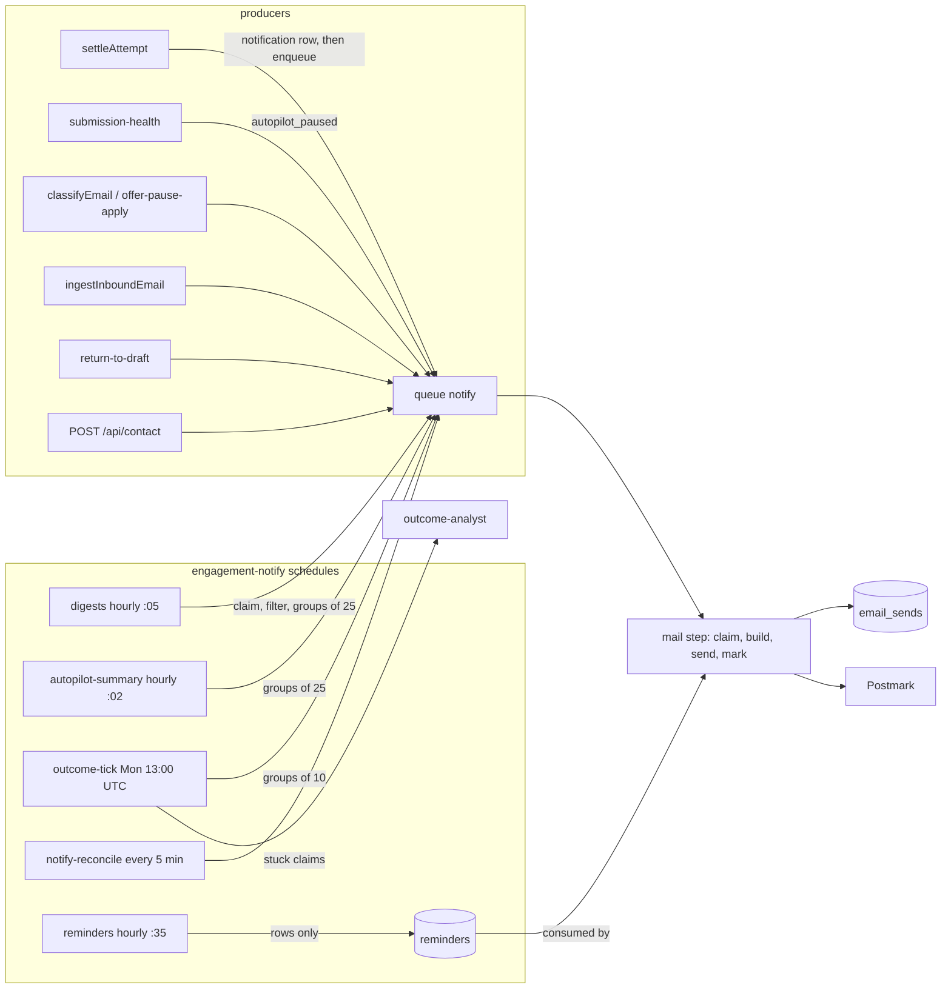

# Worker spec 12: `engagement-notify` (notifications, digests, reminders and reports)

Revision 1, 2026-10-25. Tier: standard. Process: `worker`. Queue: `notify`. Schedules: `digests`, `autopilot-summary`, `reminders`, `outcome-tick`, `notify-reconcile`. Agent: `outcome-analyst`.

Sources read: `01-architecture.md` (B.5, B.6.3, B.6.10, B.6.12, B.7.10, B.9, B.11), `02-database.md` (sections 7.1.10, 7.3.4, 7.3.5, 7.5, 7.6.10, indexes), `03-agent-runtime.md` (3.3 table, section 10), `05-api.md` (12.1, 12.5), `06-infrastructure.md` (email streams, volumes, alerts), `_db/messaging.md` (5.2, 5.3, 6.3), `_db/applications.md` (3.5, 4.6), `_db/identity-profile.md` (3.13 claim contract) and `_research/spike-s-d1-local.md`. Where this file differs from them, section 13 says so.

Vocabulary. "Send" means one outbound Postmark message. An "email key" is the pair `(kind, entity_id)`, the primary key of `email_sends`. Names such as `settleAttempt`, `approveCore` and `classifyEmail` are workflows of other workers.

---

## 1. Purpose and place in the lifecycle

`engagement-notify` is the only component that sends product email about a user's job search. It owns the email half of every notification and the three scheduled content builders (saved-search digests, no-reply reminders, the weekly outcome report). It never decides whether an application is approved, sent or charged.

What it owns:

| Capability | Source requirement | Email kind (`email_sends.kind`) | Stream | Opt-out key (`profiles.mail_opt_out`) |
|---|---|---|---|---|
| Hourly Autopilot summary with receipts of each auto-sent application | arch B.6.3 step 5 | `autopilot_hourly` | broadcast | `autopilot_summary` |
| Autopilot paused notice | arch B.6.3 failure-spike pause | `autopilot_paused` | transactional | none (never suppressible) |
| Resend offer with a signed single-use link | arch B.6.10 | `resend_available` | transactional | none |
| Saved-search digest, carrying the reminder nudges | F6, arch B.7.10 | `digest` | broadcast | `digest` (nudge block also `reminders`) |
| No-reply and draft-ageing reminders (rows, no mail of their own) | F5, arch B.6.12 | none (rides in `digest`) | n/a | `reminders` |
| Weekly outcome report with up to three targeting suggestions | FR-52 | `outcome_report` | broadcast | `outcome_report` |
| Offer-pause notice and applied notice | arch B.6.11 | `offer_pause_notice`, `offer_pause_applied` | transactional | none |
| Gmail forwarding code | arch B.6.12 | `forwarding_code` | transactional | none |
| Return-to-draft notice | arch B.6.10 | `return_to_draft` | transactional | none |
| Contact-form alert to the founder | `_db/messaging.md` 5.4 | `contact_message` | transactional | none |

What it does not own:

- In-app `notifications` rows. The producing worker inserts them in the same transaction as the event (`settleAttempt` for `autopilot_sent` and `resend_available`, `submission-health` for `autopilot_paused`, `classifyEmail` for `offer_pause_notice` and `reply_important`, `ingestInboundEmail` for `forwarding_code`). This worker only reads `notifications` (the Autopilot summary window). The api serves them (`GET /api/notifications`, `POST /api/notifications/read`). This is why a receipt and a notification exist for every auto-sent application even if a user opted out of the Autopilot email (invariant: every auto-sent application gets a receipt and a notification).
- Better Auth OTP and verification mail (sent by Better Auth directly).
- Retention of `email_sends`, `notifications` and `reminders` (`housekeeping`).
- Reply classification, billing pauses and the Autopilot spike rule (other workers start the `notify` work they cause).



Place in the lifecycle: Autopilot and resend mail are downstream of settlement (`settle`), the digest is downstream of matching (`matches` with status `new`), reminders are downstream of submission and replies (`application_events`), and the report is downstream of replies (`application_events` of kind `reply_*`). Nothing upstream waits on this worker: a dead `notify` queue delays email but never blocks a send, a charge or a notification row.

---

## 2. Trigger, schedule and payload (a TypeScript type), plus the idempotency key

### 2.1 Triggers

| Trigger | Mechanism | Workflow | Workflow id |
|---|---|---|---|
| Digests | schedule `digests`, cron `5 * * * *` | `digestBatch` | `digestBatch:<UTC hour>` e.g. `digestBatch:2026-10-26T08` |
| Autopilot summary | schedule `autopilot-summary`, cron `2 * * * *` | `autopilotSummaryBatch` | `autopilotSummary:<UTC hour>` |
| Reminders | schedule `reminders`, cron `35 * * * *` | `remindersTick` | `remindersTick:<UTC hour>` |
| Outcome report | schedule `outcome-tick`, cron `0 13 * * 1` (UTC) | `outcomeTick` | `outcomeTick:<weekStart date>` |
| Stuck claims | schedule `notify-reconcile`, cron `*/5 * * * *` | `notifyReconcile` | `notifyReconcile:<epoch minute / 5>` |
| One event email | `DBOS.startWorkflow(notifyOne, { queueName: "notify", workflowID, priority })` from a producer | `notifyOne` | `notify:<kind>:<entityId>`; redrive `notify:<kind>:<entityId>:r<n>` |
| Many emails of one kind | enqueued by the batch workflows above | `notifyGroup` | `notify-group:<kind>:<batchKey>:<n>` where `batchKey` is the UTC hour or the week start |

The first four schedules are the ones named in the architecture; `autopilot-summary` and `notify-reconcile` are added here (section 13, item 1) because B.6.3 step 5 and the `_db/messaging.md` 5.2 reconciler need an owner.

`notify` is registered by `durable/queues.ts` after launch (spike S-D1): `await DBOS.registerQueue("notify", { globalConcurrency: 4, workerConcurrency: 2, priorityEnabled: true })`. Priorities (lower runs first, as in B.5.3): `forwarding_code` 5, `autopilot_paused` 5, `offer_pause_notice` 5, `offer_pause_applied` 8, `resend_available` 10, `return_to_draft` 15, `contact_message` 20, `autopilot_hourly` 30, `digest` 40, `outcome_report` 50.

### 2.2 Payload types

Workflow inputs are ids, enums, dates and small integers only (B.5.6). No address, name, subject, title or body ever enters an input or an output. `server/src/modules/reports/notify/types.ts`:

```ts
export const EMAIL_KINDS = [
  "digest", "autopilot_hourly", "autopilot_paused", "resend_available",
  "offer_pause_notice", "offer_pause_applied", "forwarding_code",
  "outcome_report", "return_to_draft", "contact_message",
] as const;
export type EmailKind = (typeof EMAIL_KINDS)[number];

export type MailStream = "transactional" | "broadcast";
export type OptOutKey = "digest" | "outcome_report" | "autopilot_summary" | "reminders";

export interface KindPolicy {
  stream: MailStream;
  optOut: OptOutKey | null;       // null: transactional, never suppressed by preference
  priority: number;               // DBOS queue priority
  entityPattern: RegExp;          // validates entity_id (also the zod refine on workflow input)
  workflowTimeoutSec: number;
}

export const KIND_POLICY: Record<EmailKind, KindPolicy> = {
  digest:              { stream: "broadcast",     optOut: "digest",            priority: 40, entityPattern: /^[0-9a-f-]{36}:\d{4}-\d{2}-\d{2}$/, workflowTimeoutSec: 120 },
  autopilot_hourly:    { stream: "broadcast",     optOut: "autopilot_summary", priority: 30, entityPattern: /^[A-Za-z0-9_-]{1,64}:\d{1,8}$/,     workflowTimeoutSec: 120 },
  autopilot_paused:    { stream: "transactional", optOut: null,                priority: 5,  entityPattern: /^[A-Za-z0-9_-]{1,64}:\d{9,11}$/,    workflowTimeoutSec: 120 },
  resend_available:    { stream: "transactional", optOut: null,                priority: 10, entityPattern: /^[0-9a-f-]{36}:\d{1,4}$/,           workflowTimeoutSec: 5400 },
  offer_pause_notice:  { stream: "transactional", optOut: null,                priority: 5,  entityPattern: /^[0-9a-f-]{36}$/,                   workflowTimeoutSec: 120 },
  offer_pause_applied: { stream: "transactional", optOut: null,                priority: 8,  entityPattern: /^[0-9a-f-]{36}$/,                   workflowTimeoutSec: 120 },
  forwarding_code:     { stream: "transactional", optOut: null,                priority: 5,  entityPattern: /^[A-Za-z0-9_-]{1,64}:gmail:\d{9,11}$/, workflowTimeoutSec: 120 },
  outcome_report:      { stream: "broadcast",     optOut: "outcome_report",    priority: 50, entityPattern: /^[A-Za-z0-9_-]{1,64}:\d{4}-\d{2}-\d{2}$/, workflowTimeoutSec: 120 },
  return_to_draft:     { stream: "transactional", optOut: null,                priority: 15, entityPattern: /^[0-9a-f-]{36}:\d{1,4}$/,           workflowTimeoutSec: 120 },
  contact_message:     { stream: "transactional", optOut: null,                priority: 20, entityPattern: /^[0-9a-f-]{36}$/,                   workflowTimeoutSec: 120 },
};

/** One email. Started by a producer, or by notifyReconcile as a redrive. */
export interface NotifyOneInput {
  kind: EmailKind;
  entityId: string;               // matches KIND_POLICY[kind].entityPattern
  redrive: number;                // 0 for the first run; 1..4 for reconciler redrives
}

/** Up to 25 emails of one batchable kind (10 for outcome_report). */
export interface NotifyGroupInput {
  kind: "digest" | "autopilot_hourly" | "outcome_report";
  batchKey: string;               // UTC hour 'YYYY-MM-DDTHH' or week start 'YYYY-MM-DD'
  entityIds: string[];            // 1..25, each matches the kind's entityPattern
}

export interface DigestBatchInput        { hourUtc: string }   // 'YYYY-MM-DDTHH'
export interface AutopilotSummaryInput   { hourUtc: string }
export interface RemindersTickInput      { hourUtc: string }
export interface OutcomeTickInput        { weekStart: string } // Monday of the reported UTC week, 'YYYY-MM-DD'
export interface NotifyReconcileInput    { slot: number }      // floor(epochMinute / 5)

/** What a mail step returns. An enum and a count: nothing personal reaches a checkpoint. */
export type MailOutcome =
  | { status: "sent" | "suppressed" | "failed" | "skipped_empty" | "paused" }
  | { status: "busy"; retryAfterSec: number };   // a live claim exists; caller redrives later
```

Notes on the types:

- `KIND_POLICY.optOut` is the single place that decides which mail may be suppressed by `profiles.mail_opt_out`. Transactional kinds have `null`, so they cannot be suppressed by preference (messaging 6.3).
- Entity patterns are the exact formats of `_db/messaging.md` 5.2. `digest` is `<savedSearchId>:<YYYY-MM-DD user-local date>`, `autopilot_hourly` is `<userId>:<epochHour>`, `outcome_report` is `<userId>:<weekStartDate>`.
- The `workflowTimeoutSec` of `resend_available` is 5,400 because the leader may wait up to 60 minutes to batch (section 3.6). All others keep the 2-minute timeout of B.5.4. A lease wait never happens inside a workflow: a `busy` outcome ends the workflow and enqueues a redrive (section 5).

### 2.3 Idempotency key

Three layers, strongest last:

1. DBOS workflow id: deterministic, as listed above. A second start with the same id returns the first execution.
2. Database claim: `email_sends (kind, entity_id)` primary key plus the lease claim statement (section 3.1 step 3). A redrive with a new workflow id (`:r<n>`) cannot send twice while a live claim or a `sent` row exists.
3. Postmark `Metadata.k`: `sha256(kind || "|" || entity_id)` truncated to 32 hex characters, attached to every message, used to detect an already accepted message before any second attempt (section 3.1 step 4).

The idempotency key of the whole worker is therefore the email key `(kind, entity_id)`. Nothing else determines "was this email sent".

---

## 3. Algorithm, step by step

All steps are state-conditional and safe to replay from step 0 (rule D1; `forkWorkflow` replays from step 0 per spike S-D1). Plain steps use the `kairos_worker` role through the pooled connection; steps that write several tables use one transaction each. Step outputs are ids, counts and enums.

### 3.1 The mail step (shared by every kind)

`sendMail(kind, entityId): MailOutcome`, one DBOS step. It runs these sub-steps in order; each is a conditional statement.

| # | Sub-step | Tables and columns | External call |
|---|---|---|---|
| 1 | Resolve recipient and preferences | `"user"` (`id`, `email`, `name`) and `profiles` (`user_id`, `mail_opt_out`, `timezone`, `applications_paused_at`) for the user encoded in the entity (or the row the entity names: `applications.user_id`, `offer_pause_candidates.user_id`, `forwarding_verifications.user_id`, `contact_messages` has no user). Read inside the step only; never logged, never checkpointed | none |
| 2 | Opt-out check (kinds whose `optOut` is not null) | `profiles.mail_opt_out`. If it contains the kind's key: `INSERT INTO email_sends (kind, entity_id, user_id, status, error_code) VALUES (..., 'suppressed', 'unsubscribed') ON CONFLICT DO NOTHING`; return `suppressed`. The state machine allows `claimed` to `suppressed`; inserting directly as `suppressed` is equivalent for a row that never claimed | none |
| 3 | Claim | `INSERT INTO email_sends (kind, entity_id, user_id) ... ON CONFLICT (kind, entity_id) DO UPDATE SET attempts = attempts + 1, claimed_at = now() WHERE status = 'claimed' AND claimed_at < now() - interval '10 minutes' AND attempts < 5 RETURNING attempts` (the statement of `_db/messaging.md` 5.2). No row: read `status`, `claimed_at`; `sent`, `failed`, `suppressed` return that status; `claimed` with a live lease returns `busy` with `retryAfterSec = 600 - age + 15`; `claimed` with `attempts = 5` and an expired lease sets `status = 'failed', error_code = 'lease_exhausted'` and returns `failed` | none |
| 4 | Duplicate guard (only when the claim returned `attempts > 1`) | none | Postmark `GET /messages/outbound?count=1&offset=0&metadata_k=<hash>&tag=<kind>` with the server token of the kind's stream [verify at P2 that metadata filtering is available on the plan]. A hit: go to sub-step 7 with the found `MessageID` and send nothing. Postmark keeps message activity 45 days, longer than any retry window |
| 5 | Build content (pure function of rows read in this step) | kind-specific, sections 3.2 to 3.6 and 3.7. Render `{ subject, text, html }` with `escapeHtml` on every database or third-party string; job titles and company names come from employer feeds and are untrusted. Links are built from `WEB_ORIGIN` and `API_PUBLIC_ORIGIN` only | none |
| 6 | Send | none | `ServerClient.sendEmail` (postmark 5.1.0) with `From = EMAIL_FROM`, `To`, `Subject`, `TextBody`, `HtmlBody`, `MessageStream`, `Tag = kind`, `Metadata = { k: <hash>, v: "1" }`, `TrackOpens = false`, `TrackLinks = "None"` (signed tokens must not be rewritten and opens are not tracked), and for opt-out kinds `Headers: List-Unsubscribe: <API_PUBLIC_ORIGIN/api/unsubscribe?t=...>` plus `List-Unsubscribe-Post: List-Unsubscribe=One-Click` (RFC 8058, 05-api 12.1). HTTP timeout 10 s. Token class: `POSTMARK_BROADCAST_TOKEN` for broadcast, `POSTMARK_SERVER_TOKEN` for transactional |
| 7 | Mark | `UPDATE email_sends SET status = 'sent', sent_at = now(), provider_message_id = $mid WHERE kind = $k AND entity_id = $e AND status = 'claimed'`. Permanent errors set `status = 'failed', error_code = 'postmark_<code>'` (406, 422, 300, 409 and the other 4xx-class codes of section 5.2). Kind-specific side effects run in this same transaction (reminders, saved search window; see each kind) | none |

The unsubscribe token (sub-step 5 for opt-out kinds): `base64url(payload).base64url(HMAC-SHA256(LINK_SIGNING_KEY, payload))`, payload `{ purpose: "unsubscribe", kind: <OptOutKey>, userHash, month: "YYYY-MM" }`. It is inserted with `INSERT INTO action_tokens (token_hash, purpose, entity_id, user_id, expires_at) VALUES (sha256(token), 'unsubscribe', $optOutKey, $userId, date_trunc('month', now()) + interval '90 days') ON CONFLICT (token_hash) DO NOTHING`. The result is identical on every retry of the same month, so a retried build mints nothing new. `expires_at` satisfies `action_tokens_expiry_ck` (after `created_at`, within 90 days of it). A digest that carries nudges shows a second link for `reminders`.

### 3.2 `digests` schedule: `digestBatch:<UTC hour>` then `notifyGroup`

Contract: `_db/identity-profile.md` 3.13, as changed by spike S-D1 (one hourly workflow, not one per search).

| Step | Name | Reads and writes | Notes |
|---|---|---|---|
| 1 | `checkPaused` (inside step 2) | `ops_flags` key `pause_email_broadcast` (section 13) | If set, return before claiming, so `next_digest_at` is not advanced and nothing is lost |
| 2 | `claimDue` | The claim statement of 3.13: `saved_searches (id, user_id, last_digest_at, next_digest_at, frequency)` joined to `profiles (timezone, mail_opt_out)` and to `"user"`/`session` for the dormant rule. `FOR UPDATE OF s SKIP LOCKED`, `LIMIT 500`, `ORDER BY next_digest_at`. Sets `last_digest_at = now()` and `next_digest_at = next_digest_at(frequency, timezone, now())`. RETURNING `id`, `user_id`, `since` (the previous `last_digest_at`), `claimed_at`, and two booleans `opted_out = 'digest' = ANY(mail_opt_out)`, `dormant = no session in the last 30 days` | The step repeats while a statement returns 500 rows, at most 6 times per run (3,000 searches, above the estimated 900 peak hour). Opted-out and dormant rows are claimed (so they leave the due index) and dropped from the output. Output: array of `{ id, userId, since, claimedAt }` (ids and timestamps) |
| 3 | `selectWithNews` | Set-based: for each claimed search, `EXISTS` over `matches` (`user_id`, `status = 'new'`, `created_at > coalesce(since, claimed_at - interval '1 day')`, `score >= filters.minScore`, plus `roles`, `companies`, `remoteOnly` against `jobs.title_lc`, `jobs.remote`, `companies.name` via `jobs.company_id`; `jobs.closed_at IS NULL`), served by `matches_user_new_idx (user_id, created_at DESC) INCLUDE (score, job_id) WHERE status = 'new'` and `jobs_title_lc_trgm_idx`; or a due reminder for the user's first search (3.3) | Removes the roughly 70% of claimed searches with nothing to say (9,000 claimed, 2,500 sent per day). Output: the subset of ids. No `email_sends` row is written for an empty digest (B.7.10: no digest when nothing is new) |
| 4 | fan out | `DBOS.startWorkflow(notifyGroup, { queueName: "notify", workflowID: "notify-group:digest:<hour>:<n>", priority: 40, delaySeconds })` per group of 25 | `delaySeconds = floor(n * 3000 / G) + (hash(n) mod 120)` spreads the sends over the first 52 minutes of the hour (06 recommendation: spread digests with jitter). `entityIds` are `<searchId>:<local date of claimed_at in the user's timezone>` |

`notifyGroup` (digest): one step per entity (`sendMail`), run sequentially. Between steps the workflow body collects `busy` outcomes and, after the loop, starts `notifyOne` redrives for them (`notify:digest:<entityId>:r1`, `delaySeconds = retryAfterSec`). Enqueueing happens in the workflow body, never inside a step.

Digest content (sub-step 5 of `sendMail`):

- Matches: `SELECT m.id, m.score, j.title, j.remote, c.name FROM matches m JOIN jobs j ON j.id = m.job_id JOIN companies c ON c.id = j.company_id WHERE m.user_id = $u AND m.status = 'new' AND m.created_at > $since AND j.closed_at IS NULL AND <filters> ORDER BY m.score DESC, m.created_at DESC LIMIT 10`, plus `count(*)` for "and N more". Window: `since` capped at 7 days.
- Reminder nudges ride only with the digest of the user's first active search, defined as the smallest `(created_at, id)` among that user's `saved_searches` with `frequency <> 'off'`. The reminder rows are read, validated and decided as in `_db/applications.md` 3.5: `reminders` (`id`, `kind`, `application_id`, `due_at`, `sent_at IS NULL`, `cancelled_at IS NULL`, `due_at <= now()`) joined to `applications (status, stage, draft_state, updated_at)` and to a `has_reply` `EXISTS` over `application_events (kind LIKE 'reply\_%')`, `LIMIT 10`, `FOR UPDATE OF r SKIP LOCKED`. Decisions: `no_reply` valid while `status = 'submitted' AND stage = 'applied' AND NOT has_reply`, else cancelled `reply_received`; `saved_job_ageing` valid while `status = 'draft' AND draft_state = 'ready'`, else `draft_resolved`; more than 30 days past due: `expired`; `'reminders' = ANY(mail_opt_out)`: `user_opted_out`. Cancellations commit in that read transaction, before the claim, because a cancellation is final whatever happens to the email. Valid reminder ids stay in memory.
- Empty after all this (no matches and no valid reminders): return `skipped_empty`, no row, no mail.
- Mark (sub-step 7, one transaction): `email_sends` to `sent`; `UPDATE reminders SET sent_at = now() WHERE id = ANY($ids) AND sent_at IS NULL AND cancelled_at IS NULL`; `INSERT INTO application_events (application_id, user_id, kind, actor, detail, dedupe_key) VALUES (..., 'reminder_sent', 'system', '{}', 'reminder:<id>') ON CONFLICT (application_id, dedupe_key) WHERE dedupe_key IS NOT NULL DO NOTHING`. A crash between Postmark's 200 and this transaction leaves the reminders pending, so the next digest may repeat a nudge once; the email itself is protected by sub-step 4.

No agent is called. External calls: Postmark send (and the metadata search only on a redrive).

### 3.3 `reminders` schedule: `remindersTick:<UTC hour>`

Creation only; no email. The statements are those of `_db/applications.md` 3.5, with the opt-out read from the column that replaced `notify_reminders`.

| Step | Name | Reads and writes |
|---|---|---|
| 1 | `createNoReply` | Candidate query: `applications a JOIN profiles p` where `NOT ('reminders' = ANY(p.mail_opt_out))`, `a.submitted_at >= now() - interval '17 days' AND a.submitted_at < now() - interval '14 days'` (`applications_submitted_at_idx`), `a.status = 'submitted' AND a.stage = 'applied'`, `NOT EXISTS (application_events e WHERE e.application_id = a.id AND e.kind LIKE 'reply\_%')`, `ORDER BY a.submitted_at`. The user must also have at least one `saved_searches` row with `frequency <> 'off'` (otherwise no digest can carry the nudge). In TypeScript: at most `REMINDER_WEEKLY_CAP = 3` new `no_reply` rows per user per ISO week (count from `reminders_user_idx (user_id, created_at DESC)`), oldest first. Per chosen row, one transaction: `INSERT INTO reminders (user_id, kind, application_id, due_at) VALUES ($1, 'no_reply', $2, submitted_at + interval '14 days') ON CONFLICT (application_id, kind) WHERE application_id IS NOT NULL DO NOTHING RETURNING id`, then `INSERT INTO application_events (..., 'gone_quiet', 'system', '{"days":14}', 'gone_quiet') ON CONFLICT DO NOTHING` |
| 2 | `createDraftAgeing` | `applications` where `status = 'draft' AND draft_state = 'ready' AND updated_at < now() - interval '7 days' AND updated_at >= now() - interval '10 days'` (`applications_draft_age_idx`, the literal predicate repeated), same opt-out and weekly rules (the cap counts both kinds against 3 per week), `INSERT INTO reminders (... 'saved_job_ageing', application_id, updated_at + interval '7 days') ON CONFLICT DO NOTHING` |

The 3-day scan window re-reads each application about 72 times and relies on the unique index, so an outage of up to 3 days heals without a cursor. No agent, no external call.

### 3.4 `autopilot-summary` schedule: `autopilotSummary:<UTC hour>` then `notifyGroup`

Upper bound of the window is the start of the current UTC hour `H` (so entity ids and windows are deterministic). Run at minute 2.

| Step | Name | Reads |
|---|---|---|
| 1 | `selectUsers` | `ops_flags.pause_email_broadcast` first. Then users with at least one unsummarized `autopilot_sent`: `SELECT DISTINCT n.user_id FROM notifications n WHERE n.kind = 'autopilot_sent' AND n.created_at > H - interval '25 hours' AND n.created_at <= H AND NOT EXISTS (SELECT 1 FROM email_sends s WHERE s.user_id = n.user_id AND s.kind = 'autopilot_hourly' AND s.status IN ('claimed','sent','suppressed') AND substring(s.entity_id from '[0-9]+$')::bigint * 3600 >= extract(epoch from n.created_at))`, using `notifications_age_idx` and `email_sends_user_idx`. About 100 to 400 users per hour |
| 2 | fan out | groups of 25, `entityIds = <userId>:<epochHour of H>`, `notify-group:autopilot_hourly:<hour>:<n>`, priority 30 |

Content (sub-step 5): window lower bound `L` = the epoch hour in the entity id of the user's latest `sent` or `suppressed` `autopilot_hourly` row (`email_sends_user_idx`), else `H - 24 hours`, never earlier than `H - 24 hours`; using the previous entity's hour (not its `claimed_at`) closes the gap where a notification lands between the previous hour boundary and the previous claim. Rows: `notifications` (`kind = 'autopilot_sent'`, `created_at > L AND <= H`, `entity_id` = application id, capped at 50) joined to `applications (company via jobs, status, submitted_at, channel, receipt_summary)`, `jobs.title`, `companies.name`. Per application the email prints company, title, time, and the receipt counters (`receipt_summary {filled, total, skipped, generated}`, "6 of 6 fields, 0 skipped"). It also prints `autopilot_settings.enabled` state, remaining cap (`daily_send_cap` minus today's Autopilot approvals) and a link to the web settings page (the off switch needs a signed-in session on purpose: an emailed unauthenticated off link could be triggered by a forwarded message; the off switch itself works at any time through `PUT /api/autopilot`). Empty window (all notifications already covered): `skipped_empty`. Opt-out `autopilot_summary` produces a `suppressed` row; the in-app notifications remain.

### 3.5 `outcome-tick`: `outcomeTick:<weekStart>` then `notifyGroup` (the only model use)

`weekStart` is the Monday (UTC) of the last complete week: `date_trunc('week', now() AT TIME ZONE 'UTC') - interval '7 days'` at the 13:00 Monday run. Week = `[weekStart, weekStart + 7 days)`.

| Step | Name | Reads, writes, calls |
|---|---|---|
| 1 | `selectEligible` | Pro and Max users (`effective_plan(user_id)` with `plans.outcomeReport = true`; Free and Starter excluded, FR-52 and `shared/src/plans.ts`) who have at least one `applications` row with `status = 'submitted' AND submitted_at >= weekStart + 7 days - interval '28 days' AND submitted_at < weekStart + 7 days` (`applications_submitted_at_idx`) or any `application_events` of kind `reply_*` in the week; `NOT ('outcome_report' = ANY(mail_opt_out))`; `ops_flags.pause_email_broadcast` unset. About 1,000 users |
| 2 | fan out | groups of 10, `entityIds = <userId>:<weekStart>`, `notify-group:outcome_report:<weekStart>:<n>`, priority 50 |

Report build (sub-step 5 of `sendMail` for `outcome_report`), `buildOutcomeReport(db, userId, weekStart)` in `server/src/modules/reports/outcome.ts`, the same function `GET /api/reports/latest` calls so the email and the API agree:

- Reads: `applications` (`id`, `status = 'submitted'`, `submitted_at`, `resume_profile_id`, `job_id`) for the 28 days ending at week end via `applications_user_status_updated_idx (user_id, status, updated_at DESC, id DESC)` with the `updated_at >= cutoff` superset and an exact `submitted_at` filter; `application_events` (`application_id`, `kind LIKE 'reply\_%'`, `at`) via `application_events_user_idx (user_id, at DESC)`; `jobs.title_lc` for role grouping; `profiles.preferences.roles`; `resume_profiles (id, name)` for the table's resume labels.
- Deterministic metrics, numbered `m1..mN` (at most 24): submitted in week, replies in week by kind (`reply_confirmation`, `reply_rejection`, `reply_interview`, `reply_assessment`, `reply_offer`), applications with no reply after 14 days, `callbackRate` over the 28 days (interview, assessment or offer replies linked to applications submitted in the 28 days before week end, divided by submitted, as an integer percent), and `byRole` (first matching `preferences.roles` entry by substring of `jobs.title_lc`, else "Other": submitted count and callbacks) and `byResume` (submitted and callbacks per resume profile).
- Suggestion call, only when the 28-day submitted count is at least `OUTCOME_MIN_SAMPLE = 20` (below that the email says the sample is too small for targeting advice) and `ops_flags` `agent_disabled:outcome-analyst`, `llm_paused` and `llm_shed_level >= 1` are not set: `runAgent(outcomeAnalyst, { metrics }, ctx)` with `ctx = { userId, budgetClass: "pipeline", workspace: "batch", traceId, inputRefs: ["report:<weekStart>"], deadlineAt: now + 20 s }`. The model sees counts, rates and role labels only (03 section 10 data table): resume names are replaced by "Resume A", "Resume B" in the metric rows; no job titles, company names, emails or facts. Output is `{ suggestions: [{ text (at most 240 characters), metricIds[1..] }] }`, one to three entries.
- Deterministic post-check (defense in depth beside the agent's `postValidate`): every number token in `text` appears among the cited metrics' values, every `metricId` exists, no URL or `@` or markup, text length bounded. A failing suggestion is dropped; if none survives the email goes without suggestions. Suggestions render as escaped plain text, never as HTML fragments, and are never turned into facts, preferences or application edits.
- Failure handling: any `AgentError` (`budget_stopped`, `llm_paused`, `circuit_open`, `schema_invalid`, timeout) yields an email without suggestions, as the agent's `onFailure` ("defer, then skip this week") requires. The report is never withheld because the model failed.
- The model call, rendering and send are one step (the suggestion text is personal-adjacent free text and must not reach a checkpoint). A step retry may call the model again at most 2 more times (about $0.0004 each).

### 3.6 Event-driven kinds

Each is started by its producer with `notify:<kind>:<entityId>` and runs `sendMail` once. Build details:

| Kind | Entity | Content source (tables, columns) | Link and token |
|---|---|---|---|
| `autopilot_paused` | `<userId>:<pausedAtEpochSeconds>` | `autopilot_settings (paused_at, paused_reason, counter_reset_at)`; failure reasons: `applications` where `user_id`, `approved_by = 'autopilot'`, `status = 'failed'`, `terminal_at >= counter_reset_at`, grouped by `failure_code`, mapped to plain words; no job text | Web settings page link (sign-in required) |
| `resend_available` | `<applicationId>:<attemptNo>` | See "Resend batching" below; `applications (status = 'failed', failure_code, job_id)`, `jobs.title`, `companies.name`, `notifications (entity_id, created_at)` | Per application: `API_PUBLIC_ORIGIN/api/applications/:id/resend-link?t=<token>`; payload `{ purpose: "resend", applicationId, attemptNo, userHash, exp = notification.created_at + 7 days }`; row `action_tokens (purpose 'resend', entity_id applicationId, expires_at = exp)` `ON CONFLICT DO NOTHING`. The three unconfirmed codes (`unconfirmed`, `timeout`, `no_report`) say the page asks for an acknowledgement |
| `offer_pause_notice` | `<inboundEmailId>` | `offer_pause_candidates (id, user_id, application_id, state = 'pending', apply_after)` joined to `applications`/`jobs`/`companies` for the company name | Undo link `API_PUBLIC_ORIGIN/api/billing/offer-pause/undo?t=`, `action_tokens (purpose 'offer_pause_undo', entity_id candidate id, expires_at = apply_after)`. Skipped (no mail) when the candidate is no longer `pending` |
| `offer_pause_applied` | `<inboundEmailId>` | Same candidate, `state = 'applied'`, `applied_at` | Link to the web billing page (Stripe portal) |
| `forwarding_code` | `<userId>:gmail:<receivedAtEpochSeconds>` | `forwarding_verifications (user_id, provider = 'gmail', code, confirm_url, expires_at)`; skipped if expired or acknowledged | The Gmail `confirm_url` is printed as text/link exactly as stored (the server never fetched it); code printed |
| `return_to_draft` | `<applicationId>:<attemptNo>` | `applications (status = 'draft', draft_state)`, `jobs.title`, `companies.name` | Web queue link |
| `contact_message` | `<contactMessageId>` | `contact_messages (id, name, email, topic, message)`. Recipient: env `CONTACT_ALERT_TO` (section 13); `Reply-To` is the sender | none |

Resend batching (cost model: resend offers "batched per user per hour", 06 section 11.3). The `email_sends` row stays per application (`resend_available`, `<applicationId>:<attemptNo>`), but one message can carry several applications. `notifyOne` for this kind runs:

1. `DBOS.sleep(120 s)` (collection window; one write).
2. Step `claimBatch` in one transaction under `pg_advisory_xact_lock(hashtextextended('notify:resend:' || userId, 0))` (the lock is taken only here; it is not part of the lock order of 02 section 3 because it guards no table row and is held for the one statement set): (a) if the own row exists as `sent`, `failed` or `suppressed` or is `claimed` with a live lease, return `done` or `busy`; (b) if the user's latest `sent` `resend_available` row has `claimed_at > now() - interval '60 minutes'`, return `wait(seconds until 60 minutes after it)`; (c) otherwise claim the own row plus every sibling: `notifications` of kind `resend_available` for the user with `created_at > now() - interval '70 minutes'` that have no `email_sends` row or a `claimed` row with an expired lease and `attempts < 5`, up to 20, whose application is still `failed` with a resendable code. Output: the claimed entity ids.
3. If `wait(s)`: `DBOS.sleep(s)` then repeat step 2 once.
4. Step `composeAndSend` builds one message listing each application with its own link, sends it once, and marks all claimed rows `sent` with the same `provider_message_id` in one transaction.

A follower workflow (the same kind, started by another failure) finds its row already claimed by the leader and ends `done`. Two simultaneous leaders cannot overlap because of the advisory lock and the `ON CONFLICT` claim. A burst therefore costs one email and the user still gets an in-app `resend_available` notification immediately.

### 3.7 `notify-reconcile` schedule: `notifyReconcile:<slot>`

Implements the new check requested in `_db/messaging.md` 5.2 for B.5.8.

- Step `stuck`: `SELECT kind, entity_id, attempts FROM email_sends WHERE status = 'claimed' AND claimed_at < now() - interval '30 minutes' ORDER BY claimed_at LIMIT 200` (`email_sends_stale_idx`). For each: if `attempts < 5` start `notify:<kind>:<entityId>:r<attempts>` on queue `notify` with the kind's priority; if `attempts = 5`: `UPDATE email_sends SET status = 'failed', error_code = 'lease_exhausted' WHERE ... AND status = 'claimed'` and send the owner an email through `ALERT_EMAIL_TO` (not through `email_sends`).
- Step `missing` (events whose workflow never started): for the two kinds whose source row is authoritative, find `notifications` of kind `autopilot_paused` and `resend_available` older than 15 minutes with no `email_sends` row and enqueue `notify:<kind>:<entityId>`. It protects against a producer that committed its notification row and crashed before enqueueing.

---

## 4. Concurrency, rate limits, ordering, batching and priorities, with numbers at 10,000 users

Volumes are from `_db/messaging.md` 5.2/5.3 and `_db/identity-profile.md` 3.13 (growth, 10,000 users), derived where marked.

| Item | Number |
|---|---|
| Queue `notify` | `globalConcurrency: 4`, `workerConcurrency: 2` per replica (3 to 4 replicas, so the global cap binds), `priorityEnabled: true` |
| Saved searches claimed per day | about 9,000 (about 375 per hour; peak hour about 900 [est: local 08:00 coincides for UTC-5 and UTC+5:30 clusters]) |
| Digests sent per day | about 2,500 (peak hour about 600) |
| Autopilot summaries per day | about 3,500 `email_sends` rows (peak hour about 350) |
| Resend offers per day | about 2,500 `email_sends` rows, about 700 messages after batching [est: 3.5 applications per burst] |
| Outcome reports | about 1,000 each Monday (140 per day averaged) |
| Event emails (codes, pauses, offer, return, contact) | about 300 per day |
| Postmark messages per day | about 7,100 (about 213,000 a month) |
| Postmark sustained / peak rate | 0.08 per second average; about 2 per second at the digest peak; about 2 per second during the Monday report burst |
| Latency per mail step | 80 to 150 ms database, 150 to 400 ms Postmark; reports add 0.8 to 1.5 s for `outcome-analyst` |
| Monday report burst | 1,000 reports, groups of 10, 4 concurrent slots at 2.5 s each: about 10 minutes (13:00 to about 13:10 UTC) |
| Digest hour | 600 sends in groups of 25 spread with `delaySeconds` over 52 minutes |

Ordering and priority. Within a priority DBOS runs FIFO. Time-sensitive mail (`forwarding_code`, `autopilot_paused`, `offer_pause_notice`: priority 5) jumps ahead of bulk (digest 40, report 50). A running group holds one of the four slots for at most about 25 s (reports: 10 users at 2.5 s) or 10 s (digests: 25 users at 0.4 s), so an urgent email waits at most that long behind a bulk group. Without priorities a Monday burst could delay a Gmail forwarding code by minutes; hence `priorityEnabled` (section 13, item 2).

Per-user and per-kind limits:

- One Autopilot summary per user per hour (entity id `<userId>:<epochHour>`); one digest per search per local day; one report per user per week; at most 3 new `no_reply` reminders per user per ISO week (`REMINDER_WEEKLY_CAP`); one resend email per user per 60 minutes.
- Soft anomaly guard (metric and alert, no gate): more than 30 `email_sends` for one user in 24 hours.
- Batching: groups of 25 (digest, summary), 10 (report); claim statement `LIMIT 500` repeated up to 6 times per hour; reconciler `LIMIT 200` per 5 minutes.
- Model rate: 1,000 `outcome-analyst` calls in 10 minutes is 100 requests per minute, far below `LLM_RPM_HAIKU`; the gateway limiter and breaker apply as for every agent.
- Ordering guarantee: none across emails, and none needed. A user can receive a digest and an Autopilot summary in any order. Within one kind and entity the claim makes the order irrelevant.

---

## 5. Retries, backoff, timeouts, dead-letter handling, poison messages and compensation

### 5.1 Layers

| Layer | Mechanism | Settings |
|---|---|---|
| Postmark call | In-step retry for definite non-acceptance only | 3 attempts, 2 s, 4 s, 8 s, honoring `Retry-After` on 429, jitter 20%; HTTP timeout 10 s |
| Step | `DBOS.runStep(sendMail, { name, retriesAllowed: false })` | The in-step policy above is the only retry; a DBOS-level step retry would re-send after an ambiguous timeout |
| Claim lease | 10 minutes | `email_sends.claimed_at`; a live claim blocks any other attempt |
| Workflow | Timeouts of `KIND_POLICY` (2 min; resend leader 90 min; group 15 min) | A timeout cancels the workflow; the claim row stays and the reconciler handles it |
| Redrive | `busy` outcome enqueues `notify:<kind>:<entityId>:r<n>` with `delaySeconds = retryAfterSec`; reconciler every 5 minutes for claims older than 30 minutes | At most 5 attempts per email key (`email_sends_attempts_ck`) |
| Recovery of crashed executors | `dbos-orphan-recovery` cancel then resume (spike S-D1 result 2) | A resumed mail step re-runs; the claim, the Postmark metadata search and the `WHERE status = 'claimed'` mark make it safe |

### 5.2 Postmark outcomes

| Response | Class | Action |
|---|---|---|
| 200, `ErrorCode 0` | accepted | mark `sent` |
| 406 inactive recipient (hard bounce or suppression) | permanent, per user | `failed`, `error_code = 'postmark_406'`; no retry; counted |
| 422 with codes 300, 303, 405 (invalid email, field, not allowed to send) | permanent, per message | `failed`, `postmark_<ErrorCode>` |
| 401 unauthorized, 422 with 10 (bad token), 400/401 sender signature missing or disabled | configuration | Do not mark `failed` (the email is valid): leave `claimed`, raise `A-EMAIL-7`, the reconciler retries after 30 minutes up to 5 attempts; a fixed token recovers every pending email without code changes |
| 429 | transient | in-step backoff; after 3 attempts leave `claimed` and return `busy` with 660 s |
| 500, 503, connection reset before the request body is sent | transient | in-step backoff as above |
| Timeout or reset after the request was sent | ambiguous | no in-step retry; leave `claimed`; the next attempt does the metadata search first (sub-step 4) |

### 5.3 Poison messages and dead letters

- A render that throws (bad data, unexpected null) is a poison message: `KairosStepError("render_failed")`, no retry, `email_sends` set to `failed` with `error_code = 'render_failed'`, Sentry event with the email key only. The row is the dead letter; `failed` rows are never retried automatically.
- A recipient without an address (`no_recipient`, for example a deleted account mid-flight) sets `failed` with `error_code = 'no_recipient'`.
- A group workflow isolates each entity in its own step and a `try` around it, so one poison entity cannot abort the other 24.
- Dead-letter inspection: `SELECT kind, error_code, count(*) FROM email_sends WHERE status = 'failed' AND claimed_at > now() - interval '24 hours' GROUP BY 1, 2` through the `kairos_readonly` role; DBOS-level failures appear in `GET /api/admin/workflows`. The `email_sends` row, not the DBOS workflow, is the system of record for "was this mail sent".
- `lease_exhausted` (five attempts) emails the owner (messaging 6.3).

### 5.4 Compensation

Emails cannot be unsent, so compensation is limited:

- Reminders: marked `sent` only after Postmark accepted; a crash window can repeat one nudge (accepted).
- Saved search window: the claim advances `last_digest_at` and `next_digest_at` before the send. If the digest ends `failed` or `lease_exhausted`, the window's matches are not re-mailed; they remain in the web feed and in `GET /api/matches`. This is accepted for a convenience email and measured by `digest.failed`.
- Opt-out race: a user who unsubscribes between claim and send is caught by sub-step 2 and gets `suppressed`.
- Outcome report: no state is written besides `email_sends`; a failed report is simply not sent, and the next week's report covers the following week.
- Fork or version migration (`forkWorkflow` from step 0): every step re-checks `email_sends`, so a replay sends nothing twice.

---

## 6. State transitions it performs and the invariants it must uphold (and how)

State transitions written by this worker:

| Object | Transition | Statement guard |
|---|---|---|
| `email_sends.status` | (none) to `claimed`; `claimed` to `claimed` (attempts + 1); `claimed` to `sent`, `failed`; (none) to `suppressed` | Claim statement; `WHERE status = 'claimed'` on every update; terminal rows never updated |
| `reminders` | `pending` to `sent` or `cancelled` (reasons `reply_received`, `draft_resolved`, `user_opted_out`, `expired`) | `WHERE sent_at IS NULL AND cancelled_at IS NULL`; `reminders_resolution_ck` |
| `saved_searches` | `last_digest_at`, `next_digest_at` advanced by the claim | Claim statement with `FOR UPDATE SKIP LOCKED`; `saved_searches_next_ck` |
| `application_events` | insert `gone_quiet`, `reminder_sent` | `dedupe_key` unique index; table is append-only |
| `action_tokens` | insert (purposes `resend`, `offer_pause_undo`, `unsubscribe`) | `ON CONFLICT (token_hash) DO NOTHING`; expiry derived from the triggering event |
| `llm_calls`, `user_daily_usage.pipeline_usd` | one row per `outcome-analyst` call, written by the gateway | Gateway `writeCallRow` |

It never writes `applications.status`, `matches.status`, `credit_ledger`, `credit_balances`, `subscriptions`, `notifications` (read only) or Stripe.

Invariants and how they hold:

| Invariant | How this worker upholds it |
|---|---|
| Approval before send; Autopilot only within its guards; every auto-sent application gets a receipt and a notification; the user can turn Autopilot off at any time | No write path to approval. The notification row is written by the producer, so the opt-out of the summary email cannot remove it. The summary email prints the receipt counters and links the settings page; the off switch is `PUT /api/autopilot`, unaffected by mail state. `autopilot_paused` is transactional and cannot be suppressed |
| One credit per submitted application; billing pauses only on a genuine offer | None of its code reads or writes credits. `offer_pause_notice` is sent only for a candidate that is still `pending`, so an undone or applied candidate never produces a misleading mail |
| Truth lock | The report suggestions are advice text, not resume lines, answers or letters. They cite only report metrics, are never stored as facts, and are never fed into `PATCH /api/applications/:id` or `PUT /api/resume` |
| EEO, disability, veteran, gender, race, orientation, salary and visa answers are never answered by a model | No application content reaches `outcome-analyst`; `profiles.sensitive_answers_enc` is never read |
| Never read a user's mailbox | Reads only Kairos-owned tables; inbound rows are not read (no `inbound_emails` access) |
| Never automate LinkedIn; no CAPTCHA solving | Not applicable; no browser use |
| Plan limits only from `shared/src/plans.ts` | The report gate reads `plans.outcomeReport` through `effective_plan`; Autopilot cap text reads `autopilotDailySendCap` |
| Privacy: minimum to model providers; employer text is untrusted | The model sees counts, rates and role labels only. Employer job titles and company names are HTML-escaped in every template. Postmark metadata holds a hash, not an id |
| Cost: about $0.01 per submitted application | This worker's model cost is about $0.000003 per submitted application; its Postmark cost is in section 9 |
| Transactional mail cannot be suppressed by preference; non-transactional mail always carries one-click unsubscribe | `KIND_POLICY.optOut`, header injection in sub-step 6, test in section 11 |
| Idempotent sends | Email key, claim lease, metadata search |

---

## 7. Failure modes

| # | Cause | Detection | User-visible effect | Recovery |
|---|---|---|---|---|
| 1 | Postmark outage or 5xx for minutes | `notify.send_errors{class=transient}` rate, `A-EMAIL-2` | Emails late; in-app notifications unaffected | In-step backoff, then `busy` redrives and the reconciler; no loss |
| 2 | Postmark token revoked or sender signature disabled | 401 or sender-signature errors, `A-EMAIL-7` (SEV1) | No email; OTPs sent by Better Auth may also fail | Fix token or signature; claimed rows retry within 30 minutes (rows are not marked `failed`) |
| 3 | Worker crash after Postmark 200, before the mark | Row `claimed` older than 30 minutes with a Postmark hit on the metadata search | None (one email arrives) | Redrive finds the message by `Metadata.k`, marks `sent`, sends nothing |
| 4 | Metadata search unavailable on the plan or fails | `notify.dup_guard_errors` | A rare duplicate email after a crash in that window | The send proceeds after 2 failed searches (a duplicate is preferred to a lost resend link or code); fix the plan |
| 5 | Two workers race the same email key | `notify.claim_conflicts` | None | Claim statement returns no row to the loser; it ends `busy` or `done` |
| 6 | Digest claim run missed for hours (scheduler down, worker deploy) | `digest_overdue` gauge from identity R-8 pages above 50 | Digests late | The claim moves each search to the next 08:00 after `now()`; a three-day outage yields one digest per search covering the window |
| 7 | Claim then Postmark permanent failure for a digest | `digest.failed` | That day's digest missing | Matches stay in the web feed (section 5.4) |
| 8 | User unsubscribed or never opted in | `email_sends.status = 'suppressed'` | No mail, as wanted | None |
| 9 | `outcome-analyst` unavailable, over budget, shed level at least 1, circuit open | `outcome.suggestions_skipped{reason}` | Report without suggestions | Automatic; no re-run |
| 10 | `outcome-analyst` produces an unsupported number or a URL | Post-check drops it, `outcome.suggestion_dropped{rule}` | Fewer or no suggestions | Prompt owner reviews eval; never sent |
| 11 | Monday burst exceeds the model's daily envelope | `llm.budget_stopped.outcome-analyst` | Reports after the cap sent without suggestions | Raise the envelope (section 13, item 3); the Monday total is about $0.40 against the written $0.20 |
| 12 | Producer committed a notification row but crashed before enqueueing | `missing` step of the reconciler | Email delayed up to 20 minutes | Reconciler enqueues `notify:<kind>:<entityId>` |
| 13 | Render throws | `notify.failed{code=render_failed}`, Sentry | That email missing | Fix and, if needed, an operator inserts a new entity key; the row stays `failed` |
| 14 | Recipient deleted during a send (account deletion) | Step finds no `"user"` row | None | `failed`, `no_recipient`; cascade removes the row later |
| 15 | Signed-link scanner opens a link | Not a worker concern | None | GET never changes state (05-api 10.4) |
| 16 | `ops_flags.pause_email_broadcast` left set | `A-EMAIL-6` (flag age above 6 hours) | Digests, summaries, reports held | Unset; the next hourly run claims the due searches; reports can be re-run by starting `outcomeTick` with a new id |
| 17 | Clock or time-zone data error (invalid IANA zone) | `next_digest_at()` falls back to UTC (`coalesce(tz, 'UTC')`) | Digest at 08:00 UTC | None needed |
| 18 | Dormant account mailed forever | Prevented by the 30-day session rule in the claim | None | n/a |
| 19 | Same email forwarded through two rules duplicates a reply | Out of scope | n/a | n/a |
| 20 | `DBOS` workflow stuck in `ENQUEUED` because `notify` queue paused | `durable.queue.depth{notify}` | Delayed email | Queue controls through `GET/PUT /api/admin/queues` |

---

## 8. Observability: logs, metrics, traces and alerts with thresholds

Logs (pino, one line per send decision, no address, name, subject or body): `msg: "mail"`, `kind`, `entityHash` (first 12 hex of `sha256(entity_id)`), `userHash`, `status`, `attempts`, `postmarkCode`, `latencyMs`, `workflowId`, `redrive`. Postmark `MessageID` is logged. Unsubscribe tokens and signed-link tokens are never logged. The route-template rule of 05-api 14 applies to any link URL.

Metrics (stored in `metrics_minute`, names follow 06 section 6.5; the first is the existing `email.sent`):

| Metric | Type | Meaning |
|---|---|---|
| `email.sent{kind,stream}` | counter | Accepted by Postmark |
| `notify.suppressed{kind}` | counter | Unsubscribed |
| `notify.failed{kind,code}` | counter | Permanent failures |
| `notify.send_errors{class}` | counter | Transient, ambiguous, config |
| `notify.claim_conflicts{kind}` | counter | Claim returned no row |
| `notify.dup_guard_hits`, `notify.dup_guard_errors` | counters | Metadata search results |
| `notify.stuck_claimed` | gauge | `email_sends` claimed older than 30 minutes |
| `notify.queue_wait_s{kind}` | histogram | Enqueue to start; p95 per kind |
| `notify.send_latency_ms{kind}` | histogram | Mail step duration |
| `digest.claimed`, `digest.sent`, `digest.empty_ratio`, `digest.overdue` | counter, counter, gauge, gauge | Hourly digest health |
| `reminders.created{kind}`, `reminders.cancelled{reason}`, `reminders.sent` | counters | F5 |
| `autopilot_summary.lag_s` | gauge | Age of the oldest unsummarized `autopilot_sent` notification |
| `outcome.reports_sent`, `outcome.suggestions_skipped{reason}`, `outcome.suggestion_dropped{rule}` | counters | FR-52 |
| `notify.user_emails_24h_max` | gauge | Highest per-user count in 24 hours |

Traces: OpenTelemetry span `notify.mail` per mail step with attributes `kairos.email.kind`, `kairos.email.attempt`, `kairos.email.status`, `kairos.workflow.id`; child spans `postmark.send` and, for reports, the gateway's `gen_ai.*` span carrying `kairos.agent.id = outcome-analyst`. Each schedule run is a root span.

Alerts (extending 06 section 6.7; severity per 06: SEV1 pages, SEV2 emails):

| Id | Condition | Severity | Runbook |
|---|---|---|---|
| `A-EMAIL-1` (existing) | Postmark bounce rate above 2% or complaints above 0.1% (weekly) | SEV2 | `R-EMAIL-1` |
| `A-EMAIL-2` | `notify.send_errors{class=transient}` above 20% of attempts over 15 minutes with at least 50 attempts | SEV2 | `R-EMAIL-1` |
| `A-EMAIL-3` | `notify.stuck_claimed` above 20 for 30 minutes | SEV2 | `R-EMAIL-1` |
| `A-EMAIL-4` | `notify.failed` above 5% of sends over 1 hour with at least 50 sends, excluding `postmark_406` | SEV2 | `R-EMAIL-1` |
| `A-EMAIL-5` | `autopilot_summary.lag_s` above 10,800 (3 hours) | SEV2 | `R-AUTO-1` |
| `A-EMAIL-6` | `ops_flags.pause_email_broadcast` set for more than 6 hours; or no `outcome.reports_sent` by 15:00 UTC on Monday while eligible users exist | SEV2 | `R-EMAIL-1` |
| `A-EMAIL-7` | Any Postmark configuration error (401, sender signature) in 5 minutes | SEV1 | `R-EMAIL-1` |
| `A-EMAIL-8` | `notify.user_emails_24h_max` above 30 | SEV2 | `R-EMAIL-1` |
| identity R-8 (existing) | `digest.overdue` above 50 | page | `R-EMAIL-1` |
| `A-LLM-*` (existing) | `outcome-analyst` envelope breach | per 06 | `R-LLM` |

Dashboard panel "Engagement": sends by kind and stream, suppression and failure rates, queue wait p95 by kind, digest empty ratio, summary lag, Monday report completion curve, suggestions skipped by reason.

---

## 9. Capacity and cost at 10,000 users

Runs per day (growth):

| Workflow | Runs per day | Notes |
|---|---|---|
| `digestBatch` | 24 | Each with 3 to 6 steps and about 4 groups |
| `notifyGroup` digest | about 100 | 2,500 digests in groups of 25 |
| `autopilotSummaryBatch` | 24 | |
| `notifyGroup` autopilot | about 140 | 3,500 summaries |
| `remindersTick` | 24 | About 3,000 `reminders` rows created per day (projection in `_db/applications.md` section 7), capped at 3 new `no_reply` per user per week |
| `notifyOne` | about 2,800 | Resend rows 2,500 plus 300 event emails |
| `notifyReconcile` | 288 | |
| `outcomeTick` and report groups | 1 and 100 per week | |

Checkpoint writes (spike S-D1 model: about 6 fixed writes per workflow plus 1 per step plus 1 per child enqueue):

| Item | Writes per day |
|---|---|
| Digest groups: 100 x (6 + 25) | 3,100 |
| `digestBatch`: 24 x (6 + 3 steps + about 4 children) | 312 |
| Autopilot groups: 140 x 31 | 4,340 |
| `autopilotSummaryBatch`: 24 x 14 | 336 |
| `remindersTick`: 24 x 9 | 216 |
| `notifyOne` resend: 2,500 x about 10 (including the 2 sleeps) | 25,000 |
| `notifyOne` others: 300 x 8 | 2,400 |
| `notifyReconcile`: 288 x 8 | 2,300 |
| Outcome: 1,620 per week | 231 |
| **Total** | **about 38,000 a day: 3.5% of the 1.1 million budget; 1.9 per submitted application** |

(The architecture's earlier line "Email, Stripe, parse, notify: 70,000 writes" is for four workers together; this worker's 38,000 fits inside it.) The resend path dominates because each failure starts its own workflow; if `checkpoint writes per submitted application` approaches 60, move followers into the leader by having `settleAttempt` enqueue one `notify` per user-hour (section 13, item 6).

CPU and memory (worker replica 1 vCPU, 1.5 GB): about 7,100 sends per day at roughly 60 ms CPU each (render, JSON, TLS) is 430 CPU-seconds a day, 0.5% of one vCPU. The Monday report burst uses 1,000 builds at about 150 ms CPU each (up to 1,300 application rows and their events), about 150 CPU-seconds over 10 minutes, under 25% of one vCPU for ten minutes and under 6% of a three-replica fleet. Memory: four concurrent slots, each holding at most about 2 MB of rows plus templates; below 40 MB resident for this worker's share. Postgres load: all statements are indexed point or short range reads; the heaviest are the weekly `selectEligible` (565,000 submitted rows scanned through `applications_submitted_at_idx` in under 2 s) and the hourly claim (500 rows).

Model cost (`outcome-analyst`, Haiku 5.5, expected $0.0004, maximum $0.001 per call):

| Case | Calls | Cost |
|---|---|---|
| Average day (1,000 per week) | 143 | $0.057 |
| Monday | 1,000 | $0.40 expected, $1.00 at the per-call maximum |
| Per submitted application | | $0.000003 (as in 01 B.12) |
| Written envelope (03 3.3) | | $0.20 a day, so a Monday would stop at about 500 calls (section 13, item 3) |

Email cost (Postmark: $18 for 10,000 messages plus $1.20 per extra 1,000, 06 section 11.3 [V]): about 213,000 messages a month from the volumes above is about $260 a month, against $120 in 06 (which assumed 95,000 a month at growth). The difference is mostly `autopilot_hourly` (3,500 a day in `_db/messaging.md` versus 600 a day implied by 06). Added cost about $140 a month, or about $0.00023 per submitted application (606,000 a month), moving the blended all-in from about $0.0079 to about $0.0081 and Pro and Max from $0.0082 to about $0.0084. That is under the $0.01 TRD ceiling but above the revised internal target of $0.008; section 13, item 4 asks the owner to choose a lever.

---

## 10. Security and privacy notes

- Data in email. Digests show job title, company, score and remote flag; Autopilot summaries show company, title, time and receipt counters; reports show counts, rates and role labels. No resume text, facts, answers, work authorization, EEO or salary data, and no reply content ever enter an email. Postmark retains messages 45 days (06 data map); the recipient address and these fields are the processor exposure.
- Untrusted input. Job titles, company names and role labels are HTML-escaped; text parts strip control characters; every field has a length cap (title 120, company 80, role label 60). Links are built only from `WEB_ORIGIN` and `API_PUBLIC_ORIGIN`; no employer URL appears in any mail (so no tracking redirect and no phishing surface). `confirm_url` of the Gmail forwarding mail is shown only because it was validated as `https://` and at most 2,048 characters at ingest, and is never fetched.
- Model boundary. `outcome-analyst` receives counts, rates and short role labels fenced as untrusted data with the gateway's nonce and echo canary. No names, emails, titles of employers, facts or reply text. Output is numerically checked and rendered as escaped plain text. Suggestions cannot change any state.
- Tokens. HMAC-signed with `LINK_SIGNING_KEY` (previous key accepted during rotation); only SHA-256 hashes are stored; resend and offer-undo tokens are single use; unsubscribe tokens are idempotent and valid up to 90 days. GET pages never change state. Postmark `Metadata.k` is a truncated hash, never an id.
- Checkpoints. Inputs are ids and enums; step outputs are statuses and counts; the digest claim output is ids and timestamps. The seeded-PII scan of `kairos_dbos` (B.5.6) covers this worker: markers in names, job titles, role labels and suggestion text must not appear.
- Roles. Runs as `kairos_worker`. The api role cannot delete `email_sends` or `notifications`; the applier has no access to this domain. Postmark tokens exist only on the worker (and the api for OTP).
- Deliverability and compliance. Broadcast stream for digest, summary and report with `List-Unsubscribe` and one-click POST; transactional stream for everything else so a bulk problem cannot damage OTP delivery. Open and click tracking are off. Unsubscribe is stored in `profiles.mail_opt_out` and honored at send time as well as at selection time (CAN-SPAM, GDPR, DPDP consent withdrawal). Suppression and bounce handling rely on Postmark's own suppression lists; a 406 becomes `failed` for that message only.
- Erasure. `email_sends`, `notifications`, `reminders` and `action_tokens` cascade with the account; Postmark's 45-day retention is documented in the privacy notice. No email address is stored in this worker's tables.

---

## 11. Tests (unit, integration, failure injection) and acceptance criteria

Unit (vitest, no network):

- `KIND_POLICY.entityPattern` accepts and rejects the exact formats; each builder produces a matching id.
- Window math: `autopilot_hourly` lower bound from the previous entity hour (including a notification created between the previous hour boundary and the previous claim); epoch-hour and ISO-week boundaries; `weekStart` for 13:00 Monday across DST changes (UTC unaffected).
- Digest filters: `minScore`, `roles`, `companies`, `remoteOnly`, 10 plus "N more", 7-day cap, closed jobs excluded.
- Reminder decisions: each valid and cancel path; weekly cap 3 combined for both kinds; opt-out reads `mail_opt_out`.
- Templates: HTML escaping of hostile titles (`<script>`, `">`), length caps, no employer URL, links from the two origins only, unsubscribe headers present exactly for `digest`, `autopilot_hourly`, `outcome_report`.
- Suggestion check: number not in cited metric dropped, URL dropped, `@` dropped, unknown `metricId` dropped; none left means no suggestion block.
- Outcome metrics: `callbackRate` on fixed fixtures equals the FR-52 definition; role grouping first match; resume names replaced by letters in the model input.

Integration (Testcontainers Postgres 18, Postmark stub from `ops/` style fakes, `fakeAnthropic` fixtures):

- Claim races: 20 concurrent `sendMail` for one key send once; second call gets `busy` or `done`.
- Expired lease re-claim increments `attempts`; the sixth attempt becomes `failed` with `lease_exhausted`.
- Digest claim: two concurrent `digestBatch` runs return disjoint sets; empty digest creates no `email_sends` row; opted-out user advances `next_digest_at` and sends nothing (T-DB-17); DST rows in `America/New_York` and `Asia/Kolkata`; three-day outage yields one digest.
- Reminders: 3-day window re-scan creates each reminder once; fourth reminder in a week not created; reminder cancelled on reply; reminders ride only with the first active search.
- Autopilot summary: user with 7 sends over 3 hours gets one email listing 7; a second run the same hour sends nothing; opt-out gives `suppressed` and the notifications stay.
- Resend batching: five failures in 10 minutes produce one message with five links, five `sent` rows with the same `provider_message_id`; a failure 20 minutes later waits for the 60-minute gap.
- Outcome tick: 1,000 seeded Pro and Max users, group concurrency 4, completes within 15 minutes of simulated time; Free and Starter get none; sample below 20 gets a report without suggestions.
- Unsubscribe token: minted twice gives one `action_tokens` row; consuming it adds exactly one element to `mail_opt_out` (T-DB-17).
- Seeded-PII scan: markers in user name, job title, role label, suggestion text, contact message never appear in `kairos_dbos` or `dbos.transaction_completion`.
- `forkWorkflow(id, 0)` of each workflow sends nothing a second time.

Failure injection:

- Kill the process after the stub returns 200 and before the mark: after lease expiry the redrive finds the message by `Metadata.k` and sends nothing; exactly one message at the stub.
- Kill after the claim and before the send: the redrive sends once.
- Stub returns 429, 503, connection reset (before and after the body), 406, 422, 401: each follows the table in section 5.2.
- Anthropic stub returns 529 for the whole Monday: all reports still sent, without suggestions; zero retries beyond the gateway policy.
- Producer crash between notification insert and enqueue: the reconciler's `missing` step sends the email within 20 minutes.
- Postmark down for 2 hours then restored: backlog drains in priority order; no duplicates.
- Pause flag set mid-digest-hour: the claim does not advance `next_digest_at`.

Acceptance criteria:

1. Zero duplicate emails for any email key in the chaos run (50 forced crashes across the worker during 5,000 scripted sends), and zero lost resend offers or forwarding codes.
2. Forwarding code, `autopilot_paused` and `offer_pause_notice` reach Postmark within 30 seconds at p95 even during a simulated Monday burst of 1,000 reports.
3. 100% of broadcast-stream mail carries working one-click unsubscribe; 0 transactional mail is suppressed by preference.
4. Every suggestion sent has all numbers traceable to cited metrics (100% on 500 replayed fixtures); the unsupported-claim rate is zero.
5. Monday report burst completes in under 15 minutes at 1,000 users; digest hour sends spread over 52 minutes.
6. The checkpoint writes of this worker stay under 50,000 a day in the load test.
7. The seeded-PII scan passes.

---

## 12. Migration from the skeleton

The skeleton sends mail from three places and has no digests, reminders, reports or `notifications`.

| Skeleton file | Today | Becomes |
|---|---|---|
| `server/src/lib/mailer.ts` | `sendEmail({ to, subject, text, html, tag })`; one Postmark `ServerClient`, stream `outbound`, logs instead of sending without a token | Kept as the thin dev-fallback entry point, re-implemented over `server/src/modules/reports/notify/postmark.ts`, which adds the two streams and tokens, `Metadata`, headers, tracking off, the 10-second timeout and the metadata search. Better Auth continues to call `sendEmail` for OTP and verification (transactional token) |
| `server/src/routes/contact.ts` | Inserts the row, then sends inline to the hard-coded `hello@kairos.app`; a Postmark error after the insert is a 500 | The api inserts the row (`ON CONFLICT (message_hash, received_on) DO NOTHING RETURNING id`), answers 202 always, and starts `notify:contact_message:<id>`; the recipient is `CONTACT_ALERT_TO` (default `hello@kairos.app`). Gated by `LIFECYCLE_V2`; the old inline send stays until the flag is on |
| `server/src/lib/auth.ts` | Better Auth OTP mail | Unchanged |
| (none) | n/a | New: `modules/reports/notify/` (`types.ts`, `send-mail.ts`, `postmark.ts`, `templates/<kind>.ts`, `tokens.ts`), `modules/reports/outcome.ts`, `modules/matching/digest.ts` (digest query), `modules/applications/reminders.ts` (create and decide), `durable/workflows/notify.ts` (`notifyOne`, `notifyGroup`, `digestBatch`, `autopilotSummaryBatch`, `remindersTick`, `outcomeTick`, `notifyReconcile`), `agents/outcome-analyst/` |

Kept unchanged: `postmark` SDK, `EMAIL_FROM`, `POSTMARK_SERVER_TOKEN`, the web app (frozen routes), and the extension. Nothing here changes a frozen route; the new routes (`GET /api/notifications`, `POST /api/notifications/read`, `GET`/`POST /api/unsubscribe`, `GET /api/reports/latest`, saved-search CRUD) belong to the api layer.

Phasing (B.13 and 02 migration order):

| Phase | Delivered |
|---|---|
| P2 | `email_sends`, `notifications`, `action_tokens`; `notify` queue; `autopilot_paused`, `resend_available`, `return_to_draft`, `offer_pause_*` templates are built with their producers; `contact_message` and `forwarding_code`; `notify-reconcile`; Postmark two streams and metadata guard |
| P4 | `saved_searches`, `digests` schedule and `autopilot-summary` (Autopilot ships after P5; the schedule exists earlier and finds nothing) |
| P6 | `reminders`, `outcome-tick`, `outcome-analyst@v1`, unsubscribe routes and `mail_opt_out` honoring, reply-driven `reply_important` notifications (producer side) |

Rollout: all schedules are registered but do work only when `feature_flags` `LIFECYCLE_V2` (P2 kinds) or the relevant phase flag is on for the cohort. First digests go to the staff cohort for one week (a "Postmark sandbox server" in staging cannot deliver). There is no data migration: `saved_searches` rows are created by the identity backfill (B-3), `email_sends` and `reminders` start empty.

---

## 13. Additions requested: anything this worker needs that the foundation documents lack

Numbered for cross-reference. Items 1 to 5 are needed before implementation; the rest are recommendations.

1. **Two schedules.** Add `autopilot-summary` (hourly at :02) and `notify-reconcile` (every 5 minutes) to the engagement-notify trigger line of `01-architecture.md` (B.5.4 workflow catalog and B.5.8 reconciler table). The first is the owner of B.6.3 step 5 ("an email sent at most hourly"); the second is the stuck-claim check that `_db/messaging.md` 5.2 asks for. Also record the schedule minutes (:05, :02, :35) in the catalog.
2. **Queue options and timeouts.** Register `notify` with `globalConcurrency: 4`, `workerConcurrency: 2`, `priorityEnabled: true` (01 B.5.3 lists `concurrency: 4` and "none" for priority, and `concurrency` is the deprecated alias per spike S-D1). Raise the workflow timeout of `notify:resend_available` to 90 minutes and add the group workflow `notify-group:<kind>:<batchKey>:<n>` with a 15-minute timeout to the catalog.
3. **Envelope for `outcome-analyst`.** `03-agent-runtime.md` 3.3 and B.12 give a $0.20 daily envelope, sized from the weekly average of 143 calls. All reports run on Monday: 1,000 calls, $0.40 expected, $1.00 at the maximum. Raise the envelope to $0.60 a day (the daily total of $206 grows by $0.40) or the Monday burst is cut off at about 500 calls. Also: (a) `03` says `outcome-analyst` is not Message-Batches eligible (ZDR), while `01` B.9.2 and B.12 still say "Message Batches eligible"; this spec follows `03` and uses direct calls on the batch workspace key. (b) Classify the report call as `budget_class = 'ops'` with the `user_hash` kept, or exempt it from the per-user `dailyModelSpendCapUsd`, so a heavy user who has spent the Pro `$0.25` on drafting does not lose the report's suggestions.
4. **Postmark volume and cost.** `06` section 11.3 assumes 95,000 messages a month at growth ($120). The row projections of `_db/messaging.md` (digests 2,500, Autopilot summaries 3,500, resend offers 2,500 rows, a day) imply about 213,000 messages a month ($260), adding about $0.00023 per submitted application and lifting Pro and Max to about $0.0084 against the internal target of $0.008. Reconcile the two documents; if the higher volume stands, the owner can choose a lever without breaking "at most hourly": send the Autopilot summary only when at least 2 applications are pending or the oldest has waited 3 hours.
5. **Pause flag and runbook.** Add the `ops_flags` key `pause_email_broadcast` (suspends `digests`, `autopilot-summary` and `outcome-tick` claims without losing windows; transactional mail unaffected) to the fixed key list of `02-database.md` and to `R-EMAIL-1` ("pause broadcast stream sends" in `06` has no switch today). Add alerts `A-EMAIL-2` to `A-EMAIL-8` of section 8 to `06` section 6.7.
6. **Resend email grouping at the producer** (optional). `settleAttempt` could enqueue one `notify:resend_available` per user-hour instead of per application, removing the follower workflows (about 20,000 writes a day). Only needed if `checkpoint writes per submitted application` nears 60.
7. **Environment.** `CONTACT_ALERT_TO` (default `hello@kairos.app`) for the founder alert; `POSTMARK_BROADCAST_STREAM` (default `broadcast`) and `POSTMARK_TRANSACTIONAL_STREAM` (default `outbound`). `06` names two tokens but not the stream ids.
8. **Alignment fixes in sibling documents.** `_db/applications.md` 3.5 still reads `profiles.notify_reminders`; `02-database.md` replaced it with `profiles.mail_opt_out` containing `reminders` (V2-5): update the query. `_db/identity-profile.md` 3.13 should say that reminders ride with the user's first active saved search (3.2 of this spec) and that the claim also returns the `opted_out` flag. `_db/messaging.md` 5.2 should add `render_failed` and `no_recipient` to the documented `error_code` values (the column has no value check, so no migration).
9. **Web paths.** Templates link to web pages by path constants in `server/src/modules/reports/notify/links.ts` (matches, queue, settings, billing). The web routes are outside this spec's source set; a contract test must pin them to `web/app` at implementation.
10. **Postmark capability to verify in P2.** Search by `metadata_` filter on the outbound messages API, and two servers (transactional, broadcast) under one account with the stream ids above [verify]. If metadata search is unavailable, sub-step 4 degrades to the lease-only guard (failure mode 4).

### Places changed or constrained because of spike S-D1

| Place | Change |
|---|---|
| Queue `notify` declaration | `DBOS.registerQueue` after launch; `globalConcurrency` instead of `concurrency`; no `partition*` options and no `partitionQueue` (the queue is not partitioned) |
| Imports | `import dbosSdk from "@dbos-inc/dbos-sdk"; const { DBOS } = dbosSdk;` in `durable/workflows/notify.ts`; `pg@8` |
| Checkpoint budget | Section 9 uses about 6 fixed writes per workflow; total about 38,000 a day for this worker, 1.9 per submitted application |
| Digest granularity | One `digestBatch:<UTC hour>` workflow with the claim as its first step and groups of 25, as `_db/identity-profile.md` 3.13 already adopted after the spike, instead of a workflow per search |
| Replay | `forkWorkflow` replays from step 0, so every step is state-conditional and the mail step re-checks `email_sends` before any send (rule D1) |
| Recovery | Orphan recovery by cancel then resume; a resumed mail step is safe because of the lease claim and the metadata guard |
| Retention | Terminal `notify` and schedule workflows are removed after 2 days by `listWorkflows` plus `deleteWorkflows` batches, not a garbage-collection call |
