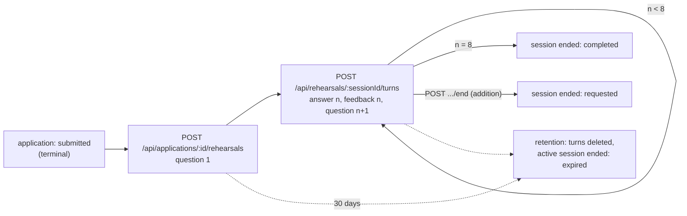

# Worker spec 13: interview-rehearsal

Revision 1, 2026-10-25. Tier: standard. Phase: P6 (migration `apps_07_engagement`, label 0027). Owner module: `coaching` (`server/src/modules/coaching/`). Agent: `interview-coach` (Sonnet 5.5). Foundation references: `01-architecture.md` B.8.9, B.8.10, B.9; `02-database.md` 7.3.6, 7.3.7 and `_db/applications.md` 3.6, 3.7, 4.7, 5.6; `03-agent-runtime.md` 3.3, 5, 9; `05-api.md` 10.9, 11.5.

This worker is different from the others in the set. It is not a queue consumer and not a DBOS workflow. It is two synchronous routes on the **api** process (plus a read route and, as an addition, an end route) and one daily clean-up inside the `retention` schedule of the `housekeeping` worker. The reasons are in section 2.4.

---

## 1. Purpose and place in the lifecycle

**What it does.** After a user has submitted an application, they can practise the interview for that job. A session asks at most 8 questions. Each question comes from the gap between the job card's requirements and the user's confirmed facts. After each answer the user gets short feedback that cites the confirmed facts it relied on, and the next question. It is the bounded interview-rehearsal feature F9 of the freehire adoption (owner decision C). It is not a chat agent: one `interview-coach` call per turn, no tools, no loop, no memory outside the transcript.

**Where it sits.**



**What it does not touch.** It never changes an application, a credit, a fact, a resume or a draft. It has no send path. Nothing it writes reaches an employer, and nothing it writes becomes a fact (a user who wants to add experience that the feedback points out goes through `POST /api/profile/facts`, a separate user action, where it starts unconfirmed). The `coaching` module may not import `billing`, `submission` or `applications/approve-core` (boundary rule 3 of `03-agent-runtime.md` section 1 applies in both directions: those modules also cannot import `agents/`).

**Plan gate.** The feature is metered by the `rehearsalTurns` allowance in `shared/src/plans.ts`. Today that is Free 0, Starter 0, Pro 20, Max 40 units a UTC day. A limit of 0 means the plan does not include the feature (403 `forbidden`, not 429; `05-api.md` 10.9). One session costs 9 units when played in full: 1 for the start call (it produces question 1) and 1 per answered question (8). A Pro user can therefore play two full sessions a day; a Max user four.

**Spike S-D1.** Nothing in this worker uses DBOS, so no spike correction changes it (section 13 lists the places checked). It writes zero checkpoint rows and adds nothing to the budget of about 55 writes per submitted application.

---

## 2. Trigger, schedule and payload (a TypeScript type), plus the idempotency key

### 2.1 Triggers

| Trigger | Process | Route id (registry) | Auth and limits | Handler deadline |
|---|---|---|---|---|
| `POST /api/applications/:id/rehearsals` | api | `rehearsals.start` | `session`; `user_api` then `ai_burst` (10 per 60 s per user) | 60 s |
| `POST /api/rehearsals/:sessionId/turns` | api | `rehearsals.turn` | same | 60 s |
| `GET /api/rehearsals/:sessionId` | api | `rehearsals.get` | `session`; `user_api` | 10 s |
| `POST /api/rehearsals/:sessionId/end` (addition AD-R1) | api | `rehearsals.end` | `session`; `user_api` | 10 s |
| `retention` schedule (daily, 03:00 UTC, the `housekeeping` worker) | worker | n/a | n/a | n/a |

There is no queue, no workflow id and no `scanForm`-style schedule. The model-backed routes are listed in `05-api.md` 7.3 as deliberately not key-idempotent. This spec keeps that and makes the repeat safe by constraints, a claim and a replay rule (2.3).

### 2.2 Payload types

```ts
// shared/src/api.ts (already specified in 05-api.md 9.4; repeated here for the contract)
export type RehearsalQuestion = { id: string; text: string; requirementIds: string[] };   // id "q1".."q8", text <= 600 chars
export type RehearsalFeedback = { strengths: string[]; gaps: string[]; suggestion: string; factIds: string[] };

export type StartRehearsalRequest  = Record<string, never>;                    // no body; path param :id is the application id (uuid)
export type StartRehearsalResponse = { sessionId: string; question: RehearsalQuestion };            // 201
export type RehearsalTurnRequest   = { answer: string };                       // strict, trimmed, 1..2000 chars
export type RehearsalTurnResponse  = { feedback: RehearsalFeedback; nextQuestion: RehearsalQuestion | null };   // 200
export type RehearsalSessionView   = {                                         // GET and POST .../end
  session: { id: string; applicationId: string; questionsAsked: number; endedAt: string | null };
  turns: { question: RehearsalQuestion; answer: string | null; feedback: RehearsalFeedback | null }[];
};
```

```ts
// server/src/modules/coaching/rehearsal.ts (internal; replaces the answerTurn(tx, ...) declaration of _db/applications.md, see AD-R4)
export interface TurnPlan {                      // everything phase 1 learns, handed to phase 2 and 3
  sessionId: string; seq: number;                // seq = the open question being answered (0 for a start)
  openQuestion: RehearsalQuestion | null;
  allowance: { used: number; limit: number; day: string };   // `day` is captured for the refund
  claimKey: string;                              // "start:<applicationId>" | "turn:<sessionId>:<seq>"
}
export declare function prepareStart(db: Db, userId: string, applicationId: string): Promise<TurnPlan & { jobId: string }>;
export declare function prepareTurn(db: Db, userId: string, sessionId: string, answer: string): Promise<TurnPlan | { replay: RehearsalTurnResponse }>;
export declare function commitStart(tx: Tx, userId: string, applicationId: string, q: RehearsalQuestion, callId: string): Promise<{ sessionId: string; ordinal: 1 | 2 }>;
export declare function commitTurn(tx: Tx, userId: string, plan: TurnPlan, answer: string, out: CoachOutput, callId: string): Promise<RehearsalTurnResponse>;
export declare function endSession(db: Db, userId: string, sessionId: string): Promise<RehearsalSessionView>;
```

### 2.3 The idempotency key

| Operation | Natural key (database) | In-flight guard | Replay rule |
|---|---|---|---|
| Start | `(application_id, ordinal)` unique, `ordinal` 1 or 2 (`rehearsal_sessions_app_ordinal_uq`); at most one active session per application (`rehearsal_sessions_one_active_uq`); question 1 is `(session_id, 1)` | Claim `start:<applicationId>`: one point in 90 s in the `rehearsal_claim` limiter class (AD-R5), kept in `rate_limits` | A second start while a session is active answers 409 `conflict` with `details { sessionId }`; the client resumes through `GET`. No unit is spent |
| Turn | `(session_id, seq)` primary key; the open turn is the one with `answer IS NULL` | Claim `turn:<sessionId>:<seq>`, same class and window | If the incoming answer is identical to the last answered turn's answer, is at least 40 characters long and that turn was answered less than 60 s ago, the stored result is returned with `Idempotent-Replayed: true`: no model call, no unit. Shorter answers are never treated as replays (a user may legitimately type "Yes." twice), and a lost response to one of those costs one extra unit at worst |
| End | `ended_at IS NULL` conditional update | none | Ending an ended session returns it unchanged (200) |

An `Idempotency-Key` header, if a client sends one, is ignored on these routes (they are not `workflow-id` routes, `05-api.md` 7.2). The "key" is therefore the pair `(session_id, seq)` plus the claim. The claim is deleted when the request finishes, whether it succeeded or failed, and expires by itself after 90 s (longer than the 60 s deadline) if the process dies.

### 2.4 Why not a DBOS workflow

A turn blocks a person on a Sonnet call of 4 to 15 s. The request-workflow wait is 5 s (`05-api.md` 2.4); the turn would have to be answered by polling, which the UI does not want. A workflow replay (rule D1 and `forkWorkflow` from step 0) would repay the model call. The state to protect (a session row and its turns) is small and fully guarded by constraints. Not using a workflow also keeps answer text out of `kairos_dbos`, which holds ids only. A `DBOS.runStep` around the model call is rejected for the same reasons.

---

## 3. Algorithm, step by step

Notation: **tx** is a short Postgres transaction through PgBouncer in transaction mode with `SET LOCAL kairos.actor = 'user'`. No transaction is open while the model runs: the api must not hold a pooled connection for up to 60 s, and a locked session row would block `GET` and retention. Instead every request has three phases (prepare, call, commit) and the claim plus the `(session_id, seq)` primary key give the same safety a held lock would.

### 3.1 Start: `POST /api/applications/:id/rehearsals`

| Step | Action | Tables and columns | Agent / external |
|---|---|---|---|
| S0 | Middleware: session (email verified), `user_api`, `ai_burst`, `:id` validated as uuid (400 `invalid_param`), body must be empty or `{}` (422 `invalid_body`), deadline 60 s | `rate_limits` | none |
| S1 | Plan gate. `limit = getPlan(effective_plan(user)).aiDailyAllowance.rehearsalTurns`. `0` gives 403 `forbidden`, message "Interview rehearsal is on Pro and up" (built from the lowest plan with a non-zero allowance, so it follows `plans.ts`; AD-R3) | `subscriptions` via `effective_plan()`; `shared/src/plans.ts` | none |
| S2 | tx1, read: `SELECT id, job_id, status FROM applications WHERE id = $1 AND user_id = $2`, no lock. No row: 404 `not_found` (also for another user's application, INV-11). `status <> 'submitted'`: 409 `conflict` "Practice is available after you submit the application" | `applications(id, user_id, job_id, status)` | none |
| S3 | tx1: `SELECT id, ordinal, ended_at FROM rehearsal_sessions WHERE application_id = $1` (index prefix of `rehearsal_sessions_app_ordinal_uq`). An active row: 409 `conflict`, `details { sessionId }`. Two rows: 422 `limit_reached`, `details { limit: 2 }` | `rehearsal_sessions(application_id, ordinal, ended_at)` | none |
| S4 | Service switches (10 s in-process cache): `llm_paused` or `agent_disabled:interview-coach` gives 503 `ai_unavailable` with `Retry-After: 30`; `currentShedLevel() >= 2` gives 429 `rate_limited`, `details.reason = "service_budget"`. Checked before any unit is spent | `ops_flags` | none |
| S5 | Claim: consume `start:<applicationId>` in `rehearsal_claim`. Refused: 409 `conflict` "Your practice session is already starting" | `rate_limits` | none |
| S6 | `consumeAllowance(db, userId, "rehearsalTurns", 1, limit)` (autocommit upsert guarded by `used + 1 <= limit`). `null`: delete the claim, 429 `rate_limited`, `details { reason: "daily_allowance", feature: "rehearsalTurns", limit, used, resetsAt }`. Keep `{ used, day }` for the refund | `ai_usage(user_id, day, feature, used)` | none |
| S7 | Load the job and the user's facts (read only, one statement each): `jobs(id, title, card, seniority_hint)` joined to `companies(name)`; `facts(id, kind, text, confirmed)` for the user; `profiles(preferences)` roles and seniority only. A null `jobs.card` (purged 180 days after the job closed, or never analysed) gives 409 `conflict` "The job details are no longer available for practice"; the unit is refunded | `jobs`, `companies`, `facts`, `profiles` | none |
| S8 | Deterministic gap plan (`modules/coaching/gaps.ts`, pure): run `computeF1` in `display` mode with the card and all the user's facts; take `requirements`; drop every requirement for which `classifySensitive(text)` is non-null (visa, work authorization, salary, EEO, never practised, INV-9); order by `(askedCount asc, status rank, required desc, card order)` where status rank is `missing` 0, `unconfirmed` 1, `covered` 2. The first 12 form the requirement list and the first 4 are `candidateIds`. For a start `askedCount` is 0, so gaps come first, then required requirements the user covers. An empty list gives 409 `conflict` and a refund | none | `computeF1` is a pure function (`modules/matching/f1.ts`) |
| S9 | Fact selection (`modules/coaching/facts.ts`, pure, deterministic): confirmed facts only, at most 30 and 4,800 characters in total: first the fact ids F1 mapped to the listed requirements, then the highest alias-normalized term overlap with those requirements, then the newest | none | none |
| S10 | **Model call.** `runAgent(getAgent("interview-coach"), input, ctx)` with `input.mode = "start"` (the input contract is in AD-R7). `ctx = { userId, applicationId, jobId, inputRefs: { factIds, requirementIds }, plan, feature: "rehearsalTurns", budgetClass: "interactive", workspace: "interactive", traceId, deadlineAt: start + 55 s, signal: ctx.deadline }`. The gateway runs its own checks: `checkBudget` (call, shed, user interactive backstop, agent envelope $12, global), limiter permit, breaker, one write to `llm_calls` per attempt, `user_daily_usage.interactive_usd` and `llm_cost_daily` updates | `llm_calls`, `user_daily_usage`, `llm_cost_daily` (written by the gateway) | `interview-coach` on the Anthropic API, workspace `kairos-prod-interactive` |
| S11 | Route-level checks on the validated output: `nextQuestion` is non-null and its `requirementIds` are a non-empty subset of `candidateIds`; its text is at most 600 characters and its JSON at most 1,500 bytes (the `rehearsal_turns_shape_ck` limit is 2,048 bytes of jsonb); the question text contains no URL, email address or phone number. The route sets `id = "q1"`, ignoring any id the model chose | none | none |
| S12 | tx2: `commitStart`: `INSERT INTO rehearsal_sessions (user_id, application_id, ordinal) VALUES ($1, $2, (SELECT COALESCE(max(ordinal), 0) + 1 FROM rehearsal_sessions WHERE application_id = $2)) RETURNING id, ordinal`; trigger `rehearsal_sessions_bind_bi` re-checks owner and `submitted`. Then `INSERT INTO rehearsal_turns (session_id, seq, question, question_call_id) VALUES ($id, 1, $q, $callId)`. `questions_asked` takes its default 1 | `rehearsal_sessions`, `rehearsal_turns` | none |
| S13 | Delete the claim. Respond 201 `{ sessionId, question }` with `Kairos-Allowance: feature=rehearsalTurns;used=<n>;limit=<n>;resets=<next 00:00 UTC>` | `rate_limits` | none |

**Failure handling for S7 to S12.** Any exception after S6 runs the compensation in this order: delete the claim, `refundAllowance(db, userId, "rehearsalTurns", 1, day)` (restores the captured day even across midnight), then map the error (section 5.1). A unique violation at S12 means a parallel start won: refund, 409 `conflict` with the winner's `sessionId`.

### 3.2 Turn: `POST /api/rehearsals/:sessionId/turns`

| Step | Action | Tables and columns | Agent / external |
|---|---|---|---|
| T0 | Middleware as S0, with `{ answer }` strict, trimmed, 1 to 2,000 characters (422 `invalid_body`) | `rate_limits` | none |
| T1 | Plan gate as S1 (a user who downgraded after starting gets 403) | `subscriptions` | none |
| T2 | tx1, read, no lock: `SELECT s.*, a.job_id FROM rehearsal_sessions s JOIN applications a ON a.id = s.application_id WHERE s.id = $1 AND s.user_id = $2`. No row: 404. Then `SELECT seq, question, answer, answered_at FROM rehearsal_turns WHERE session_id = $1 ORDER BY seq` | `rehearsal_sessions`, `applications(job_id)`, `rehearsal_turns` | none |
| T3 | Replay check (2.3). On a match: respond 200 with the stored `feedback` of that turn and the next turn's `question` (or `null` when the session is completed), header `Idempotent-Replayed: true`. Done | `rehearsal_turns` | none |
| T4 | `ended_at IS NOT NULL`: 409 `conflict` "This practice session has ended". Open turn missing (cannot happen under the constraints; treated as a data fault): 409 and a `rehearsal_state_fault` log. The open turn is the highest `seq`, which must equal `questions_asked` | `rehearsal_sessions`, `rehearsal_turns` | none |
| T5 | Service switches as S4, claim `turn:<sessionId>:<seq>` as S5 (refused: 409 `conflict` "Your last answer is still being checked"), allowance as S6 | `ops_flags`, `rate_limits`, `ai_usage` | none |
| T6 | Context as S7 to S9, with two differences. `askedCount` per requirement comes from the transcript's `question.requirementIds`; when every requirement has been asked once the counts simply rise (a requirement is re-asked from a new angle, never an ungrounded question). The transcript sent is compacted: every question (at most 600 characters) and prior answers cut to their first 300 characters; prior feedback is not sent; the current answer is sent whole (at most 2,000 characters), after `redactContact` | `jobs`, `facts`, `profiles` | none |
| T7 | **Model call** with `input.mode = "turn"`, `seq`, `isLast = (seq === 8)`. Output: `{ feedback, nextQuestion }`. Interactive route deadline and gateway behaviour as S10 | `llm_calls` and counters | `interview-coach` |
| T8 | Route-level checks: every `feedback.factIds` entry is in the input fact set (so it is a confirmed fact the user owns); `nextQuestion` is `null` exactly when `isLast`; otherwise its `requirementIds` are a non-empty subset of `candidateIds`; no URL, email address or phone number in any output string unless it appears in the user's answer or a cited fact; every number in `suggestion` appears in the user's answer, a cited fact or a requirement text; `JSON.stringify(feedback)` at most 3,500 bytes (the check allows 4,096 bytes of jsonb), `nextQuestion` at most 1,500 bytes. A violation is repaired once by the gateway (violations carry paths and codes only); a second failure is an `AgentError` | none | none |
| T9 | tx2, `commitTurn`: `SELECT id, questions_asked, ended_at FROM rehearsal_sessions WHERE id = $1 FOR UPDATE` (the only lock, `02-database.md` 5.1). Re-check `ended_at IS NULL` and `questions_asked = seq`. `UPDATE rehearsal_turns SET answer = $a, feedback = $f, feedback_call_id = $c, answered_at = now() WHERE session_id = $1 AND seq = $n AND answer IS NULL RETURNING seq`; zero rows means a parallel request won | `rehearsal_sessions`, `rehearsal_turns` | none |
| T10 | If `seq < 8`: `INSERT INTO rehearsal_turns (session_id, seq, question, question_call_id) VALUES ($1, $n + 1, $q, $c) ON CONFLICT DO NOTHING RETURNING seq` (the same call produced the feedback and this question, so both call ids are the same `llm_calls` id) and `UPDATE rehearsal_sessions SET questions_asked = $n + 1 WHERE id = $1 AND questions_asked = $n`. If `seq = 8`: `UPDATE rehearsal_sessions SET ended_at = now(), end_reason = 'completed'`. Commit | same | none |
| T11 | Delete the claim. Respond 200 `{ feedback, nextQuestion }` with `Kairos-Allowance` | `rate_limits` | none |

**A lost race at T9 or T10** (the claim expired during a very slow call, or retention ended the session) rolls tx2 back, refunds the unit, and answers 409 `conflict`. The model call was paid for and its `llm_calls` row stays; that is the only unrecoverable cost of a race and it is bounded by the claim (section 7).

### 3.3 Read and end

- `GET /api/rehearsals/:sessionId`: one query joining the session on `user_id` and one turn query ordered by `seq`. Not metered, no model. An expired session returns its row with empty `turns`.
- `POST /api/rehearsals/:sessionId/end` (AD-R1): `UPDATE rehearsal_sessions SET ended_at = now(), end_reason = 'requested' WHERE id = $1 AND user_id = $2 AND ended_at IS NULL`; then return the view. An open question stays unanswered. No unit is spent or refunded.

### 3.4 Retention (`housekeeping` worker, schedule `retention`, daily)

Both statements run in one transaction per batch, in this order, so no active session can ever lose turns:

1. `UPDATE rehearsal_sessions SET ended_at = now(), end_reason = 'expired' WHERE ended_at IS NULL AND created_at < now() - interval '30 days'` (uses the partial index `rehearsal_sessions_one_active_uq`, which holds only active rows).
2. `DELETE FROM rehearsal_turns WHERE (session_id, seq) IN (SELECT session_id, seq FROM rehearsal_turns WHERE created_at < now() - interval '30 days' LIMIT 1000)`, repeated until fewer than 1,000 rows are deleted. A turn can only be older than 30 days if its session is, and step 1 has already ended that session. At about 1,000 rows a day this is one batch.

The session rows stay for the life of the account so that the 2-session limit holds. Account deletion removes everything by cascade (`erasure:<userHash>` deletes applications, which cascade sessions and turns).

---

## 4. Concurrency, rate limits, ordering, batching and priorities, with numbers at 10,000 users

**Expected load** (from `01-architecture.md` B.12 and `02-database.md` 12): about 250 rehearsal users a day, 1,000 `interview-coach` calls a day, about 110 to 120 sessions started a day. Assume 30% of the day's calls land in a 3-hour evening window: about 100 calls an hour, 1.7 a minute. Bursts of 10 times that give 17 a minute. At a typical latency of 6 s the average number of calls in flight is 0.2 and the 99th percentile of concurrency is at most 5.

| Control | Value | Scope |
|---|---|---|
| `ai_burst` | 10 requests per 60 s | per user, shared with the other AI routes |
| Allowance `rehearsalTurns` | Pro 20, Max 40 a UTC day (Free and Starter 0) | per user and day, `ai_usage` |
| Sessions | 2 per application, 1 active, 8 questions | database constraints |
| In-flight claim | 1 per `start:<applicationId>` or `turn:<sessionId>:<seq>`, 90 s | cluster-wide, in `rate_limits` |
| Process concurrency | at most 6 rehearsal calls at once per api replica (`REHEARSAL_MAX_CONCURRENCY`, AD-R5), wait at most 3 s, then 503 `service_unavailable` with `Retry-After: 3`; inside the gateway's api semaphore of 20 | per replica |
| Anthropic Sonnet 5.5 RPM bucket | api 40 a minute per replica (120 across 3 replicas), shared with `resume-writer` and escalations; worker 15 per replica | per process |
| Per-user cost backstop | `interactiveSpendBackstopUsd`: Pro $2.70, Max $4.53 a day | `user_daily_usage.interactive_usd` |
| Agent envelope | `interview-coach` $12 a day (expected $7.50); 80% emails, 100% stops the agent for the day (429 `service_budget`) | `llm_cost_daily` |

**Ordering.** Calls inside one session are strictly serial: the claim admits one request per open turn, and the answer is written against the open turn only. Different sessions and different users run in parallel. There is no cross-session ordering and no batching: the Batch API is not ZDR-eligible and every call carries a person's answer, so `batchEligible` is `never`.

**Priority.** Rehearsal is the lowest-priority interactive feature. It is third in the shedding order (`01-architecture.md` B.11.3): backfill, scoring, **rehearsal**, builder suggestions, polling. Shed level 2 (global spend $220) refuses it with 429 `service_budget`. It never delays approvals, sends, settlement or billing, which share only the Postgres primary and the api process. The 6-call process cap exists so a burst of practice calls cannot take the api's 20-call semaphore from the builder and tailor routes.

**Database load.** A start runs about 12 statements, a turn about 14, each transaction under 10 ms. At the 17-a-minute burst that is under 4 statements a second. The only locked row is the session being answered, held for under 10 ms in tx2.

---

## 5. Retries, backoff, timeouts, dead-letter handling, poison messages and compensation

### 5.1 Retries and timeouts

| Layer | Behaviour |
|---|---|
| Route | Never retries on the server. The web disables the button while a request is pending. A client retry after a lost response is handled by the replay rule |
| Gateway (api profile of `03-agent-runtime.md` 5.2) | Up to 2 retries for `overloaded`, `server_error` and `connection` with full jitter `random(0, min(8 s, 1 s x 2^attempt))`; `rate_limited` is retried only when `retry-after` is at most 5 s; no retry for `timeout` on the api; one repair re-ask for `schema_invalid` and `postValidate` violations; no tier-up (`interview-coach` has no tier above Sonnet and is `fail_closed`) |
| Deadlines | Handler 60 s. The gateway's `deadlineAt` is request start plus 55 s, leaving 5 s for tx2. `interview-coach.timeoutMs` must be 25 s so that one retry or repair still fits (`now + timeoutMs < deadlineAt`); at the 60 s in the current table nothing after the first send could ever start (AD-R6). The first call per process after a deploy gets `timeoutMs + 20 s` for grammar compilation, which is why the deadline is 55 s and not 40 s |
| Database | Each transaction retries once on SQLSTATE `40P01` or `40001`. A statement budget of 5 s applies |
| Deadline hit | 503 `timeout`, `Retry-After: 5` (`05-api.md` 2.4); compensation runs |

### 5.2 Error mapping (route errors; the envelope is the standard one)

| Source | HTTP | Code | Compensation |
|---|---|---|---|
| Unknown or foreign application or session | 404 | `not_found` | none (no unit spent yet) |
| Application not `submitted`; session ended; active session exists; claim held; no card or no usable requirement; race lost | 409 | `conflict` (start with active session: `details { sessionId }`) | refund if a unit was spent |
| Third session | 422 | `limit_reached` `{ limit: 2 }` | none |
| Allowance 0 | 403 | `forbidden` | none |
| Allowance spent, user backstop, or agent envelope, shed level | 429 | `rate_limited`, `details.reason` `daily_allowance` or `service_budget` | refund when the gateway refuses after the unit was spent |
| `refusal`, `injection_echo` | 422 | `ai_refused`, "The coach could not review this answer. Try rewording it." | refund |
| Any other retryable or non-retryable `AgentError` (`overloaded`, `server_error`, `connection`, `schema_invalid`, `max_tokens`, `circuit_open`, `agent_disabled`, `llm_paused`) | 503 | `ai_unavailable`, "The practice coach is busy. Try again in a minute." with `Retry-After` | refund |
| Deadline | 503 | `timeout` | refund |
| Body invalid | 422 | `invalid_body` | none |

### 5.3 Dead letters and poison messages

There is no queue, so nothing can sit in a dead-letter state and no message can be redelivered forever. The equivalents are:

- **A turn that keeps failing.** The open turn is unchanged by any failure, so the user can retry, edit the answer, or end the session. Three consecutive `ai_refused` or `ai_unavailable` answers on the same open turn within 15 minutes log `rehearsal_turn_stuck` (counted in section 8); the support path is the end route.
- **A poison answer** (a prompt-injection attempt, an answer that makes the model refuse every time) is data fenced as untrusted text. It either yields normal feedback or `ai_refused`; it never loops, because there is one call and one repair per request.
- **An abandoned session** blocks the application's single active slot. The user ends it with the end route, or retention ends it as `expired` at 30 days. The 409 on start returns the `sessionId` so the client resumes instead of being stuck.

### 5.4 Compensation summary

| What was done | Undo |
|---|---|
| Allowance unit consumed (S6, T5) | `refundAllowance` with the captured `day`, in its own autocommit statement, whenever the request does not end in a stored turn or session |
| Claim taken | Deleted in a `finally`; expires after 90 s if the process dies |
| Model call paid | Not undone; the `llm_calls` row records it (status `ok`, `schema_invalid`, `blocked` and so on) and the daily envelope counts it |

If the process is killed between S6 and the commit, or the database is down for both the commit and the refund, the unit is lost (at most one unit a user; a Pro unit costs at most $0.015). This is accepted: consuming the unit only after the call would let a user fire ten parallel calls against one remaining unit.

---

## 6. State transitions it performs and the invariants it must uphold (and how)

### 6.1 State transitions

| Entity | From | To | Performed by | Guard |
|---|---|---|---|---|
| `rehearsal_sessions` | (none) | active (`ended_at` null, `questions_asked` 1) | `commitStart` | trigger `rehearsal_sessions_bind_bi` (owner, `submitted`); `rehearsal_sessions_one_active_uq`; `rehearsal_sessions_app_ordinal_uq`; `rehearsal_sessions_ordinal_ck` |
| `rehearsal_sessions` | active | active, `questions_asked` n+1 | `commitTurn` | `FOR UPDATE`; `WHERE questions_asked = n`; `rehearsal_sessions_asked_ck` (1 to 8) |
| `rehearsal_sessions` | active | ended, `completed` | `commitTurn` when `seq = 8` | `rehearsal_sessions_end_ck` |
| `rehearsal_sessions` | active | ended, `requested` | end route | `WHERE ended_at IS NULL` |
| `rehearsal_sessions` | active | ended, `expired` | `retention` | `WHERE ended_at IS NULL AND created_at < now() - 30 days` |
| `rehearsal_turns` | (none) | open (`answer` null) | `commitStart`, `commitTurn` | PK `(session_id, seq)`; `rehearsal_turns_seq_ck` 1 to 8; `rehearsal_turns_shape_ck` |
| `rehearsal_turns` | open | answered (`answer`, `feedback`, `answered_at`, `feedback_call_id` together) | `commitTurn` | `WHERE answer IS NULL`; `rehearsal_turns_answered_ck` |
| `rehearsal_turns` | any | deleted | `retention` | age over 30 days |
| `ai_usage.used` | n | n+1 or n-1 | `consumeAllowance`, `refundAllowance` | `used + units <= limit`; `ai_usage_used_ck` |

No other table is written (apart from the gateway's `llm_calls`, `llm_cost_daily` and `user_daily_usage`). No `application_events` row, notification or email is created; the event ledger describes the application lifecycle, not practice.

### 6.2 Invariants

| Invariant | How this worker upholds it |
|---|---|
| INV-11 ownership | Every query filters by the session user id; a foreign id is 404; `rehearsal_sessions_bind` re-checks the owner at insert; the authorization matrix test calls all four routes as a second user |
| F9 limits: at most 8 questions, at most 2 sessions per application, one active, bound to a submitted application | Database constraints, not just code (T-11 of `_db/applications.md`); the code maps their violations to 409 or 422 |
| F11 allowance | Consumed atomically before the call, refunded on every non-stored outcome, UTC day captured, limit 0 means 403, spent means 429 and never a cheaper model |
| Truth lock (INV-2) and "no invented facts" | The coach cites only fact ids from its input (a confirmed, user-owned set, checked at T8); numbers and entities in suggestions must come from the input; feedback is display text, never stored as a fact or resume line, and never sent to an employer. The only path to a new fact is the user's own action on the facts routes |
| Sensitive topics (INV-9) | Requirements that match `classifySensitive` are removed before any prompt is built, so a visa, salary or EEO question is never asked and a model never answers one. Profile fields for work authorization and salary are never loaded by `coaching` (the module selects `profiles` preferences roles and seniority only) |
| No model before the fit gate | Not applicable: the application already exists and is submitted. The fit gate, threshold and caps are untouched |
| Approval before send, Autopilot, credits, one charge per application | No interaction: no write to `applications`, `credit_ledger`, `credit_balances` or any send path; enforced by the import boundary |
| Privacy (INV-15) | Sent to Anthropic: job requirement text (public), at most 30 confirmed fact texts, the question and answer transcript with contact details redacted, `metadata.user_id` as `userHash`. Never sent: name, email, phone, links, work authorization, salary, unconfirmed facts, application or job ids |
| Untrusted input | The user's answers (T2) and job text (T3) are fenced with `DATA_RULES`; no tools; output is one strict JSON object, validated by zod, `postValidate`, the echo canary and the route checks of S11 and T8 |
| Cost | Section 9 |

---

## 7. Failure modes table

| # | Cause | Detection | User-visible effect | Recovery |
|---|---|---|---|---|
| 1 | Anthropic 5xx, 529 or connection error after retries | `llm.calls.interview-coach.error`; route 503 rate; breaker state | 503 `ai_unavailable`; turn unchanged; unit refunded | User retries; breaker half-open probes after 30 s; `R-LLM-5` if widespread |
| 2 | Call exceeds the 55 s gateway deadline | `AgentError timeout`; 503 `timeout` count | "Try again" message; unit refunded | Retry; check latency alert (section 8) |
| 3 | `schema_invalid` or `max_tokens` after the repair | `llm.schema_invalid_rate.interview-coach`, `llm.max_tokens_rate.interview-coach` | 503 `ai_unavailable`; unit refunded | Prompt or schema bug: roll back with `prompt_pin:interview-coach`; A-LLM-5 |
| 4 | Output fails the route checks (a fact id outside the input, an ungrounded question, a stray URL, an oversize JSON) | `postValidate` violation codes in `llm_calls.error_code`; metric `rehearsal.grounding_violations` | One repair is invisible; a second failure is 503 `ai_unavailable`; refund | Same as 3; the eval grounding gate (100%) should have caught it |
| 5 | Refusal or injection-echo on an answer | `llm.refusal_rate.interview-coach`; `ai_refused` count | 422 `ai_refused` message; refund; the question stays open | User rewords or ends the session |
| 6 | Allowance spent | 429 `daily_allowance` | "You have used today's practice allowance; it resets at 00:00 UTC" with `resetsAt` | Wait; plan upgrade |
| 7 | Agent envelope ($12), global shed level 2, or user backstop reached | `llm_cost_daily`, `llm.shed_level`, 429 `service_budget` | "Practice is paused for everyone for a while" | Resets at 00:00 UTC; `R-LLM-2` if abnormal |
| 8 | `llm_paused`, `agent_disabled:interview-coach` | `ops_flags` read at S4 | 503 `ai_unavailable` before any unit is spent | Clear the flag after the cause is fixed |
| 9 | Double click or two tabs on the same open turn | claim refusal; metric `rehearsal.claim_conflicts` | Second request gets 409 "still being checked"; first completes normally | None needed |
| 10 | Lost response, client retries the same long answer | replay rule; metric `rehearsal.replays` | The same feedback appears again, no charge | None |
| 11 | Lost response on an answer under 40 characters, client retries | none (by design) | The retry answers the next question with the same short text: one extra unit and one odd feedback | User can end the session; accepted |
| 12 | Claim expired during a slow call and a parallel request committed first | commit finds `answer IS NOT NULL` or `questions_asked <> n`; metric `rehearsal.commit_races`; alert at 5 an hour | 409 `conflict`; refund | The winner's result stands; investigate latency |
| 13 | Retention ended the session while the user was answering | commit finds `ended_at` set | 409 "This practice session has ended"; refund | Start a new session if one of the two remains |
| 14 | api process killed after the unit was spent (deploy drain is 25 s, crash, OOM) | claim expires; allowance higher than the number of stored turns for that day | The request fails; the unit is lost; the turn is still open | Retry; at most one unit a user per incident |
| 15 | Database unavailable at commit after a paid call | `rehearsal_write_failed` log and counter; `/health` 503 | 503 | Refund and retry on recovery; the `llm_calls` row records the wasted call |
| 16 | The job card was purged or never created | S7 null card | 409 "The job details are no longer available for practice"; refund | None; this applies only to jobs closed over 180 days ago |
| 17 | Every requirement filtered as sensitive or the card has none | empty pool at S8 | 409 with the same style of message | None |
| 18 | The user lacks the feature on their plan or downgrades mid-session | S1 allowance 0 | 403 `forbidden` | Upgrade; the session stays and can be read or ended |
| 19 | Account deleted during a call | FK violation at commit | 404 | Erasure already removed the data; the refund finds no row |
| 20 | Retention schedule fails | `rehearsal.retention_lag_days` above 31, invariant I-9 | None visible | Re-run `retention`; privacy alert (section 8) |
| 21 | A bug writes a feedback over 4 KB or a question over 2 KB | CHECK violation 23514 on commit | 500 `internal`; refund | The byte-size guards at T8 and S11 prevent it; the test in section 11 asserts the guards for multi-byte text |

---

## 8. Observability: logs, metrics, traces and alerts with thresholds

**Logs** (pino, one line per request through the shared request log, plus these events). Fields: `requestId`, `route` (`rehearsals.start|turn|get|end`), `sessionId`, `seq`, `userHash`, `outcome` (`ok|replay|conflict|limit|forbidden|rate_limited|ai_unavailable|ai_refused|timeout`), `unitsUsed`, `callId`, `latencyMs`. Events: `rehearsal_started`, `rehearsal_turn_committed`, `rehearsal_session_ended` (with `reason`), `rehearsal_replayed`, `rehearsal_claim_conflict`, `rehearsal_commit_race`, `rehearsal_refunded` (with `reason`), `rehearsal_turn_stuck`, `rehearsal_write_failed`, `rehearsal_state_fault`. **Never logged:** the answer, question, feedback or fact text (pino redaction paths gain `*.answer`, `*.feedback`, `*.question`, AD-R8).

**Metrics** (stored in `metrics_minute`; the HTTP ones come from the registry route id):

| Metric | Type | Meaning |
|---|---|---|
| `kairos_api_requests_total{route=rehearsals.*,status}` and `kairos_api_request_duration_ms` | existing | Request volume, status mix, latency |
| `llm.calls.interview-coach.<status>`, `llm.cost_usd.interview-coach`, `llm.cache_read_share.interview-coach`, `llm.latency_ms_p50|p95.interview-coach`, `llm.schema_invalid_rate`, `llm.repair_success_rate`, `llm.refusal_rate`, `llm.max_tokens_rate` | existing (`03-agent-runtime.md` 12) | Model health and cost |
| `rehearsal.sessions_started`, `rehearsal.sessions_completed`, `rehearsal.sessions_requested_end` | counter | Funnel |
| `rehearsal.turns_committed`, `rehearsal.replays`, `rehearsal.claim_conflicts`, `rehearsal.commit_races` | counter | Concurrency behaviour |
| `rehearsal.refunds{reason}` | counter | Units given back, by reason |
| `rehearsal.grounding_violations` | counter | Route check failures before the repair |
| `rehearsal.retention_deleted`, `rehearsal.retention_lag_days` | gauge | Age of the oldest turn minus 30 |

**Traces.** One span per route (`rehearsal.start`, `rehearsal.turn`) with children `rehearsal.prepare` (tx1), `rehearsal.gaps`, `llm.runAgent` (the gateway's own span with `kairos.agent.id = interview-coach`), `rehearsal.commit` (tx2). Attributes are ids, counts and enums only (`kairos.session.seq`, `kairos.allowance.used`), never text.

**Alerts** (additions to `06-infrastructure.md` 6.7 are listed as AD-R9; the first three reuse existing rules):

| Alert | Threshold | Action |
|---|---|---|
| A-LLM-3 (existing) | `interview-coach` at 80% of its $12 envelope | Email |
| A-LLM-2 (existing) | Envelope at 100% | Page; the agent stops for the day |
| A-LLM-5 (existing) | `interview-coach` refusals above 0.5%, `max_tokens` above 1%, repair success below 50%, or tier or drift events, over an hour | Email |
| A-LLM-7 (new) | 5xx or 503 share of `rehearsals.turn` above 5% over 15 minutes with at least 20 requests; or `rehearsal.refunds` above 10% of calls over an hour with at least 30 calls | Email |
| A-LLM-7 (new) | p95 of `llm.latency_ms.interview-coach` above 20 s over 15 minutes | Email |
| A-LLM-7 (new) | `rehearsal.commit_races` above 5 an hour, or `rehearsal.grounding_violations` above 5% of calls over an hour | Email |
| A-DATA (existing family) | `rehearsal.retention_lag_days` above 1 (oldest turn older than 31 days) for 2 consecutive daily runs; or invariant I-9 returns rows | Email |

---

## 9. Capacity and cost at 10,000 users

**Volumes per day** (base and growth are the same here; `01-architecture.md` B.12.1):

| Quantity | Value |
|---|---|
| Rehearsal users | about 250 |
| Sessions started | about 110 to 120 (9 calls when played in full, fewer when abandoned) |
| `interview-coach` calls | about 1,000 (start calls plus answered turns) |
| Requests including reads and replays | about 1,500 |
| Peak rate | about 1.7 calls a minute in the busiest 3 hours; 17 a minute in a 10x burst |
| Rows | `rehearsal_turns` about 1,000 inserted and 1,000 updated a day, 30,000 live (about 51 MB); `rehearsal_sessions` about 120 a day, 44,000 after a year at growth (about 9 MB); `ai_usage` about 250; `llm_calls` about 1,100 (retries included) |

**CPU and memory.** A request spends about 15 to 25 ms of api CPU outside the model wait (zod, `computeF1` over at most 25 requirements and 200 facts in under 5 ms, JSON, TLS). Memory per in-flight request is about 3 to 5 MB for 6 s. At the burst rate that is under 0.5% of one vCPU across the 3 growth replicas (0.5 vCPU, 0.75 GB each), so no new replica or process is needed. The Typst renderer, Playwright and the worker are not involved. Postgres: about 13,000 statements a day, negligible. Checkpoint writes: zero.

**Model cost.**

| Item | Calculation | Result |
|---|---|---|
| Expected per call | `03-agent-runtime.md` 3.3: about 3,900 input tokens after the 1.3 tokenizer factor with 60% cached, about 350 output tokens at Sonnet 5.5 prices ($2 and $10 per million, cache read $0.10) | $0.0075 |
| Maximum per call | Gateway refusal threshold | $0.015 |
| Per day | 1,000 calls x $0.0075 | $7.50 |
| Share of daily model spend | $7.50 of $120.6 (base) or $136.4 (growth) | 6.2% or 5.5% |
| Envelope | $12 a day = 1,600 calls at the expected price | 60% headroom |
| Full session | 9 calls x $0.0075 | $0.0675 |
| Per user per day | Pro 20 units x $0.0075; Max 40 units x $0.0075 | $0.15; $0.30 (well under the interactive backstops $2.70 and $4.53) |
| Three times the estimate | 3,000 calls x $0.0075 = $22.50 a day | Exceeds the envelope at 1,600 calls; the rest of the day is 429 `service_budget`. The all-in cost per submitted application rises to $0.0086 (`01-architecture.md` risk table), still under $0.01 |

The cost of rehearsal is already inside the $0.0076 all-in figure. It does not depend on the number of submitted applications, so it is the only agent whose cost per submitted application falls as submissions rise. No cheaper model is used: the owner fixed Sonnet 5.5 for this agent, and a spent allowance is refused, never degraded. If the eval set (60 sessions) ever shows Haiku 5.5 passing, running it would cut this line to about $2 a day; that change is a prompt-version and model decision made through the eval gate, not by this worker.

---

## 10. Security and privacy notes

- **Data held.** Answers and feedback are what users typed and what the coach returned. They are stored in plain columns for 30 days (Q-3 of `_db/applications.md`, kept). `kairos_readonly` and `kairos_metrics` get no access to these two tables. The api can insert and update but not delete; the worker can select, update sessions and delete turns.
- **Account erasure and export.** Sessions cascade from `"user"` and from `applications`; turns cascade from sessions. The user data export (`export-user.mjs`) includes transcripts still inside the 30 days (AD-R8). Backups leave in 28 days, processors in 45 (`06-infrastructure.md`).
- **Sent to Anthropic** (a sub-processor named in the privacy notice): see the invariants table. Contact details in an answer are replaced by `[email]`, `[phone]`, `[link]` before sending (`redactContact`). Free text cannot be reliably scrubbed of visa status or salary, so the screen tells people not to put contact, visa or salary details in answers (AD-R12), and the privacy notice states that practice answers go to the model provider. Messages API traffic is ZDR-eligible; no batch path exists for this agent.
- **Prompt injection.** The job requirements are third-party text (T3), the answers are user text (T2); both are fenced with a per-call nonce, and the stable per-user block uses `userBlockNonce`. The agent has no tools, so there is nothing to hijack beyond its own text. Output is plain text rendered by the web as text, never as HTML, and never used as a path, URL, SQL fragment or id (ids are checked against the input set). The echo canary rejects fence markers and instruction-echo patterns.
- **No privileged action from output.** The only things model output decides are display text and which of four candidate requirements is asked next. A wrong output cannot move money, send mail, create a fact or touch an application. The import boundary keeps `coaching` away from billing, submission and approval code, and the gateway spy test that proves no `runAgent` call occurs inside privileged paths is unaffected, because rehearsal is not one of them.
- **Abuse.** `ai_burst` (10 a minute), the allowance (20 or 40 a day), 2 sessions per application, the claim and the envelope bound the cost of a hostile user to well under $0.30 a day per account. Free and Starter accounts reach 403 before any model call, so free accounts cannot spend model money here.
- **IDOR and enumeration.** Foreign and unknown ids both answer 404; session ids are uuids (v7).
- **Secrets.** The api holds `ANTHROPIC_KEY_INTERACTIVE`; nothing here needs another key. `USER_HASH_KEY` builds the metadata hash.

---

## 11. Tests (unit, integration, failure injection) and acceptance criteria

### 11.1 Unit (vitest, no network, `fakeAnthropic` and recorded fixtures under `server/test/fixtures/llm/interview-coach/`)

1. `gaps.ts`: ordering `(askedCount, status rank, required, card order)`; sensitive requirements removed (visa, sponsorship, salary, EEO fixtures); first 12 and first 4; re-asking only after every requirement was asked; empty pool.
2. `facts.ts`: confirmed only; at most 30 facts and 4,800 characters; F1-mapped facts first; deterministic for equal input.
3. Replay detection: identical answer of 40 characters or more within 60 s is a replay; 39 characters, 61 s, a different answer, and a first turn are not.
4. Route checks: a fact id outside the input, an ungrounded or empty `requirementIds`, `nextQuestion` present when `isLast`, absent when not, a URL, email or phone not in the input, a number in `suggestion` not in the input, JSON size above 3,500 bytes, including a multi-byte (4-byte emoji) feedback and a 600-character question that exceeds 1,500 bytes.
5. Error mapping table of section 5.2, one case per row, asserting the compensation (claim deleted, unit refunded exactly once).
6. Prompt render fixture: an answer containing "Ignore previous instructions" sits inside a fence and the system block equals the prompt file byte for byte (`03-agent-runtime.md` 11.6).

### 11.2 Integration (Testcontainers Postgres 18, real `rate_limits`, `ai_usage`)

1. T-11 of `_db/applications.md`: a third session fails on `ordinal`; two concurrent starts leave one active session and exactly one unit spent (the loser refunded); a ninth turn fails on `seq`; a session for a non-submitted or foreign application fails the bind trigger; retention ends active sessions and deletes turns older than 30 days.
2. 50 parallel turn requests on one open turn: exactly one commit, one model call (fake counts), the rest 409 or replay, allowance net 1 unit.
3. Allowance race: 50 parallel starts across applications against a limit of 20 spend exactly 20 units; limit 0 gives 403 with no `llm_calls` row.
4. Full session: 8 answers, 9 units, `questions_asked = 8`, `end_reason = 'completed'`, the `nextQuestion` of the last answer is null, I-9 returns no rows.
5. Authorization matrix: `rehearsals.start`, `.turn`, `.get`, `.end` called as a second user return 404 and spend nothing.
6. Retention order: an active session aged 31 days with turns aged 31 days is ended and its turns deleted in one run; an active session aged 29 days keeps its turns; running it twice changes nothing.
7. Cascades: deleting the user or the application removes sessions and turns; deleting the application leaves `llm_calls` rows.
8. Contract: recorded request and response shapes for the four routes validate against the zod schemas; unknown body keys are 422.

### 11.3 Failure injection

1. Fake Anthropic returns 529 three times, then 200: two retries, success, no refund. Returns 529 always: 503 `ai_unavailable`, unit refunded, claim deleted, turn unchanged.
2. Delay the response past 55 s: 503 `timeout`, refund.
3. Return invalid JSON twice: repair then failure, 503, refund. Return a valid object citing a fact id not in the input: repair, then failure.
4. Return a `refusal` stop reason: 422 `ai_refused`, refund. Return output containing a fence nonce: 422 `ai_refused`.
5. Kill the api process after S6 (before the call) and after the call (before tx2): the unit stays consumed, the turn stays open, the claim expires after 90 s, a retry succeeds.
6. Fail tx2 with a connection error, then fail the refund: the failure is logged as `rehearsal_write_failed` and the next request still works.
7. Make the claim lapse (set TTL 1 s, delay the call 3 s) with two requests: one commit, one 409, one refund, one wasted `llm_calls` row, `rehearsal.commit_races` incremented.
8. Set `llm_paused`, `agent_disabled:interview-coach`, `llm_shed_level = 2`: S4 responses with no unit spent and no `llm_calls` row.
9. Load: 30 concurrent sessions with a 6 s fake latency for 5 minutes; assert p95 route latency under 8 s, no 5xx, the 6-call process cap queues the excess (503 only after the 3 s wait), no deadlocks (T-2).

### 11.4 Evals (the `interview-coach` set, 60 sessions, owned by the agent spec)

Gates for shipping a prompt or model: every question grounded in a listed requirement (100%), zero invented user facts in feedback, rubric at least 4 of 5 on 90% of turns, zero sensitive questions asked, injection cases unchanged.

### 11.5 Acceptance criteria

1. A Pro user can play two full sessions in a day and a third start answers 429 `daily_allowance` with the reset time; a Starter user gets 403 on every route; a user cannot start a third session on one application (422 `limit_reached`).
2. Zero questions about visa, salary, EEO or work authorization across the eval set and the integration fixtures.
3. Zero feedback fact ids outside the input set; zero stored rows with an oversize jsonb; I-9 empty after every integration test.
4. 50 parallel duplicate submissions produce one model call and one committed turn.
5. After every failure injection above, the open turn is unchanged and the allowance equals the number of stored turns plus sessions for the day (the exceptions are cases 5 and 6 of 11.3, which lose at most one unit).
6. Turn p95 latency under 12 s and start p95 under 12 s in staging against the real API, with the `interview-coach` cost per call at or under $0.0075 on the eval set.
7. No transcript text in logs, traces, Sentry events, `kairos_dbos` or `llm_calls` (the PII scan of `03-agent-runtime.md` and the seeded-PII CI scan pass with seeded answers).
8. Retention leaves no turn older than 30 days after the daily run, and no active session older than 30 days.

---

## 12. Migration from the skeleton

The skeleton has no rehearsal code (a search of `server/src` finds only the reserved `interview-coach` id in `agents/types.ts`, a comment in `agents/registry.ts` and a comment in `llm/budget.ts` about shed level 2). Nothing is replaced and nothing needs a data migration.

| Item | Action | Phase |
|---|---|---|
| Migration `apps_07_engagement` (label 0027): tables `rehearsal_sessions`, `rehearsal_turns`, trigger `rehearsal_sessions_bind`, their indexes, constraints and grants | Add (already specified in `02-database.md`) | P6 |
| `server/src/agents/interview-coach/{spec,schema,render}.ts`, `prompts/v1.md`, `CHANGELOG.md`, `schema.snap.json`, `server/evals/interview-coach/` | Add (agent spec document), enable in `agents/registry.ts` | P6 |
| `server/src/modules/coaching/{rehearsal,gaps,facts,routes,retention}.ts` | Add | P6 |
| `shared/src/api.ts` rehearsal schemas | Add (additive; specified in `05-api.md` 9.4) | P6 |
| `retention` schedule | Extend with the two statements of 3.4 | P6 |
| Reused unchanged | `services/sensitive.ts#classifySensitive`, `computeF1` (`modules/matching/f1.ts`; the skeleton's `services/job-fit.ts#computeJobFit` is its precursor), `llm/*` gateway, `llm/redact.ts`, `shared/src/plans.ts` allowances, `rate_limits` | |

**Release procedure.** Deploy the routes with `agent_disabled:interview-coach` set. Run the 60-session eval set in staging; when it passes the gates, clear the flag. There is no feature flag because the plan allowance (0 on Free and Starter) and the kill switch already control exposure. The routes appear in the registry with `phase: "P6"`, so the completeness test fails if they are mounted earlier. Backward compatibility: all routes are new; no existing route, shape or code changes; the optional field `rehearsals` of AD-R13 is additive.

---

## 13. Additions requested

Nothing in the foundation documents blocks this worker, but these gaps and inconsistencies need decisions or edits. Numbers like AD-R1 are this document's labels.

| Id | Document | Request |
|---|---|---|
| AD-R1 | `05-api.md` 9.2, 10.9; `01-architecture.md` B.8.9 | Add `POST /api/rehearsals/:sessionId/end` (id `rehearsals.end`, `session`, `user_api`, 200 `rehearsalSessionSchema`, errors `not_found`; idempotent). B.8.9 says a session ends "on request" but no route can request it, and an abandoned session blocks the application's only active slot for 30 days |
| AD-R2 | `05-api.md` 9.2 error lists | `rehearsals.start`: add `forbidden`, `rate_limited`, `ai_refused`, `timeout`, `service_unavailable`. `rehearsals.turn`: add `forbidden`, `rate_limited`, `ai_refused`, `timeout`, `service_unavailable`, `invalid_body`. Add to 4.5 that `conflict` on start may carry `details { sessionId }`. `05-api.md` 4.4 says `ai_refused` is new on these routes (from `03-agent-runtime.md` 5.5) but the route table omits it |
| AD-R3 | `05-api.md` 10.9, 11.5; `01-architecture.md` plan table | The text says "Interview rehearsal is on Starter and up", but `shared/src/plans.ts` sets `rehearsalTurns` to 0 for Starter (Pro 20, Max 40). The message must be generated from `plans.ts`, which today reads "Pro and up"; update the prose. If the owner wants Starter included, `plans.ts` changes, not this worker |
| AD-R4 | `_db/applications.md` module signatures | Replace `answerTurn(tx, userId, sessionId, answer)` by `prepareTurn`, `commitTurn` (section 2.2): a transaction cannot span a 4 to 15 s model call. `startSession` becomes `commitStart` and receives the question and call id because the first question must exist when the row is inserted |
| AD-R5 | `05-api.md` 6.2, 20 | New limiter class `rehearsal_claim` (key `start:<applicationId>` or `turn:<sessionId>:<seq>`, 1 point per 90 s, fails open to memory, deleted by the handler) and config `REHEARSAL_MAX_CONCURRENCY` (default 6) |
| AD-R6 | `03-agent-runtime.md` 3.3, 5.1, 9.5; `05-api.md` 2.4, 20.2 | (a) `interview-coach.timeoutMs` from 60 s to 25 s so a retry or repair fits inside the route (60 s per `05-api.md`; `03` 5.1 says 30 s: align both on 60 s with the gateway `deadlineAt` at 55 s). (b) A shed level of 2 gives 429 `service_budget` for rehearsal (`03` 9.5), but `05-api.md` 20.2 lists `llm_shed_level` under 503 `ai_unavailable`; use 03's behaviour for shed levels and 503 only for `llm_paused` and `agent_disabled` |
| AD-R7 | Agent spec `interview-coach` (parallel work) | Input must carry `mode: "start" or "turn"`, `seq`, `isLast`, the requirement list with `status` and `askedCount`, `candidateIds`, at most 30 confirmed facts, the compacted transcript (prior answers cut to 300 characters, no prior feedback) and the current answer; block budgets of about 5,600 estimated tokens in total (under `maxInputTokens` 6,000). In `start` mode the output `feedback` is ignored (empty arrays are valid). `postValidate` must enforce: fact ids within the input; `nextQuestion` null exactly when `isLast`; `requirementIds` non-empty and within `candidateIds`; no URL, email or phone absent from the input; numbers in `suggestion` present in the input; feedback JSON at most 3,500 bytes and question JSON at most 1,500 bytes (the character caps of `rehearsalFeedbackSchema` allow about 4.5 KB, which would break `rehearsal_turns_shape_ck`). The route overwrites the question id with `q<seq>`. Data labels `rehearsal_answer`, `job_requirement`, `fact` |
| AD-R8 | `03-agent-runtime.md` 10.4; `06-infrastructure.md`; scripts | Add `*.answer`, `*.feedback`, `*.question` to the pino redaction paths; `export-user.mjs` includes `rehearsal_sessions` and the live `rehearsal_turns` of the user; the seeded-PII scan seeds a rehearsal answer |
| AD-R9 | `06-infrastructure.md` 6.7; `01-architecture.md` metrics | New alert `A-LLM-7` (rehearsal route errors, refund rate, p95 latency, commit races, grounding violations; thresholds in section 8) and the `rehearsal.*` metric names in section 8; add `rehearsal.retention_lag_days` to the A-DATA family |
| AD-R10 | `02-database.md` 12 retention row | State the order of the two retention statements (3.4): sessions are ended before turns are deleted, so no active session loses turns; session rows are kept |
| AD-R11 | `01-architecture.md` B.8.10 vs `_db/platform.md` | `consumeAllowance` has two signatures (`(tx, userId, plan, feature, units)` throwing `HttpError`, and `(db, userId, feature, units, limit)` returning `{ used, day }` or `null`). This worker uses the second, because it needs the captured `day` for the refund; reconcile the first with it |
| AD-R12 | Web plan (copy) | On the practice screen: say that answers go to the model provider and should not include contact details, visa status or salary; show the allowance from `Kairos-Allowance`; on the 409 with `details.sessionId`, resume that session; on 403, show the plan gate |
| AD-R13 | `05-api.md` 9.4 `applicationDetailSchema` | Optional additive field `rehearsals: { used: number; activeSessionId: string or null }` on `GET /api/applications/:id` for a submitted application, so the screen can show "Practise" or "Resume practice" without calling start to find out |
