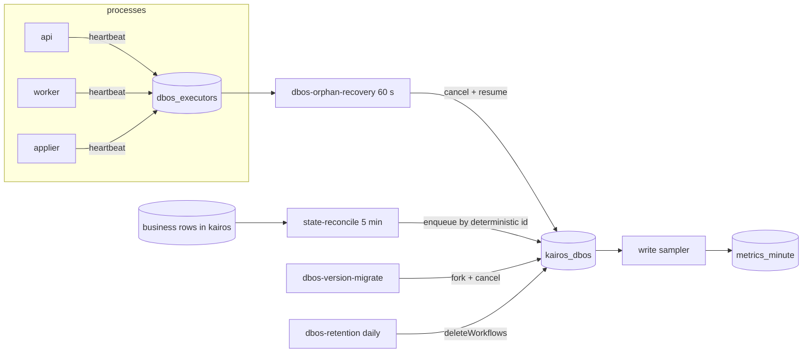

# Worker spec 14: durable-ops (Durable engine operations)

Tier: ops. Revision 1, 2026-10-23. Implements B.5.5 and B.5.8 of `01-architecture.md` (revision 2) with the corrections of spike S-D1 (`_research/spike-s-d1-local.md`). Database objects are those of `02-database.md` section 7.6 and `_db/platform.md` sections 5.5 to 5.7 and 7.6. Alert and runbook ids are those of `06-infrastructure.md` (`A-DUR-*`, `R-DBOS-*`).

Spike S-D1 changes applied in this spec (each is marked "S-D1" where it appears):

| # | S-D1 finding | What this spec does because of it |
|---|---|---|
| 1 | No public recover-for-other-executors call | Orphan recovery is `cancelWorkflow` then `resumeWorkflow` (proven), never a recover call |
| 2 | `forkWorkflow(id, 0, ...)` replays from step 0 and re-runs business effects | Version migration forks only workflows on an allow-list that is state-conditional (rule D1); `applyCloud` is never forked |
| 3 | No garbage-collection call; `deleteWorkflows(ids, deleteChildren?)` exists | Retention is `listWorkflows` with `completedBefore` plus `deleteWorkflows(ids, true)` in batches of 500 |
| 4 | About 6 fixed writes per workflow, 1 per step, 2 per datasource transaction; target 60 and alert 80 per submitted application | The write-metric job uses those numbers; each ops workflow is kept to few steps and its own write cost is budgeted in section 9 |
| 5 | Queues are database-backed, registered with `await DBOS.registerQueue(name, options)` after launch; `globalConcurrency`, no `partitionQueue` | Reconcilers enqueue with a partition key where the queue is partitioned (`prepare` by user id, `stripe` by customer id); no code here creates a queue |
| 6 | Packages are CommonJS | All code in `server/src/durable/ops/` uses `import dbosSdk from "@dbos-inc/dbos-sdk"; const { DBOS } = dbosSdk;` |
| 7 | `pg@8` pin | Heartbeats and ops queries use the shared `pg` pool; no new driver |

---

## 1. Purpose and place in the lifecycle

The durable engine (DBOS Transact 5.3.0 inside the api, worker and applier processes, checkpoints in `kairos_dbos`) is the one place where a lost replica can strand work. This worker keeps the engine honest. It does not move any application through the lifecycle itself. It makes sure that work already promised by a business row actually runs.

It has five jobs.

| Job | What it guarantees | Lifecycle position |
|---|---|---|
| Executor heartbeat | Every live replica is visible in `dbos_executors` within 15 seconds | Underneath every stage |
| `dbos-orphan-recovery` | A workflow left `PENDING` by a dead replica is finished by a live one, within about 3.5 minutes | Between any two steps of any workflow |
| `state-reconcile` | A business row that promises follow-up work ("draft pending", "approved for cloud", "attempt reported", "email unclassified", "Stripe event received") always has a live workflow, even when a checkpoint or an enqueue was lost | Safety net for D2 (write and follow-up are one durable unit) |
| `dbos-version-migrate` | After `WORKFLOW_SET_VERSION` is bumped, non-terminal workflows of the old version are carried to the new version | Deploys |
| `dbos-retention` and `dbos-executors-purge` | `kairos_dbos` stays near 4 GB and `dbos.transaction_completion` near empty; checkpoint write counts are sampled for the unit metric | Housekeeping |

It invokes no agent and calls no external service other than Postgres (`kairos` and `kairos_dbos`). Model cost is zero.

Where it sits relative to other workers:



Boundaries with sibling workers, to avoid double ownership:

- `submission-settlement` owns `leaseSweeper` (open attempts with stale `heartbeat_at`, expired extension claims), `return-to-draft` and `draft-expiry`. `durable-ops` never changes an attempt's phase or state.
- `ops-monitors` owns the one-minute `metrics` schedule and the alert evaluator. `durable-ops` exports the functions the `metrics` schedule calls for the `durable.*` series (section 8).
- `identity` reconcilers (sign-up without profile, stuck parse, dangling citations) stay with their domain. `state-reconcile` covers only the five follow-up kinds in section 3.3 because those are the ones where a workflow id, not a business column, is the missing piece.

---

## 2. Trigger, schedule and payload (a TypeScript type), plus the idempotency key

### 2.1 Triggers

| Job | Mechanism | Runs on | Cadence | Workflow id (idempotency key) | `timeoutMS` |
|---|---|---|---|---|---|
| Executor heartbeat | In-process `setInterval` timer, not a workflow (a workflow would add about 6 checkpoint writes per beat) | api, worker, applier | Every 15 s, jitter 0 to 2 s; plus on startup, SIGTERM and clean exit | none; idempotent upsert on `dbos_executors.executor_id` | n/a |
| `dbos-orphan-recovery` | `DBOS.registerScheduled`, worker only | worker | Crontab `* * * * *` | `dbos-orphan-recovery:<epochMinute>` | 50,000 |
| `state-reconcile` | `DBOS.registerScheduled`, worker only | worker | Crontab `*/5 * * * *` | `state-reconcile:<epoch5Min>` | 240,000 |
| `dbos-version-migrate` | Started at worker launch (after the drain wait) and by every `state-reconcile` tick that sees a stale version | worker | On deploy; backstop every 5 min | `version-migrate:<WORKFLOW_SET_VERSION>:<epoch10Min>` | 600,000 |
| `dbos-retention` | `DBOS.registerScheduled`, worker only | worker | Crontab `30 3 * * *` (UTC) | `dbos-retention:<yyyymmdd>` | 5,400,000 |
| `dbos-executors-purge` | `DBOS.registerScheduled`, worker only | worker | Crontab `7 * * * *` | `dbos-executors-purge:<epochHour>` | 60,000 |

`epochMinute`, `epoch5Min`, `epoch10Min` and `epochHour` are Unix time in seconds divided by 60, 300, 600 and 3600, floored. DBOS runs a scheduled workflow once per tick across all worker replicas (S-D1 relied on this; B.4.1). Scheduled workflows are registered only in the worker entry point. They do not run on a queue, so a backlog on `prepare` or `score` cannot delay them.

### 2.2 Payload types

All inputs hold ids, enums, counts and hashes only (rule D4, B.5.6). The scheduled ones receive no business input.

```ts
// server/src/durable/ops/types.ts
export type ServiceName = "api" | "worker" | "applier";
export type ExecutorState = "running" | "draining" | "stopped";

/** Input of every scheduled workflow: the two values DBOS passes to a scheduled function. */
export interface ScheduledInput {
  scheduledTime: Date;
  startTime: Date;
}

/** Workflow ids follow ^[a-z][a-z-]*:[A-Za-z0-9:._-]{1,100}$ (05-api section 16). */
export type WorkflowIdParts =
  | { kind: "prepare"; applicationId: string; revision: number }
  | { kind: "apply"; applicationId: string; attemptNo: number }
  | { kind: "settle"; attemptId: string; retry: number }
  | { kind: "classify"; inboundEmailId: string; retry: number }
  | { kind: "stripe"; eventId: string; redrives: number }
  | { kind: "other"; name: string };

export interface OrphanRecoveryResult {
  suspected: number;              // executors marked suspect in pass 1 (from dbos_orphaned_executors side effect)
  orphanedExecutors: string[];    // executor ids returned by pass 2 (ids only)
  resumed: number;
  reEnqueued: number;             // routed to the owning domain (cloud-apply, scan-form)
  quarantined: number;
  skippedWrongVersion: number;
  skippedAlreadyHealed: number;
}

export type FollowUpKind = "prepare" | "apply" | "settle" | "classify" | "stripe";

export interface ReconcileResult {
  perKind: Record<FollowUpKind, { candidates: number; enqueued: number; alreadyLive: number; failedClosed: number; backlog: number }>;
  versionMigrateStarted: boolean;
}

export type MigrationPolicy = "fork" | "cancel_only" | "cancel_and_reconcile";

export interface VersionMigrateResult {
  staleVersions: string[];
  forked: number;
  cancelledOnly: number;
  routedToReconcile: number;
  remaining: number;              // non-terminal workflows still on a stale version after this run
}

export interface RetentionResult {
  shortDeleted: number;
  longDeleted: number;
  batches: number;
  stoppedBecause: "done" | "batch_cap" | "time_cap";
  completionRowsDeleted: number;  // dbos.transaction_completion sweep
  oldestTerminalAgeDays: number;
}
```

Constants (in `server/src/durable/ops/config.ts`, overridable by environment for tests only):

| Constant | Value |
|---|---|
| `HEARTBEAT_INTERVAL_MS` | 15,000 |
| `EXECUTOR_STALE_AFTER_S` | 90 (fixed inside `dbos_orphaned_executors`) |
| `ORPHAN_MAX_RESUMES_PER_RUN` | 100 |
| `ORPHAN_QUARANTINE_AFTER` | 3 resumes of the same workflow id within 24 hours |
| `UNKNOWN_EXECUTOR_IDLE_S` | 900 (backstop for a `PENDING` workflow whose executor row is gone) |
| `RECONCILE_MAX_PER_KIND` | 200 per run |
| `RECONCILE_RETRY_SUFFIX_MAX` | 3 (`:r1` to `:r3`) |
| `MIGRATE_DRAIN_WAIT_S` | 120 |
| `MIGRATE_PAGE` | 100 |
| `RETENTION_BATCH` | 500 |
| `RETENTION_MAX_BATCHES` | 400 (see section 13, request A-1) |
| `RETENTION_SPACING_MS` | 5,000 |
| `RETENTION_SHORT_DAYS` / `RETENTION_LONG_DAYS` | 2 / 14 |
| `TX_COMPLETION_SWEEP_DAYS` | 21 |

---

## 3. Algorithm, step by step

Notation: "reads" and "writes" name tables and columns. Every job makes no model call. External calls are limited to Postgres and the DBOS SDK (which itself talks to `kairos_dbos`). Steps are coarse (D8): each job is one workflow with the fewest steps that keep the retry unit sensible.

### 3.1 Executor heartbeat (timer, every process)

1. **Before `DBOS.launch()`** the process computes `executorID = ${RAILWAY_SERVICE_NAME}:${RAILWAY_REPLICA_ID}` and calls `heartbeat_executor(executorId, service, WORKFLOW_SET_VERSION, GIT_SHA, 'running')`. Doing it first means a replica that restarts with the same id clears `orphan_suspected_at` and `stopped_at` before DBOS recovers its own pending workflows (platform 5.6, detail 2).
2. Every 15 s: same call with state `running`. Writes `dbos_executors(executor_id, service, app_version, git_sha, state, last_seen_at)`; `orphan_suspected_at` is cleared by the function. Reads nothing else. The function enforces that `kairos_api` may only heartbeat service `api`, and so on.
3. On SIGTERM: immediately heartbeat with state `draining`, stop dequeuing, wait for steps (api 25 s, worker 30 s, applier 170 s, delta X18 of `06-infrastructure.md`).
4. On clean exit: heartbeat with state `stopped`, which sets `stopped_at`. A stopped executor with `PENDING` workflows is orphaned at once by the next sweep.
5. A failed heartbeat is logged (`durable.heartbeat.failed`) and retried at the next tick. It never crashes the process. If the database is unreachable, nothing else works either; the sweeper's own rule (below) prevents a mass false positive after the outage.

### 3.2 `dbos-orphan-recovery` (every minute)

Two steps. Workflow input is `ScheduledInput`.

**Step 1 `markAndSelect`** (plain step, retriable).
- Calls `dbos_orphaned_executors(selfExecutorId)`. It reads and writes `dbos_executors`. Pass 1 sets `orphan_suspected_at = now()` for `running` or `draining` executors with `last_seen_at` older than 90 s. Pass 2 returns executors that are `stopped`, or suspected for at least 60 s and still stale, with `last_seen_at` inside 24 hours. It returns nothing when the sweeper's own heartbeat is older than 30 s (database outage rule).
- Output: the list of orphaned `executor_id` strings (ids only). Metric `durable.executors_alive{service}` is written by the `metrics` schedule from the same table.

**Step 2 `recoverPending`** (plain step; management calls are not workflow starts, which S-D1 check 2 exercised from an ordinary process; see Q-1 in section 13 for the one thing the Railway half must confirm).
1. Lists pending work: `DBOS.listWorkflows({ status: "PENDING", executorIDs: orphanedExecutors, loadInput: false, loadOutput: false, limit: 500 })`. Backstop query: `kairos_ops.stuck_workflows_v` rows (`idle_s > 900`, `PENDING`) whose `executor_id` is absent from `dbos_executors` or has `last_seen_at` older than 24 hours (an executor row purged or never written). Both lists are merged by workflow id.
2. Sorts by workflow `created_at` ascending and takes the first `ORPHAN_MAX_RESUMES_PER_RUN` (100). Metric `durable.orphans` is the full count before the cap.
3. For each workflow, in order:
   1. Re-read `DBOS.getWorkflowStatus(id)`. If it is no longer `PENDING`, or its `executorId` is no longer in the orphan set (the replica came back, or another sweep got there), count `skippedAlreadyHealed` and continue. This makes two overlapping runs harmless.
   2. If `applicationVersion` differs from `WORKFLOW_SET_VERSION`, count `skippedWrongVersion` and continue. These belong to `dbos-version-migrate`.
   3. Parse the id with `parseWorkflowId`. Count prior recoveries: `SELECT count(*) FROM ops_audit WHERE entity = $workflowId AND action = 'workflow.resume' AND at > now() - interval '24 hours'` (index `ops_audit_entity_idx`). If the count is 3 or more, **quarantine**: `DBOS.cancelWorkflow(id)`, insert `ops_audit(operator 'system:durable-ops', action 'workflow.quarantine', entity id, reason 'resumed 3 times without finishing', detail {queue, name, executor})`, count `quarantined`, continue. The domain reconciler (section 3.3) then decides what the business row needs. This is the poison-message rule (section 5).
   4. Route by queue name:
      - Queues `cloud-apply` and `scan-form` (run only on the applier, which has Chromium; resuming on a worker would try to launch a browser it cannot launch): `DBOS.cancelWorkflow(id)`, then call the domain function `routeOrphanedBrowserWorkflow(parsedId)` (section 13, request A-3), which for `apply:<applicationId>:<attemptNo>` does exactly what runbook R-DBOS-1 step 3 says: read `submission_attempts.phase` and `browser_launched_at`; if the browser was launched, enqueue `settleAttempt` (`settle:<attemptId>`) and never start another apply; otherwise leave the application to `reconcileApply` of section 3.3, which starts a fresh `applyCloud` on the applier queue (decision recorded in `02-database.md` Q-DB-11). Count `reEnqueued`.
      - Every other queue and request workflows: `DBOS.cancelWorkflow(id)` then `DBOS.resumeWorkflow(id)`. Resume restarts from the last completed step on the sweeper's own executor (S-D1 check 2: datasource transactions not repeated, plain steps re-run once). Count `resumed`.
   5. Insert `ops_audit(operator 'system:durable-ops', action 'workflow.resume', entity id, reason 'executor unseen for more than 90 seconds', detail {executor, queue, name, version})`. The reason never contains an address (`ops_audit_reason_ck`).
4. Returns `OrphanRecoveryResult`. Metrics: `durable.orphans`, `durable.orphan_recoveries{result}`.

The sweeper never touches its own pending workflows (DBOS recovers those at launch) and never touches a workflow whose executor row says `running` and fresh.

### 3.3 `state-reconcile` (every 5 minutes)

One workflow, six steps: one per follow-up kind and one `maybeMigrate`. Each kind step runs the same procedure with different parameters. Keeping them as separate steps limits blast radius: an exception in the Stripe step is retried without repeating the prepare step's enqueues (those are idempotent anyway).

Common procedure for a kind `K` with spec `{ select, workflowIdFor, queue, partitionKey, priority, pausedBy }`:

1. If any flag in `pausedBy` is on (`ops_flag_on(...)`), skip the kind and write gauge `durable.reconcile.skipped{kind}=1`. Flags: prepare skips on `pause_drafting` or `llm_paused`; apply skips on `pause_cloud_apply` or `approvals_frozen`; settle, classify and stripe never skip.
2. `select(limit = RECONCILE_MAX_PER_KIND)` runs the SQL in the table below, oldest first. Backlog beyond the cap is counted (`count(*)` capped at 5,000) and exported as `durable.reconcile.backlog{kind}`.
3. For each candidate compute the expected workflow id and read `DBOS.getWorkflowStatus(id)`:
   - **Absent**: enqueue it (`DBOS.startWorkflow(fn, { workflowID, queueName, enqueueOptions: { queuePartitionKey, priority }, timeoutMS })`). Ids are deterministic, so a race with the normal path starts one workflow. Count `enqueued`.
   - **`ENQUEUED` or `PENDING`**: alive; count `alreadyLive`. A stuck one is the business of alert `A-DUR-2` (above 30 minutes) and runbook R-DBOS-2, not of this loop.
   - **Terminal with success** while the row still promises work: the workflow ended as a no-op under rule D1 (for example the revision moved on). Count `anomaly{kind}`; no action; the third consecutive tick with the same candidate raises `durable.reconcile.anomaly{kind}` above 0 for the alert in section 8.
   - **Terminal without success** (`ERROR`, `CANCELLED`, `MAX_RECOVERY_ATTEMPTS_EXCEEDED`): the id is spent. Retry kinds whose id carries no revision or attempt (`settle`, `classify`) use the suffix convention already used by `parse:<slotId>:<hash8>[:r<n>]`: probe `id:r1`, `id:r2`, `id:r3` and enqueue the first absent one; if `:r3` exists and is terminal without success, fail closed (below). `stripe` uses `stripe_events.redrives`: increment it with a conditional `UPDATE stripe_events SET redrives = redrives + 1 WHERE id = $1 AND status = 'received' AND redrives = $old` and enqueue `stripe:<eventId>:<redrives>`; at `redrives = 3` fail closed. `prepare` and `apply` ids are tied to a revision and an attempt, so a spent id means that revision or attempt cannot complete: fail closed.
4. **Fail closed** (always the safe direction, never a charge, never a send): `prepare` calls `failDraft(applicationId, revision, 'workflow_failed')` which, conditional on `applications.revision` unchanged, sets `draft_state = 'failed'` and `draft_issue = 'workflow_failed'` so the user sees a retry button (`POST /api/applications/:id/prepare` bumps `revision` and starts `prepare:<applicationId>:<revision>`). `apply` calls `failUnstartedApproval(applicationId, 'applier_error')` only when no `submission_attempts` row exists for the application with `phase` beyond `claimed`; the function goes through the normal `recordOutcome` path so credits are released by the existing trigger (`applications_in_flight_aiud`) and nothing is charged. `settle`, `classify`, `stripe` raise an alert row instead (`durable.reconcile.failed_closed{kind}`) because a human must look: an unsettled attempt, an unclassified email or an unprocessed Stripe event is never silently dropped.

Candidate queries (all use the partial indexes of `02-database.md` section 11, so each costs milliseconds at 10,000 users):

| Kind | Select | Index | Workflow id | Queue and partition key | Priority |
|---|---|---|---|---|---|
| `prepare` | `applications` with `status = 'draft' AND draft_state = 'pending' AND updated_at < now() - interval '10 minutes'`; reads `id, user_id, revision` | `applications_draft_work_idx` | `prepare:<applicationId>:<revision>` | `prepare`, key `user_id` | 10 (a user-initiated draft; Autopilot drafts are 50, see Q-4) |
| `apply` | `applications` with `status = 'approved' AND channel = 'cloud' AND approved_at < now() - interval '5 minutes'` and no `submission_attempts` row in state `open` for the application (`submission_attempts_one_open_uq`); reads `id, user_id, attempt_no, approved_by`; the domain function `enqueueApplyIfMissing` computes the id `apply:<applicationId>:<attemptNo>`, honors a remaining Autopilot `delaySeconds`, and passes the apply-host partition key from `companies.apply_host` | `applications_cloud_approved_idx` | `apply:<applicationId>:<attemptNo>` | `cloud-apply`, key `companies.apply_host` | 10 or 20 user-approved by plan, 40 Autopilot |
| `settle` | `submission_attempts` with `phase = 'reported' AND settled_at IS NULL AND finished_at < now() - interval '2 minutes'`; reads `id` | `submission_attempts_unsettled_idx` | `settle:<attemptId>` (+ `:r<n>`) | `settle` | none |
| `classify` | `inbound_emails` with `classified_at IS NULL AND received_at < now() - interval '10 minutes'`; reads `id` | `inbound_emails_unclassified_idx` | `classify:<inboundEmailId>` (+ `:r<n>`) | `email` | none |
| `stripe` | `stripe_events` with `status = 'received' AND received_at < now() - interval '10 minutes'`; reads `id, stripe_customer_id, redrives` | the received-status index of the billing domain | `stripe:<eventId>[:<redrives>]` | `stripe`, key `stripe_customer_id` | none |

Step 6 `maybeMigrate`: reads `kairos_ops.version_mix_v`; if any `application_version` other than `WORKFLOW_SET_VERSION` has `enqueued + pending > 0` and no live executor (below), starts `dbos-version-migrate` with its deterministic id and returns. Otherwise no-op.

This job also covers the "orphaned workflows" reconciler of B.5.8 by being the second line behind section 3.2: even a lost checkpoint costs minutes, never an application.

### 3.4 `dbos-version-migrate` (on deploy and as backstop)

Triggered by the worker at launch: after `DBOS.launch()`, `startVersionMigrate()` calls `DBOS.startWorkflow(versionMigrate, { workflowID: "version-migrate:" + WORKFLOW_SET_VERSION + ":" + epoch10Min })`. Several new worker replicas starting within the same ten minutes share one id and cause one execution. If `version.json` did not change, the first step finds no stale version and the workflow ends in one step.

**Step 1 `wait`**: `DBOS.sleep(MIGRATE_DRAIN_WAIT_S * 1000)` (120 s; durable) so that old replicas, which drain for 60 s with Railway overlap, are gone.

**Step 2 `selectStale`** (reads `kairos_ops.version_mix_v` and `dbos_executors`): a version `v` is stale when `v <> WORKFLOW_SET_VERSION`, `enqueued + pending > 0`, and no executor has `app_version = v AND state IN ('running','draining') AND last_seen_at > now() - interval '90 seconds'`. A version with a live executor is still draining and is left alone. (A rollback is the same case: the "current" version is the older one, the newer version's workflows are stale and are forked back; the forked workflows must therefore also be state-conditional, which CI already enforces.)

**Step 3 `migrate`** (loops pages of 100 inside one step; idempotent):
1. `DBOS.listWorkflows({ applicationVersion: v, status: ["ENQUEUED", "PENDING"], limit: 100 })` repeatedly.
2. For each workflow, look up `MIGRATION_POLICY[name]` (a static map built from the workflow registry; a workflow missing from the map defaults to `cancel_only` and is counted, so a new workflow cannot be forked by accident):

| Policy | Workflows | Action | Why |
|---|---|---|---|
| `fork` | `queueMatch`, `prepareApplication`, `reverifyDraft`, `approveApplications`, `resendApplication`, `autopilotApprove`, `scanForm`, `settleAttempt`, `candidatePage`, `scoreUser`, `pollBatch`, `ingestInboundEmail`, `classifyEmail`, `ingestStripeEvent`, `processStripeEvent`, `parseResume`, `notify` | `DBOS.forkWorkflow(id, 0, { applicationVersion: WORKFLOW_SET_VERSION, newWorkflowID: id + ":v" + WORKFLOW_SET_VERSION })`, then `DBOS.cancelWorkflow(id)`; `ops_audit` action `workflow.fork` | First step of each is a conditional read or claim (rule D1; CI asserts it in `staging-gate.yml`), and fork replays from step 0 (S-D1 check 5) |
| `cancel_and_reconcile` | `applyCloud` | `DBOS.cancelWorkflow(id)`, then `routeOrphanedBrowserWorkflow` as in section 3.2 | Never fork `applyCloud` (R-DBOS-2): a replay must not reach the browser step without the attempt-phase guard deciding |
| `cancel_only` | every scheduled workflow (`pollTick`, `candidateTick`, this job's siblings, monitors), `batchScore`, `batchAnalyze`, any unlisted name | `DBOS.cancelWorkflow(id)`; audit `workflow.cancel` | Scheduled work is re-created by the new version's schedules; a Message Batches workflow would resubmit a paid batch if replayed. Deploy checklist R-DBOS-7 requires no `batch-llm` workflow `PENDING` at a bump; if one is, it is cancelled and the wasted spend is bounded by the `batch` workspace envelope |

   `newWorkflowID` makes the fork idempotent: if the run crashes between fork and cancel, the next run lists the original again, the second fork returns the existing child, and the cancel completes. Fork happens before cancel for this reason. The fork keeps the queue name and partition key of the original (to be confirmed in the Railway half, Q-2; fallback in section 7).
3. Count results and the number still non-terminal on stale versions (`remaining`). If `remaining > 0`, the workflow ends with a non-zero `remaining` and the next `state-reconcile` tick starts it again with a new `epoch10Min` id.

The cancelled originals leave `dbos.transaction_completion` rows behind; the 21-day sweep (3.5) removes them.

### 3.5 `dbos-retention` (daily, 03:30 UTC)

Four steps. Terminal statuses: `SUCCESS`, `ERROR`, `CANCELLED`, `MAX_RECOVERY_ATTEMPTS_EXCEEDED`. A non-terminal workflow is never deleted.

**Step 1 `deleteShortClass`**: loop. `DBOS.listWorkflows({ status: terminalStatuses, completedBefore: now - 2 days, queueNames: ["poll","candidates","score","notify","batch-llm"], limit: 500, loadInput: false, loadOutput: false })` followed by the same query for names in `SCHEDULE_WORKFLOW_NAMES` (workflows started by schedules). Then `DBOS.deleteWorkflows(ids, true)` (the second argument deletes children). Sleep 5 s between batches. Stops at 400 batches in total across steps 1 and 2, at `done`, or after 80 minutes.

**Step 2 `deleteLongClass`**: the same with `completedBefore: now - 14 days` and no queue filter (everything else, including request workflows and anything the first step left). Same cap.

**Step 3 `sweepCompletion`**: in `kairos`, as `kairos_worker`:

```sql
DELETE FROM dbos.transaction_completion
 WHERE ctid IN (SELECT ctid FROM dbos.transaction_completion
                 WHERE created_at < (extract(epoch FROM now() - interval '21 days') * 1000)::bigint
                 LIMIT 5000);
```
repeated until fewer than 5,000 rows are deleted, at most 50 times. It is a safety net for cancelled or forked originals; the SDK already deletes the rows of finished workflows.

**Step 4 `measure`**: reads `min(created_at)` of terminal rows on the short and long classes through `DBOS.listWorkflows(... limit: 1, sortDesc: false)` and writes `durable.retention_lag_days` to `metrics_minute`; records the `RetentionResult` counts as `maintenance.deleted{table="kairos_dbos.workflow"}` and `{table="dbos.transaction_completion"}`.

### 3.6 `dbos-executors-purge` (hourly)

Single step: `DELETE FROM dbos_executors WHERE last_seen_at < now() - interval '7 days'` (batch 5,000 by `ctid`; under 100 rows normally, because each redeploy creates 15 new ids and the table holds about 2,000 ids a week). Reads and writes `dbos_executors` only.

### 3.7 Checkpoint write sampler (function called by the `metrics` schedule, hourly branch)

Exported as `sampleCheckpointWrites(now)`. It runs at minute 0 of each hour inside the `metrics` workflow (owned by `ops-monitors`):

1. In `kairos_dbos` as `dbos_worker`: `SELECT sum(n_tup_ins + n_tup_upd + n_tup_del)::bigint FROM pg_stat_user_tables WHERE schemaname = 'dbos'`.
2. In `kairos` as `kairos_worker`: the same sum for `relname = 'transaction_completion'` in schema `dbos`.
3. Writes the two cumulative values to `metrics_minute` as `dbos.writes_total{db=system}` and `{db=app}`.
4. Reads the previous hour's two rows from `metrics_minute` (not process memory, because the `metrics` schedule runs on a different replica each time). Difference of each counter; a negative difference (crash recovery or statistics reset) drops the sample.
5. Counts `application_events` rows with `kind = 'submitted'` in the hour. If zero, writes only `dbos.writes` and skips the ratio. Otherwise writes `dbos.writes` and `durable.checkpoint_writes_per_submitted` = (system + app writes) / submitted.
6. Also writes `durable.sys_db_size_gb` from `pg_database_size('kairos_dbos')` and `dbos.tx_completion_rows` from `pg_class.reltuples` of `dbos.transaction_completion`.

Alert `A-DUR-4` evaluates the sum of 24 hourly write counts divided by the sum of 24 hourly submitted counts, not the mean of ratios, so quiet hours cannot distort it.

---

## 4. Concurrency, rate limits, ordering, batching and priorities, with numbers at 10,000 users

| Aspect | Value |
|---|---|
| Replicas involved | 15 processes at growth (api 3, worker 4, applier 8) heartbeat; 4 workers compete for each schedule tick, DBOS runs it once |
| Heartbeat load | 15 replicas x 4 beats a minute = 60 upserts a minute on a table of about 15 live rows (fillfactor 50, `autovacuum_vacuum_threshold = 50`). About 86,400 calls a day. No checkpoint writes |
| Detection latency (crash) | Worst case about 3.5 minutes: last heartbeat up to 15 s old, stale at +90 s, first sweep after that marks it suspect (up to 60 s later), second sweep at least 60 s after that returns it: at most 90 + 60 + 60 = 210 s from the last heartbeat, plus the resume run. A clean `stopped` exit is recovered on the next tick (at most 60 s) |
| Orphan batch | At most 100 workflows a run. A dead worker replica holds at most about 40 (prepare 8, score, candidates, email, notify, parse, settle concurrency of one replica); a dead applier replica holds at most 4 (`workerConcurrency` of `cloud-apply`) plus 1 `scan-form`. Losing every worker at once (about 160) takes two ticks |
| Order | Oldest workflow first, so the longest-waiting user-visible work (a `prepare` or `settle`) is recovered before newer work |
| Reconcile batch | 200 per kind per tick, oldest first. Expected candidates per tick at growth are 0 to 10 per kind in steady state. A backlog above 200 means a real incident and is exported as a gauge |
| Reconcile enqueue rate | Bounded by the queue's own limits: `prepare` `partitionConcurrency: 2` per user, `cloud-apply` `rateLimit` 240 a minute, `stripe` `partitionConcurrency: 1` per customer. The reconciler does not add its own rate limit |
| Priorities | Orphan recovery and reconcile enqueues reuse the queue priorities of B.5.3, so recovered work competes fairly (user-initiated 10 or 20, Autopilot 40 or 50) |
| Version migrate | One run at a time per id; 100 workflows a page; `forkWorkflow` calls are sequential. A bump with 2,000 non-terminal workflows takes about 2 minutes |
| Retention | 500 ids a batch, 5 s spacing, at most 400 batches a night (200,000 workflows) |
| Statement timeouts | `dbos_worker` 30 s per statement: a 500-id `deleteWorkflows` removes roughly 3,000 to 6,000 rows and stays far below it |

Retention volume check at growth (this is why the cap is 400, not 100). Workflows a day by class, from the counts in B.5.7 plus the per-minute schedules:

| Class | Source | Per day |
|---|---|---|
| Short (2 days) | `pollBatch` 22,080; schedule runs about 8,000 (`pollTick`, `dbos-orphan-recovery`, `leaseSweeper`, `metrics`, `cost-rollup` each 1,440, plus the 5-minute and slower ones); `candidatePage` 1,880; `scoreUser` 19,000; `notify` about 6,000 | about 57,000 |
| Long (14 days) | `prepareApplication` 27,700; `approveApplications` and `resendApplication` 4,900; `autopilotApprove` 6,700; `applyCloud` 8,580; `settleAttempt` 8,580; `scanForm` 2,000; email, Stripe, parse about 8,000 | about 66,500 |
| **Total deleted a day in steady state** | | **about 123,500, which is 247 batches of 500** |

A cap of 100 batches (50,000 workflows) would let the system database grow by about 73,000 workflows a day. The cap of 400 leaves 1.6 times headroom and finishes in about 35 minutes (247 batches x (5 s spacing + about 1 s delete)).

---

## 5. Retries, backoff, timeouts, dead-letter handling, poison messages and compensation

| Concern | Rule |
|---|---|
| Step retries | `DBOS.runStep` with `retriesAllowed: true, maxAttempts: 4, intervalSeconds: 2, backoffRate: 2` for `markAndSelect`, `recoverPending`, the reconcile kinds and the retention steps. Errors are `KairosStepError(code)` with short codes (`db_unavailable`, `dbos_api_error`); third-party messages go to Sentry redacted, never into the checkpoint (B.5.6) |
| Workflow timeouts | Table in section 2.1. The orphan sweeper (50 s) is shorter than its period (60 s) so runs do not stack; a timed-out run is a cancelled scheduled workflow and the next minute starts a fresh one |
| Overlap | Each per-workflow action re-reads the status first (3.2 step 3.1), and every enqueue uses a deterministic id, so overlapping runs do no double work |
| Poison workflow | A workflow that kills its process every time it runs (an out-of-memory PDF, a crash in `runBrowser`) would be resumed every minute forever. After 3 resumes of the same id in 24 hours the sweeper cancels it and records `workflow.quarantine`. The business row is then handled by `state-reconcile` (fail closed): a draft becomes `failed` with `draft_issue = 'workflow_failed'`, an unstarted cloud approval fails as `applier_error` with no charge. Page `A-DUR-8` fires (section 8) |
| Spent deterministic id | Section 3.3 step 3: suffix probing `:r1` to `:r3` for `settle` and `classify`; `redrives` for `stripe`; fail closed for `prepare` and `apply` |
| Dead letter | There is no separate dead-letter queue. The dead letter is the combination of the cancelled workflow row (kept 14 days), the `workflow.quarantine` row in `ops_audit` (kept per its own retention) and the business row left in a visible failed or pending state. Nothing is silently dropped |
| Compensation | Cancel-and-resume re-runs plain steps once (S-D1 check 7); the datasource transactions are exactly-once. Plain steps in the pipelines are idempotent by the database (D8). For `applyCloud`, the compensation for a lost browser run is the attempt-phase protocol (settle by stored phase); this worker only routes to it |
| Database outage | `dbos_orphaned_executors` returns nothing unless the sweeper's own heartbeat is under 30 seconds old, so after an outage no executor is judged dead until every process has heartbeated again. All `dbos_executors` writes are idempotent upserts |
| Retention failure | A failed delete batch is retried by the step; if the step still fails the run ends, the next night's run continues, and `durable.retention_lag_days` above 16 raises `A-DUR-5` |

---

## 6. State transitions it performs and the invariants it must uphold (and how)

### 6.1 State it changes

| State | Transition | Writer |
|---|---|---|
| `dbos_executors.state` / `last_seen_at` / `stopped_at` / `orphan_suspected_at` | `running` to `draining` to `stopped`; `running` to suspected (via `orphan_suspected_at`) to orphaned (derived); suspicion cleared by any heartbeat; purged after 7 days | only `heartbeat_executor` and `dbos_orphaned_executors` (platform 6.6) |
| Workflow status in `kairos_dbos` | `PENDING` to `CANCELLED` to `ENQUEUED` (resume); `ENQUEUED`/`PENDING` to `CANCELLED` with a forked child `ENQUEUED`; terminal rows deleted | `DBOS.cancelWorkflow`, `resumeWorkflow`, `forkWorkflow`, `deleteWorkflows` |
| `ops_audit` | Insert-only rows `workflow.resume`, `workflow.fork`, `workflow.cancel`, `workflow.quarantine` with operator `system:durable-ops` | this worker |
| `metrics_minute` | Inserts of `durable.*` and `dbos.*` series | sampler, sweeper |
| `applications.draft_state` | `pending` to `failed` (with `draft_issue = 'workflow_failed'`), only through `failDraft`, only when the revision is unchanged | domain function called by `state-reconcile` |
| `applications.status` | `approved` to `failed` (`failure_code = 'applier_error'`) for a cloud approval that never started, only through `failUnstartedApproval` and the normal `recordOutcome` path | domain function |
| `stripe_events.redrives` | increment by one, conditional on `status = 'received'` and the old value | this worker |

It never writes `credit_ledger`, `credit_balances`, `submission_attempts`, `matches` or any resume content directly.

### 6.2 Invariants and how they hold

| Invariant | How this worker upholds it |
|---|---|
| One application per (user, job); the same application sent twice submits once | It never starts an `applyCloud` workflow except through `enqueueApplyIfMissing` (deterministic id `apply:<applicationId>:<attemptNo>`, no open attempt, unique `submission_attempts_one_open_uq`). It never forks or resumes `applyCloud` past the browser step: orphaned `cloud-apply` workflows are cancelled and routed by attempt phase |
| One credit only when a submission reports `submitted`; failed never charged | It performs no charge. Fail-closed paths go through `recordOutcome`, which releases `in_flight` and writes no `submission` ledger row for a failure. Settlement stays in `settleAttempt`, started under its own deterministic id |
| Approval before send; Autopilot only for applications that pass every guard | Re-enqueueing an Autopilot-approved `apply` honors the remaining `delaySeconds` and the `approvals_frozen` and `autopilot_frozen` flags (reconcile skips while frozen) |
| Truth lock; verifier | A resumed or forked `prepareApplication` re-runs `generateAndVerify` as one step, so unverified text is never stored (INV-2); the worker itself touches no draft text |
| Fit gate before any model call | The worker invokes no model and enqueues only workflows that begin with the gate (`candidatePage`) or state-conditional reads |
| Billing pause on a genuine offer email | `classify` reconciliation enqueues `classifyEmail`, whose offer rules and `inbound_emails_offer_needs_rule_ck` remain in force |
| Privacy: checkpoints hold ids only | Every payload in this spec is ids, enums, counts and hashes; `listWorkflows` is called with `loadInput: false, loadOutput: false`; the CI PII scan covers the `durable-ops` workflows too |
| No automation of LinkedIn, no CAPTCHA solving | Not touched |
| Plan limits and prices only from `shared/src/plans.ts` | Not read; the only per-plan value used is a queue priority that B.5.3 already derives from the plan |
| Rule D1 (Postgres decides) | Reconcile and migrate treat workflows as hints: they act from business rows and refuse to fork anything not on the allow-list |

---

## 7. Failure modes table

| # | Cause | Detection | User-visible effect | Recovery |
|---|---|---|---|---|
| 1 | Worker replica killed (OOM, deploy overrun) with `PENDING` workflows | `durable.orphans` above 0; `A-DUR-1` at 15 minutes | Draft or settlement delayed up to about 3.5 minutes plus run time | Section 3.2 cancel and resume on a live worker; R-DBOS-1 by hand if needed |
| 2 | Applier replica killed mid-`applyCloud` | Same, plus `leaseSweeper` sees a stale attempt | Application stays `submitting` until settlement by phase; at worst the user is asked to resend | Cancel, `routeOrphanedBrowserWorkflow`; settle by phase; never a second submit |
| 3 | api replica killed during a request workflow (approve, queue, ingest) | Orphan sweep; HTTP caller saw a 5xx | Client retries with the same `Idempotency-Key`; the workflow finishes on a worker | Section 3.2; deterministic id means one execution |
| 4 | Sweeper mistakes a live replica for dead (network partition of its heartbeats) | `skippedAlreadyHealed` and audit rows for a replica that is still `running` | None: the workflow is cancelled and resumed; transactions are exactly-once, plain steps re-run once | Idempotent steps; heartbeat resumes and clears suspicion |
| 5 | Database outage then recovery | `A-PG-*`; sweeper judges nobody while its own heartbeat is stale | Normal outage effects | Own-heartbeat rule prevents false orphans; DBOS recovers pending workflows at each launch |
| 6 | Poison workflow that kills its host repeatedly | 3 `workflow.resume` rows for one id in 24 hours; `durable.quarantined` above 0, `A-DUR-8` | One draft fails with a retry button, or one approval fails uncharged | Quarantine, fail closed, fix the cause, add a regression test |
| 7 | Checkpoint or enqueue lost (crash between business write and enqueue, restored backup) | Reconcile finds a business row with no live workflow | Delay of at most 10 to 15 minutes | Section 3.3 enqueues by deterministic id |
| 8 | Deterministic id spent by an `ERROR` run | Reconcile sees terminal non-success | Retry button (prepare), or alert (settle, classify, stripe) | `:r<n>` suffix, `redrives`, or fail closed |
| 9 | Incompatible deploy without version bump | Hash check in CI fails; if bypassed, `version_mix_v` shows a version with `PENDING` and no executor, and workflows error on replay | Stalled workflows | Bump and migrate (R-DBOS-7); runbook R-DBOS-2 |
| 10 | Version bump while a `batch-llm` workflow is pending | `cancel_only` counter for `batchScore` or `batchAnalyze` | A batch's results are lost; spend bounded by the batch envelope | Deploy checklist: bump when none pending; re-run the backfill (`backfill:<name>:<batch>`) |
| 11 | Fork cannot preserve queue partition key (Q-2) | Migration test in staging shows the child on the wrong partition or a refused fork | None if caught in rehearsal | Fallback: `cancel_and_reconcile` for every workflow in the `fork` set, so the 5-minute reconcile re-derives them from business rows |
| 12 | Retention cap too low or a delete batch fails | `durable.retention_lag_days` above 16, `durable.sys_db_size_gb` above 6; `A-DUR-5` | None immediately; slower queries later | R-DBOS-5: run in batches of 500 by hand; check autovacuum |
| 13 | Hot `dbos_executors` rows bloat | `pg_stat_user_tables.n_dead_tup` through the existing `pg.*` series | None | `fillfactor 50` and `autovacuum_vacuum_threshold 50` keep updates HOT; `VACUUM` by hand |
| 14 | Checkpoint writes per submitted application above 80 over 24 hours | `A-DUR-4` (email) | None | R-DBOS-4: find the heaviest workflow, coarsen steps, check the second-Postgres trigger |
| 15 | Executors purge deletes a row of a replica that is alive but silent for 7 days | Not possible (a live replica heartbeats every 15 s) | None | n/a |
| 16 | Sweeper schedule itself stops (worker fleet down, schedule not registered) | `durable.sweeper_last_ok_age_s` above 180 (new, section 8) and `A-DUR-3` for fleet loss | Orphans accumulate | Restart workers; manual R-DBOS-1 |

---

## 8. Observability: logs, metrics, traces and alerts with thresholds

### 8.1 Logs

Structured pino lines, ids and counts only: `durable.heartbeat.failed`, `durable.orphan.resumed` (workflowId, queue, name, executor), `durable.orphan.quarantined`, `durable.orphan.skipped` (reason), `durable.reconcile.enqueued` (kind, id), `durable.reconcile.failed_closed`, `durable.migrate.forked`, `durable.migrate.cancelled`, `durable.retention.batch` (class, deleted), `durable.retention.done`. Workflow ids contain pseudonymous user or entity ids only. No email address, name or text ever appears.

### 8.2 Metrics (written to `metrics_minute` by the `metrics` schedule or by the jobs; names follow `06-infrastructure.md` section 6.6 and the `dbos.*` names of `_db/platform.md` 5.4)

| Metric | Type | Source | Use |
|---|---|---|---|
| `durable.executors_alive{service}` | gauge | `dbos_executors` seen in the last 45 s | A-DUR-3 |
| `durable.orphans` | gauge | pending workflows of executors unseen for 90 s (full count before the cap) | A-DUR-1 |
| `durable.orphan_recoveries{result}` (aliased `dbos.orphan_recoveries`) | counter | sweeper | trend, runbook |
| `durable.quarantined` | counter | sweeper | A-DUR-8 |
| `durable.sweeper_last_ok_age_s` | gauge | age of the last successful `dbos-orphan-recovery` workflow | A-DUR-9 |
| `durable.reconcile.enqueued{kind}`, `.alreadyLive{kind}`, `.failed_closed{kind}`, `.anomaly{kind}`, `.backlog{kind}` | counter/gauge | `state-reconcile` | A-DUR-8, trend |
| `durable.migrate.forked`, `.cancelled{name}`, `.remaining` | counter/gauge | `dbos-version-migrate` | R-DBOS-7 |
| `durable.queue.enqueued/pending/oldest_age_s{queue}` | gauge | `kairos_ops.queue_depth_v` through `durable.queueStats()` | A-DUR-6, A-DUR-7 |
| `durable.checkpoint_writes_per_submitted` | gauge | 3.7 | target 60, A-DUR-4 at 80 |
| `durable.sys_db_size_gb`, `durable.retention_lag_days` | gauge | 3.5, 3.7 | A-DUR-5 |
| `maintenance.deleted{table}` | counter | retention | trend |
| `dbos.tx_completion_rows` | gauge | 3.7 | alert above 50,000 |

### 8.3 Traces

OpenTelemetry spans `durable.ops.heartbeat` (sampled 1 in 100), `durable.ops.orphan_recovery`, `durable.ops.reconcile.<kind>`, `durable.ops.version_migrate`, `durable.ops.retention.<step>`. Attributes: counts, queue, kind, `kairos.workflow.id`. The Sentry traces budget excludes the heartbeat.

### 8.4 Alerts (ids from `06-infrastructure.md`; thresholds unchanged unless marked new)

| Id | Condition | For | Action |
|---|---|---|---|
| A-DUR-1 | `durable.orphans` above 0 | 15 min | Page, R-DBOS-1 |
| A-DUR-2 | A `prepare`, `cloud-apply` or `settle` workflow `PENDING` above 30 minutes | 1 min | Page, R-DBOS-2 |
| A-DUR-3 | `durable.executors_alive{service}` below the configured replica count | 3 min | Email, R-DBOS-3 |
| A-DUR-4 | `durable.checkpoint_writes_per_submitted` above 80 (target 60) | 1 day | Email, R-DBOS-4 |
| A-DUR-5 | `durable.sys_db_size_gb` above 6, or `durable.retention_lag_days` above 16 | 1 h | Email, R-DBOS-5 |
| A-DUR-6, A-DUR-7 | Queue backlog and scale signals | 10 min | Email, R-SCALE-1 |
| A-DUR-8 (new) | `durable.quarantined` increased, or `durable.reconcile.failed_closed` above 0, or `durable.reconcile.anomaly` above 0 for 3 ticks | immediate | Page, R-DBOS-2 |
| A-DUR-9 (new) | `durable.sweeper_last_ok_age_s` above 180 | 1 min | Page, R-DBOS-3 |

---

## 9. Capacity and cost at 10,000 users

| Item | Runs a day (growth) | Cost per run | Per day |
|---|---|---|---|
| Heartbeat | about 86,400 (15 replicas x 5,760) | one indexed upsert, under 1 ms | negligible CPU; no checkpoint writes |
| `dbos-orphan-recovery` | 1,440 | about 8 checkpoint writes (6 fixed + 2 steps) | about 11,500 writes |
| `state-reconcile` | 288 | 6 steps + fixed = about 12 writes, plus enqueues only when needed | about 3,500 writes |
| `dbos-version-migrate` | about 1 to 3 per month | about 100 writes per 100 workflows moved | negligible |
| `dbos-retention` | 1 | about 10 writes | negligible |
| `dbos-executors-purge` | 24 | about 8 writes | about 200 writes |
| Sampler | 24 | 6 catalog queries | negligible |

- Checkpoint budget: durable-ops adds about 15,200 writes a day, which is 1.4% of the 1.1 million of S-D1 and 0.75 write per submitted application (20,200 submissions a day). It stays inside the target of 60.
- CPU and memory: the whole worker is under 0.5% of one worker vCPU and under 30 MB on top of the process baseline. The only sizeable operation is `deleteWorkflows` on 500 ids, which is Postgres work (about 1 second, 3,000 to 6,000 rows).
- Postgres: reads use partial indexes of a few kilobytes; reconcile selects return zero to ten rows. Connections: no new pool. Ops queries use the worker's pooled connection; the DBOS management calls use the worker's existing `kairos_dbos` pool (`DBOS_SYS_POOL_SIZE` 5 per worker). Connection budget unchanged at 134 of 200 at growth.
- Retention keeps `kairos_dbos` at about 4 GB (2-day and 14-day windows) and rewrites roughly 123,500 workflows' rows a day through delete; WAL for deletes is about 0.5 GB a day, inside the 06 estimate.
- Model cost: $0 a day. External calls: none.

At base (2/3/6 replicas) all numbers scale down by about 25% except retention, which scales with workflow volume (about 70% of growth).

---

## 10. Security and privacy notes

- **Ids only.** The jobs read and write workflow ids, executor ids, counts and enums. Workflow ids may contain a user id, an application id or a Stripe event id (all pseudonymous); none contains an email, name or text. `listWorkflows` is called without inputs and outputs so even an accidental text input never reaches this code.
- **Roles.** Heartbeat and sweeper run as `kairos_api`/`kairos_worker`/`kairos_applier` through the `SECURITY DEFINER` functions `heartbeat_executor` and `dbos_orphaned_executors` (the latter granted to `kairos_worker` only). The applier role therefore cannot judge or purge other executors and cannot read `dbos_executors` beyond its own heartbeat. `kairos_dbos` access is `dbos_worker` (statement timeout 30 s) and `dbos_api` (read-only views); DBOS tables are never altered by this design.
- **Audit.** Every cancel, resume, fork and quarantine writes an `ops_audit` row with operator `system:durable-ops`; the `reason` text is fixed per action and cannot contain `@`. Manual use from `GET/POST /api/admin/workflows*` writes `operator:<id>` rows through the same table.
- **Abuse resistance.** The workflow id grammar regex is enforced before any cancel, resume or fork of an operator-supplied id (05-api section 16); the sweeper only acts on ids returned by DBOS.
- **Prompt injection.** No untrusted text (job descriptions, form questions, emails) is read by this worker.
- **Erasure.** Because checkpoints are ids-only, they resolve to nothing after account deletion; `dbos-retention` removes them within 14 days (`deletion_tasks.dbos_retention_due_at`). A forked child lives under the new version for the same retention window.
- **Fail-closed bias.** Where the right action is uncertain, the worker fails an unstarted draft or approval without charge rather than resuming something that could send twice.
- **No secrets.** No key is read beyond database credentials already in the process role.

---

## 11. Tests (unit, integration, failure injection) and acceptance criteria

### 11.1 Unit (vitest, no database)

| Test | Asserts |
|---|---|
| `parseWorkflowId` | Round-trips every id in B.5.4 (`prepare`, `apply`, `settle`, `classify`, `stripe` with and without `:r<n>`); rejects ids that violate `^[a-z][a-z-]*:[A-Za-z0-9:._-]{1,100}$` |
| `MIGRATION_POLICY` | Covers every registered workflow name; unlisted defaults to `cancel_only`; `applyCloud` is never `fork`; every `fork` workflow has a registry flag `firstStepConditional: true` |
| Retry-suffix probe | Given statuses for `id`, `id:r1`, `id:r2`, picks `:r3`; stops after `:r3` |
| Quarantine counter | Third `workflow.resume` row in 24 hours selects quarantine |
| Cron and id builders | `epochMinute`, `epoch5Min`, `epoch10Min`, `epochHour` boundaries |
| Heartbeat state machine | `running`, `draining`, `stopped` order on SIGTERM; first beat before launch |

### 11.2 Integration (Testcontainers Postgres 18, real DBOS 5.3.0, two or three child processes)

| Test | Asserts |
|---|---|
| T-DUR-1 crash and recover | Kill a worker process inside a step; a second worker's sweeper cancels and resumes it within 210 s plus run time; every datasource transaction exactly once (S-D1 checks 2 and 7) |
| T-DUR-2 two-pass rule | A single stale observation only marks suspect; the orphan list is returned 60 s later; a heartbeat in between clears it; a `stopped` executor is returned at once |
| T-DUR-3 own-heartbeat rule | With the sweeper's own `last_seen_at` older than 30 s, `dbos_orphaned_executors` returns no rows and marks none suspect |
| T-DUR-4 applier routing | Kill an applier process mid-`applyCloud` after `mark_browser_launched`: workflow cancelled, `settleAttempt` enqueued, no second attempt, no second submit on the fake ATS (`ops/fake-ats/`) |
| T-DUR-5 reconcile | For each kind, delete the workflow row (simulated lost checkpoint) and assert the next tick enqueues the deterministic id; with an `ERROR` workflow assert `:r1` for `settle` and `classify`, `redrives` increment for `stripe`, `failDraft` for `prepare` |
| T-DUR-6 pause flags | With `pause_cloud_apply` or `approvals_frozen` on, `apply` candidates are not enqueued |
| T-DUR-7 version migrate | Start 50 workflows on version `A`, bump to `B`, run migration: every business effect occurred once; `applyCloud` workflows cancelled and routed; scheduled ones cancelled; batch workflows cancelled; a crash between fork and cancel followed by a rerun creates no duplicate child |
| T-DUR-8 retention | Create terminal workflows at ages 1, 3, 13 and 15 days across classes; run retention; short class older than 2 days and long older than 14 days are gone, newer and non-terminal remain; `transaction_completion` rows older than 21 days removed; batch cap and time cap respected |
| T-DUR-9 write sampler | Counter diff logic with a reset (negative diff dropped), zero submissions (no ratio), 24-hour sum rule |
| T-DUR-10 PII scan | `durable/pii-scan.test.ts` includes these workflows and finds no marker |
| T-DUR-11 schema drift | `durable/schema-drift.test.ts` creates `queue_depth_v`, `version_mix_v` and `stuck_workflows_v` against the real DBOS schema; a renamed column fails CI |

### 11.3 Failure injection and chaos

- P2 exit chaos test (R-DBOS-8): kill api, worker and applier processes at random during 1,000 scripted approvals; assert zero duplicate attempts, zero double charges and every application terminal within 10 minutes. This worker's contribution is measured: median and maximum time from kill to first resumed step.
- 50 forced crashes across the three process types (S-D1 Railway half), with the sweeper as the only recovery path for dead executors.
- Poison test: a `prepareApplication` fixture that calls `process.exit(137)` always; after 3 resumes it is quarantined and the draft is `failed`, `workflow_failed`.
- Database restart test: stop Postgres for 120 s while the sweeper is running; after restart no executor is falsely orphaned.
- Retention under load: run T-DUR-8 with 150,000 terminal workflows; completes within 40 minutes and statement time stays under 30 s.

### 11.4 Acceptance criteria

1. Worst-case recovery of a killed worker's pending workflow is under 4 minutes of wall time to first resumed step in staging.
2. Across the chaos tests there are no duplicate submissions, no double charges, and no workflow `PENDING` on a dead executor after 10 minutes.
3. A bump rehearsal with 50 old-version workflows leaves none non-terminal on the old version and every business effect exactly once.
4. `durable.checkpoint_writes_per_submitted` measured in the P8 load test is at most 60; this worker contributes at most 1.
5. `dbos-retention` keeps `durable.retention_lag_days` at or below 3 in a 7-day soak at growth volume.
6. All `A-DUR-*` alerts fire in staging fault drills (kill an executor for A-DUR-1, stop the sweeper for A-DUR-9).
7. Seeded-PII scan of `kairos_dbos` finds zero hits.

---

## 12. Migration from the skeleton

The skeleton has no durable-ops equivalent: BullMQ on Redis provides stalled-job detection internally, and `server/src/worker.ts` has no sweeper. Nothing here replaces a skeleton file; it replaces the behavior of Redis and BullMQ.

| Item | Skeleton | New |
|---|---|---|
| Stalled job recovery | BullMQ stalled-jobs check (Redis lock timeout) | `dbos-orphan-recovery` plus launch-time recovery |
| Queue draining on deploy | BullMQ graceful close | SIGTERM drain, `draining` heartbeat, version rule |
| Retention | Redis `removeOnComplete` counts | `dbos-retention` |
| Missing follow-up | Manual | `state-reconcile` |

New files (all behind the `server/src/durable/` seam, the only importer of `@dbos-inc/*`):

- `server/src/durable/heartbeat.ts` (called from `launchDurable`)
- `server/src/durable/version.ts` (exists in the design; adds `MIGRATION_POLICY` import)
- `server/src/durable/ops/{types,config,ids,orphan-recovery,reconcile,version-migrate,retention,executors-purge,write-metrics}.ts`
- `server/test/durable/ops/*.test.ts` and the chaos harness under `ops/fake-ats/`

Phasing (architecture section B.15 and `06-infrastructure.md`):

| Phase | What lands |
|---|---|
| P1 | DBOS installed with no traffic. Heartbeats on all three processes, `dbos_executors`, `heartbeat_executor`, `dbos_orphaned_executors`, `dbos-orphan-recovery` running against an empty queue (the two-pass rule and own-heartbeat rule tested), `dbos-executors-purge`, `dbos-retention` with the short class, the `kairos_ops` views. Runbook R-DBOS-1, R-DBOS-3 documented |
| P2 | `state-reconcile` for `apply`, `settle`, `classify`, `stripe`; `dbos-version-migrate` and the bump rehearsal in `staging-gate.yml`; the chaos test; R-DBOS-2, R-DBOS-7 and R-DBOS-8 rehearsed. Drains `cloud-apply` and `classify-email` from BullMQ |
| P3 | `state-reconcile` for `prepare` (behind `PREPARE_V2`) and `failDraft`; drains `tailor-application` and `parse-resume` |
| P4 | Retention volumes at full scale; short-class cap raised; retention lag alert armed |
| P7 | Redis and BullMQ removed; nothing in this worker depends on them |
| P8 | Load test measures section 11.4 criteria 4 and 5; restore drill includes `dbos_executors` repopulation |

Everything is additive. No existing route, response or database object changes.

---

## 13. Additions requested: anything this worker needs that the foundation documents lack

| # | Addition | Where | Why |
|---|---|---|---|
| A-1 | Raise the `dbos-retention` cap from "at most 100 batches a night" to 400, and note the measured volume (about 123,500 workflows a day, 247 batches) | `_db/platform.md` 5.5, `02-database.md` 12.2, `06-infrastructure.md` R-DBOS-5 | 100 batches (50,000 workflows) cannot keep up with steady state; the system database would grow by about 73,000 workflows a day |
| A-2 | A fourth ops audit action set `workflow.quarantine` and `workflow.cancel` (both fit `ops_audit_action_ck`); no schema change | `05-api.md` 16.2 audit action list | Quarantine and migrate record their actions |
| A-3 | Domain function `routeOrphanedBrowserWorkflow(parsedId)` owned by the cloud-applier module: for `apply:<applicationId>:<attemptNo>` reads `submission_attempts.phase` and `browser_launched_at` and either enqueues `settle:<attemptId>` or leaves the application to `reconcileApply`; for `scan:<jobId>:<parserVersion>` re-enqueues `scanForm` under the same job's pending state | cloud-applier worker spec | Section 3.2 and 3.4 call it; it carries out R-DBOS-1 step 3 |
| A-4 | Domain functions `enqueueApplyIfMissing`, `failUnstartedApproval(applicationId, code)` and `failDraft(applicationId, revision, issue)` | applications module (approval-autopilot, prepare-application, cloud-applier) | Reconcile needs conditional, status-guard-safe writers; `failDraft` conditional on unchanged `revision` |
| A-5 | New `applications.draft_issue` value `workflow_failed` (no new column; `draft_issue` already exists and carries `model_failed:<code>`) | `02-database.md` applications domain, `05-api.md` status payload | Lets the UI show a retry for a spent `prepare` id |
| A-6 | Alerts `A-DUR-8` and `A-DUR-9` and metrics `durable.quarantined`, `durable.sweeper_last_ok_age_s`, `durable.reconcile.*`, `durable.migrate.*` | `06-infrastructure.md` 6.6 and 6.7; runbooks R-DBOS-2 and R-DBOS-3 | Section 8 |
| A-7 | Ownership note: `reconcile-prepare`, `reconcile-apply`, `reconcile-settle`, the unclassified-mail and Stripe re-enqueue loops are hosted by `state-reconcile` (this worker), with candidate SQL as in section 3.3; `leaseSweeper`, `return-to-draft` and `draft-expiry` stay with `submission-settlement` | `02-database.md` 8.5 (rows currently assigned to "applications 6", "billing 6", "messaging 8") | Avoids two schedules racing on one predicate |
| A-8 | `dbos-executors-purge` as its own hourly schedule (02 says "`dbos-retention` hourly") and `dbos-retention` as daily 03:30 UTC | `02-database.md` retention table, `_db/platform.md` 5.5 | A daily workflow cannot also be hourly; two schedules, two ids |
| A-9 | Registration helper default `maxRecoveryAttempts: 5` for pipeline workflows, so DBOS's own counter (default 100) cannot out-run the sweeper's 3-resume quarantine | `server/src/durable/` registration | Poison workflows end quickly on either path |
| A-10 | Batch workflows (`batchScore`, `batchAnalyze`) should store the Anthropic batch id in a business row at submit so a replay or fork can adopt it instead of resubmitting | matching and agent-runtime specs | Makes `batch-llm` forkable and removes the `cancel_only` loss in failure mode 10 |
| A-11 | `kairos_worker` needs `SELECT, INSERT` on `ops_audit` and `SELECT` on `ops_flags` through `ops_flag_on` (already granted per `02-database.md`; stated here for the sweeper's audit inserts) | `02-database.md` grants | Confirmation only |

Open questions for the Railway half of S-D1 (acceptance tests, not design changes):

| # | Question | If the answer is no |
|---|---|---|
| Q-1 | `cancelWorkflow`/`resumeWorkflow` called from inside a plain step (not from a top-level process) behave as in S-D1 check 2 | Run the recovery loop as a timer-driven function in the worker guarded by `pg_try_advisory_lock(7281552)`, still writing the same audit rows; the scheduled workflow only records the result |
| Q-2 | `forkWorkflow` accepts `newWorkflowID`, forks from a `PENDING` or `ENQUEUED` original, and keeps queue name and partition key | Use cancel-then-fork with an `ops_audit` intent row `fork:<oldId>`, or fall back to `cancel_and_reconcile` for the whole `fork` set (failure mode 11) |
| Q-3 | `resumeWorkflow` on the sweeper's executor respects the sweeper's version and does not exceed its worker concurrency | Add `skippedWrongVersion` coverage (already present) and cap resumes per run lower |
| Q-4 | Whether `prepare` reconcile should know a draft was Autopilot-originated to use priority 50 | Use priority 10; the cost is only ordering under backlog |
