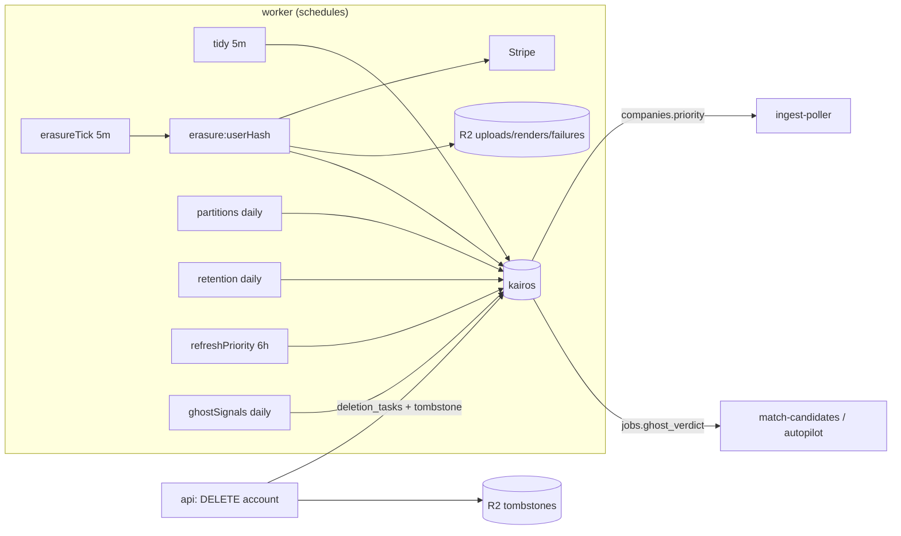

# Worker spec 16: housekeeping (retention, partitions, erasure, priority polling, ghost signals)

Revision 1, 2026-10-23. Tier: ops. Agents invoked: none (this worker never calls a model). Process: `worker` only (schedules are registered only in `server/src/worker.ts`, 01-architecture.md B.2). Source modules: `server/src/modules/housekeeping/` (new). Foundation documents used: 01-architecture.md (B.5, B.7.8, B.10.6, B.11.5), 02-database.md (sections 4, 7.2, 7.6, 8.3, 12, 16), 03-agent-runtime.md (section on `llm_calls`), 04-matching.md (priority polling), 06-infrastructure.md (A-DATA alerts, R2 buckets, X15), and the S-D1 spike correction table.

Names used in this spec that are not in the foundation documents are marked "(new)" and collected in section 13.

---

## 1. Purpose and place in the lifecycle

`housekeeping` keeps the business database bounded, private and fresh. It sits outside the application lifecycle (match, draft, approve, submit, settle) and touches it at four edges only:

| Job (schedule) | What it protects | Lifecycle edge |
|---|---|---|
| `retention` (daily) | Storage bound and storage-limitation duty (DPDP Act 2023, GDPR): deletes or nulls data past its retention window, table by table (02-database.md section 12.2) | Ends the life of matches, jobs, drafts' evidence, emails, notifications, usage counters |
| `partitions` (daily) | Keeps `llm_calls` writable (a partition must exist for every week) and bounded (drop after 90 days once rolled up) | The Anthropic gateway inserts into `llm_calls` on every model call; if no partition exists the row lands in `llm_calls_default` |
| `erasure` (every 5 minutes) | The right to erasure: drives each `deletion_tasks` row through every store (Stripe, database, R2, contact messages, `llm_calls.user_hash`) to `complete`, and pages when a task is older than 24 hours | Follows account deletion; runs after the api has signed the user out, turned Autopilot off and written the tombstone |
| `refresh-priority` (every 6 hours) | FR-53: which companies are polled every 5 minutes (cap 300) for Max subscribers | Feeds `pollTick` (ingest-poller) and the `express` lane (match-candidates) through `companies.priority` |
| `ghost-signals` (daily) | F2 outcome criteria and the cached `jobs.ghost_verdict` | Feeds the fit gate (skips `likely`) and Autopilot (skips `possible` and `likely`); it changes no match or application status |
| `tidy` (every 5 minutes, new) | Cheap expiring rows: `verified_claims` (24 hours), `rate_limits` | None |

Everything in this worker is idempotent maintenance. None of it is on a user-visible latency path, and a missed run delays cleanup only; the single exception is `erasure`, which has a 24-hour service level, and `partitions`, which has a six-week buffer.

Invariants this worker must never weaken: INV privacy (minimum retention, erasure, sensitive data), credits (the ledger is never deleted by retention; erasure archives it first), one application per (user, job) (retention never deletes a referenced job), and "no Autopilot after deletion" (erasure relies on the api having switched Autopilot off before the workflow starts).

---

## 2. Trigger, schedule and payload, plus the idempotency key

All schedules use `DBOS.registerScheduled` in the worker entry point. DBOS runs each interval exactly once across replicas and derives the workflow id from the schedule name and the scheduled time, which is the idempotency key for a schedule run. Cron expressions are UTC.

| Schedule (workflow) | Cron | Why this time | Workflow id | Queue |
|---|---|---|---|---|
| `tidy` | `*/5 * * * *` | `rate_limits_purge()` backs up the limiter's own cleanup; `verified_claims` lives 24 hours | scheduler id (`sched-tidy-<scheduledTime>`) | none (runs in the scheduler's workflow) |
| `erasureTick` | `1-56/5 * * * *` | Offset by one minute from `tidy` so the two never contend for connections | `sched-erasureTick-<scheduledTime>` | none |
| `erasureTask` (child of the tick) | started by the tick | One workflow per account | `erasure:<userHash>` (02-database.md workflow id list) | none; started with `DBOS.startWorkflow` in the same process, at most 5 per tick |
| `partitions` | `10 0 * * *` | Just after the UTC day rolls over; `cost-rollup` (every minute) has finished the previous day by then | `sched-partitions-<scheduledTime>` | none |
| `retention` | `30 7 * * *` | About 03:30 in New York, the lowest-traffic window for US users; after `dbos-retention` (03:30) and the nightly backups | `sched-retention-<scheduledTime>` | none |
| `refreshPriority` | `10 */6 * * *` | FR-53: every 6 hours; offset 10 minutes from the hour so it does not collide with the digests schedule | `sched-refreshPriority-<scheduledTime>` | none |
| `ghostSignals` | `0 6 * * *` | After the poller's night traffic, before US morning feeds | `sched-ghostSignals-<scheduledTime>` | none |

No new queue is created. These workflows need no partitioning or rate limiting, and the S-D1 spike showed that any `partition*` option partitions a queue, so adding one only to throttle a daily job would add cost for nothing.

```ts
// server/src/modules/housekeeping/types.ts (new)

/** Arguments DBOS passes to every scheduled workflow. */
export interface ScheduleTick {
  scheduledTime: Date; // the interval this run represents (UTC)
  startTime: Date;     // when the scheduler actually fired
}

export type HousekeepingSchedule =
  | "tidy" | "erasureTick" | "partitions" | "retention" | "refreshPriority" | "ghostSignals";

/** Input of the per-account erasure workflow. Carries a hash only (checkpoints hold ids, never PII). */
export interface ErasureTaskInput {
  userHash: string; // 64 hex characters, primary key of deletion_tasks
}

/** Result of one retention rule; this is the only data a retention step checkpoints. */
export interface RetentionRuleReport {
  rule: string;        // R01..R34, section 3.4
  table: string;
  deleted: number;
  updated: number;     // rows nulled or purged instead of deleted
  batches: number;
  capped: boolean;     // true when maxBatches was reached with work left
  skippedLocked: number;
}

export interface RetentionRunReport {
  rules: RetentionRuleReport[];
  durationMs: number;
}

export type ErasureStore = "stripe" | "database" | "r2" | "contact" | "llm";

export interface ErasureStepResult {
  store: ErasureStore;
  done: boolean;          // false = retry later (not an error)
  retryAfterSec?: number; // e.g. an open submission attempt
  count?: number;
}

export interface PriorityRefreshReport {
  candidates: number;     // companies with qualifying activity
  promoted: number;
  demoted: number;
  total: number;          // companies with priority = true after the run, at most 300
  skipped?: "implausible_empty_set";
}

export interface GhostSignalsReport {
  silentUpserted: number;
  silentDeleted: number;
  reportsUpserted: number;
  reportsDeleted: number;
  staleDeleted: number;
  verdictsChanged: number;
}
```

Payload sources: `tidy`, `partitions`, `retention`, `refreshPriority` and `ghostSignals` take no business input. `erasureTick` reads `deletion_tasks`; `erasureTask` receives one `userHash`. The account-deletion request (api, 02-database.md 16.2 step 0) writes the `deletion_tasks` row and the tombstone before this worker ever sees the task; the worker never learns a user id except through `deletion_tasks` columns that hold it in a protected form (`storage_id`, `stripe_customer_id`, `llm_user_hash`, `contact_email_enc`).

Manual triggers: an operator may start any schedule's body through `scripts/ops.mjs housekeeping <name>` with workflow id `manual-<name>-<epoch minute>`; the body is the same function, so it is equally idempotent.

---

## 3. Algorithm, step by step

Conventions for all six workflows:

- Every database access uses the `kairos_worker` role through the pooled datasource (PgBouncer, transaction mode). `kairos.actor` is left unset (worker context); the one exception is the `matches` retention delete, which does not change `status`, so the status guard is not involved.
- Batch deletes use `DELETE ... WHERE ctid IN (SELECT ctid ... LIMIT n FOR UPDATE SKIP LOCKED)`, so a concurrent writer is never blocked and the batch is skipped, not failed, when rows are locked. Default batch is 5,000 rows, at most 50 batches per rule per run (02-database.md 12.2), `SET LOCAL statement_timeout = '30s'` and `lock_timeout = '2s'` per batch.
- Per-rule advisory lock `pg_try_advisory_xact_lock(hashtext('hk:' || rule))` prevents two overlapping runs (a manual run beside a scheduled one) from working the same rule; a held lock means "skip, report 0".
- A step checkpoints counts only (S-D1 and checkpoint rule: ids and numbers, never row content).
- A DBOS step is a unit of retry. A step may loop over many batches, because each batch is itself idempotent; the loop is bounded by `maxBatches` and a wall-clock budget (the default is 20 minutes per rule).

### 3.1 `tidy` (every 5 minutes)

| Step | Tables and columns | Statement | External calls |
|---|---|---|---|
| T1 `rateLimitsPurge` | `rate_limits` (via the definer function, because `kairos_worker` has no privilege on the table) | `SELECT rate_limits_purge()` | none |
| T2 `verifiedClaimsPurge` | `verified_claims.expires_at` (index `verified_claims_expires_idx`) | `DELETE FROM verified_claims WHERE ctid IN (SELECT ctid FROM verified_claims WHERE expires_at < now() LIMIT 5000 FOR UPDATE SKIP LOCKED)`, repeated until fewer than 5,000 are deleted, at most 10 batches | none |

`tidy` merges what 02-database.md lists as two separate `housekeeping` lines (10 minutes and 5 minutes). Running `verified_claims` every 5 minutes instead of 10 is harmless: the table is unlogged, has a 24-hour life and holds hashes only.

### 3.2 `partitions` (daily 00:10 UTC)

| Step | Tables and columns | Statement or action | External calls |
|---|---|---|---|
| P1 `ensureFuture` | `llm_calls` (partitioned), `pg_inherits` | `SELECT llm_calls_ensure_partitions(6)` creates `llm_calls_<IYYY>w<IW>` for the current week plus 6. Then count future partitions: if fewer than 6, raise (the step fails and retries). | none |
| P2 `checkDefault` | `llm_calls_default` | `SELECT count(*) FROM ONLY llm_calls_default`. A count above zero sets gauge `housekeeping.llm_default_rows` and logs `llm_default_partition_rows`. Rows in the default partition are moved by an operator (runbook R-OPS-1), never automatically, because moving needs the target partition to exist and be attached without the rows. | none |
| P3 `rollupGap` | `llm_cost_daily`, `llm_calls` | For the oldest partition older than 90 days, call `llm_calls_partition_rolled_up(partition)`. If it returns false, run `SELECT llm_cost_rollup_day(d)` for each of the 7 UTC days of that partition (the roll-up recomputes absolute counts and takes its own advisory lock, so a replay or a race with `cost-rollup` is safe) and test again. | none |
| P4 `dropOld` | same | `SELECT llm_calls_drop_old_partitions(90)`: detaches and drops each partition whose upper bound is older than 90 days **and** that is fully rolled up, under `lock_timeout = '2s'`. A partition that cannot be locked is retried on the next run. Returns the dropped names. | none |
| P5 `report` | `ops_flags`, metrics | Emit `housekeeping.llm_partitions_ahead`, `housekeeping.llm_partitions_dropped`, `housekeeping.llm_oldest_partition_age_days`. If P3 still returns false after the roll-up, raise a log error `llm_partition_not_rolled_up` (the alert in section 8 pages through the metric). | none |

The rows in `llm_calls` live 90 to 97 days. Erasure's scrub of `user_hash` uses a 98-day window, which is why the two numbers fit (02-database.md 16.2 step 8).

### 3.3 `erasure`

**3.3.1 `erasureTick` (every 5 minutes)**

| Step | Tables and columns | Action | External calls |
|---|---|---|---|
| E1 `claim` | `deletion_tasks` (`stage`, `next_attempt_at`, `attempts`, `user_hash`), index `deletion_tasks_open_idx` | In one statement: `UPDATE deletion_tasks SET next_attempt_at = now() + interval '10 minutes', attempts = attempts + 1 WHERE user_hash IN (SELECT user_hash FROM deletion_tasks WHERE stage IN ('requested','db_deleted') AND next_attempt_at <= now() ORDER BY next_attempt_at LIMIT 5 FOR UPDATE SKIP LOCKED) RETURNING user_hash`. The 10-minute lease means a crashed worker's task is picked up again by the next tick after the lease expires. | none |
| E2 `start` | none | `DBOS.startWorkflow(erasureTask, { workflowID: 'erasure:' + userHash })(input)` for each claimed hash. Starting an existing id is a no-op and returns the running handle. | none |
| E3 `watch` | `deletion_tasks` (`requested_at`, `stage`, `paged_at`) | Count tasks with `stage IN ('requested','db_deleted') AND requested_at < now() - interval '24 hours'`. Publish gauge `housekeeping.erasure_overdue`. For rows with `paged_at IS NULL`, set `paged_at = now()` so the alert pages once per task. | none (the alert evaluator, not this worker, pages) |

**3.3.2 `erasureTask` (workflow `erasure:<userHash>`), implements 02-database.md 16.2 steps 1 to 9**

Step 0 (sign out, Autopilot off, row, tombstone, 202) already ran in the api. The workflow begins by reading the `deletion_tasks` row in step X0.

| Step | Name | Tables and columns | Action | External calls |
|---|---|---|---|---|
| X0 | `load` | `deletion_tasks` | Read the row. If `stage` is `complete` or `cancelled`, return. If `tombstone_written_at IS NULL` (the api crashed after inserting the row), write `tombstones/<userHash>.json` to R2 (idempotent PUT) and set `tombstone_written_at`. A `db_deleted` stage skips X1 to X5 below (they are complete by definition). | R2 `PutObject` (bucket `kairos-tombstones`) only in the repair case |
| X1 | `stripe` | `deletion_tasks.stripe_customer_id`, `stripe_done_at` | If `stripe_done_at IS NULL` and `stripe_customer_id` is set: cancel the subscription and delete the customer with idempotency key `erase:<userHash>`. If Stripe refuses because of an open invoice or a dispute, keep the customer (legal need), treat as done. `resource_missing` means done. Then `UPDATE deletion_tasks SET stripe_done_at = now(), stripe_customer_id = NULL`. | Stripe `subscriptions.cancel`, `customers.del` |
| X2 | `waitAttempts` | `submission_attempts` (`user_id`, `state = 'open'`), `deletion_tasks` | The workflow cannot see the user id as a checkpoint value, so the step resolves it inside the transaction from the `storage_id`/hash mapping held in `deletion_tasks`'s companion lookup (the api stores `user_id` only in the protected columns listed in 02-database.md; the step runs `SELECT 1 FROM submission_attempts s JOIN "user" u ON u.id = s.user_id WHERE encode(sha256(convert_to(u.id,'UTF8')),'hex') = $userHash AND s.state = 'open'`; see section 13 item 1). If a row exists, return `{done:false, retryAfterSec:120}`: the workflow sets `next_attempt_at = now() + 2 minutes` and ends; the next tick resumes it. This follows rule D5 (no workflow waits longer than 10 minutes inside a step). The lease sweeper closes any open attempt within 10 minutes, so the wait is bounded. | none |
| X3 | `archiveLedger` | `credit_ledger` (read), `credit_ledger_archive` (written) | `SELECT archive_user_ledger($userId)`; keeps `application_id` in the archive. Idempotent through `ON CONFLICT (ledger_id) DO NOTHING`. | none |
| X4 | `deleteApplications:<n>` | `applications`, cascades `submission_attempts`, `application_events`, `verification_results`, `reminders`, `rehearsal_*`; `SET NULL` on `credit_ledger.application_id`, `inbound_emails.application_id`, `saved_answers.source_application_id`, offer-pause rows | Loop: take the per-user credit lock (`lockCreditBalance(tx, userId)`), then `DELETE FROM applications WHERE id IN (SELECT id FROM applications WHERE user_id = $1 ORDER BY id LIMIT 500)`. One DBOS step per batch, named by batch number, until a batch returns 0 rows. A typical Starter user with 1,000 applications a month needs a few batches. | none |
| X5 | `deleteUser` | `"user"` and, by cascade, every user-owned table; `deletion_tasks` | One transaction: `DELETE FROM "user" WHERE id = $1`, then `UPDATE deletion_tasks SET stage = 'db_deleted', db_deleted_at = now()`. The `user_archive_ledger_bd` trigger is a no-op now (X3 already archived). | none |
| X6 | `r2` | `deletion_tasks.storage_id`, `r2_done_at` | Page through `ListObjectsV2` with prefix `<storage_id>/` in the buckets `kairos-uploads`, `kairos-renders`, `kairos-failures`; delete in `DeleteObjects` batches of 1,000; repeat until each listing is empty. Then `SET r2_done_at = now(), storage_id = NULL`. The tombstone bucket is never touched. | R2 `ListObjectsV2`, `DeleteObjects` |
| X7 | `contact` | `deletion_tasks.contact_email_enc`, `contact_done_at`, `contact_messages.email` | Decrypt `contact_email_enc` in memory (key list `DATA_KEKS`), `DELETE FROM contact_messages WHERE lower(email) = lower($email)` using `contact_messages_email_idx`, then `SET contact_done_at = now(), contact_email_enc = NULL`. The plaintext address is never logged and never checkpointed (the step returns a count). | none |
| X8 | `llm` | `deletion_tasks.llm_user_hash`, `llm_scrubbed_at`; `llm_calls.user_hash` | `UPDATE llm_calls SET user_hash = NULL WHERE user_hash = $hash AND created_at >= now() - interval '98 days'`. To avoid one scan per task, `erasureTick` may pass up to 25 `llm_user_hash` values from tasks that have `db_deleted_at` set and `llm_scrubbed_at` null to one statement using `user_hash = ANY($hashes)`; each task then sets `llm_scrubbed_at = now(), llm_user_hash = NULL`. One scan covers at most 25 million narrow rows (seconds to tens of seconds) and runs only on ticks that have a task. | none |
| X9 | `complete` | `deletion_tasks.stage`, `completed_at` | `UPDATE deletion_tasks SET stage = 'complete', completed_at = now()`; the CHECK `deletion_tasks_complete_ck` refuses this while any store timestamp is null. | none |
| X10 | `verify` | all user-owned tables | The identity R-12 counts: for every user-owned table, count rows still naming the user. The user id is gone, so the check runs on the pre-delete snapshot: before X5, step X4b records the user's per-table counts expected to disappear (counts only); after X5 the verifier runs the full-schema scan used in the drill (platform T-7) only in the drill and in the nightly sample (3 tasks a night); a non-zero count logs `erasure_residue` and pages (R-PRIV-2). | none |

The workflow has about 12 to 18 durable steps per task (the X4 loop dominates), roughly 6 checkpoint writes each by the S-D1 budget. A task is a rare event (about 30 a month at beta, a few hundred a month at growth), so the checkpoint cost is negligible (section 9).

### 3.4 `retention` (daily 07:30 UTC)

The workflow is a fixed list of rules, each one durable step returning a `RetentionRuleReport`. Rules not listed here belong to other workers (section 12 and section 13 item 2). Ordering puts cheap, high-volume rules first and the cascade-heavy `jobs` rules last.

| Rule | Table and predicate | Action | Index | Max batches |
|---|---|---|---|---|
| R01 | `matches` where `status IN ('below_bar','expired') AND status_changed_at < now() - interval '30 days'` | delete | `matches_retention_idx` | 100 (about 150,000 `below_bar` rows a day at growth) |
| R02 | `matches` where `status IN ('new','skipped')` and the job closed 60 to 90 days ago (a 30-day sliding window on `jobs.closed_at`, so a missed week is caught) | delete | `jobs_closed_idx`, `matches_job_idx` | 50 |
| R03 | `verification_results` where `created_at < now() - interval '90 days'` | delete | `verification_results_created_brin` | 50 |
| R04 | `submission_attempts` where `settled_at < now() - interval '90 days' AND (evidence IS NOT NULL OR session_id IS NOT NULL)` | `UPDATE ... SET evidence = NULL, session_id = NULL` | `submission_attempts_scrub_idx` | 50 |
| R05 | `inbound_emails` where `received_at < now() - interval '180 days' AND text_body_enc IS NOT NULL` | `SET text_body_enc = NULL, preview_enc = NULL` (the pair check requires both) | `inbound_emails_body_purge_idx` | 50 |
| R06 | `inbound_emails` where `hidden_reason IS NOT NULL AND received_at < now() - interval '30 days'` | delete | `inbound_emails_hidden_idx` | 20 |
| R07 | `forwarding_verifications` past `expires_at` (3 days) | delete | sequential (small) | 5 |
| R08 | `email_sends` where `claimed_at < now() - interval '120 days'` | delete | `email_sends_age_idx` | 20 |
| R09 | `notifications` where `created_at < now() - interval '90 days'` | delete | `notifications_age_idx` | 20 |
| R10 | `reminders` where `coalesce(sent_at, cancelled_at) < now() - interval '90 days'` | delete | sequential | 20 |
| R11 | `rehearsal_turns` older than 30 days; `rehearsal_sessions` still active and older than 30 days set to `expired` | delete / update | primary key | 10 |
| R12 | `stripe_events` where status in (`processed`,`ignored`) and received more than 90 days ago. Never `received`, `failed` or rows with `redrives` pending. | delete | sequential (small) | 10 |
| R13 | `user_daily_usage` and `ai_usage` where `day < (now() AT TIME ZONE 'UTC')::date - 90` | delete | primary key | 20 |
| R14 | `tailor_cache` where `created_at < now() - interval '7 days'` | delete | sequential | 20 |
| R15 | `action_tokens` where `expires_at < now() - interval '7 days'` | delete | sequential | 10 |
| R16 | `contact_messages` where spam and older than 30 days, or older than 12 months | delete | sequential | 5 |
| R17 | `deletion_tasks` where `stage IN ('complete','cancelled') AND completed_at < now() - interval '24 months'` | delete | sequential | 2 |
| R18 | `board_requests` resolved more than 180 days ago, or open and last seen more than 365 days ago | delete | sequential | 2 |
| R19 | `form_questions` whose job closed 30 to 60 days ago (30-day window) | delete | `jobs_closed_idx`, primary key | 20 |
| R20 | `ops_flags` where `active AND expires_at < now() - interval '1 day'` | `SET active = false, set_by = 'system:expiry', reason = 'expired'` (audited by the trigger) | `ops_flags` primary key | 1 |
| R21 | `resume_revisions`: for each `resumes.id` that has more than 100 revisions, `SELECT prune_resume_revisions($id)` (keeps the 100 newest, named and referenced) | function | `resume_revisions_resume_created_idx` | 10 |
| R22 | `jobs` closed more than 14 days ago with `search_tsv IS NOT NULL` | `SET search_tsv = NULL` | new partial index `jobs_tsv_clear_idx` (section 13) | 50 |
| R23 | `job_ghost_evidence` of jobs closed more than 14 days ago (verdict irrelevant once closed) | delete | `jobs_closed_idx`, `job_ghost_evidence_job_kind_uq` | 20 |
| R24 | `jobs` closed more than 180 days ago with `description_purged_at IS NULL` | If the job has no `applications` row (`NOT EXISTS`, index `applications_job_idx`): delete, with cascade to `form_questions`, `job_ghost_evidence`, `ghost_reports`, `tailor_cache`, `matches`. Otherwise purge: `SET description_text = NULL, card = NULL, raw = NULL, description_purged_at = now()`. Batch size 500 because of the cascade. | new partial index `jobs_purge_due_idx` (section 13) | 60 (about 12,000 jobs a day at growth) |

Notes on the rules:

- R24 is a single pass for both outcomes, so every row leaves the partial index (deleted, or marked purged). A foreign key violation (`23001`, an application created while the job was being deleted) is caught, the batch is retried with batch size 50 and then 1, and the row is purged instead. Applications reference `jobs` with `ON DELETE RESTRICT` (02-database.md R-5), so a referenced job can never be deleted by mistake.
- R02 and R19 use a 30-day sliding window on `jobs.closed_at` because `jobs_closed_idx` cannot exclude rows already handled; the window keeps each scan bounded (about 90,000 to 360,000 index entries) while tolerating an outage of up to 30 days.
- Rules never touch: `credit_ledger`, `credit_balances`, `credit_ledger_archive`, `application_events`, `llm_cost_daily`, `eval_runs`, `ops_audit` (retained forever or with the account), `submission_attempts` rows themselves (only the evidence columns), or `inbound_emails` metadata.
- After the last rule, step R99 `report` writes metric `maintenance.deleted{table}` (02-database.md 12.2) and gauge `housekeeping.retention_capped_rules`.

### 3.5 `refreshPriority` (every 6 hours; FR-53)

| Step | Tables and columns | Action | External calls |
|---|---|---|---|
| F1 `select` | `subscriptions` (`plan`, `status`, `past_due_since`), `matches` (`user_id`, `job_id`, `status`, `created_at`), `applications` (`user_id`, `job_id`, `status`, `submitted_at`), `jobs.company_id`, `companies` (`active`, `priority`) | Compute the new priority set in one statement and return the ids (at most 300) | none |
| F2 `apply` | `companies.priority`, `companies.next_poll_at` | One transaction: set `priority = true` for ids in the set; `priority = false` for every other company that currently has it; for newly promoted companies set `next_poll_at = least(next_poll_at, now() + interval '5 minutes')` so they enter the 5-minute cadence without waiting out a 30-minute interval | none |

F1 statement (pseudo-SQL, final form in the implementation):

```sql
WITH max_users AS (
  SELECT s.user_id FROM subscriptions s
   WHERE effective_plan(s.plan, s.status, s.past_due_since) = 'max'
), activity AS (
  SELECT j.company_id, max(m.created_at) AS last_at
    FROM matches m JOIN max_users u ON u.user_id = m.user_id JOIN jobs j ON j.id = m.job_id
   WHERE m.status IN ('new','queued') AND m.created_at > now() - interval '14 days'
   GROUP BY j.company_id
  UNION ALL
  SELECT j.company_id, max(a.submitted_at)
    FROM applications a JOIN max_users u ON u.user_id = a.user_id JOIN jobs j ON j.id = a.job_id
   WHERE a.status = 'submitted' AND a.submitted_at > now() - interval '30 days'
   GROUP BY j.company_id
)
SELECT c.id FROM companies c JOIN (SELECT company_id, max(last_at) AS last_at FROM activity GROUP BY 1) x
    ON x.company_id = c.id
 WHERE c.active
 ORDER BY x.last_at DESC, c.id
 LIMIT 300;
```

Guard (F1): if the result is empty while more than 20 companies currently have `priority = true` and at least one Max subscriber exists, skip F2, report `skipped: "implausible_empty_set"` and raise the alert in section 8. A bug or an empty `matches` after a bad migration must not silently demote every priority company.

### 3.6 `ghostSignals` (daily 06:00 UTC)

The structural criteria (`repost_pattern`, `long_open`, `unlisted`) are written by `ingest-poller` as it sees the postings (01-architecture.md B.7.8). This workflow owns the two outcome criteria, the stale cleanup and the verdict cache. Evidence holds counts and dates only, never user ids.

| Step | Tables and columns | Action | External calls |
|---|---|---|---|
| G1 `silent` | `applications` (`job_id`, `status`, `submitted_at`), `inbound_emails` (`application_id`), `job_ghost_evidence` (`kind = 'silent_applications'`) | Jobs with at least 5 submitted applications older than 30 days (window 30 to 120 days) where none of those applications has a linked `inbound_emails` row: `INSERT INTO job_ghost_evidence (job_id, kind, detail) ... ON CONFLICT (job_id, kind) DO UPDATE SET detail = EXCLUDED.detail, updated_at = now()` with `detail = {"submissions": n, "oldestDays": d}`. Then delete `silent_applications` rows whose job no longer qualifies (a reply arrived, or the count fell below 5 after an erasure). Index use: `applications_submitted_at_idx`, `inbound_emails` by `application_id`. `SET LOCAL statement_timeout = '120s'`. | none |
| G2 `reports` | `ghost_reports` (`job_id`), `job_ghost_evidence` (`kind = 'user_reports'`) | Jobs with reports from at least 2 distinct users: upsert `user_reports` with `detail = {"reports": n}`; delete `user_reports` rows whose job has fewer than 2 (an erased user's reports cascade away). The report route already refreshes the single job on each report; this step corrects drift. | none |
| G3 `stale` | `job_ghost_evidence`, `jobs.closed_at` | Same as R23 for rows missed by the retention run | none |
| G4 `verdicts` | `jobs.ghost_verdict` (cache), view `job_ghost_verdict_v` | `SELECT refresh_ghost_verdicts(NULL)`: recomputes every job that has evidence or a non-`none` verdict (`jobs_ghost_flagged_idx`) and updates only differing rows. Returns the count of changed jobs. | none |
| G5 `report` | metrics | Gauges `housekeeping.ghost_jobs{verdict}` and `housekeeping.ghost_verdicts_changed` | none |

`ghostVerdict` rule (B.7.8): `likely` when at least one outcome and one structural criterion hold, or both outcome criteria hold; `possible` when any criterion holds; else `none`. The fit gate skips `likely`; Autopilot skips `possible` and `likely` at send time (`autopilotApprove` reads `jobs.ghost_verdict` itself, so a verdict that changes after a match was created still protects the send).



---

## 4. Concurrency, rate limits, ordering, batching and priorities, with numbers at 10,000 users

| Aspect | Rule | Number |
|---|---|---|
| Schedule overlap | Exactly one run per interval across all worker replicas (DBOS); per-rule advisory lock covers manual overlap | 3 to 4 worker replicas |
| Erasure parallelism | At most 5 tasks started per tick, leases of 10 minutes; each task is sequential | At beta about 30 tasks a month and at growth under 300; the 5-per-tick cap allows 1,440 a day |
| Retention parallelism | Rules run sequentially in one workflow so deletes never compete with each other for I/O | One writer at a time |
| Retention budget | Batches of 5,000 (500 for `jobs`), 30 s statement timeout, a pause of 200 ms between batches when `pg.replication/WAL lag` or CPU gauges are high (read from `metrics_minute`: CPU above 70% stretches the pause to 2 s) | Daily run is about 350,000 rows at growth (R01 150,000; R03 77,000; R04 22,000; R05 8,500; R13 10,000; R14 20,000; R22 12,000; R24 12,000; the rest under 5,000 each); about 90 batches; expected duration 6 to 15 minutes |
| Retention cap | Per-rule cap in the table; when reached, `capped = true` and the remainder is done the next day; two consecutive capped days raise the backlog alert | R01 allows 500,000 rows a day against 150,000 expected |
| Priority | Erasure claims by `next_attempt_at` (oldest first); no business priority exists because nothing here competes with user traffic | n/a |
| Ordering | `erasureTask` steps are strictly ordered (Stripe first so billing stops; wait for open attempts; archive ledger; applications; user; stores). Retention order is fixed (section 3.4). `partitions` always creates before it drops | |
| External rate limits | R2 `DeleteObjects` 1,000 keys per call, sequential; Stripe calls are two per task (default limit far above this) | A task with 2,000 objects makes about 6 R2 calls |
| Connections | Every statement runs through the worker's pooled datasource; no dedicated pool | Peak 2 connections (retention) plus 1 (tidy or erasure), inside the 118 of 200 budget |

---

## 5. Retries, backoff, timeouts, dead-letter handling, poison messages and compensation

| Concern | Rule |
|---|---|
| Step retries | DBOS step retry with `maxAttempts` 3, backoff 2 s then 4 s for database errors (`40001`, `40P01`, `57014`, connection loss). A step that still fails ends the schedule run with an error; the next interval re-runs it (all steps are idempotent), so no schedule has a dead-letter queue. |
| Per-batch timeout | `statement_timeout 30s`, `lock_timeout 2s`. A timed-out batch is retried once with half the batch size; after that the rule step ends early with `capped = true` and logs `retention_batch_timeout{rule}`. |
| Erasure task retry | Failure of a store step does not roll back completed stores (each store has its own `*_done_at`). The task row gets `attempts + 1`, `last_error_code` (a short code matching `^[a-z0-9_]{1,64}$`, for example `stripe_5xx`, `r2_timeout`, `contact_decrypt`), and `next_attempt_at = now() + least(2^attempts minutes, 60 minutes)`. After attempt 12 the retry interval stays 60 minutes; the task is never abandoned and never dead-lettered, because a stuck erasure is a legal exposure, not a poison message. |
| Permanent store errors | Stripe `resource_missing` and R2 empty listing mean "already done". A Stripe refusal to delete a customer with an open invoice is accepted as done (customer kept for legal reasons). An R2 `NoSuchBucket` or `AccessDenied` is a configuration error: the task pauses at 60-minute retries, `last_error_code = 'r2_config'`, and the 24-hour page fires with runbook R-PRIV-2. |
| 24-hour page | `paged_at` is set on the first tick after `requested_at + 24 hours` while the task is incomplete; alert A-DATA-1 reads gauge `housekeeping.erasure_overdue`. |
| Poison task | A task that fails the same step more than 20 times keeps retrying hourly, but its `last_error_code` is surfaced in the alert text; manual removal is a runbook step with an `ops_audit` row (action `deletion.manual`, new, section 13). |
| Idempotent replay | Every erasure step reads its own `*_done_at` before acting, so a replay after a crash repeats nothing that completed. Step X4 deletes by `LIMIT 500` and repeats until zero, so a replay simply finds zero rows. |
| Compensation | There is none, by design: erasure is one-way. The one reversible case is `stage = 'cancelled'` (an operator cancels a task before X5, for example a mistaken request); the tick skips cancelled tasks, and Stripe/R2 steps already done stay done (the CHECK `deletion_tasks_cancelled_ck` requires all protected identifiers cleared). Retention has no compensation either; PITR is the only recovery, and after a restore the tombstone replay (06-infrastructure.md L6 and `replay-tombstones.mjs`) re-runs erasure for deleted users. |
| Partition failures | A failed `ensureFuture` raises, retries, and the next day's run is another chance; the buffer is 6 weeks. A failed `dropOld` only delays freeing disk. |
| Stuck schedule | If `dbos-orphan-recovery` resumes a schedule run on another executor, the body is rerun from its first incomplete step; per-rule locks and idempotent predicates make that safe. This respects rule D1 (state-conditional steps) because `forkWorkflow` replays from step 0 (S-D1). |

---

## 6. State transitions it performs and the invariants it must uphold (and how)

State transitions:

| Entity | Transition | Actor | Guard |
|---|---|---|---|
| `deletion_tasks.stage` | `requested` to `db_deleted` (X5), `db_deleted` to `complete` (X9) | `erasureTask` | CHECKs `deletion_tasks_tombstone_ck`, `deletion_tasks_complete_ck`; trigger `deletion_tasks_guard` (write-once timestamps, no illegal transitions) |
| `deletion_tasks` store timestamps | null to set, once each | `erasureTask` | Same trigger |
| `companies.priority` | false to true, true to false | `refreshPriority` | Cap of 300 in the SQL `LIMIT`; implausible-empty guard |
| `jobs.ghost_verdict` | `none`, `possible`, `likely` (cache of `job_ghost_verdict_v`) | `refresh_ghost_verdicts` | Function recomputes from evidence; `ghostVerdict()` in TypeScript is tested against the view |
| `job_ghost_evidence` | insert, update, delete per `(job_id, kind)` | `ghostSignals` | unique key; `detail` size CHECK |
| `matches.status` | none (rows are deleted, never transitioned) | `retention` | The status guard is not involved |
| `rehearsal_sessions.status` | active to `expired` (R11) | `retention` | Existing status check |
| `ops_flags.active` | true to false after expiry (R20) | `retention` | `ops_flags_audit` trigger writes the audit row |

Invariants and how they are upheld:

| Invariant | How |
|---|---|
| Credits (one charge per application, no lost ledger) | Retention never targets `credit_ledger`, `credit_balances` or `credit_ledger_archive` (no `DELETE` grant exists for `credit_ledger`; triggers block it even for the owner). Erasure archives the ledger under a user hash first (X3), and takes the per-user credit lock before deleting applications (X4), the global lock order of `approveCore`. |
| One application per (user, job) and referenced jobs survive | R24 never deletes a job that has an `applications` row (`NOT EXISTS` plus the `RESTRICT` foreign key). |
| No send after deletion | The api turns Autopilot off and signs the user out in step 0 of the request, before this worker acts; X2 waits for any `open` submission attempt, so an in-flight cloud attempt settles (and is charged if it reported `submitted`) before the user's rows disappear. A late extension report for a deleted application returns 404 and charges nothing. |
| Billing pauses and Stripe | X1 cancels the subscription first, with a fixed idempotency key, so no further invoice can create a grant for a user mid-erasure. |
| Ghost jobs never auto-applied | G4 keeps `jobs.ghost_verdict` current; Autopilot also reads it at send time. |
| Plan limits only from `shared/src/plans.ts` | `effective_plan()` is the only plan source in F1 (Max detection); no plan constants live in this worker. |
| Privacy: minimum retention and erasure | Section 3.4 retention table; X6 to X8 cover R2, contact messages and the pseudonymous `llm_calls.user_hash`; the tombstone is the only artifact kept, and it is a hash. |
| Never store passwords, read a mailbox, or use LinkedIn | Not touched by this worker. |
| Truth lock and fact ownership | Not touched. Erasure removes facts through the cascade; no fact is ever written. |

---

## 7. Failure modes

| Cause | Detection | User-visible effect | Recovery |
|---|---|---|---|
| `partitions` schedule not running or failing; future partitions fewer than 3 | Gauge `housekeeping.llm_partitions_ahead` below 3 (page below 2) | None for 3 weeks; then model calls land in `llm_calls_default` and the ledger write path degrades (the gateway logs `llm_ledger_write_failed` but the call itself proceeds) | Run `partitions` by hand; move default rows by runbook R-OPS-1 |
| Rows in `llm_calls_default` | Gauge `housekeeping.llm_default_rows` above 0 | None | Create the missing partition, move rows (detach default, insert, reattach) |
| Partition not rolled up when due to drop | `housekeeping.llm_oldest_partition_age_days` above 100 | None; disk grows about 70 MB per extra day | P3 re-runs the roll-up; if it persists, inspect `cost-rollup` and `llm_cost_daily` |
| Retention backlog (cap hit two days running) | `housekeeping.retention_capped_rules` above 0 for 2 days | None; disk grows | Raise the cap for the rule through a config deploy; run retention manually; check long-held locks |
| Lock contention or long-running transaction blocks deletes | `retention_batch_timeout` log, skipped-locked counts | None | Batches skip locked rows; investigate the blocking transaction (A-PG alerts) |
| Foreign-key violation on job delete | Logged `23001`, falls back to purge | None | Self-healing (row purged instead) |
| Erasure: Stripe outage | `last_error_code = 'stripe_5xx'`, task not complete | User sees "deleting your account" until done; no further charge (subscription cancel is retried) | Backoff retries; page at 24 hours |
| Erasure: R2 outage or misconfiguration | `r2_timeout` / `r2_config` | Same | Retries; fix token (R-PRIV-2) |
| Erasure: open submission attempt never closes | Task waits in X2 | None | The lease sweeper closes it within 10 minutes; if it does not, operator uses the attempt runbook (R-SUB) |
| Erasure: api crashed after the row insert, before the tombstone | `tombstone_written_at IS NULL` | None | X0 writes it before any deletion (CHECK enforces the order) |
| Erasure: worker crash mid-task | Lease expires after 10 minutes | Delay | Next tick restarts `erasure:<userHash>`; DBOS recovery also resumes it |
| Erasure: residue found by verification | Log `erasure_residue`, page | None | Manual removal with `ops_audit`; fix the missing cascade (a schema test failure) |
| Restore from backup resurrects a deleted user | Tombstone replay in the restore runbook | None if replayed | `replay-tombstones.mjs --after <restore point>` |
| `refreshPriority` finds an empty set | `skipped: implausible_empty_set` and alert | Max users lose 5-minute freshness only if the set is wrongly demoted; the guard prevents that | Investigate `matches` and `subscriptions`; rerun |
| `refreshPriority` slow or failed | Missed run for 12 hours | Priority set up to 6 hours stale | Next run corrects it |
| Ghost query slow | Step duration above 120 s | Verdicts a day stale; no effect on sending (Autopilot also checks at send time) | Retry; examine `applications_submitted_at_idx` |
| Retention deletes too much (bad predicate after a code change) | Test T-HK-3, `maintenance.deleted` anomaly (more than 3x trailing 7-day median) | Data loss | PITR; this is why the anomaly alert exists and why every rule has a dry-run mode (`HK_DRY_RUN=1` counts instead of deleting) used in staging |

---

## 8. Observability

Logs (pino, JSON; ids and counts only, never contact details, emails or names; a user is named only by the first 8 characters of `userHash`):

- `housekeeping run` with `schedule`, `durationMs`, `rules`, and per-rule `deleted`, `updated`, `batches`, `capped`.
- `erasure step` with `userHashPrefix`, `store`, `done`, `count`, `attempt`.
- Named events: `llm_default_partition_rows`, `llm_partition_not_rolled_up`, `retention_batch_timeout`, `erasure_residue`, `priority_refresh_skipped`.

Metrics (written to `metrics_minute` by the `metrics` schedule from in-process counters; names follow the `maintenance.` and `housekeeping.` prefixes):

| Metric | Type | Labels | Alert threshold |
|---|---|---|---|
| `maintenance.deleted` | counter | `table` | Anomaly: above 3x the trailing 7-day median for a table, or zero for a table with a daily rule for 3 days (email) |
| `housekeeping.run_duration_seconds` | histogram | `schedule` | `retention` above 45 minutes (email); `tidy` above 4 minutes (email) |
| `housekeeping.run_ok` | gauge (1/0, age) | `schedule` | Last success older than 2 intervals (email), older than 3 days for `partitions` (page) |
| `housekeeping.retention_capped_rules` | gauge | none | Above 0 for 2 consecutive days (email) |
| `housekeeping.llm_partitions_ahead` | gauge | none | Below 3 (email), below 2 (page) |
| `housekeeping.llm_default_rows` | gauge | none | Above 0 (page) |
| `housekeeping.llm_oldest_partition_age_days` | gauge | none | Above 100 (email) |
| `housekeeping.erasure_open` | gauge | `stage` | Informational |
| `housekeeping.erasure_overdue` | gauge | none | Above 0 (page; this is A-DATA-1, "a `deletion_tasks` row not complete after 24 hours") |
| `housekeeping.erasure_residue` | counter | none | Above 0 (page) |
| `housekeeping.erasure_step_failures` | counter | `store` | Above 5 in an hour for one store (email) |
| `housekeeping.priority_companies` | gauge | none | Equals 300 for 7 days (email: the cap binds, review it); zero while Max users exist (page) |
| `housekeeping.priority_promoted`, `housekeeping.priority_demoted` | counter | none | Demoted above 100 in one run (email) |
| `housekeeping.ghost_jobs` | gauge | `verdict` | `likely` above 10% of open jobs (email: probably a bug in the evidence) |
| `housekeeping.ghost_verdicts_changed` | gauge | none | Informational |

Traces: each schedule run is one OpenTelemetry trace with a span per step (`housekeeping.<schedule>.<step>`), attributes `rule`, `deleted`, `batches`. Erasure spans carry `userHashPrefix` only.

Alerts: A-DATA-1 (erasure not complete after 24 hours) is existing. The others in this table are requested as A-DATA-4 to A-DATA-6 (section 13).

---

## 9. Capacity and cost at 10,000 users

| Quantity | Value |
|---|---|
| Runs a day | `tidy` 288; `erasureTick` 288; `partitions` 1; `retention` 1; `refreshPriority` 4; `ghostSignals` 1; plus `erasureTask` runs (about 1 a day at beta, up to 10 at growth) |
| DBOS checkpoint writes a day | About 6 per workflow by the S-D1 budget. Idle `tidy` and `erasureTick` runs are 1 to 2 steps each, so about 600 + 600 writes; retention (about 30 steps) 180; the rest under 100; erasure tasks 10 tasks x 15 steps x 6 = 900. Total about 2,500 a day, which is 0.2% of the 1.11 million a day budget. Housekeeping adds no checkpoint cost per submitted application. |
| Database work | About 350,000 rows deleted or nulled a day at growth, about 90 batches. WAL from deletes about 150 MB a day [est], inside the 1.5 GB a day WAL estimate. Vacuum handles the dead tuples; `matches` and `notifications` autovacuum settings are in 02-database.md 13. |
| Longest statements | `ghostSignals` G1 about 5 to 30 seconds at the applications ceiling; retention batches under 1 second each; the `llm_calls` scrub 10 to 60 seconds on nights that have a deletion |
| CPU and memory | Under 5% of one worker vCPU averaged; peak 20% of one vCPU for the retention window; memory under 150 MB above the worker baseline (batches hold ids and counts only; erasure holds one decrypted address at a time) |
| R2 | List and delete calls: about 10 per erasure task; Class A operations are negligible (under 1,000 a month); no storage added (tombstones are a few hundred bytes each) |
| Model cost a day | $0, no agent is invoked |
| Disk effect | Keeps the 12-month ceiling in 02-database.md 12.3 (about 108 GB, 60 to 70 GB at the beta ramp); without `retention`, `matches` below-bar rows alone would add about 55 million rows a year |

---

## 10. Security and privacy notes

- **Roles.** The worker runs as `kairos_worker`. Writes to `rate_limits` go only through the definer function `rate_limits_purge()`. Deleting from `deletion_tasks`, `job_ghost_evidence`, `ghost_reports`, `matches`, `jobs` and the other retention tables uses the grants in the 02-database.md matrix; `credit_ledger`, `credit_ledger_archive`, `application_events` and `ops_audit` have no `UPDATE` or `DELETE` grant for any runtime role. `kairos_applier` and `kairos_api` have no part in these jobs.
- **Secrets.** `DATA_KEKS` (decrypt `contact_email_enc` in memory only, never logged, never checkpointed), `STRIPE_SECRET_KEY`, and the R2 credentials. R2 tokens are scoped per bucket (06-infrastructure.md X3): list and delete on `kairos-uploads`, `kairos-renders` and `kairos-failures`; write and read on `kairos-tombstones`; no delete permission on the tombstone or backup buckets. No Anthropic key is present in this worker's code path.
- **Checkpoints.** Only user hashes, counts and step names are checkpointed. The seeded-PII scan of `kairos_dbos` in CI covers `erasure:<userHash>`; the hash is a SHA-256 of the user id and is not a plain identifier, and the Stripe customer id and the email never enter a workflow input or step result (they are read from `deletion_tasks` inside the step).
- **Tombstones.** One object per deleted user, containing the hash and a timestamp, kept forever (06-infrastructure.md X15). The hash is a one-way function of the user id; it lets a restore runbook remove the user again without keeping any personal data. 02-database.md 12.2 already adopts the "forever" rule.
- **Purpose limitation.** Ghost evidence stores counts only; `ghostSignals` never copies a user id into `job_ghost_evidence`, and erasing a user reduces the underlying counts on the next run.
- **Untrusted input.** None of these jobs parses job descriptions, form questions or emails. `ghost_reports.reason` and `jobs` text are never read into a prompt or a log line.
- **Backups.** Deleted data leaves PITR and dumps within about 28 days (core dump 7, full dump 28, money journal 35); the privacy notice states this. The money journal holds pseudonymous ids and enums only.
- **SSRF and network.** R2 and Stripe endpoints are fixed hosts. The worker follows no user-supplied URL.
- **Operator actions.** A manual run or manual task removal writes an `ops_audit` row with `request_id`; the retention dry-run flag exists only for staging.

---

## 11. Tests and acceptance criteria

IDs use the prefix T-HK. All integration tests run against Testcontainers Postgres 18 with the real migrations; R2 and Stripe use stubs (`ops/fake-ats` style local S3 stub and a Stripe stub).

**Unit**

| ID | Test |
|---|---|
| T-HK-U1 | Retention rule definitions: each predicate matches a golden table of ages (day 29, 30, 31 for `matches`; day 89, 90, 91 for emails and verification results); no rule references `credit_ledger`, `credit_balances`, `credit_ledger_archive`, `application_events`, `ops_audit` or `llm_cost_daily` |
| T-HK-U2 | Batch loop honors `maxBatches`, sets `capped`, backs off on a 40P01 and halves the batch on a timeout |
| T-HK-U3 | Erasure backoff arithmetic: `least(2^attempts, 60)` minutes; `last_error_code` always matches the CHECK pattern |
| T-HK-U4 | F1 priority selection on a small dataset: only Max (via `effective_plan`), `new`/`queued` matches within 14 days, submitted within 30 days, cap 300, ordered by latest activity, inactive companies excluded |
| T-HK-U5 | `ghostVerdict()` equals `job_ghost_verdict_v` for all 32 evidence combinations |

**Integration**

| ID | Test |
|---|---|
| T-HK-1 | `partitions`: starting from a database with only the 0002 partitions, one run leaves current plus 6 partitions; a second run is a no-op; a partition aged 91 days that is rolled up is dropped; an unrolled one triggers the roll-up and then drops; a row in the default partition sets the gauge |
| T-HK-2 | `erasure` with a seeded user (all domains populated, a Stripe stub customer, R2 objects in three buckets, a contact message, `llm_calls` rows): tombstone first, then the order X1..X9; `complete` within one tick sequence; a full-schema scan for the user id and email returns zero rows; the ledger archive keeps rows with `application_id` |
| T-HK-3 | Retention over seeded volumes (1,000 rows per table at each boundary age): exactly the expected rows disappear; referenced jobs survive; unreferenced closed jobs are deleted with cascade; `description_purged_at` is set for referenced ones; `credit_ledger` is untouched |
| T-HK-4 | `ghostSignals`: 5 old unreplied submissions create `silent_applications`; one linked reply removes it; 2 distinct reports create `user_reports`; erasing one reporter removes it; verdicts update; Autopilot skip rule reads the new verdict |
| T-HK-5 | `refreshPriority`: promotion sets `next_poll_at` within 5 minutes; demotion leaves cadence alone; the implausible-empty guard skips and alerts |
| T-HK-6 | Grants: as `kairos_worker`, every statement of every rule succeeds, and `DELETE FROM credit_ledger` fails |

**Failure injection**

| ID | Test |
|---|---|
| T-HK-F1 | Kill the worker at each erasure step boundary (X1..X9): after restart the task completes with no duplicate Stripe call (same idempotency key), no second tombstone, no double archive |
| T-HK-F2 | Stripe 500 for 3 attempts, then success: task completes, `attempts` incremented, no `complete` before Stripe is done |
| T-HK-F3 | R2 `AccessDenied`: `last_error_code = 'r2_config'`, task not complete, `housekeeping.erasure_overdue` goes above 0 after 24 simulated hours, `paged_at` set once |
| T-HK-F4 | Open submission attempt: X2 defers by 2 minutes, no deletion happens until the attempt settles; the settled `submitted` attempt is charged exactly once |
| T-HK-F5 | Concurrent application insert during job delete: FK violation falls back to purge; no job with an application is deleted |
| T-HK-F6 | Lock held on a `matches` row: the batch skips it and the next run removes it |
| T-HK-F7 | Two overlapping retention runs: the second reports zero for every locked rule |
| T-HK-F8 | A replay of a finished `retention` workflow from step 0 (forkWorkflow replay, S-D1) deletes nothing new and double-counts nothing |
| T-HK-F9 | Restore drill (once before launch, then quarterly): restore PITR to a point before a deletion, run `replay-tombstones.mjs`, confirm the user is removed and `erasure` re-run |

**Acceptance criteria**

1. An erasure drill completes within 24 hours (the target is 15 minutes in the normal case) and leaves no row naming the user in `kairos` (T-7 of the platform draft).
2. `llm_calls` always has at least 6 future weekly partitions and an empty default partition for 30 consecutive days in staging.
3. A 30-day soak on staging with synthetic volume at 10x growth finishes every retention run within 45 minutes with no capped rule.
4. Credits, applications, ledger and archive rows are byte-identical before and after any retention run, apart from the columns each rule explicitly nulls.
5. The priority set never exceeds 300 and always includes the 14-day match and 30-day applied companies of an active Max subscriber (up to the cap).
6. No agent call, no model key and no job text appears in this worker's traces.

---

## 12. Migration from the skeleton

| Topic | Skeleton state | Action |
|---|---|---|
| Retention | None (no retention code in `server/src/jobs/`; tables grow unbounded) | New module `server/src/modules/housekeeping/retention.ts` plus the rule list. Replaces nothing |
| Partitions | `llm_calls` migration 0002 is applied and creates 6 weeks ahead once (`SELECT llm_calls_ensure_partitions(6)`) | The `partitions` schedule is needed from P1, not P6, because partitions run out six weeks after the 0002 migration |
| Erasure | Better Auth user deletion cascades through foreign keys [verify]; there is no Stripe, R2, tombstone, contact or `llm_calls` handling and no `deletion_tasks` | New `erasure.ts`; table, trigger and hook arrive with migration `platform_03_links_erasure` in P2 (deviation P18, which 01-architecture.md P6 text should now follow) |
| Priority polling | `companies.priority` exists in `server/src/db/schema/jobs.ts`, and `server/src/jobs/poll-boards.ts` polls priority companies every 5 minutes (constants `PRIORITY_INTERVAL_MIN = 5`, `STANDARD_INTERVAL_MIN`), but nothing sets `priority` (`refreshPriorityCompanies` of PLAN T-11 is not implemented) | New `refresh-priority.ts`. `poll-boards.ts` stays until `pollTick` takes over in P4; the schedule can start earlier, writing `priority` and being a harmless no-op for the old poller until then |
| Ghost signals | None | New `ghost-signals.ts`, P4 for the structural side (poller) and P6 for the outcome side |
| `verified_claims` and `rate_limits` cleanup | None | `tidy` in P3 (when the verifier cache is introduced) and P1 (`rate_limits` arrives with the api) |
| Files replaced | None of the six jobs in `server/src/jobs/` (they are replaced by other workers); no file is deleted by this spec | |
| Kept | Existing tables and the `ops_flags` pattern; `server/src/migrate.ts` is not touched | |

Phase fit (06-infrastructure.md and 02-database.md): `partitions` and `tidy` in P1, `erasure` and `retention` (the non-matching rules) in P2, `retention` rules for new tables as they arrive (P3 caches, P4 matches and jobs, P6 emails and engagement), `refreshPriority` and `ghostSignals` in P4, outcome-side ghost in P6.

---

## 13. Additions requested

1. **User lookup for `erasure` step X2.** `deletion_tasks` has no user id (it must outlive it), but X2 needs to find open attempts for a user whose id is only known at the start. Request: `erasureTask` reads the user id from a `user_id` column that is nulled at X5, or the api passes `userId` into the workflow input encrypted with `DATA_KEKS`. Preferred: add `deletion_tasks.user_id text` (nullable, no foreign key, set to NULL by the same `UPDATE` that sets `stage = 'db_deleted'`), covered by the existing `deletion_tasks_guard` trigger. Without it, X2 and X4 cannot run from a hash alone.
2. **Ownership of `scrub-applications` and `failed-expiry`.** 02-database.md 12.2 names these schedules but no worker spec owns them (01-architecture.md assigns `draft-expiry` to `submission-settlement`). Request: `submission-settlement` owns all three application schedules; `housekeeping` does not touch `applications` except through erasure.
3. **Two partial indexes on `jobs`** (migration `catalog_05_contract` or an earlier additive step): `jobs_purge_due_idx ON jobs (closed_at) WHERE closed_at IS NOT NULL AND description_purged_at IS NULL` for R24, and `jobs_tsv_clear_idx ON jobs (closed_at) WHERE closed_at IS NOT NULL AND search_tsv IS NOT NULL` for R22. Without them, retention would rescan every referenced, already purged job on each run.
4. **Schedule names.** Add `tidy` (every 5 minutes) to the schedule list of the `housekeeping` row in 01-architecture.md; 02-database.md lists its work as two `housekeeping` lines at 10 and 5 minutes. State that `partitions` is live from P1 (01-architecture.md places "retention and partition schedules" in P6).
5. **Alerts.** Add to 06-infrastructure.md: `A-DATA-4` partition horizon (`housekeeping.llm_partitions_ahead` below 3 email, below 2 page, and default-partition rows page), `A-DATA-5` retention backlog or anomaly (`housekeeping.retention_capped_rules`, `maintenance.deleted` anomaly), `A-DATA-6` priority set anomaly (zero with Max users present, or implausible-empty skip). Runbooks R-PRIV-2 (stalled erasure) and R-OPS-1 (default partition move) get the steps named in section 7.
6. **`ops_audit.action` value** `deletion.manual` (manual removal of a stuck erasure) and `housekeeping.run` (manual schedule trigger) added to `ops_audit_action_ck`.
7. **Metrics registry.** The `housekeeping.*` metric names of section 8 are added to the `metrics_minute` series list.
8. **Grant check.** The grants matrix should confirm `kairos_worker` has `UPDATE (priority, next_poll_at)` on `companies`, `UPDATE (search_tsv, description_text, card, raw, description_purged_at)` and `DELETE` on `jobs`, `DELETE` on `matches`, `form_questions`, `job_ghost_evidence`, `tailor_cache`, `verification_results`, `reminders`, `rehearsal_turns`, `stripe_events`, `board_requests`, `email_sends`, `notifications`, `forwarding_verifications`, `contact_messages`, `user_daily_usage`, `ai_usage`, `action_tokens`, `verified_claims`, and `SELECT` on `subscriptions`, `applications`, `inbound_emails`, `ghost_reports`. Test T-HK-6 enforces it.
9. **Spike S-D1 effects on this document** (the places changed because of the spike): schedules are registered after launch in the worker only and use a database-backed scheduler id as the idempotency key; no `partition*` queue option is used and no new queue is created; no `concurrency` field is used; `dbos-retention` stays with `durable-ops` and uses `deleteWorkflows` (this worker does not touch `kairos_dbos`); the replay-from-step-0 behavior of `forkWorkflow` is the reason every retention and erasure step is state-conditional (rule D1) and T-HK-F8 exists; the checkpoint budget (about 6 fixed writes per workflow, 60 per submitted application target, 80 alert) is used in section 9 to show housekeeping adds none per submitted application.
